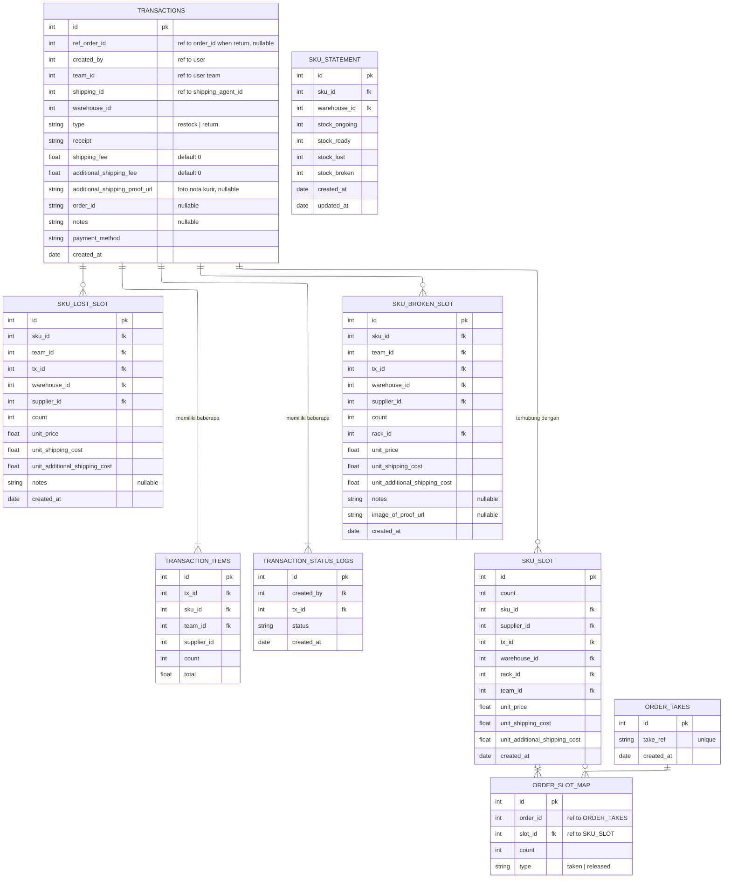

ERD di atas dibuat untuk mendukung mekanisme FIFO.
SKU_SLOT akan dibuat ketika barang sampai di gudang.

- TRANSACTIONS `type` berupa enum `(restock | return)`.
- TRANSACTIONS `order_id` adalah order id untuk restock bukan order atau ref ke order / outbound tertentu.
- TRANSACTIONS `ref_order_id` merujuk ke id pesanan yang retur.

### SKU_STATEMENT

Table ini `UNIQUE (sku_id, warehouse_id)`, jika kombinasi keduanya belum ada maka buat baru, jika sudah ada maka tambahkan nilai nya.
baris statement selalu ditulis urut `sku_id`.
Table ini bersifat statement artinya dia bertujuan agar kita gampang menyimpulkan kondisi suatu SKU, dia bisa saja miss dalam perhitungan saat proses `restock`, `order`, ataupun `order`, maka dari itu saya berencana mentrigger kalkulasi ulang setiap tengah malam untuk merekonsiliasi statement, bisa juga ada fungsi untuk "force reconcile" yang bisa di tekan user untuk memicu reconcile, tapi saya ingin ketika force reconcile di tekan saat jam kerja berikan user warning.

---

> Todo mekanisme `adjustment`, sedang saya pikirkan dulu.
