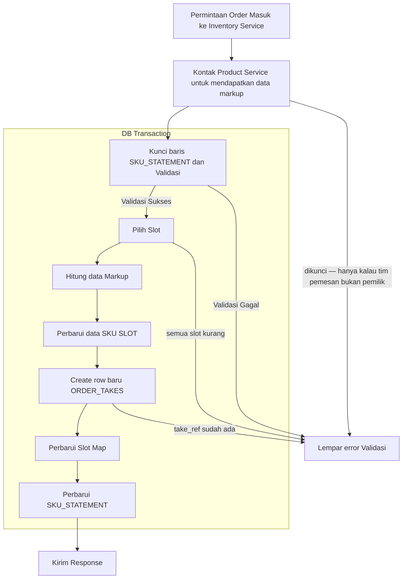
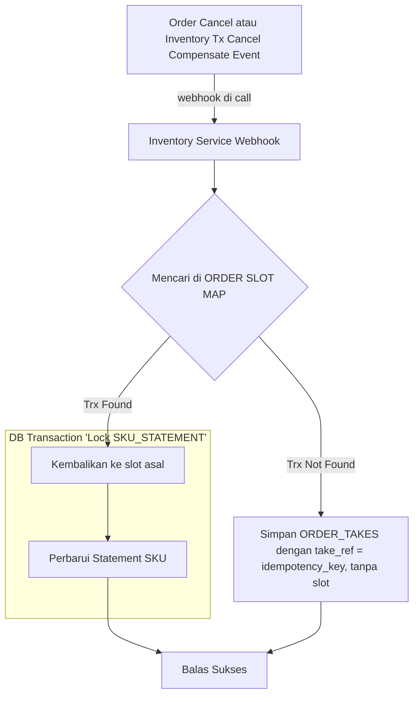

# Alur Order Creation

## Ketika Order Dibuat

## Referensi Proses

- **Permintaan Order Masuk ke Inventory Service**

    Berasal dari Order Service saat order creation proses, membawa data dengan schema `OrderTransactionCreateRequest`

- **Kunci baris SKU_STATEMENT dan Validasi**

    Kunci `SKU_STATEMENT` setiap item di gudang permintaan, urut `sku_id`. Lalu per item:
    - (1) `stock_ready ≥ qty`
    - (2) kalau tim pemesan bukan pemilik: `stock_ready` − `qty` ≥ `reserved_stock`. Satu item gagal, semua ditolak.

- **Lempar error Validasi**

    Tutup DB transaction kemudian lempar error validasi gagal misalnya ketika jumlah count tidak cukup.

- **Kontak Product Service untuk mendapatkan data markup**

    Hubungi Product Service untuk mendapatkan tim pemilik, `cross_markup_bps`, `cross_locked` dan `reserved_stock`. Di sini hanya `cross_locked` yang diperiksa: kalau tim pemesan bukan pemilik dan produknya dikunci, tolak. `reserved_stock` dibawa ke langkah kunci.

- **Hitung data Markup**

    Data yang dikembalikan Product service diolah untuk mendapatkan data yang diinginkan oleh `OrderTransactionCreateResponse`.

- **Perbarui data SKU SLOT**

    Kurangi `count` pada SKU Slot terkait.

- **Perbarui SKU_STATEMENT**

    Update statement kurangi stock ready kemudian Tutup transaksi Database.

- **Kirim Response**

    Kembalikan `OrderTransactionCreateResponse` ke order service dengan data yang sudah dikalkulasi. Isi `transaction_id` (wajib isi bukan optional) dengan `ORDER_TAKES` id, ini berguna ketika order cancel, saat cancel Order service akan mengirim `transaction_id` yang mereference ke id `order_takes` dan `idempotency_key`.

- **Pilih Slot**

    Pemilihan Slot diurutkan dari `created_at tertua`, jika tidak mencukupi maka cari slot lain tapi tetap urutan dari yang tertua untuk FIFO. Tentunya cocokan juga gudang nya. kalau semua slot kurang, seluruh take gagal.

- **Perbarui Slot Map**

    Catat ke tabel `ORDER_SLOT_MAP` terkait dengan item apa saja yang diorder, kemudian tandai dengan `taken`

- **Create row baru ORDER_TAKES**

    Buat row baru order di tabel `ORDER_TAKES`, yang nantinya ID nya akan digunakan di `ORDER_SLOT_MAP`, `take_ref` berasal dari `OrderTransactionCreateRequest.idempotency_key`. kalau take_ref sudah ada, seluruh take gagal, lempar error.

## Ketika Cancel Order dikirim ke Service ini

Service ini menyediakan webhook yang digunakan ketika `Order Cancel atau Inventory Tx Cancel Compensate Event`, dia akan mengirim `idempotency_key` dan `transaction_id` (jika ada), kemudian keduanya digunakan untuk mencari ke table `ORDER_SLOT_MAP` guna untuk mengembalikan stok ke SLOT-nya.

Berikut flow lengkap ketika order dibatalkan:

## Referensi Proses

- **Order Cancel atau Inventory Tx Cancel Compensate Event**

    Event ini terjadi saat Order Cancel (user batal) atau Compensate (create gagal). Event akan memanggil webhook service inventory.

- **Inventory Service Webhook**

    Webhook yang tersedia dalam service ini untuk menangani event dari `Order Service`. Event cancel akan membawa `transaction_id` (optional) dan `idempotency_key` == `ORDER_TAKES.take_ref`.

- **Mencari di ORDER SLOT MAP**

    Cari `transaction_id` (optional) atau `idempotency_key` terkait, di table `ORDER_SLOT_MAP`.

- **Kembalikan ke slot asal**

    Kembalikan stock ke SLOT asalnya, disini slot sudah tersimpan di table `ORDER_SLOT_MAP` dengan column `slot_id`, kemudian ubah `taken` → `released` hanya yang masih `taken`, kembalikan hanya baris yang berubah.

- **Perbarui Statement SKU**

    kembalikan count-nya, stock ready += stock yang batal.
