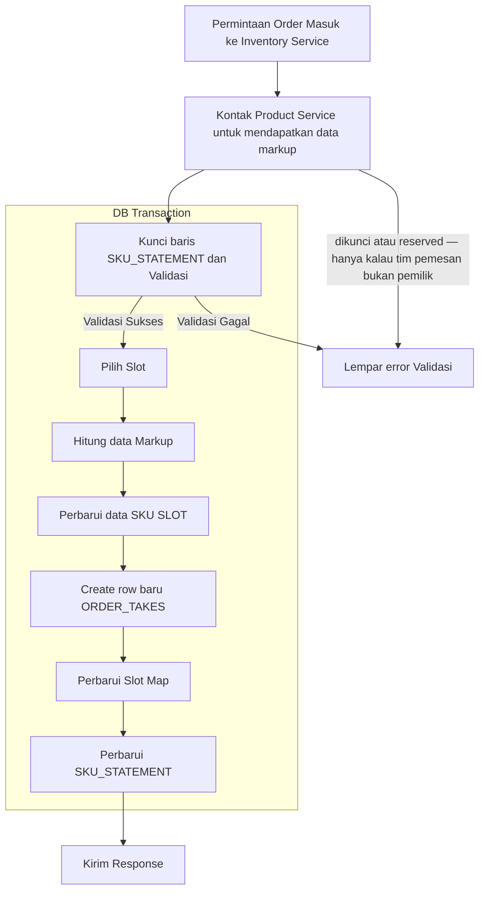

# Alur Order Creation

## Ketika Order Dibuat

## Referensi Proses

- **Permintaan Order Masuk ke Inventory Service**

    Berasal dari Order Service saat order creation proses, membawa data dengan schema `OrderTransactionCreateRequest`

- **Kunci baris SKU_STATEMENT dan Validasi**

    `OrderTransactionCreateRequest` membawa data `items` yang berisi `product_id` dan `count`, di sini kunci SKU_STATEMENT dengan `product_id == sku_id` terkait, kemudian validasi atau hitung apakah order bisa dilanjutkan dengan mempertimbangkan count nya.

- **Lempar error Validasi**

    Tutup DB transaction kemudian lempar error validasi gagal misalnya ketika jumlah count tidak cukup.

- **Kontak Product Service untuk mendapatkan data markup**

    Hubungi Product Service untuk mendapatkan data-data yang bakalan digunakan untuk proses perhitungan.

- **Hitung data Markup**

    Data yang dikembalikan Product service diolah untuk mendapatkan data yang diinginkan oleh `OrderTransactionCreateResponse`.

- **Perbarui data SKU SLOT**

    Kurangi `count` pada SKU Slot terkait.

- **Perbarui SKU_STATEMENT**

    Update statement kurangi stock ready kemudian Tutup transaksi Database.

- **Kirim Response**

    Kembalikan `OrderTransactionCreateResponse` ke order service dengan data yang sudah dikalkulasi. Isi `transaction_id` dengan `ORDER_TAKES` id, ini berguna ketika order cancel, saat cancel Order service akan mengirim transaction_id yang mereference ke id `order_takes`

- **Pilih Slot**

    Pemilihan Slot diurutkan dari `created_at tertua`, jika tidak mencukupi maka cari slot lain tapi tetap urutan dari yang tertua untuk FIFO. Tentunya cocokan juga gudang nya.

- **Perbarui Slot Map**

    Catat ke tabel `ORDER_SLOT_MAP` terkait dengan item apa saja yang diorder, kemudian tandai dengan `taken`

- **Create row baru ORDER_TAKES**

    Buat row baru order di tabel `ORDER_TAKES`, yang nantinya ID nya akan digunakan di `ORDER_SLOT_MAP`
