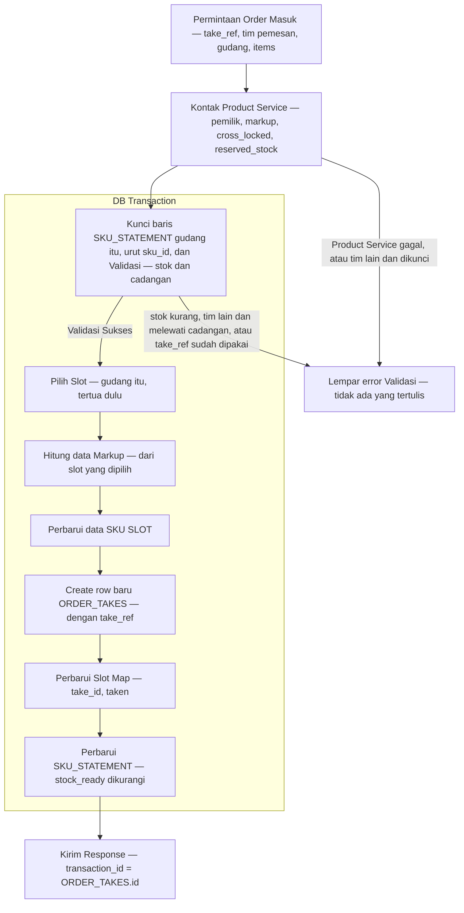
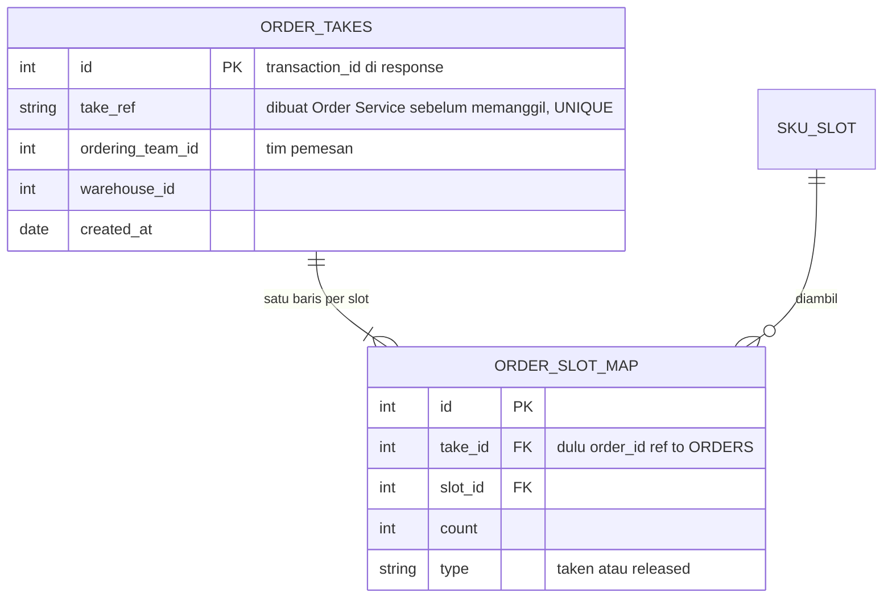
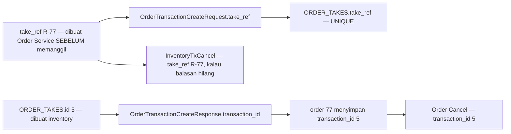
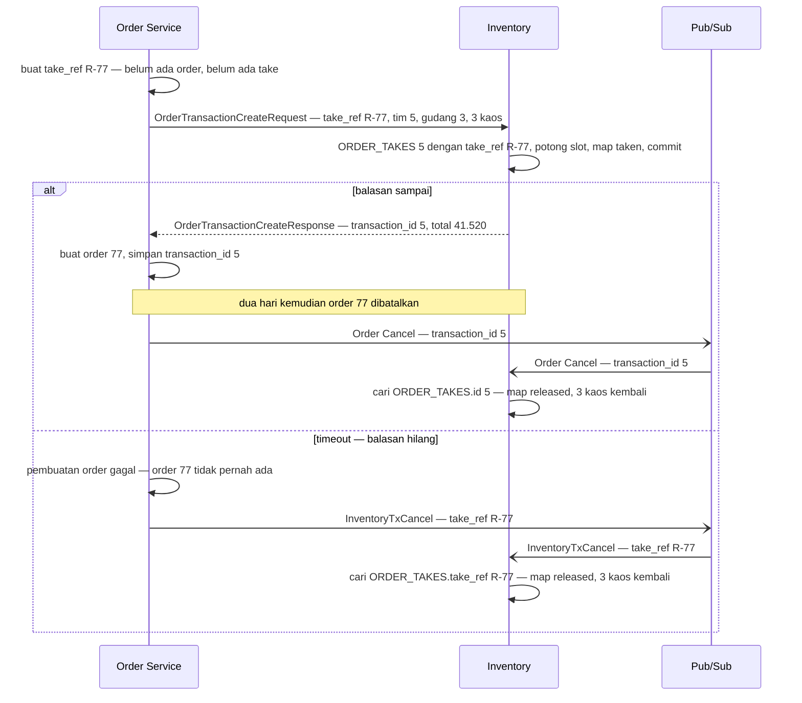
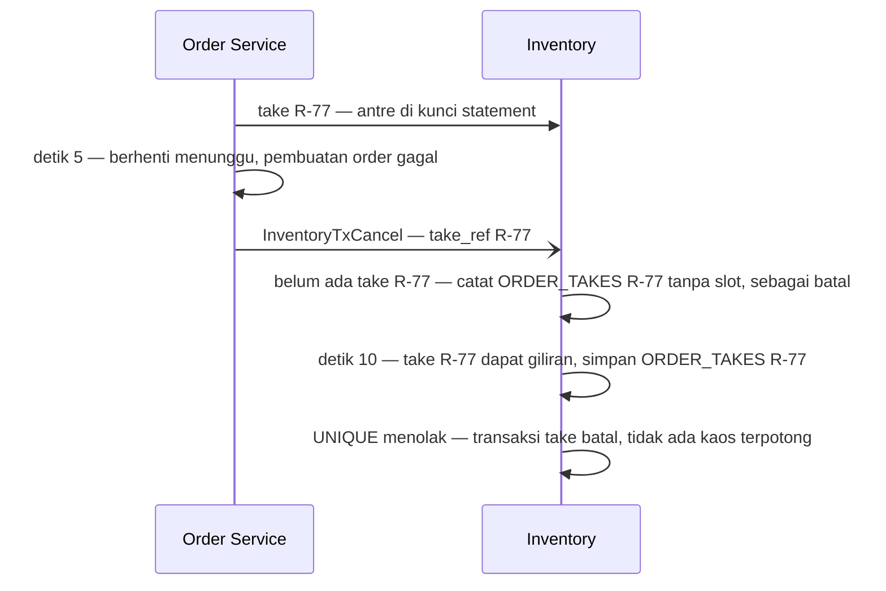
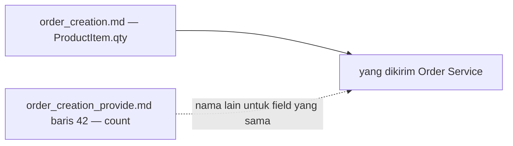

# Clarity — `stock_thoni/order_creation_provide.md`

Kritik dan pertanyaan untuk [order_creation_provide.md](./order_creation_provide.md) — alur take saat order dibuat.
**Dokumen itu milik Anda; file ini milik saya.** Poin yang sudah dijawab **dihapus**. Keputusan dicatat di
[context_decision.md](./context_decision.md), sama seperti restock; pertanyaan tentang ERD tetap di
[context_clarify.md](./context_clarify.md).

> **2026-10-12 13:39 — koreksi saya.** Pemilik: *"saat flow ini berjalan kita belum ada `order_id` dari order service"*.
> Benar — di [order_creation.md](../order/order_creation.md) take dipanggil **sebelum** baris order dibuat. Saran
> *`ORDER_TAKES.order_id`* tidak bisa dijalankan; diganti: rujukan yang dibuat Order Service **sebelum** memanggil —
> [timeout-tanpa-rujukan](#critique) (dulu *timeout-tanpa-rujukan*).
>
> **2026-10-12 13:36** — `ORDERS` menjadi `ORDER_TAKES`; response mengisi `transaction_id` dengan id-nya, dan Order
> Service mengirimnya kembali saat order dibatalkan (baris 66). ✅ Dicatat:
> [take-dirujuk-lewat-transaction-id](./context_decision.md#take-dirujuk-lewat-transaction-id) (berbeda dari saran saya,
> diterima untuk pembatalan biasa). Selesai: *transaction-id-tanpa-transaksi*; *orders-tanpa-order-asli* menyempit menjadi
> [timeout-tanpa-rujukan](#critique). ⚠ Garis relasi di [model.md](./model.md) baris 17 masih `ORDERS`
> ([relasi-masih-orders](./context_clarify.md#relasi-masih-orders)).
>
> **2026-10-12 13:15** — Product Service kini **sebelum** kotak; slot dicocokkan gudangnya; statement *"kurangi stock
> ready"*; penolakan *"hanya kalau tim pemesan bukan pemilik"*; dan langkah baru *Create row baru ORDERS* — tabel `ORDERS`
> di ERD, id-nya dipakai `ORDER_SLOT_MAP`. ✅ Dicatat:
> [product-service-dibaca-sebelum-kunci](./context_decision.md#product-service-dibaca-sebelum-kunci) ·
> [take-punya-baris-kepala-di-inventory](./context_decision.md#take-punya-baris-kepala-di-inventory), dan catatan di tiga
> keputusan lain. Selesai: *product-service-di-dalam-kunci*, *statement-tanpa-angka*. ⛔ 🆕
> [orders-tanpa-order-asli](#critique) — pembatalan tidak bisa menemukan take-nya · [cadangan-diperiksa-di-luar-kunci](#critique).
>
> **2026-10-12 12:32–12:46** — ✅ [count-slot-adalah-sisa](./context_decision.md#count-slot-adalah-sisa) ·
> [take-kunci-statement-lalu-periksa-stok](./context_decision.md#take-kunci-statement-lalu-periksa-stok) ·
> [markup-dibaca-dari-product-service-saat-take](./context_decision.md#markup-dibaca-dari-product-service-saat-take) ·
> [slot-dipilih-tertua-dulu](./context_decision.md#slot-dipilih-tertua-dulu) ·
> [slot-map-ditandai-taken-atau-released](./context_decision.md#slot-map-ditandai-taken-atau-released) ·
> [silang-ditolak-kalau-dikunci-atau-melewati-cadangan](./context_decision.md#silang-ditolak-kalau-dikunci-atau-melewati-cadangan).
>
> ⏸ **Belum ditulis, tidak ditanyakan dulu:** pengembalian stok saat order batal dan saat `InventoryTxCancel`; retur.

---

## Uji alur

| langkah | penilaian |
| --- | --- |
| Permintaan Order Masuk | ✅ dari Order Service, `OrderTransactionCreateRequest` · ⛔ belum membawa tim pemesan dan rujukan take (`take_ref`) ([timeout-tanpa-rujukan](#critique) · [tim-pemesan-tidak-dikirim](#critique)) |
| Kontak Product Service | ✅ sebelum kotak ([product-service-dibaca-sebelum-kunci](./context_decision.md#product-service-dibaca-sebelum-kunci)) · ✅ dikunci → ditolak, hanya untuk tim lain · ⛔ cadangan dibandingkan di sini, di luar kunci ([cadangan-diperiksa-di-luar-kunci](#critique)) |
| Kunci baris SKU_STATEMENT dan Validasi | ✅ kunci dulu, baru periksa ([take-kunci-statement-lalu-periksa-stok](./context_decision.md#take-kunci-statement-lalu-periksa-stok)) · ⚠ gudang dan angkanya belum disebut ([validasi-belum-menyebut-angka](#critique)) |
| Lempar error Validasi | ✅ transaksi DB ditutup, tidak ada yang tertulis |
| Pilih Slot | ✅ tertua dulu, di gudangnya ([slot-dipilih-tertua-dulu](./context_decision.md#slot-dipilih-tertua-dulu)) |
| Hitung data Markup | ✅ sesudah slot dipilih |
| Perbarui data SKU SLOT | ✅ `count` = sisa ([count-slot-adalah-sisa](./context_decision.md#count-slot-adalah-sisa)) |
| Create row baru ORDER_TAKES | ✅ take punya baris kepala, namanya kini `ORDER_TAKES` ([take-punya-baris-kepala-di-inventory](./context_decision.md#take-punya-baris-kepala-di-inventory)) · ⛔ tanpa id order — kasus timeout ([timeout-tanpa-rujukan](#critique)) |
| Perbarui Slot Map | ✅ bertanda `taken` ([slot-map-ditandai-taken-atau-released](./context_decision.md#slot-map-ditandai-taken-atau-released)) |
| Perbarui SKU_STATEMENT | ✅ `stock_ready` dikurangi (13:15) |
| Kirim Response | ✅ sesudah commit · ✅ `transaction_id` = `ORDER_TAKES.id`, dipakai pembatalan ([take-dirujuk-lewat-transaction-id](./context_decision.md#take-dirujuk-lewat-transaction-id)) |

## Critique

Diurutkan dari yang paling berbahaya.

| | Masalah | → Rekomendasi |
| --- | --- | --- |
| **timeout-tanpa-rujukan** | ⛔ 13:36: pembatalan **biasa** beres — Order Service menyimpan `transaction_id` 5 dan mengirimnya kembali (baris 66). Yang tersisa kasus yang justru alasan `InventoryTxCancel` ada: Order Service memanggil take → inventory membuat `ORDER_TAKES` #5, memotong 3 kaos, commit → balasannya **hilang** (timeout) → Order Service tidak pernah menerima 5 dan menggagalkan pembuatan order. 13:39: dan **id order pun belum ada**, karena baris order baru dibuat sesudah take. Jadi `InventoryTxCancel` tidak bisa menyebut apa pun yang dikenal inventory — 3 kaos tertahan `taken` **selamanya**. Pub/Sub menjamin pesannya sampai, bukan pesannya menyebut apa. 💬 13:4x, pemilik: *"tidak akan timeout karena saya pakai Pub/Sub"*. Pub/Sub hanya membawa **event** (Order Cancel, `InventoryTxCancel`); take sendiri adalah **panggilan langsung** yang ditunggu jawabannya — `total` dan `items` dibutuhkan untuk menghitung warehouse fee. Panggilan langsung bisa melewati batas waktu, dan alur ini sendiri yang membuatnya mungkin: di hari promo, 50 CS menjual kaos yang sama → take antre di kunci statement → yang ke-50 menunggu 10 detik → Order Service berhenti menunggu di detik 5 → inventory tetap commit di detik 10. | Order Service membuat **rujukan sebelum memanggil** — misalnya `take_ref`, sebuah UUID — dan mengirimnya di permintaan take. Inventory menyimpannya di **`ORDER_TAKES.take_ref`**, `UNIQUE`. Saat timeout, `InventoryTxCancel` membawa `take_ref` itu; pembatalan biasa tetap lewat `transaction_id`. Rujukannya dibuat di sisi order — sama dengan kritik di sana: [a-timed-out-take-cannot-be-named](../order/order_creation_clarify.md#critique). |
| **cadangan-diperiksa-di-luar-kunci** | ⛔ 13:15, baris 30: *"dikunci atau reserved"* ditolak di *Kontak Product Service* — **sebelum** statement dikunci. `cross_locked` aman di sini, karena tidak bergantung stok. Cadangan tidak: kaos tim 2 di gudang 3, `stock_ready` 8, `reserved_stock` 5. Tim 5 dan tim 7 masing-masing memesan 2 di detik yang sama: keduanya melihat 8 − 2 = 6, lolos; lalu keduanya antre di kunci dan sama-sama mengambil → tersisa **4**, di bawah cadangan 5 — padahal tidak satu pun yang ditolak. | Pisahkan: *dikunci* tetap di *Kontak Product Service*; *reserved* dibandingkan di *Kunci baris SKU_STATEMENT dan Validasi*, dengan angka cadangan yang sudah diambil sebelumnya. |
| **tim-pemesan-tidak-dikirim** | ⛔ Baris 30 kini *"hanya kalau tim pemesan bukan pemilik"* — benar. Tapi permintaannya (baris 38, `OrderTransactionCreateRequest`) hanya membawa `warehouse_id` dan `items`: **tim pemesan tidak ada**. Server tetap tidak bisa membedakan CS tim 2 yang menjual kaosnya sendiri dari CS tim 5 — aturannya tertulis, tapi tidak bisa dijalankan. | Tulis di baris 38 apa yang dibutuhkan inventory dari permintaan: **tim pemesan dan `take_ref`** ([timeout-tanpa-rujukan](#critique)). Kontraknya milik penulis [order_creation.md](../order/order_creation.md) — pertanyaannya sudah di sana: [which-team-is-team-id](../order/order_creation_clarify.md#which-team-is-team-id). |
| **validasi-belum-menyebut-angka** | Baris 42: kunci statement *"dengan `product_id == sku_id` terkait"* — di **semua** gudang, atau di gudang order? Lalu *"validasi atau hitung … dengan mempertimbangkan count nya"* — dibandingkan dengan apa? *Pilih Slot* kini menyebut gudang (baris 70); langkah ini belum. | (1) kunci statement SKU itu **di gudang permintaan**, urut `sku_id`; (2) `stock_ready` ≥ jumlah dipesan, per baris — satu baris kurang, **semua** ditolak; (3) untuk tim lain: sisa sesudah diambil ≥ cadangan ([cadangan-diperiksa-di-luar-kunci](#critique)). |

## Proposed Design

Semua simpul Anda — dengan cadangan pindah ke dalam kunci, dan baris kepalanya membawa order yang asli:

Contoh angka — CS **tim 5** memesan 3 kaos milik **tim 2** dari gudang 3, dengan `take_ref` **R-77**; `cross_markup_bps` 2000
(20%). Slot kaos di gudang 3: slot 1 (Januari, sisa 1, 11.200 per unit) dan slot 2 (Maret, sisa 50, 11.700 per unit).

| | slot 1 | slot 2 | baris order |
| --- | --- | --- | --- |
| diambil — tertua dulu | 1 | 2 | 3 |
| biaya — `unit_cost` × jumlah | 11.200 | 23.400 | **34.600** — `unit_cost` keterangan 11.533,33 |
| dengan markup 20% | 13.440 | 28.080 | **41.520** = `total` |
| `markup_total` | | | 41.520 − 34.600 = **6.920** |
| `SKU_SLOT.count` | 1 → 0 | 50 → 48 | |
| `ORDER_TAKES` | | | take #5 — `take_ref` R-77, tim 5, gudang 3 |
| `ORDER_SLOT_MAP` | take 5, slot 1, 1, `taken` | take 5, slot 2, 2, `taken` | |
| `SKU_STATEMENT` gudang 3 | | | `stock_ready` 51 → 48 |

| pembatalan | membawa | menemukan take #5 lewat |
| --- | --- | --- |
| Order Cancel, dua hari kemudian | `transaction_id` 5 | `ORDER_TAKES.id` — ✅ alur Anda |
| `InventoryTxCancel` sesudah timeout | `take_ref` R-77 — dibuat sebelum memanggil, jadi Order Service memilikinya | `ORDER_TAKES.take_ref` — ⛔ kolom ini belum ada |

### Rujukan take — dua jalan pembatalan

Siapa memegang id apa, dan kapan:

Urutannya, untuk kedua kemungkinan:

Tanpa `take_ref`, cabang kedua berhenti di langkah *cari*: Order Service tidak pernah menerima 5, dan order 77 tidak
pernah ada — 3 kaos tertahan `taken`.

### Kalau `take_ref` dipakai — yang berubah

| di mana | perubahan |
| --- | --- |
| [model.md](./model.md) `ORDER_TAKES` | `string take_ref` — `UNIQUE` |
| alur ini, *Permintaan Order Masuk* | permintaan membawa `take_ref` dan tim pemesan |
| alur ini, *Create row baru ORDER_TAKES* | simpan `take_ref`; kalau sudah ada, `UNIQUE` menolak — transaksi DB batal, tidak ada kaos terpotong |
| sisi order — [order_creation.md](../order/order_creation.md) | buat `take_ref` (UUID) **sebelum** memanggil take; kirim di permintaan dan di `InventoryTxCancel` |
| ⏸ alur pembatalan — belum ditulis | `InventoryTxCancel` mencari `ORDER_TAKES.take_ref`; **kalau belum ada, catat `take_ref` itu sebagai batal** — lihat di bawah |

Satu aturan untuk alur pembatalan nanti. Take ke-50 di hari promo masih antre di kunci statement saat Order Service sudah
berhenti menunggu — jadi `InventoryTxCancel` R-77 bisa tiba **sebelum** take R-77 selesai:

Kalau urutannya terbalik — take selesai lebih dulu — `InventoryTxCancel` menemukan take R-77 dan mengembalikannya. Dua
urutan, satu hasil: tidak ada kaos yang tertahan. Yang menjaganya hanya `UNIQUE` pada `take_ref`.

Satu penyederhanaan, kalau mau: Order Cancel juga boleh membawa `take_ref` — maka order cukup menyimpan **satu** rujukan,
dan `transaction_id` tinggal keterangan.

## Question

### reserved-stock-per-gudang-atau-total
`reserved_stock` milik product, sedangkan stok ada per gudang. Kaos tim 2, `reserved_stock` 5. Gudang 3 punya 4, gudang 5
punya 10. Tim 5 memesan 2 kaos dari gudang 3:

| dihitung | sisa sesudah diambil | hasil |
| --- | --- | --- |
| per gudang | 4 − 2 = 2, kurang dari 5 | ditolak |
| total semua gudang | 14 − 2 = 12, tidak kurang dari 5 | boleh — gudang 3 tinggal 2, padahal order tim 2 sendiri juga dikirim dari gudang 3 |

**→ Saran: per gudang.** Order dikirim dari satu gudang, jadi cadangan yang melindungi tim pemilik adalah cadangan di
gudang tempat ordernya akan dikirim — dan angka itu tepat yang dikunci di *Kunci baris SKU_STATEMENT*.

---

# Contradiction

## count-atau-qty

Baris 42: *"`items` yang berisi `product_id` dan `count`"* — sedangkan kontraknya di
[order_creation.md](../order/order_creation.md) baris 104–107: `ProductItem { product_id, qty }`. Field yang sama, dua nama.
Menurut saya yang benar kontraknya — `count` di model ini sudah berarti isi slot dan isi item restock.

**→ Rekomendasi:** baris 42 → `qty`. Supaya tidak terulang: nama field di alur disalin dari kontrak, bukan diketik ulang.

