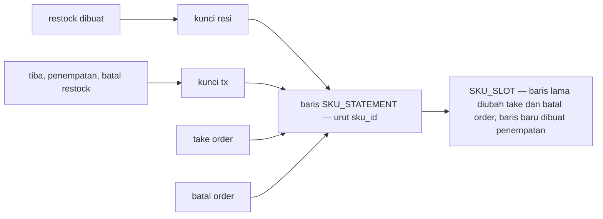
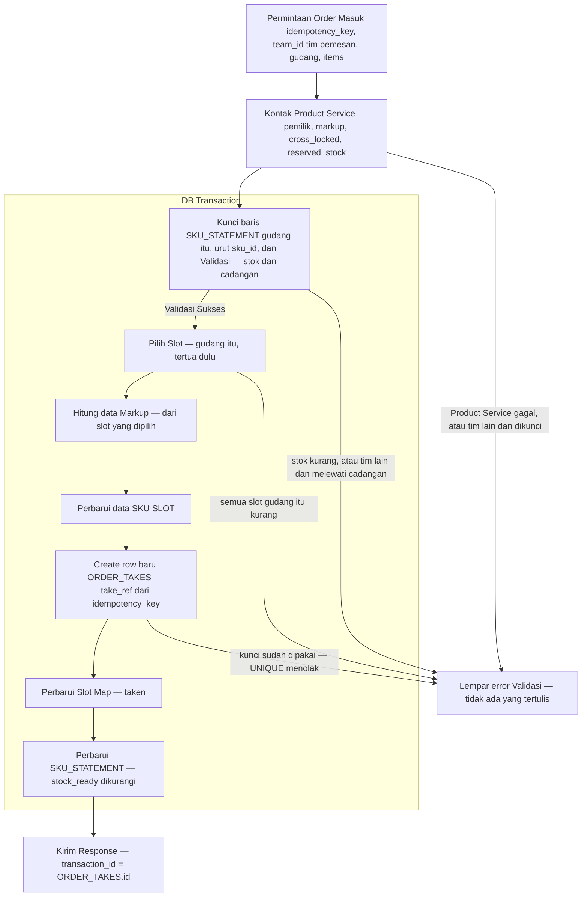
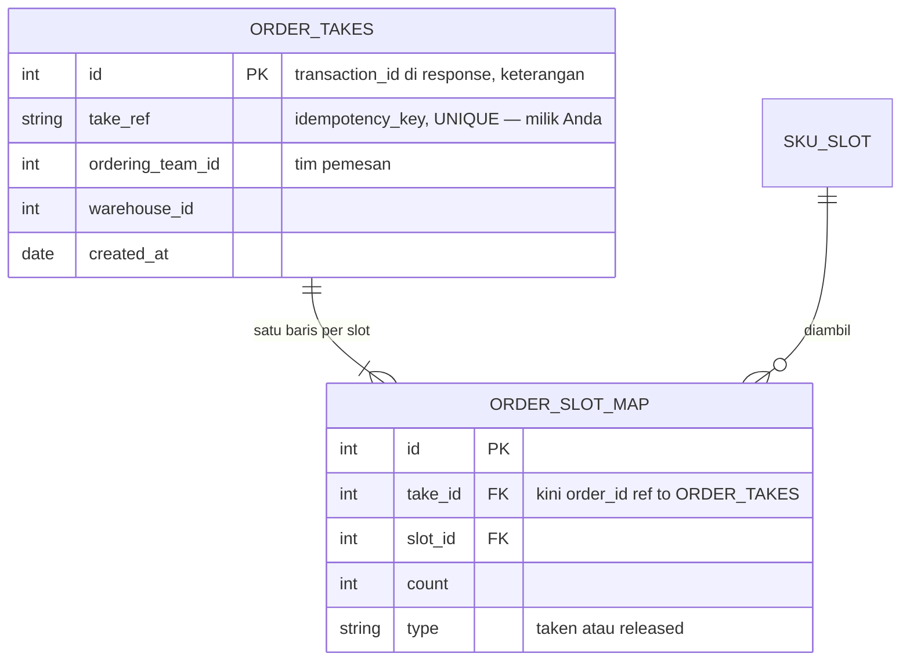
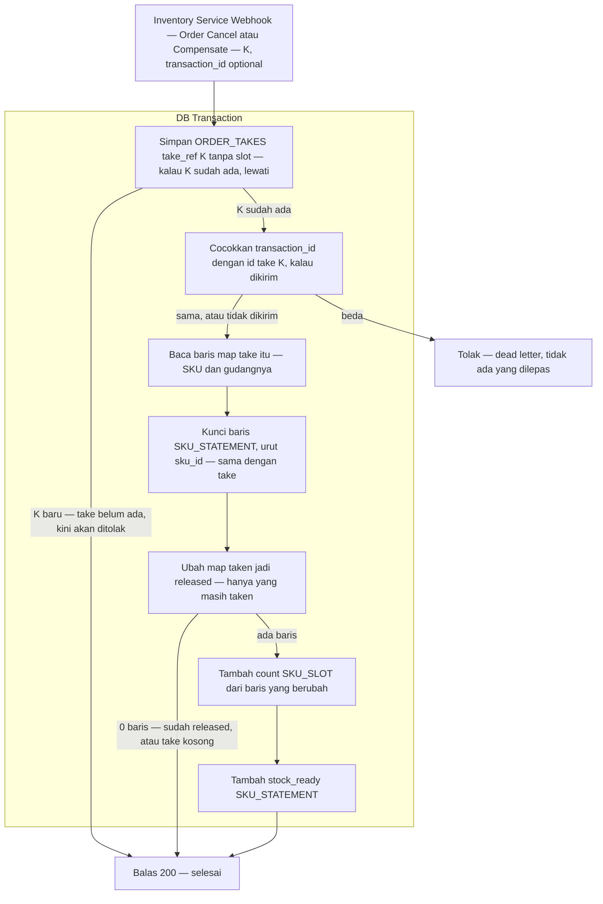
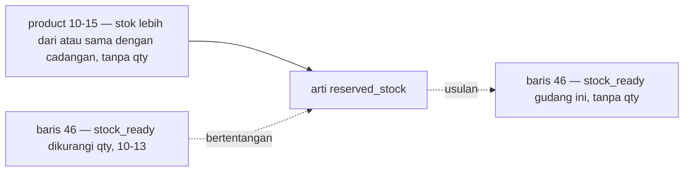
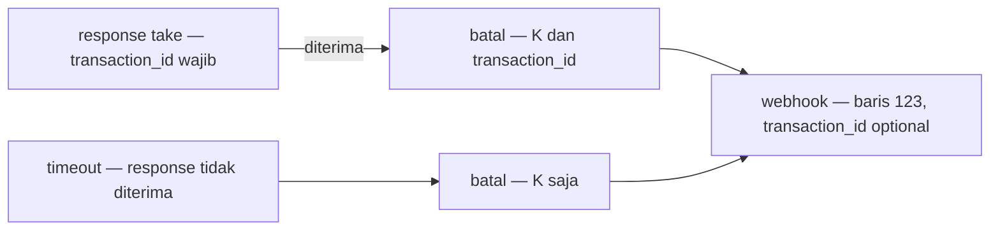

# Clarity — `stock_thoni/order_creation_provide.md`

Kritik dan pertanyaan untuk [order_creation_provide.md](./order_creation_provide.md) — alur take saat order dibuat.
**Dokumen itu milik Anda; file ini milik saya.** Poin yang sudah dijawab **dihapus**. Keputusan dicatat di
[context_decision.md](./context_decision.md), sama seperti restock; pertanyaan tentang ERD tetap di
[context_clarify.md](./context_clarify.md).

> **2026-10-17 (urutan slot)** — baris 74: *"diurutkan dari `created_at` tertua, lalu `id` terkecil kalau `created_at`-nya sama"*.
> ✅ [slot-seri-diurutkan-dengan-id](./context_decision.md#slot-seri-diurutkan-dengan-id) tertulis — kritik *urutan-slot-belum-menyebut-id* selesai.
>
> **2026-10-17 (uji sesudah merge `backup/inventory`)** — dokumen ini tidak berubah; yang berubah dokumen **order** dan
> **product**. ⚠ Catatan 10-17 sebelumnya (*"tidak ada kontradiksi"*) **dikoreksi**: 🆕 kontradiksi
> [cadangan-tanpa-qty](#cadangan-tanpa-qty) — product 10-15 mendefinisikan cadangan sebagai stok ≥ cadangan,
> **tanpa** `qty`. 🔄 10-17, atas permintaan Anda: bagian *"semua gudang"* dan *"order kembali ke `pending`"* **dilepas** —
> dasarnya inventory Heri. 🔄 Sisi order kini **menyimpan** `orders.transaction_id` —
> [diagram-tertinggal-dari-teks](#diagram-tertinggal-dari-teks) menyempit ke kompensasi saja. Selebihnya cocok:
> [Dampak perubahan restock](#dampak-perubahan-restock) kini juga memuat order dan product. Folder `business/inventory/` milik
> Heri **tidak** dipakai di sini — di branch `thoni` folder itu diabaikan, atas permintaan pemiliknya.
>
> **2026-10-17 (dampak restock)** — dokumen ini tidak berubah sejak 10-13 17:16; yang diuji adalah perubahan besar di
> [restock_flow.md](./restock_flow.md) 10-16 – 10-17 terhadap take dan pembatalan: [Dampak perubahan restock](#dampak-perubahan-restock).
> **Tidak ada kontradiksi, tidak ada pertanyaan baru.** Satu dampak: *kunci sku_statement* kini didefinisikan restock sebagai
> *"perintah tulis itu sendiri"* — cukup untuk restock yang hanya menambah, **tidak** cukup untuk take yang memeriksa dulu
> baru menulis: 🆕 [kunci-take-belum-terdefinisi](#critique).
>
> **2026-10-13 17:16** — baris 32 dan 82: take dengan `take_ref` yang sudah ada **gagal seluruhnya**; kotak baris 106 kini
> `take_ref = idempotency_key`; kotak baris 94 dan kalimat baris 86 kini menyebut **kedua** event. ✅ Catatan di
> [batal-tanpa-take-menyimpan-k](./context_decision.md#batal-tanpa-take-menyimpan-k) dan [dua-event-batal-satu-webhook](./context_decision.md#dua-event-batal-satu-webhook).
> [simpan-k-belum-dirinci](#critique) menyempit ke satu hal: simpan K yang bentrok. [diagram-tertinggal-dari-teks](#diagram-tertinggal-dari-teks)
> tinggal baris 70. Tidak ada ⛔ dan tidak ada pertanyaan terbuka — **tidak ada yang menghalangi alur retur**.
>
> **2026-10-13 17:07** — kotak *Simpan ORDER_TAKES … tanpa slot* (baris 105, 110), dan dua panah di diagram take (baris 29,
> 31). ✅ Dicatat: [batal-tanpa-take-menyimpan-k](./context_decision.md#batal-tanpa-take-menyimpan-k) — selesai: kontradiksi ⛔ *take-tidak-ketemu-tidak-disimpan*. **Dokumen ini kini
> tanpa ⛔.** ✅ Baris 69: `transaction_id` wajib di response — catatan di
> [take-dirujuk-lewat-transaction-id](./context_decision.md#take-dirujuk-lewat-transaction-id). 🆕 [simpan-k-belum-dirinci](#critique) — kotak baru itu
> hanya bekerja kalau take yang telat memang **gagal**, dan itu belum tertulis. [diagram-tertinggal-dari-teks](#diagram-tertinggal-dari-teks)
> menyempit: dua dari empat tempat diperbaiki.
>
> **2026-10-13 16:58** — sisi order baris 137: *"item owner team_id"* — `team_id` per baris adalah tim pemilik ([the-line-team-is-the-owner](../order/context_decision.md#the-line-team-is-the-owner)).
> Anda bertanya maksud ⛔ *Kunci (K) tidak disimpan saat take tidak ketemu* — contohnya kini ditulis ulang sebagai urutan
> waktu, detik demi detik: *take-tidak-ketemu-tidak-disimpan* (✅ [batal-tanpa-take-menyimpan-k](./context_decision.md#batal-tanpa-take-menyimpan-k)). Isinya tidak berubah.
>
> **2026-10-13 16:04** — [order_creation.md](../order/order_creation.md) baris 129: `uint64 team_id` di
> `OrderTransactionCreateRequest` — cara **A**. ✅ Dicatat: [tim-pemesan-dikirim-di-permintaan-take](./context_decision.md#tim-pemesan-dikirim-di-permintaan-take) — selesai: pertanyaan
> *sendiri-atau-silang-diketahui-dari-mana* dan kritik ⛔ *tim-pemesan-tidak-dikirim*. **Alur take kini tanpa ⛔ dan tanpa
> pertanyaan terbuka**; ⛔ yang tersisa ada di alur batal (*take-tidak-ketemu-tidak-disimpan* (✅ [batal-tanpa-take-menyimpan-k](./context_decision.md#batal-tanpa-take-menyimpan-k))).
> Nama `team_id` juga dipakai `TransactionItem` (baris 137) — untuk tim pemilik? Itu kontrak sisi order, jadi ditanyakan
> di sana: `which-team-is-team-id` (✅ 16:58 [the-line-team-is-the-owner](../order/context_decision.md#the-line-team-is-the-owner)).
>
> **2026-10-13 15:52** — dokumen Anda tersimpan 13:17, sebelum chat 13:18; dua suntingannya baru saya uji sekarang.
> Baris 72: *"kalau semua slot kurang, seluruh take gagal"*. ✅ Dicatat:
> [slot-kurang-seluruh-take-gagal](./context_decision.md#slot-kurang-seluruh-take-gagal) — selesai: *slot-kurang-sesudah-validasi*.
> Baris 116: *"Order Cancel (user batal) atau Compensate (create gagal)"*. ✅ Dicatat:
> [dua-event-batal-satu-webhook](./context_decision.md#dua-event-batal-satu-webhook) — selesai: kontradiksi
> *batal-user-lewat-event-mana*. Yang tersisa dari keduanya adalah diagram dan kalimat yang belum ikut berubah — sebabnya
> sama dengan kontradiksi cadangan, jadi digabung dan diberi nama baru: [diagram-tertinggal-dari-teks](#diagram-tertinggal-dari-teks)
> (dulu *diagram-dan-teks-beda-soal-cadangan*). Masih terbuka: *sendiri-atau-silang-diketahui-dari-mana* (✅ 16:04 [tim-pemesan-dikirim-di-permintaan-take](./context_decision.md#tim-pemesan-dikirim-di-permintaan-take)).
>
> **2026-10-13 13:18** — Anda, di chat: *"saya rasa tidak perlu teamid"*. Saya masih berpendapat inventory perlu tahu
> siapa yang memesan — tapi caranya bisa lain. Kritik *tim-pemesan-tidak-dikirim* kini pertanyaan: *sendiri-atau-silang-diketahui-dari-mana* (✅ 16:04 [tim-pemesan-dikirim-di-permintaan-take](./context_decision.md#tim-pemesan-dikirim-di-permintaan-take)).
>
> **2026-10-13 13:03** — baris 42–44 dan 52 ditulis ulang sesuai saran. ✅ Dicatat:
> [cadangan-dibandingkan-per-gudang-sesudah-kunci](./context_decision.md#cadangan-dibandingkan-per-gudang-sesudah-kunci) — selesai: *cadangan-diperiksa-di-luar-kunci* dan pertanyaan
> *reserved-stock-per-gudang-atau-total* · [validasi-take-per-item-semua-atau-tidak](./context_decision.md#validasi-take-per-item-semua-atau-tidak) — selesai: *validasi-belum-menyebut-angka*
> dan kontradiksi *count-atau-qty*. 🆕 kontradiksi *diagram-dan-teks-beda-soal-cadangan* (kini [diagram-tertinggal-dari-teks](#diagram-tertinggal-dari-teks)) —
> diagram baris 30 belum ikut. Belum diubah: jalur *Trx Not Found* masih tanpa menyimpan K.
>
> **2026-10-13 12:58** — baris 126: *"hanya yang masih `taken`, kembalikan hanya baris yang berubah"* · baris 101–106: *Trx Not
> Found → Balas Sukses*. ✅ Dicatat: [batal-hanya-mengembalikan-yang-masih-taken](./context_decision.md#batal-hanya-mengembalikan-yang-masih-taken)
> — selesai: *pelepasan-tidak-memeriksa-taken* · [take-tidak-ketemu-dibalas-sukses](./context_decision.md#take-tidak-ketemu-dibalas-sukses)
> — separuh. Kontradiksinya menyempit dan berganti nama (dulu *take-tidak-ketemu-dilempar-atau-disimpan*):
> *take-tidak-ketemu-tidak-disimpan* (✅ [batal-tanpa-take-menyimpan-k](./context_decision.md#batal-tanpa-take-menyimpan-k)) — kini justru kasus timeout yang terbuka.
>
> **2026-10-13 12:51** — kotak baris 96 kini *"DB Transaction 'Lock SKU_STATEMENT'"*, dan baris 126 *"kemudian tandai sebagai
> `released`"*. ✅ Dicatat: [batal-mengunci-statement-lebih-dulu](./context_decision.md#batal-mengunci-statement-lebih-dulu) —
> selesai: *pelepasan-tanpa-urutan-kunci* · [map-diubah-jadi-released](./context_decision.md#map-diubah-jadi-released) —
> menjawab *released-mengubah-baris-yang-sama*. *map-tidak-ditandai-released* menyempit menjadi
> [pelepasan-tidak-memeriksa-taken](#critique). Tetap: dua kontradiksi pembatalan.
>
> **2026-10-13 12:42** — alur pembatalan digambar (baris 86–108) dan dirinci (baris 112–130). ✅ Dicatat:
> [batal-mengembalikan-slot-dan-stock-ready](./context_decision.md#batal-mengembalikan-slot-dan-stock-ready) — selesai:
> *stock-ready-tidak-dikembalikan* · [transaction-id-opsional-di-event-batal](./context_decision.md#transaction-id-opsional-di-event-batal)
> — kontradiksi *pembatalan-lewat-id-atau-kunci* selesai, dan separuh
> [take-dirujuk-lewat-transaction-id](./context_decision.md#take-dirujuk-lewat-transaction-id) dibalik. *batal-sebelum-take* kini
> tertulis — *Lempar Error* — dan bertentangan dengan keputusan sisi order:
> *take-tidak-ketemu-tidak-disimpan* (✅ [batal-tanpa-take-menyimpan-k](./context_decision.md#batal-tanpa-take-menyimpan-k)). *order-cancel-hanya-di-judul* menjadi
> kontradiksi *batal-user-lewat-event-mana* (✅ [dua-event-batal-satu-webhook](./context_decision.md#dua-event-batal-satu-webhook)). 🆕 [map-tidak-ditandai-released](#critique).
>
> **2026-10-13 12:22** — [model.md](./model.md) baris 152: statement boleh meleset sampai tengah malam, lalu direkonsiliasi
> ([statement-direkonsiliasi-tiap-malam](./context_decision.md#statement-direkonsiliasi-tiap-malam)). Validasi take membaca
> statement, jadi 🆕 *slot-kurang-sesudah-validasi* (✅ [slot-kurang-seluruh-take-gagal](./context_decision.md#slot-kurang-seluruh-take-gagal)).
>
> **2026-10-12 17:22** — bagian baru, baris 80–82: *Ketika Cancel Order dikirim ke Service ini* — webhook kompensasi membawa
> K dan `transaction_id` jika ada, **keduanya** dipakai mencari take. Itu jawaban Anda untuk *siapa yang membaca
> `transaction_id`*; 17:26 *Order Created* tidak lagi membawanya — dicatat di sisi order:
> [the-take-id-rides-only-the-compensation](../order/context_decision.md#the-take-id-rides-only-the-compensation).
> 🆕 lima kritik di alur pembatalan, tiga ⛔ · 🆕 pertanyaan
> `released-mengubah-baris-yang-sama` (✅ [map-diubah-jadi-released](./context_decision.md#map-diubah-jadi-released)), diparkir sejak 12:46 sampai alur ini ditulis ·
> kontradiksi `pembatalan-lewat-id-atau-kunci` (✅ [transaction-id-opsional-di-event-batal](./context_decision.md#transaction-id-opsional-di-event-batal)) kini tinggal Order Cancel.
>
> **2026-10-12 17:12** — sisi order ([order_creation.md](../order/order_creation.md) baris 109, 111): *Order Created* kini
> membawa `transaction_id`, dan `InventoryTxCancel` membawanya *"kalau ada"*. Kontradiksi
> `pembatalan-lewat-id-atau-kunci` (✅ [transaction-id-opsional-di-event-batal](./context_decision.md#transaction-id-opsional-di-event-batal)) tetap: Order Cancel masih tanpa sumber `transaction_id`.
> Untuk apa id itu dikirim, ditanyakan di sisi order:
> `who-reads-the-transaction-id` (✅ [the-take-id-rides-only-the-compensation](../order/context_decision.md#the-take-id-rides-only-the-compensation)).
>
> **2026-10-12 16:43** — baris 66: Order Cancel kini mengirim `transaction_id` **dan `idempotency_key`**. ✅ Kuncinya ikut —
> sejalan dengan [every-release-goes-by-the-key](../order/context_decision.md#every-release-goes-by-the-key); catatan di
> [take-dirujuk-lewat-transaction-id](./context_decision.md#take-dirujuk-lewat-transaction-id). Kontradiksi
> `pembatalan-lewat-id-atau-kunci` (✅ [transaction-id-opsional-di-event-batal](./context_decision.md#transaction-id-opsional-di-event-batal)) menyempit: belum tertulis **mana yang dipakai mencari
> take**, dan sisi order tidak menyimpan `transaction_id`.
>
> **2026-10-12 16:38** — `OrderTransactionCreateRequest` kini membawa `idempotency_key`
> ([order_creation.md](../order/order_creation.md) baris 129), dan `ORDER_TAKES.take_ref` `"unique"` diisi darinya
> (baris 78). ✅ Dicatat: [take-ref-dari-idempotency-key](./context_decision.md#take-ref-dari-idempotency-key) — sejalan
> dengan keputusan sisi order: kunci dibuat frontend, satu take per kunci, dan **semua** pengembalian lewat kunci
> ([the-frontend-mints-the-idempotency-key](../order/context_decision.md#the-frontend-mints-the-idempotency-key) ·
> [inventory-takes-a-key-once](../order/context_decision.md#inventory-takes-a-key-once) ·
> [every-release-goes-by-the-key](../order/context_decision.md#every-release-goes-by-the-key)). Selesai:
> *timeout-tanpa-rujukan*. 🆕 kontradiksi `pembatalan-lewat-id-atau-kunci` (✅ [transaction-id-opsional-di-event-batal](./context_decision.md#transaction-id-opsional-di-event-batal)) — baris 66 masih
> mengirim Order Cancel lewat `transaction_id`.
>
> **2026-10-12 12:32–13:39** — ✅ [count-slot-adalah-sisa](./context_decision.md#count-slot-adalah-sisa) ·
> [take-kunci-statement-lalu-periksa-stok](./context_decision.md#take-kunci-statement-lalu-periksa-stok) ·
> [markup-dibaca-dari-product-service-saat-take](./context_decision.md#markup-dibaca-dari-product-service-saat-take) ·
> [slot-dipilih-tertua-dulu](./context_decision.md#slot-dipilih-tertua-dulu) ·
> [slot-map-ditandai-taken-atau-released](./context_decision.md#slot-map-ditandai-taken-atau-released) ·
> [silang-ditolak-kalau-dikunci-atau-melewati-cadangan](./context_decision.md#silang-ditolak-kalau-dikunci-atau-melewati-cadangan) ·
> [product-service-dibaca-sebelum-kunci](./context_decision.md#product-service-dibaca-sebelum-kunci) ·
> [take-punya-baris-kepala-di-inventory](./context_decision.md#take-punya-baris-kepala-di-inventory) ·
> [take-dirujuk-lewat-transaction-id](./context_decision.md#take-dirujuk-lewat-transaction-id) (⚠ kini bertentangan — lihat
> [Contradiction](#contradiction)). Koreksi saya 13:39: id order belum ada saat take, jadi rujukannya harus dibuat sebelum
> memanggil — kini `idempotency_key`.
>
> ⏸ **Belum ditulis, tidak ditanyakan dulu:** retur — 17:17 Anda mulai menulisnya; diuji setelah tertulis. Pembatalan sudah ditulis (baris 80–82) — usulannya di
> [Proposed Design](#pengembalian).

---

## Uji alur

Nomor baris dokumen versi 2026-10-13 17:16.

| langkah | penilaian |
| --- | --- |
| Permintaan Order Masuk (baris 38) | ✅ dari Order Service, `OrderTransactionCreateRequest` · ✅ membawa `idempotency_key` · ✅ membawa tim pemesan, `team_id` ([tim-pemesan-dikirim-di-permintaan-take](./context_decision.md#tim-pemesan-dikirim-di-permintaan-take)) |
| Kontak Product Service (baris 52) | ✅ sebelum kotak ([product-service-dibaca-sebelum-kunci](./context_decision.md#product-service-dibaca-sebelum-kunci)) · ✅ hanya `cross_locked`, untuk tim lain — teks dan diagram baris 31 sama |
| Kunci baris SKU_STATEMENT dan Validasi (baris 42) | ✅ kunci dulu, baru periksa ([take-kunci-statement-lalu-periksa-stok](./context_decision.md#take-kunci-statement-lalu-periksa-stok)) · ⚠ 10-17: cara menguncinya belum tertulis ([kunci-take-belum-terdefinisi](#critique)) · ✅ gudang permintaan, urut `sku_id`, `stock_ready` ≥ `qty`, semua atau tidak ([validasi-take-per-item-semua-atau-tidak](./context_decision.md#validasi-take-per-item-semua-atau-tidak)) · ⛔ 10-17: cadangan dengan `qty` — product tanpa `qty` ([cadangan-tanpa-qty](#cadangan-tanpa-qty)) |
| Lempar error Validasi (baris 48) | ✅ transaksi DB ditutup, tidak ada yang tertulis |
| Pilih Slot (baris 72) | ✅ tertua dulu, di gudangnya ([slot-dipilih-tertua-dulu](./context_decision.md#slot-dipilih-tertua-dulu)) · ✅ semua slot kurang → seluruh take gagal, juga di diagram baris 29 ([slot-kurang-seluruh-take-gagal](./context_decision.md#slot-kurang-seluruh-take-gagal)) |
| Hitung data Markup (baris 56) | ✅ sesudah slot dipilih |
| Perbarui data SKU SLOT (baris 60) | ✅ `count` = sisa ([count-slot-adalah-sisa](./context_decision.md#count-slot-adalah-sisa)) |
| Create row baru ORDER_TAKES (baris 80) | ✅ baris kepala take ([take-punya-baris-kepala-di-inventory](./context_decision.md#take-punya-baris-kepala-di-inventory)) · ✅ `take_ref` dari `idempotency_key`, `UNIQUE` ([take-ref-dari-idempotency-key](./context_decision.md#take-ref-dari-idempotency-key)) · ✅ `take_ref` sudah ada → seluruh take gagal, baris 32 dan 82 (17:16) · ⚠ dua nama untuk satu kunci ([dua-nama-untuk-satu-kunci](#critique)) |
| Perbarui Slot Map (baris 76) | ✅ bertanda `taken` ([slot-map-ditandai-taken-atau-released](./context_decision.md#slot-map-ditandai-taken-atau-released)) |
| Perbarui SKU_STATEMENT (baris 64) | ✅ `stock_ready` dikurangi |
| Kirim Response (baris 68) | ✅ sesudah commit · ✅ `transaction_id` = `ORDER_TAKES.id`, **wajib** di response · ⚠ baris 70: *"saat cancel Order service akan mengirim `transaction_id`"* — tanpa *kalau ada* ([diagram-tertinggal-dari-teks](#diagram-tertinggal-dari-teks)) |
| Event batal (baris 117) | ✅ Order Cancel dan Compensate, satu webhook ([dua-event-batal-satu-webhook](./context_decision.md#dua-event-batal-satu-webhook)) — kini juga di kotak baris 94 dan kalimat baris 86 (17:16) |
| Inventory Service Webhook (baris 121) | ✅ K selalu, `transaction_id` optional ([transaction-id-opsional-di-event-batal](./context_decision.md#transaction-id-opsional-di-event-batal)) |
| Mencari di ORDER SLOT MAP (baris 125) | ⚠ *atau* — dan K tidak ada di map ([keduanya-dipakai-bagaimana](#critique)) · ✅ yang masih `taken` saja ([batal-hanya-mengembalikan-yang-masih-taken](./context_decision.md#batal-hanya-mengembalikan-yang-masih-taken)) |
| Trx Not Found (baris 106, 111) | ✅ tidak ke dead letter ([take-tidak-ketemu-dibalas-sukses](./context_decision.md#take-tidak-ketemu-dibalas-sukses)) · ✅ K disimpan, `take_ref = idempotency_key`, tanpa slot ([batal-tanpa-take-menyimpan-k](./context_decision.md#batal-tanpa-take-menyimpan-k)) · ⚠ simpan yang bentrok belum tertulis, belum ada Referensi Proses ([simpan-k-belum-dirinci](#critique)) |
| Kembalikan ke slot asal (baris 129) | ✅ dari `slot_id` di map · ✅ statement dikunci lebih dulu — judul kotak baris 100 ([batal-mengunci-statement-lebih-dulu](./context_decision.md#batal-mengunci-statement-lebih-dulu)) · ✅ ditandai `released` ([map-diubah-jadi-released](./context_decision.md#map-diubah-jadi-released)) · ✅ kiriman kedua tidak mengembalikan apa pun |
| Perbarui Statement SKU (baris 133) | ✅ `stock_ready` dikembalikan, di transaksi yang sama ([batal-mengembalikan-slot-dan-stock-ready](./context_decision.md#batal-mengembalikan-slot-dan-stock-ready)) |

## Dampak perubahan restock

Setiap perubahan [restock_flow.md](./restock_flow.md) 10-16 – 10-17, terhadap take dan pembatalan order:

| perubahan di restock | dampak ke dokumen ini |
| --- | --- |
| status `arrived` — tiba dulu, baru ditempatkan ([paket-tiba-ditandai-sebelum-penempatan](./context_decision.md#paket-tiba-ditandai-sebelum-penempatan)) | ✅ tidak ada — take hanya membaca `stock_ready`, dan kaos yang tiba tapi belum di rak tetap di `stock_ongoing`: tidak bisa dijual sebelum ada di rak |
| statement tidak berubah saat tiba ([statement-tidak-berubah-saat-tiba](./context_decision.md#statement-tidak-berubah-saat-tiba)) | ✅ tidak ada — `stock_ready` naik hanya saat penempatan, bersama slot barunya, di satu transaksi |
| *kunci tx* untuk ganti status ([ganti-status-dikunci-per-transaksi](./context_decision.md#ganti-status-dikunci-per-transaksi)) | ✅ tidak ada — take tidak pernah mengambil kunci itu |
| statement dikunci oleh barisnya sendiri ([statement-dikunci-oleh-barisnya-sendiri](./context_decision.md#statement-dikunci-oleh-barisnya-sendiri)) | ⚠ take memakai baris yang sama, tapi memeriksa dulu baru menulis — [kunci-take-belum-terdefinisi](#critique) |
| scope `warehouse_id` di kiriman staff gudang ([gudang-dikirim-sebagai-scope-lalu-dicocokkan](./context_decision.md#gudang-dikirim-sebagai-scope-lalu-dicocokkan)) | ✅ tidak ada — take dipanggil Order Service, bukan staff gudang |
| Product Service hanya ditanya pemiliknya saat restock | ✅ tidak ada — take tetap membaca markup, `cross_locked` dan `reserved_stock` ([markup-dibaca-dari-product-service-saat-take](./context_decision.md#markup-dibaca-dari-product-service-saat-take)) |
| order: take satu transaksi inventory lintas pemilik ([an-order-is-one-inventory-transaction](../order/context_decision.md#an-order-is-one-inventory-transaction)) | ✅ satu `ORDER_TAKES` per take, satu `transaction_id` |
| order: kunci yang sudah dipakai ditolak ([the-order-refuses-a-used-key](../order/context_decision.md#the-order-refuses-a-used-key)) | ✅ `take_ref` `UNIQUE`, dan K disimpan saat batal datang lebih dulu |
| order: `orders.transaction_id` kini disimpan saat create ([an-order-is-one-inventory-transaction](../order/context_decision.md#an-order-is-one-inventory-transaction)) | 🔄 Order Cancel **bisa** membawa id take; hanya kompensasi yang mungkin tanpa — [diagram-tertinggal-dari-teks](#diagram-tertinggal-dari-teks) menyempit |
| order: baris response `owner_team_id` ([the-take-names-the-orderer-and-each-owner](../order/context_decision.md#the-take-names-the-orderer-and-each-owner)) | ✅ nama baru, isi sama — pemilik dari Product Service |
| order: event kompensasi `InventoryTxCancel` membawa K ([the-compensation-event-is-inventory-tx-cancel](../order/context_decision.md#the-compensation-event-is-inventory-tx-cancel)) | ✅ webhook yang sama · ⚠ belum dibangun: `OrderCancelled` di `proto/warehouse/events/v1/event.proto` belum membawa K, dan `InventoryTxCancel` belum ada — milik sisi order (*"the key is a field the event gains"*) |
| product: cadangan = stok ≥ cadangan, tanpa `qty` ([the-reserve-stops-other-teams-at-low-stock](../product/context_decision.md#the-reserve-stops-other-teams-at-low-stock)) | ⛔ [cadangan-tanpa-qty](#cadangan-tanpa-qty) — *"semua gudang"* tidak dipakai: dasarnya inventory Heri |

**Urutan kunci — tidak ada lingkaran.** Semua langkah mengunci baris statement urut `sku_id`. Restock mengambil kunci
advisory-nya **sebelum** statement; take dan pembatalan order tidak mengambil kunci advisory sama sekali. Penempatan menulis slot
sebelum statement, take sebaliknya — aman karena slot penempatan selalu **baris baru**
([slot-lahir-saat-barang-tiba](./context_decision.md#slot-lahir-saat-barang-tiba)), yang belum terlihat oleh take mana pun.

## Critique

Diurutkan dari yang paling berbahaya.

| | Masalah | → Rekomendasi |
| --- | --- | --- |
| **kunci-take-belum-terdefinisi** 🆕 | Baris 44: *"Kunci `SKU_STATEMENT` setiap item … urut `sku_id`. Lalu per item: `stock_ready ≥ qty`"* — **cara** menguncinya tidak ditulis. Sejak 10-17 restock mendefinisikan *kunci sku_statement* sebagai perintah tulis itu sendiri, tanpa advisory lock ([statement-dikunci-oleh-barisnya-sendiri](./context_decision.md#statement-dikunci-oleh-barisnya-sendiri)). Untuk restock itu cukup — restock hanya **menambah**. Take **memeriksa dulu**, baru menulis di akhir (baris 64). Kalau programmer membaca definisi restock: dua CS menjual 3 kaos terakhir di detik yang sama, keduanya membaca `stock_ready` 3 ≥ 3 — lolos — dan baru terkunci saat `UPDATE` di akhir: `stock_ready` −3, enam kaos terjual dari tiga. | Satu kalimat di baris 44: *"kunci dengan `select … from sku_statement where warehouse_id = $gudang and sku_id in (…) order by sku_id for update` — baris yang sama yang dikunci restock, tanpa advisory lock; baru sesudahnya validasi."* Pemeriksaan dan penulisan lalu terjadi di bawah kunci yang sama. |
| **simpan-k-belum-dirinci** | ⚠ ✅ 17:16: take yang telat kini gagal (baris 32, 82), dan kotak memakai `idempotency_key`. Tinggal **simpan K yang bentrok**: detik 5,1 webhook mencari K-77 — tidak ada; di milidetik yang sama take K-77 commit; simpan K-77 lalu ditolak `UNIQUE`. Kalau itu dibalas sukses, 3 kaos tertahan, 51 → 48. Jarang — hanya di milidetik yang sama — tapi akibatnya sama dengan ⛔ yang baru ditutup. | Satu Referensi Proses untuk kotak baris 106: *"**Simpan ORDER_TAKES tanpa slot** — buat `ORDER_TAKES` dengan `take_ref` = `idempotency_key`, tanpa baris map. Kalau ditolak `UNIQUE` — take-nya baru saja commit — ulangi dari *Mencari di ORDER SLOT MAP*."* |
| **keduanya-dipakai-bagaimana** | ⚠ 12:42, baris 122: *"Cari `transaction_id` (optional) **atau** `idempotency_key` terkait, di table `ORDER_SLOT_MAP`"* — jadi *salah satu*. Dua hal: K tidak ada di `ORDER_SLOT_MAP`, ia di `ORDER_TAKES.take_ref`. Dan dengan *atau*, jalan lewat K hanya berjalan saat id kosong — saat timeout, kasus paling jarang — sehingga rusaknya baru ketahuan saat flash sale. Kalau id yang dikirim salah (bug di sisi order), take tim lain yang dilepas. | Cari lewat K, **selalu** — kalau *take-tidak-ketemu-tidak-disimpan* (✅ [batal-tanpa-take-menyimpan-k](./context_decision.md#batal-tanpa-take-menyimpan-k)) diputuskan *disimpan*, setiap event memang mulai dari K. `transaction_id`, kalau ada, harus sama dengan id take itu; beda → tolak, tidak ada yang dilepas. *Dipindah dari sisi order, 10-12 17:22.* |
| **dua-nama-untuk-satu-kunci** | 🆕 16:38: kunci yang sama bernama `idempotency_key` di permintaan dan di `orders`, dan `take_ref` di `ORDER_TAKES`. Baris 78 menghubungkannya — tapi programmer yang mencari `idempotency_key` di inventory, misalnya saat menulis penerima `InventoryTxCancel`, tidak menemukan apa-apa. | Namai kolomnya `idempotency_key` juga. Kalau tetap `take_ref`, biarkan kalimat baris 78 — itu satu-satunya jembatannya. |

## Proposed Design

Semua simpul Anda — dengan panah yang belum ikut digambar ([diagram-tertinggal-dari-teks](#diagram-tertinggal-dari-teks)):

Contoh angka — CS **tim 5** memesan 3 kaos milik **tim 2** dari gudang 3, dengan kunci **K-77**; `cross_markup_bps` 2000
(20%). Slot kaos di gudang 3: slot 1 (Januari, sisa 1, 11.200 per unit) dan slot 2 (Maret, sisa 50, 11.700 per unit).

| | slot 1 | slot 2 | baris order |
| --- | --- | --- | --- |
| diambil — tertua dulu | 1 | 2 | 3 |
| biaya — `unit_cost` × jumlah | 11.200 | 23.400 | **34.600** — `unit_cost` keterangan 11.533,33 |
| dengan markup 20% | 13.440 | 28.080 | **41.520** = `total` |
| `markup_total` | | | 41.520 − 34.600 = **6.920** |
| `SKU_SLOT.count` | 1 → 0 | 50 → 48 | |
| `ORDER_TAKES` | | | take #5 — `take_ref` K-77, tim 5, gudang 3 |
| `ORDER_SLOT_MAP` | take 5, slot 1, 1, `taken` | take 5, slot 2, 2, `taken` | |
| `SKU_STATEMENT` gudang 3 | | | `stock_ready` 51 → 48 |

### Pengembalian

Alur Anda 12:42 (baris 86–108) dengan celah di [Critique](#critique) ditutup — satu webhook untuk *Order Cancel* dan
*Inventory Tx Cancel Compensate Event* ([every-release-goes-by-the-key](../order/context_decision.md#every-release-goes-by-the-key)):

Contoh angka — order 77 dibatalkan; take #5, K-77, mengambil 1 dari slot 1 dan 2 dari slot 2.

| | sebelum | kiriman pertama | kiriman kedua, detik yang sama |
| --- | --- | --- | --- |
| `ORDER_SLOT_MAP` take 5 | 2 baris `taken` | 2 baris `released` | antre di kunci, lalu 0 baris berubah |
| `SKU_SLOT` slot 1 · slot 2 | 0 · 48 | 1 · 50 | tetap 1 · 50 |
| `SKU_STATEMENT` gudang 3 `stock_ready` | 48 | 51 | tetap 51 |

| pembatalan K-77 tiba, take K-77 … | inventory |
| --- | --- |
| ada, `taken` | kembalikan slot **dan** `stock_ready`, tandai `released` |
| ada, sudah `released` | tidak melakukan apa-apa — event yang datang dua kali |
| **belum ada** — take masih antre di kunci statement | simpan `ORDER_TAKES` K-77 **tanpa slot**; take yang datang belakangan ditolak `UNIQUE`, tidak ada kaos terpotong |
| **tidak akan pernah ada** — take ditolak karena stok kurang | sama: simpan K-77 tanpa slot, balas sukses — bukan error, tidak masuk dead letter |
| ada, tapi `transaction_id` yang dikirim bukan 5 | tolak — tidak ada yang dilepas |

## Question

✅ *reserved-stock-per-gudang-atau-total* dijawab 13:03 — per gudang:
[cadangan-dibandingkan-per-gudang-sesudah-kunci](./context_decision.md#cadangan-dibandingkan-per-gudang-sesudah-kunci).

✅ *sendiri-atau-silang-diketahui-dari-mana* dijawab 16:04 — tim pemesan di permintaan, cara A:
[tim-pemesan-dikirim-di-permintaan-take](./context_decision.md#tim-pemesan-dikirim-di-permintaan-take).

Tidak ada pertanyaan terbuka di dokumen ini.

---

# Contradiction

## cadangan-tanpa-qty

**Contohnya.** Baris 46: *"kalau tim pemesan bukan pemilik: `stock_ready` − `qty` ≥ `reserved_stock`"*, per gudang permintaan,
sesudah kunci ([cadangan-dibandingkan-per-gudang-sesudah-kunci](./context_decision.md#cadangan-dibandingkan-per-gudang-sesudah-kunci), 10-13).
Pemilik product, 10-15 ([the-reserve-stops-other-teams-at-low-stock](../product/context_decision.md#the-reserve-stops-other-teams-at-low-stock)):
*"simple stock >= reserve"* — *"the quantity wanted — not counted"*. Arti `reserved_stock` milik product.

🔄 10-17, atas permintaan Anda: putusan product juga menyebut *"total semua gudang"* dan *"dicek sebelum transaksi"* — dua
bagian itu bersandar pada inventory Heri, jadi **tidak** dipakai di sini. Gudang dan kuncinya tetap putusan Anda.

Cadangan kaos tim 2 = 10. Tim 5 meminjam 3 dari gudang 3, yang punya 12:

| | hitungan | hasil |
| --- | --- | --- |
| product | 12 ≥ 10 | boleh — sisa 9 |
| baris 46 | 12 − 3 = 9 < 10 | ditolak |

**→ Rekomendasi: ikuti product untuk `qty`** — baris 46 → *"kalau tim pemesan bukan pemilik: `stock_ready` ≥ `reserved_stock`"*,
tetap per gudang permintaan dan tetap sesudah kunci. Kalau Anda ingin tetap dengan `qty`, itu permintaan ke pemilik
product, karena artinya cadangan berubah — bukan perubahan di sini.

## diagram-tertinggal-dari-teks

🔄 **2026-10-17 — menyempit.** Sisi order kini menyimpan `orders.transaction_id` saat create
([an-order-is-one-inventory-transaction](../order/context_decision.md#an-order-is-one-inventory-transaction)): order hanya ada kalau take
menjawab, jadi **Order Cancel** selalu bisa membawa id itu. Yang tetap tanpa id hanya **kompensasi** `InventoryTxCancel` —
create yang gagal karena timeout. Kalimat baris 70 kini salah hanya untuk kompensasi.

*Dulu `diagram-dan-teks-beda-soal-cadangan`; 15:52 digabung dengan sisa `batal-user-lewat-event-mana`. 17:07 dan 17:16:
diperbaiki di baris 29, 31, 86 dan 94.*

**Contohnya.** Tinggal satu kalimat. Baris 123: `transaction_id` *(optional)* — sedangkan baris 70: *"Isi `transaction_id`
(wajib isi bukan optional) … saat cancel Order service akan mengirim `transaction_id` … dan `idempotency_key`"*. *Wajib* ✅
benar untuk response. Tapi kalimat yang sama lanjut ke event batal tanpa *kalau ada* — dibaca seolah id selalu ikut saat
batal, padahal saat timeout (detik 5) response tidak pernah diterima, jadi Order Service tidak punya id-nya.

**→ Rekomendasi:** baris 70 → *"Isi `transaction_id` (wajib) dengan id `ORDER_TAKES`. Saat batal, Order Service mengirim
`idempotency_key`, dan `transaction_id` kalau response ini sempat diterima."* Supaya tidak terulang: setiap kali teks sebuah
langkah berubah, periksa juga panah yang keluar dari langkah itu, dan kalimat lain yang menyebut hal yang sama.

