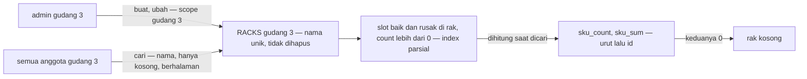

# Clarity — `stock_thoni/rack_flow.md`

Kritik dan pertanyaan untuk [rack_flow.md](./rack_flow.md). **Dokumen itu milik Anda; file ini milik saya.** Poin yang sudah
dijawab **dihapus**. Keputusan dicatat di [context_decision.md](./context_decision.md); tabel `RACKS` sendiri diuji di
[context_clarify](./context_clarify.md#uji-racks).

> **2026-10-19 (nama persis)** — chat: *"saya ikuti saranmu"*. ✅ Dicatat:
> [nama-persis-selalu-pertama](./context_decision.md#nama-persis-selalu-pertama) — kritik *nama-persis-tenggelam* selesai.
> **Nol pertanyaan, nol kritik.**
>
> **2026-10-19 (kunci untuk pencarian)** — chat: *"setuju dengan `rack_name_key` tapi hanya untuk pencarian"*; baris 25 kini *"nama"*.
> ✅ Dicatat: [nama-rak-dicari-lewat-kunci](./context_decision.md#nama-rak-dicari-lewat-kunci). Selesai: kritik
> *kode-tanpa-tanda-tidak-ketemu* dan kontradiksi *baris-25-masih-pg-trgm*.
>
> **2026-10-19 (sebelumnya)** — dicatat: [rak-tidak-bisa-dihapus](./context_decision.md#rak-tidak-bisa-dihapus) ·
> [rak-dibuat-diubah-admin-dicari-semua-anggota](./context_decision.md#rak-dibuat-diubah-admin-dicari-semua-anggota) ·
> [isi-rak-menjumlah-baik-dan-rusak](./context_decision.md#isi-rak-menjumlah-baik-dan-rusak) ·
> [urutan-rak-diakhiri-id](./context_decision.md#urutan-rak-diakhiri-id) ·
> [isi-rak-dihitung-dari-slot-saat-dicari](./context_decision.md#isi-rak-dihitung-dari-slot-saat-dicari) ·
> [nama-rak-dicari-tanpa-pg-trgm](./context_decision.md#nama-rak-dicari-tanpa-pg-trgm) ·
> [tanda-pisah-membedakan-nama-rak](./context_decision.md#tanda-pisah-membedakan-nama-rak). Semua yang berhubungan dengan query
> diuji di Postgres 17 lokal (di-rollback). Diuji terhadap putusan stock_thoni saja
> ([inventory-heri-diabaikan-di-thoni](./context_decision.md#inventory-heri-diabaikan-di-thoni)).

---

## Uji rack_flow.md

| baris | penilaian |
| --- | --- |
| 7, 28 — buat dan ubah hanya admin gudang | ✅ [rak-dibuat-diubah-admin-dicari-semua-anggota](./context_decision.md#rak-dibuat-diubah-admin-dicari-semua-anggota) |
| 8 — nama unik di satu gudang | ✅ [nama-rak-unik-per-gudang](./context_decision.md#nama-rak-unik-per-gudang) — `A-01`, `A01`, `a 01` tiga rak ([tanda-pisah-membedakan-nama-rak](./context_decision.md#tanda-pisah-membedakan-nama-rak)) |
| 9–10 — gambar boleh ada, boleh diganti | ✅ `RACKS.image_url` nullable |
| 11 — satu rak banyak `sku` | ✅ banyak slot per rak |
| 12 — rak tidak bisa dihapus | ✅ [rak-tidak-bisa-dihapus](./context_decision.md#rak-tidak-bisa-dihapus) |
| 17 — cari: semua anggota gudang, berhalaman | ✅ isi dihitung dari slot ([isi-rak-dihitung-dari-slot-saat-dicari](./context_decision.md#isi-rak-dihitung-dari-slot-saat-dicari)) |
| 19–22 — urutan diakhiri `id`; baik dan rusak dijumlah, slot 0 diabaikan | ✅ [urutan-rak-diakhiri-id](./context_decision.md#urutan-rak-diakhiri-id) · [isi-rak-menjumlah-baik-dan-rusak](./context_decision.md#isi-rak-menjumlah-baik-dan-rusak) |
| 25 — nama | ✅ dicocokkan lewat `rack_name_key`, hanya untuk pencarian ([nama-rak-dicari-lewat-kunci](./context_decision.md#nama-rak-dicari-lewat-kunci)) · nama persis pertama ([nama-persis-selalu-pertama](./context_decision.md#nama-persis-selalu-pertama)) |
| 26 — hanya rak yang kosong | ✅ kosong = `sku_count` 0, slot baik dan rusak — rak berisi barang rusak saja tidak kosong |

## Critique

Tidak ada kritik terbuka (uji 2026-10-19).

## Proposed Design

Tiga RPC baris 16–28, dengan nama urutan dan filter Anda:

```proto
message RackCreateRequest {
    option (warehouse.role_base.v1.request_policy) = { roles: [/* admin gudang */] };

    uint64          warehouse_id = 1 [(warehouse.role_base.v1.use_scope) = true];
    string          name = 2 [(buf.validate.field).string.min_len = 1];
    optional string image_url = 3;
}

message RackUpdateRequest {
    option (warehouse.role_base.v1.request_policy) = { roles: [/* admin gudang */] };

    uint64          warehouse_id = 1 [(warehouse.role_base.v1.use_scope) = true];
    uint64          rack_id = 2 [(buf.validate.field).uint64.gt = 0];
    optional string name = 3;
    optional string image_url = 4;
}

message RackSearchRequest {
    option (warehouse.role_base.v1.request_policy) = { roles: [/* semua anggota gudang */] };

    uint64                         warehouse_id = 1 [(warehouse.role_base.v1.use_scope) = true];
    string                         name = 2;         // saring: potongan nama, huruf besar, spasi, tanda pisah diabaikan; nama asli yang persis pertama; kosong = semua
    bool                           only_empty = 3;   // hanya rak kosong — sku_count 0
    RackSort                       sort = 4;         // selalu diakhiri id
    warehouse.common.v1.PageFilter page = 5;
}

enum RackSort {
    RACK_SORT_UNSPECIFIED = 0;
    RACK_SORT_NAME = 1;
    RACK_SORT_SKU_COUNT = 2;   // count(unique(sku)) — slot baik dan rusak, count lebih dari 0
    RACK_SORT_SKU_SUM = 3;     // jumlah unit — slot baik dan rusak, count lebih dari 0
    RACK_SORT_CREATED_AT = 4;
}

message RackSearchResponse {
    repeated Rack                  racks = 1;
    warehouse.common.v1.PageInfo   page_info = 2;
}

message Rack {
    uint64                    id = 1;
    string                    name = 2;
    optional string           image_url = 3;
    uint32                    sku_count = 4;
    uint64                    sku_sum = 5;
    google.protobuf.Timestamp created_at = 6;
}
```

SQL ini **sudah dijalankan** di Postgres 17 (satu transaksi, di-rollback). Hasilnya ada di tabel kritik di atas dan di
[isi-rak-dihitung-dari-slot-saat-dicari](./context_decision.md#isi-rak-dihitung-dari-slot-saat-dicari).

```sql
-- migrasi service — rack_name_key hanya untuk pencarian, bukan aturan unik
create function rack_name_key(t text) returns text immutable language sql
    as $$ select regexp_replace(lower(t), '[^a-z0-9]', '', 'g') $$;
create index on sku_slot        (warehouse_id, rack_id) where count > 0;
create index on sku_broken_slot (warehouse_id, rack_id) where count > 0;

-- cari rak: $1 gudang, $2 nama, $3 hanya kosong, $4 limit, $5 offset
with isi as (
    select rack_id, sku_id, count from sku_slot        where warehouse_id = $1 and count > 0
    union all
    select rack_id, sku_id, count from sku_broken_slot where warehouse_id = $1 and count > 0
)
select r.id, r.name, r.image_url, r.created_at,
       count(distinct i.sku_id)  as sku_count,                       -- baik dan rusak, satu sku dihitung sekali
       coalesce(sum(i.count), 0) as sku_sum
from racks r
left join isi i on i.rack_id = r.id
where r.warehouse_id = $1
  and ($2 = '' or rack_name_key(r.name) like '%' || rack_name_key($2) || '%')
group by r.id
having not $3 or count(i.rack_id) = 0                                -- hanya rak kosong
order by lower(r.name) = lower($2) desc,                             -- nama asli yang persis selalu pertama
         sku_sum desc, r.id                                          -- urut pilihan, id memecah seri
limit $4 offset $5;
```

Ubah rak memastikan raknya milik gudang yang dikirim — `rack.warehouse_id === payload.warehouseId` — pola yang sama dengan
[rak-dicocokkan-ke-gudang-transaksi](./context_decision.md#rak-dicocokkan-ke-gudang-transaksi).



## Question

Tidak ada pertanyaan terbuka di dokumen ini.

> ⏸ **Ditunda — tidak dihitung**, sampai ditulis:
> - label yang dipindai staff di rak (nama, atau kode tersendiri);
> - barang yang sudah diambil order (take mengurangi `count`, [order_creation_provide](./order_creation_provide.md) baris 62) tetapi
>   belum dikemas masih ada di rak secara fisik, padahal raknya sudah terhitung *kosong*. Ini menunggu langkah pengambilan barang
>   ditulis.

---

# Contradiction

**Tidak ada kontradiksi** (uji 2026-10-19). Baris 25 kini *"nama"*, sejalan dengan
[nama-rak-dicari-tanpa-pg-trgm](./context_decision.md#nama-rak-dicari-tanpa-pg-trgm) dan
[nama-rak-dicari-lewat-kunci](./context_decision.md#nama-rak-dicari-lewat-kunci).
