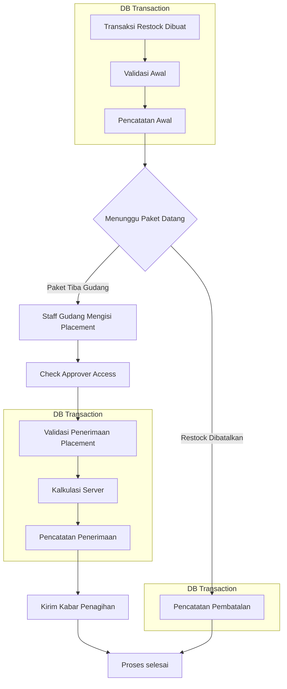

# Berikut adalah gambaran alur `restock`



## Referensi Proses

- **Transaksi Restock Dibuat**

    Customer Service atau Admin Tim membuat transaksi `restock`, data yang diisikan kurang lebih:

    ```proto
    message Sku {
        uint64 id = 1;
        uint64 team_id = 2;
    }

    message Item {
        Sku sku = 1;
        uint64 supplier_id = 2;
        uint64 count = 3;
        double total = 4; // total saat belanja exclude ongkir
    }

    message CreateRestockPayload {
        optional string order_id = 1;
        uint64 shipping_id = 2;
        uint64 warehouse_id = 3;
        uint64 team_id = 4;
        string receipt = 5;
        string payment_method = 6;
        double shipping_fee = 7;
        repeated Item items = 8;
    }
    ```

    Kunci baris `TRANSACTIONS` dengan resi yang sama & `SKU_STATEMENT`, periksa resi tidak sedang `ongoing` atau `approved` (kalau dipakai, tolak), kemudian catat.

- **Validasi Awal**

    Server memastikan setiap `Sku.team_id` dalam `CreateRestockPayload.items` sama dengan `CreateRestockPayload.team_id`, jika ada salah satu yang berbeda maka transaksi akan ditolak dan mengembalikan Error.

    Untuk sementara proses validasi cukup seperti ini, jika memungkinkan kedepannya akan meminta data valid dari `Product Service`.

- **Pencatatan Awal**
    - Catat transaksi Masuk ke table `TRANSACTIONS` dengan type `restock`
    - Catat semua sku yang ada ke table `TRANSACTION_ITEMS` dengan `tx_id` yang diperoleh dari proses sebelumnya.
    - Catat ke table `TRANSACTION_STATUS_LOGS` dengan `tx_id` terkait isi status jadi `ongoing`, isi `created_by` dengan id yang sedang membuat `restock`.
    - Catat `stock_ongoing` di table `SKU_STATEMENT`, `stock_ongoing + jumlah item`.

- **Menunggu Paket Datang**

    Paket sedang dikirim dari supplier ke alamat gudang terkait.

- **Staff Gudang Mengisi Placement**

    Terdapat halaman di bagian web gudang yang hanya menampilkan transaksi `restock` yang mengarah ke gudang itu saja, `restock`-an gudang lain tidak ditampilkan.

    Staff gudang akan mencari paket yang sudah tiba ke server, berdasarkan nomor resi pengiriman. Ketika transaksi ditemukan dan statusnya masih `ongoing` maka staff gudang bisa memetakan sku yang diterima di rak mana saja.

    Ketetapan pemetaan sku-rak:
    - Sku bisa ditempatkan ke beberapa rak, misal `Kaos berjumlah 1000` bisa di sebar ke beberapa rak misalnya `rack A 500pcs` `rack B 500pcs`
    - Sku bisa diterima sebagian karena `rusak di jalan`, `hilang di jalan`

- **Check Approver Access**

    `id` staff gudang yang didapat dari JWT token, diambil kemudian mencocokan apakah `id` staff tersebut diakui sebagai staff gudang penerima `restock`, pengecekan melibatkan `User Service` atau `Team Service`. Jika staff bukan pegawai gudang target maka dia tidak berhak menerimanya.

- **Validasi Penerimaan Placement**

    Validasi yang dilakukan server ketika pihak gudang sudah mengirim request penerimaan restock dan melampirkan pemetaan sku terhadap rak.

    Data yang akan diterima kurang lebih berbentuk:

    ```proto
    message AcceptRestockPayload {
        uint64 tx_id = 1; // berasal dari transaksi `restock` - `ongoing`
        optional AdditionalShippingFee additional_shipping_fee = 2;
        repeated Placement placements = 3;
    }

    message AdditionalShippingFee {
        double value = 1; // nilai ongkir tambahan
        optional string image_of_proof_url = 2; // foto nota ongkir jika ada
    }

    message Placement {
        oneof placement {
            option (buf.validate.oneof).required = true;

            SlotPlacement normal = 1;
            LostSlotPlacement lost = 2;
            BrokenSlotPlacement broken = 3;
        }
    }

    // item_id diperoleh dari `TRANSACTION_ITEMS.id`

    message SlotPlacement {
        uint64 item_id = 1 [(buf.validate.field).uint64.gt = 0];
        uint64 count = 2 [(buf.validate.field).uint64.gt = 0];
        uint64 rack_id = 3 [(buf.validate.field).uint64.gt = 0];
    }

    message LostSlotPlacement {
        uint64 item_id = 1 [(buf.validate.field).uint64.gt = 0];
        uint64 count = 2 [(buf.validate.field).uint64.gt = 0];
        optional string notes = 3;
    }

    message BrokenSlotPlacement {
        uint64 item_id = 1 [(buf.validate.field).uint64.gt = 0];
        uint64 count = 2 [(buf.validate.field).uint64.gt = 0];
        uint64 rack_id = 3 [(buf.validate.field).uint64.gt = 0];
        optional string notes = 4;
        optional string image_of_proof_url = 5;   // foto barang rusak
    }
    ```

    Dikarenakan Gudang dan Tim berada dalam satu manajemen maka `AdditionalShippingFee.image_of_proof_url` bersifat opsional (Gudang hampir bisa dipastikan tidak memanipulasi ongkir meskipun tidak ada bukti nota).

    Semua item placement dihitung dan dibandingkan dengan `TRANSACTION_ITEMS` terkait, jumlah setiap item harus sama dengan saat `restock` dibuat, sehingga menghindari kesalahan saat API ditembak diluar UI.

    Jika ada `item_id` yang tidak terkait maka tolak request ini.

    Setelah validasi lolos, ketika payload ada `additional_shipping_fee` dan lebih dari nol maka langsung catat ke row table `TRANSACTIONS` terkait.

- **Kalkulasi Server**

    Setelah melalui proses `Validasi Penerimaan Placement`, proses kalkulasi dilakukan, hal-hal yang perlu dikalkulasi adalah:
    - `unit_price`
      Unit price diperoleh dari `TRANSACTION_ITEMS.total / TRANSACTION_ITEMS.count`
    - `unit_shipping_cost`
      Unit Shipping cost diperoleh dari `TRANSACTIONS.shipping_fee / sum(TRANSACTION_ITEMS.map(item => item.count))`
    - `unit_additional_shipping_cost`
      Unit Additional Shipping Cost diperoleh dari `TRANSACTIONS.additional_shipping_fee / sum(TRANSACTION_ITEMS.map(item => item.count))`

- **Pencatatan Penerimaan**

    Kunci baris `SKU_STATEMENT`, periksa transaksi masih ongoing (kalau bukan, tolak), kemudian:
    - (1) Simpan barang baik, rusak, dan hilang.
    - (2) Tulis log approved oleh staff.
    - (3) Perbarui statement. `stock_ongoing − jumlah dikirim, lalu stock_ready, stock_broken, stock_lost masing-masing ditambah`

- **Kirim Kabar Penagihan**

    kirim kabar ke penagihan kalau ada ongkir tambahan saat penerimaan `restock`.

- **Pencatatan Pembatalan**

    Kunci baris `SKU_STATEMENT`, periksa transaksi masih ongoing (kalau bukan, tolak), kemudian:
    - (1) buat satu row baru di `TRANSACTION_STATUS_LOGS` dengan status `cancelled`,
      `created_by` diisi `id` cs atau admin yang membatalkan
    - (2) Perbarui statement, `stock_ongoing − jumlah dikirim`

    Kasus jika trx sudah cancel dan paket ternyata tiba digudang maka, CS / Admin Tim bisa membuat trx baru dengan resi yang sama. Resi bisa digunakan kembali karena status sebelumnya adalah `cancelled`.

---

## Ketentuan Transaksi Restock

- Resi yang sudah dipakai di transaksi dengan status `ongoing` dan `approved` tidak boleh dipakai lagi, kecuali jika pada status `cancelled` resi bisa dipakai lagi.

- Barang rusak saat penerimaan wajib ada keterangan di rack mana dia diletakkan, bisa saja di letakkan di tempat khusus barang rusak misal `broken rack`.
