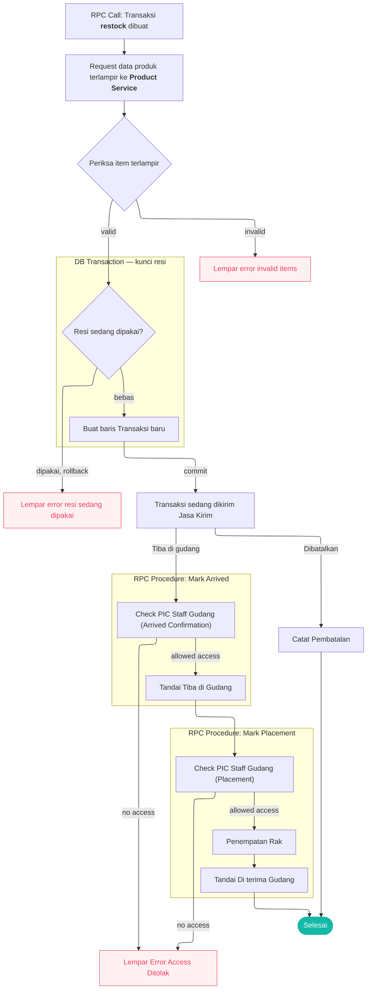

# Berikut adalah gambaran alur `restock`

Penguncian baris menggunakan:

1. mari kita sebut ini `kunci resi`.

```sql
select pg_advisory_xact_lock(hashtextextended('resi:' || lower(${resi}::text), 0));
```

2. mari kita sebut ini `kunci sku_statement`

    tanpa advisory lock — baris `(sku_id, warehouse_id)` yang unik sudah menjadi kuncinya. Syaratnya: satu perintah per SKU,
    urut `sku_id`, dan hitungan dilakukan di SQL, bukan di kode.

---

Kabar ke message broker, mari kita sebut ini `kirim kabar`:

Publish selalu sesudah commit. Kalau berhasil, tandai kolomnya true; kalau gagal, catat error dan jangan balas error ke
pengguna — langkahnya sudah berhasil. Tugas berkala mengirim ulang yang belum ditandai:

| kabar                     | kolom               | dikirim ulang kalau                                                                          |
| ------------------------- | ------------------- | -------------------------------------------------------------------------------------------- |
| restock created           | `publish_created`   | `publish_created` false                                                                      |
| restock cancelled         | `publish_cancelled` | status terakhir `cancelled`, `publish_cancelled` false, **dan `publish_created` sudah true** |
| penagihan ongkir tambahan | `billed`            | `additional_shipping_fee` > 0 dan `billed` false                                             |

Pendengar menolak kabar yang sama dua kali (`tx_id` + jenis kabar).

```ts
async function publishAndMark(
    kind: "created" | "cancelled" | "billing",
    txId: number,
    data: unknown,
) {
    try {
        await publishTopic({ topic: `restock-${kind}`, data })

        await db.transaction(async function (tx) {
            await markPublished(tx, txId, kind) // publish_created, publish_cancelled, atau billed = true
        })
    } catch (err) {
        logError(err) // tugas berkala akan mengirim ulang
    }
}
```

---



- RPC Call: Transaksi <b>restock</b> dibuat

    Customer Service atau Admin Tim membuat transaksi `restock`, data yang dikirim saat request kurang lebih:

    ```proto
    message Item {
        uint64 sku_id = 1 [(buf.validate.field).uint64.gt = 0];
        uint64 supplier_id = 2 [(buf.validate.field).uint64.gt = 0];
        uint64 count = 3 [(buf.validate.field).uint64.gt = 0];
        double total = 4 [(buf.validate.field).double.gte = 0]; // total saat belanja exclude ongkir
    }

    message CreateRestockPayload {
        option (warehouse.role_base.v1.request_policy) = { roles: [/* CS dan admin tim */] };

        uint64          team_id = 1 [(warehouse.role_base.v1.use_scope) = true];
        uint64          warehouse_id = 2 [(buf.validate.field).uint64.gt = 0];
        uint64          shipping_id = 3 [(buf.validate.field).uint64.gt = 0];
        string          receipt = 4 [(buf.validate.field).string.min_len = 1];
        uint64          payment_id = 5 [(buf.validate.field).uint64.gt = 0];
        double          shipping_fee = 6 [(buf.validate.field).double.gte = 0];
        optional string order_id = 7;
        repeated Item   items = 8 [(buf.validate.field).repeated.min_items = 1];
    }
    ```

    team_id di kiriman adalah scope: sistem akses memastikan pengirim adalah CS atau admin tim itu sebelum handler berjalan. Pemeriksaan item memastikan semua item milik tim itu.

- Request data produk terlampir ke <b>Product Service</b>

    `CreateRestockPayload.items` check item yang terlampir, minta data ke `product service` data yang diperlukan adalah
    `produk ini milik siapa?`, `apakah produk dikunci?`, `apakah produk reserved?`.

- Periksa item terlampir

    Pada tahap ini periksa satu per satu item yang dibawa oleh payload, pastikan semua item yang di-restock milik team si pembuat request. Jika ada salah satu saja item bukan milik team nya maka tolak. Mekanisme pengecekan dengan membandingkan response dari product service dengan `CreateRestockPayload.team_id`.

- Resi sedang dipakai?

    Buat DB Transaction dengan `kunci resi`. Pastikan jika resi belum pernah ada maka loloskan, jika resi sudah pernah ada maka check pada table log jika status terakhir transaksi yang ditemukan adalah `cancelled` maka loloskan selain status itu maka tolak.

- Buat baris Transaksi baru

    Buat row baru di table `transactions` dengan data terlampir, lalu lakukan:
    - buat log baru dengan status `ongoing`, pic isi dengan id pembuat request.
    - buat relasi ke table `TRANSACTION_ITEMS` dengan item terlampir.
    - `kunci sku_statement`, jika data terkait belum ada maka buat baru, jika sudah ada maka increment `stock_ongoing`
      dengan masing-masing `Item.count`

- DB Transaction — kunci resi

    Cukup dengan commit / rollback transaction, bayangan saya proses nya versi typescript dan drizzle adalah:

    ```ts
    // proses ini hanya membandingkan response dari product service dengan payload.
    if (!isItemsValid(payload, itemsResponse)) {
        throw InvalidItemsIncludedError() // rollback otomatis lepas kunci
    }

    const trx = await db.transaction(async (tx) => {
        await lockReceipt(tx, payload.receipt)

        if (await isReceiptInUse(tx, payload.receipt)) {
            throw TrxExistError() // rollback otomatis lepas kunci
        }

        const trx = await createTrx(tx, {
            payload,
            type: "restock",
            created_by: 1 /* ambil dari jwt token user id*/,
        })

        await createTrxItems(tx, trx.id, payload)
        await createTrxLog(tx, { txId: trx.id, status: "ongoing", createdBy: 1 /* dari jwt */ })
        await createOrUpdateStmt(tx, payload)

        return trx
        // sampai disini commit otomatis lepas kunci.
    })

    // sesudah commit
    publishAndMark("created", trx.id, payload)
    ```

    Mungkin kurang lebih akan seperti itu, semua fungsi hanya ilustrasi dari saya.

- Transaksi sedang dikirim Jasa Kirim

    Transaksi sedang dikirim menuju gudang oleh jasa kirim dari supplier.

- Check PIC Staff Gudang (Arrived Confirmation)

    Ketika paket sampai di gudang, maka staff gudang menandainya tiba di gudang. Saya membayangkan payload yang akan dikirim kurang lebih seperti ini:

    ```proto

    message ArrivedConfirmationRestockPayload {
        option (warehouse.role_base.v1.request_policy) = { roles: [/* peran staff gudang */] };

        uint64                           warehouse_id = 1 [(warehouse.role_base.v1.use_scope) = true];
        uint64                           tx_id = 2;
        optional AdditionalShippingFee   additional_shipping_fee = 3;
    }

    message AdditionalShippingFee {
        double              value = 1; // nilai ongkir tambahan
        optional string     image_of_proof_url = 2; // bukti nota tidak wajib
    }

    ```

    warehouse_id di kiriman adalah scope: sistem akses memastikan staff anggota gudang itu sebelum handler berjalan. Handler memastikan transaksinya milik gudang itu (transactions.warehouse_id = warehouse_id); kalau bukan, tolak.

- Tandai Tiba di Gudang

    Proses ini setelah check PIC:
    - buat log baru transaksi terkait dengan status `arrived`, dengan created_by user_id dari jwt penerima.
    - periksa jika ada ongkir tambahan catat di table transaksi terkait di field `additional_shipping_fee`, `additional_shipping_proof_url` (optional), dan publish ke message broker untuk info penagihan.
    - statement tidak berubah

    Flow logic nya kurang lebih dalam typescript dan drizzle:

    ```ts
    await db.transaction(async function (tx) {
        // lock menggunakan pg_advisory_xact_lock
        await lockTxId(tx, txId)

        const trx = await findTrx(tx, txId)

        if (!trx) throw NotFoundError()

        if (trx.warehouse_id !== payload.warehouseId) throw AccessDenied() // tx gudang lain

        if ((await lastStatus(tx, txId)) !== "ongoing") throw IllegalOperation()

        await createTrxLog(tx, {
            txId,
            status: "arrived",
            createdBy: 134, // id dari jwt token yang menandai tiba di gudang, dalam hal ini pasti staff gudang
        })

        if (additionalShippingFee > 0) {
            await updateAdditionalShippingFee(tx, {
                txId,
                additionalShippingFee,
                additionalShippingProofUrl,
            })
        }
    })

    if (additionalShippingFee > 0) {
        publishAndMark("billing" /* etc. */)
    }
    ```

- Check PIC Staff Gudang (Placement)

    Pada tahap ini staff gudang mengirim data penempatan, bisa saja pengirim `penerimaan` dan `penempatan` beda staff, payload kurang lebih:

    ```proto

    message PlacementRestockPayload {
        uint64  tx_id = 1; // tx_id dari restock yang sudah "arrived" sebelumnya.
        repeated Placement placements = 2;
    }

    message PlacementRestockPayload {
        option (warehouse.role_base.v1.request_policy) = { roles: [/* peran staff gudang */] };

        uint64             warehouse_id = 1 [(warehouse.role_base.v1.use_scope) = true];
        uint64             tx_id = 2;
        repeated Placement placements = 3;
    }

    // item_id diperoleh dari `TRANSACTION_ITEMS.id`

    message SlotPlacement {
        uint64 item_id = 1 [(buf.validate.field).uint64.gt = 0];
        uint64 count = 2 [(buf.validate.field).uint64.gt = 0];
        uint64 rack_id = 3 [(buf.validate.field).uint64.gt = 0];
    }

    message LostSlotPlacement {
        uint64 item_id = 1 [(buf.validate.field).uint64.gt = 0];
        uint64 count = 2 [(buf.validate.field).uint64.gt = 0];
        optional string notes = 3;
    }

    message BrokenSlotPlacement {
        uint64 item_id = 1 [(buf.validate.field).uint64.gt = 0];
        uint64 count = 2 [(buf.validate.field).uint64.gt = 0];
        uint64 rack_id = 3 [(buf.validate.field).uint64.gt = 0];
        optional string notes = 4;
        optional string image_of_proof_url = 5;   // foto barang rusak
    }

    ```

    Dikarenakan Gudang dan Tim berada dalam satu manajemen maka `AdditionalShippingFee.image_of_proof_url` bersifat opsional (Gudang hampir bisa dipastikan tidak memanipulasi ongkir meskipun tidak ada bukti nota).

    Semua item placement dihitung dan dibandingkan dengan `TRANSACTION_ITEMS` terkait, jumlah setiap item harus sama dengan saat `restock` dibuat, sehingga menghindari kesalahan saat API ditembak diluar UI.

    Jika ada `item_id` yang tidak terkait maka tolak request ini.

    Tentunya cek dulu apakah PIC merupakan anggota gudang, sama seperti saat arrived.

- Penempatan Rak

    Pada payload terdapat `placements`, Ketetapan pemetaan sku-rak:
    - Sku bisa ditempatkan ke beberapa rak, misal `Kaos berjumlah 1000` bisa di sebar ke beberapa rak misalnya `rack A 500pcs` `rack B 500pcs`
    - Sku bisa ditandai karena `rusak di jalan`, `hilang di jalan`

    Check apakah payload yang dikirim sesuai dengan `transaction_items` transaksi terkait, ini berguna untuk menghindari salah input kuantitas oleh staff gudang. Bila sku dan jumlah nya tidak sesuai maka `TOLAK`.

- Tandai Di terima Gudang

    Pada tahap ini kita lakukan step kalkulasi antara lain:
    - `unit_price`
      Unit price diperoleh dari `TRANSACTION_ITEMS.total / TRANSACTION_ITEMS.count`
    - `unit_shipping_cost`
      Unit Shipping cost diperoleh dari `TRANSACTIONS.shipping_fee / sum(TRANSACTION_ITEMS.map(item => item.count))`
    - `unit_additional_shipping_cost`
      Unit Additional Shipping Cost diperoleh dari `TRANSACTIONS.additional_shipping_fee / sum(TRANSACTION_ITEMS.map(item => item.count))`

    Akan saya ilustrasikan alur kode-nya dalam typescript dan drizzle:

    ```ts
    // Check PIC di sini...

    const payload: PlacementRestockPayload = {}

    await db.transaction(async function (dbTx) {
        // lock menggunakan pg_advisory_xact_lock
        await lockTxId(dbTx, payload.txId)

        const tx = await dbTx.findOne("transactions", { where: { id: payload.txId } })

        if (!tx) throw new NotFoundError()

        if (tx.warehouse_id !== payload.warehouseId) throw new AccessDenied() // tx gudang lain

        const lastStatus = await findLastStatusOf(dbTx, tx.id)

        if (lastStatus !== "arrived") throw new IllegalOp()

        const txItems = await dbTx.findMany("transaction_items", { where: { txId: tx.id } })

        if (!isPlacementValid(payload, txItems)) throw new InvalidPlacementProvided()

        // penempatan di slot masing-masing, normal, broken ataupun lost
        // beserta kalkulasi atribut seperti unitPrice, unitShippingCost, UnitAdditionalShippingCost
        await createPlacements(dbTx, payload)

        await createTrxLog(dbTx, {
            txId: tx.id,
            status: "approved",
            createdBy: 135, // id dari jwt token yang mengirim request penempatan / menerima di gudang, dalam hal ini pasti staff gudang
        })
        await updateSkuStatement(dbTx, payload)
    })
    ```

- Catat Pembatalan

    Restock hanya bisa dibatalkan ketika dia masih dalam status `ongoing`, hanya oleh CS atau admin tim restock (`transactions.team_id`), bukan staff gudang. Payload kurang lebih:

    ```proto
    message CancelRestockPayload {
        option (warehouse.role_base.v1.request_policy) = { roles: [/* CS dan admin tim */] };

        uint64 team_id = 1 [(warehouse.role_base.v1.use_scope) = true];
        uint64 tx_id = 2;
    }
    ```

    team_id di kiriman adalah scope: sistem akses memastikan pengirim adalah CS atau admin tim itu sebelum handler berjalan. Handler memastikan restock-nya milik tim itu (transactions.team_id = team_id); kalau bukan, tolak.

    Ketika ini terjadi lakukan:
    - `lockTxId` terkait
    - cocokkan `transactions.team_id` dengan `team_id` kiriman, kalau bukan tolak
    - periksa status terakhir masih `ongoing`, kalau bukan tolak
    - create log baru dengan status `cancelled`, isi pic dengan yang meminta cancel yaitu id cs atau admin team selling
    - ubah `sku_statement` dengan mengurangi `stock_ongoing`
    - publish restock cancel ke message broker, sesudah commit

    ```ts
    const trx = await db.transaction(async function (tx) {
        // lock menggunakan pg_advisory_xact_lock
        await lockTxId(tx, payload.txId)

        const trx = await findTrx(tx, payload.txId)

        if (!trx) throw NotFoundError()

        if (trx.team_id !== payload.teamId) throw AccessDenied() // restock tim lain

        if ((await lastStatus(tx, trx.id)) !== "ongoing") throw IllegalOperation() // arrived, approved, cancelled ditolak

        await createTrxLog(tx, {
            txId: trx.id,
            status: "cancelled",
            createdBy: 12, // id dari jwt token, CS atau admin tim
        })

        // kunci sku_statement: satu perintah per SKU, urut sku_id — stock_ongoing = stock_ongoing - dikirim
        await decrementOngoing(tx, trx)

        return trx
    })

    // sesudah commit
    if (trx.publish_created) {
        publishAndMark("cancelled", trx.id, { txId: trx.id })
    }
    // kalau publish_created masih false: jangan kirim sekarang — tugas berkala
    // akan mengirim created dulu, baru cancelled
    ```
