# Clarity — `stock_thoni/restock_flow.md`

Kritik dan pertanyaan untuk [restock_flow.md](./restock_flow.md) — **satu-satunya acuan alur restock** (permintaan Anda,
2026-10-02). **Dokumen itu milik Anda; file ini milik saya.** Poin yang sudah dijawab **dihapus**. Keputusan dicatat di
[context_decision.md](./context_decision.md); pertanyaan tentang ERD dan konteks secara umum tetap di
[context_clarify.md](./context_clarify.md).

> **2026-10-17 (pembuatan)** — terlewat di uji sebelumnya: `CreateRestockPayload` kini membawa `team_id` scope (baris 136), dan item
> serta log `ongoing` menempel ke `trx.id` (baris 193–194). ✅ Selesai: *pembuatan-tanpa-scope-tim* · *item-dan-log-tanpa-id-transaksi*.
> Catatan di [gudang-dikirim-sebagai-scope-lalu-dicocokkan](./context_decision.md#gudang-dikirim-sebagai-scope-lalu-dicocokkan).
>
> **2026-10-17 (rak dicocokkan)** — baris 323 dan kode baris 368–376: rak yang tidak ada atau milik gudang lain menolak seluruh
> penempatan. ✅ Dicatat: [rak-dicocokkan-ke-gudang-transaksi](./context_decision.md#rak-dicocokkan-ke-gudang-transaksi) — kritik
> *rak-gudang-lain-diterima* selesai.
>
> **2026-10-17 (RACKS)** — model.md kini punya `RACKS` dengan `warehouse_id`. 🆕 [rak-gudang-lain-diterima](#critique) —
> penempatan belum memastikan rak yang dikirim milik gudang transaksinya. Tabelnya sendiri diuji di
> [context_clarify](./context_clarify.md#uji-racks).
>
> **2026-10-17 (uji sesudah merge `backup/inventory`)** — restock_flow.md tidak berubah; yang diuji dokumen konteks lain dan
> kode bersama yang kini ada di branch ini. Folder `business/inventory/` milik Heri **tidak** dipakai — di branch `thoni` folder
> itu diabaikan, atas permintaan pemiliknya. 🆕 pertanyaan [penerimaan-tidak-mengabari-supplier](#penerimaan-tidak-mengabari-supplier)
> — supplier ingin angka restock, rusak, hilang per hari · 🆕 kritik [nama-topik-bentrok](#critique) — penerbit menamai topiknya.
> 🔄 Sesudahnya, atas permintaan Anda, dasar yang berasal dari inventory Heri dilepas dari keduanya.
>
> **2026-10-17 (kirim kabar)** — model.md: `publish_created`, `publish_cancelled`; restock_flow.md baris 18–47: bagian
> bersama *kirim kabar* dengan tabel tiga kabar dan `publishAndMark`; pembuatan (baris 176–198) dan pembatalan (baris
> 417–445) membawa `trx` keluar transaksi. ✅ Dicatat:
> [kabar-restock-ditandai-dan-dikirim-ulang](./context_decision.md#kabar-restock-ditandai-dan-dikirim-ulang) — selesai:
> pertanyaan *siapa-mendengar-restock-cancel* (B — tidak boleh hilang). **Nol pertanyaan terbuka.** 🆕 kecil:
> [item-dan-log-tanpa-id-transaksi](#critique).
>
> **2026-10-17 (Catat Pembatalan, dibetulkan)** — baris 357–405: pembatal adalah **tim** — CS atau admin
> `transactions.team_id` (baris 359); `CancelRestockPayload` dengan `team_id` scope (baris 362–366); kode: *kunci tx* →
> cocok tim (baris 389) → periksa `ongoing` sesudah kunci (baris 391) → log `cancelled` → `stock_ongoing` → publish sesudah
> commit (baris 404). ✅ Selesai: kontradiksi *pembatal-orangnya-atau-timnya* · kritik *pembatalan-tanpa-cek-tim* dan
> *pembatalan-periksa-status-sesudah-kunci*; usulannya diambil seluruhnya — dipangkas dari file ini. Catatan di
> [pembatalan-oleh-cs-atau-admin](./context_decision.md#pembatalan-oleh-cs-atau-admin) dan
> [gudang-dikirim-sebagai-scope-lalu-dicocokkan](./context_decision.md#gudang-dikirim-sebagai-scope-lalu-dicocokkan).
> **Keempat langkah kini tertulis, tanpa kontradiksi.** Satu pertanyaan:
> [siapa-mendengar-restock-cancel](#siapa-mendengar-restock-cancel). 🆕 kecil: pembuatan kini satu-satunya kiriman tanpa scope
> ([pembuatan-tanpa-scope-tim](#critique)).
>
> **2026-10-17 (Catat Pembatalan)** — langkah terakhir ditulis; ✅ dicatat
> [paket-yang-sudah-tiba-tidak-bisa-dibatalkan](./context_decision.md#paket-yang-sudah-tiba-tidak-bisa-dibatalkan).
>
> **2026-10-17 (referensi proses)** — deskripsi di bawah diagram mengikuti diagram dan kode; kode tiba mencocokkan gudang.
> ✅ Dicatat: [statement-dikunci-oleh-barisnya-sendiri](./context_decision.md#statement-dikunci-oleh-barisnya-sendiri) ·
> [gudang-dikirim-sebagai-scope-lalu-dicocokkan](./context_decision.md#gudang-dikirim-sebagai-scope-lalu-dicocokkan). model.md
> baris 20 kini unik atas pasangan.
>
> **2026-10-16 – 10-17** — alur lama dihapus tanpa kontradiksi (8 dari 10 bagian terbawa; halaman gudang tetap di
> [restock-tampil-hanya-di-gudang-tujuan](./context_decision.md#restock-tampil-hanya-di-gudang-tujuan)). Kode ilustrasi Anda
> **adalah** spesifikasinya — sebelas kritik yang hanya meminta kode ditulis ulang sebagai kalimat dilepas. Selesai juga:
> penempatan *kunci tx* lalu baca `tx` lewat `dbTx` · `createdBy` di log `arrived` dan `approved` · publish penagihan di
> `try/catch` dengan tugas berkala pengirim ulang
> ([kabar-penagihan-ditandai-billed](./context_decision.md#kabar-penagihan-ditandai-billed)).
>
> **2026-10-16, sebelumnya** — dicatat:
> [paket-tiba-ditandai-sebelum-penempatan](./context_decision.md#paket-tiba-ditandai-sebelum-penempatan) ·
> [resi-dibandingkan-tanpa-beda-huruf](./context_decision.md#resi-dibandingkan-tanpa-beda-huruf) ·
> [restock-membaca-product-service-sebelum-kunci](./context_decision.md#restock-membaca-product-service-sebelum-kunci) ·
> [resi-dikunci-dengan-advisory-lock](./context_decision.md#resi-dikunci-dengan-advisory-lock) ·
> [pemilik-item-dibaca-dari-product-service](./context_decision.md#pemilik-item-dibaca-dari-product-service) ·
> [cara-bayar-dirujuk-lewat-payment-id](./context_decision.md#cara-bayar-dirujuk-lewat-payment-id) ·
> [pic-dicek-saat-tiba-dan-saat-penempatan](./context_decision.md#pic-dicek-saat-tiba-dan-saat-penempatan) ·
> [resi-dicek-ke-semua-transaksinya](./context_decision.md#resi-dicek-ke-semua-transaksinya) ·
> [ongkir-tambahan-diisi-dan-dikabarkan-saat-tiba](./context_decision.md#ongkir-tambahan-diisi-dan-dikabarkan-saat-tiba) ·
> [tiba-dan-penempatan-dua-rpc](./context_decision.md#tiba-dan-penempatan-dua-rpc) ·
> [statement-tidak-berubah-saat-tiba](./context_decision.md#statement-tidak-berubah-saat-tiba) ·
> [ganti-status-dikunci-per-transaksi](./context_decision.md#ganti-status-dikunci-per-transaksi).
>
> **2026-10-02 – 10-15** — alur lama sempat bersih (10-03 14:42); status `arrived` diusulkan 10-15. Semua putusannya ada di
> [context_decision](./context_decision.md).

---

## Yang masih kurang

| | apa | di mana |
| --- | --- | --- |
| 1 | apakah penerimaan mengabari supplier | [penerimaan-tidak-mengabari-supplier](#penerimaan-tidak-mengabari-supplier) |
| 2 | nama topik kabar bentrok dengan yang sudah dibangun | [nama-topik-bentrok](#critique) |

Keempat langkah — pembuatan, tiba, penempatan, pembatalan — **tanpa sisa** selain itu.

## Critique

| | Masalah | → Rekomendasi |
| --- | --- | --- |
| **nama-topik-bentrok** 🆕 | Baris 38: `publishTopic({ topic: \`restock-${kind}\`, data })` — penerbit yang menamai topiknya. Aturan repo ini: **event menamai topiknya sendiri** — satu pesan proto, `event_config` di pesan itu (CLAUDE.md, *Events*); penerbit tidak pernah menulis nama topik. Fakta teknis, bukan masukan desain: `event.proto` sudah memakai nama `restock-created` dan `restock-cancelled` untuk pesan dengan isi lain, dan satu topik hanya bisa membawa satu bentuk pesan. | Setiap kabar satu pesan proto dengan topiknya sendiri — nama dan isinya keputusan Anda, asal tidak sama persis dengan nama yang sudah ada. `publishAndMark` menerima pesannya, bukan nama topik. |

## Proposed Design

### Status per langkah

Ringkasan alur yang kini tertulis — semuanya sudah Anda tulis; tabel ini hanya merangkumnya:

| langkah | kunci | pemeriksa akses | status yang diperiksa, sesudah kunci | status sesudahnya | statement |
| --- | --- | --- | --- | --- | --- |
| Transaksi Restock Dibuat | *kunci resi* | `team_id` scope, item dicocokkan ke tim itu | resi: tidak ada transaksi resi itu yang status terakhirnya bukan `cancelled` | `ongoing` | `stock_ongoing` + dikirim |
| Tandai Tiba | *kunci tx* | `warehouse_id` scope, cocok `transactions.warehouse_id` | `ongoing` | `arrived` | tidak berubah |
| Tandai Di terima Gudang | *kunci tx* | `warehouse_id` scope, cocok `transactions.warehouse_id` | `arrived` | `approved` | `stock_ongoing` − dikirim · ready, broken, lost + |
| Catat Pembatalan | *kunci tx* | `team_id` scope, cocok `transactions.team_id` | `ongoing` | `cancelled` | `stock_ongoing` − dikirim |

```mermaid
stateDiagram-v2
  [*] --> ongoing: Transaksi Restock Dibuat — CS atau admin tim
  ongoing --> arrived: Tandai Tiba — staff gudang
  ongoing --> cancelled: Catat Pembatalan — CS atau admin tim
  arrived --> approved: Tandai Di terima Gudang — staff gudang
  cancelled --> [*]
  approved --> [*]
```

## Question

### penerimaan-tidak-mengabari-supplier

Konteks supplier ingin tahu, per supplier, per produk, per hari, **berapa yang di-restock, rusak dan hilang**
([a-supplier-is-measured-per-product-per-day](../supplier/context_decision.md#a-supplier-is-measured-per-product-per-day)). Di Flow
Anda, angka itu baru diketahui di *Tandai Di terima Gudang* (baris 335–382) — dan langkah itu tidak mengirim kabar apa pun; tabel
*kirim kabar* (baris 23–27) hanya punya created, cancelled dan penagihan.

🔄 10-17, atas permintaan Anda: **cara** supplier menerimanya di putusan-putusan supplier lain — dibaca saat *accept*, lewat
`restock-accepted`, menautkan produk ke channel — bersandar pada restock Heri, jadi **tidak** dipakai di sini. Yang tersisa hanya
pertanyaannya: apakah rancangan Anda mau memberi supplier angka itu?

Contohnya: restock dari Melati diterima — 8 baik, 1 rusak, 1 hilang. Tanpa kabar, laporan Melati hari itu tetap 0.

| | | |
| --- | --- | --- |
| **A** | `approved` mengirim kabar *restock approved* lewat *kirim kabar* — per baris: produk, supplier, tim, baik, rusak, hilang, harga per unit; penanda `publish_approved`; menunggu *created* terkirim | supplier dapat angkanya; satu kolom lagi di `TRANSACTIONS` |
| **B** | tidak mengabari — supplier membaca sendiri, atau angkanya ditunda | tidak ada kolom baru; laporan supplier belum punya sumber |

**→ Rekomendasi: A** — pola yang sudah Anda punya, dan langkah penerimaan memang satu-satunya tempat angka itu lahir. Apakah
penerimaan mengabari supplier?

> ⏸ **Ditunda — tidak dihitung**, sampai teksnya ditulis: retur ikut `arrived` ([return_flow.md](./return_flow.md) masih
> kosong) — Order Service dikabari saat tiba, atau saat diterima? Penempatan restock tidak mengirim kabar apa pun, jadi kabar
> retur perlu publish sendiri.

---

# Contradiction

**Tidak ada kontradiksi terbuka** (uji 2026-10-17, sesudah *Catat Pembatalan* dibetulkan).

✅ Selesai: *pembatal-orangnya-atau-timnya* (10-17 — timnya) · *alur-lama-dan-flow-baru-berbeda* dan
*status-arrived-belum-ikut-di-pemeriksaan* (teks lama dihapus, 10-16) · *statement-tidak-diperbarui-saat-diterima* ·
*ongoing-turun-saat-tiba-sejumlah-yang-tiba* (A) · *ongkir-tambahan-dikabarkan-tapi-tidak-disimpan* ·
*item-dicocokkan-ke-tim-pembuat* · *kunci-resi-kembali-ke-baris-transaksi* (10-16). Sebelumnya: *nama-foto-nota-tertinggal*
(10-03) · *pemeriksaan-ongoing-hilang-dari-alur* (10-03) · *foto-nota-opsional-padahal-check* (10-02) ·
*penerimaan-mengirim-supplier-lagi* (10-02).
