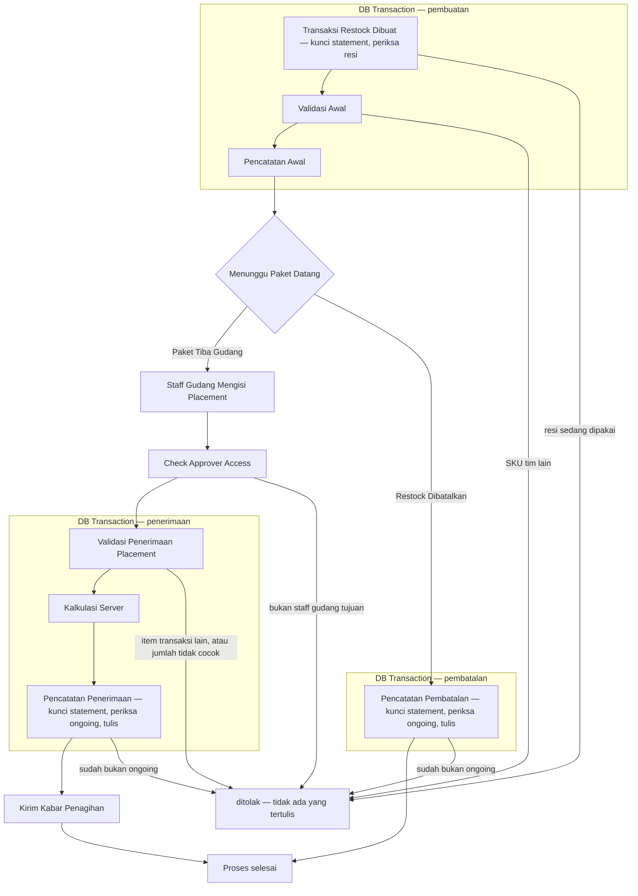
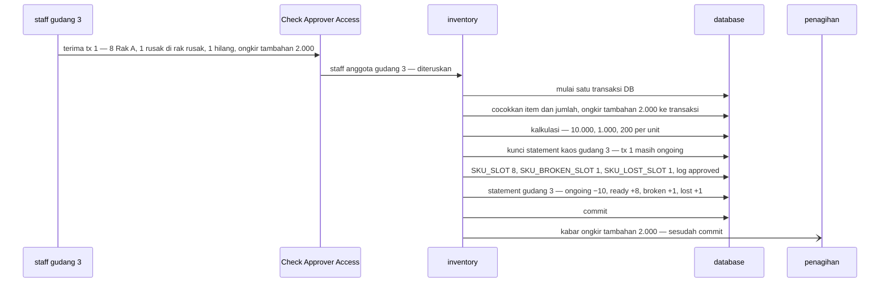

# Clarity — `stock_thoni/restock_flow.md`

Kritik dan pertanyaan untuk [restock_flow.md](./restock_flow.md) — **satu-satunya acuan alur restock** (permintaan Anda,
2026-10-02). **Dokumen itu milik Anda; file ini milik saya.** Poin yang sudah dijawab **dihapus**. Keputusan dicatat di
[context_decision.md](./context_decision.md); pertanyaan tentang ERD dan konteks secara umum tetap di
[context_clarify.md](./context_clarify.md).

> **2026-10-03 14:42 — alur restock bersih.** `stock_ongoing + jumlah item` kini sekali saja, di *Pencatatan Awal* (baris 80),
> dan baris 151 memakai `image_of_proof_url`. Sesuai rekomendasi. Selesai: kritik *statement-ongoing-disebut-dua-kali* dan
> kontradiksi *nama-foto-nota-tertinggal*. Tersisa satu kritik kosmetik — [jalur-ditolak-belum-digambar](#critique). Nol
> pertanyaan, nol kontradiksi.
>
> **2026-10-03 14:39** — baris TRANSACTIONS kini *"dengan resi yang sama"* (baris 68) · foto nota kini `image_of_proof_url`
> (baris 117) · angka statement tertulis di ketiga langkah (baris 70, 176, 187). ✅ Dicatat:
> [foto-nota-dikirim-sebagai-link](./context_decision.md#foto-nota-dikirim-sebagai-link) · catatan di
> [kunci-statement-lalu-periksa-resi](./context_decision.md#kunci-statement-lalu-periksa-resi) dan
> [statement-diperbarui-di-setiap-langkah](./context_decision.md#statement-diperbarui-di-setiap-langkah). Selesai:
> *kunci-transaksi-mana-saat-dibuat*, *statement-tanpa-angka*, pertanyaan *foto-nota-file-atau-link*, dan — saya tarik —
> *kabar-memakai-nama-lain*: isi kabar sudah tercatat di
> [kabar-membawa-tx-tim-jumlah-dan-foto](./context_decision.md#kabar-membawa-tx-tim-jumlah-dan-foto), alur tidak wajib
> mengulangnya. 🆕 [statement-ongoing-disebut-dua-kali](#critique) · satu [kontradiksi](#contradiction) kecil, nama lama di
> baris 153.
>
> **2026-10-03 14:33 — ditutup satu per satu.** Rumus kini membaca `TRANSACTION_ITEMS` (baris 165, 167) · ongkir tambahan
> kini `double value` (baris 114). ✅ Dicatat: [nilai-ongkir-tambahan-bertipe-double](./context_decision.md#nilai-ongkir-tambahan-bertipe-double) ·
> catatan di [ongkir-dibagi-ke-unit-yang-dikirim](./context_decision.md#ongkir-dibagi-ke-unit-yang-dikirim). Selesai:
> *rumus-membaca-kiriman-lama*; *nama-di-kiriman-penerimaan* menyempit menjadi satu pertanyaan,
> [foto-nota-file-atau-link](#foto-nota-file-atau-link). 🆕 [kunci-transaksi-mana-saat-dibuat](#critique) — baris 68 kini
> mengunci `TRANSACTIONS` lagi, tanpa menyebut barisnya.
>
> **2026-10-03 14:27** — *"Kunci baris `TRANSACTIONS`"* dihapus dari *Validasi Awal* dan *Pencatatan Awal*, dan resi kini
> hanya diperiksa di baris 68. Sesuai rekomendasi. Selesai: kritik *kunci-transaksi-saat-restock-dibuat*. Tersisa lima
> kritik kecil, tanpa pertanyaan dan tanpa kontradiksi.
>
> **2026-10-03 14:20** — resi kini dikunci lewat statement (baris 68), dan resi tiap jasa kirim pasti berbeda (chat).
> Pembatalan punya kotaknya sendiri. ✅ Dicatat: [kunci-statement-lalu-periksa-resi](./context_decision.md#kunci-statement-lalu-periksa-resi) ·
> [resi-unik-lintas-jasa-kirim](./context_decision.md#resi-unik-lintas-jasa-kirim). Selesai: pertanyaan *resi-dijaga-database*
> — **tidak ada pertanyaan terbuka lagi di alur ini** — dan kritik *pembatalan-sekotak-dengan-penerimaan*. 🆕
> [kunci-transaksi-saat-restock-dibuat](#critique): baris 72 dan 80 mengunci baris `TRANSACTIONS` yang belum ada. Tetap
> **tidak menghalangi** return.
>
> **2026-10-03 13:42–14:09** — batas transaksi DB digambar; cek staff dan kabar penagihan keluar dari kotak; paket yang tiba
> setelah batal → restock baru; penerimaan dan pembatalan mengunci statement lalu memeriksa `ongoing`. ✅
> [restock-dibuat-dalam-satu-transaksi-db](./context_decision.md#restock-dibuat-dalam-satu-transaksi-db) ·
> [transaksi-db-penerimaan-mulai-dari-validasi](./context_decision.md#transaksi-db-penerimaan-mulai-dari-validasi) ·
> [pembatalan-dalam-satu-transaksi-db](./context_decision.md#pembatalan-dalam-satu-transaksi-db) ·
> [paket-tiba-setelah-batal-dibuat-restock-baru](./context_decision.md#paket-tiba-setelah-batal-dibuat-restock-baru) ·
> [service-lain-di-luar-transaksi-db](./context_decision.md#service-lain-di-luar-transaksi-db) ·
> [kunci-statement-lalu-periksa-ongoing](./context_decision.md#kunci-statement-lalu-periksa-ongoing).
>
> Semua putusan alur ini sejak 2026-10-02 14:06, dari [restock-dibuat-cs-atau-admin-tim](./context_decision.md#restock-dibuat-cs-atau-admin-tim)
> sampai [resi-unik-lintas-jasa-kirim](./context_decision.md#resi-unik-lintas-jasa-kirim), ada di
> [context_decision](./context_decision.md). Catatan per ronde dipangkas dari file ini supaya tetap terbaca.

---

## Uji alur — lengkap

| langkah | penilaian |
| --- | --- |
| Transaksi Restock Dibuat | ✅ CS atau Admin Tim, tim dikirim ([restock-dibuat-cs-atau-admin-tim](./context_decision.md#restock-dibuat-cs-atau-admin-tim) · [tim-dikirim-dan-disimpan-di-transaksi](./context_decision.md#tim-dikirim-dan-disimpan-di-transaksi)) · ✅ satu transaksi DB bersama dua langkah berikut ([restock-dibuat-dalam-satu-transaksi-db](./context_decision.md#restock-dibuat-dalam-satu-transaksi-db)) · ✅ kunci statement, lalu periksa resi ([kunci-statement-lalu-periksa-resi](./context_decision.md#kunci-statement-lalu-periksa-resi)) · ✅ resi saja menunjuk satu paket ([resi-unik-lintas-jasa-kirim](./context_decision.md#resi-unik-lintas-jasa-kirim)) · ✅ baris `TRANSACTIONS` dengan resi yang sama ikut dikunci (14:39) |
| Validasi Awal | ✅ [sku-tim-lain-ditolak-saat-dibuat](./context_decision.md#sku-tim-lain-ditolak-saat-dibuat) · ✅ [tim-sku-dari-kiriman-untuk-sementara](./context_decision.md#tim-sku-dari-kiriman-untuk-sementara) |
| Pencatatan Awal | ✅ `stock_ongoing` dicatat ([statement-diperbarui-di-setiap-langkah](./context_decision.md#statement-diperbarui-di-setiap-langkah)) · ✅ angkanya tertulis, sekali (baris 80) |
| Menunggu Paket Datang | ✅ |
| Staff Gudang Mengisi Placement | ✅ beberapa rak, diterima sebagian ([penerimaan-boleh-dipecah-ke-beberapa-rak](./context_decision.md#penerimaan-boleh-dipecah-ke-beberapa-rak) · [restock-boleh-diterima-sebagian](./context_decision.md#restock-boleh-diterima-sebagian)) · ✅ halaman hanya menampilkan restock gudangnya ([restock-tampil-hanya-di-gudang-tujuan](./context_decision.md#restock-tampil-hanya-di-gudang-tujuan)) |
| Check Approver Access | ✅ staff dari token, anggota gudang tujuan ([penerima-dicek-anggota-gudang-tujuan](./context_decision.md#penerima-dicek-anggota-gudang-tujuan)) · ✅ langkah sendiri, sebelum transaksi DB ([service-lain-di-luar-transaksi-db](./context_decision.md#service-lain-di-luar-transaksi-db)) |
| Validasi Penerimaan Placement | ✅ tiga varian, nilai kosong ditolak ([penempatan-tiga-varian](./context_decision.md#penempatan-tiga-varian) · [penerimaan-menolak-nilai-kosong](./context_decision.md#penerimaan-menolak-nilai-kosong)) · ✅ menunjuk `item_id`, jumlah dicocokkan per item, `item_id` transaksi lain ditolak ([penempatan-menunjuk-item-id](./context_decision.md#penempatan-menunjuk-item-id) · [jumlah-dicocokkan-per-item](./context_decision.md#jumlah-dicocokkan-per-item) · [item-dari-transaksi-lain-ditolak](./context_decision.md#item-dari-transaksi-lain-ditolak)) · ✅ ongkir tambahan ditulis **di dalam** transaksi DB ([transaksi-db-penerimaan-mulai-dari-validasi](./context_decision.md#transaksi-db-penerimaan-mulai-dari-validasi)) · ✅ ongkir tambahan `double value` ([nilai-ongkir-tambahan-bertipe-double](./context_decision.md#nilai-ongkir-tambahan-bertipe-double)) · ✅ foto nota sebagai link ([foto-nota-dikirim-sebagai-link](./context_decision.md#foto-nota-dikirim-sebagai-link)) |
| Kalkulasi Server | ✅ tiga rumus sesuai keputusan ([supplier-dan-total-disimpan-di-item](./context_decision.md#supplier-dan-total-disimpan-di-item) · [ongkir-dibagi-ke-unit-yang-dikirim](./context_decision.md#ongkir-dibagi-ke-unit-yang-dikirim)) · ✅ membagi dengan `TRANSACTION_ITEMS` (14:33) |
| Pencatatan Penerimaan | ✅ kunci statement, periksa `ongoing` ([kunci-statement-lalu-periksa-ongoing](./context_decision.md#kunci-statement-lalu-periksa-ongoing)) · ✅ barang, log `approved`, statement ([penerimaan-dicatat-dalam-satu-transaksi-db](./context_decision.md#penerimaan-dicatat-dalam-satu-transaksi-db)) · ✅ angka statement (baris 174) |
| Kirim Kabar Penagihan | ✅ langkah sendiri, sesudah transaksi DB ([service-lain-di-luar-transaksi-db](./context_decision.md#service-lain-di-luar-transaksi-db)) · ✅ isinya di [kabar-membawa-tx-tim-jumlah-dan-foto](./context_decision.md#kabar-membawa-tx-tim-jumlah-dan-foto) |
| Pencatatan Pembatalan | ✅ kunci statement, periksa `ongoing` ([kunci-statement-lalu-periksa-ongoing](./context_decision.md#kunci-statement-lalu-periksa-ongoing)) · ✅ satu transaksi DB ([pembatalan-dalam-satu-transaksi-db](./context_decision.md#pembatalan-dalam-satu-transaksi-db)) · ✅ log `cancelled` oleh CS atau admin ([pembatalan-oleh-cs-atau-admin](./context_decision.md#pembatalan-oleh-cs-atau-admin)) · ✅ paket yang tetap tiba → restock baru, resi sama ([paket-tiba-setelah-batal-dibuat-restock-baru](./context_decision.md#paket-tiba-setelah-batal-dibuat-restock-baru)) · ✅ kotak transaksi DB-nya sendiri (14:20) · ✅ angka statement (baris 185) |
| Ketentuan | ✅ resi ([resi-dipakai-lagi-hanya-setelah-cancelled](./context_decision.md#resi-dipakai-lagi-hanya-setelah-cancelled)) · ✅ barang rusak wajib di rak ([barang-rusak-wajib-di-rak](./context_decision.md#barang-rusak-wajib-di-rak)) · ✅ resi dijaga kunci statement ([kunci-statement-lalu-periksa-resi](./context_decision.md#kunci-statement-lalu-periksa-resi)) |

## Critique

Tidak ada yang menghalangi return — yang tersisa hanya gambar.

| | Masalah | → Rekomendasi |
| --- | --- | --- |
| **jalur-ditolak-belum-digambar** | Diagram hanya punya jalur lancar. Penolakan ada di teks — *Validasi Awal*, *Check Approver Access*, *Validasi Penerimaan*, *"kalau bukan, tolak"* — tapi tidak di gambar. | Gambar jalur keluarnya, seperti [Proposed Design](#proposed-design). |

## Proposed Design

### Batas transaksi DB per langkah

Jawaban untuk *"mana saja yang harus dalam DB transaction"* (13:42). Aturannya dua: **tulisan yang harus jadi semua atau
tidak sama sekali → di dalam**; **apa pun yang bukan database kita → di luar**, karena transaksi DB tidak bisa
membatalkannya.

| langkah | transaksi DB | kenapa | alur Anda (14:42) |
| --- | --- | --- | --- |
| *Transaksi Restock Dibuat* — kunci statement, periksa resi | ✅ **wajib** | tanpa kunci, dua *Simpan* kembar sama-sama lolos | ✅ |
| *Validasi Awal* | bebas | hanya membandingkan isi kiriman — tidak membaca database | ✅ |
| *Pencatatan Awal* | ✅ **wajib** | transaksi, item, log `ongoing`, `stock_ongoing` — semua atau tidak | ✅ |
| *Staff Gudang Mengisi Placement* | ✗ di luar | layar | ✅ |
| *Check Approver Access* | ✗ **di luar, sebelum kotak** | service lain | ✅ |
| *Validasi Penerimaan Placement* — termasuk tulis ongkir tambahan | ✅ **wajib** | ongkir tambahan ikut batal kalau penerimaan gagal | ✅ |
| *Kalkulasi Server* | ✅ di dalam | membaca ongkir tambahan yang baru ditulis — hanya terlihat di transaksi yang sama | ✅ |
| *Pencatatan Penerimaan* — kunci, periksa `ongoing`, tulis | ✅ **wajib** | tanpa kunci dan periksa, dua *terima* sama-sama lolos | ✅ |
| *Kirim Kabar Penagihan* | ✗ **di luar, sesudah commit** | kabar yang terkirim tidak bisa ditarik | ✅ |
| *Pencatatan Pembatalan* — kunci, periksa `ongoing`, tulis | ✅ **wajib — kotaknya sendiri** | permintaan lain, orang lain | ✅ |

Alur Anda dengan jalur ditolak — kini satu-satunya beda dengan diagram Anda:



### Isi Pencatatan Penerimaan

Contoh angka — yang bisa menutup alur Anda sebagai pengganti kasus: kaos dikirim **10**, total belanja **100.000**, ongkir
**10.000**, ongkir tambahan **2.000**. Diterima: 8 di Rak A, 1 rusak di rak rusak, 1 hilang.



| tabel | yang ditulis | `unit_price` / `unit_shipping_cost` / `unit_additional_shipping_cost` |
| --- | --- | --- |
| `SKU_SLOT` | 8 unit, Rak A | 10.000 / 1.000 / 200 |
| `SKU_BROKEN_SLOT` | 1 unit, rak rusak | 10.000 / 1.000 / 200 |
| `SKU_LOST_SLOT` | 1 unit | 10.000 / 1.000 / 200 |
| `TRANSACTION_STATUS_LOGS` | `approved`, oleh staff | — |
| `SKU_STATEMENT` gudang 3 | `stock_ongoing` 10 → 0 · `stock_ready` +8 · `stock_broken` +1 · `stock_lost` +1 | — |

Kalau restock yang sama **dibatalkan** sebelum tiba: kunci statement, periksa `ongoing`, log `cancelled` oleh CS atau admin,
dan `stock_ongoing` gudang 3 10 → 0 — dalam transaksi DB-nya sendiri.

Kiriman penerimaan — dengan `warehouse_id`, karena pemeriksa akses di sistem ini membaca tim dari
field di permintaan, bukan dari token ([penerima-dicek-anggota-gudang-tujuan](./context_decision.md#penerima-dicek-anggota-gudang-tujuan)):

```proto
message AcceptRestockPayload {
    uint64 tx_id = 1;
    uint64 warehouse_id = 2;                            // gudang staff (use_scope) — harus sama dengan TRANSACTIONS.warehouse_id
    optional AdditionalShippingFee additional_shipping_fee = 3;
    repeated Placement placements = 4;
}

message AdditionalShippingFee {
    double value = 1;                                   // nilai ongkir tambahan — sudah di alur Anda
    optional string image_of_proof_url = 2;             // foto nota yang sudah diunggah — sudah di alur Anda
}
```

## Question

Tidak ada pertanyaan terbuka di alur ini.

> ✅ Dijawab dan dihapus (2026-10-03 14:39): *foto-nota-file-atau-link* —
> [foto-nota-dikirim-sebagai-link](./context_decision.md#foto-nota-dikirim-sebagai-link).

---

# Contradiction

Tidak ada kontradiksi terbuka (diuji ulang 2026-10-03 14:42).

✅ Selesai dan dihapus: *nama-foto-nota-tertinggal* (10-03 14:42 — baris 151 kini `image_of_proof_url`) ·
*pemeriksaan-ongoing-hilang-dari-alur* (10-03 14:09 — aturan *"kalau bukan `ongoing`, tolak"*
kembali di penerimaan dan pembatalan, [kunci-statement-lalu-periksa-ongoing](./context_decision.md#kunci-statement-lalu-periksa-ongoing)) ·
*foto-nota-opsional-padahal-check* (10-02 14:12) · *penerimaan-mengirim-supplier-lagi* (10-02 15:50).
