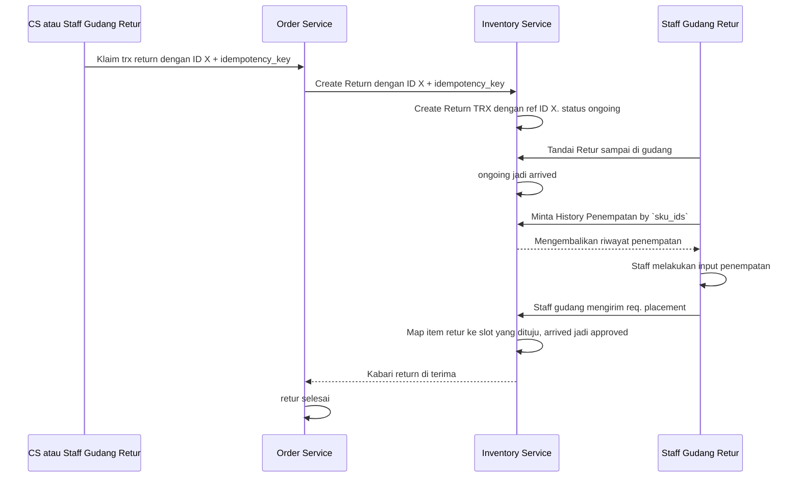

# Alur Return

## Berikut Alur Utama antar Service



## Ketentuan Transaksi Return

- Transaksi `return` berasal dari transaksi `order` dari `order service`.
- Gudang penerima return bisa jadi beda dengan gudang yang memproses orderan.
- Dalam 1 transaksi return bisa memuat: `barang dia sendiri`, `barang dari cross team`
- permintaan transaksi return bisa dibuat oleh:
    - cs / yang membuat orderan.
    - pihak gudang, misal ada paket tiba di gudang dan staff tahu itu paket return
      tapi dari pihak cs belum membuat transaksi return.

## Payload Return

```proto

message CreateReturnPayload {
    option (warehouse.role_base.v1.request_policy) = { roles: [/* dipanggil Order Service — pola antar-service belum ada */] };

    uint64              team_id = 1 [(buf.validate.field).uint64.gt = 0];        // tim pengorder — Melati, pemilik transaksi retur
    uint64              warehouse_id = 2 [(buf.validate.field).uint64.gt = 0];   // gudang retur — dari konfigurasi retur tim
    uint64              ref_order_id = 3 [(buf.validate.field).uint64.gt = 0];   // order 78
    string              take_ref = 4 [(buf.validate.field).string.min_len = 1];  // K-78 — idempotency_key saat order dibuat
    uint64              created_by = 5 [(buf.validate.field).uint64.gt = 0];     // yang mengklaim — Ani (CS) atau Budi (staff)
    ReturnSource        source = 6 [(buf.validate.field).enum = { defined_only: true, not_in: [0] }];
    optional uint64     shipping_id = 7;   // kurir retur, kalau diketahui
    optional string     receipt = 8;       // resi retur, kalau ada
    repeated ReturnItem items = 9 [(buf.validate.field).repeated.min_items = 1];
}

enum ReturnSource {
    RETURN_SOURCE_UNSPECIFIED = 0;
    RETURN_SOURCE_CS = 1;          // CS mengklaim lebih dulu
    RETURN_SOURCE_WAREHOUSE = 2;   // paket tiba lebih dulu, gudang mem-force
}

message ReturnItem {
    uint64 sku_id = 1 [(buf.validate.field).uint64.gt = 0];          // sku sekarang, milik tim pengorder — MLT-KAOS-01
    uint64 origin_sku_id = 2 [(buf.validate.field).uint64.gt = 0];   // sku saat order — TKB-KAOS-01; sama dengan sku_id kalau barang sendiri
    uint64 count = 3 [(buf.validate.field).uint64.gt = 0];
    // ⏸ harga — dibahas nanti
}

message CreateReturnResponse {
    uint64 tx_id = 1;
}


```
