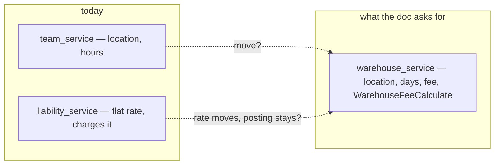
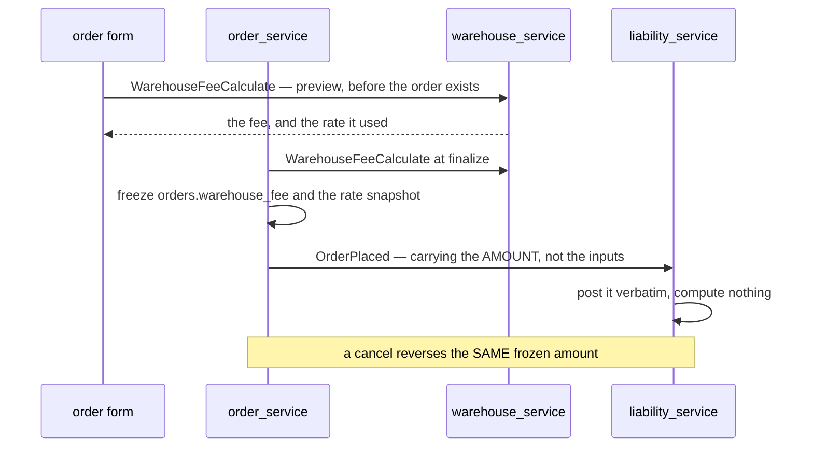
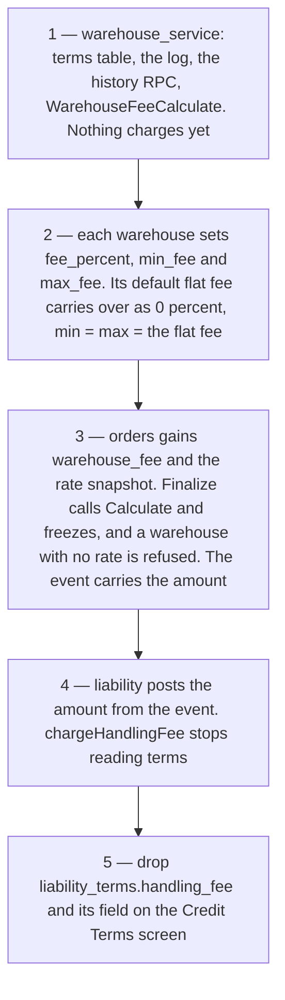
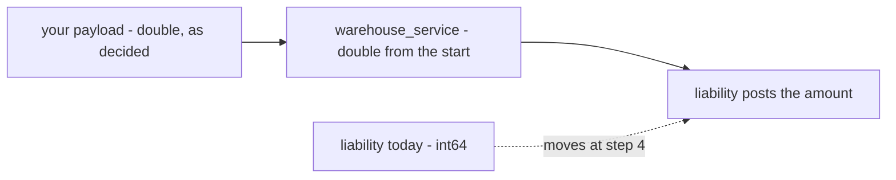
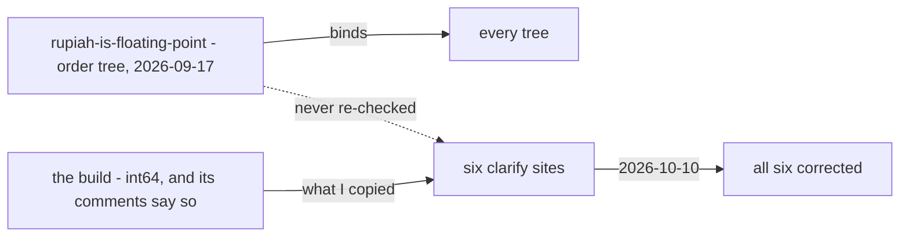

# Clarity — warehouse `context.md`

What [context.md](./context.md) leaves open. **That doc is yours — this one is mine.** Answered points are
deleted, so this file is always the current open set; what you settle goes in `context_decision.md`.

> ✅ **Answered 2026-10-10 and deleted:** [is-the-money-an-integer-rupiah](#question). **No:** money is `double`, as your
> payload has it, by [rupiah-is-floating-point](../../order/context_decision.md#rupiah-is-floating-point). My `int64` and basis points are withdrawn throughout this file. They argued
> from the build's `int64`, were written the day before that decision, and were never re-checked after it: [my-clarifies-kept-int64-after-double-was-decided](#my-clarifies-kept-int64-after-double-was-decided).

> 🆕 **First pass, 2026-09-16.** Three of the four things the doc asks for **already exist somewhere else in the
> build** — the location and the open/close grid are a shipped table in `team_service`, and the order fee is a
> shipped **flat** rate in `liability_service`. So the first question is not *how do we build this*, it is
> **what does `warehouse_service` TAKE OVER**, and what happens to the rate that is already charging money.
>
> 🔄 **Revised the same day — you added the `WarehouseFeeCalculate` payload.** ✅ It settles two things I had
> asked for: the RPC takes a **basis, not an `order_id`** (so `warehouse_service` never depends on
> `order_service`), and it **echoes the rate it used**, which is what makes a charge explainable months later.
> ✅ **Then §Responsbility 2 settled the biggest question in this file** — *warehouse gives the RPC, balance
> handles and records, order calls it*. Recorded as
> [warehouse-prices-balance-records](./context_decision.md#warehouse-prices-balance-records), and it closes the
> ownership fork outright: the rate lives where the calculation lives, balance is **told** the amount, and the
> number is fixed when the order calls. What is left of it is one narrow question — whether
> `liability_terms.handling_fee`, which stores a rate and computes from it **today**, is
> [dropped](#is-the-old-flat-rate-column-dropped).
>
> ⛔ **The payload still opens two sharper ones:** the request names **no selling team**, which
> both kills the per-pair rate liability already charges **and** leaves the message with no `use_scope` field, so
> the access interceptor cannot scope it · and it prices **one** warehouse per call, so the order form comparing
> three is three round trips.

Siblings: [order](../order/context_clarify.md) · [balance](../balance/context_clarify.md) ·
[inventory](../inventory/context_clarify.md) · [technical/balance](../../technical/balance/team_balance_design_clarify.md).

---

## What is already built, before anything is designed

| what your doc asks for | where it lives TODAY | shape today |
| --- | --- | --- |
| Location Info | `team_service.warehouse_infos.location` | one free-text line, no region codes |
| Open/Close Order Day | `team_service.warehouse_infos.receiving_hours` + `operating_hours` | a weekly JSONB grid, ⛔ **read by nobody — no RPC consults it** |
| Fee Configuration | `liability_service.liability_terms.handling_fee` | a **flat rupiah amount per order**, per creditor→debtor **pair**, `0` = charge nothing |
| `WarehouseFeeCalculate` | nothing | the fee is computed **inside liability**, from the `OrderPlaced` push, and never returned to anyone. Your payload is the first statement of it as a contract — see [the proto](#the-payload-as-i-would-write-it) |
| `orders.warehouse_fee` *(order context)* | nothing | ⛔ the column does not exist — no order stores what it was charged |



---

## Proposed Design

### a-warehouse-is-a-warehouse-team

A warehouse is **a team of `TEAM_TYPE_WAREHOUSE`**, and `warehouse_id` everywhere in the build is that team's
id — on `orders`, on every stock row, on every rack, on `warehouse_products`. Keep it. `warehouse_service`
then owns the **profile of a warehouse team**, never a second identity.

**→ Recommend:** one profile row per warehouse team, `UNIQUE (warehouse_id)`. A team that opens a second
building becomes a **second team** — that keeps stock, racks and orders addressable by one id with no
migration. If a team must ever run two buildings under one balance, say so now, because it changes the grain
of `stock`, `racks` and `orders.warehouse_id` and nothing else about this design.

### the-warehouse-profile-moves-out-of-team-service

`warehouse_infos` is a warehouse-only table sitting in the service that owns **identity**. Your doc claims its
two columns for `warehouse_service`.

**→ Recommend: move it.** `team_service` goes back to *who exists*, `warehouse_service` owns *what a warehouse
is like* — location, calendar, fee. Splitting them instead (fee here, hours there) means a warehouse profile
screen has to call two services, and the owner of one property cannot say who owns the other.

| step | |
| --- | --- |
| 1 | `warehouse_service/db_migrations` creates `warehouses` (location) + `warehouse_days` + `warehouse_fee_terms` |
| 2 | one-off backfill copies `team_service.warehouse_infos` across, then drops it |
| 3 | `WarehouseInfoDetail` / `WarehouseInfoUpdate` move to `warehouse.warehouse.v1` — the two frontend call sites change with them |

### the-fee-is-a-percent-with-a-floor-and-a-cap

🔄 *(2026-10-19)* **A floor and a cap**, as recommended ([the-fee-has-a-floor-and-a-cap](./context_decision.md#the-fee-has-a-floor-and-a-cap)), and **one rate per warehouse** ([one-rate-per-warehouse](./context_decision.md#one-rate-per-warehouse)).
Money is float ([rupiah-is-floating-point](../../order/context_decision.md#rupiah-is-floating-point)). What I still add is the cap's meaning.

```
fee = clamp( goods_cost * fee_percent / 100 , min_fee , max_fee )
```

| field | type | meaning |
| --- | --- | --- |
| `fee_percent` | `double` | 2.5 = 2.5%, as your payload has it |
| `min_fee` | `double` | ✅ decided, default 0 = no floor. Above `max_fee` is refused when saved; equal means a flat fee |
| `max_fee` | `optional double` | ⚠ **absent = uncapped, and `0` must be REFUSED.** `liability_terms.credit_limit` already carries this trap — nil is unlimited, 0 is nothing — and it is the one field in that table with a warning comment on it |
| no row at all | — | 🔄 **refused**, never charged nothing ([a-warehouse-with-no-rate-takes-no-orders](./context_decision.md#a-warehouse-with-no-rate-takes-no-orders)). `0%` is how a warehouse charges nothing |

### the-payload-as-i-would-write-it

Your payload, and the same contract with the two changes now decided: `team_id` as the scope, and `min_fee`. The shape and the types are yours —
the changes are fields.

```proto
// what you wrote                          // what I would write
message WarehouseFeeCalculateRequest {
  double order_total = 1;                  //  double order_total    — as you wrote
  uint64 warehouse_id = 2;                 //  uint64 warehouse_id
                                           //  uint64 team_id        — the ORDERING team: the scope only, never a rate key
}

message WarehouseFeeCalculateResponse {
  uint64 warehouse_id = 1;                 //  uint64 warehouse_id
  double order_total = 2;                  //  double order_total    — echoed back as given
  double max_fee = 3;                      //  optional double max_fee — ABSENT = uncapped
  double fee_percent = 4;                  //  double fee_percent   — as you wrote
                                           //  double min_fee       — the floor, default 0
  double calculated_warehouse_fee = 5;     //  double calculated_warehouse_fee — frozen by the order
}
```

| change | why |
| --- | --- |
| **`team_id` in the request** | 🔄 *(2026-10-19)* **the scope only**: one rate per warehouse ([one-rate-per-warehouse](./context_decision.md#one-rate-per-warehouse)). A request message carries its team as a field (`use_scope`), never a header, the same as inventory's `OrderTransactionCreateRequest`. Without it the policy collapses to *root/admin only* |

🔄 *(2026-10-10)* **My *what it ROUNDS to* line is withdrawn.** It was there so an `int64` ledger would not truncate a
`double` fee, and the ledger is float too ([every-ledger-keeps-money-as-float64](../../../technical/ledger/mutation_and_ledger_decision.md#every-ledger-keeps-money-as-float64)).
The fee is computed once and frozen ([the-order-freezes-the-fee-and-the-ledger-posts-it](#the-order-freezes-the-fee-and-the-ledger-posts-it)),
so the frozen and the posted number are already one number.

### the-order-freezes-the-fee-and-the-ledger-posts-it

The fee must be computed **once**, at finalize, and stored. Today liability recomputes it from its own terms
when the push arrives — so a rate edited between commit and delivery charges a number the order never saw.



| | |
| --- | --- |
| the RPC is **pure** | it reads config, writes nothing, and knows nothing about orders — which is what lets the form preview a fee for a warehouse the seller has not chosen yet |
| ✅ it takes a **basis**, not an `order_id` | **your payload says so** — `order_total` + `warehouse_id`. `warehouse_service` never depends on `order_service` to price work |
| ✅ it returns the **rate snapshot** | **your payload says so** — it echoes `max_fee` and `fee_percent`, so a disputed charge can be explained months later. `min_fee` is echoed too |
| ✅ it is **one warehouse** | per call, as your payload has it ([the-fee-is-priced-one-warehouse-at-a-time](./context_decision.md#the-fee-is-priced-one-warehouse-at-a-time)) |
| history | no effective-dating. The order froze the amount, and a `warehouse_fee_terms_log` records who changed the rate and when — the pattern `liability_terms_log` already uses |

### the-rate-moves-in-five-steps

The elaboration of [who-owns-the-rate-after-this](#who-owns-the-rate-after-this). **What is true today, read
off the code** — this is what any answer has to survive:

| | today |
| --- | --- |
| the rate | `liability_terms.handling_fee`, `int64`, **flat per order**, grain `(creditor, debtor)` with `counterparty_id = 0` as the default row |
| the lookup | `termsFor(warehouse, seller)` → the pair's row, else the default, else nothing |
| nothing configured | **charges nothing.** Also: no warehouse on the order, or the warehouse IS the seller → nothing |
| when it is charged | on the `OrderPlaced` **push**, at-least-once, idempotent on `(source_type, source_id, counterparty)` — **not at order time** |
| the reversal | ⚠ `ReverseOrder` **reads back what was charged** and never recomputes, *"a rate changed between placement and cancellation would make it disagree by design"* |
| governance already built | actor on every edit · a **`reason` required** when the editor is not the creditor's own person · `liability_terms_log` · `LiabilityTermsHistoryList` |
| what the order keeps | **nothing.** The fee exists only as a ledger row |

⚠ **The reversal leg is the argument.** Liability already refuses to recompute a fee it once posted, for exactly
the reason the charge leg should not compute one either: the rate can change underneath. Half of that principle
is shipped.

**The fork, and why it is not really three-sided:**

| | |
| --- | --- |
| ✅ **A — the rate moves**, balance posts what it is handed | **DECIDED** — [warehouse-prices-balance-records](./context_decision.md#warehouse-prices-balance-records). One owner, one number. Same shape as [the-cross-markup-belongs-to-the-product](../balance/context_decision.md#the-cross-markup-belongs-to-the-product) |
| **B — the rate stays**, `warehouse_service` only calculates | ⛔ ruled out: `WarehouseFeeCalculate` would be a proxy for another service's column, and `warehouse_service` would own nothing it can answer for |
| **C — both hold a copy** | ✅ ruled out: `handling_fee` is dropped as the last step of the move ([the-flat-rate-is-dropped-last](./context_decision.md#the-flat-rate-is-dropped-last)) |

**Five steps, each deployable on its own, none of them changing a charge:**



🔄 *(2026-10-19)* **Only a seller's own rate changes on the day of step 4.** A warehouse's default flat fee still carries over
exactly, as `0%` with floor = cap ([the-fee-has-a-floor-and-a-cap](./context_decision.md#the-fee-has-a-floor-and-a-cap)). A seller with its own flat row (`counterparty_id ≠ 0`) has no
equivalent under [one-rate-per-warehouse](./context_decision.md#one-rate-per-warehouse), and pays the warehouse's rate from that day: [is-the-old-flat-rate-column-dropped](#is-the-old-flat-rate-column-dropped).

⚠ **Two things must travel with the rate or the move is a regression** (the pair grain was dropped by
[one-rate-per-warehouse](./context_decision.md#one-rate-per-warehouse), and *nothing configured = charge nothing* reversed by
[a-warehouse-with-no-rate-takes-no-orders](./context_decision.md#a-warehouse-with-no-rate-takes-no-orders)): the **actor + `reason`** on every edit · the **history** RPC. They
are both built in liability today, and none of them is in your field list.

### closed-means-refused

An open/close grid nothing consults is decoration — that is its state today.

| | → |
| --- | --- |
| order create / finalize names a warehouse closed at that moment | **refuse**, naming the day and the next opening |
| the warehouse picker | shows closed warehouses **disabled**, with the reason |
| timezone | one, fixed: **Asia/Jakarta**. A per-warehouse timezone is a real feature only when a warehouse sits outside WIB |
| one-off dates | the weekly grid cannot say *Idul Fitri*. **→ Recommend a `warehouse_closures` exception list** (date, reason) beside the grid |
| receiving vs operating | keep both, and be explicit: **`receiving_hours` gates orders, `operating_hours` gates restock and return arrival** |

---

## Critique

| | Problem | → Recommend |
| --- | --- | --- |
| **flat-vs-percent-is-a-live-rate-change** | `liability_terms.handling_fee` is charging money **today**, flat per order. 🔄 *(2026-10-19)* A warehouse's **default** flat fee carries over as `0%`, floor = cap; a **per-seller** flat fee has no form under one rate per warehouse | carry the default row over exactly, and tell a seller with its own row the day its charge changes. Never a silent reinterpretation of the old column |
| **nobody-reads-the-calendar** | `receiving_hours` has a table, a proto, an editor and a test, and **no caller** — an order can be placed into a warehouse that is shut | [closed-means-refused](#closed-means-refused) |
| **location-is-free-text** | one string cannot be matched against `region_service`, cannot suggest the nearest warehouse, and cannot fill a courier pickup form. `orders` already freezes provinsi→desa codes **and** names for exactly this reason | the same shape as the order address: codes + names + `address_line`, with the free text kept as the last line |
| **who-may-change-a-price-others-pay** | `WarehouseInfoUpdate` is `WAREHOUSE_OWNER` / `WAREHOUSE_ADMIN`. A fee is money other teams owe — a rate edited unilaterally at 2am changes every order placed after it | the rate is writable by `ROOT`/`ADMIN` **and** the warehouse owner, every edit is logged with the actor, and the seller sees the rate on the order form before finalizing. If a rate is meant to be *agreed* rather than *set*, that is a different feature and worth saying |
| **the-fee-is-invisible-to-the-payer** | nothing in the doc lets a selling team **see** a warehouse's rate before choosing it. Today the first sight of the charge is a ledger row | `WarehouseFeeCalculate` is callable by any authenticated team, pricing the caller's own order, and the order form shows the chosen warehouse's fee ([the-fee-is-priced-one-warehouse-at-a-time](./context_decision.md#the-fee-is-priced-one-warehouse-at-a-time)) |
| **responsibility-is-one-line** | *"manage warehouse teams"* is the only stated responsibility, and it is the one thing `team_service` already does. What is **not** ours is unwritten — stock is inventory's, the balance is liability's, the racks are inventory's | a *Whats Not* section, like the order context has. It is what stops this service growing into the warehouse's everything |

---

## Question

### does-order-total-include-shipping
✅ **Answered by your docs and closed (2026-10-19):** the basis is `goods_cost`, goods only — [order/context.md](../../order/context.md)
line 42 and [order_creation.md](../../order/order_creation.md) line 84 ([the-fee-is-priced-on-goods-cost](./context_decision.md#the-fee-is-priced-on-goods-cost)).
Kept as a heading so the links into it hold.


### does-the-request-name-the-selling-team
✅ **Answered and closed (2026-10-19):** one rate per warehouse, the same for every seller ([one-rate-per-warehouse](./context_decision.md#one-rate-per-warehouse)),
against my per-seller override. `team_id` stays in the request as the scope only. Kept as a heading so the links into it hold.

### does-a-min-fee-exist
✅ **Answered and closed (2026-10-19):** yes, `min_fee`, default 0 ([the-fee-has-a-floor-and-a-cap](./context_decision.md#the-fee-has-a-floor-and-a-cap)), as recommended, after a
first *no* the same day. Kept as a heading so the links into it hold.

### what-does-it-return-when-nothing-is-configured
✅ **Answered and closed (2026-10-19):** an error. The order is refused until the warehouse sets its fee ([a-warehouse-with-no-rate-takes-no-orders](./context_decision.md#a-warehouse-with-no-rate-takes-no-orders)),
against my *charge nothing, with a `configured` flag*. Kept as a heading so the links into it hold.

### does-it-price-several-warehouses-at-once
✅ **Answered and closed (2026-10-19):** no, one warehouse per call ([the-fee-is-priced-one-warehouse-at-a-time](./context_decision.md#the-fee-is-priced-one-warehouse-at-a-time)), as recommended. That
reversed my own `repeated`: the form picks one warehouse, where the stock is. Kept as a heading so the links into it hold.

### is-the-old-flat-rate-column-dropped
✅ **Answered and closed (2026-10-19):** yes, dropped as the last of five steps ([the-flat-rate-is-dropped-last](./context_decision.md#the-flat-rate-is-dropped-last)), as recommended.
[technical/balance Q8](../../../technical/balance/team_balance_design_clarify.md#question)'s rename is moot. Kept as a heading so the links into it hold.

### how-does-the-amount-reach-balance
✅ **Answered and closed (2026-10-19):** stored on the order and carried on `OrderPlaced` as `warehouse_fee`
([the-event-carries-the-warehouse-fee](./context_decision.md#the-event-carries-the-warehouse-fee)), as recommended. Kept as a
heading so the links into it hold.

### does-the-warehouse-profile-move-out-of-team-service
`warehouse_infos` (location + both weekly grids) lives in `team_service` and is built. Does it move whole into
`warehouse_service`? **→ Recommend yes, in one migration** — otherwise the warehouse profile is owned by two
services and the doc is true of neither.

### what-does-a-closed-day-actually-do
Refuse the order · warn and allow · queue it to the next open day. And does it gate **restock arrival** too?
**→ Recommend refuse for orders (`receiving_hours`) and refuse for arrivals (`operating_hours`)**, both naming
the next opening. Today neither is read at all.

### are-there-one-off-closures
The weekly grid cannot express a public holiday. **→ Recommend a `warehouse_closures` date list** with a
reason, read by the same check.

### is-the-fee-refunded-on-return-or-lost
✅ **Overtaken and closed (2026-10-19):** a return keeps the fee ([a-return-keeps-both-fees](../../order/context_decision.md#a-return-keeps-both-fees)),
`lost` triggers nothing and is settled by hand ([a-lost-parcel-is-settled-by-hand](../../order/context_decision.md#a-lost-parcel-is-settled-by-hand)),
and a cancel refunds it in full ([a-cancel-refunds-the-warehouse-fee-in-full](../../order/context_decision.md#a-cancel-refunds-the-warehouse-fee-in-full)).
Kept as a heading so the links into it hold.


### is-a-warehouse-ever-two-buildings
Everything built assumes `warehouse_id` is a warehouse **team**. If one team can run two locations, that
changes `stock`, `racks` and `orders.warehouse_id` — not this service. **→ Recommend one team per building.**

### what-is-NOT-the-warehouse-services-job
Stock, racks and opname are inventory's. The balance and the posting are liability's. Identity and membership
are team's. **→ Recommend a *Whats Not* section** naming those four, as the order context has.

---

# Contradiction

## the-fee-rate-would-exist-in-two-services

✅ *(2026-10-19)* **Resolved by decision:** all four sites go in the move's five steps, and the rename is moot ([the-flat-rate-is-dropped-last](./context_decision.md#the-flat-rate-is-dropped-last)).
⚠ Live in the code until built. Kept as a heading so the links into it hold.

## money-is-a-double-here-and-an-integer-everywhere-else

*"`double order_total` … `double max_fee` … `double calculated_warehouse_fee`"* (§Rpc That Must Exist). Meanwhile the
build stores money as `int64`: over 100 `int64` fields with money names (`total`, `price`, `cost`, `fee`…) across the
protos, against 10 `double` fields, all in `financial_account`. [expense.proto](../../../proto/warehouse/expense/v1/expense.proto)
even states `int64` as the rule in a comment.

🔄 *(2026-10-10)* **Which is wrong: the BUILD, not your payload.** I first said the opposite. Your `double` follows
[rupiah-is-floating-point](../../order/context_decision.md#rupiah-is-floating-point) (2026-09-17), which already records
that *"it reverses the build everywhere"*. The build has not moved yet.

**→ Recommend** `warehouse_service` is built `double` from the start, as your payload is. Liability's `int64` moves in
the same change that makes it post the amount from the event (step 4 of
[the move](#the-rate-moves-in-five-steps)), so the fee crosses no type boundary once it
is live.



## my-clarifies-kept-int64-after-double-was-decided

*(2026-10-10)* **One cause, six sites.** [rupiah-is-floating-point](../../order/context_decision.md#rupiah-is-floating-point)
was decided in the **order** tree and binds every tree. My clarifies argued from the build, which is `int64`, instead of
from the decision. Most were written before it and never re-checked after it.

| site | what I wrote | now |
| --- | --- | --- |
| this file, first pass 2026-09-16 | `int64` and basis points for the fee, and called your `double` wrong | rewritten: your types stand ([money-is-a-double-here-and-an-integer-everywhere-else](#money-is-a-double-here-and-an-integer-everywhere-else)) |
| [cost Critique 3](../../../technical/cost/design_clarify.md), 2026-08-27 | `int64` for cost | deleted, answered by [every-ledger-keeps-money-as-float64](../../../technical/ledger/mutation_and_ledger_decision.md#every-ledger-keeps-money-as-float64) |
| [team balance](../../../technical/balance/team_balance_design_clarify.md) | an `int64` ERD, a fee rounded half-up to `int64`, the markup moved to basis points | rewritten to `float64`, and the markup verdict reversed |
| stock design Q4 and its contradiction | `int64` valuation | answered against me: [stock-money-is-float64-compared-at-4-digits](../../../technical/stock/design_decision.md#stock-money-is-float64-compared-at-4-digits) |
| ledger template Q2 and Critique 1 | integer minor-units for payments | answered against me: [every-ledger-keeps-money-as-float64](../../../technical/ledger/mutation_and_ledger_decision.md#every-ledger-keeps-money-as-float64) |
| [excel_readers](../../../technical/packages/excel_readers/context_clarify.md#i-recommended-int64-rupiah-against-a-decision-that-had-already-settled-double), 2026-09-24 | `int64` in the reader | already recorded there |

**→ Recommend** two things, so it does not happen a seventh time:
1. **The code comments that state `int64` as the rule are what I kept copying**: `expense.proto` (*"Money is whole
   rupiah as int64, like every other money field in this system"*) and `liability.proto`. Correct each one in the change
   that moves its context to `double`.
2. **A system-wide rule decided in one tree needs a line where every tree is read.** One line in `CLAUDE.md`, *money is
   `double` / `float64`, per rupiah-is-floating-point*, is the first thing every agent reads. That is your call, and I
   have not added it.



## the-warehouse-profile-is-already-owned-elsewhere

*"Property or Field that must Have — Location Info, Open/Close Order Day info"* (this doc) — while
[database-schema.md](../../database-schema.md) has **`warehouse_infos`** holding exactly those, in
`team_service`, with `WarehouseInfoDetail` / `WarehouseInfoUpdate` shipped and a frontend editor on them.
**Which is wrong:** neither — they are the same requirement written twice, in two services.
**→ Recommend** [the move](#the-warehouse-profile-moves-out-of-team-service), so one of them stops being true.

## the-order-fee-column-the-order-context-promises-is-not-built

*"`warehouse_fee`"* in [order/context.md](../order/context.md) §Table That Must Have — while no `warehouse_fee`
column, field or proto exists anywhere in the build, and the amount lives **only** as a `liability_entries` row
posted after the fact. **Which is wrong:** the build. **→ Recommend** the freeze
([does-the-order-freeze-the-fee](#does-the-order-freeze-the-fee)) — it is the same change that makes this
column mean something.

---

# Awaiting

- **What the fee is FOR, in the warehouse's words** — per order, per line, per unit, per volume? A percent of
  money says the warehouse is paid as a commission on sales, which is a business stance worth stating
  explicitly, because everything downstream (returns, short picks, cross-product orders) inherits it.
- **Whether a warehouse can refuse a selling team outright** — today a seller picks any warehouse and the fee
  decides the price. A *not accepting new sellers* state is unwritten.
- **Capacity** — nothing yet says a warehouse can be full, or that an order can be refused for volume.
