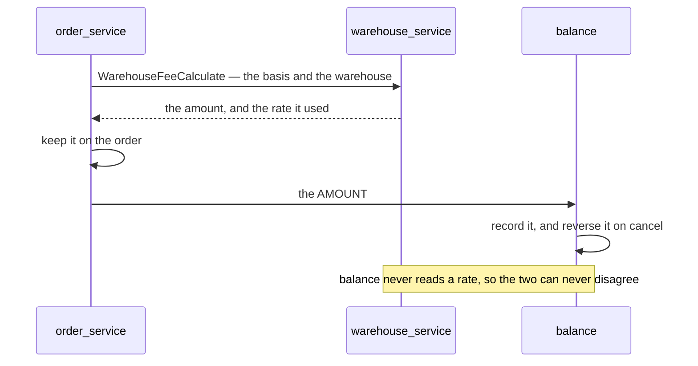
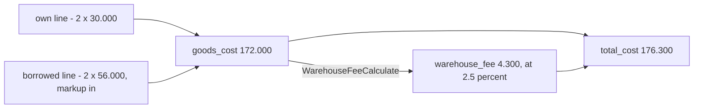
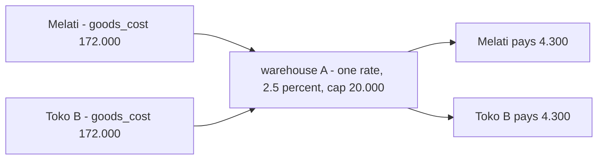
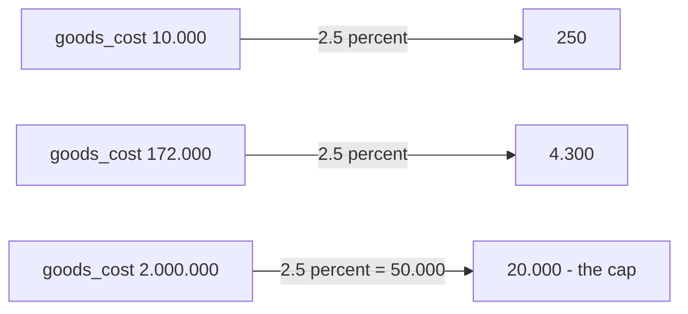
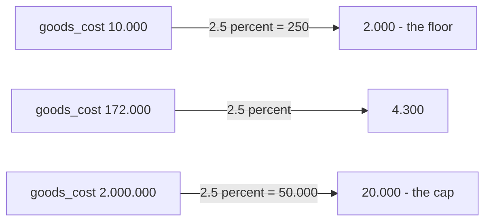
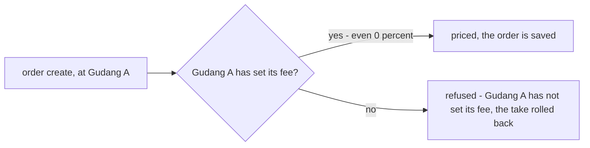
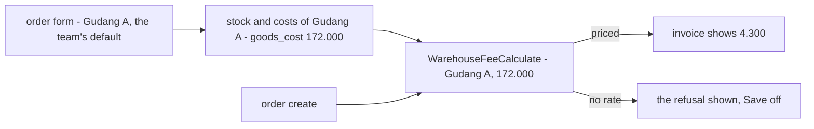
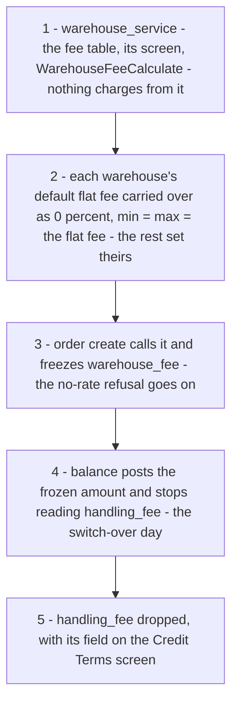
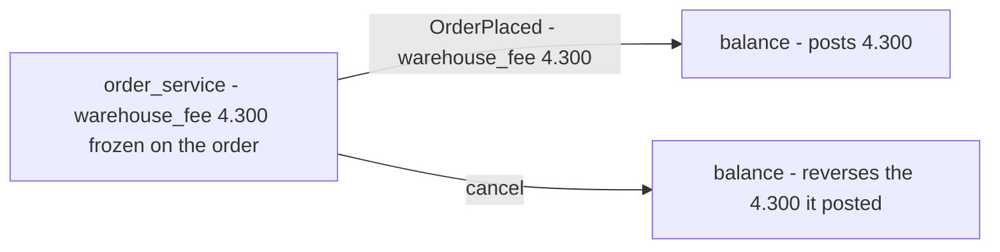
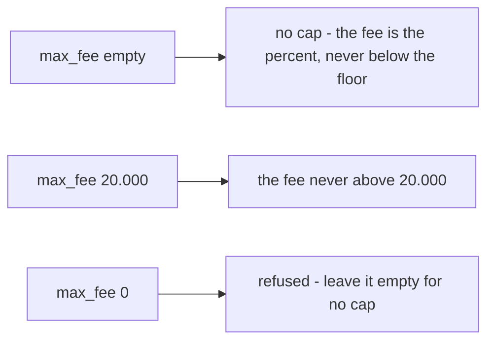

# Decisions — warehouse `context.md`

What the owner decided, recorded before it is acted on. **Append-only** — a reversal is a new entry that renames
the old one, never an edit to it (HARD RULE 12). The open set lives in [context_clarify.md](./context_clarify.md).

| decision | in one line |
| --- | --- |
| [warehouse-prices-balance-records](#warehouse-prices-balance-records) | `warehouse_service` owns the rate and calculates it, `order_service` calls, `balance` handles and records |
| [the-fee-is-priced-on-goods-cost](#the-fee-is-priced-on-goods-cost) | The fee's basis is the order's `goods_cost`: what the goods cost the seller, never shipping or the sale price |
| [one-rate-per-warehouse](#one-rate-per-warehouse) | One fee rate per warehouse, the same for every seller. `team_id` in the request is the scope only |
| ~~[superseded-the-fee-has-a-cap-and-no-floor](#superseded-the-fee-has-a-cap-and-no-floor)~~ | ⛔ superseded by [the-fee-has-a-floor-and-a-cap](#the-fee-has-a-floor-and-a-cap): the owner changed their mind the same day |
| [the-fee-has-a-floor-and-a-cap](#the-fee-has-a-floor-and-a-cap) | `fee = clamp(goods_cost × fee_percent / 100, min_fee, max_fee)`, `min_fee` default 0 |
| [a-warehouse-with-no-rate-takes-no-orders](#a-warehouse-with-no-rate-takes-no-orders) | An order at a warehouse that never set its fee is refused. `0%` is a rate |
| [the-fee-is-priced-one-warehouse-at-a-time](#the-fee-is-priced-one-warehouse-at-a-time) | `WarehouseFeeCalculate` prices one warehouse per call, as your payload has it |
| [the-flat-rate-is-dropped-last](#the-flat-rate-is-dropped-last) | `liability_terms.handling_fee` is dropped, as the last of five steps. Tech balance Q8 is moot |
| [an-empty-cap-means-no-cap](#an-empty-cap-means-no-cap) | `max_fee` is optional: empty = no cap, and a cap of 0 is refused when saved |
| [the-event-carries-the-warehouse-fee](#the-event-carries-the-warehouse-fee) | `OrderPlaced` carries the frozen `warehouse_fee`; balance posts it and computes nothing |

---

## warehouse-prices-balance-records

**Decided 2026-09-16**, written into `context.md` §Responsbility 2:

> *"for `warehouse_fee` warehouse service just give rpc for calculate. how the fee handle and recorded is
> responsbility of [balance](../balance/context.md) and called by [order](../order/context.md)"*

It settles the fork this context opened with — three services, three jobs, no overlap.

| service | owns | does NOT |
| --- | --- | --- |
| `warehouse_service` | the fee **configuration** (§Property 3) and the **calculation** (`WarehouseFeeCalculate`) | never posts, never records, never knows an order exists |
| `order_service` | **calling** it, and carrying the answer | never computes a rate |
| `balance` / `liability_service` | **handling and recording** — the entry, the reversal, the balance | **stops computing the fee.** A service that does not own the rate cannot derive the amount |



**What follows from it, and is therefore not open any more:**

1. **The rate lives in `warehouse_service`.** The calculation is warehouse's, and a calculation needs the config
   it reads — they cannot sit in different services.
2. **`balance` is TOLD the amount.** With no rate to read, it has nothing to compute from. This is already how
   its **reversal** leg behaves: `ReverseOrder` reads back what was charged and never recomputes, *"a rate
   changed between placement and cancellation would make it disagree by design"*.
3. **The fee is fixed when the order calls** — *called by order*, not at push time. The number the seller is
   shown, the number the order keeps and the number balance records are one number.

⚠ **What it does NOT settle**, and is still open in the clarify: whether `liability_terms.handling_fee` — the
flat rate balance stores and computes from **today** — is dropped in the same change
([is-the-old-flat-rate-column-dropped](./context_clarify.md#is-the-old-flat-rate-column-dropped)). Leaving it is
how the system ends up with two rates by accident.

🔄 *(2026-10-19)* **Settled:** dropped, as the last step of the move ([the-flat-rate-is-dropped-last](#the-flat-rate-is-dropped-last)).

---

## the-fee-is-priced-on-goods-cost

> Owner, in [order/context.md](../../order/context.md) line 42: *"`goods_cost`, goods only, used for warehouse fee charge
> calculation"* — and in [order_creation.md](../../order/order_creation.md) line 84: *"goods_cost, for the warehouse fee"*.
> Found 2026-10-19; it answers [does-order-total-include-shipping](./context_clarify.md#does-order-total-include-shipping).
> Against my *goods `subtotal`* in one respect only: the basis is what the goods **cost**, not what they **sold** for.

**The verdict.** The warehouse fee is priced on the order's `goods_cost`: the sum of the line totals, which is what the
goods cost the selling team. That means own lines at their cost, and borrowed lines at the owner's cost plus markup. Shipping
is never in it, because the order records none
([an-order-records-no-shipping-cost](../../order/context_decision.md#an-order-records-no-shipping-cost)).



**The spec.**

| | |
| --- | --- |
| the basis | `goods_cost` = Σ line `total`, frozen at create ([a-lines-money-is-frozen-at-finalize](../../order/context_decision.md#a-lines-money-is-frozen-at-finalize)) |
| never | shipping, the sale price, `marketplace_total` |
| a borrowed line | priced with its markup in, so the fee follows what the goods cost the seller |
| the payload | your `order_total` field is fed `goods_cost`. Renaming it is yours: `goods_cost` would say what it is |

---

## one-rate-per-warehouse

> Owner, in chat (2026-10-19): *"no need specific or exclusive fee for a few seller"* — to
> [does-the-request-name-the-selling-team](./context_clarify.md#does-the-request-name-the-selling-team), *"can a warehouse
> charge different sellers a different rate?"*. **Against my recommendation** (a default rate plus a per-seller override).

**The verdict.** A warehouse has **one** fee rate, the same for every seller. There's no per-seller row and no override.
The request still names the ordering team, but only as the permission scope. The rate never depends on it.



**The spec.**

| | |
| --- | --- |
| the rate | one per warehouse: `fee_percent` and `max_fee`, its fee configuration ([context.md](./context.md) §Property 3) |
| a per-seller rate | none: no pair table, no override row |
| `team_id` in the request | the ordering team, as the permission **scope** only, the same as inventory's `OrderTransactionCreateRequest`. Never a rate key |
| today's per-seller rows | `liability_terms` rows with `counterparty_id ≠ 0` hold a flat `handling_fee` per seller. They have no equivalent, and go with [is-the-old-flat-rate-column-dropped](./context_clarify.md#is-the-old-flat-rate-column-dropped) |

---

## superseded-the-fee-has-a-cap-and-no-floor

> ⛔ **SUPERSEDED 2026-10-19** by [the-fee-has-a-floor-and-a-cap](#the-fee-has-a-floor-and-a-cap): the owner changed their
> mind the same day, *"sorry, i change my mind, minimal fee seems good"*.

> Owner, in chat (2026-10-19): *"no, just max_fee enough"* — to
> [does-a-min-fee-exist](./context_clarify.md#does-a-min-fee-exist). **Against my recommendation** (`min_fee`, default 0).

**The verdict.** The fee is a percent of `goods_cost` with a ceiling, `max_fee`, and no floor. A small order pays its
percent, however small. The configuration is exactly your §Property 3: `fee_percent` and `max_fee`, nothing added.

```
fee = min( goods_cost × fee_percent / 100 , max_fee )
```



**The spec.**

| | |
| --- | --- |
| the formula | `min(goods_cost × fee_percent / 100, max_fee)`, on [the-fee-is-priced-on-goods-cost](#the-fee-is-priced-on-goods-cost) |
| the configuration | `fee_percent` and `max_fee`, per warehouse ([one-rate-per-warehouse](#one-rate-per-warehouse)) |
| a small order | pays its percent: 10.000 at 2.5% is 250 |
| today's flat fee | **can't be carried over.** With no floor and one rate per warehouse, a flat amount has no percent form, so every seller's charge changes on the day the percent goes live: [is-the-old-flat-rate-column-dropped](./context_clarify.md#is-the-old-flat-rate-column-dropped) |
| `max_fee` unset | 🔄 *(2026-10-21)* decided: empty = no cap, 0 refused — [an-empty-cap-means-no-cap](#an-empty-cap-means-no-cap). Was: not decided. I propose absent = uncapped and `0` refused ([the-fee-is-a-percent-with-a-cap](./context_clarify.md#the-fee-is-a-percent-with-a-floor-and-a-cap)) |

---

## the-fee-has-a-floor-and-a-cap

> Owner, in chat (2026-10-19): *"sorry, i change my mind, minimal fee seems good"* — on
> [does-a-min-fee-exist](./context_clarify.md#does-a-min-fee-exist), reversing
> [superseded-the-fee-has-a-cap-and-no-floor](#superseded-the-fee-has-a-cap-and-no-floor) the same day. As recommended:
> `min_fee`, defaulting to 0.

**The verdict.** The fee is a percent of `goods_cost`, never below `min_fee` and never above `max_fee`. Packing a small
order is the same work as a big one, so a warehouse may set a floor. `min_fee` defaults to 0, so a warehouse that sets
none charges its plain percent.

```
fee = clamp( goods_cost × fee_percent / 100 , min_fee , max_fee )
```



**The spec.**

| | |
| --- | --- |
| the formula | `clamp(goods_cost × fee_percent / 100, min_fee, max_fee)`, on [the-fee-is-priced-on-goods-cost](#the-fee-is-priced-on-goods-cost) |
| the configuration | `fee_percent`, `min_fee`, `max_fee`, one set per warehouse ([one-rate-per-warehouse](#one-rate-per-warehouse)). `min_fee` is new beside your §Property 3 |
| `min_fee` | `double`, default 0, where 0 means no floor |
| `min_fee` above `max_fee` | refused when saved. Equal is allowed, and means a flat fee |
| the response | echoes `min_fee` beside `fee_percent` and `max_fee`, so a charge can be explained later |
| today's flat fee | a warehouse's **default** flat fee carries over exactly: `fee_percent` 0, `min_fee` = `max_fee` = the flat fee. A seller's own flat row has no equivalent ([one-rate-per-warehouse](#one-rate-per-warehouse)): [is-the-old-flat-rate-column-dropped](./context_clarify.md#is-the-old-flat-rate-column-dropped) |
| `max_fee` unset | 🔄 *(2026-10-21)* decided: empty = no cap, 0 refused — [an-empty-cap-means-no-cap](#an-empty-cap-means-no-cap). Was: not decided. I propose absent = uncapped and `0` refused ([the-fee-is-a-percent-with-a-floor-and-a-cap](./context_clarify.md#the-fee-is-a-percent-with-a-floor-and-a-cap)) |
| ✅ built *(2026-10-21)* | the formula in [warehouse_v1/service.go](../../../../backend/services/warehouse_service/warehouse_v1/service.go), pinned on the worked examples above; a floor above the cap is refused by the handler and the table |

---

## a-warehouse-with-no-rate-takes-no-orders

> Owner, in chat (2026-10-19): *"yes, i like this"* — to *"the other option is to refuse the order until the warehouse sets a
> rate"*, on [what-does-it-return-when-nothing-is-configured](./context_clarify.md#what-does-it-return-when-nothing-is-configured).
> **Against my recommendation** (charge nothing, and a `configured` flag).

**The verdict.** An order placed at a warehouse that has never set its fee is **refused**. Nothing is charged silently, and
no order goes through with a fee nobody chose. A warehouse that wants to charge nothing sets `0%`, which is a rate.



**The spec.**

| | |
| --- | --- |
| set | the warehouse has a fee row. `0%` with `min_fee` 0 counts: that is a warehouse choosing to charge nothing |
| `WarehouseFeeCalculate`, not set | an error (`FailedPrecondition`) naming the warehouse: *"Gudang A has not set its fee"*. Never a number |
| the response | no `configured` flag. A warehouse with no rate never gets a fee back |
| in order create | the fee call fails the transaction, and the take is rolled back like any failed step. [order_creation.md](../../order/order_creation.md) already says *"If Any Step Fails, Rollback Transaction and Return Error"*, so it needs no new box |
| the order form | proposed: a warehouse with no rate is shown disabled, with the reason, so a seller rarely meets the refusal |
| the rollout | proposed, the same as [create-refuses-a-team-with-no-return-warehouse](../../order/context_decision.md#create-refuses-a-team-with-no-return-warehouse): 1. the fee table and its screen · 2. a rate for every warehouse, where the carry-over gives one to each warehouse with a default flat fee today · 3. the refusal. Never in one commit |
| ✅ the refusal in the calculation, built *(2026-10-21)* | `WarehouseFeeCalculate` answers `FailedPrecondition` naming the warehouse. The settings card warns a warehouse with no fee. Order create does not call it yet — step 3 |
| ✅ the refusal in order create, built *(2026-10-22)* | the refusal reaches the form unchanged, before any stock moves — so nothing is rolled back because nothing was taken. The form shows it under the warehouse picker and keeps Save off; the draft page lists it among Promote's reasons. The proposed *"shown disabled"* in the picker was not built — it is a proposal |
| 🔄 changed *(2026-10-23)* | the fee is now priced AFTER the take, on the cost of the units it drew ([an-order-is-costed-at-what-leaves-the-shelf](../../order/context_decision.md#an-order-is-costed-at-what-leaves-the-shelf)) — so a warehouse with no rate refuses once the take has happened, and the take is released under the same key, as this decision's own spec allows. The form still refuses such a warehouse before Create, so in practice nothing is taken |
| ✅ step 4 built *(2026-10-29)* | **the switch-over.** `OrderPlaced.warehouse_fee` carries the order's frozen fee ([the-event-carries-the-warehouse-fee](#the-event-carries-the-warehouse-fee)); liability's `chargeWarehouseFee` posts it and `chargeHandlingFee` is gone, with the terms lookup it used. `liability_terms.handling_fee` is read by nothing but step 2's carry-over; the Credit Terms field says it is no longer charged, and the Warehouse Fee card says an order keeps the fee it was placed at. Step 5 is not built |
| ✅ step 5 built *(2026-10-29)* | liability `00011` drops `liability_terms.handling_fee` and rebuilds `liability_terms_non_negative` over the limit alone; `handling_fee` (3) is reserved on `LiabilityTerms` and `LiabilityTermsSetRequest`; the Credit Terms dialog and the pair detail's terms panel lose the field. `liability_terms_logs.old_/new_handling_fee` stay, as history, never written again. **Also removed, because it read the column:** step 2's `san warehouse carry-over-fees`, its `dev setup` step, `liability_v1.DefaultHandlingFees`, `team_v1.WarehouseTeamIDs` and `warehouse_v1.CarryOverFlatFees`. ⚠ A database must have run the carry-over before `00011`; after it the flat fees are gone. `seed dev` now writes Dev Warehouse's worked example only when it has no rate. **The rollout is complete** |

---

## the-fee-is-priced-one-warehouse-at-a-time

> Owner, in chat (2026-10-19): *"yes i follow your recomendation"* — to
> [does-it-price-several-warehouses-at-once](./context_clarify.md#does-it-price-several-warehouses-at-once). As recommended,
> which reversed my own earlier *`repeated` items in and out*: the order form picks one warehouse, where the stock is, and
> never compares several by fee.

**The verdict.** `WarehouseFeeCalculate` prices **one** warehouse per call, as your payload has it. There's no list in
and no list out.



**The spec.**

| | |
| --- | --- |
| the request | `order_total` (fed `goods_cost`), `warehouse_id`, `team_id` (the scope). One warehouse |
| the response | one fee and the rate it used: `fee_percent`, `min_fee`, `max_fee`, `calculated_warehouse_fee` |
| order create | calls it once per order, inside its transaction ([order_creation.md](../../order/order_creation.md)) |
| the order form | calls it once for the chosen warehouse. That replaces the mock fee in [order-create/index.tsx](../../../../frontend/src/pages/order-create/index.tsx) (`mockTerms(warehouseId).handlingFee`) |
| a refusal on the form | its message is shown and Save stays off ([a-warehouse-with-no-rate-takes-no-orders](#a-warehouse-with-no-rate-takes-no-orders)) |
| later | a list can be added if a screen ever compares warehouses. Adding a field is cheap |
| ✅ built *(2026-10-21)* | `WarehouseFeeCalculate` ([warehouse_fee_calculate.go](../../../../backend/services/warehouse_service/warehouse_v1/warehouse_fee_calculate.go)), echoing the percent, floor and cap it used. The order form still shows its mock fee: that call lands with step 3, so the form never shows a fee the ledger is not yet charging |
| ✅ the form and order create call it *(2026-10-22)* | the form through `useWarehouseFeeQuote` (fed Σ quantity × HPP), order create once per order in-process, before its transaction. ⚠ Between step 3 and step 4 the form shows the warehouse's fee while the ledger still posts the flat fee — the same amount for a carried-over warehouse, a different one for a warehouse that set its own percent |

---

## the-flat-rate-is-dropped-last

> Owner, in chat (2026-10-19): *"yes, follow your recomendation"* — to
> [is-the-old-flat-rate-column-dropped](./context_clarify.md#is-the-old-flat-rate-column-dropped). As recommended. It also
> closes [technical/balance Q8](../../../technical/balance/team_balance_design_clarify.md#question), the rename of the same
> column, as moot.

**The verdict.** `liability_terms.handling_fee` is **dropped**, as the **last** step of moving the rate to `warehouse_service`,
never earlier. There is one fee rate at a time: the flat one until the switch-over day, and the warehouse's percent after it.



**The spec.**

| | |
| --- | --- |
| dropped | `liability_terms.handling_fee`, its proto fields, and its field on the Credit Terms screen ([TermsEditDialog.tsx](../../../../frontend/src/features/liability/TermsEditDialog.tsx)) |
| kept | `liability_terms_log`'s `old_handling_fee` and `new_handling_fee`, as history, never written again · `credit_limit` |
| retired | `chargeHandlingFee` at step 4. Liability computes no fee, it posts the order's frozen `warehouse_fee` |
| when | step 5, after step 4 has switched balance to the frozen amount. Each step ships on its own |
| the switch-over day | a seller on the warehouse's default flat fee pays the same ([the-fee-has-a-floor-and-a-cap](#the-fee-has-a-floor-and-a-cap)). A seller with its own flat row pays the warehouse's rate from then on, and is told beforehand |
| technical/balance Q8 | moot: the column is dropped, not renamed to `order_fee` |
| ✅ step 1 built *(2026-10-21)* | `warehouse_service`: `warehouse_fees` (warehouse `00001`), `WarehouseFeeDetail` · `WarehouseFeeSet` · `WarehouseFeeCalculate`, and the **Warehouse Fee** card on a warehouse's Settings, which says the rate is not charged yet. Nothing charges from it. Steps 2–5 are not built |
| ✅ step 2 built *(2026-10-22)* | `san warehouse carry-over-fees`, also a step of `san dev setup`: each WAREHOUSE team's default `liability_terms` row (`counterparty_id = 0`) becomes `0%`, floor = cap = its `handling_fee`; a default of 0 becomes `0%`, no floor, no cap — it charges nothing today and still does. A warehouse that already has a rate is never overwritten; a second run carries nothing. Read through `liability_v1.DefaultHandlingFees` and `team_v1.WarehouseTeamIDs`, written by `warehouse_v1.CarryOverFlatFees` ([docs/tools/san.md](../../../tools/san.md)). `seed dev` gives Dev Warehouse its own flat fee carried, or the worked example 2.5% / 2.000 / 20.000 when it has none |
| ✅ step 3 built *(2026-10-22)* | `placeOrder` (both doors) calls `WarehouseFeeCalculate` on the order's `cogs` and freezes `orders.warehouse_fee` (selling `00019`), refusing a warehouse with no rate before any stock moves. The order form and the draft page show the real fee and keep Save / Promote off on a refusal; `mockTerms`' fee is gone. The list's Beli, its summary and the order detail read the frozen fee. Flow: [selling rpc.md](../../../services/selling_service/rpc.md). Steps 4–5 are not built: the ledger still posts the flat fee |
| 🔄 changed *(2026-10-23)* | the fee is now priced AFTER the take, on the cost of the units it drew ([an-order-is-costed-at-what-leaves-the-shelf](../../order/context_decision.md#an-order-is-costed-at-what-leaves-the-shelf)) — so a warehouse with no rate refuses once the take has happened, and the take is released under the same key, as this decision's own spec allows. The form still refuses such a warehouse before Create, so in practice nothing is taken |

---

## the-event-carries-the-warehouse-fee

> Owner, in chat (2026-10-19): *"yes, follow your recomendation"* — to
> [how-does-the-amount-reach-balance](./context_clarify.md#how-does-the-amount-reach-balance), *"does the `OrderPlaced` event
> carry the warehouse fee amount?"*. As recommended.

**The verdict.** `OrderPlaced` carries `warehouse_fee`, the amount frozen on the order. Balance posts that number and
computes nothing. It never calls order_service back to ask. A cancel reverses what was posted, so the cancel carries no
amount.



**The spec.**

| | |
| --- | --- |
| the field | `warehouse_fee` on `OrderPlaced`, a `double` ([rupiah-is-floating-point](../../order/context_decision.md#rupiah-is-floating-point)) |
| where it comes from | `orders.warehouse_fee`, frozen at create ([order_creation.md](../../order/order_creation.md) line 86) |
| balance | posts it verbatim from step 4 of [the-flat-rate-is-dropped-last](#the-flat-rate-is-dropped-last): no lookup, no call back |
| a fee of 0 | posts no row, as today |
| the cancel | reverses what was posted. `ReverseOrder` already reads back the charge, so no amount rides on the cancel |
| the same event change | each line gains its `total` ([the-ledger-charges-the-frozen-line-total](../../../technical/balance/team_balance_design_decision.md#the-ledger-charges-the-frozen-line-total)) |
| ✅ built *(2026-10-29)* | `optional double warehouse_fee = 12` on `OrderPlaced`, set from `orders.warehouse_fee` by `placeOrder`'s publish. Liability posts it as the `ORDER_FEE` to the fulfilling warehouse; the cancel reverses it through `ReverseOrder`, unchanged. Pinned by `TestOrderCreate_TheEventCarriesTheFrozenWarehouseFee` and `TestChargeOrder_TheFlatRateIsNoLongerRead` |
| ⚠ my reading, not asked | **unset is not 0.** An order placed before fees were frozen (NULL) carries no field, and liability posts nothing for it rather than falling back to the flat rate. **Rounding:** liability's entries are still `BIGINT`, so the fee is rounded half-up once at its edge, as the product fee and the restock courier charge already are. The frozen fee itself stays unrounded, and when a frozen figure is rounded is still open ([rupiah-is-floating-point](../../order/context_decision.md#rupiah-is-floating-point)) |

---

## an-empty-cap-means-no-cap

> Owner, in chat (2026-10-21): *"i follow your recomendation"* — to *"if a warehouse leaves `max_fee` empty, is the fee
> uncapped?"*, the row [the-fee-has-a-floor-and-a-cap](#the-fee-has-a-floor-and-a-cap) left *not decided*. As recommended.

**The verdict.** `max_fee` is **optional**. Empty means **no cap**. A cap of **0 is refused** when saved: it would make every
fee 0, and `0%` is already how a warehouse charges nothing.



**The spec.**

| | |
| --- | --- |
| `max_fee` | `optional double`, `> 0` when present |
| the formula | `max(goods_cost × fee_percent / 100, min_fee)`, then `min(…, max_fee)` only when a cap is set |
| `min_fee` above `max_fee` | refused when saved, as decided; equal is a flat fee |
| why not 0 = no cap | `liability_terms.credit_limit` already carries that trap — nil is unlimited, 0 is nothing — and it is the one field in that table that needed a warning comment |
| ✅ built *(2026-10-21)* | `max_fee` is `optional double` with `gt: 0` in the proto and `CHECK (max_fee > 0)` in `warehouse_fees`; the settings card refuses a 0 before sending and sends an empty cap as no cap |
