# Database schema

The authoritative schema is the goose migrations under
`backend/services/<service>/db_migrations/` — this document mirrors them for humans. **Keep it in
sync: any migration that changes the schema updates this file in the same commit** (HARD RULE 3).

Each service owns its own tables. **There are no cross-service foreign keys** — a service refers to
another's rows by an *opaque id* it never joins on (it resolves them over RPC, e.g.
`team_service.TeamByIds`). Those logical links are described in the prose and are not enforced by
the database.

---

## team_service

`backend/services/team_service/db_migrations/`

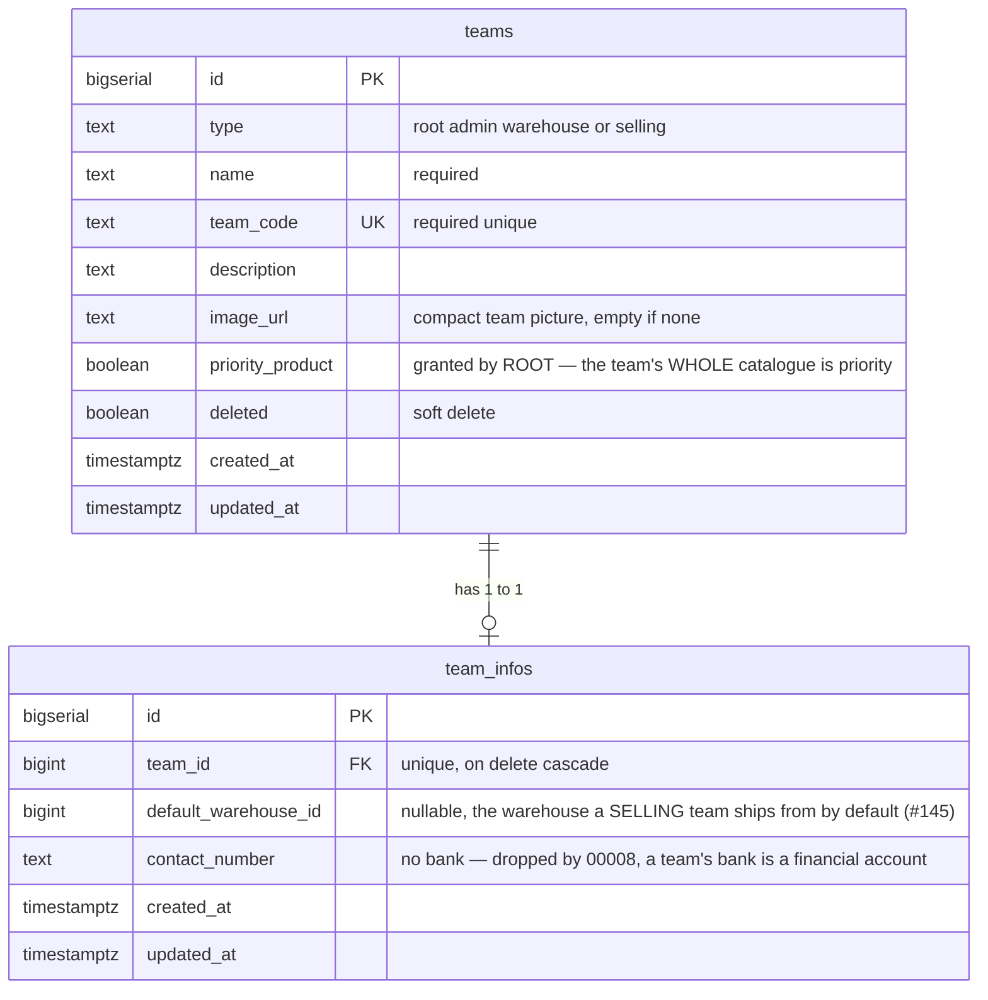

- **`teams`** — one row per team (a warehouse *is* a team). Root-ness is
  structural: `CHECK ((type = 'root') = (id = 1))` ties `id = 1` and `type = 'root'` together so the
  hardcoded root-team scope in the access interceptor can never drift from the data. Indexes:
  `UNIQUE (team_code)`, a partial `(type) WHERE deleted = FALSE`, and a partial
  `(id) WHERE priority_product AND NOT deleted`.
  - **`priority_product`** — the priority-product feature, granted by **ROOT**, applying to the team's
    **whole catalogue**: every product it owns is a priority product to everybody discovering products.
    It backs the product picker's *Priority Product* tab.

    On the **team** rather than on each product, because the decision is about a team — one write,
    and automatically true of everything the team adds later, with no backfill when a team is granted
    the feature. In **`teams`** rather than `team_infos` for a policy reason, not a layout one:
    `TeamInfoUpdate` is callable by `ROLE_SELLING_OWNER`, so a capability granted by root must not live
    in a message a team owner can write, or a team could grant itself the feature.

    ⚠ **`product_service` never reads this column** — it cannot, because `teams` belongs to
    `team_service` and cross-service joins are forbidden (HARD RULE 3). The caller reads the priority
    **team ids** from `TeamList(filter.priority_product_only)` and passes them to `ProductDiscover` as
    `owner_team_ids` / `exclude_owner_team_ids`, so `product_service` filters by ids it was handed and
    never learns what "priority" means. One flag, one owner, two independent schemas.

    ⚠ **How root SETS it is not designed yet** (owner) — the column and the read path landed first, so
    no RPC writes it today.
- **`team_infos`** — 1:1 with `teams` (`UNIQUE (team_id)`, which is what makes `TeamInfoUpdate` a
  real `ON CONFLICT` upsert).
  - **No return warehouse and no return user (00009).** The return warehouse is the order context's
    `team_return_configurations` (selling_service, below), which order create reads without calling
    this service; the return user was read by nothing. Both columns were dropped, not copied — nothing
    had read them.
  - **`default_warehouse_id`** (#145) — the warehouse a SELLING team ships from by default. Every
    order must name a warehouse (#72), and a team almost always ships from the same building, so this
    is that answer held once rather than asked every time.
    It is a **default, not a rule**: the order form pre-fills an *untouched* field with it, the person
    may still choose another, and the server keeps refusing an order that names none. A server-side
    fallback would quietly undo that refusal — which exists so a warehouse-less order cannot reach the
    database at all.
- **`warehouse_infos`** — ⛔ **dropped** (`00010`): the warehouse profile moved to warehouse_service
  ([the-warehouse-profile-lives-in-warehouse-service](business/teams/warehouse/context_decision.md#the-warehouse-profile-lives-in-warehouse-service)).

---

## user_service

`backend/services/user_service/db_migrations/`

```mermaid
erDiagram
    users ||--o{ user_team_roles : "member of"
    users ||--o{ team_member_logs : "whose membership changed"
    users |o--o{ team_member_logs : "who changed it"
    users ||--o{ agent_credentials : "connected an AI agent"
    users ||--o{ agent_oauth_codes : "allowed an agent"
    agent_oauth_clients ||--o{ agent_oauth_codes : "client_id, no FK"
    agent_oauth_clients ||--o{ agent_credentials : "client_id, no FK"

    users {
        bigserial   id                  PK
        text        name
        text        username            UK "unique on lower, required"
        text        password            "bcrypt hash, empty means cannot log in"
        text        email               UK "unique on lower when set"
        text        phone_number        UK "+ and country code, unique when set"
        boolean     is_suspended        "default false"
        text        avatar_url          "profile picture thumbnail url"
        timestamptz last_password_reset "nullable"
        timestamptz erased_at           "nullable, set once by UserErase"
        timestamptz created_at
        timestamptz updated_at
    }

    user_team_roles {
        bigserial   id         PK
        bigint      team_id    "opaque cross-service id, no FK to teams"
        bigint      user_id    FK "on delete cascade"
        bigint      role       "role_base.v1.Role enum number"
        timestamptz created_at
        timestamptz updated_at
    }

    team_member_logs {
        bigserial   id            PK
        bigint      team_id       "opaque cross-service id, no FK to teams"
        bigint      actor_user_id FK "nullable, null when actor_agent is set"
        text        actor_agent   "a tools/san developer, else empty"
        bigint      user_id       FK
        smallint    action        "1 add, 2 change role, 3 remove"
        bigint      role_before   "0 before an add"
        bigint      role_after    "0 after a removal"
        boolean     is_override   "Root or the Administrator, not a member"
        timestamptz created_at
    }

    agent_oauth_clients {
        bigserial   id            PK
        text        client_id     UK "agent_ + random"
        text        client_name   "what the agent calls itself"
        jsonb       redirect_uris "exact match only"
        timestamptz created_at
    }

    agent_oauth_codes {
        bigserial   id             PK
        text        code_hash      UK "SHA-256, the code is never stored"
        text        client_id
        bigint      user_id        FK
        bigint      team_id        "opaque, 0 = every team"
        text        name
        text        redirect_uri
        text        code_challenge "PKCE S256"
        timestamptz expires_at     "5 minutes"
        timestamptz used_at        "spent once"
        timestamptz created_at
    }

    agent_credentials {
        bigserial   id           PK
        text        token_hash   UK "SHA-256, the bearer is never stored"
        bigint      user_id      FK
        bigint      team_id      "opaque, 0 = every team"
        text        name         "named by the person"
        text        client_id
        text        client_name
        timestamptz created_at
        timestamptz expires_at   "90 days"
        timestamptz last_used_at "stamped at most once a minute"
        timestamptz revoked_at
    }

    team_agent_policies {
        bigint      team_id             PK "opaque"
        boolean     members_may_connect "CS and staff, off by default"
        bigint      updated_by_user_id  FK
        timestamptz updated_at
        boolean     is_override         "the last setter was Root or the Administrator, not a member (00012)"
    }
```

- **`users`** — the identity table. An empty `password` is a deliberate "cannot log in" marker
  (bcrypt never matches an empty hash), used by the seeded root account until a password is set.
  Case-insensitive uniqueness on both `username` and (non-empty) `email`. `erased_at` marks an account erased on
  request ([an-erased-account-is-final](business/user/context_decision.md#an-erased-account-is-final)): set once, never
  cleared, and a CHECK (`users_erased_is_suspended`) keeps such an account suspended for good. `phone_number` is
  stored in ONE form, `+` and the country code (`+6281234567890`), and **unique when set** — `users_phone_unique` (`00008`)
  ([a-phone-is-saved-in-international-form](business/user/context_decision.md#a-phone-is-saved-in-international-form),
  [a-phone-or-email-belongs-to-one-account](business/user/context_decision.md#a-phone-or-email-belongs-to-one-account)). The
  handlers write that form (`normalizePhone`); `00008` rewrote the stored ones with `user_phone_international(text)`, its
  SQL twin, which stays for that test. A number it could not read was left as it was. `00007`'s `user_phone_key` and its
  index are dropped by `00008`.
- **`user_team_roles`** — a user's role within a team. `role` stores the raw proto `Role` enum
  *number* (not a Postgres enum — proto enums are open). `UNIQUE (team_id, user_id)` is load-bearing:
  the authorization read takes one row, and it is what makes `TeamUserUpdate` an upsert. `team_id`
  is opaque — **no FK to `team_service.teams`** (that would couple the two services' databases);
  team display data is resolved over RPC, never joined. Its `alias` column was dropped in `00009`
  ([a-user-is-name-username-email-phone-and-photo](business/user/context_decision.md#a-user-is-name-username-email-phone-and-photo)).
- **`team_member_logs`** — the membership log
  ([every-role-change-is-logged](business/user/context_decision.md#every-role-change-is-logged)): one row per add,
  role change and removal, written in the **same transaction** as the `user_team_roles` change, so a membership
  never changes without its row. **Append-only** — never updated, never deleted. A CHECK makes each row a real
  change (an add has no role before it, a removal none after, a role change two different roles); nothing
  changing writes nothing. Read newest first per team, and per person within a team — indexes
  `(team_id, id DESC)` and `(team_id, user_id, id DESC)`.
- **`agent_oauth_clients`, `agent_oauth_codes`, `agent_credentials`, `team_agent_policies`** (`00011`) — the AI
  agents a person connects to read through the MCP ([our-server-hosts-the-mcp](business/mcp/context_decision.md#our-server-hosts-the-mcp)).
  A **client** is an agent that registered itself (RFC 7591) — public, no secret, PKCE instead; its redirects match
  **exactly**. A **code** is the connect page's one-time grant — 5 minutes, spent by the `UPDATE … WHERE used_at IS NULL`
  that reads it, so a code mints one credential. A **credential** is the agent's own
  ([an-agent-gets-its-own-team-credential](business/mcp/context_decision.md#an-agent-gets-its-own-team-credential)) — named, one team or every team
  (`team_id = 0`, root's, [a-roots-agent-reads-every-team](business/mcp/context_decision.md#a-roots-agent-reads-every-team)), 90 days, revoked one by
  one; codes and bearers are kept as SHA-256 only. Indexed `(user_id, id DESC)` for /profile and `(team_id, id DESC)` for
  the owner's list. **`team_agent_policies`** is the owner's switch for CS and staff
  ([the-owner-decides-who-connects-an-agent](business/mcp/context_decision.md#the-owner-decides-who-connects-an-agent)) — no row reads as off.
- **`is_override`** — Root or the Administrator wrote it inside a team they hold no role in
  ([an-override-is-stamped-in-every-service](business/user/context_decision.md#an-override-is-stamped-in-every-service)).
  `team_member_logs` has it from `00005`; `team_agent_policies` from `00012`, where it follows the last setter as
  `updated_by_user_id` does. Every service stamps the same answer, `san_auth.IsOverride`: a person, a scoped request, and
  no role in that team. Rows from before the column read false. `agent_credentials` is not stamped — `AgentConnect` is
  unscoped (team `0` is "every team"), so there is no team for the rule to read.

---

## shipment_service

`backend/services/shipment_service/db_migrations/` — design: [business/shipment/context_decision.md](business/shipment/context_decision.md)

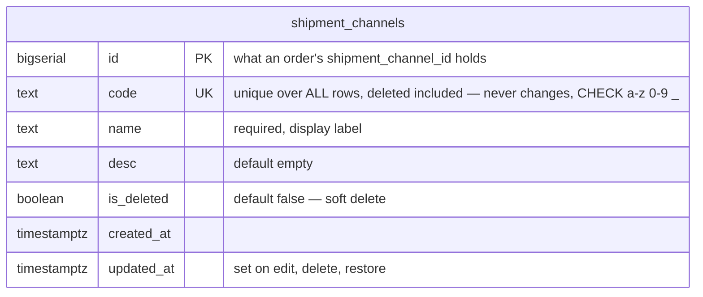

- **`shipment_channels`** — the courier catalogue, one row per COURIER (never courier + service level).
  Seeded with `jne`, `jnt`, `sicepat` (00001) and `spx`, `grabexpress`, `jntcargo`, `idexpress`, `lex`, `anteraja`,
  `gosend`, `pos` (00002, the-channels-are-what-orders-ship-by), because it must exist in production too.
  Curated by root only. No relations — it stands alone; other services hold its `id` (or, until the
  order redesign, its `code`) with no FK.
- **The unique index on `code` is PLAIN, not partial.** A deleted channel keeps its code, and creating
  that code again is refused in favour of restore — a partial index would let a second `jne` split the
  orders and the third-party app's mapping between two ids.

## shipping_service — REMOVED

⚠ **The service is gone; its TABLE is not.** `shipping_service` was replaced by `shipment_service` on
2026-09-16 — see [the-old-catalogue-bridges-by-code](business/shipment/context_decision.md#the-old-catalogue-bridges-by-code).
No drop migration was written: one service's migration never touches another's table (HARD RULE 3), so
an existing database keeps an unused `shippings` table and `shipping_service_version`, and a fresh one
never creates them. Rows that still store a courier code outside the new seed (`anteraja`, `tiki`, …)
render as the raw code until root creates that channel.

---

## product_service

`backend/services/product_service/db_migrations/`

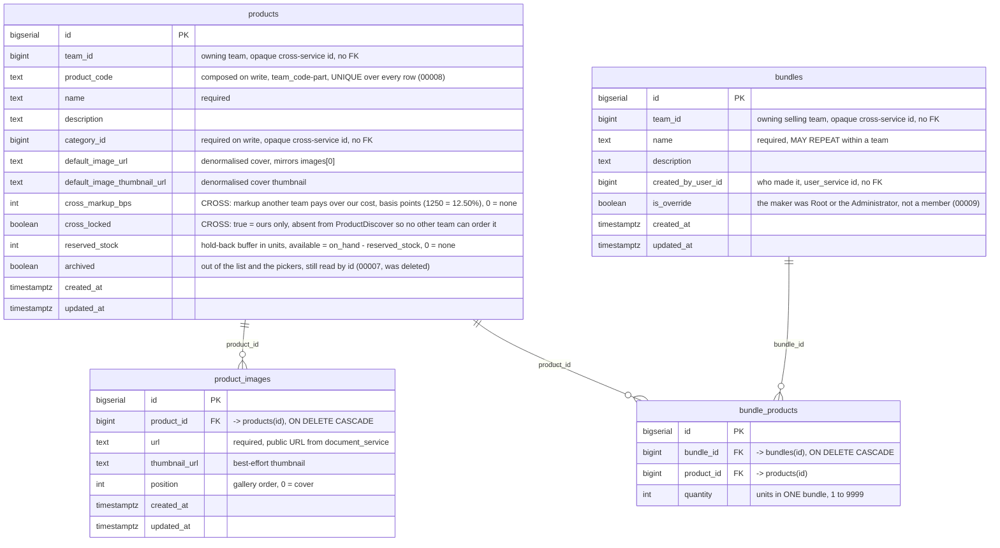

- **`products`** — a team's catalogue items. Every RPC is team-scoped (`team_id` carries
  `use_scope`), so a product is only ever reachable within its owning team. **`product_code`** (00008, renamed from
  `sku`) is the product's one code, **composed on write**: the team sends its part and product_service stores
  `<team_code>-<part>`, the team code read from team_service ([the-field-is-product-code-composed-on-write](business/product/context_decision.md#the-field-is-product-code-composed-on-write)).
  It is **unique over every row** (`products_product_code_unique`) — an archived product keeps its code, so Unarchive
  cannot collide; only a Delete, of a never-used product, frees one. 00008 replaced the partial per-team index
  `(team_id, sku) WHERE archived = FALSE`, suffixing `-<id>` onto every row but the oldest of a code two rows shared,
  and `san product recompose-codes` puts each team's code in front of the rows written before. **`archived`** (00007, renamed from `deleted`): a product
  with any HISTORY — a stock movement, an order line, a restock line — is archived, never deleted; one with none is
  removed for good by `ProductDelete` ([a-used-product-is-archived-never-deleted](business/product/context_decision.md#a-used-product-is-archived-never-deleted)). `team_id` is opaque — no FK to
  `team_service.teams`. `category_id` is likewise an **opaque cross-service id** (a `category_service`
  node, no FK); it is **required on write** (the handler rejects 0), `DEFAULT 0` only so pre-existing
  rows survive the migration. `default_image_url` / `default_image_thumbnail_url` are the
  **denormalised cover** (mirror of the first `product_images` row) so a list renders a picture
  without a join.
- **`product_images`** — a product's gallery, **up to 5** (enforced by the handler + proto, not the
  DB), ordered by `position` (0 = cover). `url`/`thumbnail_url` are produced by the two-phase
  `document_service` upload (resource type `PRODUCT_IMAGE`, served at a stable public URL) and stored
  verbatim. `ProductUpdate` replaces the whole set when its `images` wrapper is present. `ON DELETE
  CASCADE` covers `ProductDelete`, which removes only a never-used product; an archived one keeps its images.
- **`bundles`** (`00006`) — a selling team's **picking recipes** ([product_bundle.md](business/product/product_bundle.md)):
  no stock, no price. The name **may repeat** within a team, so there is no unique index on it. A bundle is
  **hard-deleted**, because no order refers to one — the order form expands it into product lines and keeps no link
  back. `bundles_team_updated_idx (team_id, updated_at DESC, id DESC)` serves BundleList's default order.
  **`is_override`** (`00009`) is set once at create, beside the creator: Root or the Administrator made it inside a team
  they hold no role in ([an-override-is-stamped-in-every-service](business/user/context_decision.md#an-override-is-stamped-in-every-service)).
- **`bundle_products`** — one product per bundle and how many go into one bundle: `UNIQUE (bundle_id, product_id)`,
  `CHECK (quantity BETWEEN 1 AND 9999)`. Whose product it is comes from `products.team_id` — **no copy** on the line.
  `product_id` is a real FK (same service); a product is only ever archived, so the FK never blocks, and an archived
  product's line keeps naming it. `bundle_products_product_idx (product_id)` serves the search's join.

---

## selling_service

`backend/services/selling_service/db_migrations/`

```mermaid
erDiagram
    shops ||--o{ shop_users : "shop_id"
    shops ||--o{ orders : "shop_id"
    orders ||--|| order_addresses : "order_id, exactly one"
    orders ||--o{ order_items : "order_id"
    orders ||--o{ order_timeline_logs : "order_id"
    order_drafts ||--|| order_draft_addresses : "order_draft_id, exactly one"
    order_drafts ||--o{ order_draft_items : "draft_id"
    team_return_configurations
    product_return_maps

    shops {
        bigserial   id          PK
        bigint      team_id     "owning SELLING team, opaque cross-service id, no FK"
        text        name        "required"
        text        shop_code   "required, unique per team among OPEN shops (00043)"
        text        marketplace "Marketplace enum as text (shopee, tokopedia, …); no CHECK"
        text        description
        text        status      "open or closed - CHECK; replaced deleted (00043)"
        timestamptz closed_at   "set exactly while closed - CHECK"
        timestamptz created_at
        timestamptz updated_at
    }

    shop_users {
        bigserial   id         PK
        bigint      shop_id    FK "-> shops(id), ON DELETE CASCADE"
        bigint      user_id    "opaque user_service id, no FK, indexed (user_id, shop_id) (00039)"
        boolean     is_primary "the shop's primary CS, at most one per shop, partial unique (00014)"
        timestamptz created_at
    }

    orders {
        bigserial   id               PK
        bigint      team_id          "owning SELLING team, opaque, no FK"
        bigint      shop_id          FK "-> shops(id)"
        text        status           "OrderStatus as text, the eleven (00015) — default pending; no CHECK"
        text        buyer_username   "the buyer's marketplace username (00021), trimmed. Optional — '' = none, NOT NULL. The customer and the address are its order_addresses row since 00045"
        bigint      shipment_channel_id "the COURIER - an opaque shipment_service channel id, no FK, nothing else about it stored (00044, shipment-channel-is-an-id-into-shipment-service). Required at create, checked in code (no-order-without-a-courier). 0 only on a dev row from before 00044 - shipping_code dropped, no fill"
        double      goods_cost         "the owner's goods_cost - sum of the lines' frozen total, a borrowed line WITH its markup; the warehouse fee's basis. Exact, never rounded; 0 = unknown, not free (cogs until 00027). A double since 00042"
        double      total_cost         "the owner's total_cost - goods_cost + warehouse_fee, frozen at create (00027). Unrounded, CHECK >= 0; back-filled with a NULL fee as 0"
        double      platform_total     "the owner's platform_total - what the buyer paid on the platform (marketplace_total until 00026). Required at placement since 00022, checked in code; 0 only before that. A double since 00041, frozen exact at placement"
        text        order_external_ref_id "the MARKETPLACE'S own id for this order, verbatim; '' = none. Indexed with team_id for the statement lookup (00014). NOT unique — a duplicate is warned by the order form, never refused (a-duplicate-ref-is-warned-not-refused)"
        text        idempotency_key     "UK - the key the submit that created it minted (00035). NOT NULL, UNIQUE. Older dev rows filled as order:id. The key its stock take is filed under"
        bigint      transaction_id      "the inventory transaction its stock take wrote (00036) - no FK, another service's id. NULL = none recorded, no backfill"
        timestamptz settlement_opened_at "when its settlement account opened (00040) - stamped once by settlement in-process at the first initial_total. NULL = NOT YET. Partial index orders_settlement_not_opened_idx on the NULLs"
        bigint      created_by_user_id  "who created it — from the TOKEN at placement, never the request (00013). settlement copies it onto the account; 0 = not recorded"
        boolean     is_override         "the creator was Root or the Administrator, not a member - set at placement, never updated (00033)"
        text        receipt_document_id "the shipping receipt — an opaque document_service id, no FK; '' = none"
        text        receipt_filename    "snapshot of what the receipt was called when attached"
        text        receipt_mime_type   "image/* or application/pdf — how to render it without fetching it"
        text        receipt             "the TRACKING NUMBER printed on that slip (00018), verbatim — the owner's orders.receipt, Order.receipt_code on the wire. '' = not recorded. Searched with ILIKE through the GIN trigram index orders_ref_receipt_trgm_idx (00048)"
        double      warehouse_fee       "the warehouse's fee, FROZEN at create from WarehouseFeeCalculate on goods_cost (00019, step 3 of the-flat-rate-is-dropped-last). Unrounded. NULL = never priced, placed before 00019. 0 = a warehouse charging nothing. CHECK >= 0"
        timestamptz platform_created_at        "when the BUYER ordered on the storefront (00020) — required at placement, checked in code. NULL only before 00020"
        timestamptz platform_shipment_deadline "the marketplace's own ship-by time, its kirim sebelum (00020). Optional, NULL = none"
        timestamptz created_at
        timestamptz updated_at
    }

    order_addresses {
        bigserial   id             PK
        bigint      order_id       FK "-> orders(id), ON DELETE CASCADE, UNIQUE (order_addresses_order_unique) - exactly one per order, written in its transaction (00045)"
        text        customer_name  "required - CHECK order_addresses_customer_present, moved from orders_customer_present. Searched with ILIKE through the GIN trigram index order_addresses_customer_trgm_idx (customer_name, customer_phone) (00048)"
        text        customer_phone
        text        provinsi_name  "NAMES ONLY (an-address-is-plain-names) - no region codes kept"
        text        kabupaten_name
        text        kecamatan_name
        text        desa_name
        text        postal_code    "as chosen in the picker - kode_pos until 00045, still kode_pos on the wire"
        text        address_line   "jalan, no. rumah, RT/RW - free text"
        timestamptz created_at
        timestamptz updated_at
    }

    order_items {
        bigserial   id         PK
        bigint      order_id   FK "-> orders(id), ON DELETE CASCADE"
        bigint      product_id "opaque product_service id, no FK"
        text        product_code "snapshot at order time, sku until 00032"
        text        name       "snapshot"
        int         quantity   ">= 1"
        double      unit_cost     "the owner's unit_cost - the take's drawn cost per unit, frozen exact (#74); server-set, 0 = unknown. A double since 00042"
        double      total         "the owner's total - the line's FROZEN total as the take priced it, goods plus the product's own markup (00023). Unrounded, CHECK >= 0. NULL = never frozen, placed before 00023"
        double      unit_cost_with_markup "the owner's unit_cost_with_markup - one unit after the owner's markup, as the take returned it; the unit cost on an own line (00025). Unrounded, CHECK >= 0. NULL = never frozen"
        double      markup_total  "the owner's markup_total - what the markup added, total minus the drawn cost; 0 on an own line (00025). Unrounded, CHECK >= 0. NULL = never frozen"
        timestamptz created_at
    }

    order_timeline_logs {
        bigserial   id         PK
        bigint      order_id   FK "-> orders(id), ON DELETE CASCADE"
        text        status     "OrderStatus as text, the status moved into; '' = a NOTE row, no move (00017, a-note-is-a-timeline-row)"
        text        note       "why a move needed a reason, or the note itself - the order's only notes since 00029 dropped orders.note"
        text        from       "warehouse or selling — the side that wrote it; quoted, an SQL keyword"
        bigint      actor_id   "who wrote it — opaque user_service id, no FK; 0 = not recorded"
        boolean     is_override "the actor was Root or the Administrator, not a member of the scoped team (00033)"
        bigint      accepting_warehouse_id "the warehouse that accepted the return - on the return_completed row only, 0 elsewhere; opaque, no FK (00034)"
        timestamptz created_at "when it happened — the row is written at that moment"
    }

    order_drafts {
        bigserial   id             PK
        bigint      team_id        "the scope, carries use_scope"
        bigint      author_user_id "personal — only the author lists it; opaque, no FK"
        boolean     is_override    "the author pushed it as Root or the Administrator, not a member - follows the push (00033)"
        text        source         "which app pushed it"
        text        external_id    "the marketplace's own id — UNIQUE with team_id and source; indexed (team_id, shop_id, external_id) for the duplicate-ref lookup (00037)"
        jsonb       touched_fields "field names a human has edited; the push writes only what is absent here"
        bigint      shop_id        "0 until known — no FK, can go stale"
        bigint      warehouse_id   "0 until known — no FK, can go stale"
        text        buyer_username "the buyer's marketplace username (00021), trimmed — '' = none. Promote copies it. The customer and the address are its order_draft_addresses row since 00046"
        bigint      shipment_channel_id "the courier as the app converted it or a person picked it (00044) - 0 = not known yet, allowed on a draft. Its own touched mark"
        double      platform_total "what the buyer paid on the platform, as pushed or typed (a double since 00041, kept as typed) (00022; marketplace_total until 00026). 0 allowed on a draft — Promote copies it, and refuses a 0"
        timestamptz platform_created_at        "when the buyer ordered on the storefront, as pushed or corrected (00020). NULL allowed on a draft — Promote refuses it"
        timestamptz platform_shipment_deadline "the marketplace's ship-by time (00020). Optional everywhere"
        timestamptz created_at
        timestamptz updated_at
    }

    order_draft_addresses {
        bigserial   id             PK
        bigint      order_draft_id FK "-> order_drafts(id), ON DELETE CASCADE, UNIQUE (order_draft_addresses_draft_unique) - exactly one per draft, written in its transaction (00046)"
        text        customer_name  "best effort - '' allowed, a draft is incomplete by definition; Create requires it"
        text        customer_phone
        text        provinsi_name  "NAMES ONLY (an-address-is-plain-names), as the app read them - no region codes kept"
        text        kabupaten_name
        text        kecamatan_name
        text        desa_name
        text        postal_code    "kode_pos until 00046, still kode_pos on the wire"
        text        address_line   "jalan, no. rumah - and the whole text when the app cannot split the tiers"
        timestamptz created_at
        timestamptz updated_at
    }

    order_draft_items {
        bigserial   id            PK
        bigint      draft_id      FK "-> order_drafts(id), ON DELETE CASCADE"
        text        external_sku  "what the app scraped, never overwritten"
        text        external_name "what the app scraped, never overwritten. NO product_id since 00047 - a draft stores no mapping (a-draft-stores-no-mapping)"
        int         quantity      "no CHECK, unlike order_items — a scrape may not have read it"
        double      unit_price    "what the marketplace charged per unit, as scraped — the owner's platform_price; kept as read, not rounded (00042); deleted with the draft"
        timestamptz created_at
        timestamptz updated_at
    }

    team_return_configurations {
        bigserial   id           PK
        bigint      team_id      "the SELLING team — UNIQUE, opaque, no FK (00016)"
        bigint      warehouse_id "where its returns are received — any warehouse, CHECK > 0, opaque, no FK"
        timestamptz created_at
        timestamptz updated_at
    }

    product_return_maps {
        bigserial   id                PK
        bigint      team_id           "the SELLING team that maps it — opaque, no FK (00024)"
        bigint      shared_product_id "the BORROWED product, another team's — UNIQUE with team_id, CHECK > 0, opaque"
        bigint      own_product_id    "the team's own product a return comes back as — CHECK > 0, never equal to shared"
        timestamptz created_at
        timestamptz updated_at        "mirrors created_at — the row is written once"
    }

    order_event_logs {
        text        id         PK "the EVENT id - order-placed:N, order-status-changed:LOG (00030)"
        bytea       raw        "the event as received, protojson"
        date        day        "the Jakarta day its figures went to"
        timestamptz created_at "when it was received"
    }

    order_daily_reports {
        bigserial        id           PK
        date             day          "the move s Jakarta day (00030)"
        text             metric       "created, cancelled, return_created, return_arrived, lost_created, warehouse_fee (00038)"
        bigint           team_id      "the seller - UNIQUE with day, metric, shop, warehouse, user"
        bigint           shop_id
        bigint           warehouse_id
        bigint           user_id      "the order s creator, 0 = none recorded"
        bigint           order_count  "warehouse_fee - signed fee transactions"
        double_precision total        "sum of total_cost - warehouse_fee - signed fee amount"
        double_precision mp_total     "sum of platform_total - 0 on warehouse_fee (double since 00041)"
        timestamptz      last_updated
    }
```

- **`order_addresses`** *(00045, 2026-11-06)* — an order's buyer and where the parcel goes, as plain names
  ([an-address-is-plain-names](business/order/context_decision.md#an-address-is-plain-names)): exactly one row per order,
  `order_id` UNIQUE, written in the order's own transaction by `placeOrder`
  ([one-address-per-order-and-per-draft](business/order/context_decision.md#one-address-per-order-and-per-draft)). The
  customer's name is required here (`order_addresses_customer_present`, the CHECK `orders` carried). The four region
  `_code` columns were dropped, not moved; `kode_pos` is `postal_code`. The migration copied every existing order's
  customer and address into its row.
- **`order_draft_addresses`** *(00046, 2026-11-06)* — a draft's buyer and address, mirroring `order_addresses` field for
  field ([a-draft-carries-the-scraped-address](business/order/context_decision.md#a-draft-carries-the-scraped-address)),
  as plain names: exactly one row per draft, `order_draft_id` UNIQUE, written in the draft's own transaction —
  `OrderDraftPush` creates it with the draft, a re-push and `OrderDraftUpdate` update the one row
  ([one-address-per-order-and-per-draft](business/order/context_decision.md#one-address-per-order-and-per-draft)).
  Unlike an order's, no field is required (best effort). The migration copied every draft's customer and address names
  into its row and dropped the twelve columns from `order_drafts` (the four codes not moved). The order form's region
  pre-fill is read-time only — `OrderDraftDetail` asks region_service's `RegionMatch` and stores nothing
  ([the-cs-edits-the-whole-address-before-create](business/order/context_decision.md#the-cs-edits-the-whole-address-before-create)).
- **`order_draft_items.product_id` dropped** *(00047, 2026-11-06)* — a draft stores no mapping
  ([a-draft-stores-no-mapping](technical/frontend/order_draft_decision.md#a-draft-stores-no-mapping)); the CS maps each
  line in the order form, straight into `order_items`. Its down migration brings the column back as `0` (the mapping is
  not recoverable).
- **The order search's trigram indexes** *(00048, 2026-11-06)* — `CREATE EXTENSION IF NOT EXISTS pg_trgm` (the schema's
  first extension; trusted since Postgres 13) and two GIN indexes for OrderList's `ILIKE '%term%'` search:
  `order_addresses_customer_trgm_idx (customer_name gin_trgm_ops, customer_phone gin_trgm_ops)` and
  `orders_ref_receipt_trgm_idx (order_external_ref_id gin_trgm_ops, receipt gin_trgm_ops)` — the OrderList audit's
  finding 1, split over the two tables since 00045. The down migration drops the indexes and keeps the extension (the
  database's, not this service's).
- **`shops`** — a selling team's marketplace storefronts (#66). Team-scoped (`team_id` carries
  `use_scope`), so a shop is only ever reachable within its owning team. 🔄 *(00043, 2026-11-06)* a shop
  is **closed, never deleted**
  ([a-shop-is-closed-never-deleted](business/shop/context_decision.md#a-shop-is-closed-never-deleted)):
  `status` (`open` | `closed`, CHECK `shops_status_known`) and `closed_at` (non-null exactly while closed,
  CHECK `shops_closed_at_when_closed`) replaced the `deleted` flag — the migration filled every deleted
  shop in as `closed` at its `updated_at`. `shop_code` is unique per team **among open shops only**
  (`shops_team_code_open_unique (team_id, shop_code) WHERE status = 'open'`), so a closed shop frees its
  code and two teams may share one; the fill renamed no code, so a deleted shop whose code was since
  reused reopens only after one is renamed. `shops_team_status_idx (team_id, status)` serves ShopList's
  status filter (open by default). `marketplace` stores the shared
  `warehouse.marketplace.v1.Marketplace` enum **as text**, mapped via `pkgs/san_marketplace` — the
  same helper `supplier_service.supplier_channels` uses, so the two domains cannot drift to different
  encodings (#120). Deliberately **without** a `CHECK` IN-list: the mapper + proto validation guard
  the value, and an IN-list is just one more place to drift when the enum grows (the trap behind #80).
  No credentials are stored — "just shop info". selling_service also owns orders (the #23
  decomposition).
- **`shop_users`** — which users may work on a shop (#86); one row per (shop, user) grant, `UNIQUE
  (shop_id, user_id)`. `user_id` is an **opaque** user_service id (no FK). The RPCs are scoped
  through the shop's team (the request carries the team_id, and the handler verifies the shop
  belongs to it); the frontend resolves the ids to names via `UserByIDs`. `ON DELETE CASCADE` drops
  the grants when a shop is hard-deleted.
  - **`is_primary`** (`00014`) — the shop's **primary CS**
    ([the-primary-cs-is-a-flag-on-a-grant](business/shop/context_decision.md#the-primary-cs-is-a-flag-on-a-grant)):
    a flag on ONE grant, so a primary is never someone without access, and removing the grant removes the
    flag. `UNIQUE (shop_id) WHERE is_primary` holds it to one; every change to it takes the shop's row
    `FOR UPDATE` first. The migration flagged each shop's earliest grant. It is read onto
    `Shop.primary_user_id` and by `ShopAccessCheck` — a shop with none cannot import a statement.
  - **`shop_users_user_shop_idx`** (`00039`) — `(user_id, shop_id)`: a person's grants, by person. Serves `ShopList`'s
    `writable` filter (the order form's picker for a CS, [a-write-needs-a-grant-or-a-manager](business/shop/context_decision.md#a-write-needs-a-grant-or-a-manager)),
    which scanned every grant of every team without it, and the member-removed listener's delete by user. Both columns,
    so the filter's probe needs no heap column ([ShopList.md](../audits/services/selling_service/performances/ShopList.md)).
- **`orders_team_external_ref_idx`** (`00014`) — `(team_id, order_external_ref_id) WHERE
  order_external_ref_id <> ''`, for `OrderByExternalRefs`: the settlement importer resolves a whole
  statement's refs to orders in one query. **Not unique, by decision** — two live orders may share a ref, and the
  form warns instead ([a-duplicate-ref-is-warned-not-refused](business/order/context_decision.md#a-duplicate-ref-is-warned-not-refused)).
- **`order_timeline_logs`** (00017) — the order's timeline, the owner's own table
  ([order-timeline-logs-replaces-order-events](business/order/context_decision.md#order-timeline-logs-replaces-order-events)):
  one **append-only** row per status change, or per **note** written while working the order (*no goods on Rak A*),
  with who wrote it and **from which side**. Read by the order detail — its status rows by the Timeline, its note rows by *Catatan*.
  - **It replaced `order_events`, which 00017 DROPPED, not migrated** — the owner's decision carries nothing over,
    so an order placed before 00017 starts its timeline empty.
  - **The timeline and `orders.status` are BOTH kept, and neither derives the other.** The column says where the
    order is NOW — what the list filters, sorts and counts on — while the timeline says what happened, when, by whom
    and from which side.
  - **Written at ONE choke point.** Every move passes through `setOrdersStatus`, which stamps the status and appends
    the rows under one timestamp, in the same transaction; a batch move is one multi-row INSERT
    ([a-batch-move-saves-in-one-transaction](technical/frontend/warehouse_order_list_decision.md#a-batch-move-saves-in-one-transaction)).
    Placement appends its own `pending` row in `placeOrder`, from `selling`.
  - **`from`** is the end of the order that made the move — `selling` for placement and cancel, the warehouse's moves
    `warehouse`. A team that is both ends, making a move either may make, writes `warehouse`. `from` is an SQL
    keyword, so a hand-written query quotes it.
  - **`CHECK (status <> '' OR note <> '')`** — a row is a move, a note, or both; never nothing.
  - **`actor_id = 0` means "not recorded"**, never "nobody".
  - **`accepting_warehouse_id`** (`00034`) — on the `return_completed` row, the warehouse whose staff accepted the return:
    the scope of `OrderReturnAccept`, asked of nobody
    ([the-accept-records-where-it-was-accepted](business/order/context_decision.md#the-accept-records-where-it-was-accepted)).
    Not always `orders.warehouse_id` — the parcel comes back to the configured return warehouse, or to whichever an old
    label names — so a mismatch with `team_return_configurations` is visible here. 0 on every other row, and on none
    written before the column.
  - **Statuses repeat**: a warehouse hands an order back to `pending` and confirms it again, so `pending` and
    `processed` can each appear twice. No unique key on `(order_id, status)`.
  - **A NOTE IS A ROW WITH NO STATUS** ([a-note-is-a-timeline-row](technical/frontend/order_detail_decision.md#a-note-is-a-timeline-row)):
    `status = ''`, the trimmed `note`, `from`, `actor_id`, `created_at`. Either end writes one with `OrderNoteCreate`
    (`from` follows the scope: the order's team `selling` — a team that is both ends included — its warehouse
    `warehouse`). **Never edited, never deleted** — a correction is a new note.
    - **The create form's note is the order's FIRST NOTE ROW**, written by `placeOrder` in the same INSERT as the
      placement row: from `selling`, by the person placing it, at the order's `created_at` — so it reads straight after
      `pending` in `(created_at, id)` order.
    - **`orders.note` is GONE** (`00029`): each non-blank note moved into its order's first note row the same way — from
      `selling`, `actor_id = created_by_user_id`, `created_at = orders.created_at`, trimmed — and the column was dropped.
      The Down puts each order's earliest note row back into a re-added column and deletes no row.
    - **A note row moves nothing**: the list's `status_at` subquery matches `status = orders.status`, which a note row
      never does.
- **`orders.idempotency_key`** (`00035`) — the key the browser minted inside the submit that created the order
  ([the-frontend-mints-the-idempotency-key](business/order/context_decision.md#the-frontend-mints-the-idempotency-key),
  [every-submit-mints-a-new-key](business/order/context_decision.md#every-submit-mints-a-new-key)), kept on the order
  ([the-order-stores-its-idempotency-key](business/order/context_decision.md#the-order-stores-its-idempotency-key)).
  `NOT NULL`, and **`orders_idempotency_key_idx`** makes it **UNIQUE**
  ([the-idempotency-key-is-unique](business/order/context_decision.md#the-idempotency-key-is-unique)): `OrderCreate`
  looks the key up first and refuses a used one, and the index is the backstop for two submits of one key in the same
  second — its violation is the same refusal ([the-order-refuses-a-used-key](business/order/context_decision.md#the-order-refuses-a-used-key)).
  Rows already in a developer's database were filled `order:<id>` only so the constraints apply
  ([revamp-has-no-real-orders-yet](business/order/context_decision.md#revamp-has-no-real-orders-yet)); a new key
  starting `order:` is refused, so it never meets one. The Down drops the index and the column.
- **`orders.transaction_id`** (`00036`, backlog #10 slice 3) — the inventory transaction the order's stock take wrote,
  stored in the transaction that inserts the order. The take runs BEFORE the order row, under `idempotency_key`, so the
  row is written knowing it. `BIGINT NULL`, no FK (inventory_service's id, HARD RULE 3) and no index (nothing reads orders
  by it); what the placement page reads the order's racks by
  ([the-placement-page-reads-racks-by-transaction-id](business/inventory/order_decision.md#the-placement-page-reads-racks-by-transaction-id)).
  NULL = none recorded; no backfill ([revamp-has-no-real-orders-yet](business/order/context_decision.md#revamp-has-no-real-orders-yet)).
  The Down drops the column.
- **`orders.settlement_opened_at`** (`00040`) — when the order's settlement account OPENED
  ([a-missing-account-is-found-by-its-opened-at](business/settlement/context_decision.md#a-missing-account-is-found-by-its-opened-at)).
  `TIMESTAMPTZ NULL`; **NULL = not yet** — the open failed, is dead-lettered, or never ran, and the order committed all the
  same. Stamped by settlement through an in-process seam (`settlement_v1.OrderOpenedMarker` →
  `cmd/app_development/settlement_opened_marker.go` → `selling_v1.SettlementOpened`) after the first `initial_total`
  commits — from Order Placed, by hand on the order page, or from an imported statement — with that row's `created_at`;
  `WHERE settlement_opened_at IS NULL` makes every later stamp a no-op, so the first opening wins. Selling writes it,
  settlement never touches `orders` (HARD RULE 3). **`orders_settlement_not_opened_idx`** — `(id) WHERE
  settlement_opened_at IS NULL`, partial: it holds only the backlog, so OrderList's `settlement_not_opened` filter reads
  that short list newest first (1.6 ms over 50 000 orders with 500 missing; 4.5–17 ms without it —
  [OrderList finding 6](../audits/services/selling_service/performances/OrderList.md)). **The fill** (developer databases
  only, [revamp-has-no-real-orders-yet](business/order/context_decision.md#revamp-has-no-real-orders-yet)): an existing
  order with an `initial_total` in settlement's `settlement_logs` gets that row's earliest `created_at`, so NULL means
  missing on a dev database too — a one-off READ of settlement's table, guarded by `to_regclass` so a fresh database
  (selling migrated before settlement) applies it as a no-op. The Down drops the index and the column.
- **`orders_return_team_idx`** (`00034`) — `(team_id) WHERE status IN ('return', 'return_completed')`, partial: the index of
  the third reader every order read now has, the selling team's configured return warehouse, which reads that team's
  returns only (`orderReaders`, [a-return-may-land-in-another-warehouse](business/order/context_decision.md#a-return-may-land-in-another-warehouse)).
  Without it that arm read every order of the configured teams and the planner fell back to a sequential scan of
  `orders` on every warehouse's list; with it the scope is one BitmapOr of three index scans.
- **An order freezes what its goods COST** (#74) — `order_items.unit_cost` per line, and `orders.goods_cost` (`cogs`
  until `00027`) as what the goods cost the SELLER: Σ the lines' frozen `total`, so a borrowed line counts WITH its
  owner's markup ([the-cross-charge-lives-on-the-line](business/order/context_decision.md#the-cross-charge-lives-on-the-line)).
  A line carries no price of its own: `order_items.unit_price` was dropped by `00028`
  ([an-order-line-carries-no-marketplace-price](business/order/context_decision.md#an-order-line-carries-no-marketplace-price),
  corrected 2026-10-23); what the marketplace charged lives on `order_draft_items.unit_price` only, and lines Promote
  placed before 2026-10-23 lost the marketplace price they held (dev data only — accepted).
  - **Server-set, ignored on input.** The cost is what the take draws (since the tenth order pass, not `StockCost`'s
    read), because a client supplying it would be writing its own margin — the one number nobody placing an order
    should get to choose. `orderItemModels` deliberately reads no money from the request, the same way it ignores
    `id`.
  - **The cost is the batches' — what the goods cost TO GET HERE** (#155, ledgers stage 3). `StockCost` answers the
    WEIGHTED AVERAGE of the units the warehouse holds, Σ `stock_valuation` ÷ Σ `stock_count` over the product's
    `batches` there, and a product with none left reads its newest batch's price. Each batch was minted at the
    accept's LANDED price — the line total ÷ the ordered count, plus (shipping + the courier's charge) ÷ every unit
    ordered in the restock (unit-price-is-line-price-plus-costs-per-unit, all-qty-is-every-unit-ordered) — so freight
    is in the COGS, and a broken unit costs what a good one does. Only arrived stock counts: a restock not yet accepted
    has no batch. The order take itself charges oldest batch first, so this is the preview a form freezes.
  - It is safe to change because the answer is **frozen onto the line**: a new rule changes future orders and never
    rewrites what past ones recorded. The read is UNROUNDED `double` (no `ROUND::bigint` since inventory's part 2 of
    every-ledger-moves-to-double-rounded-when-frozen); the order freezes it exact onto the line — nothing rounds it
    (the-backend-never-rounds-money, 2026-11-06).
  - **0 means UNKNOWN, not free.** A product never restocked has no recorded cost, and every row
    predating this column is in that position. A margin computed over an unknown cost reads as pure
    profit, so treat 0 as a flag rather than a figure. `StockCost` omits unknown products entirely
    rather than returning zero for them, precisely to keep the two apart.
  - `goods_cost` is denormalised onto the header because `OrderList` returns a summary **without** lines; it
    cannot drift, because the lines it was computed from are frozen too. It is the EXACT sum of the line totals, never
    rounded (the-backend-never-rounds-money), so Σ line totals and the header agree within the tolerance. ⚠ An order placed before `00027` keeps the drawn cost
    it was frozen with (no markup) — the same figure on any order with no borrowed line; not recomputed
    ([a-lines-money-is-frozen-at-finalize](business/order/context_decision.md#a-lines-money-is-frozen-at-finalize)).
- **What the order cost the seller** — `orders.total_cost` (`00027`), the owner's "goods + warehouse fee": `goods_cost`
  + `warehouse_fee`, frozen beside them in the order's transaction. `DOUBLE PRECISION`, unrounded like the fee, `CHECK >= 0`.
  Back-filled for existing rows as `goods_cost + COALESCE(warehouse_fee, 0)` — a NULL fee still says "never priced", and
  every reader that needs that (the margin) reads the fee, not this. `margin = platform_total − total_cost`
  ([an-order-records-no-shipping-cost](business/order/context_decision.md#an-order-records-no-shipping-cost)).
- **Dropped by `00027`**: `orders.subtotal`, `orders.total` (our quote, which was not the same figure on the two doors)
  and `orders.shipping_cost` / `order_drafts.shipping_cost` — an order records no shipping
  ([an-order-records-no-shipping-cost](business/order/context_decision.md#an-order-records-no-shipping-cost),
  [cod-and-shipping-are-the-platforms](business/order/context_decision.md#cod-and-shipping-are-the-platforms)). A
  draft's `shipping_cost` touched mark was dropped with it. The Downs re-add the columns at 0: the values are gone.
- **An order freezes what the WAREHOUSE charges for it** (`00019`, step 3 of the-flat-rate-is-dropped-last) —
  `orders.warehouse_fee`, priced once at create by warehouse_service's `WarehouseFeeCalculate` on `goods_cost`
  (the-fee-is-priced-on-goods-cost — a borrowed line's markup is in the basis) and never recomputed, so a rate changed
  later cannot rewrite what an order cost.
  - **Priced after the take, inside the order's transaction**, because its basis is the draw
    (an-order-is-costed-at-what-leaves-the-shelf): a warehouse that never set its fee fails the transaction
    (a-warehouse-with-no-rate-takes-no-orders) and the take is given back. The form refuses such a warehouse first.
  - **`DOUBLE PRECISION`, unrounded** (rupiah-is-floating-point) — when a frozen fee is rounded is not decided.
  - **NULL is NEVER PRICED, 0 is a price.** Every order before `00019` is NULL and is not back-filled: the flat fee
    those orders paid is a liability row the order cannot read. The list's money and the census treat NULL as an
    unknown total beli, exactly as a `goods_cost` of 0.
  - **What the ledger posts** (step 4, the-event-carries-the-warehouse-fee): `OrderPlaced.warehouse_fee` carries this
    column as stored, and liability posts it EXACT (`PostEntry`, its freeze point; `double precision` since liability
    `00014`, never rounded since the-backend-never-rounds-money) — and reads no rate. NULL posts nothing.
- **Each line freezes its TOTAL** (`00023`) — `order_items.total`, what inventory's take priced the line at: the goods
  it drew plus, on another team's product, that product's own `cross_markup_bps`
  ([inventory-computes-the-markup](business/order/context_decision.md#inventory-computes-the-markup)). The order
  applies nothing; it freezes what the take returned.
  - **It is the product fee.** `OrderPlaced` carries each line's total, and liability posts Σ the owning team's totals
    with no markup of its own
    ([the-ledger-charges-the-frozen-line-total](technical/balance/team_balance_design_decision.md#the-ledger-charges-the-frozen-line-total)).
  - **Written once, complete.** `placeOrder` inserts the header, picks, then inserts the lines with the take's answer —
    in the order's one transaction, so a line is never stored short and patched
    ([a-lines-money-is-frozen-at-finalize](business/order/context_decision.md#a-lines-money-is-frozen-at-finalize)).
  - **`DOUBLE PRECISION`, unrounded** (rupiah-is-floating-point), like `warehouse_fee`. Liability rounds the SUM, once,
    at its own edge.
  - **NULL is NEVER FROZEN**: every line before `00023`, and a product the take named no total for. Not back-filled —
    the take's figures for those orders were never kept.
  - **The same draw as `unit_cost`** — both come from the take's oldest-first answer
    ([an-order-is-costed-at-what-leaves-the-shelf](business/order/context_decision.md#an-order-is-costed-at-what-leaves-the-shelf));
    the weighted average is no line's figure any more.
- **The rest of the line's money** (`00025`) — `order_items.unit_cost_with_markup` and `markup_total`, the owner's last
  two money columns of a line (§Table That Must Have). Frozen beside `unit_cost` and `total` from the same take answer,
  in the same INSERT; the order applies nothing ([inventory-computes-the-markup](business/order/context_decision.md#inventory-computes-the-markup)).
  - **An own line has no markup**: `unit_cost_with_markup` is the drawn unit cost and `markup_total` is exactly 0. The
    take prices the markup ON the draw's value (value × rate), so float noise never lands it under the `CHECK >= 0`.
  - **`markup_total` = `total` − `unit_cost` × `quantity` within the tolerance** — all four are frozen exact, never
    rounded (the-backend-never-rounds-money), and all four are `DOUBLE PRECISION` (rupiah-is-floating-point; `unit_cost`
    since `00042`).
  - **NULL is NEVER FROZEN** — every line before `00025`, and a product the take named no draw for. Not back-filled.
  - Exposed read-only on `OrderItem` (`total`, `unit_cost_with_markup`, `markup_total`, absent when NULL). No screen
    shows the two new ones yet.
- **The platform's two dates** (`00020`), on `orders` and `order_drafts` — the owner's `platform_created_at` and
  `platform_shipment_deadline`. Both NULL on every row before the column; not back-filled.
  - **`platform_created_at` is required to PLACE** (platform-created-at-is-required-at-finalize), by `placeOrder`'s
    shared rule, so both doors meet it. A draft may hold it NULL while it is worked on.
  - **`platform_shipment_deadline` is optional** (the-shipment-deadline-is-the-platforms-and-optional): the marketplace's
    promise, never computed.
  - The order list's date window reads either `created_at` or `platform_created_at`
    (the-date-filter-switches-created-or-platform). Neither is indexed — the window is read over rows the team scope
    has already narrowed.
  - On a draft each date is its own `touched_fields` name, so a person's correction survives the app's next push.
- **The buyer's username** (`00021`), on `orders` and `order_drafts` — the name the buyer goes by on the marketplace,
  which is not `customer_name` (who the parcel is addressed to). `TEXT NOT NULL DEFAULT ''`: `''` is the one way to say
  none, and every row before the column reads as it; not back-filled.
  - **Optional everywhere** (the-buyers-username-is-optional) — no rule on either door refuses an empty one.
  - **Trimmed by the handlers** (create, push, update), so spaces alone are stored as `''`. Promote copies the draft's.
  - On a draft it is its own `touched_fields` name (`buyer_username`). No index: nothing searches or joins on it.
- **What the buyer paid** — `orders.platform_total` (`00008`, as `marketplace_total`), and since `00022`
  `order_drafts.platform_total` (`BIGINT NOT NULL DEFAULT 0`, whole rupiah; both `double precision` since `00041` —
  [every-ledger-moves-to-double-rounded-when-frozen](business/order/context_decision.md#every-ledger-moves-to-double-rounded-when-frozen):
  a draft keeps what was typed, and since [the-backend-never-rounds-money](business/order/context_decision.md#the-backend-never-rounds-money) placement freezes the order's EXACT, as typed — it rounded to
  whole rupiah before). The owner's `platform_total`: `00026`
  renamed both columns at once, values kept
  ([the-total-is-ours-the-platform-total-is-theirs](business/order/context_decision.md#the-total-is-ours-the-platform-total-is-theirs)).
  - **Required to PLACE** (platform-total-is-required-at-finalize), by `placeOrder`'s shared rule, so both doors meet
    it: an order refused at 0 names what is missing. Settlement opens the order's account on it, and still skips a 0 —
    the guard for orders placed before the rule, which carry none.
  - **A draft may hold 0** while it is worked on. The app pushes it; a person types it on the draft page; Promote
    COPIES it rather than recomputing it from the lines, because no line can say what the buyer paid.
  - On a draft it is its own `touched_fields` name (`platform_total` — `00026` renamed the mark in every stored array,
    so a person's typed figure stays protected). Not back-filled; no index.
- **`orders.receipt`** (`00018`) — the TRACKING NUMBER printed on the slip, beside the `receipt_*` columns that name
  the FILE it is printed on. The owner's `orders.receipt`; on the wire `Order.receipt_code`, because the proto's
  `receipt` is the file. Written at create; the seller's *Edit Resi* (pending, processed, picked —
  the-seller-edits-the-resi-until-handover) is built: OrderReceiptUpdate (2026-10-29).
  The list's search reaches it with ILIKE, which no b-tree serves (see audits/…/OrderList.md).
- **`is_override`** (`00033`) on `orders`, `order_timeline_logs` and `order_drafts` — the actor beside it was Root or the
  Administrator, writing inside a team they hold no role in
  ([an-override-is-stamped-in-every-service](business/user/context_decision.md#an-override-is-stamped-in-every-service)),
  read from `san_auth.IsOverride`, never sent. Each row carries its OWN actor's answer: a timeline row says whether THAT
  move or note was an override, an order whether its placement was, a draft whether its last push was. Rows from before
  the column read false. The placement's answer rides `OrderPlaced.actor_is_override` and the cancel's own rides
  `OrderCancelled.actor_is_override`, so the rows liability and settlement write from them say so too. ⚠ Moves made by the order-import STREAMS (`ShopeeOrderImport`, `TiktokOrderImport`) read
  false even for Root: a server stream's ctx carries no scope or role, so the rule has nothing to read.
- **`orders`** / **`order_items`** — the SELLING side of an order (#67): who ordered, from which
  shop, and the frozen money (exact, never rounded). Team-scoped (`team_id` opaque); `shop_id` is a real FK
  (same service). `status` is the `OrderStatus` enum as text — the eleven of the status diagram
  (`pending`, `processed`, `picked`, `shipping`, `shipped`, `completed`, `problem`, `lost`, `return`,
  `return_completed`, `cancel`), default `pending` since 00015, which moved every old row:
  `placed → pending`, `confirmed`/`picking → processed`, `packed → picked`, `shipped → shipping` (the old
  `shipped` was the handover), `cancelled → cancel`. No `CHECK` (mapper + proto guard it). `order_items` snapshots each line (`product_id` opaque; `product_code` — `sku` until 00032 — and `name` frozen
  at order time, and the take's money — no marketplace price), `ON DELETE CASCADE`. `OrderCreate` does **not** touch inventory (that is #69), and
  COGS/margin are the revenue side (#74). The UI is #68.
- **The order's delivery address is a SNAPSHOT** (#118) — the ten `provinsi_*` … `address_line`
  columns, which replaced the old free-text `customer_address` (the migration carries that text into
  `address_line`, since the street detail is exactly what it held). Both the **codes and the names**
  are frozen: `region_service`'s rows change (a desa is renamed, merged, split) and a historical order
  must keep reading what was agreed — so rendering a past order never touches `region_service`, and
  there is **no FK** to it (HARD RULE 3; each consumer keeps its own snapshot). Flat columns rather
  than one JSONB blob: an address is a fixed 4-tier shape, and "which orders ship to this kecamatan"
  is a question worth being able to ask. The whole address is **optional** — as the free text it
  replaced was.
- **`order_drafts`** / **`order_draft_items`** — an incomplete order **pushed in by a third-party
  app** (#190), finished by a person here and promoted
  into a real order. A draft is not a quotation, not a reservation, not an unpaid marketplace order,
  and it holds no stock.
  - **Its own table, not an `ORDER_STATUS_DRAFT` on `orders`.** The reason is not tidiness: on one
    table, *every* reader of `orders` becomes responsible for excluding drafts — the list, the pick
    queue, the revenue chain, every count — and one forgotten `AND status <> 'draft'` puts an
    unfinished scrape into somebody's revenue report. Apart, `orders` keeps every `NOT NULL` it has
    (a real order always has a shop, a warehouse, a customer) while this table carries almost none,
    because incompleteness is what a draft **is**. A draft never publishes `OrderCreatedEvent` —
    placement does, and a draft was never placed.
  - **`UNIQUE (team_id, source, external_id)` is what makes the push idempotent.** An external caller
    on a flaky network will retry, and without this one bad connection quietly fills the list with
    near-identical drafts nobody can tell apart. Per **team**, not per author, so the same marketplace
    order cannot become two drafts because two people's logins pushed it. The `CHECK` that both are
    non-empty exists because empty strings would make that index collide across unrelated drafts.
  - **`touched_fields` is how a re-scrape cannot destroy someone's work.** `OrderDraftPush` writes
    only fields absent from this list; `OrderDraftUpdate` (a person, in our UI) always wins and adds
    to it. The app and the person authenticate as the *same user*, so identity cannot tell them
    apart — the **RPC** is what carries the distinction.
  - **A line keeps the scrape, never a mapping.** `external_sku`/`external_name` are what the
    marketplace said and are never overwritten, even by a person editing the line: they are the
    evidence of what the buyer ordered. 🔄 *(00047, 2026-11-06)* `product_id` is gone — a draft stores no
    mapping ([a-draft-stores-no-mapping](technical/frontend/order_draft_decision.md#a-draft-stores-no-mapping)); the
    CS maps each line in the order form, straight into `order_items`.
  - **No `quantity >= 1` CHECK**, unlike `order_items` — a scrape can arrive with a quantity it could
    not read, and refusing the whole push over one unreadable line would lose the other nine. Promote
    is where every requirement lands, by running the same validation `OrderCreate` runs.
  - `author_user_id` makes a draft **personal**, as a *handler filter* — the request still carries
    `team_id` with `use_scope`, because a team-level policy without a scope is a dead letter.
    `shop_id` / `warehouse_id` / a mapped `product_id` have **no FK** and can go stale underneath a
    draft; promote re-checks them and names which reference died.
  - **`order_drafts_team_shop_external_idx` (`team_id, shop_id, external_id`, `00037`)** is the order form's
    duplicate-ref lookup (`OrderDraftByExternalRefs`): a team's drafts in one shop on the refs being typed. That ask
    carries no `source`, so the unique key above could not seek on `external_id` and the read walked the team's whole
    backlog. Not unique — two apps may push one ref into one shop
    ([audit](../audits/services/selling_service/performances/OrderDraftByExternalRefs.md)).
- **`team_return_configurations`** (00016) — where a selling team's returned parcels are received
  ([the-return-warehouse-lives-in-team-return-configurations](business/order/context_decision.md#the-return-warehouse-lives-in-team-return-configurations)).
  One row per team; **no row = not set**, the state order create will refuse once its check is on
  ([create-refuses-a-team-with-no-return-warehouse](business/order/context_decision.md#create-refuses-a-team-with-no-return-warehouse)).
  - **In the order context, not in `team_infos`**, because order create is what reads it — its own
    table, no call to team_service. It replaced `team_infos.return_warehouse_id` (dropped by team 00009).
  - **`UNIQUE (team_id)` is what makes the Set one `INSERT … ON CONFLICT DO UPDATE`**, so two managers
    saving at once leave one row holding the later warehouse.
  - **Any warehouse** ([a-team-may-pick-any-return-warehouse](business/order/context_decision.md#a-team-may-pick-any-return-warehouse)):
    nothing checks the pair. `CHECK (warehouse_id > 0)` because there is no clear — a team without one
    has no row.
  - Starts **empty**: the rollout is the table and its screen, a row for every team, then the check.
- **`product_return_maps`** (00024) — which of a selling team's **own** products a **borrowed** product (another
  team's, sold by this one) comes back as when its order is returned
  ([the-return-map-is-selling-services-and-read-by-ids](technical/frontend/order_create_decision.md#the-return-map-is-selling-services-and-read-by-ids),
  the owner's [order_return.md](business/order/order_return.md) §Table Must Have item 2).
  - **`UNIQUE (team_id, shared_product_id)` — on the source, not the pair**
    ([the-map-is-unique-on-its-source](business/order/context_decision.md#the-map-is-unique-on-its-source)): one own
    product per borrowed product per team. It is the write's `ON CONFLICT … DO NOTHING` arbiter, so two people mapping the
    same product at once leave one row and both are handed it; and it is the index both reads use (`ProductReturnMapByIds`,
    and order create's check).
  - **Written once** ([a-return-map-is-written-once](business/order/context_decision.md#a-return-map-is-written-once)):
    nothing updates a row, so `updated_at` mirrors `created_at`. Moving a team off a pair is a stock transfer, not an
    `UPDATE`.
  - **Order create refuses a borrowed line with no row**
    ([a-borrowed-line-needs-its-map-at-create](business/order/context_decision.md#a-borrowed-line-needs-its-map-at-create)),
    on both doors; an own line never reads the table
    ([an-own-line-never-touches-the-map](business/order/context_decision.md#an-own-line-never-touches-the-map)).
  - Both product ids are opaque product_service ids with no FK. Ownership — the borrowed one is another team's, the own
    one is this team's — is checked by the write against product_service; the table only refuses a product mapped to
    itself (`CHECK (shared_product_id <> own_product_id)`). No `warehouse_id`: a map is a catalogue fact.
- **`order_daily_reports`** / **`order_event_logs`** (00030) — the ORDER METRICS' report and its fold's dedup
  ([order_statistic_metric.md](business/order/order_statistic_metric.md)). ⚠ **Both are derived**: built by
  selling_service's own webhook from `OrderPlaced`, `OrderCancelled` and `OrderStatusChanged`
  ([a-report-is-fed-by-events-only-for-now](business/analytic/context_decision.md#a-report-is-fed-by-events-only-for-now));
  nothing on a write path reads them.
  - **One row per (day, metric, seller, shop, warehouse, creator)** — the upsert target, so two moves on one day ADD.
    The day is the move's own instant as a Jakarta date
    ([a-fact-counts-on-the-day-it-happened](business/order/order_statistic_metric_decision.md#a-fact-counts-on-the-day-it-happened));
    everything else is read off the order, which does not change after it is placed.
  - **`created_at` is indexed** (00031): every order metric answers *as of* the newest claim, `MAX(created_at)`
    ([a-money-metric-says-as-of-when](business/analytic/rpc_provide_decision.md#a-money-metric-says-as-of-when)).
  - **The claim is the dedup**: `order_event_logs`' `INSERT … ON CONFLICT (id) DO NOTHING` in the fold's own transaction,
    on the EVENT id, so a redelivery counts nothing. Raced: 40/40, no increment lost, no event counted twice.
  - **Two scope indexes**, `(team_id, metric, day)` and `(warehouse_id, metric, day)` — a seller's and a warehouse's reads
    ([a-warehouse-reads-the-orders-it-ships](business/order/order_statistic_metric_decision.md#a-warehouse-reads-the-orders-it-ships)).
    Root reads every row; over 100 000 rows a year of it is a 13–30 ms scan.
  - **Not backfilled.** Orders placed before the fold ran have no row
    ([are-past-orders-folded](business/order/order_statistic_metric_decision.md#the-order-metrics-count-from-the-fold-onward)).
  - **`warehouse_fee` rows are SIGNED** (00038 widens the `metric` CHECK): Warehouse Fee
    ([the-warehouse-fee-prototype-is-accepted](business/analytic/rpc_provide_decision.md#the-warehouse-fee-prototype-is-accepted))
    is net, each on its own day — a placement adds +1 / + the order's frozen `warehouse_fee` on the placement day, a cancel
    −1 / − the fee on the cancel's day
    ([a-warehouse-fee-counts-on-its-day-and-a-cancel-takes-it-back-on-its-day](business/analytic/rpc_provide_decision.md#a-warehouse-fee-counts-on-its-day-and-a-cancel-takes-it-back-on-its-day)).
    `order_count` is the fee transactions, `total` the fee amount, `mp_total` 0. Written in the same claim as the
    `created` / `cancelled` row; orders folded before 00038 are not refolded.

`backend/services/category_service/db_migrations/`

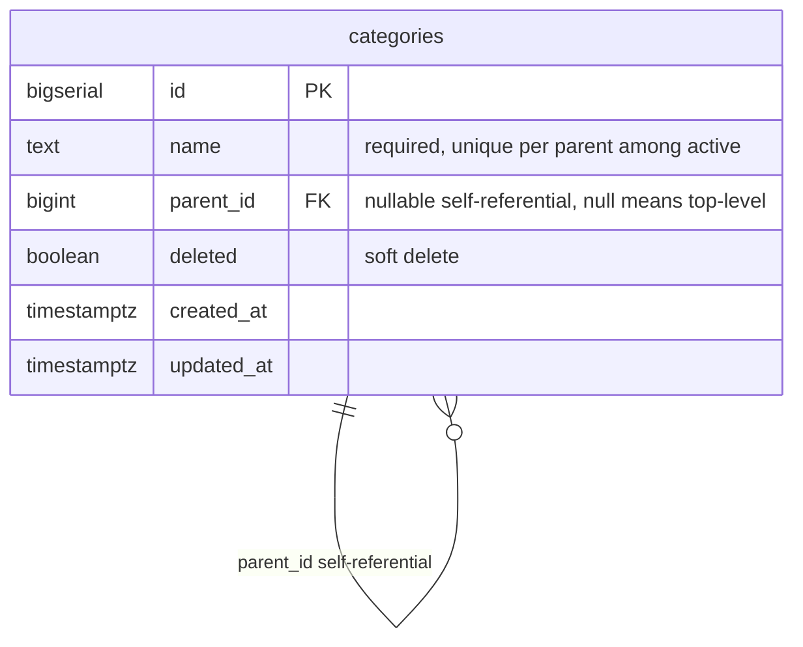

- **`categories`** — a **global**, nested product-category taxonomy. Unlike `products`, it is **not
  team-scoped** (there is no `team_id`): root/admin curate one shared tree and every authenticated
  user reads it. `parent_id` is a **self-referential FK** to `categories(id)` — `NULL` marks a
  top-level category — so the table is a single tree the client assembles from the flat list. `name`
  is unique among **active** siblings (`UNIQUE (COALESCE(parent_id, 0), name) WHERE deleted = FALSE`,
  which folds the NULL top-level parent into one bucket), so a soft delete frees the name for reuse.
  A category with active children cannot be deleted.

---

## document_service

`backend/services/document_service/db_migrations/`

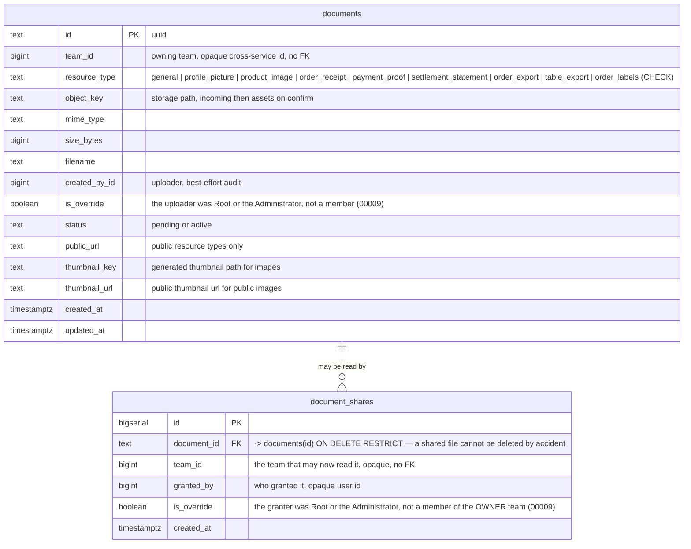

- **`documents`** — metadata for one stored file; the bytes live in object storage, not the DB.
  Team-scoped (`team_id` opaque, no FK). `status` goes `pending` → `active` on ConfirmUpload, which
  also moves `object_key` from the `incoming/` prefix to `assets/`. `public_url`/`thumbnail_url` are
  set only for public resource types (`profile_picture`, `product_image`); an image upload also gets
  a generated thumbnail. `order_receipt` (an order's courier slip or the marketplace's PDF) is
  **private** like `general` — it names a buyer and an address, so it is read through a short-lived
  signed URL rather than a stable public one. So is `payment_proof` (a-payment-must-carry-proof): a
  transfer slip names an account number. And `settlement_statement` (`00006`) — the .xlsx the settlement
  importer stores under the hash of its bytes before it reads it: it lists every order and what the
  platform took. And `order_export` (`00008`) — an order list exported as .xlsx
  ([one-export-is-the-list-as-a-file](technical/frontend/warehouse_order_list_decision.md#one-export-is-the-list-as-a-file)),
  stored as the person who exported it: it names buyers and their phone numbers. And `table_export` (`00010`) — a
  screen's table exported as .xlsx the same way, a supplier page tab's
  ([each-supplier-tab-exports-its-own-table](technical/frontend/suppliers_decision.md#each-supplier-tab-exports-its-own-table)).
  And `order_labels` (`00011`) — several orders' shipping labels merged into ONE PDF for the warehouse that prints them
  ([a-warehouse-prints-the-labels-of-orders-it-ships](technical/frontend/warehouse_order_list_decision.md#a-warehouse-prints-the-labels-of-orders-it-ships)):
  written ACTIVE by the order service's `OrderLabels` under the WAREHOUSE's team (never uploaded — `RequestUpload`
  refuses the type), its object straight under `assets/`; private, since every label on it names a buyer. A partial index on `created_by_id` WHERE `resource_type = 'profile_picture'` (`00007`) serves
  `ProfilePictureErase` ([erase-deletes-the-photo-file](business/user/context_decision.md#erase-deletes-the-photo-file)),
  which deletes every photo one person uploaded — removing their share rows first, deliberately, since `RESTRICT`
  would otherwise refuse it.

- **`document_shares`** — the ONE way a document is readable outside the team that owns it
  ([a-payment-must-carry-proof](business/balance/context_decision.md#a-payment-must-carry-proof)).
  `GetDownloadUrl` matches the owning team **OR** a share row, and nothing else.
  - **The grant is made by the OWNER, in the owner's scope.** No service asks another service for
    permission, and `document_service` never learns what a payment is — it learns *"team X may read
    document D"*, which the owner is entitled to assert about their own file.
  - ⚠ **The alternative was rejected and is worth not re-proposing**: an internal, non-team-scoped
    signing path so `liability_service` could vouch for the reader. It works, and it replaces *there
    is no read without a row saying you may* with *trust that service* — one bug in its relation
    check would leak every private file in the system.
  - ⚠ **`ON DELETE RESTRICT` is the point, not a default.** A creditor accepted or rejected a payment
    by looking at the file, so evidence for a decision somebody may be asked about later cannot be
    withdrawn by the party who supplied it. **There is no unshare** for the same reason.
  - Unique on `(document_id, team_id)`: granting twice is the same fact, so a retry is a no-op rather
    than a second row or an error.
- **`is_override`** (`00009`) on `documents` and `document_shares` — the uploader, or the granter, was Root or the
  Administrator inside a team they hold no role in
  ([an-override-is-stamped-in-every-service](business/user/context_decision.md#an-override-is-stamped-in-every-service)).
  A share is judged in the OWNER's scope, never the reader's. A repeated grant is a no-op, so the first granter's answer
  stays. Rows from before the column read false.

---

## inventory_service

`backend/services/inventory_service/db_migrations/`

```mermaid
erDiagram
    legacy_suppliers ||--o{ legacy_supplier_channels : "supplier_id"

    placements {
        bigserial   id           PK "the screen says Racks (00028 renamed racks)"
        bigint      warehouse_id "the WAREHOUSE team it stands in, opaque, no FK"
        text        code         "the label on the shelf, saved trimmed and lowercase (a-01-3) - CHECK; unique per warehouse among those in use"
        text        name         "optional human name"
        text        description
        timestamptz deleted_at   "soft delete, only at zero stock; NULL = in use"
        timestamptz created_at
        timestamptz updated_at
    }

    legacy_suppliers {
        bigserial   id          PK
        bigint      team_id     "MOVED to supplier_service.suppliers by san supplier move, ids kept"
        text        code
        text        name
        text        contact
        text        province
        text        city
        text        address
        text        description
        boolean     deleted     "soft delete"
        timestamptz created_at
        timestamptz updated_at
    }

    legacy_supplier_channels {
        bigserial   id          PK
        bigint      supplier_id FK "-> legacy_suppliers(id), ON DELETE CASCADE"
        text        type        "online/offline"
        text        marketplace
        text        name
        text        url
        text        contact
        text        location
        timestamptz created_at
        timestamptz updated_at
    }

    restocks ||--o{ restock_items : "restock_id"
    restocks ||--o{ restock_logs : "restock_id"
    restock_items ||--o{ restock_problem_items : "restock_id, product_id"

    restocks {
        bigserial   id                 PK
        bigint      team_id            "SELLING team that raised it, opaque, no FK (requesting_team_id until 00030)"
        bigint      warehouse_id       "target WAREHOUSE team that accepts it, opaque, no FK"
        text        status             "ongoing / arrived / accepted / lost / cancelled (mapper-guarded, #80)"
        text        invoice_ref_id     "the store's INVOICE reference (order_ref until 00030)"
        text        receipt            "optional: courier tracking number (resi)"
        text        receipt_file       "a photo of the label; '' = none"
        bigint      shipment_id        "the courier, opaque shipment_service id, no FK; 0 = not named"
        bigint      finance_account_id "the account that paid, opaque financial_account_service id; 0 = raised before it was required"
        bigint      transaction_id     "the accept's inventory transaction; 0 until accepted"
        float8      shipment_cost      "the freight the selling team paid, CHECK >= 0 (shipping_cost until 00030)"
        float8      subtotal           "00030: sum of line totals, written by every create and edit"
        float8      total              "00030: subtotal + shipment_cost, never the courier's charge"
        float8      warehouse_additional_cost "the courier's ONE charge at the door, CHECK >= 0; outside the total, inside the unit price"
        text        warehouse_additional_cost_note "what the charge was for — required above 0 by the contract"
        text        payment_type       "RestockPaymentType as text (shopee_pay/bank_account); read-only history"
        text        note               "the selling team's note on the whole restock"
        bigint      created_by_user_id "who RAISED it, opaque user_service id, no FK; 0 = not recorded"
        bigint      arrived_by_user_id "who SIGNED for the box; 0 = not signed"
        bigint      accepted_by_user_id "who COUNTED it; 0 = not accepted yet"
        bigint      lost_by_user_id    "who GAVE IT UP as lost; 0 = not lost"
        bigint      cancelled_by_user_id "who CALLED IT OFF; 0 = not cancelled"
        timestamptz arrived_at         "nullable: when the box was signed for"
        timestamptz accepted_at        "nullable: when the warehouse accepted"
        timestamptz lost_at            "nullable: when it was given up as lost"
        timestamptz cancelled_at       "nullable: when the selling team called it off"
        timestamptz created_at
        timestamptz updated_at
    }

    restock_logs {
        bigserial   id                 PK
        bigint      restock_id         FK "-> restocks(id), ON DELETE CASCADE"
        text        from_status        "status words as restocks stores them; '' = the create"
        text        to_status          "the same as from_status for an edit"
        bigint      actor_user_id      "who did it, opaque user_service id, no FK; 0 = not recorded"
        boolean     is_override        "the actor was Root or the Administrator, not a member of the scoped team (00034)"
        text        description        "what moved it, or what an edit changed"
        timestamptz created_at         "WHEN IT HAPPENED, set by the writer; 00030 folded the backfill's at into it"
    }

    restock_items {
        bigserial   id                 PK
        bigint      restock_id         FK "-> restocks(id), ON DELETE CASCADE; UNIQUE with product_id"
        bigint      product_id         "opaque product_service id, no FK; once per restock"
        text        product_code       "snapshot at raise time, sku until 00033"
        text        name               "snapshot"
        bigint      count              "how many were ORDERED, CHECK > 0 (quantity until 00030)"
        float8      total              "THE LINE TOTAL, the truth, CHECK >= 0 (total_price until 00030)"
        float8      price_unit         "00030: total / count, for display, rewritten whenever either changes"
        bigint      received_count     "what was IN THE BOX, broken included; 0 until accepted (received_quantity, good units only, until 00030)"
        bigint      supplier_id        "the line's supplier, opaque supplier_service id, nullable"
        bigint      supplier_channel_id "the line's store, opaque supplier_service id, nullable"
        text        note               "the selling team's note on the line"
        timestamptz created_at
        timestamptz updated_at
    }

    restock_problem_items {
        bigserial   id                  PK
        bigint      restock_id          FK "with product_id -> restock_items(restock_id, product_id), ON DELETE CASCADE"
        bigint      product_id          "the line's product — a product IS its line"
        bigint      supplier_channel_id "the line's store, copied at accept, nullable"
        text        problem_type        "broken | missing, CHECKed; UNIQUE with restock_id, product_id"
        bigint      count               "CHECK > 0"
        float8      price_unit          "the LANDED unit price, filled at accept, CHECK >= 0"
        float8      total               "price_unit x count, CHECK >= 0"
        text        note                "the warehouse's optional note"
        timestamptz created_at
    }

    warehouse_products {
        bigserial   id           PK
        bigint      warehouse_id "opaque team_service id (a WAREHOUSE team), no FK"
        bigint      product_id   "opaque product_service id, no FK"
        timestamptz created_at
    }
```

- **`warehouse_products`** (#142) — WHICH PRODUCTS A WAREHOUSE HANDLES. A warehouse must not see the
  whole catalogue: it holds no products of its own (products belong to selling teams), so a
  team-scoped product list shows it nothing useful. This is the list it should see instead.
  - **Written by `RestockRequestCreate`**, in the same transaction as the request (owner,
    2026-07-20): asking a warehouse to stock something is what makes that product visible there, and a
    request whose products the crew cannot see is one nobody can act on. A transfer's create links its products to the
    receiving warehouse the same way (a-transfer-links-its-products-to-the-receiver).
  - **Not derivable from the rack rows**, which is why it is its own table rather than a query over
    them. A product asked for but not yet received has no stock level at all, and the crew
    expecting it still have to be able to find it. "Handles" and "currently holds" are two facts.
  - `UNIQUE (warehouse_id, product_id)` — the arrangement exists once. Writers upsert with
    `ON CONFLICT DO NOTHING`, because a second restock request for a product a warehouse already
    stocks is the normal case, not an error worth failing the request over.
  - It lives in **inventory_service** because this service already owns warehouse×product facts
    (`batches` and `product_placements` are keyed on that pair) and owns the restock flow that writes it — so no
    cross-service write is needed to maintain it (HARD RULE 3).
- **Stock lives in the decided ledgers** — see [The decided ledgers](#the-decided-ledgers-00025-00026) below. `00029`
  **dropped** the tables they replaced: `stock_levels` and `stock_movements` (→ `product_placements` and their log),
  `stock_batches` and `stock_shelf_batches` (→ `batches` and their log — a rack counts units per product, never per
  batch), `stock_owner_movements` (→ the owner's `batch_logs`, the owner being `batches.team_id`) and
  `restock_received_placements` (→ the restock accept's own rack rows). Its down half is not reversible: nothing is in
  production and development data is reseeded (no-switch-over-the-ledgers-replace-todays-tables).
- **`legacy_suppliers`** / **`legacy_supplier_channels`** — **MOVED OUT** (the-supplier-gets-its-own-service).
  They were `suppliers` and `supplier_channels`; `00023_legacy_suppliers` renamed them — and their indexes and
  sequences, whose names are schema-wide — so supplier_service's `00001` can create its own under the decided
  names (every service shares one database). Nothing in inventory_service reads them any more: only
  `san supplier move` does, copying their rows into supplier_service with the ids kept
  (existing-suppliers-move-with-their-ids). ⚠ A **later** migration drops them, once the move has run on every
  database — dropping them in 00023 would have lost the rows before the command could read them.
  inventory_service is therefore pinned before supplier_service in every apply order.
- **`placements`** (`racks` until `00028`) — the physical places inside one warehouse (#129); the screen still says
  Racks (the-racks-page-is-the-placement-list). Scoped to the `warehouse_id`, which **is** a team, carrying
  `use_scope`; opaque, no FK. `code` is the label someone reads off the shelf, saved **trimmed and lowercase**
  (rack-codes-are-saved-lowercase, `CHECK (code = lower(btrim(code)))`), unique per warehouse **among those in use**
  (`WHERE deleted_at IS NULL`) — a soft-deleted rack frees its label for re-use. Soft delete is `deleted_at`, allowed
  only at zero stock (a-placement-deletes-at-zero-stock). `00028` lowercased the existing codes; two that differed only
  by case in one warehouse keep the later one's id as a suffix. What a rack holds is its `product_placements` rows.
- **`restocks`** / **`restock_items`** / **`restock_problem_items`** — a SELLING team's parcel to a WAREHOUSE
  (restock.md §Table Should We Have In Restock). They were `restock_requests`, `restock_request_items` and
  `restock_damaged_units` until **`00030`** gave them the owner's names and turned their money `DOUBLE PRECISION`
  (money-is-double-in-the-api-too) in one migration. Two-sided: `team_id` (the selling team, `use_scope` on create,
  update, cancel, mark lost) raises it to a `warehouse_id` (`use_scope` on arrive, accept, labels); either side lists
  and reads it. `status` is text, mapped in the handler (no `CHECK` IN-list, cf. #80). The **accept** is one
  transaction: the row locked, the problem rows, the decided ledgers' `restock` transaction (a batch per line with good
  units, their rack rows) and the status — so the ledger and the restock never diverge.
- **The money** is double and stored as typed. A line's `total` is the truth (a-line-is-typed-as-its-total); its
  `price_unit` is `total ÷ count`, rewritten with it, for display. `restocks.subtotal` (Σ line totals) and `total`
  (`subtotal + shipment_cost`) are written by every create and every edit, never the courier's charge
  (the-couriers-charge-stays-out-of-total), which is `warehouse_additional_cost`, one per restock with its note.
- **`count` is what was ORDERED; `received_count` is what was IN THE BOX**, broken units included
  (any-warehouse-member-counts-what-arrived). Both are kept: the gap is what somebody chases the supplier about. The
  good units are `received_count − broken`; more in the box than ordered is refused
  (accept-refuses-more-than-the-line-says). Until `00030` the column was `received_quantity` and held only the good
  units; the migration added the broken back.
- **`restock_problem_items` is what never became stock** — `broken` as typed, `missing` worked out as
  `count − received_count` (a-short-unit-at-the-door-is-missing), each with the landed unit price filled by the system
  (the-problem-price-is-filled-by-the-system) and the warehouse's optional note. Keyed by **restock and product**: a
  product appears once per restock, so the product finds its line, and the composite FK to
  `restock_items (restock_id, product_id)` says so. One row per kind (`UNIQUE (restock_id, product_id, problem_type)`);
  `00030` merged the older rows of one kind on one line.
- **Where the good units went** is the accept's own rack rows in `product_placement_logs` — there is no unplaced pile
  (there-is-no-unplaced-pile). `restock_received_placements` held this until `00029` dropped it.
- **`restock_logs`** — the trail, one append-only row per status change and per edit, from and to status
  (every-status-change-is-logged, edits-are-in-the-same-trail), written in the same transaction as the change with the
  same instant. It replaced `restock_request_events` in `00024`; `00030` keyed it by `restock_id` and folded its `at`
  into `created_at` (the backfilled rows keep their moment). The columns on `restocks` stay too: the list filters and
  sorts on them, and a filter cannot reach into a child table cheaply.
- **`restock_logs.is_override`** (`00034`) — the row's actor was Root or the Administrator, inside the team the call was
  scoped to (the seller's for a create or an edit, the warehouse's for an arrive or an accept) with no role there
  ([an-override-is-stamped-in-every-service](business/user/context_decision.md#an-override-is-stamped-in-every-service)).
  ⚠ It is on the TRAIL, not on `restocks`: that row carries one actor column per act, so one flag could not say which
  act it meant, and every act that stamps a `*_by_user_id` writes its own trail row. The ACCEPT's row is what
  `RestockAccepted.actor_is_override` is read from, beside `accepted_by_user_id` — the live publish and the supplier
  backfill alike — so liability's courier charge says so too.
- **Who handled it, and when**: the `*_by_user_id` columns are stamped from the caller's identity, never the request
  body; opaque user_service ids with no FK, names resolved at read time. Nothing is backfilled — a restock raised
  before `00018` keeps `0` / `NULL`. The timestamps are what the list's date-range filter ranges on
  (`RestockDateField`); partial indexes on `(team_id, accepted_at)` and `(team_id, cancelled_at)` serve it.
- **A line's supplier and store** (`supplier_id`, `supplier_channel_id`) are opaque supplier_service ids, both
  optional, the store one of the supplier's (a-line-may-name-a-supplier-without-a-channel). The handler asks
  supplier_service that a newly named one is live; one a line already holds is not re-checked, so deleting a supplier
  never bricks the restocks that name it.
- **`product_code` / `name`** (`product_code` was `sku` until `00033`) are snapshots at raise time — the product may be renamed later, and the restock must keep reading
  as it was raised.
- `payment_type` is read-only history from before paying accounts (a-restock-must-name-the-account-that-paid).
  `shipping_code` (a free-text courier code from `00003`) was never on the contract's restock, and `00030` dropped it.

### The decided ledgers (`00025`, `00026`)

Stage 1 of [the ledger build](development_state/inventory/ledgers.md): the tables that replace `stock_levels`,
`stock_movements`, `stock_batches`, `stock_shelf_batches` and `stock_owner_movements` outright
([no-switch-over-the-ledgers-replace-todays-tables](technical/stock/design_decision.md#no-switch-over-the-ledgers-replace-todays-tables)).
They are written only through `inventory_service/inventory_ledgers`; `00029` dropped the old tables (stage 5).

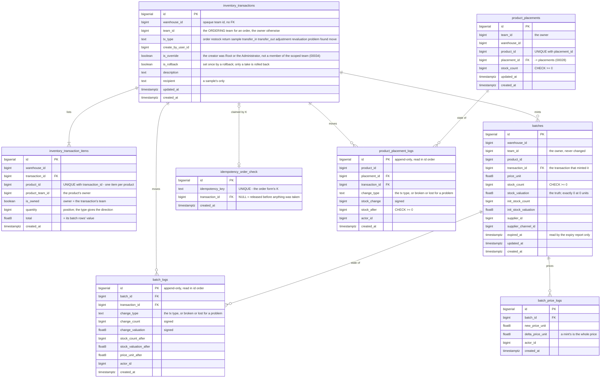

- **Money is `double precision`**, compared at 4 places through `pkgs/san_money`, never with `=`
  ([stock-money-is-float64-compared-at-4-digits](technical/stock/design_decision.md#stock-money-is-float64-compared-at-4-digits)).
- **Logs are append-only** — no `updated_at`, no UPDATE, no DELETE
  ([ledger-logs-are-append-only](technical/ledger/mutation_and_ledger_decision.md#ledger-logs-are-append-only)).
- **Two invariants**, checked by `inventory_ledgers.Verify` in every mutation's test: both ledgers move the same units
  per product, and an item equals its batch rows.
- **Each log is indexed by its transaction alone** — `batch_logs_transaction_idx` and, since `00031`,
  `product_placement_logs_transaction_idx (transaction_id)`, which replaced `(warehouse_id, transaction_id)`: every
  reader asks by transaction and none names the warehouse
  ([placement-logs-are-indexed-by-transaction](technical/stock/design_decision.md#placement-logs-are-indexed-by-transaction)).
- **The reserve read has its own index** — `00032` `batches_owner_product_idx ON batches (team_id, product_id) WHERE
  stock_count > 0`: the take and `StockTakeQuote` sum an owner's stock of a product across EVERY warehouse in one grouped
  read, and every other batches index leads with `warehouse_id`
  ([the-reserve-is-read-once-for-every-line](business/inventory/order_decision.md#the-reserve-is-read-once-for-every-line)).
- **A supplier's goods are read by supplier** — `00039` `batches_supplier_idx ON batches (supplier_id, supplier_channel_id,
  warehouse_id)`: `SupplierGoods` (the supplier pages' Terjual / Siap / Gudang terkait) sums the batches minted with a
  supplier's id, grouped by store or warehouse; without it every read scanned every batch.
- **Written set-based** — a write locks each ledger's rows in one statement, works the rows out in memory, and stores
  each table with one `UPDATE … FROM unnest(…)` or one multi-row `INSERT`, however many lines
  ([ledger-writes-are-set-based](technical/stock/design_decision.md#ledger-writes-are-set-based)).
- **An override is stamped on the transaction** — `inventory_transactions.is_override` (`00034`): its creator was Root
  or the Administrator inside the team the call was scoped to, with no role there
  ([an-override-is-stamped-in-every-service](business/user/context_decision.md#an-override-is-stamped-in-every-service)).
  `batch_logs`, `product_placement_logs` and `batch_price_logs` are the transaction's lines and read it through
  `transaction_id`. ⚠ Except a ROLLBACK's rows: they are written under the original transaction with the releaser in
  `actor_id`, so whether the RELEASE was an override is recorded nowhere in inventory (a transfer's cancel is still
  stamped, on its `warehouse_transfer_logs` row; an order's release is not).

### Warehouse transfers (`00027`)

A selling team moving its own stock from warehouse A to warehouse B
([warehouse_transfer_decision.md](business/inventory/warehouse_transfer_decision.md)). Its two legs are ledger
transactions — `transfer_out` at create, `transfer_in` at accept — so these tables hold only what the ledgers cannot:
the trip, the lifecycle, and what went wrong at B's door. **A line's pick list and B's put-away are not stored here**:
they are the legs' `product_placement_logs`, read back.

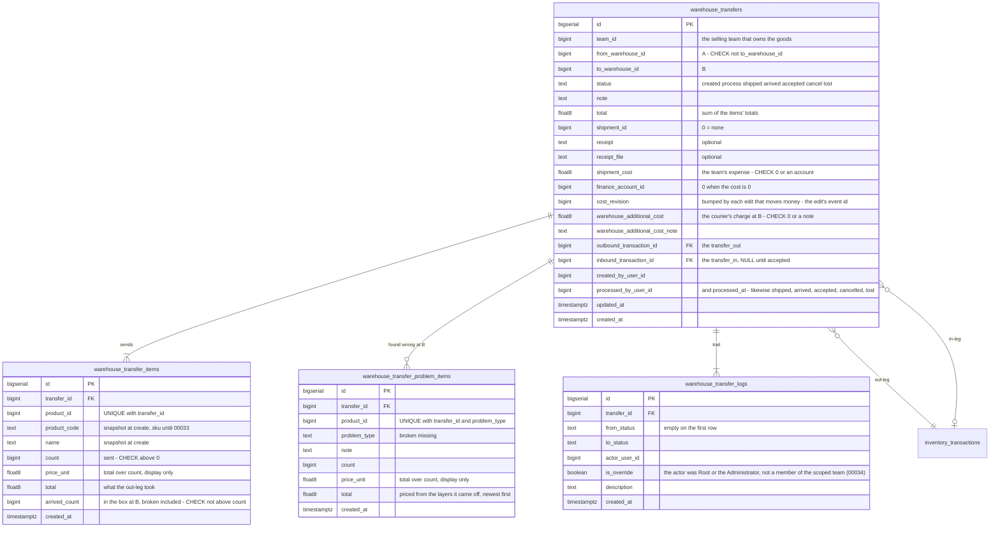

- **Money is `double precision`** like the ledgers', and the contract carries it as `double`, unrounded
  (money-is-double-in-the-api-too).
- **Indexed for each side's list**, newest first: `(team_id, id DESC)`, `(from_warehouse_id, id DESC)`,
  `(to_warehouse_id, id DESC)`.
- **`warehouse_transfer_logs.is_override`** (`00034`) — that act's actor was Root or the Administrator with no role in
  the team the call was scoped to
  ([an-override-is-stamped-in-every-service](business/user/context_decision.md#an-override-is-stamped-in-every-service)).
  On the TRAIL, not on `warehouse_transfers`, for the reason `restock_logs` carries it: one actor column per act there.
  ⚠ `WarehouseTransferUpdate` writes no trail row and no actor at all, so an edit has neither.

### The stock count (`00035`)

A count of one warehouse as a session ([opname.md](business/inventory/opname.md), accepted 2026-11-02 —
[the-count-prototype-is-accepted](business/inventory/opname_decision.md#the-count-prototype-is-accepted)). The snapshot
copies `product_placements`; an **open** snapshot row (`released_at` NULL) **is** the lock on that product on that rack
([the-lock-is-the-open-snapshot-row](business/inventory/opname_decision.md#the-lock-is-the-open-snapshot-row)). Staff
count blind and write each difference as a draft with its reason; finalize turns the drafts into the stock-problem
register and the ledgers, in up to three transactions per owning team — `problem`, `found`, `move` — which the session
lists. The register has a second door: a broken or lost unit reported on the Adjust screen.

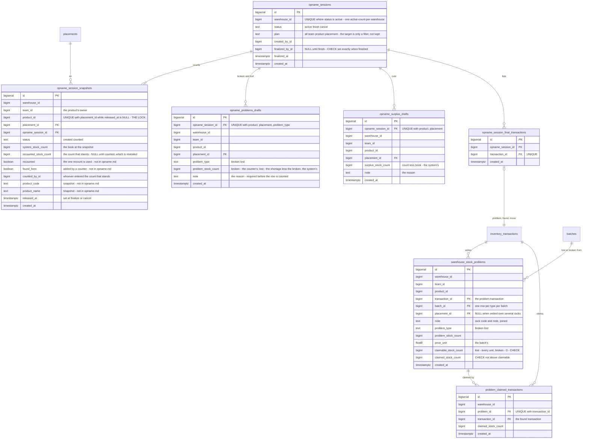

- **One active count per warehouse** is the partial unique index `opname_sessions_one_active`; **one open count per
  product per rack** is `opname_session_snapshots_open_lock` on `(product_id, placement_id) WHERE released_at IS NULL`.
- **Every mutation that moves units reads the lock after locking its shelf rows, in a statement of its own**
  (`inventory_ledgers.RefuseCounted`): a put-away (restock and transfer accept), a move, a sample and an adjustment are
  refused, naming the count — and so are a take's rollback (a cancel) and a rack delete; a take (an order's, a transfer's
  out-leg) runs only over the racks no count holds. A count is planned under `FOR SHARE OF pp, p` on the same shelf rows
  and their racks, so the two queue — proved both ways in `opname_race_test.go`.
- **A draft is keyed by its row** — `(opname_session_id, product_id, placement_id)`, the snapshot row's own grain; there
  is no snapshot id on it, as opname.md draws it.
- **The register's open losses** are indexed for the claim, oldest first: `(warehouse_id, team_id, product_id,
  created_at, id) WHERE problem_type = 'lost' AND claimed_stock_count < claimable_stock_count`.
- **Which door a problem came through** is whether `opname_session_final_transactions` lists its transaction: listed, a
  count's finalize; not listed, a report at the shelf
  ([a-session-lists-its-final-transactions](business/inventory/opname_decision.md#a-session-lists-its-final-transactions)).
- **No override flag on the session** ([finalizing-is-the-agreement](business/inventory/opname_decision.md#finalizing-is-the-agreement)):
  a finalize by Root is stamped on every transaction it writes (`inventory_transactions.is_override`).
- **"Last counted"** on the rack, placement and batch screens is the later of a recount's `adjustment` rack row and the
  `finalized_at` of a finished count holding a row there (index `(placement_id, product_id)`).

### Found stock waiting for approval (`00036`)

A unit found on a rack outside a count waits as a request
([an-adjust-found-waits-for-the-owner-or-admin](business/inventory/opname_decision.md#an-adjust-found-waits-for-the-owner-or-admin),
built 2026-11-03). `FoundRequestCreate` writes one row and posts nothing; the approval — the warehouse Owner or Admin,
never the reporter — posts one `found` transaction through the count's own claim and mint; a rejection, or the
reporter's withdrawal, posts nothing; a count that finalizes over the product on the rack **settles** it, posting
nothing more ([a-count-settles-the-found-it-counted](business/inventory/opname_decision.md#a-count-settles-the-found-it-counted)).

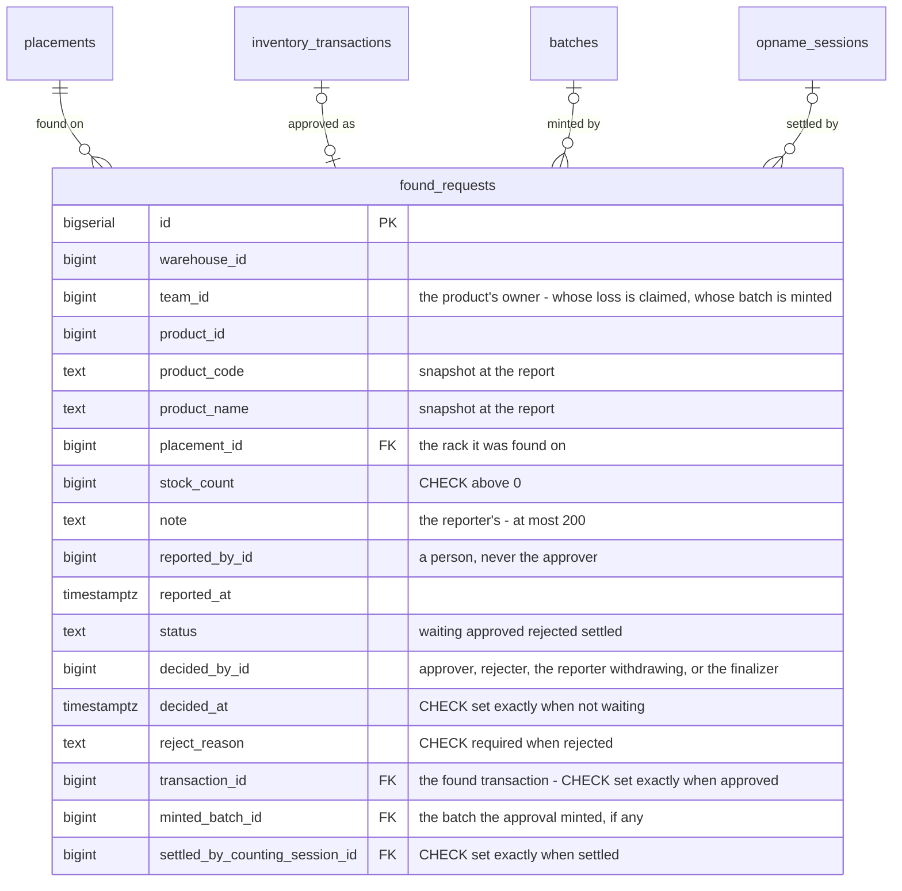

- **The list** reads `(warehouse_id, id DESC)` for every status and `(warehouse_id, status, id DESC)` for one; the
  menu's count is the second on a one-row page.
- **What a finalize settles** is read by `found_requests_waiting_idx` on `(product_id, placement_id) WHERE status =
  'waiting'`, locked `FOR UPDATE` in id order after the session and before the register, the batches and the racks —
  the order an approval takes them in.
- **The request row is the approval's first lock**: two approvals, or an approval and a rejection, queue on it and the
  second finds it no longer waiting.
- `team_id`, `product_id`, `warehouse_id` and the people are other services' ids — no FK, as everywhere in this service.

### Lost stock, by day (`00037`)

The report `metrics/inventory/lost` reads (built 2026-11-05 —
[inventory-lost-counts-the-warehouses-custody-losses](business/analytic/rpc_provide_decision.md#inventory-lost-counts-the-warehouses-custody-losses),
[inventory-lost-is-gross](business/analytic/rpc_provide_decision.md#inventory-lost-is-gross)). Every **lost**
`warehouse_stock_problems` row — a count's shortage, a Stock Adjust "lost" — adds its units and their value at the
batch's price to its Jakarta day's row, **in the same transaction** (`inventory_mutations.foldLost`, the transaction's
last lock). A broken row never does; a transfer or restock lost on the way writes other tables and never reaches it. A
Found claim never lowers it — rows only grow.

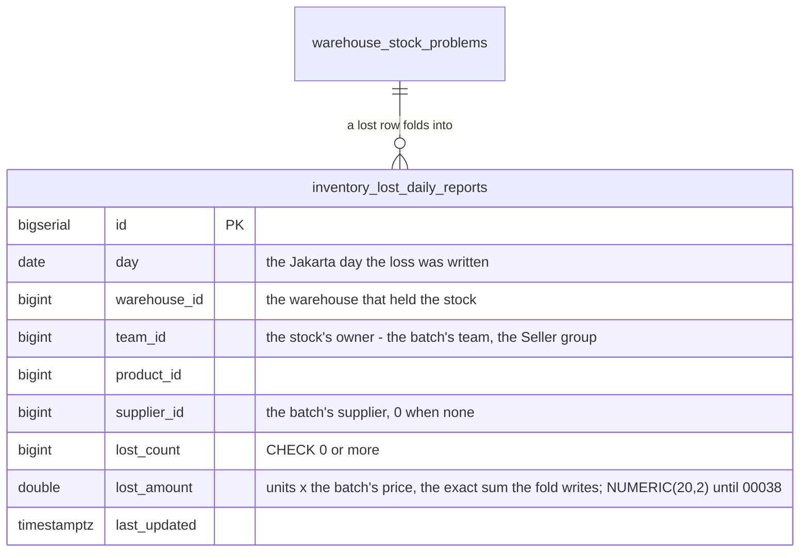

- **Unique** `(day, warehouse_id, team_id, product_id, supplier_id)` — the fold's `ON CONFLICT DO UPDATE` target: two
  losses into one row queue on it and both add.
- **The readers**: `(warehouse_id, day)` for the warehouse that held the stock, `(team_id, day)` for the seller owning
  it — one `warehouse_id = T OR team_id = T` condition, a BitmapOr of the two (a-warehouse-sees-its-lost-amount).
- Logical link only to `warehouse_stock_problems` (no FK): the report is derived and its sums equal the register's lost
  rows (asserted by `TestRace_LostFold_EveryLossAddsToTheDaysRow`).
- **`lost_amount` is `double precision`** since `00038` (numeric-money-moves-to-double-too) — `NUMERIC(20,2)` before. The
  fold writes each row's units × price EXACT ([the-backend-never-rounds-money](business/order/context_decision.md#the-backend-never-rounds-money); it rounded to whole rupiah before); the cast was exact
  and nothing was backfilled.

---

## region_service

`backend/services/region_service/db_migrations/`

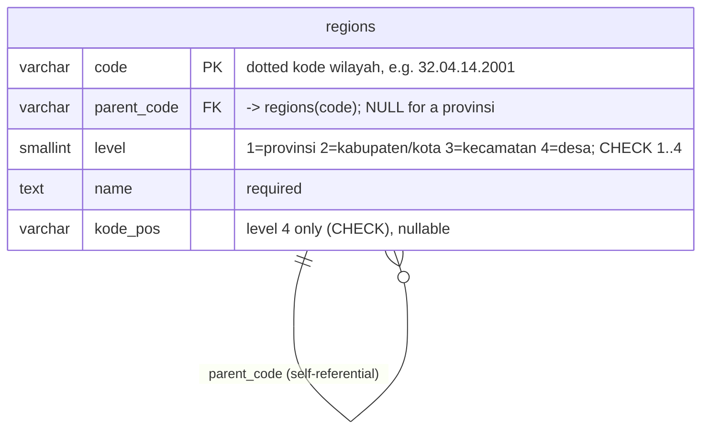

- **`regions`** — Indonesia's administrative hierarchy (provinsi → kabupaten/kota → kecamatan →
  desa/kelurahan) with a kode pos on each desa (#112/#114). **Global reference data**: unlike almost
  every other table here there is **no `team_id`** and no `use_scope` — regions are the same for
  everyone, so the reads are unscoped and open to any authenticated user.
- **One self-referential table, not four typed ones** (owner call). `code` — the government's dotted kode wilayah — **is** the identity, and the hierarchy is
  derivable from it (`11` → `11.01` → `11.01.01` → `11.01.01.2001`), so the upstream source loads
  near-verbatim and "children of X" is a single indexed predicate (`WHERE parent_code = ?`).
  `parent_code` is a **real self-FK** (`ON DELETE CASCADE`) — an orphan is a picker that dead-ends.
- `level` carries a range `CHECK (1..4)`: a 4-tier structure fixed by law, so unlike an enum IN-list
  it cannot drift as the data grows (cf. #80). `kode_pos` is `CHECK`-confined to level 4 — officially
  one postcode per desa, so it is a column, not a table.
- **Indexes:** `parent_code` (the cascading picker's only query), `LOWER(name) text_pattern_ops`
  (case-insensitive **prefix** typeahead — a leading-wildcard "contains" search would need `pg_trgm`),
  and `level` (a scoped search: "find a kecamatan named X").
- **The 91 599 rows are NOT in the migration.** They are generated from pinned upstream dumps and
  loaded separately — `go run ./tools/san region build-seed` then `… region load-seed` (idempotent
  upsert; ~5 s). Postgres runs in Docker and cannot read a host file, so a server-side `COPY … FROM
  '<path>'` inside the migration would not work; this mirrors how the category taxonomy is seeded
  from a file. See
  [the seed README](../backend/services/region_service/db_migrations/seed/README.md).
- **Consumers snapshot, they do not FK.** A saved address (an order's customer address, a warehouse
  address) freezes the codes **+** names **+** kode pos on its own record, so history cannot mutate
  when a desa is renamed or merged. `region_service` is reached only via its RPCs — no cross-service
  FK (HARD RULE 3).

---

## Cross-service links (logical, not enforced)

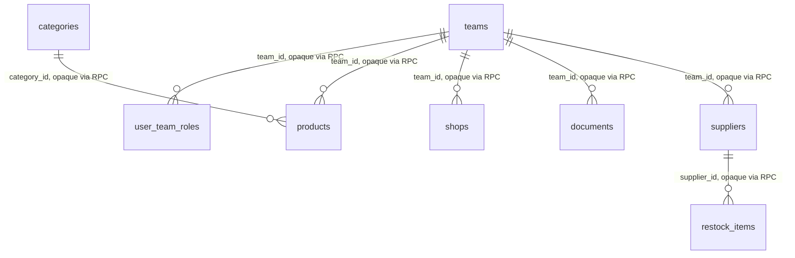

`user_team_roles.team_id`, `products.team_id`, `documents.team_id`,
`team_return_configurations.team_id` / `.warehouse_id`, and `product_return_maps.team_id` / `.shared_product_id` /
`.own_product_id` point at rows owned by other services. They carry no database foreign key by design (HARD RULE 3 — services stay independent);
the owning service resolves them over Connect RPC.

---

## revenue_service — REMOVED

⚠ **The service is gone; its TABLE is not.** `revenue_service` was deleted on 2026-08-28 with its
statistics deferred — see
[revenue-service-is-removed-and-statistics-deferred](business/settlement/context_decision.md#revenue-service-is-removed-and-statistics-deferred).

**No drop migration was written, deliberately.** `order_revenues` and every row in it remain in the
database, so a future statistics service can backfill the history instead of starting at zero. Its
goose version table `revenue_service_version` remains too, and a fresh database simply never creates
either — the migrations were deleted with the service, so `migrate up-all` no longer knows about them.

⚠ **A fresh database and an existing one therefore differ here**, and that is the accepted cost of
keeping the history: an old database has an orphaned table, a new one has nothing. Whichever service
picks the statistics back up owns the decision about which shape to standardise on.

The columns it held — `revenue`, `cogs`, `shipping_cost`, `expected_margin`, `cost_known`,
`voided_at` — are all still carried by `OrderPlacedEvent` / `OrderCancelledEvent`, which
`selling_service` keeps publishing with no consumer for exactly this reason.

## expense_service

`backend/services/expense_service/db_migrations/`

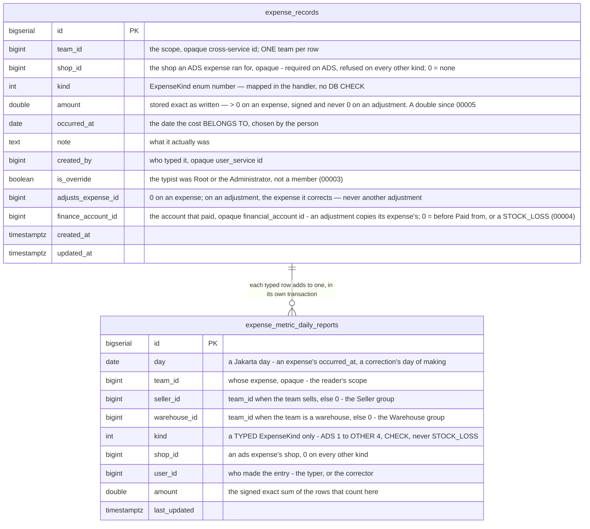

- **`expense_records`** (#161/#167) — money the business spent that **no order caused**: ads budget,
  payroll, rent. `revenue_service` already knows what an order earned; this is everything else.
  - **A PERSON TYPES IT**, and every decision here follows from that. A revenue row is written by the
    system from an order and frozen (#153); a cost row is entered by hand about a period, so it can be
    wrong — hence correctable, hence `created_by`. It is corrected by a **new row**, never an edit
    ([every-correction-is-a-signed-adjustment](business/analytic/context_decision.md#every-correction-is-a-signed-adjustment)): a row never changes after it is saved, and void is not a concept.
  - **An ADJUSTMENT is a row of this table** with `adjusts_expense_id` set. It copies its expense's team, shop, kind and
    day, so every total, the per-kind split and the daily statement just sum rows, and the correction lands in the month
    that holds the mistake. Its `created_by` and `created_at` say who corrected it and when.
  - **`is_override`** (`00003`) — the row's own typist was Root or the Administrator, inside a team they hold no role in
    ([an-override-is-stamped-in-every-service](business/user/context_decision.md#an-override-is-stamped-in-every-service)).
    An expense and each of its adjustments carry their own answer. Rows from before the column read false.
  - **`amount` is CHECK'd per kind of row** (`expense_records_amount_sign`): `> 0` on an expense — the `kind` already
    says the money is going out, so a signed amount would let a negative cost silently become revenue — and `<> 0` on
    an adjustment. That an expense and its adjustments never sum below 0 is `ExpenseAdjust`'s, under the expense row's
    lock: a CHECK cannot see the other rows.
  - **`occurred_at` is a DATE the person picks**, not the insert timestamp. Payroll is paid on the 5th
    for the month before, and filing it under the 5th puts it in the wrong month for every report that
    matters. A date, not a timestamp — nobody records the hour the rent was paid.
  - **ONE team per row.** A warehouse *is* a team, so warehouse payroll is a cost on that warehouse's
    `team_id` — and it is **never recharged onward** to the selling teams it fulfils for (owner,
    2026-07-21). A recharge would have been a second team here, which is why it was settled before
    this table was written rather than migrated in later.
  - **`shop_id` is for ADS only, and ADS must name one**
    ([an-expense-names-a-shop-only-for-ads](business/financial_account/context_decision.md#an-expense-names-a-shop-only-for-ads)),
    checked by `ExpenseCreate` — it reverses the earlier *optional on every kind* (owner, 2026-07-21). Rows made before
    keep whatever shop they carry; an adjustment copies its expense's.
  - **`finance_account_id`** (`00004`) — the account that paid
    ([an-expense-must-name-the-account-that-paid](business/financial_account/context_decision.md#an-expense-must-name-the-account-that-paid)):
    one of the team's ACTIVE OPERATIONAL accounts, asked of financial_account_service in-process before the insert (no
    FK across services). An adjustment copies its expense's
    ([a-correction-follows-the-expenses-account](business/financial_account/context_decision.md#a-correction-follows-the-expenses-account)).
    `0` on every row made before the column and on a `STOCK_LOSS` (inventory's internal call, no cash moved) — nothing
    posts for 0. Each new row is published (`ExpenseCreated` / `ExpenseAdjusted`) and financial_account_service posts it
    as `expense`, or `ads_expense` for ADS.
  - **`amount` is `double precision`** since `00005` (every-ledger-moves-to-double-rounded-when-frozen) — `BIGINT` before.
    `ExpenseCreate` / `ExpenseAdjust` store it EXACT ([the-backend-never-rounds-money](business/order/context_decision.md#the-backend-never-rounds-money)), a stock loss's FIFO fraction included; Create
    refuses one that is not finite and above 0, Adjust a correction of 0 (float dust counts as 0). Sums equal their rows
    within the tolerance.
  - **`kind` has no DB `CHECK`** (cf. #80). Proto enums are open and append-only, so a check
    constraint would reject a kind the contract already allows on the day one is added.
  - Indexed on `(team_id, occurred_at DESC, id DESC)` — every screen and every total asks for one team's rows over a
    period — and on `adjusts_expense_id` where it is set, for an expense's net and the floor. Migration `00002` turned
    every row voided until then into its expense plus an adjustment of minus its amount.
- **`expense_metric_daily_reports`** (`00006`, 2026-11-06) — the Analytic expense metrics, *Ads expense* `metrics/ads` and
  *Expenses* `metrics/expenses`, served by `ExpenseAnalyticService`
  ([expense-has-ads-and-expenses](business/analytic/rpc_provide_decision.md#expense-has-ads-and-expenses),
  [the-expense-prototype-is-accepted](business/analytic/rpc_provide_decision.md#the-expense-prototype-is-accepted)).
  - **Written in the expense row's own transaction** (`expense_v1/metric_fold.go`, called by `ExpenseCreate` and
    `ExpenseAdjust`) — never from the events, which a STOCK_LOSS and an expense made before *Paid from* never publish
    ([expense-figures-are-read-from-its-own-records](business/analytic/rpc_provide_decision.md#expense-figures-are-read-from-its-own-records)).
    One `INSERT … ON CONFLICT (day, team_id, kind, shop_id, user_id) DO UPDATE SET amount = amount + EXCLUDED.amount`.
  - **The day.** An expense counts on its own `occurred_at`; a correction — a cancel too — on the Jakarta day it is
    MADE ([an-expense-correction-counts-on-the-day-it-is-made](business/analytic/rpc_provide_decision.md#an-expense-correction-counts-on-the-day-it-is-made)),
    so a past day never changes here, while `expense_records` keeps the correction on the expense's day for the Expenses
    page, the statement and the paying account. **The person**: the typer, or the corrector
    ([an-expense-correction-counts-for-who-made-it](business/analytic/rpc_provide_decision.md#an-expense-correction-counts-for-who-made-it)).
  - **Typed kinds only** — `CHECK (kind BETWEEN 1 AND 4)`
    ([stock-loss-stays-out-of-analytic-expenses](business/analytic/rpc_provide_decision.md#stock-loss-stays-out-of-analytic-expenses)).
  - **`seller_id` / `warehouse_id`** — the team on its side of the composer
    ([the-warehouse-is-its-own-group](business/analytic/rpc_provide_decision.md#the-warehouse-is-its-own-group)): a selling
    team's expense under Seller, a warehouse team's under Warehouse, the root team's under neither; CHECK'd to be the team
    itself, on one side at most. Which side is team_service's answer, asked before the transaction through the
    composition root (`cmd/app_development/expense_team_sides.go`).
  - Indexed on the upsert key (which starts with `day`, so root's read of every team over a window uses it) and on
    `(team_id, day)` for a team's own read. No backfill (revamp-has-no-real-orders-yet).

---

## liability_service

`backend/services/liability_service/db_migrations/`

> ⚠ **These tables were called `settlement_*` until 2026-08-28.** The service renamed because the word
> `settlement` now means the MARKETPLACE PAYOUT — see
> [the-name-settlement-moves-to-the-payout](business/settlement/context_decision.md#the-name-settlement-moves-to-the-payout).
>
> Migrations 00001–00003 create the tables under the new names. **`00004_adopt_legacy_settlement_tables.sql`**
> then copies any rows a database still holds under the old names and drops them — including the old
> `settlement_service_version` goose table, which would otherwise hand a future (real) `settlement_service`
> a migration history that was never its own. On a fresh database every step of 00004 is a no-op.

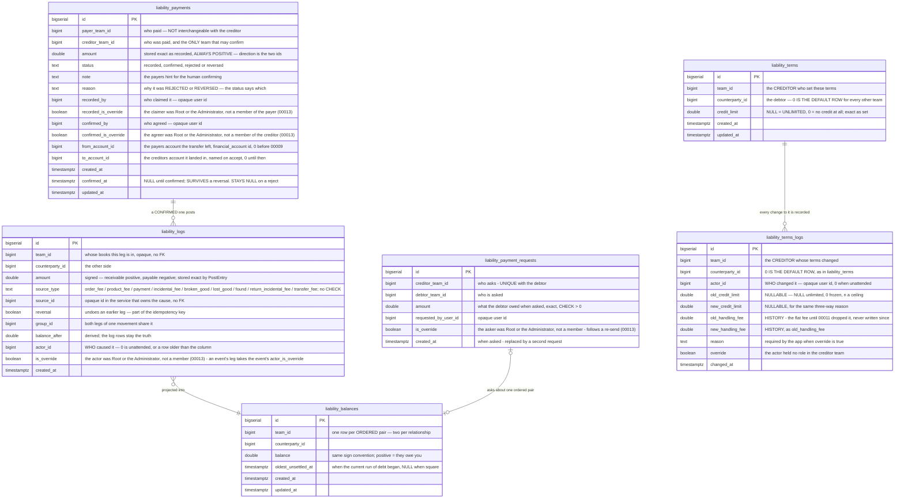

- **Every rupiah column is `double precision`** since `00014` (every-ledger-moves-to-double-rounded-when-frozen) — the
  ten that were `BIGINT`: `liability_logs.amount` / `balance_after`, `liability_balances.balance`,
  `liability_payment_requests.amount`, `liability_payments.amount`, `liability_terms.credit_limit` and the four
  `liability_terms_logs` limit/fee columns. ⚠ **Frozen exact** ([the-backend-never-rounds-money](business/order/context_decision.md#the-backend-never-rounds-money), 2026-11-06 — it rounded to whole
  rupiah before): `PostEntry` is the freeze point — it refuses NaN/Inf and anything not above 0 (float dust counts as 0,
  `san_money.Positive`) and stores the figure as handed in — so a 2,5% fee of Rp 316,67475 is that leg, and a balance
  equals the sum of its logs within the tolerance. "Square" is tested with a tolerance in SQL too
  (`abs(balance) < 0.00005`, `san_money.ZeroBelow`). A payment's claim and a credit limit are stored as written. The CHECKs carry over; the casts were exact and nothing was backfilled.
- **`liability_logs`** — the ledger of what teams owe each other (#183). Immutable and
  append-only: a correction is a
  **compensating entry**, never an update or delete, because a ledger you can edit is not evidence of
  anything.
  - **Every movement writes TWO legs in one transaction**, one per side, holding exact negatives —
    posting half a movement is impossible by construction rather than by discipline. `group_id` (from
    `liability_group_seq`) is what lets "show me both sides of this posting" be a query instead of a
    heuristic match on amount, opposite sign and a near timestamp.
  - **One sign convention, stated once**: from `team_id`'s side, a receivable is **positive** and a
    payable is **negative**. Nothing anywhere returns an `abs()` of it under another name — two fields
    called "payable" that disagree in sign is a bug that reaches the screen. The UI renders direction
    as **words** from this one signed number.
  - **`(source_type, source_id)` rather than a note.** "Why do I owe this?" is the first question
    anyone asks a balance, and a note cannot be joined, filtered or counted. It is also what lets an
    order's fee and its cancellation reversal read as one story.
  - **`UNIQUE (team_id, counterparty_id, source_type, source_id, reversal)` is load-bearing.** The
    order fees arrive on Pub/Sub, which delivers **at least once**, so a redelivered order is normal
    rather than an error — the consumer can only safely ACK a duplicate because this index makes the
    duplicate harmless. `counterparty_id` is in the key because **one order posts several entries** (a
    handling fee plus one product fee per owning team), and `reversal` is in it because a compensating
    entry shares the other four values with the entry it undoes.
  - `CHECK (team_id <> counterparty_id)` — a team owing itself could only come from a bug upstream,
    and a ledger is the wrong place to discover one quietly.
- **The override stamps** (`00013`, beside `liability_terms_logs.override` from `00008`) — each actor column says
  whether that actor was Root or the Administrator inside a team they hold no role in
  ([an-override-is-stamped-in-every-service](business/user/context_decision.md#an-override-is-stamped-in-every-service)).
  All of them read `san_auth.IsOverride`, the terms log included. Rows from before the column read false.
  - **`liability_logs.is_override`** — on both legs of every posting, beside its actor. A posting a PERSON made (a
    payment's confirm, a stock damage the warehouse recorded) reads `san_auth.IsOverride`. A leg posted from an EVENT has
    no caller, so it takes the event's **`actor_is_override`**, beside the event's `actor_id`: an order's fees the
    placement's (`OrderPlaced`, from `orders.is_override`), their reversal the CANCEL's own (`OrderCancelled` — never the
    placement's), a restock's courier charge the accept's (`RestockAccepted`, from the accept's `restock_logs` row). A leg
    posted from an event published before the field existed reads false.
  - **`liability_payments`** carries **one flag per actor column** — `recorded_is_override` beside `recorded_by`,
    `confirmed_is_override` beside `confirmed_by` — because the row records two acts by two people. The confirm's
    flag is also on the legs it posts, and rides `LiabilityPaymentAccepted` as `actor_is_override` to the financial
    accounts' `team_payment` rows.
  - **`liability_payment_requests.is_override`** follows the sender, as `requested_by_user_id` does: a re-send replaces
    both.
- **`liability_balances`** — a **projection** of the entries, kept because "what do we owe each
  other" is asked far more often than it changes. Every balance must stay recomputable by summing the
  entries alone, or the ledger cannot be audited; there is a test that does exactly that.
  - **`UNIQUE (team_id, counterparty_id)` is in the FIRST migration, deliberately.** Lock-then-read
    cannot protect a row that does not exist yet: two concurrent first-postings for a new pair both
    find nothing, both insert, and one update is lost. Only a database constraint prevents it, and
    the posting path upserts against this index (`ON CONFLICT … DO UPDATE … RETURNING`) so the
    database serialises them.
  - **Two rows per relationship**, one from each side. Both teams then read their own position with
    the same query and the same sign convention, and neither has to know which way round the pair was
    stored.
  - **`oldest_unsettled_at` is the age of the current NON-ZERO RUN** — set as the balance leaves zero,
    cleared as it returns. Ageing is the point of the position screen ("Rp 2.4m, oldest unsettled 47
    days" is actionable in a way a balance alone is not). A per-entry FIFO age would be truer under
    partial payments and needs an allocation model — which payment settled which entry — that nothing
    here has; see §5.3 of the brainstorming doc.
- **`liability_terms`** — a **creditor's terms toward one debtor** (#186/#189): how far it will let them run.
  - **`counterparty_id = 0` IS the default row**, applying to every team without one of their own.
    That is the whole override mechanism, and it is why 0 is not a valid team id anywhere else. The
    lookup is "this debtor's row, else the default, else nothing".
  - ⚠ **`credit_limit` NULL is UNLIMITED; `0` is NO CREDIT AT ALL.** They are opposites, and encoding
    unlimited as 0 is the trap — the day somebody wants to freeze a team they will type 0 and grant
    infinite credit instead. Removing a limit **deletes the row**, which is why the API has a delete.
  - ⛔ **No markup** (`00010` dropped `product_markup_bp`, and the logs' `old_/new_product_markup_bp` with it —
    [the-ledger-charges-the-frozen-line-total](technical/balance/team_balance_design_decision.md#the-ledger-charges-the-frozen-line-total)).
    The markup is the product's, applied by inventory's take and frozen on `order_items.total`; the product fee
    posts those totals and reads nothing here. `liability_terms_non_negative` was rebuilt over the fee and the limit,
    since dropping the column would have dropped the whole CHECK.
  - ⛔ **No fee** (`00011` dropped `handling_fee` — step 5 of
    [the-flat-rate-is-dropped-last](business/teams/warehouse/context_decision.md#the-flat-rate-is-dropped-last)). The
    warehouse's fee is warehouse_service's rate, frozen on `orders.warehouse_fee` and posted from `OrderPlaced`.
    `liability_terms_non_negative` is rebuilt again, over the limit alone. The log keeps `old_/new_handling_fee` as
    history: unlike the markup's, they recorded real money.
  - **The two fees default differently, deliberately.** An order with no frozen `warehouse_fee` charges the warehouse
    nothing — it is a *price*, frozen on the order, and liability guesses none. The product fee
    needs no row at all: it is a *cost transfer* — the goods left the owner's stock and do not come back — and
    it is the lines' frozen totals. See `docs/services/liability_service/rpc.md`.
  - Created with #186 rather than #189, because the order fees have to READ it before anything writes
    it. #189 added the RPCs that write it — until then every row was absent, so every fee was 0 and
    every credit limit unlimited.
- **`liability_terms_logs`** — WHO changed a limit, when, and why
  ([a-limit-change-is-recorded](business/balance/context_decision.md#a-limit-change-is-recorded)).
  The threshold is the ONLY control this design has — no cycle, no due date, no overdue state — so
  lowering one is the most consequential act in this context: it stops a team trading. An unrecorded
  override is the difference between a supervisor and a back door.
  - ⚠ **BOTH limit columns are NULLABLE, and that is the entire point of the table.** `NULL`, `0` and
    a number are three different acts — unlimited, frozen, a real ceiling — and a NOT NULL column
    flattens the first into the second, recording *"they removed the limit"* as *"they froze the
    team"*. Those are opposites, and the wrong one of the two is the one that stops a team trading.
  - **`override` is DERIVED BY THE SERVER** from the role the access interceptor resolved: it is true
    when the actor held **no role in the creditor team**, i.e. they were let in by the root-team
    bypass. Never sent by the caller — whether a write was an override is a fact about who made it,
    and the caller is the one party with a reason to misreport it. It reads `san_auth.IsOverride`, the rule every
    service's stamp shares, so a call with no person or no scope (a test, a direct domain call) reads false.
  - **A DELETE is logged as a removal**, with `new_credit_limit` NULL rather than 0. Deleting a pair's
    terms lifts the ceiling entirely, so recording 0 would say the act froze the team it freed.
  - **A no-op delete logs nothing.** The RPC still succeeds — the caller asked for a state and it
    holds — but nothing changed, and a history full of no-ops is one nobody reads.
  - ⚠ **It is NOT `liability_logs`, and the two must never merge**
    ([two-logs-two-names](technical/balance/team_balance_design_decision.md#two-logs-two-names)). This
    is a RULE that changed; that one is MONEY that moved. They appear on the same page because
    somebody asking *"why is this team blocked"* needs both, and only one of them is a ledger.
- **`liability_payment_requests`** (`00012`) — a creditor asking its debtor to pay
  ([a-creditor-may-request-payment](business/balance/context_decision.md#a-creditor-may-request-payment)). A NOTICE, never an entry: it posts nothing, blocks nothing and
  has no due date. **One per pair** (`UNIQUE (creditor_team_id, debtor_team_id)`) — sending again replaces it with the
  moment's figure, and the debtor RECORDING a payment to that creditor deletes it in the same transaction. Indexed on
  `debtor_team_id` for the debtor's side of `LiabilityPositionList`.
- **`liability_payments`** — one team's claim that it paid another, and the creditor's agreement that
  the money arrived (#188). **Liability is two-phase**: the payer RECORDS, the creditor CONFIRMS, and
  only the confirm posts to the ledger.
  - ⚠ **It is NOT the ledger.** This table holds the claim; `liability_logs` holds what moved. A payment
    sitting at `recorded` has changed no balance at all — one side asserting a transfer is not evidence
    that it landed, and only the creditor can see the money arrive. That asymmetry is also why
    counterparties are teams only: an external party has no account and could never confirm.
  - **`amount` is always POSITIVE**; direction lives in the two team columns. A negative payment would be
    a refund, which is a different thing and is not modelled.
  - ⚠ **`rejected` AND `reversed` ARE DIFFERENT FAILURES.** Rejecting refuses a CLAIM and posts
    **nothing**; reversing undoes a CONFIRMATION with a compensating entry. Only the second ever
    touched the ledger. Before `rejected` existed, a creditor facing a payment that never landed could
    only leave it pending forever or confirm-then-reverse — two real movements for money that never
    moved. `balance_context.md` §Payment Flow draws both arms and the lifecycle makes both terminal.
  - **One `reason` column serves both**, because the `status` already says which act filled it. Two
    columns would leave one permanently NULL on every row. It was `reversal_reason` while only one act
    could write it (migration `00007`).
  - **A reject leaves `confirmed_by` / `confirmed_at` empty.** Borrowing them to record who refused
    would make every *"when was this agreed"* query count refusals as agreements.
  - **A reversal is a compensating entry, never an edit.** The confirmation stays and an
    equal-and-opposite entry joins it — "it was briefly settled" is what an audit needs to see.
    `confirmed_at` / `confirmed_by` SURVIVE a reversal: when it was agreed, and by whom, are facts.
  - **`liability_payments_awaiting_idx` is the badge query** — `(creditor_team_id, status, id DESC)`, the
    creditor's inbox of what is waiting on them. A payment nobody notices is a debt that stays open for
    no reason.
  - ⚠ **Confirm locks the row `FOR UPDATE`.** It is a check-then-act on money, and two managers clicking
    Confirm in the same second is ordinary here — without the lock both reads see `recorded`, both post,
    and the debt is paid off twice. Proven against a real Postgres in `payment_confirm_race_test.go`
    (8 concurrent confirms → exactly one succeeds, balance lands on 0).
  - **`from_account_id` / `to_account_id` say where the money LEFT and where it LANDED**
    ([a-team-payment-posts-on-accept](business/financial_account/context_decision.md#a-team-payment-posts-on-accept),
    migration `00009`) — opaque financial_account_service ids, no FK. The payer names `from` when recording,
    the creditor names `to` when accepting; each is checked as one of that team's active, named accounts
    before it is written. On accept both ride `LiabilityPaymentAccepted`, and the accounts post one
    `team_payment` row on each. `0` = not named: `to` until accepted, and `from` on every payment recorded
    before `00009` — that one's acceptance posts only the `to` leg.

---

## settlement_service

`backend/services/settlement_service/db_migrations/`

The ledger of **what the marketplace pays us** for an order.

> ⚠ **Not `liability_service` above**, which is what TEAMS OWE EACH OTHER. That service held this name
> until 2026-08-28 — see
> [the-name-settlement-moves-to-the-payout](business/settlement/context_decision.md#the-name-settlement-moves-to-the-payout).
> The two are easy to confuse: both are order-aware ledgers with a state projection. Only this one is
> **allowed to never balance**.

**The one idea.** `initial_total` is a frozen copy of `order.platform_total` — what the buyer
actually paid, a fact rather than a prediction. The running balance is therefore not drift from a
guess, it is exactly *how much of what the buyer paid never reached us*: the platform's take, which the
platform never itemises. So the balance **never reaches zero, and that is correct** — there is no
`settled` flag and no outstanding figure anywhere in this schema.

**Every rupiah here is `double precision` since `00010`** (2026-11-06,
[every-ledger-moves-to-double-rounded-when-frozen](business/order/context_decision.md#every-ledger-moves-to-double-rounded-when-frozen)) —
the log's `change`/`balance`, both accounts, both daily reports' sixteen figures and both state reports' `close_balance`;
never `numeric`. `SettlementPost` stores `change` **exact** as it posts ([the-backend-never-rounds-money](business/order/context_decision.md#the-backend-never-rounds-money), 2026-11-06 — it rounded to
whole rupiah before), so every column below is a sum of exact doubles and the reports equal the log within the tolerance.
Comparisons in code go through `san_money.Equal` / `IsZero`, never `==`; an unrecorded sale is `abs(initial_total) <
0.00005` in SQL (`san_money.ZeroBelow`).

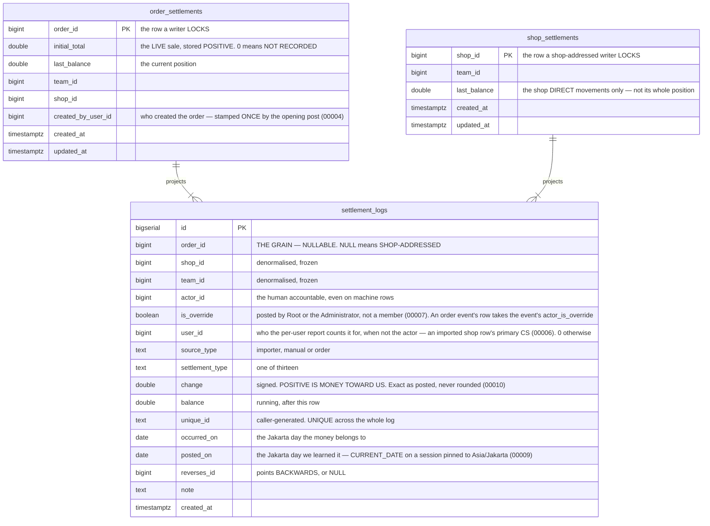

### Two grains, and why there are two accounts

A row is addressed to an **order** or to a **shop** (`an-entry-names-an-order-or-a-shop`). Both carry
`shop_id` and `team_id`, so both fold into the same daily report — but only the order grain has an
account keyed by order.

| | order-addressed | shop-addressed |
| --- | --- | --- |
| `order_id` | set | **NULL** |
| the account | `order_settlements` | `shop_settlements` |
| what it is for | one order's payout | a platform **withdrawal**, a **system adjustment** — things that name no order |
| `initial_total` | yes | — a sale belongs to an order, and the handler refuses one without |
| on `OrderSettlementDetail` | yes | **never** — that panel is one order's log |

⚠ **BOTH ACCOUNTS EXIST TO BE LOCKED**, not merely read. Each is a read-modify-write on a running
balance, so without a row to take `FOR UPDATE` two concurrent posts read the same previous value and
the second erases the first. Proven absent for both grains in `post_entry_race_test.go`.

⛔ **`shop_settlements.last_balance` IS NOT THE SHOP'S POSITION.** It sums the shop's DIRECT rows only.
The order-addressed rows carry the same `shop_id` and fold into the same daily report, so
`shop_settlement_daily_reports.close_balance` is a different and larger number. Two figures, one word.

### The sign convention, and the one place it flips

| | |
| --- | --- |
| `settlement_logs.change` | **positive is money toward us** — so `initial_total` is NEGATIVE (the platform owes us the sale) and `fund` is POSITIVE |
| `order_settlements.initial_total` | the sale as a **person** says it, **POSITIVE** |
| where they meet | the projection, and nowhere else — no screen negates by hand |

Both state figures are recomputable from the log alone, which is what makes the ledger auditable:

```
last_balance  =  SUM(change) over every row
initial_total = −SUM(change) over { initial_total, initial_total_cancel }
```

The second line is why a **cancel needs no special case**: its `change` is the exact opposite of the
sale's, so the running sum returns to zero on its own.

### Indexes, and what each is for

| index | answers |
| --- | --- |
| `settlement_logs_unique_idx` (unique_id) | ⚠ **the idempotency key, GLOBAL** (`00002`). All three writers retry; this is what makes a retried cancel absorb instead of crediting twice. Scoped to `(order_id, unique_id)` until `order_id` became nullable — Postgres treats NULL as distinct from NULL, so the scoped form would have admitted a shop-addressed key twice, silently |
| `settlement_logs_order_idx` (order_id, id) **WHERE order_id IS NOT NULL** | the panel's running balance, oldest first. ⚠ **Partial** (`00003`): with the column nullable, every shop-addressed row would otherwise sit in this index under one NULL group the panel never reads |
| `settlement_logs_team_occurred_idx` / `_shop_occurred_idx` | a period's movement for a team or a shop |
| `settlement_logs_shop_rows_idx` (team_id, posted_on DESC, id DESC) **WHERE order_id IS NULL** | Shop Entries (`ShopSettlementEntryList`, `00011`) — a team's SHOP rows, newest learned first; partial, since every order writes several rows of its own (1.7 ms vs 68 ms at 200 000 rows a team) |
| `settlement_logs_reverses_idx` (reverses_id) **WHERE reverses_id IS NOT NULL** | a row is reversed once (`00011`) — SettlementPost looks the reversal up under the account's lock, and Shop Entries marks each row of a page with the row that reversed it |
| `order_settlements_team_balance_idx` (team_id, last_balance) | the list screen, ranked by loss |
| `order_settlements_shop_idx` (shop_id, last_balance) | the same, narrowed to one shop |

### The reports — folded from the log, never written by the ledger (`00005`)

The daily tables are built by settlement's own webhook consuming `SettlementLogPosted`
([the-fold-owns-the-report-not-the-writer](business/settlement/context_decision.md#the-fold-owns-the-report-not-the-writer)).
**Every table below is DERIVED** — `AnalyticReplayCompute` can rebuild it — and nothing on the ledger's
write path reads or writes one.

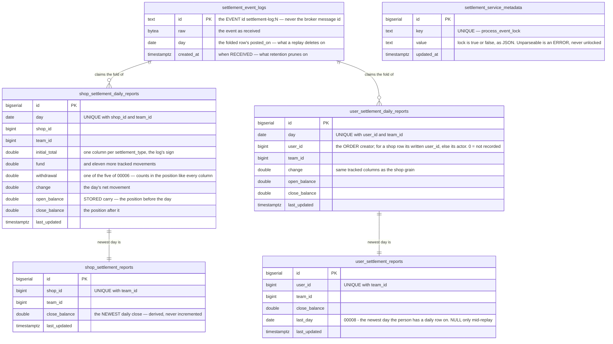

| | |
| --- | --- |
| **the tracked columns** | `initial_total`, `initial_total_cancel`, `other`, `fund`, `external_ads_fee`, `affiliate_fee`, `marketplace_adjustment`, `system_adjustment`, and since `00006` `withdrawal`, `shipment_adjustment`, `logistic_reimbursement`, `platform_reimbursement`, `marketplace_program` — the settlement_type TEXT is the column name — plus `change`. ⚠ **Widened WITH `SettlementPost`, never after**: the fold refuses a type it has no column for |
| **`withdrawal` is in the position** | summed into `change` and the carry like every column ([withdrawal-counts-in-the-position](business/settlement/context_decision.md#withdrawal-counts-in-the-position)) — so `close_balance` is the shortfall PLUS what was withdrawn, and the report calls it *Position to date* |
| **who a shop row counts for** | the user grain folds an order row for its creator, and a shop row for its `settlement_logs.user_id` when set — an imported shop row's primary CS, carried on the event — else for its actor ([settlement-asks-the-shop-for-its-primary-cs](business/settlement/settlement_importer_decision.md#settlement-asks-the-shop-for-its-primary-cs)) |
| **the carry** | `open(D) = Σ change before D`, `close(D) = Σ change up to D` ([the-carry-materialises-the-day-boundary-position](business/settlement/context_decision.md#the-carry-materialises-the-day-boundary-position)). Maintained by increment: a late event shifts every later day |
| **a quiet day has NO row** | a position read falls back to the last row at or before the date |
| **the dedup and the fold share ONE transaction** | a failure rolls the claim back with the compute, so the redelivery is really reprocessed |
| **no genesis row** | the fold opens a new scope at 0, true for a log with nothing older ([genesis-is-not-needed-when-the-log-starts-empty](business/settlement/context_decision.md#genesis-is-not-needed-when-the-log-starts-empty)) |
| **retention** | `settlement_event_logs` is pruned at **45 days** from receipt by `AnalyticMaintenanceRun` — longer than the broker's 31, or a redelivery would fold twice |

| index | answers |
| --- | --- |
| `*_daily_reports_scope_day_idx` (scope, team_id, day) UNIQUE | the fold's upsert target, its `prev` lookup and its later-day shift — equality on the scope, a range on day |
| `*_daily_reports_team_day_idx` (team_id, day) | a team's series and its ranking over a window |
| `*_daily_reports_day_idx` / `settlement_event_logs_day_idx` | the replay's delete — three tables, one predicate |
| `settlement_event_logs_created_idx` | the retention prune |
| `user_settlement_reports_team_last_day_idx` (team_id, last_day, user_id) | `SettlementPersonList`'s page, `ORDER BY last_day, user_id` either way (`00008` — replaced `user_settlement_reports_team_idx`) |

### Every date is a Jakarta day (`00009`)

- **Column comments only**, no DDL: `settlement_logs.posted_on` / `occurred_on`, `settlement_event_logs.day`, both daily
  tables' `day` and `user_settlement_reports.last_day` say they are Jakarta (WIB) days
  ([the-system-runs-on-jakarta-time](technical/architecture/context_decision.md#the-system-runs-on-jakarta-time): *"`DATE`
  columns are Jakarta dates by definition, and the column comment should say so"*). `posted_on`'s `DEFAULT CURRENT_DATE`
  is the Jakarta day because every session is: `backend/pkgs/san_dbsession` pins `TimeZone=Asia/Jakarta` on every
  connection the server, `san` and the tests open. Rows written before are not rewritten — there is no real data yet.

### The person's last day (`00008`)

- **`user_settlement_reports.last_day`** — the newest report day the person has a daily row on, so the *Created by*
  picker reads one row per (user, team) instead of every day of the team
  ([the-person-list-reads-the-last-day-from-the-user-report](business/settlement/context_decision.md#the-person-list-reads-the-last-day-from-the-user-report)).
  The fold sets it from the same newest daily row it derives `close_balance` from and only RAISES it (`GREATEST`), so a
  late event on an older day leaves it. `AnalyticReplayCompute` recomputes it as `MAX(day)` of the rows its cut left
  (NULL when none are — the redelivery raises it again). The migration backfilled it from the daily table.

### The override stamp (`00007`)

- **`settlement_logs.is_override`** — a `SettlementPost` row whose actor was Root or the Administrator inside a team
  they hold no role in ([an-override-is-stamped-in-every-service](business/user/context_decision.md#an-override-is-stamped-in-every-service)),
  read from `san_auth.IsOverride`. The importer's posts reach `SettlementPost` through a Connect client that forwards
  the bearer, so settlement's own interceptor resolves their scope and they are stamped too. A row opened or cancelled
  from an order's EVENT has no caller, so it takes the event's **`actor_is_override`** beside the event's actor: the
  opening row the placement's (`OrderPlaced`), the `initial_total_cancel` row the cancel's own (`OrderCancelled`).
  Every row publishes its stamp on as `SettlementLogPosted.actor_is_override`, which the financial accounts' withdrawal
  listener reads. Rows from before the column, or opened from an event published before the field, read false.
- **`order_settlements` is not stamped.** Its `created_by_user_id` is the ORDER's creator copied from selling, not who
  acted here — that act's stamp is selling's `orders.is_override`.

### Two things the schema deliberately does NOT hold

- **A non-null `order_id`.** It WAS `NOT NULL` until
  [an-entry-names-an-order-or-a-shop](business/settlement/context_decision.md#an-entry-names-an-order-or-a-shop)
  made it nullable (`00003`), which is what gives a platform **withdrawal** or a `system_adjustment` a
  shop-addressed home.
- **The shop's primary CS as a table.** An imported shop row's `user_id` is ASKED of the shop
  (`ShopAccessCheck`) before the write and kept on the row — settlement stores the answer, never the shop.
  The `00006` migration also rewrote any `source_type` `exporter` to `importer`
  ([the-source-is-named-importer](business/settlement/settlement_importer_decision.md#the-source-is-named-importer)).
- **No `order_ref`, names or `goods_cost`.** Settlement keys on our internal order id and never sees the
  marketplace's reference; the names and the cost live in `selling_service`, and a service does not
  read another's tables. The screens supply all four from where they already are.

---

## settlement_importer_service

`backend/services/settlement_importer_service/db_migrations/`

A platform statement, uploaded as a file and posted to the settlement ledger line by line
([settlement_importer.md](business/settlement/settlement_importer.md)). **It owns no ledger** — the rows it
posts are `settlement_logs` rows, written by `SettlementPost` under the uploader's token. These two tables
say what an upload DID: the import screen pages over the first, one file's page over the second.

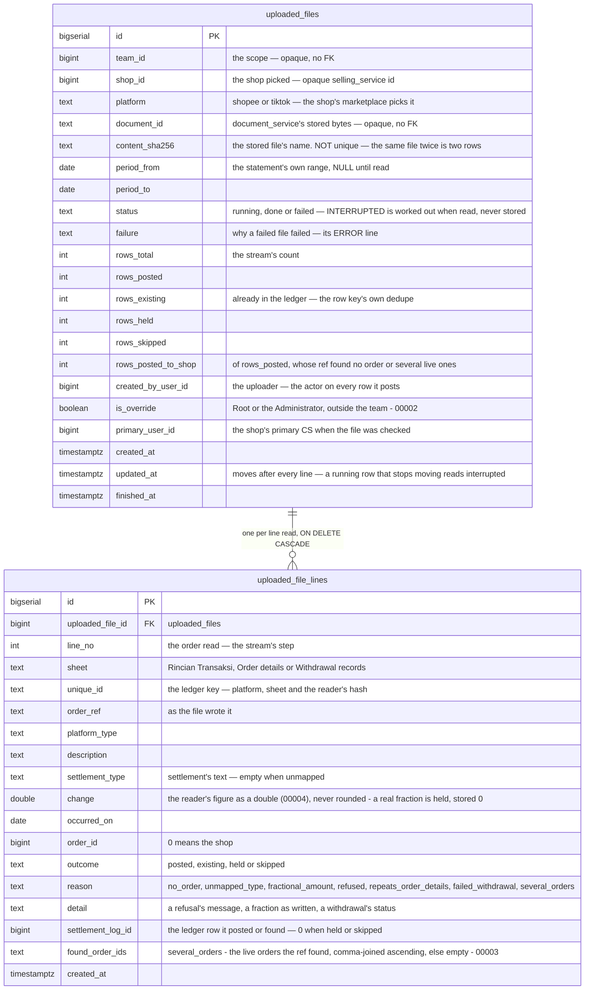

| | |
| --- | --- |
| **nothing unique but the ids** | duplicates are caught row by row, by the ledger's key — never file by file ([the-row-key-is-the-only-dedupe](business/settlement/settlement_importer_decision.md#the-row-key-is-the-only-dedupe)). The same file twice is a second row whose lines read `existing` |
| **INTERRUPTED is derived** | a `running` row whose `updated_at` is over two minutes old — the server stopped mid-file ([an-import-finishes-whether-anyone-watches](business/settlement/settlement_importer_decision.md#an-import-finishes-whether-anyone-watches)). The list filters it in SQL on the same line; nothing sweeps it |
| **every line is kept** | not only the ones worth a look — the file page's three views (held · skipped · posted to the shop) are filters over all of them |
| **no FK across services** | `team_id`, `shop_id`, `order_id`, `document_id`, `settlement_log_id` are other services' ids, kept as given |
| **`found_order_ids` is a record, not a key** (`00003`) | a ref on two or more live orders posts to the shop and names them ([two-live-orders-on-a-ref-post-to-the-shop](business/settlement/settlement_importer_decision.md#two-live-orders-on-a-ref-post-to-the-shop)). TEXT, comma-joined ascending, `''` otherwise — selling's ids, never joined or filtered on; the file page filters by `reason` |
| **no override stamp yet** | the import RPCs are server STREAMS, whose ctx carries no scope or role, so [an-override-is-stamped-in-every-service](business/user/context_decision.md#an-override-is-stamped-in-every-service) has nothing to read here. The rows it posts are stamped by `SettlementPost` (`settlement_logs.is_override`) |

| index | answers |
| --- | --- |
| `uploaded_files.is_override` (`00002`) | the upload was Root's or the Administrator's, in a team they hold no role in ([an-override-is-stamped-in-every-service](business/user/context_decision.md#an-override-is-stamped-in-every-service)) — read off the stream's `san_auth.StreamScope` |
| `uploaded_files_team_created_idx` (team_id, created_at DESC, id DESC) | the import screen — a team's uploads, newest first |
| `uploaded_files_team_shop_created_idx` (team_id, shop_id, created_at DESC, id DESC) | the same, one shop's |
| `uploaded_file_lines_file_outcome_idx` (uploaded_file_id, outcome, line_no) | one file's page — its lines by outcome, in the file's order |
| `uploaded_file_lines_settlement_log_idx` (settlement_log_id, id) **WHERE settlement_log_id <> 0** | the statement a ledger row came from (`00005`) — `StatementLinesBySettlementLogIds`, asked in-process by settlement's Shop Entries, one page of ids at a time |

---

## financial_account_service

`backend/services/financial_account_service/db_migrations/`

The money a team actually HOLDS — its bank accounts, ShopeePay wallet and cash box
([context_decision.md](business/financial_account/context_decision.md)). `financial_accounts` is the ledger's
STATE and `financial_account_logs` its LOG: a balance moves only with a log row, in the same transaction
([the-accounts-are-one-ledger](business/financial_account/context_decision.md#the-accounts-are-one-ledger)).
Money is `double precision` since `00003` (`NUMERIC(20,2)` before —
[numeric-money-moves-to-double-too](business/order/context_decision.md#numeric-money-moves-to-double-too)), stored exact
as it posts ([the-backend-never-rounds-money](business/order/context_decision.md#the-backend-never-rounds-money)), so a balance equals the sum of its logs within the tolerance; the wire is `double`
([rupiah-is-floating-point](business/order/context_decision.md#rupiah-is-floating-point)).

```mermaid
erDiagram
  financial_accounts ||--o{ financial_account_logs : "every move of its balance"
  financial_accounts ||--o{ shop_accounts : "the shops that withdraw into it"
  financial_accounts ||--o| operational_accounts : "marked: it pays for operations"
  financial_accounts ||--o{ financial_account_daily_reports : "one row per day it moved"
  financial_accounts {
    bigserial id PK
    bigint team_id "the scope — opaque, no FK"
    text type "wallet, bank_account, cash or unknown"
    text provider "cash, bca, bni, jago, shopeepay or unknown"
    text status "active or archived — archived only at zero"
    text account_number "a bank number or a wallet phone — empty for cash and unknown"
    text name "unique in the team, case-blind"
    text holder_name "atas nama"
    text description
    double balance "moves ONLY with a log row — may go below zero"
    timestamptz reconciled_at "last checked against the bank — NULL is never"
    timestamptz created_at
    timestamptz updated_at
  }
  financial_account_logs {
    bigserial id PK
    bigint team_id
    bigint account_id FK "financial_accounts — the scope of balance_after"
    text change_type "expense, ads_expense, adjustment, withdrawal, restock, opening_balance, transfer, team_payment, capital"
    double change "signed — positive is money INTO the account"
    double balance_after "the previous row's plus this change, in ENTRY order"
    text description "the cause in words — no source id"
    bigint actor_id "who — 0 for a listener with no person behind it"
    boolean is_override "the actor was Root or the Administrator, not a member (00002). A listener's row takes the event's actor_is_override"
    timestamptz occurred_at "when the money MOVED — the analytics day, in Jakarta"
    bigint group_id "both legs of one transfer — 0 for a single-leg row"
    bigint counter_account_id "a transfer's other account — 0 otherwise"
    timestamptz created_at "when it was recorded"
  }
  shop_accounts {
    bigserial id PK
    bigint team_id
    bigint shop_id "UNIQUE — a shop names one account; opaque selling_service id"
    bigint account_id FK "financial_accounts"
    timestamptz updated_at
    timestamptz created_at
  }
  operational_accounts {
    bigserial id PK
    bigint team_id
    bigint account_id FK "UNIQUE — financial_accounts"
    timestamptz updated_at
    timestamptz created_at
  }
  financial_account_daily_reports {
    bigserial id PK
    date day "the Jakarta day of the rows' occurred_at"
    bigint account_id "UNIQUE with day"
    bigint team_id
    double expense "one signed sum per change type"
    double ads_expense
    double adjustment
    double withdrawal
    double restock
    double opening_balance
    double transfer
    double team_payment
    double capital
    double change "the day's net — close minus open"
    double open_balance "the account's balance as the day opened — SHIFTED by a late row"
    double close_balance
    timestamptz last_updated
  }
  financial_account_event_logs {
    text event_id PK "the listener's claim — a redelivered event posts once"
    bigint occurred_at_unix
    timestamptz received_at
  }
```

### One write path

Every row goes through the ledger's `post`, on an account its caller has locked `FOR UPDATE`: the log row,
the balance and the day's report row in one transaction — the report row is upserted and every LATER day of
the account shifted, so a row dated last week moves every day since and the report is never behind the
balance ([the-daily-row-is-written-with-the-log-row](business/financial_account/context_decision.md#the-daily-row-is-written-with-the-log-row)).
A transfer locks both accounts in id order. The lock order is `audits/services/financial_account_service/concurrency/lock-order.md`.

**`is_override`** (`00002`) rides into `post` beside `actor_id`: a hand row (opening balance, capital, reconcile,
transfer — both legs — and identify's move) whose actor was Root or the Administrator inside a team they hold no role in
([an-override-is-stamped-in-every-service](business/user/context_decision.md#an-override-is-stamped-in-every-service)),
read from `san_auth.IsOverride`. A listener's row has no caller, so it takes its event's **`actor_is_override`**, beside
the event's `actor_id`: a `withdrawal` the settlement row's stamp (`SettlementLogPosted`), both `team_payment` legs the
confirmer's (`LiabilityPaymentAccepted`, from `liability_payments.confirmed_is_override`). Rows from before the column,
or from an event published before the field, read false.

| index | answers |
| --- | --- |
| `financial_accounts_provider_number_unique` (provider, account_number) WHERE account_number <> '' | one real account, one row, across ALL teams — a cash box and an unknown account exempt ([a-real-account-is-recorded-once](business/financial_account/context_decision.md#a-real-account-is-recorded-once)) |
| `financial_accounts_team_name_unique` (team_id, lower(name)) | a picker never shows two of the same |
| `financial_accounts_team_status_idx` (team_id, status) | the accounts page and every picker |
| `financial_account_logs_account_id_idx` (account_id, id) | one account's statement newest first — and the previous row a post reads |
| `shop_accounts_shop_unique` (shop_id) | a shop names one account ([a-shop-has-one-account](business/financial_account/context_decision.md#a-shop-has-one-account)) — also what makes two first withdrawals of a new shop make ONE unknown account |
| `operational_accounts_account_unique` (account_id) | an account is marked once |
| `financial_account_daily_reports_account_day_unique` (account_id, day) | the upsert's conflict target, the previous-day lookup and the later-day shift |
| `financial_account_daily_reports_team_day_idx` (team_id, day) | a team's series and its rankings |

`shop_accounts.shop_id` is an opaque `selling_service` id — `FinancialAccountShopSet` asks the shop's service
whether it is the team's before linking it, and the withdrawal listener trusts settlement's event.

---

## supplier_service

`backend/services/supplier_service/db_migrations/` — the suppliers a selling team buys from, and the online stores
each sells through (docs/business/supplier/context_decision.md, the-supplier-gets-its-own-service).

```mermaid
erDiagram
    suppliers ||--o{ supplier_channels : "supplier_id"
    supplier_sale_orders ||--o{ supplier_sale_order_parts : "order_id, no FK - written together"

    suppliers {
        bigserial   id          PK "moved rows keep their inventory_service id"
        bigint      team_id     "the SELLING team that keeps it, opaque, no FK"
        text        name        "required"
        text        contact
        text        address     "city and province folded in by the move"
        text        description
        timestamptz deleted_at  "NULL = live, soft delete"
        timestamptz created_at
        timestamptz updated_at
    }

    supplier_channels {
        bigserial   id           PK
        bigint      supplier_id  FK "-> suppliers(id), no ON DELETE: rows are never removed"
        text        channel_type "shared marketplace code via san_marketplace, other = custom"
        text        name         "required, the store's name"
        text        uri          "optional link to the store"
        text        description
        timestamptz deleted_at   "NULL = live, soft delete"
        timestamptz created_at
        timestamptz updated_at
    }

    supplier_product_daily_reports {
        bigserial   id                        PK
        date        day                       "the accept, Jakarta day"
        bigint      supplier_id               "the restock supplier, no FK, a deleted one kept"
        bigint      product_id                "the RESTOCKING team product, opaque"
        bigint      team_id                   "the RESTOCKING team, not the supplier owner"
        bigint      restock_count             "units accepted as good stock"
        double      restock_valuation         "at the line price, exact as the fold values it - a double since 00003"
        bigint      shipping_lost_count       "short in an accepted parcel"
        double      shipping_lost_valuation
        bigint      shipping_broken_count     "arrived broken"
        double      shipping_broken_valuation
        timestamptz last_updated
    }

    supplier_sale_daily_reports {
        bigserial   id           PK
        date        day          "the order or the cancel, Jakarta day"
        bigint      supplier_id  "the batch supplier, no FK"
        bigint      product_id   "the batch product, opaque"
        bigint      team_id      "the batch team - the RESTOCKING team"
        bigint      sales_count  "units sold, SIGNED - a cancel subtracts on its day"
        double      sales_value  "their share of the platform total, exact"
        timestamptz last_updated
    }

    supplier_sale_orders {
        bigint      order_id      PK "selling's order, opaque - the sales fold claim"
        date        placed_day    "NULL until OrderPlaced is folded"
        date        cancelled_day "NULL while the order stands"
        timestamptz created_at
        timestamptz updated_at
    }

    supplier_sale_order_parts {
        bigint      order_id    PK "with the three ids below"
        bigint      supplier_id PK
        bigint      product_id  PK
        bigint      team_id     PK
        bigint      units       "what the placement added"
        double      value       "taken back exactly by the cancel"
    }

    supplier_event_logs {
        text        id          PK "the EVENT id, restock-accepted:N, the fold dedup"
        bytea       raw         "the event as received, protojson"
        date        day         "the figures day, cut by the replay on the same predicate"
        timestamptz created_at  "received, pruned after 45 days"
    }

    supplier_service_metadata {
        bigserial   id          PK
        text        key         "unique, process_event_lock, figures_live_since, figures_backfilled"
        text        value       "each key defines its encoding"
        timestamptz updated_at
    }
```

- **Reads cross teams, writes do not** (another-team-sees-everything-of-a-supplier). Any team reads any live
  supplier and its stores — Discover Supplier is a list across every team; only the team in `team_id` writes. So
  a write's `WHERE` carries `team_id = ?` and a read's does not.
- **Delete is soft, on both** (a-deleted-supplier-is-kept-for-its-figures, a-store-delete-is-soft-too) — a past
  restock names its supplier and store, and the daily figures still read them. Every read states
  `deleted_at IS NULL` itself (not GORM's hidden scope), because `SupplierByIds` deliberately reads deleted
  rows. Deleting a supplier does **not** mark its stores: they hide with it.
- `channel_type` is the shared `warehouse.marketplace.v1.Marketplace` code **as text**, mapped by
  `pkgs/san_marketplace` — the same encoding `selling_service.shops.marketplace` uses; no `CHECK` IN-list (#80).
- Ids: the move inserts the legacy rows **with their ids**, then sets both sequences past the largest id, so a
  supplier created afterwards never takes one a restock already holds.

| index | serves |
| --- | --- |
| `suppliers_team_live_idx` (team_id, id DESC) WHERE deleted_at IS NULL | My Supplier — a team's live suppliers, newest first |
| `supplier_channels_supplier_live_idx` (supplier_id, id DESC) WHERE deleted_at IS NULL | a supplier's live stores — the Channels tab, Discover's badges and its store-name search |

### The figures — `00002_supplier_figures`

A supplier's figures are a FOLD of inventory_service's *Restock Accepted* event (the-report-is-processed-like-settlement,
the-figures-screens-are-accepted) — every table here is DERIVED and rebuilt by `AnalyticReplayCompute`; nothing on a
write path reads them.

- **The key is the owner's** — unique (`day`, `supplier_id`, `product_id`, `team_id`), the fold's upsert target
  (the-report-is-keyed-by-team-not-by-store). All six figures are movements, so the upsert ADDS and no later day
  changes — there is no balance to carry, unlike settlement's.
- **`supplier_id` is the RESTOCK's** while restock lines name no store
  (the-supplier-comes-from-the-restock-until-lines-name-a-store); no FK, because a deleted supplier's figures stay.
- **The dedup row is the event's id**, never the broker's message id — a republish, a replay and the backfill all
  collide on `restock-accepted:<id>`. It is pruned 45 days after receipt (`AnalyticMaintenanceRun`).
- **`supplier_service_metadata`** holds three keys: `process_event_lock` (`{"lock":true|false}`, seeded false — the
  replay's switch, and a value that does not parse is an error, never "unlocked"); `figures_live_since` (the earliest
  accept the WEBHOOK has folded, a fixed-width UTC instant — the backfill's cutoff, never pruned); `figures_backfilled`
  (the one-shot backfill has run).

| index | serves |
| --- | --- |
| `supplier_product_daily_reports_key_idx` UNIQUE (day, supplier_id, product_id, team_id) | the fold's upsert · the replay's delete · every window scan — the ranking |
| `supplier_product_daily_reports_supplier_day_idx` (supplier_id, day) | one supplier over a window — the Statistics tab's series and by-product table |
| `supplier_event_logs_day_idx` (day) · `_created_idx` (created_at) | the replay's delete · the prune |

### Penjualan — `00004_supplier_sales`

What a supplier's goods SOLD for (penjualan-is-the-selling-value-on-the-order-day), folded from selling's `OrderPlaced`
and `OrderCancelled` by the sales fold — DERIVED, like the restock figures, and in tables of its own because
`AnalyticReplayCompute` deletes and re-seeks only the restock subscription.

- **`supplier_sale_daily_reports`** is keyed as the restock rows are (`day`, `supplier_id`, `product_id`, `team_id`) and
  read with them as one UNION ALL by `metrics/suppliers`. SIGNED: the order's day adds, the cancel's day subtracts.
- **`supplier_sale_orders`** is the claim — one row per order, locked FOR UPDATE by both events, so either may arrive
  first; **`supplier_sale_order_parts`** keeps what the placement added, so the cancel takes back exactly that.
- The supplier, product and team are the BATCH's that the order's take drew (inventory's ledger, read in-process at the
  fold); no FK across services.

| index | serves |
| --- | --- |
| `supplier_sale_daily_reports_key_idx` UNIQUE (day, supplier_id, product_id, team_id) | the sales fold's upsert · every window scan |
| `supplier_sale_daily_reports_supplier_day_idx` (supplier_id, day) | one supplier over a window — the Statistics tab |
| `supplier_sale_orders_pkey` (order_id) · `supplier_sale_order_parts_pkey` (order_id, supplier_id, product_id, team_id) | the claim · the cancel's read of its parts |

**Not here yet:** `supplier_channel_products` — the store-to-product link
(restock-accepted-links-the-product-to-its-channel) needs a store on each restock line, which the restock does not
record yet.

---

## warehouse_service

`backend/services/warehouse_service/db_migrations/`

```mermaid
erDiagram
    warehouse_infos {
        bigserial   id              PK
        bigint      warehouse_id    "UNIQUE, the warehouse team - opaque, no FK"
        jsonb       operating_hours "weekly open-close grid"
        jsonb       receiving_hours "weekly order-receiving grid"
        text        location        "physical address, free text"
        timestamptz created_at
        timestamptz updated_at
    }

    warehouse_closures {
        bigserial   id           PK
        bigint      warehouse_id "the warehouse team - opaque, no FK"
        date        first_day    "Asia/Jakarta, inclusive"
        date        last_day     "inclusive, CHECK first_day <= last_day"
        text        reason       "named by the warning - CHECK not empty"
        timestamptz created_at
    }

    warehouse_fees {
        bigserial        id           PK
        bigint           warehouse_id "the warehouse team - UNIQUE, opaque, no FK"
        double_precision fee_percent  "2.5 = 2.5 percent, 0 to 100"
        double_precision min_fee      "the floor, default 0 = no floor"
        double_precision max_fee      "the cap - NULL = no cap, never 0"
        timestamptz      created_at
        timestamptz      updated_at
    }
```

- **`warehouse_infos`** (`00002`) — the warehouse PROFILE, moved whole from team_service ([the-warehouse-profile-lives-in-warehouse-service](business/teams/warehouse/context_decision.md#the-warehouse-profile-lives-in-warehouse-service)): both weekly grids
  as JSONB (validated by the handler) and the location. One row per warehouse; none reads as closed every day.
- **`warehouse_closures`** (`00002`) — one-off closures, whole days in Asia/Jakarta with a reason ([a-warehouse-records-its-holidays](business/teams/warehouse/context_decision.md#a-warehouse-records-its-holidays)). Indexed on
  `(warehouse_id, last_day)` — the profile and the receiving status read the ones still to come. They refuse nothing:
  `WarehouseReceivingStatus` only says a warehouse is closed, why and from when ([a-closed-day-warns-and-never-refuses](business/teams/warehouse/context_decision.md#a-closed-day-warns-and-never-refuses)).
- **`warehouse_fees`** (`00001`) — what a warehouse charges per order
  ([warehouse-prices-balance-records](business/teams/warehouse/context_decision.md#warehouse-prices-balance-records)): the
  owner's §Property 3 plus the decided floor. **One row per warehouse**, the same rate for every seller
  ([one-rate-per-warehouse](business/teams/warehouse/context_decision.md#one-rate-per-warehouse)):
  `fee = clamp(goods_cost × fee_percent / 100, min_fee, max_fee)`
  ([the-fee-has-a-floor-and-a-cap](business/teams/warehouse/context_decision.md#the-fee-has-a-floor-and-a-cap)).
  - **`max_fee` NULL is no cap, and 0 is refused** by `CHECK (max_fee > 0)`
    ([an-empty-cap-means-no-cap](business/teams/warehouse/context_decision.md#an-empty-cap-means-no-cap)).
    `CHECK (max_fee IS NULL OR min_fee <= max_fee)`: equal is a flat fee.
  - **No row = the warehouse never set its fee**, and takes no orders
    ([a-warehouse-with-no-rate-takes-no-orders](business/teams/warehouse/context_decision.md#a-warehouse-with-no-rate-takes-no-orders));
    `0%` is a rate, a missing row is not.
  - **`UNIQUE (warehouse_id)`** makes `WarehouseFeeSet` one `INSERT … ON CONFLICT DO UPDATE`, so two managers saving at once
    leave one row.
  - **Money is `DOUBLE PRECISION`** ([rupiah-is-floating-point](business/order/context_decision.md#rupiah-is-floating-point)).
  - **All five steps are built** ([the-flat-rate-is-dropped-last](business/teams/warehouse/context_decision.md#the-flat-rate-is-dropped-last)):
    an order freezes this table's fee and the ledger posts what the order froze; step 5 dropped
    `liability_terms.handling_fee` (liability `00011`). This table is the only fee rate there is.
