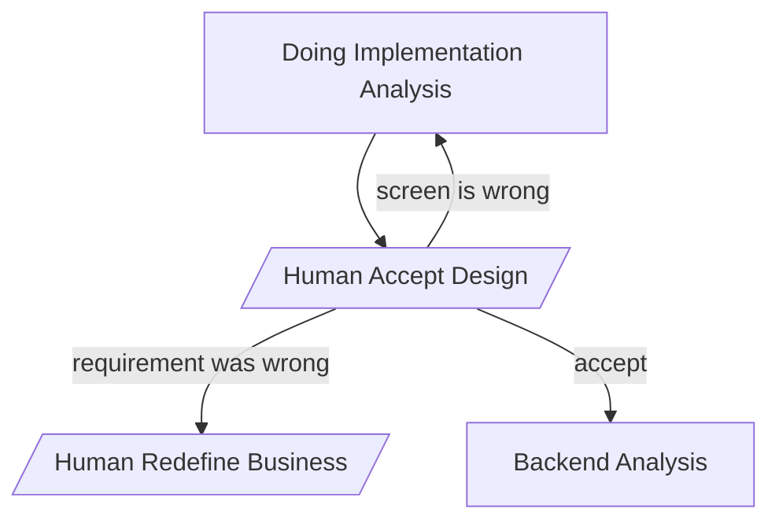
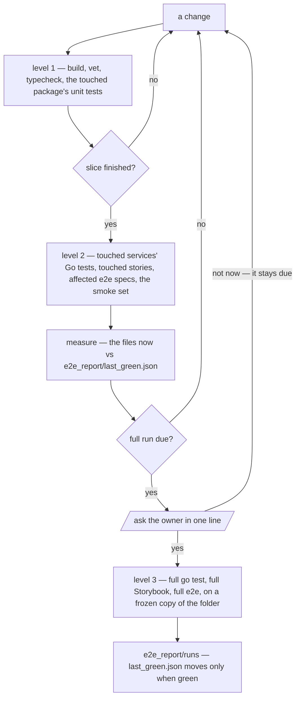

# Decisions — `development_lifecycle.md`

What the owner decided about [development_lifecycle.md](development_lifecycle.md), recorded before
it was acted on. **Append-only** — an entry is never edited away, so the next agent can see what was
already settled and does not re-propose it. Nothing is currently open — there is no `_clarify.md` for this doc.

---

## design-accept-blocks

**2026-08-27** · asked in `_clarify.md` § Question 1

**Decided: `design_accept` BLOCKS.** No implementation work starts while the owner is looking at the
Storybook prototype. `backend_analysis` is reachable only through the `accept` edge.

**Why:** a gate that can be walked past is decoration. The work that would start while nobody is
looking is exactly the work the gate exists to avoid paying for — the proto, the migration and the
handlers, all derived from a screen that may be about to change.

**Spec**

| | |
| --- | --- |
| what is being accepted | the previewable Storybook prototype — pages, components, mock wiring, and the contract derived from them (see [contract-accepted-with-the-screens](#contract-accepted-with-the-screens)) |
| who accepts | the owner, previewing at `npm run storybook` |
| while it is open | nothing downstream runs. The pass waits. |
| the three outcomes | `accept` → `backend_analysis` · `screen is wrong` → `implementation_analysis` · `requirement was wrong` → `redefine_business` |
| recorded where | an entry in this file, before work continues |

---

## contract-accepted-with-the-screens

**2026-08-27** · asked in `_clarify.md` § Question 2

**Decided: the contract is accepted at the SAME gate as the screens.** There is no separate contract
review.

**Why:** `contract_analysis` is derived from `pages_analysis` — it is a description of what the page
must show and do, so it is already part of what the owner is looking at. A second gate would review
the same decision twice, and a contract reviewed apart from its screens is reviewed without the thing
that justifies it.

**Spec**

| | |
| --- | --- |
| accepted together | `pages_analysis`, `components_analysis`, `contract_analysis`, `write_storybook` |
| accepted separately | nothing — one gate covers the whole prototype |
| consequence | a contract change after `accept` is a **new pass**, not an amendment to a settled one |

⚠ That last row is the cost of this decision, and it is the intended one: it makes the contract
expensive to change *after* the gate, which is what keeps the gate meaningful.

**Watch it on the first passes.** A contract gap is most likely to be found during `backend_analysis`
or `implementation`, and the only route back is the whole prototype again. If that bites twice, the
fix is a narrow edge from the gap back to `pages_analysis` that re-accepts only the changed screen —
recorded then as a decision that supersedes the strict reading. Until it bites, strict is correct and
cheaper than the escape hatch.

---

## gate-sits-before-backend-analysis

**2026-08-27** · applied to `development_lifecycle.md` at the owner's request

**Decided: `design_accept` sits between `implementation_analysis` and `backend_analysis`, and
`backend_analysis` moves OUT of the Implementation Analysis sub-flow.**

Previously the sub-flow ran `write_storybook → backend_analysis`, which designed the backend against
a screen nobody had accepted yet. Now Implementation Analysis produces a previewable prototype and
nothing else, so a rejection costs only the prototype — no proto decided, no migration written, no
handlers built.

## two-gates-not-one

**2026-08-27** · applied

**Decided: two gates, different weights.**

| gate | weight | for |
| --- | --- | --- |
| `design_accept` | **blocking** | the expensive decision, taken while it is still cheap |
| `add_requirements` | light | the owner previews `dev` continuously — a checkpoint, not an inspection |

`add_requirements` restores the loop that was commented out of the draft. It is what stops `end`
meaning *the agent declared itself finished*.

## test-then-audit

**2026-08-27** · applied

**Decided: `Run Testing` and `Audit RPC` are separate nodes.**

`Run Testing` is unit → integration → e2e. `Audit RPC` is the performance audit plus, for a write
RPC, the concurrency audit — only a HEAVY or UNSAFE result is written up. The audits are neither
tests nor implementation, so without a node of their own they had no place in the lifecycle and
would simply not happen.

---

## the-backlog-is-reranked-after-every-slice

**2026-11-04** · owner chose A over "per slice only" and "only when asked"

**Decided: [development_state/backlog.md](development_state/backlog.md) is the one ranked list of what is incomplete, across feature, frontend, API, service, event, statistic and flow. It is re-examined and re-ranked after EVERY finished slice, and fully re-audited against the code whenever the owner decides something or writes a doc, otherwise once a week.**

- **Per slice:** fired at the same moment as the person-log entry ([a-report-fires-per-slice](business/project/member_decision.md#a-report-fires-per-slice)), before the commit. Close the item with its commit; re-check every item the slice touched (unblocked, smaller, obsolete); add what the slice uncovered, verified against the code; re-rank; tell the owner one line per item that moved and why.
- **Full re-audit:** every row checked against the code, not against the markers, because markers drift. The first audit, on 2026-11-04, found about 30 "not built" markers on rules that were built.
- **Ranking order:** bugs that hurt a person → money that is wrong or missing → order robustness → cleanup. Unblocked before blocked; a cheap win moves up. The owner may override any position.
- `backlog.md` ranks WORK; [biggest_question.md](biggest_question.md) still ranks open QUESTIONS. An item blocked on a question links to it.

---

## the-full-e2e-waits-for-a-measured-yes

**2026-11-13** · owner chose **A**, as recommended, in chat: *"can you measure your work, and deciding the test should be cheap to expensive. and when test is expensive defer it first until changes bigger enough and we do expensive test like e2e test"* · *"it should dont rely on commit on depend github/git to much"* · *"thats why i propose folder e2e_report"* · *"what if you measure first, if it need expensive test, ask me"* · *"can we minimize the risk"* → **A** (cheap tests, a middle tier every slice, the full suite when due and with the owner's yes; the spec links and parallel workers after).

**Decided: tests run cheap to expensive, sized by a MEASUREMENT of the change. The full suites wait until the measurement says they are due — and then the owner is asked. The measurement compares the FILES with what the last green full run tested, kept in `e2e_report/` — never a commit, never git.** It refines [test-then-audit](#test-then-audit): `Run Testing` is still unit → integration → e2e; this decides how much of each runs, and when.

**Spec**

| | |
| --- | --- |
| level 1 — every change (seconds) | `go build` / `vet`, gofmt, typecheck, the unit tests of the package touched |
| level 2 — every slice (≈ 5–10 min) | the touched services' Go tests and their cross-service tests · the stories in the touched folders · race / perf tests when a write or a query changed (the RPC audit rules are unchanged) · the **affected e2e specs** — those that call an RPC, open a page or use a component the slice changed · the **smoke set** — about five key flows (sign in, place an order, accept a restock, a transfer, accept a return), kept under 5 min |
| level 3 — deferred | the full `go test ./...`, the full Storybook run and the full e2e — on a frozen copy of the folder, so work goes on while it runs |
| the measurement | a fingerprint of what the last green full run tested (each source file and a hash of its content) in `e2e_report/last_green.json`; the changed, added and deleted files grouped by area (a service, a page) and by risk. No git, no commit |
| due when | a **wide change** — a shared component, the layout or the menu · sign-in or permissions (`request_policy`) · an existing field made required · a migration that alters an existing table · an event's contents · the e2e setup or helpers — **or** the changes since the last green run span **3+ areas** — **or** work is about to be reported ready |
| who starts it | the owner: asked in ONE line built from the measurement (what changed, why it is due, about how long). Never run without a yes. Asking stops no work — the cheap levels go on |
| overdue | still unanswered at the end of the day, or 5+ areas changed → asked again, marked *overdue* |
| ready | work is never called ready while the full run is due — the report says plainly that it is not covered |
| a commit | the owner's act, unchanged — the report only says whether the current files are covered by a green full run |
| `e2e_report/` | at the repo root, gitignored: `latest.md` (the last result, and whether today's files are covered) · `last_green.json` · `runs/<time>/` (pass/fail and time per spec, the fingerprint tested, the areas changed since the previous run, failures' traces and screenshots) · a slice log (the files each slice changed), so a failure is traced to its slice without git |
| afterwards | specs stop counting what other specs wrote (`orders.spec.ts` *starts empty*, `financial_accounts.spec.ts` totals — their own team only) · 2–3 parallel workers, each with its own test database, API port and events project · sign in once per role · `restock.spec.ts` split (62 tests, ~12 of ~35 min) |
| what is given up | a break no affected spec and no smoke test touches is found at the next full run, not at its slice; the *wide* list is a path heuristic — grown each time a full run catches a break it rated low |

**What it amends**
- [test-then-audit](#test-then-audit) — how much of `Run Testing` runs, and when.
- The FAQ's [What has to be green before I commit?](faq/workflow.md#what-has-to-be-green-before-i-commit) — it points here now.
- The agent's habit of a full e2e after EVERY slice (~33–35 min each — the *full e2e N passed* lines in [backlog.md](development_state/backlog.md)'s Done rows) ends.

**What it does NOT settle**
- where the measurement and the runner live — `tools/san` (every developer's CLI) or the agent's own scripts;
- which tests make the smoke set — its five flows are named, the tests are picked when it is built;
- how many parallel workers this machine's memory carries (2–3 to start).

⛔ **Not built.** Today every slice ends with the full e2e in 10 name-ordered batches (~33–35 min, one worker, one shared test database); there is no measurement, no `e2e_report/`, no smoke set — backlog [#49–#51](development_state/backlog.md#tier-4--cleanup-and-small-gaps). Until #49 lands, the agent applies the rule by hand: it lists the files changed since the last full run and asks the same way.

🔄 *(2026-11-13)* **Where it lives — settled in chat**: owner *"A"*, as recommended — in the repo, as a `tools/san` command beside `san dev setup` / `san dev run` (HARD RULE 3b: one developer CLI), so every developer gets the same measurement and the same `e2e_report/`; documented in [docs/tools/san.md](tools/san.md) in the same commit as the build. Not chosen: the agent's own scripts (only the agent would use them), npm scripts in `frontend/` (the measurement covers Go files too, and it would be a second CLI). The command names are settled at the build.

✅ **Built 2026-11-13** — backlog #49, as `san test` ([docs/tools/san.md](tools/san.md#test-measure)): `test measure` (the file fingerprint against the gitignored `e2e_report/last_green.json`, areas and risk, the wide-change list, due / overdue, the one-line ask), `test affected` (the specs a change reaches through RPCs, pages, test ids, plus `frontend/e2e/affected.txt` for what reading cannot tell; `--run` runs them), `test smoke` (the five flows as 11 tests in `frontend/e2e/smoke.txt`, 1 min 23 s measured), `test full` (go test, Storybook and the e2e batches on a frozen copy beside the checkout; `last_green.json` moves only when all of it is green; `--dry-run` prints the plan), `test report` and `test slice` (latest.md, the slice log). The full run itself has not run yet — there is no green baseline, so it is due. #50 and #51 are not built.

✅ **Built 2026-11-14** — backlog #51, the *afterwards* row: `san test full --workers N` ([docs/tools/san.md](tools/san.md#test-full)) runs the e2e as N Playwright runs at once on the frozen copy, each with its own test database (`warehouse_test_wN`, every batch a clone of `warehouse_test_tpl`, which is migrated and seeded once per run), its own API and UI ports (8181+/5181+; a port another program holds is skipped, never killed) and its own events project (`warehouse-e2e-wN`, its push subscriptions on its own port). **How many workers — answered by measuring: 3**, the default (31.8 GB RAM, 8 cores: 19.1 GB free idle, 14.2 GB at three workers, about 1.6 GB each; five workers ran the restock specs about twice as slow — the CPU, not the memory, is the limit). Specs are placed longest first by their recorded times and run in name order inside a worker, so every *sorts after* rule still holds; `frontend/e2e/coupled.txt` lists specs that must share one database (none found — every coupling found is of the sort-after kind). Root signs in once per run (a saved storageState) instead of in nearly every test; `restock.spec.ts` is five files by its describe blocks (62 tests, titles unchanged, each passed alone); `--workers 1` keeps the name-ordered single-database batches. Proved on subsets only — three workers × 11 specs green (58 passed), the restock files on five and on two workers, the smoke set green — and `--dry-run` estimates the e2e at about 14 min against about 33 as one database. The full run itself has still not run: it waits for the owner's yes.

🔄 *(2026-11-16)* **Who runs which level — the e2e lane** ([the-tester-writes-the-e2e-specs](#the-tester-writes-the-e2e-specs), [a-slice-is-done-after-the-testers-green](#a-slice-is-done-after-the-testers-green), [the-tester-asks-for-the-full-run](#the-tester-asks-for-the-full-run)): level 1, and level 2's Go tests, stories and race / perf, stay with the dev bot; level 2's e2e — the affected specs and the smoke set — runs in the tester's worktree as worker w1 (`san test affected --run --isolated`); the measurement, the one-line ask and level 3 move to the tester. The rule itself — cheap to expensive, the full run only when measured due and after the owner's yes — is unchanged.

---

## a-file-that-fails-to-load-is-re-run-once

> Owner (Heri), in chat (2026-11-14): *"A"*, as recommended — to: the first full run on a frozen copy (3 workers, `e2e_report/runs/20261114-100420`, 23 min) had go 47 ✓, e2e 312 passed / 2 skipped / 0 failed, Storybook 2547 passed — but 11 Storybook files failed to **load** in the fresh copy (*Failed to fetch dynamically imported module*, *Cannot connect to the iframe* — the cold dependency cache re-bundling mid-run), and all 11 passed alone (34/34). A: a file that fails to load is re-run once by itself, a failed check never is, and this run becomes the first baseline; B: strict — only a run with zero failures counts.

**The verdict.**

| | |
| --- | --- |
| a load failure | a story or spec **file** that never ran a check because it failed to load (*Failed to import test file*, *Failed to fetch dynamically imported module*, *Cannot connect to the iframe*) is re-run **once, by itself**, inside the same full run; green on the re-run counts as green, and the run record names every file re-run and why |
| a failed check | a failed assertion, a timeout inside a test, or a crash after the file loaded is **never** re-run — the run is red ([the-full-e2e-waits-for-a-measured-yes](#the-full-e2e-waits-for-a-measured-yes)) |
| a second load failure | the same file failing to load again is red |
| today | the run `20261114-100420` (fingerprint `8dcc80678c5c`) is the first green baseline — every check in it passed and the 11 load-failed files passed alone; `last_green.json` moves to it |

This also settles the open point *"does a re-run of a red batch with no file changed move last_green?"* for load failures only: a batch whose checks failed still needs a whole new run. ⚠ Not built.

✅ **Built 2026-11-14** — in `san test full` and a new `san test accept-run` ([docs/tools/san.md](tools/san.md#a-file-that-fails-to-load-is-re-run-once)): a failed Storybook or e2e run is sorted per FILE by exact signatures (a story file that failed to import / to fetch a dynamic import / to reach its iframe; a story whose only error is the dynamic import; a Playwright batch stopped before any test by a load error naming its own spec) — anything else is a check failure; each load-failed file is re-run once, by itself, in the same run (a story file with vitest in the frozen copy; a spec alone, then its batch's other specs, in fresh batches on the same worker), and the run record lists every re-run, why and its result. `san test accept-run <stamp>` does the same for an ended run — now, in the live tree — and moves `last_green.json` to THAT run's fingerprint when all are green; it refuses while any check failure remains. Applied to `20261114-100420` on 2026-11-14 11:10: the 10 load-failed files and the Search story (its 15 s timeout is a CHECK failure by the rule — the log does not tie it to the re-bundle — so it was named with `--rerun` and the owner's *today* row as its recorded reason) all passed alone, 34 tests; `last_green.json` is now that run's fingerprint `8dcc80678c5c`.

---

## a-dependency-bump-is-one-area

> Owner (Heri), in chat (2026-11-14): *"B"* — to: should a dependency bump (`go.mod`/`go.sum`, `package.json`/`package-lock.json`) count as a wide change? A (recommended): wide — a library upgrade can break any screen or service, so the full run is due at once; B: no, one ordinary area — only the affected specs and the smoke set run.

**The verdict.** A dependency bump is **one ordinary area** in `san test measure`; it is not on the wide-change list ([the-full-e2e-waits-for-a-measured-yes](#the-full-e2e-waits-for-a-measured-yes)). It makes the full run due only the usual ways — with 2 other areas (3+), together with a wide change, or before reporting work ready. ✅ Built 2026-11-14 — nothing to change: `san test measure` already counts these files as one area.

---

## the-full-e2e-runs-on-one-worker

> Owner (Heri), in chat (2026-11-14): *"in next, can we set 1 worker for e2e test ? so my cpu not be heavy"* — after the day's full runs on three parallel workers (backlog #51, built 2026-11-14 with N=3 measured as what the machine carries).

**The verdict.**

| | |
| --- | --- |
| default | `san test full` runs the e2e on **one** worker — the name-ordered batches on one test database (`--workers 1`), ~35 min instead of ~16–18 |
| still there | `--workers N` (up to 6) for a run the owner asks to be fast; the parallel machinery (template clone, per-worker ports and events) is kept |
| the agent | uses one worker for every full or partial e2e run, and no parallel load loops, unless the owner asks |

It sets the open point *"how many parallel workers this machine's memory carries"* of [the-full-e2e-waits-for-a-measured-yes](#the-full-e2e-waits-for-a-measured-yes) for the default: one. ✅ Built 2026-11-14 — `defaultWorkers = 1` in `tools/san/test_workers.go`; docs/tools/san.md.

---

## development-goes-on-during-a-full-run

> Owner (Heri), in chat (2026-11-14): *"can we continue development while e2e running ?"* — after [the-full-e2e-runs-on-one-worker](#the-full-e2e-runs-on-one-worker) put the one-worker run back on the shared `warehouse_test` and :8081/:5175, the database and ports a developer's own Go DB tests and smoke use.

**The verdict.** A full run is fully isolated from the live checkout, on one worker too: its Go tests on `warehouse_test_go`, its e2e as worker w1 (`warehouse_test_w1` cloned from `warehouse_test_tpl`, :8181/:5181, events `warehouse-e2e-w1`), its Storybook on its own port (6116+). While it runs the live tree may run its Go DB tests, `san test smoke` / `affected --run` and Storybook (those first two still one at a time, as they share `warehouse_test`); only a second full run is refused. ⚠ A full run copies the tree as it is — start it when the tree compiles (no half-finished edit). ✅ Built 2026-11-14 — `tools/san` (`test_full.go`, `test_workers.go`, `test_runner.go`), `frontend/vitest.config.ts` (`STORIES_BROWSER_PORT`); docs/tools/san.md *While it runs*.

---

## the-tester-writes-the-e2e-specs

> Owner (Heri), in chat (2026-11-14): *"yes, but in note, in lightweight scenario test is dev bot enough, tester is focus on e2e test and giving report to dev bot."* — on splitting the agent into a dev bot and an e2e tester bot (about 8.8 h of 43 builder hours over 6–14 Nov went to waiting on e2e runs); then *"A"*, as recommended — to: who writes the e2e specs for a new feature? A: the tester, from the business docs and the built slice — the dev bot only adds the test ids; B: the dev bot writes them with the feature, as now, and the tester only runs them and reports; C: the dev bot writes them, and the tester checks them against the business docs and adds missing cases. The whole setup that followed (this entry and the six after it) was approved with *"A"* — build it in two stages — the same day.

**The verdict.**

| | |
| --- | --- |
| the split | the **dev bot** builds and runs the light checks itself — build, vet, gofmt, typecheck, the touched Go tests and stories, race / perf when a write or a query changed; the **tester bot** owns the e2e and reports to the dev bot |
| the specs | written by the tester, from `docs/business/` and the built slice; the dev bot adds the test ids a person's actions on its screens need, never a spec |
| `frontend/e2e/` | the tester's — specs, helpers, `smoke.txt`, `affected.txt`. A helper change still makes the full run due ([the-full-e2e-waits-for-a-measured-yes](#the-full-e2e-waits-for-a-measured-yes)) |
| a new spec failing | the tester checks its spec first; only an app bug goes to the dev bot |

**What it amends:** [the-full-e2e-waits-for-a-measured-yes](#the-full-e2e-waits-for-a-measured-yes) — level 2's e2e (the affected specs and the smoke set) is the tester's, no longer the slice builder's.

✅ **Built 2026-11-16** — the bots are Hermes profiles outside the repo (`revamp_dev`, `revamp_tester`, 2026-11-14); in the repo, `san test smoke --isolated` and `san test affected --run --isolated` ([docs/tools/san.md](tools/san.md#test-smoke)) run the level-2 e2e in the tester's checkout as worker w1, never on the dev checkout's `warehouse_test`.

---

## a-slice-is-done-after-the-testers-green

> Owner (Heri), in chat (2026-11-14): *"A"*, as recommended — to: does a slice count as done before the tester's green? A: no — after its own checks pass the dev bot marks it *built, e2e pending* in the backlog and moves on; it is Done, and may be committed, only after the tester reports green, and a red result sends it back to the dev bot; B: yes — Done after the dev bot's checks, tester failures become new bug rows (faster bookkeeping, but a commit can hold a red slice); C: the dev bot waits for the tester's green before starting the next slice.

**The verdict.**

| | |
| --- | --- |
| built | the slice's backlog row reads *built, e2e pending*, with its snapshot; the dev bot starts the next slice at once |
| Done | only after the tester's green on a snapshot holding the slice — then the backlog's Done row, and the tester's new specs brought into the main folder with it |
| red | back to the dev bot, which fixes a red app bug before new work |
| a commit | still only on the owner's word — "after green" means only green slices may go into one, not that green commits by itself |

---

## the-tester-asks-for-the-full-run

> Owner (Heri), in chat (2026-11-14): *"B"*, against my recommendation — to: who asks the owner before a full run? A (recommended): the dev bot — it measures (`san test measure`) and sends the usual one-line ask in the revamp chat; after a yes it has the tester run `san test full` on a snapshot; the owner keeps talking to one bot; B: the tester asks directly — it owns the e2e, so it knows best when a run is due; the questions then come from two bots, and the tester needs a chat of its own.

**The verdict.**

| | |
| --- | --- |
| measures | the tester — `san test measure` in its own worktree, against that worktree's `e2e_report/last_green.json` |
| asks | the tester, in its own chat ([the-tester-has-its-own-telegram-bot](#the-tester-has-its-own-telegram-bot)) — the same one-line ask |
| runs | the tester — `san test full` from its worktree, one worker ([the-full-e2e-runs-on-one-worker](#the-full-e2e-runs-on-one-worker)), only after the owner's explicit yes |
| the dev bot | stops measuring and stops asking about full runs |
| unchanged | the full run waits for a measured yes ([the-full-e2e-waits-for-a-measured-yes](#the-full-e2e-waits-for-a-measured-yes)) |

✅ **Built 2026-11-16** — the worktree's `e2e_report/` was given the dev checkout's baseline once (last green `20261116-084552`); from now on a green full run moves the worktree's `last_green.json`. `san test full` refuses while a full or `--isolated` run is live in either checkout — they share the template database and `warehouse_test_w1` ([docs/tools/san.md](tools/san.md#test-full)).

---

## the-tester-works-in-its-own-worktree

> Owner (Heri), in chat (2026-11-14): *"is two bot share same workspace ?"* — then *"A"*, as recommended — to: where does the tester work? A: in its own git worktree, a second checkout (`D:/pdcgo/warehouse_revamp_e2e`), switched to the exact snapshot before each test; it writes and runs its specs there; after a green the dev bot copies the new specs into the main folder and commits them with the slice; B: in the same folder, writing only under `frontend/e2e/` — simpler, but each test needs a careful copy of exactly the snapshot, and the tester's half-written specs can be swept into a dev commit. Asked next, *"e2e need different version of backend right ? how you can handle it ?"*: each run starts the snapshot's own backend, database and UI.

**The verdict.**

| | |
| --- | --- |
| where | `D:/pdcgo/warehouse_revamp_e2e`, a worktree of this repo, detached — never a branch, never a push |
| per test | switched to the snapshot's commit; its specs are written there and saved as a ref of their own (`refs/e2e/specs/<name>`) |
| its servers | the snapshot's own: backend built from its code, `warehouse_test_w1` cloned from a template migrated from its migrations, :8181/:5181, events `warehouse-e2e-w1` — never the dev bot's `warehouse_test`, :8081/:5175 |
| the specs afterwards | brought into the main folder by the dev bot after a green, and committed with the slice on the owner's go |

✅ **Built** — the worktree 2026-11-14 (`node_modules` hard-linked, the submodule copied in); 2026-11-16 the level-2 run in it: `san test smoke --isolated` / `affected --run --isolated`, in place as worker w1 ([docs/tools/san.md](tools/san.md#test-smoke)).

---

## the-tester-listens-for-snapshots

> Owner (Heri), in chat (2026-11-14): *"so tester bot test listen new commit and run test ?"*, *"is snapshoting is fast ?"* (~10 s), *"is snapshot takes huge space ?"* (~1 MB) — then *"A"*, as recommended — to: how does the tester know there is a new snapshot? A: it listens — a check every ~5 minutes that costs nothing when there is nothing new; one test run at a time, several waiting snapshots in one run, nothing lost when a bot restarts; up to 5 minutes before testing starts, and the dev bot reads reports between slices; B: the dev bot pokes it with a background `hermes -p revamp_tester chat -q …` — two slices handed off close together would start two runs that collide unless the tester queues them.

**The verdict.**

| | |
| --- | --- |
| the hand-off | a snapshot — the dev checkout as a commit on no branch, `refs/e2e/queue/<stamp>-<slice>`, its message the hand-off note (what changed, the business rules, the test ids added, the specs likely affected) |
| the check | every 5 minutes; no model call while nothing is queued |
| several queued | snapshots are cumulative: the newest is tested, and its report covers the older ones |
| the answer | a report file in `e2e_report/tester/`; the snapshot's ref moves to `refs/e2e/done/` |
| the dev bot | reads new reports between slices |

Commits come too late to listen for: under [a-slice-is-done-after-the-testers-green](#a-slice-is-done-after-the-testers-green) a slice is committed only after the green. The disk is the mailbox — the bots never message each other, and a queued snapshot survives a power cut.

---

## the-tester-has-its-own-telegram-bot

> Owner (Heri), in chat (2026-11-14): *"A"*, as recommended — to: where does the tester talk to the owner (needed by [the-tester-asks-for-the-full-run](#the-tester-asks-for-the-full-run))? A: its own Telegram bot — its questions reach his phone and he answers "yes" there; he creates it with @BotFather and enters its token into the tester's profile himself, never in chat; B: a desktop Bot Chat — ready with no token, but seen only at the desktop.

**The verdict.** The tester has its own Telegram bot; the owner entered its token himself. It speaks for the full-run ask. *(Not asked — the setup's default: a routine run with nothing to ask sends nothing.)* ✅ Token in place 2026-11-14.

---

## revamp-has-its-own-dev-bot

> Owner (Heri), in chat (2026-11-14): *"what if dev bot is new too"* — then *"B"*, against my recommendation — to: A (recommended): a new `revamp_dev` takes over the EXISTING Telegram bot token — the same chat on his phone with a fresh bot behind it, and `default` becomes his general assistant on the desktop; B: a new `revamp_dev` with its own NEW Telegram bot, and `default` keeps its Telegram chat — three Telegram chats; C: keep `default` as the dev bot.

**The verdict.**

| | |
| --- | --- |
| the dev bot | a new profile, `revamp_dev`, with its own new Telegram bot — the revamp channel from the switch on |
| `default` | keeps its Telegram chat as the general assistant; it no longer builds revamp and points revamp work to `revamp_dev` |
| the chats | three: `default`, `revamp_dev`, `revamp_tester` |
| carried over | everything on disk — the backlog, the decision files, `heri.md`, the agents' shared skill; not the old chat's history |

The switch waited for the old chat's builders to finish (*"i still have active session … if i choose A, is it safe ?"* — two stages: the profiles first, the repo changes after the builders). ✅ Both profiles 2026-11-14, their tokens entered by the owner.

🔄 *(2026-11-16 12:21)* **Live** — the switch: `san test … --isolated` built, the tester's 5-minute routine resumed, `revamp_dev`'s chat the revamp channel. The first snapshot is the proof run.

---

## acceptance-testing-goes-on-top-of-the-regression-run

> Owner (Heri), in `revamp_tester`'s desktop chat (2026-11-16 15:12): *"i have docs/acceptances"*, *"it should be acceptances testing"* — the tester's checks were regression only (affected + smoke per snapshot); `docs/acceptances/` held 263 thens over 11 actions, 57 ✅, then-by-then specs for four restock actions only.
> Then *"A"*, as recommended — to: what should acceptance testing replace? A: nothing — it goes on top: every snapshot still gets its affected specs + smoke (what makes a slice Done), and the tester's main spec work becomes covering the thens of `docs/acceptances/`, one block per given + when, one step per then, with a per-then result list for the owner; B: replace the regression run with only the action's acceptance thens.

**The verdict.** Acceptance testing is added on top of the regression gate ([a-slice-is-done-after-the-testers-green](#a-slice-is-done-after-the-testers-green) is unchanged). The tester writes the acceptance specs too — they are e2e specs under [the-tester-writes-the-e2e-specs](#the-tester-writes-the-e2e-specs) (the owner asked *"who write the acceptance test code ?"* — the tester; not a new decision), and they run in every affected, smoke and full run. Its reports carry an `## Acceptance` table: one row per then, passes / fails / not built. *(Not asked — `docs/acceptances/guide.md`'s rule: a check of a then that fails on an app bug keeps `test.fail` with the report's link, so the suite stays green.)*

---

## the-tester-marks-a-then-on-the-owners-word

> Owner (Heri), in `revamp_tester`'s desktop chat (2026-11-16): *"B"*, against my recommendation — to: how do per-then results reach the owner, and who changes a then's status? A (recommended): the report's table; a Telegram line when there are new passes; the owner tells revamp_dev which thens to mark and revamp_dev edits `docs/acceptances/`; B: the same table, but the owner tells the TESTER and it edits the status itself — a new exception to its *reports only* rule.

**The verdict.** On the owner's word naming the thens, the tester edits their status itself in `docs/acceptances/` — the then's cell and that action's counts in `<big>/context.md` and `progress.md` — left uncommitted in the live tree. It is the one exception to *the tester writes only reports in the main checkout*. A status still changes only on the owner's word (`docs/acceptances/guide.md`). revamp_dev commits those edits as bookkeeping and never reverts them.

🔄 *(2026-11-20)* Widened by the owner's *"B"* — the tester now sets the statuses from its green results without his naming each then: [the-tester-sets-a-thens-status-from-its-green-results](#the-tester-sets-a-thens-status-from-its-green-results). His own word still wins.

---

## the-tester-writes-acceptance-specs-when-nothing-is-queued

> Owner (Heri), in `revamp_tester`'s desktop chat (2026-11-16): *"A"*, as recommended — to: when does the tester write the acceptance specs? A: on wakes with no snapshot queued — one given + when at a time, restock first (the owner's *"the focus is restock"*), a queued snapshot always first; each finished action gets a specs ref, the spec alone, the affected run and a report; idle wakes then cost model time and keep worker w1 busy; B: only when the owner names an action.

**The verdict.** The tester works through `e2e_report/tester/acceptance_todo.md` (restock's actions, then order's) on every wake with nothing queued; a snapshot always goes first. Each action's report has `Snapshot: none` and no backlog row; on GREEN revamp_dev brings its specs in with the report's command, on RED its app bugs go first like any tester failure. Live from 2026-11-16 15:31.

---

## the-tester-sets-a-thens-status-from-its-green-results

> Owner (Heri), in `revamp_tester`'s desktop chat (2026-11-20): *"is when youre finished running test, marked it too?"* — the tester asked: confirm or reverse [docs/acceptances/guide.md](acceptances/guide.md#status-is-per-then)'s *"The agent's own passing test does not make a then ✅ ok … stays ⬜ untested until the owner says it has been checked"*? A: confirm — ✅ stays the owner's own check, the tester reports and the owner names thens; B: reverse — the tester marks. The owner picked *"B"* (no recommendation was given either way). Relayed by the tester's note `e2e_report/tester/20261120-183000-note-tester-marks-acceptance-status.md`.

**The verdict.** revamp_tester **sets a then's status from its green test results**: ✅ when the then's check passes for every role its given names in a green run (the report linked), ❌ with its `## Errors` entry when the check fails on an app bug, 🚧 while the check is a `test.fail` for something not built — the then's cell and that action's counts in `<big>/context.md` and `progress.md`, in the main checkout, left uncommitted for revamp_dev's next commit (`critical-projects/scripts/acceptance_mark.py`, run after every green report). **The owner's own word always wins.** It widens [the-tester-marks-a-then-on-the-owners-word](#the-tester-marks-a-then-on-the-owners-word) (2026-11-16: only the thens the owner names). First applied the same day: 488 status cells over 11 files (✅ 57 → 545 · 🚧 129 → 38 · ⬜ 502 → 105 of 688 thens).

---

## frontend-speed-is-measured-by-a-dev-tool

> Owner (Heri), in `revamp_dev`'s desktop chat (2026-11-21): *"okay A"*, **as recommended** — to: *"is good idea to have bot that asses frontend speed that related state management?"* A: a measuring tool the dev bot runs, no new bot; B: the tester measures every snapshot (catches regressions automatically, but adds minutes to every run and widens its lane); C: a third bot just for frontend speed (its own profile, Telegram, cron and model cost; mostly repeats the tester's browser work).

**The verdict.** Frontend speed is MEASURED by a tool the dev bot runs — no new bot, and the tester's runs do not grow. A `san` command opens each screen in a browser and counts, per screen:

| the measure | what it catches |
| --- | --- |
| requests per page load, and the same RPC asked twice | missing caching, a screen fetching on its own |
| calls waiting on each other | a slow first paint |
| time until the page is usable | what a person feels |
| requests fired after one save | too few — a stale screen; too many — a request storm |
| re-renders while typing in a big form | `order-create`'s 31 `useState` |

It writes `audits/frontend/<screen>.md` with a baseline, as `audits/services/` holds the backend's ([test-then-audit](#test-then-audit)). It joins the dev bot's Level 2 checks for a slice that changes a screen's reads, as the race/perf tests do when a write or a query changes. It is built FIRST, so the state work ([no-global-store-every-read-is-a-query-hook](technical/frontend/context_decision.md#no-global-store-every-read-is-a-query-hook)) reports before/after numbers.

*(Not asked — follows from the lane, [the-tester-writes-the-e2e-specs](#the-tester-writes-the-e2e-specs).)* The tool lives outside `frontend/e2e/`, asserts nothing and writes no spec — a measurement, not a test — and runs on servers and a database of its own, so it collides with neither the tester's worker w1 nor the dev bot's Go DB tests. How it counts re-renders and judges "usable" is the scoping pass's to propose.

⛔ Not built — backlog #119.

✅ Built 2026-11-21 (P1) — `go run ./tools/san audit frontend` ([docs/tools/san.md](tools/san.md#audit-frontend)): its own seat (`warehouse_test_audit` cloned per run from a kept `warehouse_test_audit_tpl`, :8251/:5251, events `warehouse-audit`, `e2e_report/.frontend_audit.lock`), a seed through its own API, a cached production build served by `vite preview`, the request measures (requests per load, the same RPC asked twice, CORS pre-checks, calls waiting on each other — measured by holding each answer back —, time until usable, requests after one save) and the first baseline of ten screens in [audits/frontend/](../audits/frontend/). Re-renders while typing are P2; `--files` and the Level 2 line P3 (#124); the other screens P4.

✅ Built 2026-11-21 (#125, re-renders and typing) — `go run ./tools/san audit frontend` also counts what React re-renders while a person types ([docs/tools/san.md](tools/san.md#typing--re-renders-per-keystroke)): per field of order-create (the buyer name, the address, a line's quantity), the restock form (a line's quantity, the note) and product-edit (the name), typed twice on fresh loads in a browser context of its own, a stub React DevTools hook counts the commits and the components rendered per keystroke, the commits trailing after the typing stops, where each re-render starts, and the components rendered most — named, because the audit's build alone turns on `esbuild.keepNames` (no request count moved: a `--files` run over that config). They are COUNTs in the `--files` verdict — commits/key +1, components/key +25 %, trailing +1 reads `FIX` — judged on every typing pass. order-create's save is now the whole OrderCreate a person types, and its ProductPicker is probed with the warehouse picked first. First readings: every key re-renders the whole form — order-create 3826–4213 components a key, all from `OrderCreatePage`; the restock form 3268; product-edit 934.

✅ Built 2026-11-21 (#126, every other screen) — `go run ./tools/san audit frontend` measures **50 screens**: P1's ten and 40 daily ones ([docs/tools/san.md](tools/san.md#audit-frontend), `tools/san/audit_frontend_screens_daily.go`) — the main lists and the other screens a person works on every day, each as the role whose daily work it is (22 the seller's, 2 the warehouse crew's, 14 the warehouse owner's, 2 root's), with one save where that work has a cheap one (a note on an order, an order's next step). The seed grows through the audit's own API (`audit_frontend_seed_daily.go`: 25 orders, 25 drafts, 25 expenses, 3 found reports, an open count — 266 calls, the template rebuilt in 22 s), and the ten P1 screens read the same counts on it. Every new screen has its baseline entry in [audits/frontend/](../audits/frontend/) — counts only, taken beside the tester's isolated run; the ten P1 entries untouched — so `--files` judges a slice on any of them; a unit test holds every entry to a route `router.tsx` renders on its page directory. The routes left out, each with its reason, are in docs/tools/san.md. First readings worth a look (named, not fixed): waiting chains 7 deep on `batch-detail` and 6 on `warehouse-product`, 3 on `batches`, `found-stock`, `opname-session-detail`, `restock-warehouse`, `warehouse-order` and `analytic`; the same read twice on `orders`, `shops`, `restock-warehouse` (`UserByIDs`), `restock-selling` (`UserByIDs` ×2), `user-detail` (`UserTeams`), `batch-detail` and `warehouse-product` (`ProductPlaces`).

---

## a-slice-fixes-the-speed-regression-it-caused

> Owner (Heri), in `revamp_dev`'s desktop chat (2026-11-21): *"A"*, **as recommended** — to: [audits/README.md](../audits/README.md) says audits are discussion documents whose fixes are asked for separately; when the frontend speed audit shows that a slice made a screen slower, what does the dev bot do? A: a regression in the COUNTS that the slice itself caused (an extra request, a new duplicate, a longer chain of waiting calls) is fixed in that slice before its snapshot; slower timings alone and problems that were already there are reported, never fixed unasked; B: report only — the slice goes on unchanged; C: any regression, timings included, holds the snapshot until it is fixed or the owner waives it.

**The verdict.** When [frontend-speed-is-measured-by-a-dev-tool](#frontend-speed-is-measured-by-a-dev-tool)'s Level 2 check compares a slice against the baseline:

| the change | what the dev bot does |
| --- | --- |
| a COUNT the slice made worse — requests per load, a new duplicate, a deeper waiting chain (and, once measured, renders per keystroke) | fixed in that slice, before its snapshot; the hand-off note names it |
| a TIMING worse, counts unchanged | reported in the hand-off note, not fixed — timings move with the CPU |
| a problem already in the baseline | reported, never fixed unasked — the [audits/README.md](../audits/README.md) rule stands for those |

Why counts and not timings: a count is exact on every run, so a worse count is the slice's own doing; a time is not.

⛔ Not built — backlog #124 (the Level 2 hook).

✅ Built 2026-11-21 (#124, the Level 2 hook) — `go run ./tools/san audit frontend --files a,b` ([docs/tools/san.md](tools/san.md#--files--the-level-2-line)): it measures only the audited screens the files reach (`san test affected`'s page mapping, called — the app shell and the build reach every screen, a backend file the screens whose measured requests call its RPCs), compares them with `audits/frontend/baseline.json` without writing it, and prints one summary line and a line per change: `FIX` (a count the slice made worse — the screen, the measure, before → after, the RPCs — to be fixed in the slice), `timing` (reported, not to fix), `already` (in the baseline, never fixed unasked), `better`, and `unstable` — a count that does not hold in every run of the measurement is not judged: the dependency pass runs twice, and a link a screen declares unstable (order-create's `TeamList → WarehouseReceivingStatus`) never reads as a regression. It exits 0 whenever the measurement completed *(build default)*.

---

## the-speed-audits-old-findings-are-fixed-smallest-first

> Owner (Heri), in `revamp_dev`'s desktop chat (2026-11-26): *"A"*, **as recommended** — to: the speed audit found problems that were already there, so under [a-slice-fixes-the-speed-regression-it-caused](#a-slice-fixes-the-speed-regression-it-caused) they were only reported — fix them? The findings: a keystroke re-renders the whole page (order create ~3,800–4,200 components, restock form 3,268, product edit 934); long chains of calls waiting on each other (batch detail 7 deep, warehouse product 6, six screens 3 deep); the same read sent twice a load (orders, shops, both restock lists, user detail, batch detail, warehouse product). A: fix them as ranked slices, smallest first — 1. the duplicate reads (frontend only, small), 2. the chains: run the calls side by side where the page already knows the ids; a chain that needs a new combined server call comes back to the owner as a measured question first, 3. order create's re-renders: split the page so a keystroke re-renders only its own card; the screens look the same throughout, each slice measured before and after; B: only the duplicates and order create's re-renders (frontend only), leave the chains; C: leave them, the tool keeps reporting.

**The verdict.** The audit's old findings are fixed, as ranked slices, smallest first:

| order | the slice | its limit |
| --- | --- | --- |
| 1 | the same read twice a load — `UserByIDs` (orders, shops, restock-warehouse, restock-selling ×2), `UserTeams` (user-detail), `ProductPlaces` (batch-detail, warehouse-product) — read once | frontend only |
| 2 | the waiting chains (batch-detail 7, warehouse-product 6, the 3-deep ones) — calls run side by side where the page already knows the ids | a chain that needs a NEW combined server call is not built: a measured question to the owner first |
| 3 | order create — a keystroke re-renders only its own card | the screen does not change |

Every slice keeps its screens looking the same and reports the audit's figures before → after; the audit's `FIX` rule still applies to each.

*(Not asked — the restock form's and product edit's re-renders, 3,268 and 934 components a key, were in the findings but not in A's slices: they stay reported.)*

⛔ Not built — backlog #133, #134, #135.

✅ Built 2026-11-26 (#135) — order create: a key renders only the card it is typed in. Every card, panel and dialog of `/orders/new` is its `React.memo` (`pages/order-create/components/memoCards.ts` — this page's use only, the shared components untouched), the page's own parts moved out to be memoised too (the header, the order information card, the items-or-bundles pill, the rail's header), and the page keeps their props the same between keys: the reducer's stable setters, a `useMemo` per derived value (the return map's lines keyed on WHICH products are on the order, never a quantity), a `useCallback` or `useStableHandler` (`pages/order-create/stableHandler.ts`, a latest-render handler) per handler. The form lock's fieldset renders only when the lock changes (`components/LockFieldset.tsx`): Chakra's `Fieldset.Root` hands its fields a new context on every render, which reached past every memoised card. The reducer stays the page's (no-global-store-every-read-is-a-query-hook), and what crosses cards — the totals from the lines, the credit warning, Create's held reason, the leave guard, the lock — is still derived once in the page. Kept: the screen, every test id and every behaviour; three stories pin it from React's fibers (`stories/Renders.stories.tsx`: a buyer-name key renders only the customer card, a quantity leaves the other cards alone, a draft's address text leaves the customer card still), each with a mutation check. The speed audit (`san audit frontend --files`, order-create): 0 to fix — requests 12 → 12, duplicates 0 → 0, chain 2 → 2, after the save 8 → 8; typing (commits · components a key · trailing) buyer name 1 · 3,826 → 479 · 0, address 2 · 4,213 → 866 · 0 (387 of it the address picker's own second commit, inside the card typed in), quantity 1 · 4,079 → 415 · 2.

✅ Built 2026-11-26 (#133) — the same read twice a load is read once; the screens look the same. **`UserByIDs`** (orders, shops, restock-warehouse, restock-selling ×2): a list's who filter and its rows named DIFFERENT id sets of one RPC — the seed only made them agree — so they are named by ONE read of the union now (`useScreenPeople` / `useNamedPeople` in `features/users/queries.ts`, the rules in `features/users/screenPeople.ts`: `usersByIdsQuery`, a name lookup on `referenceQuery`, sent once every part's ids are in, the last answer kept while a new union is read, never retried — as `fetchActors` never was); the who filters' hooks return ids (`useOrderCreatorIds`, `useShopPrimaryIds`, `useRestockPeopleIds`), the restock list no longer names its rows itself, and on shops and both restock lists the first rows wait for that read (they arrive named, as the restock rows always did). `useOrderCreators` stays for the analytic composer, `useTypists` alone for the pick queue. **`UserTeams`** (user-detail): the app's `retry: 1` sent a refused body (403 — the audit's seller seat) again a second later; the read no longer retries a refusal (PermissionDenied, Unauthenticated, NotFound, InvalidArgument), a read that got no answer is still asked once more. **`ProductPlaces`** (batch-detail, warehouse-product): the Adjust and Move dialogs, mounted closed beside the page, read the page's answer again — they take it as an optional `places` prop (the stock list's dialogs still read their own). Stories pin it — *People named once* (orders, shops, both restock lists), *First rows arrive named* (shops, both restock lists), *Racks read once* (batch detail, the warehouse product page — its first stories), user detail's *Refused — asked once* / *No answer — asked once more* (its first stories) — each red on the pre-slice files, with mutation checks. The speed audit (`san audit frontend --files`): duplicates 1 → 0 on orders, shops, restock-warehouse, user-detail, batch-detail and warehouse-product, 2 → 0 on restock-selling; screen requests orders 10 → 9, shops 4 → 3, restock-warehouse 11 → 10 (chain 3 → 2: the couriers no longer wait for the names), restock-selling 11 → 9, user-detail 2 → 1, batch-detail 10 → 9, warehouse-product 17 → 16 (chain 6 → 5); 0 to fix — the one `FIX` line (warehouse-products 2 → 3, a `TeamList`) was the products page drawing the catalogue's branch while the current team is still unresolved, untouched here, and did not repeat on the next measurement.
