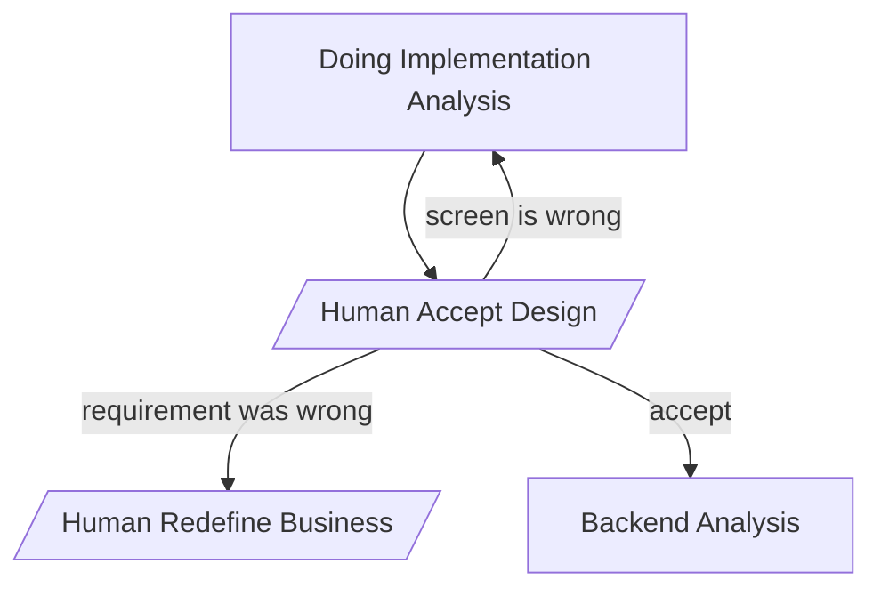
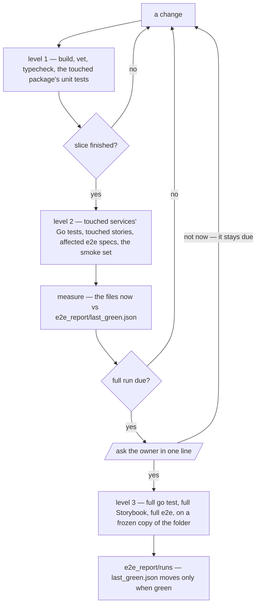

# Decisions — `development_lifecycle.md`

What the owner decided about [development_lifecycle.md](development_lifecycle.md), recorded before
it was acted on. **Append-only** — an entry is never edited away, so the next agent can see what was
already settled and does not re-propose it. Nothing is currently open — there is no `_clarify.md` for this doc.

---

## design-accept-blocks

**2026-08-27** · asked in `_clarify.md` § Question 1

**Decided: `design_accept` BLOCKS.** No implementation work starts while the owner is looking at the
Storybook prototype. `backend_analysis` is reachable only through the `accept` edge.

**Why:** a gate that can be walked past is decoration. The work that would start while nobody is
looking is exactly the work the gate exists to avoid paying for — the proto, the migration and the
handlers, all derived from a screen that may be about to change.

**Spec**

| | |
| --- | --- |
| what is being accepted | the previewable Storybook prototype — pages, components, mock wiring, and the contract derived from them (see [contract-accepted-with-the-screens](#contract-accepted-with-the-screens)) |
| who accepts | the owner, previewing at `npm run storybook` |
| while it is open | nothing downstream runs. The pass waits. |
| the three outcomes | `accept` → `backend_analysis` · `screen is wrong` → `implementation_analysis` · `requirement was wrong` → `redefine_business` |
| recorded where | an entry in this file, before work continues |

---

## contract-accepted-with-the-screens

**2026-08-27** · asked in `_clarify.md` § Question 2

**Decided: the contract is accepted at the SAME gate as the screens.** There is no separate contract
review.

**Why:** `contract_analysis` is derived from `pages_analysis` — it is a description of what the page
must show and do, so it is already part of what the owner is looking at. A second gate would review
the same decision twice, and a contract reviewed apart from its screens is reviewed without the thing
that justifies it.

**Spec**

| | |
| --- | --- |
| accepted together | `pages_analysis`, `components_analysis`, `contract_analysis`, `write_storybook` |
| accepted separately | nothing — one gate covers the whole prototype |
| consequence | a contract change after `accept` is a **new pass**, not an amendment to a settled one |

⚠ That last row is the cost of this decision, and it is the intended one: it makes the contract
expensive to change *after* the gate, which is what keeps the gate meaningful.

**Watch it on the first passes.** A contract gap is most likely to be found during `backend_analysis`
or `implementation`, and the only route back is the whole prototype again. If that bites twice, the
fix is a narrow edge from the gap back to `pages_analysis` that re-accepts only the changed screen —
recorded then as a decision that supersedes the strict reading. Until it bites, strict is correct and
cheaper than the escape hatch.

---

## gate-sits-before-backend-analysis

**2026-08-27** · applied to `development_lifecycle.md` at the owner's request

**Decided: `design_accept` sits between `implementation_analysis` and `backend_analysis`, and
`backend_analysis` moves OUT of the Implementation Analysis sub-flow.**

Previously the sub-flow ran `write_storybook → backend_analysis`, which designed the backend against
a screen nobody had accepted yet. Now Implementation Analysis produces a previewable prototype and
nothing else, so a rejection costs only the prototype — no proto decided, no migration written, no
handlers built.

## two-gates-not-one

**2026-08-27** · applied

**Decided: two gates, different weights.**

| gate | weight | for |
| --- | --- | --- |
| `design_accept` | **blocking** | the expensive decision, taken while it is still cheap |
| `add_requirements` | light | the owner previews `dev` continuously — a checkpoint, not an inspection |

`add_requirements` restores the loop that was commented out of the draft. It is what stops `end`
meaning *the agent declared itself finished*.

## test-then-audit

**2026-08-27** · applied

**Decided: `Run Testing` and `Audit RPC` are separate nodes.**

`Run Testing` is unit → integration → e2e. `Audit RPC` is the performance audit plus, for a write
RPC, the concurrency audit — only a HEAVY or UNSAFE result is written up. The audits are neither
tests nor implementation, so without a node of their own they had no place in the lifecycle and
would simply not happen.

---

## the-backlog-is-reranked-after-every-slice

**2026-11-04** · owner chose A over "per slice only" and "only when asked"

**Decided: [development_state/backlog.md](development_state/backlog.md) is the one ranked list of what is incomplete, across feature, frontend, API, service, event, statistic and flow. It is re-examined and re-ranked after EVERY finished slice, and fully re-audited against the code whenever the owner decides something or writes a doc, otherwise once a week.**

- **Per slice:** fired at the same moment as the person-log entry ([a-report-fires-per-slice](business/project/member_decision.md#a-report-fires-per-slice)), before the commit. Close the item with its commit; re-check every item the slice touched (unblocked, smaller, obsolete); add what the slice uncovered, verified against the code; re-rank; tell the owner one line per item that moved and why.
- **Full re-audit:** every row checked against the code, not against the markers, because markers drift. The first audit, on 2026-11-04, found about 30 "not built" markers on rules that were built.
- **Ranking order:** bugs that hurt a person → money that is wrong or missing → order robustness → cleanup. Unblocked before blocked; a cheap win moves up. The owner may override any position.
- `backlog.md` ranks WORK; [biggest_question.md](biggest_question.md) still ranks open QUESTIONS. An item blocked on a question links to it.

---

## the-full-e2e-waits-for-a-measured-yes

**2026-11-13** · owner chose **A**, as recommended, in chat: *"can you measure your work, and deciding the test should be cheap to expensive. and when test is expensive defer it first until changes bigger enough and we do expensive test like e2e test"* · *"it should dont rely on commit on depend github/git to much"* · *"thats why i propose folder e2e_report"* · *"what if you measure first, if it need expensive test, ask me"* · *"can we minimize the risk"* → **A** (cheap tests, a middle tier every slice, the full suite when due and with the owner's yes; the spec links and parallel workers after).

**Decided: tests run cheap to expensive, sized by a MEASUREMENT of the change. The full suites wait until the measurement says they are due — and then the owner is asked. The measurement compares the FILES with what the last green full run tested, kept in `e2e_report/` — never a commit, never git.** It refines [test-then-audit](#test-then-audit): `Run Testing` is still unit → integration → e2e; this decides how much of each runs, and when.

**Spec**

| | |
| --- | --- |
| level 1 — every change (seconds) | `go build` / `vet`, gofmt, typecheck, the unit tests of the package touched |
| level 2 — every slice (≈ 5–10 min) | the touched services' Go tests and their cross-service tests · the stories in the touched folders · race / perf tests when a write or a query changed (the RPC audit rules are unchanged) · the **affected e2e specs** — those that call an RPC, open a page or use a component the slice changed · the **smoke set** — about five key flows (sign in, place an order, accept a restock, a transfer, accept a return), kept under 5 min |
| level 3 — deferred | the full `go test ./...`, the full Storybook run and the full e2e — on a frozen copy of the folder, so work goes on while it runs |
| the measurement | a fingerprint of what the last green full run tested (each source file and a hash of its content) in `e2e_report/last_green.json`; the changed, added and deleted files grouped by area (a service, a page) and by risk. No git, no commit |
| due when | a **wide change** — a shared component, the layout or the menu · sign-in or permissions (`request_policy`) · an existing field made required · a migration that alters an existing table · an event's contents · the e2e setup or helpers — **or** the changes since the last green run span **3+ areas** — **or** work is about to be reported ready |
| who starts it | the owner: asked in ONE line built from the measurement (what changed, why it is due, about how long). Never run without a yes. Asking stops no work — the cheap levels go on |
| overdue | still unanswered at the end of the day, or 5+ areas changed → asked again, marked *overdue* |
| ready | work is never called ready while the full run is due — the report says plainly that it is not covered |
| a commit | the owner's act, unchanged — the report only says whether the current files are covered by a green full run |
| `e2e_report/` | at the repo root, gitignored: `latest.md` (the last result, and whether today's files are covered) · `last_green.json` · `runs/<time>/` (pass/fail and time per spec, the fingerprint tested, the areas changed since the previous run, failures' traces and screenshots) · a slice log (the files each slice changed), so a failure is traced to its slice without git |
| afterwards | specs stop counting what other specs wrote (`orders.spec.ts` *starts empty*, `financial_accounts.spec.ts` totals — their own team only) · 2–3 parallel workers, each with its own test database, API port and events project · sign in once per role · `restock.spec.ts` split (62 tests, ~12 of ~35 min) |
| what is given up | a break no affected spec and no smoke test touches is found at the next full run, not at its slice; the *wide* list is a path heuristic — grown each time a full run catches a break it rated low |

**What it amends**
- [test-then-audit](#test-then-audit) — how much of `Run Testing` runs, and when.
- The FAQ's [What has to be green before I commit?](faq/workflow.md#what-has-to-be-green-before-i-commit) — it points here now.
- The agent's habit of a full e2e after EVERY slice (~33–35 min each — the *full e2e N passed* lines in [backlog.md](development_state/backlog.md)'s Done rows) ends.

**What it does NOT settle**
- where the measurement and the runner live — `tools/san` (every developer's CLI) or the agent's own scripts;
- which tests make the smoke set — its five flows are named, the tests are picked when it is built;
- how many parallel workers this machine's memory carries (2–3 to start).

⛔ **Not built.** Today every slice ends with the full e2e in 10 name-ordered batches (~33–35 min, one worker, one shared test database); there is no measurement, no `e2e_report/`, no smoke set — backlog [#49–#51](development_state/backlog.md#tier-4--cleanup-and-small-gaps). Until #49 lands, the agent applies the rule by hand: it lists the files changed since the last full run and asks the same way.

🔄 *(2026-11-13)* **Where it lives — settled in chat**: owner *"A"*, as recommended — in the repo, as a `tools/san` command beside `san dev setup` / `san dev run` (HARD RULE 3b: one developer CLI), so every developer gets the same measurement and the same `e2e_report/`; documented in [docs/tools/san.md](tools/san.md) in the same commit as the build. Not chosen: the agent's own scripts (only the agent would use them), npm scripts in `frontend/` (the measurement covers Go files too, and it would be a second CLI). The command names are settled at the build.

✅ **Built 2026-11-13** — backlog #49, as `san test` ([docs/tools/san.md](tools/san.md#test-measure)): `test measure` (the file fingerprint against the gitignored `e2e_report/last_green.json`, areas and risk, the wide-change list, due / overdue, the one-line ask), `test affected` (the specs a change reaches through RPCs, pages, test ids, plus `frontend/e2e/affected.txt` for what reading cannot tell; `--run` runs them), `test smoke` (the five flows as 11 tests in `frontend/e2e/smoke.txt`, 1 min 23 s measured), `test full` (go test, Storybook and the e2e batches on a frozen copy beside the checkout; `last_green.json` moves only when all of it is green; `--dry-run` prints the plan), `test report` and `test slice` (latest.md, the slice log). The full run itself has not run yet — there is no green baseline, so it is due. #50 and #51 are not built.

✅ **Built 2026-11-14** — backlog #51, the *afterwards* row: `san test full --workers N` ([docs/tools/san.md](tools/san.md#test-full)) runs the e2e as N Playwright runs at once on the frozen copy, each with its own test database (`warehouse_test_wN`, every batch a clone of `warehouse_test_tpl`, which is migrated and seeded once per run), its own API and UI ports (8181+/5181+; a port another program holds is skipped, never killed) and its own events project (`warehouse-e2e-wN`, its push subscriptions on its own port). **How many workers — answered by measuring: 3**, the default (31.8 GB RAM, 8 cores: 19.1 GB free idle, 14.2 GB at three workers, about 1.6 GB each; five workers ran the restock specs about twice as slow — the CPU, not the memory, is the limit). Specs are placed longest first by their recorded times and run in name order inside a worker, so every *sorts after* rule still holds; `frontend/e2e/coupled.txt` lists specs that must share one database (none found — every coupling found is of the sort-after kind). Root signs in once per run (a saved storageState) instead of in nearly every test; `restock.spec.ts` is five files by its describe blocks (62 tests, titles unchanged, each passed alone); `--workers 1` keeps the name-ordered single-database batches. Proved on subsets only — three workers × 11 specs green (58 passed), the restock files on five and on two workers, the smoke set green — and `--dry-run` estimates the e2e at about 14 min against about 33 as one database. The full run itself has still not run: it waits for the owner's yes.
