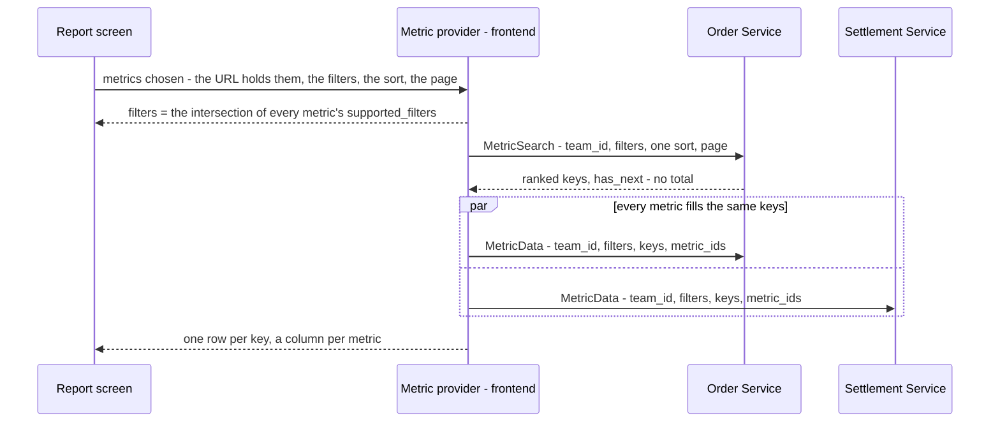

# Development state — analytic / rpc_provide

**DESIGN ACCEPTED (2026-10-27) — BACKEND, STEPS 1 AND 2 OF 4 DONE: the shared proto, its startup checks, and supplier — the
first real metric, `metrics/suppliers`, its four old reads removed.** The Storybook screen on sample
data passed design_accept ([the-analytic-screen-is-accepted](../../business/analytic/rpc_provide_decision.md#the-analytic-screen-is-accepted)). No metric, no
handler, no menu entry yet.
How analytics reach the frontend: one composed table whose columns come from any number of services, for the same rows. 45 decisions (two superseded: a
metric per grain became the table's `group_by`, and the summary metric became `group_by = SUMMARY`). No question open. No warehouse group: a warehouse is a team ([the-team-group-covers-warehouses](../../business/analytic/rpc_provide_decision.md#the-team-group-covers-warehouses)). The table and the graph are
tabs, one view at a time ([the-table-and-the-graph-are-tabs](../../business/analytic/rpc_provide_decision.md#the-table-and-the-graph-are-tabs)). The chart is designed
([the-graph-draws-the-table](../../business/analytic/rpc_provide_decision.md#the-graph-draws-the-table), 2026-10-28): line charts of the table, one per
`FieldStatType`, the columns as the legend. **Built** the same day in Storybook on Chakra's charts
([a-chart-is-chakras-chart](../../technical/frontend/context_decision.md#a-chart-is-chakras-chart)), on sample figures.

- Owner doc: [rpc_provide.md](../../business/analytic/rpc_provide.md) — ⚠ **untracked in git** until the owner commits it
- Decisions: [rpc_provide_decision.md](../../business/analytic/rpc_provide_decision.md) — 45, two superseded
- Clarify: [rpc_provide_clarify.md](../../business/analytic/rpc_provide_clarify.md) — **0 questions, 3 critiques** (a time graph oldest first, the tree's gaps, the stat-type
  startup check); its Proposed Design is the whole decided contract. Contradictions: the team group vs the warehouse filter, small slips in the owner's doc, Ads under Expense, the
  guideline's missing pointer
- Sibling: [context.md](../../business/analytic/context.md) — the fold that fills the report tables these RPCs read

## The design, in one picture

## The rules, grouped

| area | decided | decision |
| --- | --- | --- |
| access | `request_policy` on the request message, top-level `team_id [use_scope]`; no roles per metric; every team member reads every metric of the team | [a-metric-rpc-is-guarded-like-every-rpc](../../business/analytic/rpc_provide_decision.md#a-metric-rpc-is-guarded-like-every-rpc) · [every-member-reads-every-metric-of-their-team](../../business/analytic/rpc_provide_decision.md#every-member-reads-every-metric-of-their-team) |
| rows | exactly the keys `MetricSearch` sends; `MetricData` never adds or drops a key | [the-rows-are-the-keys-step-one-sends](../../business/analytic/rpc_provide_decision.md#the-rows-are-the-keys-step-one-sends) |
| filters | the intersection; an added metric removes a filter it cannot use, announced by a toast; `MetricData` takes the same filters to scope the numbers | [a-new-metric-removes-the-filters-it-cannot-use](../../business/analytic/rpc_provide_decision.md#a-new-metric-removes-the-filters-it-cannot-use) · [a-removed-filter-is-announced](../../business/analytic/rpc_provide_decision.md#a-removed-filter-is-announced) · [the-fill-step-scopes-its-numbers-by-the-filters](../../business/analytic/rpc_provide_decision.md#the-fill-step-scopes-its-numbers-by-the-filters) |
| response | `repeated MetricData`, one item per asked metric | [one-call-answers-every-asked-metric](../../business/analytic/rpc_provide_decision.md#one-call-answers-every-asked-metric) |
| groups | a metric is one measure and declares `supported_group_by`; the TABLE picks one `group_by` (summary, daily … yearly, product, shop, supplier, team, user — the enum grows with the reports, [the-group-enum-grows-with-the-reports](../../business/analytic/rpc_provide_decision.md#the-group-enum-grows-with-the-reports)), on both requests; a metric that cannot group by it is greyed in the picker; one key per table, no shop × day | [the-table-picks-one-group](../../business/analytic/rpc_provide_decision.md#the-table-picks-one-group) · [a-metric-that-cannot-group-is-greyed](../../business/analytic/rpc_provide_decision.md#a-metric-that-cannot-group-is-greyed) · [a-metric-has-one-key](../../business/analytic/rpc_provide_decision.md#a-metric-has-one-key) |
| days | `YYYY-MM-DD` Jakarta strings, inclusive (`date_min` / `date_max`); a week is Monday–Sunday | [a-day-is-a-jakarta-date-string](../../business/analytic/rpc_provide_decision.md#a-day-is-a-jakarta-date-string) · [a-week-is-monday-to-sunday-jakarta](../../business/analytic/rpc_provide_decision.md#a-week-is-monday-to-sunday-jakarta) |
| ids | a `metric_id` is a name, never a route — `metrics/orders`, the group not in it; unique across services, checked at startup | [a-metric-id-is-a-name-not-a-route](../../business/analytic/rpc_provide_decision.md#a-metric-id-is-a-name-not-a-route) |
| sort | one field of one metric, by its proto name; the key DESC breaks every tie; unspecified = DESC; a rate ranks only above `rank_min_sample` | [one-sort-field-per-table](../../business/analytic/rpc_provide_decision.md#one-sort-field-per-table) · [a-sort-field-is-its-proto-name](../../business/analytic/rpc_provide_decision.md#a-sort-field-is-its-proto-name) · [the-key-breaks-every-tie](../../business/analytic/rpc_provide_decision.md#the-key-breaks-every-tie) · [a-rate-ranks-only-above-its-minimum-sample](../../business/analytic/rpc_provide_decision.md#a-rate-ranks-only-above-its-minimum-sample) |
| paging | not a filter; no total; `has_next` from reading limit + 1; `GrowingPager` | [a-page-is-not-a-filter](../../business/analytic/rpc_provide_decision.md#a-page-is-not-a-filter) · [a-metric-page-has-no-total](../../business/analytic/rpc_provide_decision.md#a-metric-page-has-no-total) · [a-page-says-whether-another-follows](../../business/analytic/rpc_provide_decision.md#a-page-says-whether-another-follows) |
| keys | a body carries no key; the key lives in the map — three cases per metric: by id, by day, summary; `metric_key` removed | [the-key-lives-in-the-map](../../business/analytic/rpc_provide_decision.md#the-key-lives-in-the-map) |
| headline | the same metric read with `group_by = SUMMARY`, no keys — equal to the rows by construction; every metric lists `SUMMARY`, checked at startup; a rate's summary is computed from the sums | [the-headline-is-the-metric-grouped-by-summary](../../business/analytic/rpc_provide_decision.md#the-headline-is-the-metric-grouped-by-summary) · [every-metric-has-a-summary](../../business/analytic/rpc_provide_decision.md#every-metric-has-a-summary) · [the-headline-is-the-sum-of-its-rows](../../business/analytic/rpc_provide_decision.md#the-headline-is-the-sum-of-its-rows) |
| screen | state in the URL; comparing = a second tab, the A / B view deferred | [the-report-lives-in-the-url](../../business/analytic/rpc_provide_decision.md#the-report-lives-in-the-url) · [compare-in-another-tab-for-now](../../business/analytic/rpc_provide_decision.md#compare-in-another-tab-for-now) |
| scope of change | replaces the shipped analytic reads — supplier first, then settlement, then financial account | [the-pattern-replaces-the-shipped-analytics](../../business/analytic/rpc_provide_decision.md#the-pattern-replaces-the-shipped-analytics) |

## What exists

### The Analytic screen — Storybook only, sample data, ACCEPTED (2026-10-27)

`Pages/Analytic/Composer` — the owner chose to build it now and add the **menu entry later**, when a real metric is
wired, so nobody opens a page of invented numbers. **No route**: it is reachable in Storybook only.

| | |
| --- | --- |
| page | `frontend/src/pages/analytic/index.tsx` — `AnalyticPage()`; group select, metric chips, Add Metric, FilterBar, headline, then a **Table · Graph** tab row (the rows line and GrowingPager on both). The whole state is the URL (`useSearchParams`), the tab included (`v=graph`) |
| page parts | `components/` — `MetricPicker` (a popup picked like a category, CategorySelect's shape: search + the owner's categories + the chosen one's metrics as checkboxes; a metric that cannot group greyed with its reason), `ReportGraphs` (a `LineGraph` per field `kind` among the columns, drawn from the table's cells; two side by side from `lg`; ⚠ a time group drawn oldest first — proposed, [a-time-graph-runs-oldest-first](../../business/analytic/rpc_provide_clarify.md#a-time-graph-runs-oldest-first)), `ReportTable` (SortableHeader per sortable field, a block per row on a phone), `ReportHeadline` (SummaryStrip, group SUMMARY), `PlainSelect` (inline Select) · `format.ts` · `pending.ts` (three `sample` parts) |
| the chart | `frontend/src/components/charts/LineGraph.tsx` — the app's one chart component: `@chakra-ui/charts` 3.36 + `recharts` 3.10, both ends of the bottom axis always shown, `wholeNumbers` for a count axis, categorical `LINE_COLORS`. 4 stories (`Components/Charts/LineGraph`). ⚠ Recharts 3 draws tick labels in a layer of their own: select `.recharts-xAxis-tick-labels`, never `.recharts-xAxis …` |
| the provider | `frontend/src/features/analytic/provider.ts` — `loadReport`: ONE search in the service owning the sorted field (a time group sorted by period asks no one), then every metric fills the same keys under the same filters, then each metric's SUMMARY. Plain TS, no React |
| the catalogue | `features/analytic/catalogue.ts` — a TS **mirror** of the decided proto options (five metrics: orders, settlement, stock lost, ads, expenses). Goes when the proto lands and the provider reads `getOption` |
| the sample | `features/analytic/sample.ts` — seeded facts from 2025-01-01 to today. Toko Satria (13) has orders and no settlement; Toko Lama (14) settlement and no orders |
| the URL | `features/analytic/url.ts` — `?g=&m=&r=&shop=&product=&supplier=&s=&p=&n=`, read forgivingly |
| stories | `pages/analytic/index.stories.tsx` — 14, all passing: Default, Mobile, AddMetricDrillsIntoACategory, AddMetricSearchesEveryCategory, SortedByProfit, InventoryGreyedByShop, SwitchGroupToProduct, AddingStockLostRemovesTheShopFilter, HeadlineIsTheSumOfItsRows, ByDayIncludesQuietDays, GraphsSplitByKindOfNumber, TheViewIsInTheLink, ByDayGraphRunsOldestFirst, Empty |
| i18n | `analytic` namespace in `en.json` and `id.json` |
| the screen details, decided | the rows line always shows while a figure ranks ([the-rows-line-says-what-the-rows-are](../../business/analytic/rpc_provide_decision.md#the-rows-line-says-what-the-rows-are)) — the `rowsLine` prop is gone, and `SortedByProfitWithRowsLine` folded into `SortedByProfit`; a group change drops the columns that cannot follow, with its toast ([a-group-change-drops-the-columns-that-cannot-follow](../../business/analytic/rpc_provide_decision.md#a-group-change-drops-the-columns-that-cannot-follow)); the graph, built 2026-10-28 ([the-graph-draws-the-table](../../business/analytic/rpc_provide_decision.md#the-graph-draws-the-table)) — `legacy/components/charts/` (inline SVG) is not reused |

### What it will replace

Live today:

| service | today's analytic reads | stays |
| --- | --- | --- |
| supplier | ✅ **moved 2026-10-27** — `MetricSearch` / `MetricData` over `metrics/suppliers` ([supplier_analytic.proto](../../../proto/warehouse/supplier/v1/supplier_analytic.proto)); `rate_min_units` 50 is `rank_min_sample` on `broken_rate`. See [supplier's state](../supplier/context.md) | `AnalyticReplayCompute`, `AnalyticMaintenanceRun` |
| settlement | `AnalyticTimeSearch`, `AnalyticGroupSearch`, `AnalyticGroupMetric` | the same two |
| financial account | `AnalyticTimeSearch`, `AnalyticGroupSearch`, `AnalyticGroupMetric` | — |

Frontend reads them through `features/{suppliers,settlement,financialAccount}/analytics.ts`. `GrowingPager`
(`components/chrome/`) already takes `hasNext` with no total — the pager this design needs.

### The shared contract and its checks — backend step 1 (2026-10-27)

| | |
| --- | --- |
| the proto | [proto/warehouse/analytic_base/v1/analytic.proto](../../../proto/warehouse/analytic_base/v1/analytic.proto) — the decided contract, `GROUP_TYPE_TEAM` = 9 and `GROUP_TYPE_USER` = 10 included; generated to `backend/gen/…/analytic_base/v1` and `frontend/src/gen/…/analytic_base/v1` |
| the options | `metric` on `MessageOptions` and `metric_sort` on `FieldOptions`, both **50003** — registered in CLAUDE.md's options table |
| filled in here, not decided in the doc | one filter message per `FilterType` — `ProductFilter`, `TeamFilter`, `ShopFilter`, `SupplierFilter`, each ONE id, as the screen narrows by one; each `FilterItem` case number is its `FilterType`'s number. Limits: a page is 1–200, a key list at most 200. Number 2 is reserved — the keyword was removed on 2026-10-28 ([the-generic-keyword-is-removed](../../business/analytic/rpc_provide_decision.md#the-generic-keyword-is-removed)) |
| the checks | [backend/pkgs/san_metric/](../../../backend/pkgs/san_metric/) — `ValidateDescriptors()` refuses to boot on an empty or duplicated `metric_id`, a metric without `SUMMARY`, an `UNSPECIFIED` group or filter, a required filter not supported, and `metric_sort` on a non-number, on a non-metric, or with a negative minimum. Called in `service_api.go` beside `san_auth.ValidateDescriptors()`. `SortField(metric, name)` is the request-time lookup by proto name (`ErrNotSortable`); `OptionOf` reads the option |
| tests | `san_metric/metric_test.go` — 12, on metrics built IN MEMORY, so no test-only message enters the contract |

## What does not exist yet

- a metric of settlement's or financial account's — supplier's is the only one
- ⚠ `metrics/suppliers` on the composer: `features/analytic/catalogue.ts` still lists only its five SAMPLE metrics and
  `provider.ts` reads `sample.ts`. Wiring the composer to a real service is step 4
- the menu entry and a route for `/analytic` — added with the first real metric
- the cap on lines per graph — decided with the graph on screen ([the-chart-waits-for-a-chart-component](../../business/analytic/rpc_provide_decision.md#the-chart-waits-for-a-chart-component)); six colours, so a seventh line repeats the first
- a RATIO graph — the catalogue's `kind` is only `count | money`; it comes when the provider reads `field_stat_type` off the descriptor
- any `MetricSearch` / `MetricData` handler

## Waiting on the owner

| | |
| --- | --- |
| [service-guideline.md](../../../guidelines/service-guideline.md) | a pointer: analytics follow rpc_provide, not the typed-enum List/Overview shapes |
| [CLAUDE.md](../../../CLAUDE.md) HARD RULE 9 | a metric search returns `has_next`, not `PageInfo` — an exception not yet written in |
| `rpc_provide.md` in git | untracked — the clarify and decision files link to it |

## Next

**Backend analysis**, in the order of [the-pattern-replaces-the-shipped-analytics](../../business/analytic/rpc_provide_decision.md#the-pattern-replaces-the-shipped-analytics):

1. ✅ `proto/warehouse/analytic_base/v1/` and `san_metric`'s startup checks.
2. ✅ supplier's `MetricSearch` / `MetricData` (`supplier_v1/metric_*.go`), its four `Analytic*` reads removed in the
   same change as its two screens moved. What the next service copies:
   - **the shape**: one `<Service>Metric` message with the option, `…ByID` / `…ByDay` maps, a `MetricData` oneof of the
     three per metric; `metric_shared.go`'s `parseFilters` (the case number IS the FilterType), `groupOf`, `sortOrder`
     (`san_metric.SortField` + `rank_min_sample`), `bucketStart` (a period key must be its first day)
   - **the frontend**: `getOption(<Metric>Schema, metric)` for the id, `getOption(field, metric_sort)` for a minimum —
     never a typed copy (`features/suppliers/analytics.ts`); the headline is its own query, keyed without the page
     ([MetricData.md](../../../audits/services/supplier_service/performances/MetricData.md))
   - ⚠ **measure on a FRESH `warehouse_test`** (`go run ./tools/san db drop-test` before each perf test): a reused one
     read 2–4× slower and flipped a 30-day SUM to a whole-table scan
3. settlement, then financial account.
4. the route and menu entry, with the first real metric.

The chart is its own later pass ([the-chart-waits-for-a-chart-component](../../business/analytic/rpc_provide_decision.md#the-chart-waits-for-a-chart-component)).
