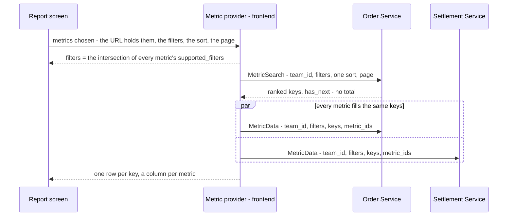

# Development state — analytic / rpc_provide

**DESIGN DECIDED, NOTHING BUILT (2026-10-26).** How analytics reach the frontend: one composed table whose columns come
from any number of services, for the same rows. 32 decisions (two superseded: a metric per grain became the table's `group_by`, and the summary metric became
`group_by = SUMMARY`). No question open; three screen details are deferred to the screen pass. No proto, no handler, no screen exists for it yet.

- Owner doc: [rpc_provide.md](../../business/analytic/rpc_provide.md) — ⚠ **untracked in git** until the owner commits it
- Decisions: [rpc_provide_decision.md](../../business/analytic/rpc_provide_decision.md) — 32, two superseded
- Clarify: [rpc_provide_clarify.md](../../business/analytic/rpc_provide_clarify.md) — **0 questions, 0 critiques**; the whole decided contract is its Proposed Design, and the owner's
  doc matches it. 1 contradiction: the guideline has no pointer here
- Sibling: [context.md](../../business/analytic/context.md) — the fold that fills the report tables these RPCs read

## The design, in one picture

## The rules, grouped

| area | decided | decision |
| --- | --- | --- |
| access | `request_policy` on the request message, top-level `team_id [use_scope]`; no roles per metric; every team member reads every metric of the team | [a-metric-rpc-is-guarded-like-every-rpc](../../business/analytic/rpc_provide_decision.md#a-metric-rpc-is-guarded-like-every-rpc) · [every-member-reads-every-metric-of-their-team](../../business/analytic/rpc_provide_decision.md#every-member-reads-every-metric-of-their-team) |
| rows | exactly the keys `MetricSearch` sends; `MetricData` never adds or drops a key | [the-rows-are-the-keys-step-one-sends](../../business/analytic/rpc_provide_decision.md#the-rows-are-the-keys-step-one-sends) |
| filters | the intersection; an added metric removes a filter it cannot use, announced by a toast; `MetricData` takes the same filters to scope the numbers | [a-new-metric-removes-the-filters-it-cannot-use](../../business/analytic/rpc_provide_decision.md#a-new-metric-removes-the-filters-it-cannot-use) · [a-removed-filter-is-announced](../../business/analytic/rpc_provide_decision.md#a-removed-filter-is-announced) · [the-fill-step-scopes-its-numbers-by-the-filters](../../business/analytic/rpc_provide_decision.md#the-fill-step-scopes-its-numbers-by-the-filters) |
| response | `repeated MetricData`, one item per asked metric | [one-call-answers-every-asked-metric](../../business/analytic/rpc_provide_decision.md#one-call-answers-every-asked-metric) |
| groups | a metric is one measure and declares `supported_group_by`; the TABLE picks one `group_by` (summary, daily … yearly, product, shop, supplier, team, user — the enum grows with the reports, [the-group-enum-grows-with-the-reports](../../business/analytic/rpc_provide_decision.md#the-group-enum-grows-with-the-reports)), on both requests; a metric that cannot group by it is greyed in the picker; one key per table, no shop × day | [the-table-picks-one-group](../../business/analytic/rpc_provide_decision.md#the-table-picks-one-group) · [a-metric-that-cannot-group-is-greyed](../../business/analytic/rpc_provide_decision.md#a-metric-that-cannot-group-is-greyed) · [a-metric-has-one-key](../../business/analytic/rpc_provide_decision.md#a-metric-has-one-key) |
| days | `YYYY-MM-DD` Jakarta strings, inclusive (`date_min` / `date_max`); a week is Monday–Sunday | [a-day-is-a-jakarta-date-string](../../business/analytic/rpc_provide_decision.md#a-day-is-a-jakarta-date-string) · [a-week-is-monday-to-sunday-jakarta](../../business/analytic/rpc_provide_decision.md#a-week-is-monday-to-sunday-jakarta) |
| ids | a `metric_id` is a name, never a route — `metrics/orders`, the group not in it; unique across services, checked at startup | [a-metric-id-is-a-name-not-a-route](../../business/analytic/rpc_provide_decision.md#a-metric-id-is-a-name-not-a-route) |
| sort | one field of one metric, by its proto name; the key DESC breaks every tie; unspecified = DESC; a rate ranks only above `rank_min_sample` | [one-sort-field-per-table](../../business/analytic/rpc_provide_decision.md#one-sort-field-per-table) · [a-sort-field-is-its-proto-name](../../business/analytic/rpc_provide_decision.md#a-sort-field-is-its-proto-name) · [the-key-breaks-every-tie](../../business/analytic/rpc_provide_decision.md#the-key-breaks-every-tie) · [a-rate-ranks-only-above-its-minimum-sample](../../business/analytic/rpc_provide_decision.md#a-rate-ranks-only-above-its-minimum-sample) |
| paging | not a filter; no total; `has_next` from reading limit + 1; `GrowingPager` | [a-page-is-not-a-filter](../../business/analytic/rpc_provide_decision.md#a-page-is-not-a-filter) · [a-metric-page-has-no-total](../../business/analytic/rpc_provide_decision.md#a-metric-page-has-no-total) · [a-page-says-whether-another-follows](../../business/analytic/rpc_provide_decision.md#a-page-says-whether-another-follows) |
| keys | a body carries no key; the key lives in the map — three cases per metric: by id, by day, summary; `metric_key` removed | [the-key-lives-in-the-map](../../business/analytic/rpc_provide_decision.md#the-key-lives-in-the-map) |
| headline | the same metric read with `group_by = SUMMARY`, no keys — equal to the rows by construction; every metric lists `SUMMARY`, checked at startup; a rate's summary is computed from the sums | [the-headline-is-the-metric-grouped-by-summary](../../business/analytic/rpc_provide_decision.md#the-headline-is-the-metric-grouped-by-summary) · [every-metric-has-a-summary](../../business/analytic/rpc_provide_decision.md#every-metric-has-a-summary) · [the-headline-is-the-sum-of-its-rows](../../business/analytic/rpc_provide_decision.md#the-headline-is-the-sum-of-its-rows) |
| screen | state in the URL; comparing = a second tab, the A / B view deferred | [the-report-lives-in-the-url](../../business/analytic/rpc_provide_decision.md#the-report-lives-in-the-url) · [compare-in-another-tab-for-now](../../business/analytic/rpc_provide_decision.md#compare-in-another-tab-for-now) |
| scope of change | replaces the shipped analytic reads — supplier first, then settlement, then financial account | [the-pattern-replaces-the-shipped-analytics](../../business/analytic/rpc_provide_decision.md#the-pattern-replaces-the-shipped-analytics) |

## What exists

Nothing of this pattern. What it will replace is live:

| service | today's analytic reads | stays |
| --- | --- | --- |
| supplier | `AnalyticTimeSearch`, `AnalyticProductSearch`, `AnalyticGroupSearch`, `AnalyticGroupMetric` ([supplier_analytic.proto](../../../proto/warehouse/supplier/v1/supplier_analytic.proto)) — carries `rate_min_units` 50 → `rank_min_sample` | `AnalyticReplayCompute`, `AnalyticMaintenanceRun` |
| settlement | `AnalyticTimeSearch`, `AnalyticGroupSearch`, `AnalyticGroupMetric` | the same two |
| financial account | `AnalyticTimeSearch`, `AnalyticGroupSearch`, `AnalyticGroupMetric` | — |

Frontend reads them through `features/{suppliers,settlement,financialAccount}/analytics.ts`. `GrowingPager`
(`components/chrome/`) already takes `hasNext` with no total — the pager this design needs.

## What does not exist yet

- `proto/warehouse/analytic_base/v1/` — `MetricOption`, `SortOption { can_sort, rank_min_sample }`, `MetricSort`,
  `FilterItem` / `FilterType`, `DateRangeFilter`, the key lists
- the startup checks: `metric_id` unique across services; a `can_sort` field exists by name
- the frontend metric provider (`features/analytic/`, plain TS) and the composed report screen
- any `MetricSearch` / `MetricData` handler

## Waiting on the owner

| | |
| --- | --- |
| [service-guideline.md](../../../guidelines/service-guideline.md) | a pointer: analytics follow rpc_provide, not the typed-enum List/Overview shapes |
| [CLAUDE.md](../../../CLAUDE.md) HARD RULE 9 | a metric search returns `has_next`, not `PageInfo` — an exception not yet written in |
| `rpc_provide.md` in git | untracked — the clarify and decision files link to it |

## Next

The owner's order: the text fixes, then the proof **frontend-first** (HARD RULE 6) — the composed report table in
Storybook against stubbed metrics — with the stories that decide the three deferred screen details
([screen-details-wait-for-the-screen](../../business/analytic/rpc_provide_decision.md#screen-details-wait-for-the-screen)) — then supplier's backend, then settlement and financial account.
