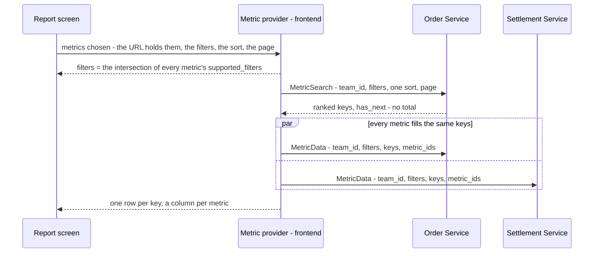

# Development state — analytic / rpc_provide

**DESIGN ACCEPTED (2026-10-27) — BACKEND, STEPS 1 AND 2 OF 4 DONE: the shared proto, its startup checks, and supplier — the
first real metric, `metrics/suppliers`, its four old reads removed.** The Storybook screen on sample
data passed design_accept ([the-analytic-screen-is-accepted](../../business/analytic/rpc_provide_decision.md#the-analytic-screen-is-accepted)).
✅ **2026-10-29: the screen is live** — route `/analytic` and a menu entry, its first SERVED metrics the five order
metrics ([order_statistic_metric.md](../order/order_statistic_metric.md)). ✅ **2026-10-30: settlement is served** — `metrics/settlement` and
`metrics/settlement/types` ([settlement's state](../settlement/context.md)), the second service on the composer; every other metric is still a sample.
How analytics reach the frontend: one composed table whose columns come from any number of services, for the same rows. 45 decisions (two superseded: a
metric per grain became the table's `group_by`, and the summary metric became `group_by = SUMMARY`). No question open. A warehouse group beside the team group, so `TEAM` and `WAREHOUSE` each mean one team for every reader ([the-warehouse-is-its-own-group](../../business/analytic/rpc_provide_decision.md#the-warehouse-is-its-own-group)); `GROUP_TYPE_WAREHOUSE = 11` joins the proto with its first metric, not yet. The table and the graph are
tabs, one view at a time ([the-table-and-the-graph-are-tabs](../../business/analytic/rpc_provide_decision.md#the-table-and-the-graph-are-tabs)). The chart is designed
([the-graph-draws-the-table](../../business/analytic/rpc_provide_decision.md#the-graph-draws-the-table), 2026-10-28): line charts of the table, one per
`FieldStatType`, the columns as the legend. **Built** the same day in Storybook on Chakra's charts
([a-chart-is-chakras-chart](../../technical/frontend/context_decision.md#a-chart-is-chakras-chart)), on sample figures.

- Owner doc: [rpc_provide.md](../../business/analytic/rpc_provide.md) — ⚠ **untracked in git** until the owner commits it
- Decisions: [rpc_provide_decision.md](../../business/analytic/rpc_provide_decision.md) — 45, two superseded
- Clarify: [rpc_provide_clarify.md](../../business/analytic/rpc_provide_clarify.md) — **0 questions, 1 critique** (the tree's gaps); its Proposed Design is the whole decided contract. Contradictions: small slips in the owner's doc, the
  guideline's missing pointer
- Sibling: [context.md](../../business/analytic/context.md) — the fold that fills the report tables these RPCs read

## The design, in one picture

## The rules, grouped

| area | decided | decision |
| --- | --- | --- |
| access | `request_policy` on the request message, top-level `team_id [use_scope]`; no roles per metric; every team member reads every metric of the team | [a-metric-rpc-is-guarded-like-every-rpc](../../business/analytic/rpc_provide_decision.md#a-metric-rpc-is-guarded-like-every-rpc) · [every-member-reads-every-metric-of-their-team](../../business/analytic/rpc_provide_decision.md#every-member-reads-every-metric-of-their-team) |
| rows | exactly the keys `MetricSearch` sends; `MetricData` never adds or drops a key | [the-rows-are-the-keys-step-one-sends](../../business/analytic/rpc_provide_decision.md#the-rows-are-the-keys-step-one-sends) |
| filters | the intersection; an added metric removes a filter it cannot use, announced by a toast; `MetricData` takes the same filters to scope the numbers | [a-new-metric-removes-the-filters-it-cannot-use](../../business/analytic/rpc_provide_decision.md#a-new-metric-removes-the-filters-it-cannot-use) · [a-removed-filter-is-announced](../../business/analytic/rpc_provide_decision.md#a-removed-filter-is-announced) · [the-fill-step-scopes-its-numbers-by-the-filters](../../business/analytic/rpc_provide_decision.md#the-fill-step-scopes-its-numbers-by-the-filters) |
| response | `repeated MetricData`, one item per asked metric | [one-call-answers-every-asked-metric](../../business/analytic/rpc_provide_decision.md#one-call-answers-every-asked-metric) |
| groups | a metric is one measure and declares `supported_group_by`; the TABLE picks one `group_by` (summary, daily … yearly, product, shop, supplier, team, user — the enum grows with the reports, [the-group-enum-grows-with-the-reports](../../business/analytic/rpc_provide_decision.md#the-group-enum-grows-with-the-reports)), on both requests; a metric that cannot group by it is greyed in the picker; one key per table, no shop × day | [the-table-picks-one-group](../../business/analytic/rpc_provide_decision.md#the-table-picks-one-group) · [a-metric-that-cannot-group-is-greyed](../../business/analytic/rpc_provide_decision.md#a-metric-that-cannot-group-is-greyed) · [a-metric-has-one-key](../../business/analytic/rpc_provide_decision.md#a-metric-has-one-key) |
| days | `YYYY-MM-DD` Jakarta strings, inclusive (`date_min` / `date_max`); a week is Monday–Sunday | [a-day-is-a-jakarta-date-string](../../business/analytic/rpc_provide_decision.md#a-day-is-a-jakarta-date-string) · [a-week-is-monday-to-sunday-jakarta](../../business/analytic/rpc_provide_decision.md#a-week-is-monday-to-sunday-jakarta) |
| ids | a `metric_id` is a name, never a route — `metrics/orders`, the group not in it; unique across services, checked at startup | [a-metric-id-is-a-name-not-a-route](../../business/analytic/rpc_provide_decision.md#a-metric-id-is-a-name-not-a-route) |
| sort | one field of one metric, by its proto name; the key DESC breaks every tie; unspecified = DESC; a rate ranks only above `rank_min_sample` | [one-sort-field-per-table](../../business/analytic/rpc_provide_decision.md#one-sort-field-per-table) · [a-sort-field-is-its-proto-name](../../business/analytic/rpc_provide_decision.md#a-sort-field-is-its-proto-name) · [the-key-breaks-every-tie](../../business/analytic/rpc_provide_decision.md#the-key-breaks-every-tie) · [a-rate-ranks-only-above-its-minimum-sample](../../business/analytic/rpc_provide_decision.md#a-rate-ranks-only-above-its-minimum-sample) |
| paging | not a filter; no total; `has_next` from reading limit + 1; `GrowingPager` | [a-page-is-not-a-filter](../../business/analytic/rpc_provide_decision.md#a-page-is-not-a-filter) · [a-metric-page-has-no-total](../../business/analytic/rpc_provide_decision.md#a-metric-page-has-no-total) · [a-page-says-whether-another-follows](../../business/analytic/rpc_provide_decision.md#a-page-says-whether-another-follows) |
| keys | a body carries no key; the key lives in the map — three cases per metric: by id, by day, summary; `metric_key` removed | [the-key-lives-in-the-map](../../business/analytic/rpc_provide_decision.md#the-key-lives-in-the-map) |
| headline | the same metric read with `group_by = SUMMARY`, no keys — equal to the rows by construction; every metric lists `SUMMARY`, checked at startup; a rate's summary is computed from the sums | [the-headline-is-the-metric-grouped-by-summary](../../business/analytic/rpc_provide_decision.md#the-headline-is-the-metric-grouped-by-summary) · [every-metric-has-a-summary](../../business/analytic/rpc_provide_decision.md#every-metric-has-a-summary) · [the-headline-is-the-sum-of-its-rows](../../business/analytic/rpc_provide_decision.md#the-headline-is-the-sum-of-its-rows) |
| screen | state in the URL; comparing = a second tab, the A / B view deferred | [the-report-lives-in-the-url](../../business/analytic/rpc_provide_decision.md#the-report-lives-in-the-url) · [compare-in-another-tab-for-now](../../business/analytic/rpc_provide_decision.md#compare-in-another-tab-for-now) |
| scope of change | replaces the shipped analytic reads — supplier first, then settlement, then financial account | [the-pattern-replaces-the-shipped-analytics](../../business/analytic/rpc_provide_decision.md#the-pattern-replaces-the-shipped-analytics) |

## What exists

### The Analytic screen — ACCEPTED (2026-10-27), LIVE with the order metrics (2026-10-29)

`Pages/Analytic/Composer`, and since 2026-10-29 the route `/analytic` with a menu entry — the step the acceptance named
*"with the first real metric"*. The entry sits **right after Home**, in the lead section with no heading
([the-analytic-entry-follows-home](../../business/analytic/rpc_provide_decision.md#the-analytic-entry-follows-home), 2026-10-30 — it was in Operations, my
unasked reading), for every member of a selling team, a warehouse, root and admin — not role-gated, since every member
reads every metric of the team ([every-member-reads-every-metric-of-their-team](../../business/analytic/rpc_provide_decision.md#every-member-reads-every-metric-of-their-team)).

| | wired 2026-10-29 |
| --- | --- |
| the catalogue | `ORDER_METRICS` in `features/analytic/catalogue.ts` are read off the generated descriptors with `getOption` — id, filters, groups, each field's `field_stat_type` and `metric_sort`; `MetricDef.schema` marks a served metric. The other four entries are still a typed mirror |
| the provider | `loadReport(req, teamId)` is ASYNC: a served metric is ranked and filled by its service (`OrderAnalyticService`, `SettlementAnalyticService` — one MetricData per question for all of a service's metrics; `clientOf` reads each through the shape every service shares), a sample by `sampleService`. `answeredFields` drops a column whose headline came back unset — a warehouse's money ([a-warehouse-sees-no-seller-money](../../business/order/order_statistic_metric_decision.md#a-warehouse-sees-no-seller-money)) |
| the page | TanStack Query with `listQuery` and a RefreshOverlay (HARD RULE 10); groups gain Seller (`team`), Warehouse and Created by (`user`), filters the same through ShopSelect, TeamSelect (by team type) and — for *created by* — PersonFilterSelect over `useAnalyticPeople` (2026-11-04, below); product and supplier keep their sample pickers (real since 2026-11-05, below). A row's id is named by ShopByIds / TeamByIds / UserByIDs (`useKeyNames`), a sample's by `sampleName` |
| a shared field name | `fieldLabel` reads `analytic.fieldOf.<metric>.<field>` before `analytic.field.<field>` — Created and Cancel both have the owner's `mp_total` |
| Storybook | `.storybook/orderAnalyticStub.ts` answers `OrderAnalyticService` from `sampleService`, so stories run the wire path; Gudang Pusat (11) gets counts only. `.storybook/settlementAnalyticStub.ts` answers `SettlementAnalyticService` by folding the settlement book (`fixtures.ts`), since a position is not a sum of samples. 16 stories, two new (`AWarehouseSeesCountsOnly`, `GroupedBySellerNamesTheTeam`) |
| e2e | `orders.spec.ts` *Analytic: the orders placed today count in Orders created, by shop* — through the emulator's push, the fold and both RPCs |
| Vite | `optimizeDeps.include` names recharts and `@chakra-ui/charts`: the dev server first met them on this lazy route, re-optimised mid-session and served a stale chunk, so the page never loaded |

| | |
| --- | --- |
| page | `frontend/src/pages/analytic/index.tsx` — `AnalyticPage()`; group select, metric chips, Add Metric, FilterBar, headline, then a **Table · Graph** tab row (the rows line and GrowingPager on both). The whole state is the URL (`useSearchParams`), the tab included (`v=graph`) |
| page parts | `components/` — `MetricPicker` (a popup picked like a category, CategorySelect's shape: search + the owner's categories + the chosen one's metrics as checkboxes; a metric that cannot group greyed with its reason), `ReportGraphs` (a `LineGraph` per field `kind` among the columns, drawn from the table's cells; two side by side from `lg`; a time group drawn oldest first, [a-time-graph-runs-oldest-first](../../business/analytic/rpc_provide_decision.md#a-time-graph-runs-oldest-first)), `ReportTable` (SortableHeader per sortable field, a block per row on a phone), `ReportHeadline` (SummaryStrip, group SUMMARY), `PlainSelect` (inline Select) · `format.ts` · `pending.ts` (three `sample` parts) |
| the chart | `frontend/src/components/charts/LineGraph.tsx` — the app's one chart component: `@chakra-ui/charts` 3.36 + `recharts` 3.10, both ends of the bottom axis always shown, `wholeNumbers` for a count axis, categorical `LINE_COLORS`. 4 stories (`Components/Charts/LineGraph`). ⚠ Recharts 3 draws tick labels in a layer of their own: select `.recharts-xAxis-tick-labels`, never `.recharts-xAxis …` |
| the provider | `frontend/src/features/analytic/provider.ts` — `loadReport`: ONE search in the service owning the sorted field (a time group sorted by period asks no one), then every metric fills the same keys under the same filters, then each metric's SUMMARY. Plain TS, no React |
| the catalogue | `features/analytic/catalogue.ts` — the SERVED metrics read off their descriptors with `getOption` (five order, two settlement); stock lost, ads and expenses still a TS **mirror** of the decided options. A field's `kind` is its `FieldStatType`: `count`, `money`, `position`, `ratio` |
| the sample | `features/analytic/sample.ts` — seeded facts from 2025-01-01 to today. Toko Satria (13) has orders and no settlement. No settlement facts: settlement is served, and its stub folds the settlement book, where Melati Official (21) has settlement and no orders |
| the URL | `features/analytic/url.ts` — `?g=&m=&r=&shop=&product=&supplier=&s=&p=&n=`, read forgivingly |
| stories | `pages/analytic/index.stories.tsx` — 14, all passing: Default, Mobile, AddMetricDrillsIntoACategory, AddMetricSearchesEveryCategory, SortedByProfit, InventoryGreyedByShop, SwitchGroupToProduct, AddingStockLostRemovesTheShopFilter, HeadlineIsTheSumOfItsRows, ByDayIncludesQuietDays, GraphsSplitByKindOfNumber, TheViewIsInTheLink, ByDayGraphRunsOldestFirst, Empty |
| i18n | `analytic` namespace in `en.json` and `id.json` |
| the screen details, decided | the rows line always shows while a figure ranks ([the-rows-line-says-what-the-rows-are](../../business/analytic/rpc_provide_decision.md#the-rows-line-says-what-the-rows-are)) — the `rowsLine` prop is gone, and `SortedByProfitWithRowsLine` folded into `SortedByProfit`; a group change drops the columns that cannot follow, with its toast ([a-group-change-drops-the-columns-that-cannot-follow](../../business/analytic/rpc_provide_decision.md#a-group-change-drops-the-columns-that-cannot-follow)); the graph, built 2026-10-28 ([the-graph-draws-the-table](../../business/analytic/rpc_provide_decision.md#the-graph-draws-the-table)) — `legacy/components/charts/` (inline SVG) is not reused |

### What it will replace

Live today:

| service | today's analytic reads | stays |
| --- | --- | --- |
| supplier | ✅ **moved 2026-10-27** — `MetricSearch` / `MetricData` over `metrics/suppliers` ([supplier_analytic.proto](../../../proto/warehouse/supplier/v1/supplier_analytic.proto)); `rate_min_units` 50 is `rank_min_sample` on `broken_rate`. See [supplier's state](../supplier/context.md) | `AnalyticReplayCompute`, `AnalyticMaintenanceRun` |
| settlement | ✅ **moved 2026-10-30** — `MetricSearch` / `MetricData` over `metrics/settlement` and `metrics/settlement/types` ([settlement_analytic.proto](../../../proto/warehouse/settlement/v1/settlement_analytic.proto)), on the composer and the Settlement Report. See [settlement's state](../settlement/context.md) | the same two |
| financial account | `AnalyticTimeSearch`, `AnalyticGroupSearch`, `AnalyticGroupMetric` | — |

Frontend reads them through `features/{suppliers,settlement,financialAccount}/analytics.ts`. `GrowingPager`
(`components/chrome/`) already takes `hasNext` with no total — the pager this design needs.

### The shared contract and its checks — backend step 1 (2026-10-27)

| | |
| --- | --- |
| the proto | [proto/warehouse/analytic_base/v1/analytic.proto](../../../proto/warehouse/analytic_base/v1/analytic.proto) — the decided contract, `GROUP_TYPE_TEAM` = 9 and `GROUP_TYPE_USER` = 10 included; generated to `backend/gen/…/analytic_base/v1` and `frontend/src/gen/…/analytic_base/v1` |
| the options | `metric` on `MessageOptions` and `metric_sort` on `FieldOptions`, both **50003**, and `field_stat_type` on `FieldOptions`, **50004** — `POSITION` added 2026-10-30 ([a-position-is-its-own-stat-type](../../business/analytic/rpc_provide_decision.md#a-position-is-its-own-stat-type)) (2026-10-29, [every-number-field-carries-a-stat-type](../../business/analytic/rpc_provide_decision.md#every-number-field-carries-a-stat-type)) — all registered in CLAUDE.md's options table |
| filled in here, not decided in the doc | one filter message per `FilterType` — `ProductFilter`, `TeamFilter`, `ShopFilter`, `SupplierFilter`, each ONE id, as the screen narrows by one; each `FilterItem` case number is its `FilterType`'s number. Limits: a page is 1–200, a key list at most 200. Number 2 is reserved — the keyword was removed on 2026-10-28 ([the-generic-keyword-is-removed](../../business/analytic/rpc_provide_decision.md#the-generic-keyword-is-removed)). Number 9 is `SUPPLIER_KEYWORD`, a typed search that means one thing, listed by `metrics/suppliers` alone (2026-10-30, [the-supplier-report-keeps-its-search](../../business/analytic/rpc_provide_decision.md#the-supplier-report-keeps-its-search)) |
| the checks | [backend/pkgs/san_metric/](../../../backend/pkgs/san_metric/) — `ValidateDescriptors()` refuses to boot on an empty or duplicated `metric_id`, a metric without `SUMMARY`, an `UNSPECIFIED` group or filter, a required filter not supported, `metric_sort` or `field_stat_type` on a non-number or a non-metric, a negative minimum, a metric's number field with no stat type, and a minimum sample on a field that is not a `RATIO`. Called in `service_api.go` beside `san_auth.ValidateDescriptors()`. `SortField(metric, name)` is the request-time lookup by proto name (`ErrNotSortable`); `OptionOf` reads the option |
| tests | `san_metric/metric_test.go` — 16, on metrics built IN MEMORY, so no test-only message enters the contract. `metrics/suppliers` passes the same check with its seven fields tagged (`TestSupplierMetricPassesTheStartupCheck`) |

## What does not exist yet

- a metric of financial account's
- `metrics/suppliers` on the composer — its service serves it, but the catalogue does not list it yet (supplier's own
  screens read it). One `servedMetric(SupplierMetricSchema, …)` line and a client in `provider.ts`'s `clientOf`
- ⚠ a sample metric filtered by a REAL shop reads zero — the shop picker is real now, and the samples' shops are
  invented. It goes when those metrics are served
- the cap on lines per graph — decided with the graph on screen ([the-chart-waits-for-a-chart-component](../../business/analytic/rpc_provide_decision.md#the-chart-waits-for-a-chart-component)); six colours, so a seventh line repeats the first
- a `MetricSearch` / `MetricData` handler outside supplier, selling and settlement — financial account is next in the agreed order

## Waiting on the owner

| | |
| --- | --- |
| [service-guideline.md](../../../guidelines/service-guideline.md) | a pointer: analytics follow rpc_provide, not the typed-enum List/Overview shapes |
| [CLAUDE.md](../../../CLAUDE.md) HARD RULE 9 | a metric search returns `has_next`, not `PageInfo` — an exception not yet written in |
| `rpc_provide.md` in git | untracked — the clarify and decision files link to it |

## Next

**Backend analysis**, in the order of [the-pattern-replaces-the-shipped-analytics](../../business/analytic/rpc_provide_decision.md#the-pattern-replaces-the-shipped-analytics):

1. ✅ `proto/warehouse/analytic_base/v1/` and `san_metric`'s startup checks.
2. ✅ supplier's `MetricSearch` / `MetricData` (`supplier_v1/metric_*.go`), its four `Analytic*` reads removed in the
   same change as its two screens moved. What the next service copies:
   - **the shape**: one `<Service>Metric` message with the option, `…ByID` / `…ByDay` maps, a `MetricData` oneof of the
     three per metric; `metric_shared.go`'s `parseFilters` (the case number IS the FilterType), `groupOf`, `sortOrder`
     (`san_metric.SortField` + `rank_min_sample`), `bucketStart` (a period key must be its first day)
   - **the frontend**: `getOption(<Metric>Schema, metric)` for the id, `getOption(field, metric_sort)` for a minimum —
     never a typed copy (`features/suppliers/analytics.ts`); the headline is its own query, keyed without the page
     ([MetricData.md](../../../audits/services/supplier_service/performances/MetricData.md))
   - ⚠ **measure on a FRESH `warehouse_test`** (`go run ./tools/san db drop-test` before each perf test): a reused one
     read 2–4× slower and flipped a 30-day SUM to a whole-table scan
3. ✅ settlement (2026-10-30) — two metrics, one table chosen per request; then financial account.
4. ✅ the route and menu entry — with the order metrics, 2026-10-29.

The chart is its own later pass ([the-chart-waits-for-a-chart-component](../../business/analytic/rpc_provide_decision.md#the-chart-waits-for-a-chart-component)).

## 2026-11-02 — the year cap and *as of*, built

| | |
| --- | --- |
| [a-metric-reads-at-most-a-year](../../business/analytic/rpc_provide_decision.md#a-metric-reads-at-most-a-year) | `san_metric.CheckRange` (`MaxRangeDays = 366`, `ErrRangeTooLong`) in every service's metric read — order, settlement, supplier — refused as InvalidArgument; the Analytic, settlement-report and supplier-report screens refuse a longer range before asking (`rangeTooLong`). A refusal test per service |
| [a-money-metric-says-as-of-when](../../business/analytic/rpc_provide_decision.md#a-money-metric-says-as-of-when) | `MetricDataResponse.as_of_unix` (2) in each service; selling's `00031` indexes the event log's `created_at` for it. The screens say *"As of {{time}} WIB"* — the OLDEST of the services read. Stories `SaysAsOfWhen` ×3 |
| the AI agents | the metric pair is what the MCP's `list_metrics` / `read_metric` read ([mcp state](../mcp/context.md)); both RPCs are marked `NO_SIDE_EFFECTS` |

## 2026-11-04 — the *created by* filter lists the people on the rows, built

| | |
| --- | --- |
| the bug | the USER filter was `<UserSelect>` with no team — the system-wide `SearchUser`, which only Root and the Administrator may call — so it was dead for every seller |
| decisions | [a-who-filter-lists-the-people-on-its-rows](../../business/user/context_decision.md#a-who-filter-lists-the-people-on-its-rows) · [a-filter-keeps-former-and-suspended-people](../../business/user/context_decision.md#a-filter-keeps-former-and-suspended-people) · [whoever-reads-a-list-may-filter-it](../../business/user/context_decision.md#whoever-reads-a-list-may-filter-it) |
| step 1 | `features/analytic/people.ts` `useAnalyticPeople(teamId, services)` — `selling` → `useOrderCreators` (gained `enabled`), `settlement` → `useSettlementPeople`; unioned by id (order creators first) when both share the table; a sample-only table offers nobody; asked only while the USER filter shows. The page renders `<PersonFilterSelect people error>` |
| step 2 | `SettlementAnalyticService.SettlementPersonList` (shaped like `OrderCreatorList`; MetricData's roles; `NO_SIDE_EFFECTS`) — one row per (user, team) of `user_settlement_reports` by its `last_day` (`00008`, raised by the fold, recomputed by the replay — [the-person-list-reads-the-last-day-from-the-user-report](../../business/settlement/context_decision.md#the-person-list-reads-the-last-day-from-the-user-report)), `user_id <> 0`, the team clause dropped for root (a person once, at `MAX(last_day)`); [rpc.md](../../services/settlement_service/rpc.md#who-a-user-filter-offers--settlementpersonlist). 🟢 [audit](../../../audits/services/settlement_service/performances/SettlementPersonList.md): 2 queries, 1.06/1.04 ms at 100 000 person-days (was 28/31 ms, a daily-table scan) |
| tests | `TestSettlementPersonList_*` (latest first, tie by id, 0 and other teams out, paging, root once per person, orders by the report's `last_day` and skips NULL, policy = MetricData's) · `TestFold_RaisesTheUsersLastDayAndAnOlderDayDoesNotLowerIt` · `TestAnalyticReplayCompute_RecomputesTheUsersLastDay` · `TestRace_Fold_ConcurrentDaysKeepTheCarryTrue` (last_day) · `TestPerf_SettlementPersonList`. Stories `CreatedByOffersThePeopleOnTheRows` (union, Budi once) · `CreatedByForSettlementIsSettlementsPeople`; stub `settlementPersonList` |
| not done | no metric of ads / expense / inventory names its people yet — a sample metric offers nobody |

## 2026-11-05 — the statistics backlog row, scoped: Warehouse Fee drawn, Inventory Lost and financial account waiting

The backlog's *Statistics: Analytic Warehouse Fee and Inventory Lost (data exists); financial account onto MetricSearch*
was read against the record. None of the three is decided far enough to build a backend, so nothing on the server
changed. ⚠ The open point the backlog leaned on — *"where the screen reads the two-team role from … decided with Warehouse
Fee"* (in [superseded-a-team-group-is-named-by-the-team-it-means](../../business/analytic/rpc_provide_decision.md#superseded-a-team-group-is-named-by-the-team-it-means))
— is **gone**: [the-warehouse-is-its-own-group](../../business/analytic/rpc_provide_decision.md#the-warehouse-is-its-own-group)
superseded it, so Seller (`TEAM`) and Warehouse (`WAREHOUSE`) mean one team each for every reader, and there is no role to read.

| item | decided | missing | status |
| --- | --- | --- | --- |
| Warehouse Fee | the tree: Expense › Warehouse Fee, filters team · shop · warehouse · user · date range, fields `transaction_count` · `amount` ([rpc_provide.md](../../business/analytic/rpc_provide.md)); `WAREHOUSE` lists it ([the-warehouse-is-its-own-group](../../business/analytic/rpc_provide_decision.md#the-warehouse-is-its-own-group)); the fee is frozen on the order, carried by `OrderPlaced.warehouse_fee`, reversed on cancel ([the-event-carries-the-warehouse-fee](../../business/teams/warehouse/context_decision.md#the-event-carries-the-warehouse-fee)) | its groups (the tree lists none — the clarify's critique [the-tree-is-the-catalogue-and-misses-two-things](../../business/analytic/rpc_provide_clarify.md#the-tree-is-the-catalogue-and-misses-two-things)); what a cancel does to the figures; whether a warehouse reads the amount; the id | ⚠ **Storybook prototype only**, awaiting the design accept |
| Inventory Lost | the owner's example `StockLostMetric` (`lost_count`, `lost_amount`, by day or product) and *"remove shop filter"* ([a-new-metric-removes-the-filters-it-cannot-use](../../business/analytic/rpc_provide_decision.md#a-new-metric-removes-the-filters-it-cannot-use)) | which losses count (opname shortage, Stock Adjust *lost*, broken, transfer lost, restock parcel lost), whether a found claim takes one back, its teams' filters and groups, its place in the tree (Inventory lists Transfer · Ready · Restock · Return). The data is `warehouse_stock_problems` (per batch, priced), but no event feeds a fold | ⛔ blocked — the existing sample `metrics/inventory/lost` is its picture |
| financial account | the move ([the-pattern-replaces-the-shipped-analytics](../../business/analytic/rpc_provide_decision.md#the-pattern-replaces-the-shipped-analytics)); `GroupType` gains `ACCOUNT`, `PROVIDER`, `CHANGE_TYPE` with it ([the-group-enum-grows-with-the-reports](../../business/analytic/rpc_provide_decision.md#the-group-enum-grows-with-the-reports)); the old three reads go in the same change | which metrics and fields (settlement needed [settlement-serves-its-headline-and-its-breakdown](../../business/settlement/context_decision.md#settlement-serves-its-headline-and-its-breakdown) for the same step); whether the composer lists them (no Finance category in the tree, [the-picker-follows-the-metric-tree](../../business/analytic/rpc_provide_decision.md#the-picker-follows-the-metric-tree)); the 🔴 `AnalyticTimeSearch` running-sum finding | ⛔ blocked |

### The Warehouse Fee prototype

| | |
| --- | --- |
| where | `PROTOTYPE_METRICS` in `features/analytic/catalogue.ts` — `metrics/warehouse_fee`, Expense, the tree's five filters, the order metrics' eight groups (recommended), `transaction_count` (count) and `amount` (money). `catalogueMetrics()` adds it only after `showPrototypeMetrics(true)`, which no live code calls — the live picker and `metricById` are unchanged |
| figures | `sample.ts`: one fee per placed order, 2.5% of its goods, at least Rp 2.500, on the placement day, seller Toko Melati (12), warehouse Gudang Pusat (11); a cancel is not drawn |
| stories | `pages/analytic/warehouseFee.stories.tsx` — *Pages/Analytic/Warehouse Fee (prototype)*: `WarehouseFeeIsUnderExpense`, `ASellerReadsItsFeesByWarehouse`, `AWarehouseReadsItsFeesBySeller`, `BesideOrdersItKeepsTheShopFilter`, `RankedByAmount`, `Mobile` — 6/6 pass |
| i18n | `analytic.metric.warehouseFee`, `analytic.field.transaction_count`, `analytic.field.amount` (en + id) |
| ⚠ awaiting the owner | the design accept, then the groups, the cancel rule, the warehouse's view of the amount, the id — the build after it: a `warehouse_fee` column on selling's `order_daily_reports` (`created` and `cancelled` rows already carry seller, shop, warehouse and creator), `WarehouseFeeMetric` in `order_analytic.proto`, served by `OrderAnalyticService` |

## 2026-11-05 — Warehouse Fee served (`metrics/warehouse_fee`)

Built from the four owner decisions recorded after the prototype:
[a-warehouse-fee-counts-on-its-day-and-a-cancel-takes-it-back-on-its-day](../../business/analytic/rpc_provide_decision.md#a-warehouse-fee-counts-on-its-day-and-a-cancel-takes-it-back-on-its-day),
[warehouse-fee-groups-like-the-order-metrics](../../business/analytic/rpc_provide_decision.md#warehouse-fee-groups-like-the-order-metrics),
[a-warehouse-sees-its-own-fee-amount](../../business/analytic/rpc_provide_decision.md#a-warehouse-sees-its-own-fee-amount),
[the-warehouse-fee-prototype-is-accepted](../../business/analytic/rpc_provide_decision.md#the-warehouse-fee-prototype-is-accepted).
The prototype's plan said "a `warehouse_fee` column"; the build uses a **sixth `metric` value instead** — reasoned below.

| | |
| --- | --- |
| the store | `order_daily_reports`, `metric = 'warehouse_fee'` (selling 00038 widens the CHECK). SIGNED rows: `order_count` = fee transactions, `total` = fee amount, `mp_total` 0 |
| why a row, not a column | net-by-day needs `created` (+) and `cancelled` (−) on DIFFERENT rows; a column there would need a cross-row net in every read (search sort, fill, summary). A signed row of its own makes the existing generic reads (`reportRows`, `keyOf`, `reportSums`, the sort by field number) serve it unchanged |
| the fold | `order_analytic_fold.go`: the same claim; after the move's own row, `feeMove` adds +1/+fee (OrderPlaced) or −1/−fee (OrderCancelled) to the event day's fee row via `addToReport`. An order with no fee (no pricer) writes no fee row. The fee row is always the second lock |
| the reads | `WarehouseFeeMetric` (`transaction_count` QTY, `amount` CURRENCY, not optional) + `WarehouseFeeMetricByID/ByDay`, MetricData oneof 16–18, `metric_ids` max 6. `orderMetric.warehouseMoney` lets a warehouse read and sort `amount`; the order metrics' money stays unset for it |
| the screen | `catalogue.ts` `WAREHOUSE_FEE_METRIC = servedMetric(WarehouseFeeMetricSchema, "warehouseFee", "selling", "expense")` in `METRICS`; `PROTOTYPE_METRICS` is now empty (the mechanism stays for the next prototype). The live picker lists it under Expense |
| Storybook | `orderAnalyticStub.ts` serves it (`ONEOF` + `WAREHOUSE_READS_MONEY`) from `sample.ts`'s fee facts (placements only — the sample draws no cancel). `warehouseFee.stories.tsx` — *Pages/Analytic/Warehouse Fee*, no `showPrototypeMetrics`: the six prototype stories plus `AWarehouseSeesItsFeeButNotTheSellersMoney` |
| backfill | none: the order metrics have no backfill by decision ([the-order-metrics-count-from-the-fold-onward](../../business/order/order_statistic_metric_decision.md#the-order-metrics-count-from-the-fold-onward), [revamp-has-no-real-orders-yet](../../business/order/context_decision.md#revamp-has-no-real-orders-yet)). ⚠ dev orders folded before 00038 are NOT refolded: such an order cancelled later nets its seller's fee below zero on the cancel day |
| MCP | `list_metrics` / `read_metric` read the descriptors, so the agent lists it with no code change |

### Tests

| test | proves |
| --- | --- |
| `TestWarehouseFeeFold_ACancelTakesItBackOnItsOwnDay` | placed 29th +1/+350, cancelled 31st −1/−350, the 30th zero, the month 0, the 29th–30th window still 1/350; redeliveries count nothing; Orders created untouched |
| `TestWarehouseFeeMetric_EveryGroupSumsTheNetFees` | shop, seller, warehouse, creator, day/week/month/year and the headline each sum to the net; shop+user filters; search by amount |
| `TestWarehouseFeeMetric_TheWarehouseSeesTheAmountAFourthTeamNothing` | warehouse reads and ranks by `amount` while `created_total` stays unset in the same answer; root and seller read it; a fourth team and another warehouse read 0 and no keys |
| `TestWarehouseFeeFold_AnOrderWithNoFeeIsNotATransaction` | no pricer → no fee row on place or cancel |
| `TestRace_WarehouseFeeFold_PlacementsAndCancelsIntoOneFeeRow` (raceaudit) | 4 placements + 4 cancels into one fee row ×10 rounds: 0 deadlocks, the row exactly the net |
| `TestPerf_OrderMetric` (perfaudit, 120 450 rows) | fee search by team as a warehouse, a year: 2.4 ms on `order_daily_reports_warehouse_idx`; fee by day, 31 days: 1.1 ms; 6 metrics summary as root, a year: 32 ms (the existing root scan). FAST — no write-up |
| e2e `orders.spec.ts` — *Analytic: an order's warehouse fee counts when placed and nets back when cancelled* (last in the file) | from a settled baseline: place → +1 and + the detail's fee; the warehouse reads the amount by seller; cancel → back to the baseline |

## 2026-11-05 — Finance and Inventory › Lost, drawn (Storybook prototype)

Drawn for the owner's design accept from
[financial-accounts-serve-their-changes-and-their-types](../../business/analytic/rpc_provide_decision.md#financial-accounts-serve-their-changes-and-their-types),
[analytic-gains-a-finance-category](../../business/analytic/rpc_provide_decision.md#analytic-gains-a-finance-category) and
[inventory-lost-groups-and-sits-under-inventory](../../business/analytic/rpc_provide_decision.md#inventory-lost-groups-and-sits-under-inventory).
Storybook only — no Go, proto, migration or e2e change; the live picker is unchanged (story `TheLivePickerShowsNoPrototype`).

| | |
| --- | --- |
| where | `PROTOTYPE_METRICS` in `features/analytic/catalogue.ts`, shown only after `showPrototypeMetrics(true)`. Beside it, prototype-only `PROTOTYPE_CATEGORIES` (Finance) and `PROTOTYPE_GROUPS` (Account, Provider, Change type) via `metricCategories()` / `tableGroups()`. A prototype with a live id REPLACES that entry while shown: Inventory › Lost takes the live *Stock lost* sample's place |
| Finance › Account changes | `metrics/financial_accounts`: `opening_balance` (position), one signed money field per change type in the proto's enum order (`CHANGE_TYPE_FIELDS`; the type OPENING_BALANCE is `account_opening`, *Account opened*), `change` (net), `closing_balance` (position). Groups summary, time, Account, Provider; date range only |
| Finance › Change types | `metrics/financial_accounts/types`: `amount`, groups Change type, time, Account, Provider. A change-type key is the enum number, labelled as its Account changes column |
| positions | the sample serves them (`SAMPLE_POSITIONS`, provider.ts `withPositions`): the running sum of `change` to a period's edges, clipped to the window; an id key's and the headline's are the window's edges — never summed over time ([a-position-is-its-own-stat-type](../../business/analytic/rpc_provide_decision.md#a-position-is-its-own-stat-type)). An account with no movement in the window is still a row |
| Inventory › Lost | `metrics/inventory/lost`, label *Lost*: `lost_count` *Lost units*, `lost_amount` *Lost amount*; filters date, seller, warehouse, product, supplier (no shop); groups product, supplier, seller, warehouse, time |
| figures | `sample.ts`: Toko Melati's four accounts (ids/names of `financialAccountFixtures.ts`), postings from 2025-01-01; the lost facts gain seller 12 and a warehouse (Gudang Pusat 11 / Gudang Cabang 14) — the live sample's numbers are unchanged |
| stories | `pages/analytic/finance.stories.tsx` (8) and `inventoryLost.stories.tsx` (7), both with play() assertions; `index.stories.tsx` `TheLivePickerShowsNoPrototype` |
| i18n | `analytic.category.finance`, `analytic.group/groupPlural.{account,provider,change_type}`, `analytic.metric.{financialAccounts,financialAccountTypes,inventoryLost}`, `analytic.fieldOf.{financialAccounts,financialAccountTypes,inventoryLost}.*` (en + id) |
| ⚠ awaiting the owner | the design accept, and: the change-type field's name beside the `opening_balance` position; signed outflows; an Account filter; which team types read Finance; the label *Lost* vs *Lost stock*; whether a warehouse reads `lost_amount`; Lost's seller/warehouse filters. Seen while drawing (not fixed — live component): an emphasised headline card truncates a nine-digit Rp figure to "Rp…" at 1440, and Account changes by account overflows 1440 by ~40 px |

## 2026-11-05 — Finance served (`metrics/financial_accounts`, `metrics/financial_accounts/types`)

Built from [financial-accounts-serve-their-changes-and-their-types](../../business/analytic/rpc_provide_decision.md#financial-accounts-serve-their-changes-and-their-types),
[the-balance-series-is-a-running-sum](../../business/analytic/rpc_provide_decision.md#the-balance-series-is-a-running-sum),
[the-finance-prototype-is-accepted](../../business/analytic/rpc_provide_decision.md#the-finance-prototype-is-accepted),
[finance-filters-by-account](../../business/analytic/rpc_provide_decision.md#finance-filters-by-account),
[every-team-reads-its-own-finance](../../business/analytic/rpc_provide_decision.md#every-team-reads-its-own-finance) and
[the-pattern-replaces-the-shipped-analytics](../../business/analytic/rpc_provide_decision.md#the-pattern-replaces-the-shipped-analytics).
The service side is in [financial_account/context.md](../financial_account/context.md) (2026-11-05) and
[rpc.md](../../services/financial_account_service/rpc.md#the-finance-metrics--metricsearch--metricdata).

| | |
| --- | --- |
| contract | `financial_account_analytic.proto` — `FinancialAccountAnalyticService.MetricSearch / MetricData`; `analytic_base` gains `FILTER_TYPE_ACCOUNT = 10` (`AccountFilter{account_ids}` 1–200) and `GROUP_TYPE_ACCOUNT / PROVIDER / CHANGE_TYPE = 12 / 13 / 14` |
| removed | `AnalyticTimeSearch`, `AnalyticGroupSearch`, `AnalyticGroupMetric` + messages, handlers, tests, perf probes. Their only callers — `features/financialAccount/analytics.ts` and the Storybook stub — moved; nothing else used them |
| positions | one running sum: each account's last daily row before the window once, then the window's daily sums; a period cut by the range has its edges at the boundary; a quiet account a row with its balance; the headline's opening/closing the window's edges |
| perf | a year daily at a page of 200: **1 482 ms → 11 ms**; a month daily ~120–156 → 2 ms; every read 1–15 ms (`TestPerf_FinanceMetric`; audit `AnalyticTimeSearch.md` marked resolved) |
| the screen | `FINANCE_METRICS` live (catalogue), the Finance category and the three groups live; `AccountsFilter` (multi-select, `acc=` in the URL); account rows named via `FinancialAccountByIds`; the Financial Account Report reads the same two RPCs (and now caps its range at a year) |
| display fixes | lead headline card spans two columns of a crowded strip (`SummaryCard double`); headings and id-row names wrap to two lines — Account changes by account fits 1440 (story `FitsA1440Screen`) |
| Storybook | `financialAccountStub.ts` folds its own ledger with the service's rules; `finance.stories.tsx` (10, *Pages/Analytic/Finance*), `AccountsFilter.stories.tsx` (3); the sample's Finance facts and `SAMPLE_POSITIONS` removed |
| e2e | `finance_metrics.spec.ts` (5): a seller and a warehouse of their own; opening, transfer, capital out posted via the existing RPCs and read back via MetricSearch/MetricData, the composer (incl. `acc=`) and the report; the warehouse reads only its Kas Gudang |
| MCP | `mcp_service` source `finance` |

## 2026-11-05 — Lost stock served (`metrics/inventory/lost`)

Built from [inventory-lost-counts-the-warehouses-custody-losses](../../business/analytic/rpc_provide_decision.md#inventory-lost-counts-the-warehouses-custody-losses),
[inventory-lost-is-gross](../../business/analytic/rpc_provide_decision.md#inventory-lost-is-gross),
[inventory-lost-groups-and-sits-under-inventory](../../business/analytic/rpc_provide_decision.md#inventory-lost-groups-and-sits-under-inventory),
[the-inventory-lost-prototype-is-accepted](../../business/analytic/rpc_provide_decision.md#the-inventory-lost-prototype-is-accepted),
[a-warehouse-sees-its-lost-amount](../../business/analytic/rpc_provide_decision.md#a-warehouse-sees-its-lost-amount).

| | |
| --- | --- |
| store | inventory 00037 `inventory_lost_daily_reports` — a Jakarta day × warehouse × owning team × product × supplier: `lost_count`, `lost_amount` ([database-schema.md](../../database-schema.md#lost-stock-by-day-00037)) |
| ⚠ the fold — IN-PROCESS, not an event | the decision said *"no event publishes them yet, so the build adds one"*. By data ownership no event is needed: inventory owns `warehouse_stock_problems` AND the report, and an event exists to cross a service boundary (CLAUDE.md data ownership). So `inventory_mutations.foldLost` adds each lost problem row to its day's row **in the same transaction** — from `PostCountFinalize` (a count's shortage) and `PostShelfProblem` (Stock Adjust "lost") — one `INSERT … ON CONFLICT DO UPDATE`, rows summed per key and written in key order, the transaction's last lock. Never behind, no redelivery to dedupe. If another service ever needs losses, an event is added then |
| what counts | `problem_type = 'lost'` rows only, at the row's batch price; broken never; a transfer or restock parcel lost writes other tables and never reaches the fold. GROSS: a Found claim updates `claimed_stock_count` on the problem row, never the report |
| contract | `inventory_analytic.proto` — `InventoryAnalyticService.MetricSearch / MetricData`, `InventoryLostMetric` (`lost_count` QTY, `lost_amount` CURRENCY); filters date (required), team, warehouse, product, supplier; groups summary, time ×4, product, supplier, team, warehouse; the eight selling + warehouse roles |
| reader | `warehouse_id = T OR team_id = T` — the warehouse that held it and the seller owning it, both fields; root every team's (as the order metrics); any other team nothing |
| the screen | `INVENTORY_LOST_METRIC` served in `METRICS`, replacing the *Stock lost* sample of the same id (the sample was its placeholder); label **Lost stock / Stok hilang**; the old `stockLost` label removed. `PROTOTYPE_METRICS` is empty again |
| Storybook | `inventoryAnalyticStub.ts` serves it from the sample's lost facts, scoped like the server; `inventoryLost.stories.tsx` (*Pages/Analytic/Lost stock*, 8 — adds `AWarehouseSeesItsLostAmount` and the accepted rows line); `index.stories.tsx` `TheLivePickerShowsNoPrototype` now pins the full live picker (Finance, Lost stock, the account groups) |
| MCP | `mcp_service` source `inventory` |

### Tests

| test | proves |
| --- | --- |
| `TestMetricData_CountsCountShortagesAndAdjustLostNotBroken` | a count's shortage (6 + 2 at two batch prices) and an adjust lost counted; the count's torn 2 and an adjust damaged not; report = the register's lost rows; product, supplier, seller and day groups |
| `TestMetricData_AFoundClaimDoesNotSubtract` | a Found approval claims a loss, the figures stay |
| `TestMetricData_TheWarehouseAndTheOwnerReadItAnotherTeamNothing` | warehouse 9 / Rp 104.000; each seller its own; root all; a stranger 0, even naming the warehouse |
| `TestMetricData_FiltersNarrowAndAShopIsRefused` · `TestMetricSearch_*` (3) | filters, refusals, paging + has_next, ties, supplier 0 left out of the Supplier group, a stranger gets no keys |
| `TestMetricData_RestockAndTransferLostAreNotCounted` | a restock parcel and a transfer box marked lost write no report row |
| `TestRace_LostFold_EveryLossAddsToTheDaysRow` · `TestInterleave_LostFold_ACountAndAnAdjustFoldTogether` (raceaudit) | 12 concurrent adjusts into one day's rows and a count finalizing beside 4 adjusts: 0 failures, report = register. SAFE — no write-up |
| `TestPerf_LostMetric` (perfaudit, 219 000 rows) | warehouse/seller searches a year 5–6 ms, by day 1 ms, fills 1–4 ms; root over every team a year 30–40 ms (the root scan, as the order metrics); Stock Adjust lost with the fold 7.7 ms. FAST — no write-up |
| e2e `opname_sessions.spec.ts` — *Lost stock: the count's shortage is read back, its broken unit is not* (last) | the count's 1 lost Kaos B at Rp 20.000 read through MetricSearch/MetricData and the composer; its broken Kaos A absent |

## 2026-11-05 — the product and supplier filters search the real ones (backlog #19)

The composer's *Product* and *Supplier* filters offered the sample's six products and three suppliers (`SAMPLES` in
`pages/analytic/index.tsx`). Only Lost stock narrows by them, and it is served, so they now pick the team's real
entities. No proto, Go or migration change.

| | |
| --- | --- |
| the filter | `pages/analytic/components/EntityFilter.tsx`: nothing chosen, the app's own picker; chosen, a CHIP named by ProductByIds / SupplierByIds (any team's, archived or deleted included), so a link or a refresh with `product=205` reads the name. The chip's × reads every one again. One id each, as the contract's `ProductFilter` / `SupplierFilter` take one; the URL keeps `product=` / `supplier=` |
| which products | by the reading team's type (`productScopeOf`): a WAREHOUSE what it holds or has held, any seller's (`ProductSelect scope="warehouse"` → WarehouseProductSearch), a SELLER its own catalogue (ProductList), root and the admin team every team's (ProductDiscover, which refuses warehouse roles). A warehouse's losses are only of what it held, a seller's only of its own stock, so each search covers every product its rows can name |
| which suppliers | a SELLER its own (`SupplierSelect`, the whole list); any other team — a warehouse keeps none, but its batches name their sellers' suppliers — searches every team's (new `SupplierSearchSelect`: SupplierList `EVERY_TEAM`, server-side `q`, each option naming the team that keeps it). Wider than "suppliers on this warehouse's batches" (no such search exists); a supplier with no loss here simply reads an empty table |
| the phone | the filters sit in the FilterBar's modal sheet, so both pickers list inline there (`portalled={false}`; `SupplierSelect` gained the prop) |
| removed | `SAMPLES`, the `pickers` pending mark and its `analytic.pending.pickers` text. No sample metric filters by a product or a supplier (Ads takes a shop, Expenses nothing), so no sample options were kept |
| Storybook | `entityFilters.stories.tsx` (*Pages/Analytic/Product and supplier filters*, 6): a seller picks a product and a supplier (URL, the Lost stock request's filters via `inventoryLostCalls`, chips, ×), its search is its own catalogue, chips after a reload, a warehouse picks only what it holds and searches every team's suppliers, the phone sheet. `withAnalyticSampleProducts` (productScenario) lists the sample's products 201–206 as Toko Melati's catalogue, held where the sample lost them. `SupplierSearchSelect.stories.tsx` (4) |
| e2e | `opname_sessions.spec.ts` *Lost stock* test, extended: the warehouse picks Kaos A (no loss → no row), then Kaos B (its row), and after a reload the chip reads "Kaos B" |
