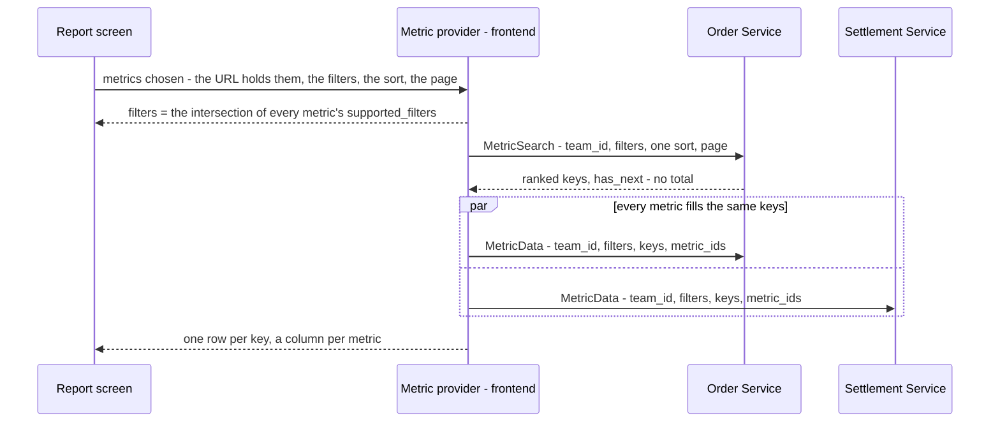

# Development state — analytic / rpc_provide

**DESIGN ACCEPTED (2026-10-27) — BACKEND, STEPS 1 AND 2 OF 4 DONE: the shared proto, its startup checks, and supplier — the
first real metric, `metrics/suppliers`, its four old reads removed.** The Storybook screen on sample
data passed design_accept ([the-analytic-screen-is-accepted](../../business/analytic/rpc_provide_decision.md#the-analytic-screen-is-accepted)).
✅ **2026-10-29: the screen is live** — route `/analytic` and a menu entry, its first SERVED metrics the five order
metrics ([order_statistic_metric.md](../order/order_statistic_metric.md)). ✅ **2026-10-30: settlement is served** — `metrics/settlement` and
`metrics/settlement/types` ([settlement's state](../settlement/context.md)), the second service on the composer; every other metric is still a sample.
How analytics reach the frontend: one composed table whose columns come from any number of services, for the same rows. 45 decisions (two superseded: a
metric per grain became the table's `group_by`, and the summary metric became `group_by = SUMMARY`). No question open. A warehouse group beside the team group, so `TEAM` and `WAREHOUSE` each mean one team for every reader ([the-warehouse-is-its-own-group](../../business/analytic/rpc_provide_decision.md#the-warehouse-is-its-own-group)); `GROUP_TYPE_WAREHOUSE = 11` joins the proto with its first metric, not yet. The table and the graph are
tabs, one view at a time ([the-table-and-the-graph-are-tabs](../../business/analytic/rpc_provide_decision.md#the-table-and-the-graph-are-tabs)). The chart is designed
([the-graph-draws-the-table](../../business/analytic/rpc_provide_decision.md#the-graph-draws-the-table), 2026-10-28): line charts of the table, one per
`FieldStatType`, the columns as the legend. **Built** the same day in Storybook on Chakra's charts
([a-chart-is-chakras-chart](../../technical/frontend/context_decision.md#a-chart-is-chakras-chart)), on sample figures.

- Owner doc: [rpc_provide.md](../../business/analytic/rpc_provide.md) — ⚠ **untracked in git** until the owner commits it
- Decisions: [rpc_provide_decision.md](../../business/analytic/rpc_provide_decision.md) — 45, two superseded
- Clarify: [rpc_provide_clarify.md](../../business/analytic/rpc_provide_clarify.md) — **0 questions, 1 critique** (the tree's gaps); its Proposed Design is the whole decided contract. Contradictions: small slips in the owner's doc, the
  guideline's missing pointer
- Sibling: [context.md](../../business/analytic/context.md) — the fold that fills the report tables these RPCs read

## The design, in one picture

## The rules, grouped

| area | decided | decision |
| --- | --- | --- |
| access | `request_policy` on the request message, top-level `team_id [use_scope]`; no roles per metric; every team member reads every metric of the team | [a-metric-rpc-is-guarded-like-every-rpc](../../business/analytic/rpc_provide_decision.md#a-metric-rpc-is-guarded-like-every-rpc) · [every-member-reads-every-metric-of-their-team](../../business/analytic/rpc_provide_decision.md#every-member-reads-every-metric-of-their-team) |
| rows | exactly the keys `MetricSearch` sends; `MetricData` never adds or drops a key | [the-rows-are-the-keys-step-one-sends](../../business/analytic/rpc_provide_decision.md#the-rows-are-the-keys-step-one-sends) |
| filters | the intersection; an added metric removes a filter it cannot use, announced by a toast; `MetricData` takes the same filters to scope the numbers | [a-new-metric-removes-the-filters-it-cannot-use](../../business/analytic/rpc_provide_decision.md#a-new-metric-removes-the-filters-it-cannot-use) · [a-removed-filter-is-announced](../../business/analytic/rpc_provide_decision.md#a-removed-filter-is-announced) · [the-fill-step-scopes-its-numbers-by-the-filters](../../business/analytic/rpc_provide_decision.md#the-fill-step-scopes-its-numbers-by-the-filters) |
| response | `repeated MetricData`, one item per asked metric | [one-call-answers-every-asked-metric](../../business/analytic/rpc_provide_decision.md#one-call-answers-every-asked-metric) |
| groups | a metric is one measure and declares `supported_group_by`; the TABLE picks one `group_by` (summary, daily … yearly, product, shop, supplier, team, user — the enum grows with the reports, [the-group-enum-grows-with-the-reports](../../business/analytic/rpc_provide_decision.md#the-group-enum-grows-with-the-reports)), on both requests; a metric that cannot group by it is greyed in the picker; one key per table, no shop × day | [the-table-picks-one-group](../../business/analytic/rpc_provide_decision.md#the-table-picks-one-group) · [a-metric-that-cannot-group-is-greyed](../../business/analytic/rpc_provide_decision.md#a-metric-that-cannot-group-is-greyed) · [a-metric-has-one-key](../../business/analytic/rpc_provide_decision.md#a-metric-has-one-key) |
| days | `YYYY-MM-DD` Jakarta strings, inclusive (`date_min` / `date_max`); a week is Monday–Sunday | [a-day-is-a-jakarta-date-string](../../business/analytic/rpc_provide_decision.md#a-day-is-a-jakarta-date-string) · [a-week-is-monday-to-sunday-jakarta](../../business/analytic/rpc_provide_decision.md#a-week-is-monday-to-sunday-jakarta) |
| ids | a `metric_id` is a name, never a route — `metrics/orders`, the group not in it; unique across services, checked at startup | [a-metric-id-is-a-name-not-a-route](../../business/analytic/rpc_provide_decision.md#a-metric-id-is-a-name-not-a-route) |
| sort | one field of one metric, by its proto name; the key DESC breaks every tie; unspecified = DESC; a rate ranks only above `rank_min_sample` | [one-sort-field-per-table](../../business/analytic/rpc_provide_decision.md#one-sort-field-per-table) · [a-sort-field-is-its-proto-name](../../business/analytic/rpc_provide_decision.md#a-sort-field-is-its-proto-name) · [the-key-breaks-every-tie](../../business/analytic/rpc_provide_decision.md#the-key-breaks-every-tie) · [a-rate-ranks-only-above-its-minimum-sample](../../business/analytic/rpc_provide_decision.md#a-rate-ranks-only-above-its-minimum-sample) |
| paging | not a filter; no total; `has_next` from reading limit + 1; `GrowingPager` | [a-page-is-not-a-filter](../../business/analytic/rpc_provide_decision.md#a-page-is-not-a-filter) · [a-metric-page-has-no-total](../../business/analytic/rpc_provide_decision.md#a-metric-page-has-no-total) · [a-page-says-whether-another-follows](../../business/analytic/rpc_provide_decision.md#a-page-says-whether-another-follows) |
| keys | a body carries no key; the key lives in the map — three cases per metric: by id, by day, summary; `metric_key` removed | [the-key-lives-in-the-map](../../business/analytic/rpc_provide_decision.md#the-key-lives-in-the-map) |
| headline | the same metric read with `group_by = SUMMARY`, no keys — equal to the rows by construction; every metric lists `SUMMARY`, checked at startup; a rate's summary is computed from the sums | [the-headline-is-the-metric-grouped-by-summary](../../business/analytic/rpc_provide_decision.md#the-headline-is-the-metric-grouped-by-summary) · [every-metric-has-a-summary](../../business/analytic/rpc_provide_decision.md#every-metric-has-a-summary) · [the-headline-is-the-sum-of-its-rows](../../business/analytic/rpc_provide_decision.md#the-headline-is-the-sum-of-its-rows) |
| screen | state in the URL; comparing = a second tab, the A / B view deferred | [the-report-lives-in-the-url](../../business/analytic/rpc_provide_decision.md#the-report-lives-in-the-url) · [compare-in-another-tab-for-now](../../business/analytic/rpc_provide_decision.md#compare-in-another-tab-for-now) |
| scope of change | replaces the shipped analytic reads — supplier first, then settlement, then financial account | [the-pattern-replaces-the-shipped-analytics](../../business/analytic/rpc_provide_decision.md#the-pattern-replaces-the-shipped-analytics) |

## What exists

### The Analytic screen — ACCEPTED (2026-10-27), LIVE with the order metrics (2026-10-29)

`Pages/Analytic/Composer`, and since 2026-10-29 the route `/analytic` with a menu entry — the step the acceptance named
*"with the first real metric"*. The entry sits **right after Home**, in the lead section with no heading
([the-analytic-entry-follows-home](../../business/analytic/rpc_provide_decision.md#the-analytic-entry-follows-home), 2026-10-30 — it was in Operations, my
unasked reading), for every member of a selling team, a warehouse, root and admin — not role-gated, since every member
reads every metric of the team ([every-member-reads-every-metric-of-their-team](../../business/analytic/rpc_provide_decision.md#every-member-reads-every-metric-of-their-team)).

| | wired 2026-10-29 |
| --- | --- |
| the catalogue | `ORDER_METRICS` in `features/analytic/catalogue.ts` are read off the generated descriptors with `getOption` — id, filters, groups, each field's `field_stat_type` and `metric_sort`; `MetricDef.schema` marks a served metric. The other four entries are still a typed mirror |
| the provider | `loadReport(req, teamId)` is ASYNC: a served metric is ranked and filled by its service (`OrderAnalyticService`, `SettlementAnalyticService` — one MetricData per question for all of a service's metrics; `clientOf` reads each through the shape every service shares), a sample by `sampleService`. `answeredFields` drops a column whose headline came back unset — a warehouse's money ([a-warehouse-sees-no-seller-money](../../business/order/order_statistic_metric_decision.md#a-warehouse-sees-no-seller-money)) |
| the page | TanStack Query with `listQuery` and a RefreshOverlay (HARD RULE 10); groups gain Seller (`team`), Warehouse and Created by (`user`), filters the same through ShopSelect, TeamSelect (by team type) and UserSelect; product and supplier keep their sample pickers. A row's id is named by ShopByIds / TeamByIds / UserByIDs (`useKeyNames`), a sample's by `sampleName` |
| a shared field name | `fieldLabel` reads `analytic.fieldOf.<metric>.<field>` before `analytic.field.<field>` — Created and Cancel both have the owner's `mp_total` |
| Storybook | `.storybook/orderAnalyticStub.ts` answers `OrderAnalyticService` from `sampleService`, so stories run the wire path; Gudang Pusat (11) gets counts only. `.storybook/settlementAnalyticStub.ts` answers `SettlementAnalyticService` by folding the settlement book (`fixtures.ts`), since a position is not a sum of samples. 16 stories, two new (`AWarehouseSeesCountsOnly`, `GroupedBySellerNamesTheTeam`) |
| e2e | `orders.spec.ts` *Analytic: the orders placed today count in Orders created, by shop* — through the emulator's push, the fold and both RPCs |
| Vite | `optimizeDeps.include` names recharts and `@chakra-ui/charts`: the dev server first met them on this lazy route, re-optimised mid-session and served a stale chunk, so the page never loaded |

| | |
| --- | --- |
| page | `frontend/src/pages/analytic/index.tsx` — `AnalyticPage()`; group select, metric chips, Add Metric, FilterBar, headline, then a **Table · Graph** tab row (the rows line and GrowingPager on both). The whole state is the URL (`useSearchParams`), the tab included (`v=graph`) |
| page parts | `components/` — `MetricPicker` (a popup picked like a category, CategorySelect's shape: search + the owner's categories + the chosen one's metrics as checkboxes; a metric that cannot group greyed with its reason), `ReportGraphs` (a `LineGraph` per field `kind` among the columns, drawn from the table's cells; two side by side from `lg`; a time group drawn oldest first, [a-time-graph-runs-oldest-first](../../business/analytic/rpc_provide_decision.md#a-time-graph-runs-oldest-first)), `ReportTable` (SortableHeader per sortable field, a block per row on a phone), `ReportHeadline` (SummaryStrip, group SUMMARY), `PlainSelect` (inline Select) · `format.ts` · `pending.ts` (three `sample` parts) |
| the chart | `frontend/src/components/charts/LineGraph.tsx` — the app's one chart component: `@chakra-ui/charts` 3.36 + `recharts` 3.10, both ends of the bottom axis always shown, `wholeNumbers` for a count axis, categorical `LINE_COLORS`. 4 stories (`Components/Charts/LineGraph`). ⚠ Recharts 3 draws tick labels in a layer of their own: select `.recharts-xAxis-tick-labels`, never `.recharts-xAxis …` |
| the provider | `frontend/src/features/analytic/provider.ts` — `loadReport`: ONE search in the service owning the sorted field (a time group sorted by period asks no one), then every metric fills the same keys under the same filters, then each metric's SUMMARY. Plain TS, no React |
| the catalogue | `features/analytic/catalogue.ts` — the SERVED metrics read off their descriptors with `getOption` (five order, two settlement); stock lost, ads and expenses still a TS **mirror** of the decided options. A field's `kind` is its `FieldStatType`: `count`, `money`, `position`, `ratio` |
| the sample | `features/analytic/sample.ts` — seeded facts from 2025-01-01 to today. Toko Satria (13) has orders and no settlement. No settlement facts: settlement is served, and its stub folds the settlement book, where Melati Official (21) has settlement and no orders |
| the URL | `features/analytic/url.ts` — `?g=&m=&r=&shop=&product=&supplier=&s=&p=&n=`, read forgivingly |
| stories | `pages/analytic/index.stories.tsx` — 14, all passing: Default, Mobile, AddMetricDrillsIntoACategory, AddMetricSearchesEveryCategory, SortedByProfit, InventoryGreyedByShop, SwitchGroupToProduct, AddingStockLostRemovesTheShopFilter, HeadlineIsTheSumOfItsRows, ByDayIncludesQuietDays, GraphsSplitByKindOfNumber, TheViewIsInTheLink, ByDayGraphRunsOldestFirst, Empty |
| i18n | `analytic` namespace in `en.json` and `id.json` |
| the screen details, decided | the rows line always shows while a figure ranks ([the-rows-line-says-what-the-rows-are](../../business/analytic/rpc_provide_decision.md#the-rows-line-says-what-the-rows-are)) — the `rowsLine` prop is gone, and `SortedByProfitWithRowsLine` folded into `SortedByProfit`; a group change drops the columns that cannot follow, with its toast ([a-group-change-drops-the-columns-that-cannot-follow](../../business/analytic/rpc_provide_decision.md#a-group-change-drops-the-columns-that-cannot-follow)); the graph, built 2026-10-28 ([the-graph-draws-the-table](../../business/analytic/rpc_provide_decision.md#the-graph-draws-the-table)) — `legacy/components/charts/` (inline SVG) is not reused |

### What it will replace

Live today:

| service | today's analytic reads | stays |
| --- | --- | --- |
| supplier | ✅ **moved 2026-10-27** — `MetricSearch` / `MetricData` over `metrics/suppliers` ([supplier_analytic.proto](../../../proto/warehouse/supplier/v1/supplier_analytic.proto)); `rate_min_units` 50 is `rank_min_sample` on `broken_rate`. See [supplier's state](../supplier/context.md) | `AnalyticReplayCompute`, `AnalyticMaintenanceRun` |
| settlement | ✅ **moved 2026-10-30** — `MetricSearch` / `MetricData` over `metrics/settlement` and `metrics/settlement/types` ([settlement_analytic.proto](../../../proto/warehouse/settlement/v1/settlement_analytic.proto)), on the composer and the Settlement Report. See [settlement's state](../settlement/context.md) | the same two |
| financial account | `AnalyticTimeSearch`, `AnalyticGroupSearch`, `AnalyticGroupMetric` | — |

Frontend reads them through `features/{suppliers,settlement,financialAccount}/analytics.ts`. `GrowingPager`
(`components/chrome/`) already takes `hasNext` with no total — the pager this design needs.

### The shared contract and its checks — backend step 1 (2026-10-27)

| | |
| --- | --- |
| the proto | [proto/warehouse/analytic_base/v1/analytic.proto](../../../proto/warehouse/analytic_base/v1/analytic.proto) — the decided contract, `GROUP_TYPE_TEAM` = 9 and `GROUP_TYPE_USER` = 10 included; generated to `backend/gen/…/analytic_base/v1` and `frontend/src/gen/…/analytic_base/v1` |
| the options | `metric` on `MessageOptions` and `metric_sort` on `FieldOptions`, both **50003**, and `field_stat_type` on `FieldOptions`, **50004** — `POSITION` added 2026-10-30 ([a-position-is-its-own-stat-type](../../business/analytic/rpc_provide_decision.md#a-position-is-its-own-stat-type)) (2026-10-29, [every-number-field-carries-a-stat-type](../../business/analytic/rpc_provide_decision.md#every-number-field-carries-a-stat-type)) — all registered in CLAUDE.md's options table |
| filled in here, not decided in the doc | one filter message per `FilterType` — `ProductFilter`, `TeamFilter`, `ShopFilter`, `SupplierFilter`, each ONE id, as the screen narrows by one; each `FilterItem` case number is its `FilterType`'s number. Limits: a page is 1–200, a key list at most 200. Number 2 is reserved — the keyword was removed on 2026-10-28 ([the-generic-keyword-is-removed](../../business/analytic/rpc_provide_decision.md#the-generic-keyword-is-removed)). Number 9 is `SUPPLIER_KEYWORD`, a typed search that means one thing, listed by `metrics/suppliers` alone (2026-10-30, [the-supplier-report-keeps-its-search](../../business/analytic/rpc_provide_decision.md#the-supplier-report-keeps-its-search)) |
| the checks | [backend/pkgs/san_metric/](../../../backend/pkgs/san_metric/) — `ValidateDescriptors()` refuses to boot on an empty or duplicated `metric_id`, a metric without `SUMMARY`, an `UNSPECIFIED` group or filter, a required filter not supported, `metric_sort` or `field_stat_type` on a non-number or a non-metric, a negative minimum, a metric's number field with no stat type, and a minimum sample on a field that is not a `RATIO`. Called in `service_api.go` beside `san_auth.ValidateDescriptors()`. `SortField(metric, name)` is the request-time lookup by proto name (`ErrNotSortable`); `OptionOf` reads the option |
| tests | `san_metric/metric_test.go` — 16, on metrics built IN MEMORY, so no test-only message enters the contract. `metrics/suppliers` passes the same check with its seven fields tagged (`TestSupplierMetricPassesTheStartupCheck`) |

## What does not exist yet

- a metric of financial account's
- `metrics/suppliers` on the composer — its service serves it, but the catalogue does not list it yet (supplier's own
  screens read it). One `servedMetric(SupplierMetricSchema, …)` line and a client in `provider.ts`'s `clientOf`
- ⚠ a sample metric filtered by a REAL shop reads zero — the shop picker is real now, and the samples' shops are
  invented. It goes when those metrics are served
- the cap on lines per graph — decided with the graph on screen ([the-chart-waits-for-a-chart-component](../../business/analytic/rpc_provide_decision.md#the-chart-waits-for-a-chart-component)); six colours, so a seventh line repeats the first
- a `MetricSearch` / `MetricData` handler outside supplier, selling and settlement — financial account is next in the agreed order

## Waiting on the owner

| | |
| --- | --- |
| [service-guideline.md](../../../guidelines/service-guideline.md) | a pointer: analytics follow rpc_provide, not the typed-enum List/Overview shapes |
| [CLAUDE.md](../../../CLAUDE.md) HARD RULE 9 | a metric search returns `has_next`, not `PageInfo` — an exception not yet written in |
| `rpc_provide.md` in git | untracked — the clarify and decision files link to it |

## Next

**Backend analysis**, in the order of [the-pattern-replaces-the-shipped-analytics](../../business/analytic/rpc_provide_decision.md#the-pattern-replaces-the-shipped-analytics):

1. ✅ `proto/warehouse/analytic_base/v1/` and `san_metric`'s startup checks.
2. ✅ supplier's `MetricSearch` / `MetricData` (`supplier_v1/metric_*.go`), its four `Analytic*` reads removed in the
   same change as its two screens moved. What the next service copies:
   - **the shape**: one `<Service>Metric` message with the option, `…ByID` / `…ByDay` maps, a `MetricData` oneof of the
     three per metric; `metric_shared.go`'s `parseFilters` (the case number IS the FilterType), `groupOf`, `sortOrder`
     (`san_metric.SortField` + `rank_min_sample`), `bucketStart` (a period key must be its first day)
   - **the frontend**: `getOption(<Metric>Schema, metric)` for the id, `getOption(field, metric_sort)` for a minimum —
     never a typed copy (`features/suppliers/analytics.ts`); the headline is its own query, keyed without the page
     ([MetricData.md](../../../audits/services/supplier_service/performances/MetricData.md))
   - ⚠ **measure on a FRESH `warehouse_test`** (`go run ./tools/san db drop-test` before each perf test): a reused one
     read 2–4× slower and flipped a 30-day SUM to a whole-table scan
3. ✅ settlement (2026-10-30) — two metrics, one table chosen per request; then financial account.
4. ✅ the route and menu entry — with the order metrics, 2026-10-29.

The chart is its own later pass ([the-chart-waits-for-a-chart-component](../../business/analytic/rpc_provide_decision.md#the-chart-waits-for-a-chart-component)).
