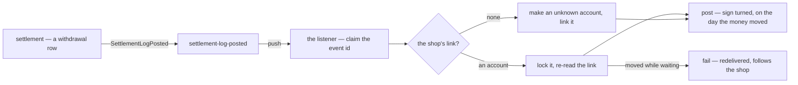

# Development state — financial_account

**Pass:** ✅ **implemented (2026-10-01)** — design_accept passed ([the-prototype-and-its-contract-are-accepted](../../business/financial_account/context_decision.md#the-prototype-and-its-contract-are-accepted)), and the service, its schema,
the withdrawal listener and the routed screens are built, tested end to end and audited. Before it: the Storybook prototype
(`implementation_analysis`), and business analysis on the owner's new [financial_account/context.md](../../business/financial_account/context.md)
— a team's bank, ShopeePay and cash accounts, each with a balance and a log — re-examined after each of the owner's
edits. Questions: [context_clarify.md](../../business/financial_account/context_clarify.md). Decisions:
[context_decision.md](../../business/financial_account/context_decision.md) — **forty owner decisions**. **Nothing is open** —
the business analysis is done, the analytics included. No technical doc.

**2026-10-14 — the team payment is wired** ([a-team-payment-posts-on-accept](../../business/financial_account/context_decision.md#a-team-payment-posts-on-accept)):
the second listener, `TeamPaymentHandler` on `liability-payment-accepted`, posts one `team_payment` row out of the
payer's account and one into the creditor's, one group, on the accept day. Liability's *Paid from* / *Received into*
are real fields now, each checked against `FinancialAccountByIds` before liability writes it — see
[balance's state](../balance/context.md). ⚠ My spec, not a decision: a payment recorded before *Paid from* existed
(`from_account_id = 0`) posts only the creditor's leg; an account in the wrong team is an error for the dead-letter
queue, never filed elsewhere; an archived account still takes the row.

**2026-10-14 — the accounts list's two marks are built** ([the-archive-and-lainnya-are-served](../../technical/frontend/financial_accounts_decision.md#the-archive-and-lainnya-are-served),
[lainnya-is-opened-by-the-server](../../business/financial_account/context_decision.md#lainnya-is-opened-by-the-server)): `archived_only` on
`FinancialAccountList`, `archived` on the Overview's filter, and `FinancialAccountCreate` opening type Lainnya
(`checkIdentity(…, allowOther)` — true for Create, false for Identify). No migration: the `(team_id, status)` index
serves both reads. `features/financialAccount/pending.ts` is deleted; the report's Export mark is the domain's
only one left. Proven in `e2e/financial_accounts.spec.ts` — 12 steps, two of them new.

**2026-11-06 — expenses also fold into Analytic, in their own transaction** ([expense-figures-are-read-from-its-own-records](../../business/analytic/rpc_provide_decision.md#expense-figures-are-read-from-its-own-records)):
`ExpenseCreate` / `ExpenseAdjust` write `expense_metric_daily_reports` (expense 00006) beside the row — a correction on the
day it is MADE, for its maker. Nothing changes for the paying account: the events, the listener and the account's day
(the expense's own) are as before; the Analytic expense figures are NOT read from them
([analytic rpc_provide.md](../analytic/rpc_provide.md), [expense rpc.md](../../services/expense_service/rpc.md#the-analytic-expense-metrics--expenseanalyticservice)).

**2026-11-04 — the warehouse transfer's shipping is wired** ([a-transfers-shipping-posts-as-an-expense](../../business/financial_account/context_decision.md#a-transfers-shipping-posts-as-an-expense)):
`TransferShippingHandler` on `warehouse-transfer-created|updated|cancelled` posts a transfer's `shipment_cost` out of the
account it names as **`expense`** — *"Warehouse transfer #603 shipping"* — straight from inventory's events, with no
expense record (settled in chat: not on the Expenses screen). It is the restock listener's shape and shares its
`postPaymentLegs`. Uncommitted.

## Decided

| decision | what it means for the build |
| --- | --- |
| [the-accounts-are-one-ledger](../../business/financial_account/context_decision.md#the-accounts-are-one-ledger) | `financial_accounts` is the state, `financial_account_logs` the log — no balance moves without a log row, in the same transaction |
| [every-log-row-names-its-account](../../business/financial_account/context_decision.md#every-log-row-names-its-account) *(line 82)* | every log row carries `account_id` — `balance_after` runs per account · `team_id` stays as a copy (⚠ my reading) · an index on `(account_id, id)` (⚠ my spec) |
| [provider-replaces-account-type](../../business/financial_account/context_decision.md#provider-replaces-account-type) *(critique 2, half)* | the column is `provider` — `account_type` in older entries means it · `type` stays, picked apart ([type-and-provider-are-picked-apart](../../business/financial_account/context_decision.md#type-and-provider-are-picked-apart)) |
| [an-account-has-a-name-and-a-holder](../../business/financial_account/context_decision.md#an-account-has-a-name-and-a-holder) *(critique 3)* | `name` and `holder_name` on every account · ⚠ `name` required and unique in the team, my spec |
| [the-log-keeps-the-day-the-money-moved](../../business/financial_account/context_decision.md#the-log-keeps-the-day-the-money-moved) *(critique 7)* | `occurred_at` on every log row — the event's time from the broker, a picked day by hand · `balance_after` stays in entry order (⚠ my spec) |
| [an-account-opens-with-a-log-row](../../business/financial_account/context_decision.md#an-account-opens-with-a-log-row) *(critique 4)* | `FinancialAccountCreate` posts `opening_balance` in the same transaction · ⚠ even at 0, and none for an `unknown` account — my spec |
| [an-account-is-archived-only-at-zero](../../business/financial_account/context_decision.md#an-account-is-archived-only-at-zero) *(critique 8)* | `FinancialAccountArchive` refused unless the balance is 0 · ⚠ an archived account takes no hand row but still takes broker rows — my spec |
| [type-and-provider-are-picked-apart](../../business/financial_account/context_decision.md#type-and-provider-are-picked-apart) *(critique 2, against my recommendation)* | `type` and `provider` both picked on the form — no derivation, a mismatched pair saves |
| [the-description-names-the-cause](../../business/financial_account/context_decision.md#the-description-names-the-cause) *(critique 1, against my recommendation)* | no `source_id`, no `reversal` — the cause is `description`, written by the listener from the event (⚠ my spec) · dedup is the library's `Claim(event_id)` |
| [a-team-payment-posts-on-accept](../../business/financial_account/context_decision.md#a-team-payment-posts-on-accept) | the team-payment listener hears only the balance service's acceptance · the event carries `from_account_id` and `to_account_id` — both new on `liability_service`'s payment · two `team_payment` rows |
| [a-team-payment-is-never-reversed](../../business/financial_account/context_decision.md#a-team-payment-is-never-reversed) *(Q14)* | an accepted payment is final — `LiabilityPaymentReverse` is removed, so there is no reversal topic and the two rows never post back |
| [the-team-description-says-where-to-pay](../../business/financial_account/context_decision.md#the-team-description-says-where-to-pay) *(Q9, against my recommendation)* | no `payee_accounts`, no payee RPCs — a payer reads the creditor team's `description` (⚠ my reading of which description) · the creditor picks *to* on acceptance |
| [analytics-are-delivered-the-settlement-way](../../business/financial_account/context_decision.md#analytics-are-delivered-the-settlement-way) *(lines 122–130)* | `AnalyticTimeSearch` (DAILY, MONTHLY, YEARLY) and `AnalyticGroupSearch` + `AnalyticGroupMetric` (by `provider`, `change_type`) — settlement's shape · the daily table behind them: the three rows below |
| [a-row-counts-on-the-day-the-money-moved](../../business/financial_account/context_decision.md#a-row-counts-on-the-day-the-money-moved) *(Q15)* | the analytics day is `occurred_at` in Jakarta time, never `created_at` |
| [the-daily-row-is-one-account-one-day](../../business/financial_account/context_decision.md#the-daily-row-is-one-account-one-day) *(Q16)* | `financial_account_daily_reports` — unique `(day, account_id)`, a signed sum per `change_type`, `open_balance`, `close_balance` · no state table |
| [the-daily-row-is-written-with-the-log-row](../../business/financial_account/context_decision.md#the-daily-row-is-written-with-the-log-row) *(Q17)* | every log write upserts its day's row and shifts later days in the same transaction — no event table, lock or replay · ⚠ audit it with `audit-sql`: two writes on one account shift the same days |
| [the-prototype-and-its-contract-are-accepted](../../business/financial_account/context_decision.md#the-prototype-and-its-contract-are-accepted) | ✅ design_accept — the three screens, the picker and the 14 + 3 RPC contract are what was built · my proposals in the prototype accepted with it |
| [account-grouped-joins-the-metrics](../../business/financial_account/context_decision.md#account-grouped-joins-the-metrics) *(critique 9)* | `AnalyticGroupSearch` also groups by account — keys are account ids |
| [a-transfers-shipping-posts-as-an-expense](../../business/financial_account/context_decision.md#a-transfers-shipping-posts-as-an-expense) *(owner, against my recommendation)* | a warehouse transfer's shipping posts as `expense` — `expense` gets a second way in, the transfer's events · ✅ settled in chat: no expense record, so the account's *Expense* may exceed the Expenses screen's total by the trips, each row naming its transfer · ✅ built 2026-11-04 |
| [a-row-comes-by-hand-or-from-the-broker](../../business/financial_account/context_decision.md#a-row-comes-by-hand-or-from-the-broker) | two ways in: the account screens, or a listener per topic. No RPC for other services to write with |
| [shopeepay-is-the-wallet-a-team-pays-with](../../business/financial_account/context_decision.md#shopeepay-is-the-wallet-a-team-pays-with) *(Q5)* | a `shopeepay` account is the team's e-wallet — no settlement row ever posts to an account |
| [a-real-account-is-recorded-once](../../business/financial_account/context_decision.md#a-real-account-is-recorded-once) *(Q6)* | a partial unique index on `(provider, account_number)` where a number exists, across all teams, archived included · a cash box exempt · the `team_infos` copy never happens — the columns were dropped ([the-team-record-holds-no-bank](../../business/financial_account/context_decision.md#the-team-record-holds-no-bank)) |
| [below-zero-is-warned-never-refused](../../business/financial_account/context_decision.md#below-zero-is-warned-never-refused) *(Q7)* | no balance check on any write path · a warning on the list and the account page while below zero |
| [opening-transfer-and-team-payment-join-the-types](../../business/financial_account/context_decision.md#opening-transfer-and-team-payment-join-the-types) *(Q4, three of four)* | three more `change_type` values · ⚠ their posting rules — the opening row at create, two legs per transfer, a team payment at confirm — are my spec, marked so in the decision |
| [capital-joins-the-types](../../business/financial_account/context_decision.md#capital-joins-the-types) *(Q4, the fourth)* | the owner's money in or out, one signed type · ⚠ two rows sharing a `group_id` when it moves between teams — my spec |
| [adjustment-is-for-reconciling-only](../../business/financial_account/context_decision.md#adjustment-is-for-reconciling-only) *(Q4)* | no RPC takes an adjustment amount — `Reconcile` takes the bank's figure and posts the difference · ⚠ a note on a non-zero difference and a `reconciled_at` stamp are my spec |
| [the-log-says-balance-after](../../business/financial_account/context_decision.md#the-log-says-balance-after) *(critique 5)* | the log's column is `balance_after` = the previous row's + this row's `change` |
| [restock-is-never-typed-by-hand](../../business/financial_account/context_decision.md#restock-is-never-typed-by-hand) *(Q10, for restock)* | no hand RPC takes a `restock` · it comes only from a restock event inventory does not publish yet — until then a restock's payment shows only through a reconcile |
| [one-way-in-per-type](../../business/financial_account/context_decision.md#one-way-in-per-type) *(Q10)* | the hand RPCs are Create, Transfer, Capital, Reconcile, and none takes a `change_type` · a listener each for `withdrawal` (settlement — exists), `restock`, `expense`, `team_payment` (their events are new) |
| [revenue-stays-in-settlement](../../business/financial_account/context_decision.md#revenue-stays-in-settlement) *(Q1, the name)* | the type is `withdrawal` (was `revenue_fund`) · the listener posts only settlement's `withdrawal` rows, sign turned · ⚠ the label *+ Withdrawal from <the shop>* is my spec |
| [a-shop-names-the-account-it-withdraws-into](../../business/financial_account/context_decision.md#a-shop-names-the-account-it-withdraws-into) *(Q1)* | the owner's `shop_accounts` — the withdrawal listener looks the shop up there · ✅ `shop_id` unique — [a-shop-has-one-account](../../business/financial_account/context_decision.md#a-shop-has-one-account) |
| [a-shop-with-no-account-gets-an-unknown-one](../../business/financial_account/context_decision.md#a-shop-with-no-account-gets-an-unknown-one) *(Q11, against my recommendation)* | the withdrawal listener, finding no `shop_accounts` row, creates an account with `type` and `account_type` `unknown`, connects it to the shop and posts there — nothing is held · ⚠ one per shop, its name, no opening row, what it may do are my spec · ✅ one per shop holds, `shop_id` unique · how it becomes real: [an-unknown-account-is-filled-in-or-moved-in](../../business/financial_account/context_decision.md#an-unknown-account-is-filled-in-or-moved-in) |
| [a-shop-has-one-account](../../business/financial_account/context_decision.md#a-shop-has-one-account) *(line 19)* | `shop_accounts (shop_id)` unique — one account per shop, many shops per account · a new shop's second concurrent withdrawal rolls back and retries onto the first one's row (⚠ my spec) |
| [the-team-record-holds-no-bank](../../business/financial_account/context_decision.md#the-team-record-holds-no-bank) *(Q9, two parts)* | ✅ **built** — `team_service` `00008_drop_team_bank` drops the three columns · `TeamInfo` / `TeamInfoUpdateRequest` reserve 3–5 · the team detail and row menu read *Contact* · stored numbers are gone, not copied · where a team is paid is still Q9 |
| [an-unknown-account-is-filled-in-or-moved-in](../../business/financial_account/context_decision.md#an-unknown-account-is-filled-in-or-moved-in) *(Q12)* | `FinancialAccountIdentify`, admin and up, on an `unknown` account only — not registered: fill in provider, number, holder, name, rows kept · registered: transfer the balance in, re-point the shop, archive the unknown at zero, one transaction |
| [a-restock-must-name-the-account-that-paid](../../business/financial_account/context_decision.md#a-restock-must-name-the-account-that-paid) *(Q2, required against my recommendation)* | *Paid from* is **required** at create — an operational account, replacing `payment_type` on new restocks · goods plus shipping from the lines · an edit posts the difference · a cancel asks whether the money came back · the courier's cost line names the warehouse's account (⚠ my reading) · old restocks post nothing · a new inventory event · ⚠ a team with no operational account cannot raise a restock — accounts are set up before the field ships |
| [an-expense-must-name-the-account-that-paid](../../business/financial_account/context_decision.md#an-expense-must-name-the-account-that-paid) *(Q3, required against my recommendation)* | *Paid from* is **required** on every expense a person types — `ADS`, `PAYROLL`, `OPERATIONAL`, `OTHER` · `STOCK_LOSS` outside it (⚠ my reading) · ~~a void reverses~~ an adjustment by its sign, once the expense event exists ([an-expense-void-is-now-a-negative-adjustment](../../business/financial_account/context_clarify.md#an-expense-void-is-now-a-negative-adjustment)) · a new expense event · an ads charge from the seller balance: [settlement-ads-and-accounts-are-independent](../../business/financial_account/context_decision.md#settlement-ads-and-accounts-are-independent) |
| [settlement-ads-and-accounts-are-independent](../../business/financial_account/context_decision.md#settlement-ads-and-accounts-are-independent) *(Q13)* | settlement's ads rows never reach an account and nothing syncs · an ad is in an account only as an `ADS` expense naming the account that paid · *Paid from* required with no exception |
| [ads-expense-joins-the-types](../../business/financial_account/context_decision.md#ads-expense-joins-the-types) *(line 93)* | `ads_expense` is a type beside `expense` · ⚠ my reading: the expense listener posts it when the kind is `ADS`, `expense` for every other kind |
| [operational-accounts-pay-for-operations](../../business/financial_account/context_decision.md#operational-accounts-pay-for-operations) *(Q2, which account)* | the owner's `operational_accounts` — the restock's *Paid from* picks among them |
| [seeing-is-team-wide-moving-is-admin-and-up](../../business/financial_account/context_decision.md#seeing-is-team-wide-moving-is-admin-and-up) *(Q8)* | `FinancialAccountList`, `FinancialAccountOverview` and `FinancialAccountLogList` open to every member of the team · Create, Update, Archive, Restore, Transfer, Capital, Reconcile, ShopSet to admin and up — `SELLING_ADMIN`/`SELLING_OWNER`, `WAREHOUSE_ADMIN`/`WAREHOUSE_OWNER`, `ADMINISTRATOR`/`ROOT` (⚠ my reading of *admin up*) · 🔄 *(2026-10-06)* **Transfer and Capital lose `WAREHOUSE_ADMIN`** ([the-warehouse-admin-equals-the-owner-except-money](../../business/user/context_decision.md#the-warehouse-admin-equals-the-owner-except-money)); the screens hide them by `canTransferMoney` · balances stay on their own RPC so narrowing *for now* later is one policy line |

## What exists — built 2026-10-01

| | where |
| --- | --- |
| the contract | [financial_account.proto](../../../proto/warehouse/financial_account/v1/financial_account.proto) — `FinancialAccountService` (14 RPCs) · 🔄 *(2026-11-05)* `FinancialAccountAnalyticService` is now [financial_account_analytic.proto](../../../proto/warehouse/financial_account/v1/financial_account_analytic.proto) — `MetricSearch` / `MetricData` over the two Finance metrics; the three old reads are removed (below) |
| **the service** | [backend/services/financial_account_service/](../../../backend/services/financial_account_service/) — one handler file per RPC and a unit test beside each · the ledger's one write path [ledger.go](../../../backend/services/financial_account_service/financial_account_v1/ledger.go): lock the account, the log row, the balance, the day's report row and every later day's shift, one transaction · mounted in the dev server, wired by Wire |
| the schema | [00001_create_financial_accounts.sql](../../../backend/services/financial_account_service/db_migrations/00001_create_financial_accounts.sql) — `financial_accounts`, `financial_account_logs`, `shop_accounts`, `operational_accounts`, `financial_account_daily_reports`, the listener's `financial_account_event_logs` · [database-schema.md](../../database-schema.md#financial_account_service) · flows: [rpc.md](../../services/financial_account_service/rpc.md) |
| the withdrawal listener | push route `/event/financial-account-withdrawal/push` on `settlement-log-posted` — settlement's `withdrawal` rows into the shop's account, sign turned; an `unknown` account made for a shop with none · subscription declared in `san pubsub ensure` ([san.md](../../tools/san.md)) |
| the team-payment listener *(2026-10-14)* | push route `/event/financial-account-team-payment/push` on `liability-payment-accepted` — [team_payment_listener.go](../../../backend/services/financial_account_service/financial_account_v1/team_payment_listener.go): claim, lock both teams' accounts in id order (`lockOwnedAccounts`), two `team_payment` legs · 5 unit tests, 3 race/interleave tests ([lock order](../../../audits/services/financial_account_service/concurrency/lock-order.md)) |
| the restock-payment listener *(2026-11-04)* | push routes `/event/financial-account-restock-{created,updated,cancelled}/push` — [restock_payment_listener.go](../../../backend/services/financial_account_service/financial_account_v1/restock_payment_listener.go): claim, lock the one or two accounts in id order (`lockOwnedAccounts`, the restock team's), `restock` rows — the amount out, the difference, the move (one group), the refund · 10 unit tests, 3 race/interleave tests, perf probe 7 / 12 statements, ~5 / ~11 ms (FAST) · [rpc.md](../../services/financial_account_service/rpc.md#the-restock-payment-listener). `postRestockLegs` became `postPaymentLegs` (the change type a parameter) for the transfer's shipping |
| the expense-payment listener *(2026-11-04)* | push routes `/event/financial-account-expense-{created,adjusted}/push` — [expense_payment_listener.go](../../../backend/services/financial_account_service/financial_account_v1/expense_payment_listener.go): claim, lock the one account (`lockOwnedAccounts`, the expense team's), one row — `ads_expense` for ADS, `expense` for the rest — the amount out on create, the signed correction's opposite on an adjustment (a cancel gives the net back), on the expense's own day; account 0 and STOCK_LOSS claim only · 7 unit tests, 3 race/interleave tests, perf probe 7 statements, ~2–3 ms (FAST) · [rpc.md](../../services/financial_account_service/rpc.md#the-expense-payment-listener). The publisher: expense_service's `ExpenseCreated` / `ExpenseAdjusted`, its account checked in-process against `FinancialAccountByIds` (active + operational) — [expense rpc.md](../../services/expense_service/rpc.md#expensecreate--paid-from-and-the-ads-only-shop) |
| the transfer-shipping listener *(2026-11-04)* | push routes `/event/financial-account-warehouse-transfer-{created,updated,cancelled}/push` — [transfer_shipping_listener.go](../../../backend/services/financial_account_service/financial_account_v1/transfer_shipping_listener.go): the restock listener's `postPaymentLegs` posting `expense` — the cost out, the difference by cost revision, the move (one group), the refund on cancel; a cost of 0 claims only · 11 unit tests, 3 race/interleave tests, perf probe 7 / 12 statements, ~2 / ~4 ms (FAST) · [rpc.md](../../services/financial_account_service/rpc.md#the-transfer-shipping-listener) |
| ShopSet's one outside question | [financial_account_deps.go](../../../backend/cmd/app_development/financial_account_deps.go) — `ShopAccessCheck` under the caller's token, before the transaction: another team's shop is refused |
| the screens | `/financial-accounts`, `/financial-accounts/:id`, `/financial-accounts/report` — routed, **Accounts** in the menu for every member of a selling or warehouse team · the prototype's pages on the real client · the report is five cards and one table of periods ([the-report-is-five-cards-and-one-table](../../technical/frontend/financial_accounts_decision.md#the-report-is-five-cards-and-one-table)) — its **Ekspor** is a marked placeholder, no contract builds a file |
| tests | 50 unit tests · 48 stories · [e2e/financial_accounts.spec.ts](../../../frontend/e2e/financial_accounts.spec.ts) — 10 steps against the real server, the withdrawal pushed to the listener's route |
| audits | [audits/services/financial_account_service/](../../../audits/services/financial_account_service/) — 9 performance reports, the lock-order matrix |
| the dev database | migrated 2026-10-01: financial_account_service 00001 |

```sh
go test ./backend/services/financial_account_service/...
go test -tags raceaudit -run 'TestRace_|TestInterleave_' ./backend/services/financial_account_service/financial_account_v1/
go test -tags perfaudit -run TestPerf_ -v ./backend/services/financial_account_service/financial_account_v1/
cd frontend && npx vitest run --project=storybook src/pages/financial-account* src/components/pickers/FinancialAccountSelect.stories.tsx
cd frontend && npx playwright test e2e/financial_accounts.spec.ts   # Docker up; the Pub/Sub emulator up and ensured
```

## How one withdrawal lands



## Audits — what they found

| | verdict |
| --- | --- |
| concurrency | ✅ safe — one lock, the account row, two only in id order ([lock-order.md](../../../audits/services/financial_account_service/concurrency/lock-order.md)) · ⚠ **one race found and fixed**: the listener read the shop's link before locking, so a withdrawal waiting on a move-in posted into the archived account the shop had left — it now re-checks under the lock and retries |
| `AnalyticTimeSearch` | ✅ **resolved 2026-11-05** — the RPC is gone; its successor `MetricData` reads the balance as ONE running sum ([the-balance-series-is-a-running-sum](../../business/analytic/rpc_provide_decision.md#the-balance-series-is-a-running-sum)): a year daily at a page of 200 1 482 ms → 11 ms, a month daily ~120–156 ms → 2 ms (fresh `warehouse_test`, same seed) ([report](../../../audits/services/financial_account_service/performances/AnalyticTimeSearch.md)). Settlement's own report keeps the old per-period shape |
| 8 write paths | 🟡 heavy by the "> 5 statements" rule only — 6 to 15 fixed statements, 2–6 ms, none growing · **→ Recommend** reading a write's answer in one query instead of three; the 4-statement ledger leg left as is |
| every read but the series | not heavy — 1 to 4 queries, ≤ 47 ms at a production-like spread, no N+1 |

## Not built — the next passes, in the build order

| | needs first |
| --- | --- |
| *(nothing queued here)* | ✅ the warehouse transfer's shipping cost is built (2026-11-04) |

✅ *Paid from* on a restock (2026-11-04) and on an expense (2026-11-04) are built — see *What exists*.

✅ **2026-11-05 — both payers ask the same seam.** A restock's account is now checked server-side like an expense's: one
of the team's ACTIVE OPERATIONAL accounts, asked in-process through `FinancialAccountByIds` — `restock_accounts.go`
beside `expense_accounts.go` in the composition root, sharing their lookup `teamAccount`
([inventory restock.md](../inventory/restock.md)). `ExpenseCreate` through the API refuses `STOCK_LOSS` (InvalidArgument
*"stock loss is recorded by inventory, not typed"*, a CEL rule on `kind`); inventory's in-process write-off still lands.
The first warehouse-transfer e2e (`e2e/transfers.spec.ts`) asserts the transfer's shipping cost leaves the operational
account that paid it (polled: the real publish → emulator push → `transfer_shipping_listener`) and the courier's charge
lands on the team balance as owed to B.

✅ Every way in is wired (restock, expense, transfer shipping, withdrawal); a reconcile's `adjustment` is left for money no event recorded.

## ⚠ Traps this pass walked into

| | |
| --- | --- |
| **The e2e broker has PULL subscriptions and the dev server no pull worker** | CI's `san pubsub ensure` passes no `--push-base-url`, so no event-driven path reaches a handler in e2e. The spec POSTs a Pub/Sub push envelope to the listener's route instead — the route, the decode, the claim and the post are real. ⚠ *(2026-11-04)* stale locally: `e2e/pubsub.ts` now ensures PUSH subscriptions to :8081 (`--push-base-url`), and `expenses.spec.ts` polls an account's balance that the real publish → emulator push → listener moved |
| **A listener has no caller token**, so it cannot ask the shop's service for a name | the server writes `shop #<id>` into an unknown account's name and a withdrawal's description; `withShopNames` in [vocab.ts](../../../frontend/src/features/financialAccount/vocab.ts) puts the name in on screen |
| **`gofmt -l` lists ~50 CRLF files in `tools/san`** | untouched files — format only the files you wrote |
| **Docker Desktop was down** | every `san_testdb` test SKIPS without Postgres — start Docker and `docker compose up -d` before believing a green run |

## 2026-11-05 — the Finance metrics, and the report moved onto them

Built from [financial-accounts-serve-their-changes-and-their-types](../../business/analytic/rpc_provide_decision.md#financial-accounts-serve-their-changes-and-their-types),
[analytic-gains-a-finance-category](../../business/analytic/rpc_provide_decision.md#analytic-gains-a-finance-category),
[the-balance-series-is-a-running-sum](../../business/analytic/rpc_provide_decision.md#the-balance-series-is-a-running-sum),
[the-finance-prototype-is-accepted](../../business/analytic/rpc_provide_decision.md#the-finance-prototype-is-accepted),
[finance-filters-by-account](../../business/analytic/rpc_provide_decision.md#finance-filters-by-account),
[every-team-reads-its-own-finance](../../business/analytic/rpc_provide_decision.md#every-team-reads-its-own-finance) and
[the-pattern-replaces-the-shipped-analytics](../../business/analytic/rpc_provide_decision.md#the-pattern-replaces-the-shipped-analytics).

| | |
| --- | --- |
| the contract | `financial_account_analytic.proto`: `AccountChangeMetric` (`metrics/financial_accounts`: `opening_balance` POSITION, the nine types in proto order — `account_opening` is OPENING_BALANCE — `change`, `closing_balance` POSITION) · `AccountChangeTypeMetric` (`metrics/financial_accounts/types`: `amount`) · `…ByID` / `…ByDay` maps, a `MetricData` oneof of six. `analytic_base` gains `FILTER_TYPE_ACCOUNT = 10` (`AccountFilter{account_ids}`, 1–200) and `GROUP_TYPE_ACCOUNT / PROVIDER / CHANGE_TYPE = 12 / 13 / 14` |
| removed | `AnalyticTimeSearch`, `AnalyticGroupSearch`, `AnalyticGroupMetric` and their messages (`FinancialAccountMetric`, `AnalyticTimeframe`, `AnalyticGroupKey`, …), handlers, tests, perf probes. Callers checked: only `features/financialAccount/analytics.ts` and the Storybook stub — both moved. Settlement and supplier lost theirs earlier |
| the reads | `metric_shared.go`: `byAccount` — per account of the scope, its last daily row before the window (backward probe of `(account_id, day)`) and its window's sums, ONE statement; `series` — that opening summed once (`openingOf`), the window's rows summed per day on `(team_id, day)`, then a running sum per period in Go. Ranking in Go (the keys are few: accounts, six providers, nine types, ≤ 366 days), the key DESC on a tie |
| scope | `team_id = request.team_id` always — root reads its own team, never every team (unlike settlement); the warehouse roles are on both policies; another team's account id in the Account filter matches nothing |
| as of | `as_of_unix` = the read's own time: the daily rows are written in the log row's transaction |
| the report | `features/financialAccount/analytics.ts` keeps its hooks and `Metric` shape, now over MetricSearch/MetricData — the series lists its periods itself (`timeSpine`) and fills a page; the groups rank by the movement's SIZE client-side as before; a range over a year is not sent (the year cap now applies to the report too) |
| the composer | `FINANCE_METRICS` live in `catalogue.ts` (Finance last, `account` filter, groups Account / Provider / Change type); the multi-account `AccountsFilter` (features/financialAccount, `acc=` in the URL); account rows named by `FinancialAccountByIds` |
| display fixes | the lead headline card takes two columns of a crowded strip (`SummaryCard double`), so a nine-digit Rp is whole at 1440; the composer's table lets headings and row names wrap to two lines, so Account changes by account fits 1440 (was 1 505 px in a 1 400 px frame) — story `FitsA1440Screen` |
| MCP | `mcp_service` lists and reads both metrics (source `finance`, date range only) |
| tests | `metric_data_test.go` (every period opens where the last closed at four grains · a cut period's edges at the range · money out negative, types sum to change, CHANGE_TYPE keys · the Account filter · another team reads nothing · a warehouse reads its own + both policies list the warehouse roles · refusals) · `metric_search_test.go` (paging, has_next, ties, refusals) · `TestPerf_FinanceMetric` · e2e `finance_metrics.spec.ts` (5 tests) · stories `finance.stories.tsx` (10), `AccountsFilter.stories.tsx` (3) |

## Open

Nothing in the business analysis. For the owner: the one-query answer for the writes (open in their reports); whether
settlement's own per-period position read should get the same running sum. Still empty in the owner's doc: §General.

**Next agent:** ✅ the restock, expense and transfer-shipping listeners are built (2026-11-04). A new
listener follows [withdrawal_listener.go](../../../backend/services/financial_account_service/financial_account_v1/withdrawal_listener.go): claim, then lock the
account, re-check what was read before the lock, then `post`. Its subscription goes in `tools/san/pubsub.go` and
[san.md](../../tools/san.md) beside `financial-account-withdrawal`.

⚠ **Raised by the expense build (2026-11-04), for the owner:** an expense's account row counts on the expense's own
day (`occurred_at`, the day the person says the cost belongs to), not the day it was typed — the decisions say *the
event's own time*, and for an expense that reads as its day. For payroll typed on the 5th for last month, the
account's row then lands last month while the bank shows the 5th. Options and the recommendation are in the build's
report. ✅ *(2026-11-05)* The restock now checks its `finance_account_id` server-side too
(`backend/cmd/app_development/restock_accounts.go` beside `expense_accounts.go` — see the 2026-11-05 note above).

## 2026-11-06 — expense and the accounts are doubles, frozen whole as they are written (money-type change, part 2)

[every-ledger-moves-to-double-rounded-when-frozen](../../business/order/context_decision.md#every-ledger-moves-to-double-rounded-when-frozen), [numeric-money-moves-to-double-too](../../business/order/context_decision.md#numeric-money-moves-to-double-too).

- **Expense** — `expense_service` `00005_expense_amount_is_double.sql`: `expense_records.amount` `BIGINT` → `double precision`;
  the create/adjust amounts (`gt 0` / `not_in [0]`, finite), list rows, daily and per-kind sums and
  `ExpenseCreated`/`ExpenseAdjusted.amount` → `double`. `ExpenseCreate` / `ExpenseAdjust` freeze with `san_money.Whole`
  and refuse a figure that rounds to nothing (InvalidArgument, `errZeroExpense` / `errZeroCorrection`) — a `STOCK_LOSS`
  arrives from inventory as a fraction. Tests `TestExpenseCreate_AFractionalAmountFreezesToWholeRupiah`,
  `TestExpenseAdjust_AFractionalCorrectionFreezesToWholeRupiah`.
- **Accounts** — `financial_account_service` `00003_numeric_money_is_double.sql`: the 15 `NUMERIC(20,2)` columns
  (`financial_accounts.balance`, `financial_account_logs.change`/`balance_after`, 12 daily-report figures) →
  `double precision`; GORM tags `double precision`. `rupiah()` is `san_money.Whole` (was `math.Round` — the same half-away-from-zero, now the one shared freeze, which also turns −0 into 0); the listeners
  pass the event's double with no `float64()` casts. Tests `TestExpensePayment_PostsAnExactWholeFigureAndTheBalanceIsTheSumOfItsLogs`,
  `TestTeamPayment_PostsAnExactWholeFigureOnBothLegs`.
- Applied on `warehouse_test` (the harness re-applies every migration from scratch); not run on dev — `go run ./tools/san migrate up`.
- **Frontend** — expenses pages and dialogs send/read `number`; the daily statement is `number`.

## 2026-11-06 — the backend never rounds money ([the-backend-never-rounds-money](../../business/order/context_decision.md#the-backend-never-rounds-money))

`rupiah()` (`san_money.Whole`) is deleted: `post` stores the change EXACT, so a balance equals the sum of its logs within
the tolerance. Capital/transfer/reconcile pass the typed figure as is; Reconcile posts the exact difference (none when it
is zero to 4 places); the restock, transfer-shipping and expense listeners skip a zero with `san_money.IsZero`; Archive
and Identify test "holds nothing" with `IsZero`. Refusals and the reconcile note write figures with `san_money.Text`
(up to 3 decimals). Storybook's `financialAccountStub` no longer rounds. Tests
`TestExpensePayment_PostsTheExactFigureAndTheBalanceIsTheSumOfItsLogs`, `TestTeamPayment_PostsTheExactFigureOnBothLegs`,
`TestFinancialAccountTransfer_PostsTwoLegsSharingAGroup` (250.000,4 exact).
