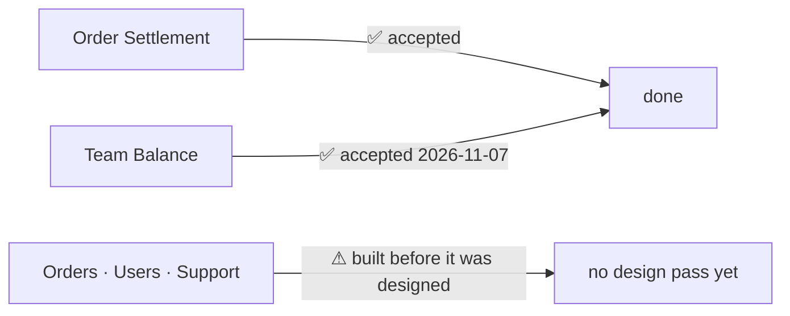

# Progress — Heri

For the **product manager**. One entry per finished slice, newest first
([a-report-fires-per-slice](../business/project/member_decision.md#a-report-fires-per-slice)).
Scope: [member.md](../business/project/member.md) — Order, Order Settlements, Team Balance,
Users & Role System, Documents, region, shipping, expense.

---

## 2026-11-05 · stock never stuck, accounts checked, Analytic figures, shop access

| What shipped | What it means for a person |
| --- | --- |
| **A failed order never keeps the stock** | every Create carries its own key; if the order isn't saved the stock goes back, and a cancel returns it by event even behind a running count |
| **The order form waits safely** | while Create waits the form locks; a dropped connection shows *No answer* with **Try Again**, which first checks whether the first try landed |
| **A ref used before is warned** | the form names the order or draft that already has it — a colleague's draft without a link |
| **The right account pays** | restocks and expenses only from the team's active operational accounts; a transfer from any active one; *stock loss* can't be typed by hand |
| **Analytic gained real figures** | **Warehouse fee** (a cancel takes it back on its day; a warehouse sees what it earned), a **Finance** category (account changes and change types, filtered by account, a year in 11 ms instead of 1.5 s), **Lost stock** (count shortages and adjustments, at batch price); product and supplier filters search real items |
| **Only the shops you were given** | placing or pushing an order checks the person's shop grant; a closed shop still imports its old statements. `san shop grant-current-cs` gives today's CS their team's shops — **run it at release** |
| **Sorting by Total works** | *Total* is what the order cost the seller; *Platform total* sorts what the buyer paid |
| **A transfer's label photo opens for every side** | the sending warehouse, the receiving one and the seller |
| **A stuck stock release is replayed** | `san pubsub releases list / replay` finds a dead-lettered release and gives the stock back, safely twice |
| **A shop is closed, never deleted** | **Close** and **Reopen** replace Delete; a closed shop takes no new orders, keeps importing statements, settlement, accounts and expenses, and its access stays editable; its code is freed, and reopening is refused while another open shop holds it. Report filters still offer it, badged *Closed* |
| **Every order names its courier** | the courier is a real link to the catalogue; the form marks it required and holds **Create** until one is picked |
| **Addresses are names, and drafts open ready to check** | an order's and a draft's address are kept as names; a draft opens with the marketplace's address shown, the regions pre-filled when they match exactly one place, everything editable |
| **Drafts are Ready without mapping** | a draft keeps no product mapping (lines are mapped at Create); *Ready* means shop, warehouse, customer, address and courier are filled |
| **Expense figures name their people** | Analytic's *Created by* lists who typed or corrected an expense; a stock loss lands on the Jakarta day |
| **Team Balance passed your review** | desktop and phone accepted; the pair page opens on **All** — the whole running ledger; only the team that owes can record a payment |
| **Team Balance filters search everything** | the list's search finds a team by name or code past the first page; the pair's date range and tabs read the whole history, not only what was loaded |
| **Supplier figures are real** | *Terjual* and *Siap* with their last order and restock dates, per store and per warehouse, on the supplier pages and Discover — every selling team's goods; a cancel takes its sale back. *Penjualan* is the real selling value on the order's day, and the Terjual / Siap pills filter the list |
| **A shop's own settlement rows have a page** | *Entri Toko* lists withdrawals, adjustments, shop fees and lines that found no order, each with the statement it came from; a wrong one is reversed in place. The report's shop rows open it |
| **Ekspor gives a real file** | the supplier Toko and Statistik tabs, the Supplier Report and the Account Report download an .xlsx of everything the screen shows as filtered — every page, exact money |
| **Every date range is the Jakarta day** | lists, reports, Analytic and the date picker cut days at Jakarta's midnight, wherever the reader is |
| **The new warehouse order list is live** | the old system's columns and a *Returns* tab; *Scan Label* opens the order's pick page, and *Set Picked* only comes after every item is scanned; labels print together as one PDF from the bulk bar |
| **Returns go back on the shelf** | the team's return warehouse accepts a returned parcel on a page: racks for the sound units, broken and missing counted with a note — those are the seller's, named for customer service to claim; stock comes back at its original price and expiry |
| **No order without a return warehouse** | a team must set its return warehouse before it can create an order (form or draft); the form says which team and where to set it; dev teams 14 and 91 return to Dev Warehouse, 89 to Jakarta Warehouse |
| **Old downloads clean themselves up** | merged label PDFs and exports are deleted after 7 days by a daily sweep (uploads never); a phone photo of a label prints the right way up; the order page reads *Platform total* instead of a raw key; an unused warehouse product list is gone |
| **A team sees what Root did inside it** | wherever a screen says who did something — orders, timelines, stock history, expenses, settlement entries, imports, the member and limit logs — Root or the System Administrator acting inside a team shows by name with a green *by Root team* badge; Expenses gained a *Recorded by* column |
| **Root's restocks and transfers are marked in the lists too** | a restock or transfer Root opened inside a team shows *by Root team* beside its creator on the lists, not only on its timeline |
| **Team Balance names who recorded each line** | the ledger and payments show *Recorded by* (a line on phones), with *by Root team* when Root paid or accepted from outside the team |
| **Orders missing a settlement account can be found** | each order records when its account opened; the order list shows a *No settlement account* badge and a *Settlement not opened* filter |
| **Dialogs fit the desktop** | seven dialogs stop filling the screen |
| **Two imports racing one key get a clear answer** | the loser reads *this key belongs to another account*, never a server error |

**Next:** an expense report on Analytic, returns back onto the shelf (waits on `return.md`).

## 2026-11-04 · table mirroring — finding what changed in the old system

| What shipped | What it means for a person |
| --- | --- |
| **A package that finds every changed row in the old system's database** | the migration job can ask *"what is new, edited or deleted in `users` since last time?"* and copy only that into the new system, on a schedule. Nothing uses it yet — the job that copies is the next step |
| **It refuses to wipe the copy by accident** | if a run finds more than 50 rows AND more than 10% of a table gone at once (a table caught half-empty during maintenance), it sends nothing and says so; an operator lets a real purge through by raising the limit once |
| **Two jobs can't run over each other** | a run that starts while the previous one is still going skips that table and says *still running* |

**Next:** the scheduled job that copies the old system's tables into the new one.

## 2026-11-04 (afternoon) · the backlog's bugs, money into accounts, expenses, returns

| What shipped | What it means for a person |
| --- | --- |
| **Saving your profile keeps your email and phone** | it used to blank them, which broke the phone password reset |
| **Shop access goes only to active team members** | a non-member, a suspended or an erased person is refused, and the picker no longer offers them |
| **The admin team's Admin can no longer look up any account** | the exact search stays with the people who manage members |
| **A warehouse opens the labels it needs** | an order's label from the order page, and a restock's label photo at its door — checked against the warehouse, nothing shared |
| **Statement money never lands on a guessed order** | two live orders on one marketplace ref post to the shop, marked "several orders" with both ids |
| **Analytic's "Created by" works for everyone who reads it** | it lists the people on the figures, not a system-wide search |
| **Money reaches the accounts** | restock payments, a transfer's shipping and every expense leave the account that paid; edits post the difference, cancels give it back; a transfer's courier fee is owed in the team balance |
| **Expenses name the account that paid** | *Paid from* is required; only Ads names a shop, and must; corrections follow the original's account; a phone layout; dates in WIB |
| **A warehouse receives a return by scanning** | *Receive a Return* finds the order by ref or tracking number, forces it to return if needed, then accepts it |
| **Every allowed order move has a button** | Mark as Problem, Mark as Lost, Return Goods where the rules allow them |
| **Smaller fixes** | shop filters work; the drafts Ready count covers every page; erased people read "Former user #57"; errors read as sentences; stale "not built" marks removed |
| **One ranked backlog** | [backlog.md](backlog.md), re-ranked after each slice |

**Next:** the backlog's Tier 3 — a duplicate-ref warning on the order form, then stock that stays taken when an order fails.

## 2026-11-04 · inventory — the count locks, found stock, a warehouse's Products; the backlog

| What shipped | What it means for a person |
| --- | --- |
| **A count stops sales, cancels and moves on what it counts** | while a rack is counted, an order or transfer cannot take from it, and a cancel or rollback says *"being counted in count #12"*; the order stays pending until the count ends. A rack a count holds cannot be deleted |
| **Found stock waits for the Owner or Admin** | staff report extra units they found; an Owner or Admin who is not the reporter approves or rejects it under *Inventories ▸ Found Stock*. The reporter can withdraw it, and a finished count settles what it counted |
| **A warehouse picks only what it has held** | the product pickers on warehouse screens offer the products that have stock history in that building, archived ones labelled |
| **A warehouse's Products is what it holds** | the Products menu of a warehouse lists what is on its shelves, and the product page opens for warehouse staff |
| **One ranked list of what is incomplete** | [backlog.md](backlog.md) ranks every unfinished feature, screen, API, event and statistic, and is re-ranked after each slice. Top of it now: six bugs, starting with *saving your profile wipes your email and phone* |

**Next:** the backlog's Tier 1 bugs.

## 2026-11-02 · every decided item built

| What shipped | What it means for a person |
| --- | --- |
| **An expense can be corrected** | a wrong expense gets an adjustment beside it instead of being edited away; the day's total shows the net |
| **Reports refuse more than a year, and say how fresh they are** | the Analytic, settlement and supplier reports stop a range over a year, and read *"As of 14:05 WIB"* |
| **A product is archived, or deleted only if nothing used it** | a used product moves to the Archived tab; one that was never sold or stocked can be deleted |
| **Product codes come from the team's code** | every code reads `<team code>-<part>` |
| **A warehouse records its holidays** | the warehouse page takes closures; the order form warns *"Closed for Idul Fitri — handled from 7 Apr"*, and the order is still created |
| **A recount that finds fewer units charges like a lost unit** | the warehouse's loss is booked and it owes the seller the cost — recording it as a recount no longer avoids that |
| **A creditor can ask to be paid** | *Request Payment* on the pair detail; the debtor sees *"Gudang Bekasi asks you to pay Rp 700.000"*. Nothing moves until they pay |
| **ChatGPT and Claude can read the business** | a person connects an AI agent by URL, picks one team and names it; the agent only reads, for 90 days, and is revoked from Profile. The owner decides whether CS and staff may connect, and sees every connection |
| **The platform's writes inside a team are marked** | when Root or the Administrator acts in a team they are not in, the record says so — orders, stock, expenses, balances, documents |
| **The admin team can watch any team, read-only** | it picks a team under *All teams*, sees its screens under a *Monitoring — read-only* strip, and every write is hidden and refused |
| **A returned parcel is accepted** | the warehouse holding it accepts the return, enters what the courier asked at the door (owed back by the seller), notes missing units, and gets the labels to print for borrowed lines. ⚠ The units do not go back on the shelf until the return's stock design exists |
| **The real stock count** | a count session over all racks, a team, a product or a rack: staff count blind, then see the difference and give reasons; a second person finalizes; losses go to a register the warehouse owes the seller for, and a later surplus claims them back. The old one-rack count is gone |

**Open:** four stock-count questions the build raised ([biggest_question.md](../biggest_question.md)).

 · order — drafts, tracking number, warehouse fee

**The order context has no open question left**, apart from the product barcode you parked.

| What shipped | What it means for a person |
| --- | --- |
| **Promote places a draft exactly like the order form** | a draft becomes an order through the same create, with the same checks. Promote sends what is on screen, so an unsaved edit is not lost, and the receipt, tracking number and note now reach the order. A draft can only be promoted once |
| **The marketplace order number is required** | on the form, on the draft page and on the server. The form no longer has Save as Draft; drafts arrive from the marketplace app |
| **Every time is Jakarta time** | dates show in WIB wherever they are read, and table cells use the short form (`29 Okt 13:05`) |
| **Edit Resi works** | the selling team changes the tracking number, the label file or both until the parcel is handed to the courier. Each change is a note on the order naming the old and the new |
| **The warehouse fee is what gets charged** | the balance now charges each order the fee the warehouse priced it at, not the old flat fee from Credit Terms |
| **The order figures are on the Analytic screen** | Analytic is in the menu now. Orders created, cancelled, returned, arrived back and lost — counted on the day each happened, by shop, seller, warehouse, person or period. A warehouse sees the counts of the orders it ships, never the seller's money. The other metrics on that screen are still sample figures, and say so |
| **Credit Terms is the limit only** | the old flat fee field is gone from Credit Terms and from the pair's terms tab — the warehouse fee rollout is finished. Past changes to the flat fee stay in the change log |

**Checked:** unit tests, two people editing at once and an edit racing the handover (one result each time), 1 545 of
1 546 component stories (the one is a known slow-machine flake), and the orders e2e.

**Next:** both of your questions on the order figures are answered — the metric ids stay, and the orders placed before the figures existed are not filled in, since this is still development. Up next: settlement on the Analytic screen. Its figures are already counted; it needs its two reads.
The order import waits on one export file from each marketplace you use.
agent detail: [order/context.md](order/context.md) · [teams/warehouse/context.md](teams/warehouse/context.md)

## 2026-10-21 · order lifecycle

**Orders now move through the eleven statuses the business uses**, from *pending* to *completed*, *problem*, *lost* or
*return*, instead of the old six. Every plain move is one action for any number of orders: a crew scanning 30 parcels
at the van moves the 28 that are ready and is told why the other two did not move.

| What shipped | What it means for a person |
| --- | --- |
| **One status move** for the warehouse and customer service | confirm, pick, hand over, hand back with a reason, shipped, completed, problem, lost and forced return are all one action. Each order says whether it moved and, if not, why |
| **One tab per status** on the order lists | an order is found under the status it is actually in |
| **Root sees every team's orders** | the platform owner can look across all teams without switching |
| **Settlement opens from the order event** | an order's settlement account appears a moment after the order. The order no longer waits on settlement to be created |
| **Return warehouse setting** (Settings → Return Warehouse) | a selling team names where its returns are received. Nothing requires it yet |

**Checked:** unit tests, all 1 405 component stories, and the orders, statement and settlement e2e. Two people moving
the same order at once was tested: exactly one move lands.

**Waiting on you:**
1. ✅ *Decided and built the same day:* moving many orders now saves them together — 200 orders in 11 ms instead of
   a quarter of a second ([audit](../../audits/services/selling_service/performances/OrderStatusChange.md)).
2. ✅ *Decided the same day:* picked is sky, shipping cyan, return red, and return completed takes your pink of *Retur Diterima*.
3. ✅ *Decided the same day:* every selling team sets its own return warehouse on Settings — nothing is filled in for
   them. Orders start requiring one once every team has set it, and the Teams list badges the teams still missing one.

**Later the same day:** the order lists lost six of their 'not implemented' marks.

| What shipped | What it means for a person |
| --- | --- |
| **Export** on both order lists | the list downloads as a spreadsheet, exactly the rows on screen (or the ticked ones on the warehouse list) |
| **Marketplace, seller and courier filters** | they now narrow the list. They were on screen before but did nothing |
| **The warehouse row's shop and unit count** | real now; before they were sample values |
| **Each timeline step says which side did it** | Warehouse or Seller, on every row of an order's timeline |

The seller list has 10 parts still waiting and the warehouse list 6; each needs a decision or a bigger piece (the fee).

**And then:** files download under their real names (an export is `orders-….xlsx`, not a storage code), and the **warehouse fee** got its first of five steps — each warehouse can now set what it charges per order (a percent with a floor and an optional cap) on its Settings. Nothing charges from it yet; orders keep paying the old flat fee until step 4. Detail: [teams/warehouse/context.md](teams/warehouse/context.md).

**2026-10-22:** six more marks gone from the seller's order list — it is down to 4.

| What shipped | What it means for a person |
| --- | --- |
| **The tracking number is kept** | the number typed on the order form is saved, shows on both order lists, the order page and the export, and the search finds an order by it |
| **The warehouse filter works** | picking a warehouse on the seller list narrows the rows and the counts |
| **The status date is real** | under a status tab, each row says when the order got there |
| **The warehouse fee is real** | each new order is priced by its warehouse and keeps that fee; the order form shows it before you save. A warehouse that never set its fee cannot take orders, and the form says so |
| **The summary's figures are real** | items, units per order, purchase value and margin come from the server |

Behind it, steps 2 and 3 of the warehouse fee: each warehouse's old flat fee became its rate (the same amount), and orders now freeze the fee. The ledger still charges the old flat fee until step 4. ⚠ In the dev database only Dev Warehouse had a flat fee, so the other warehouses there refuse orders until they set one.

Still waiting on the seller list: the import's file, the marketplace's order date and the ship-by deadline (you added both fields today), and the withdrawal figure.

**Later the same day:** the marketplace's two dates are real, so the seller list is down to **2** marks — the import (Q19) and the withdrawal (Q20), both waiting on your answer.

| What shipped | What it means for a person |
| --- | --- |
| **The marketplace order date** | every new order must have it — the order form will not create without it, and a draft cannot be promoted without it. It shows on both lists, the order page and the export |
| **The ship-by deadline** | the marketplace's own "kirim sebelum", optional. When set it colours the row: overdue, under 6 hours, under 24 hours |
| **The date filter switch** | the order list's date filter reads either *Dibuat* (the default) or *Tgl MP* |

Orders placed before today have neither date, so they show nothing there and never match a *Tgl MP* filter.

Detail: [order/context.md](order/context.md).

---

## 2026-08-31 · baseline

**The first entry is a baseline, not a slice.** Scopes were assigned today, and the work predates
them — **all 389 commits in this repository are from this machine**, so everything below was built
here, including the parts now assigned to Toni. This entry states where the whole system stands;
every entry after it covers one finished slice.

### Where each area stands

| Area | State | What a person can do with it today |
| --- | --- | --- |
| **Team Balance** | ✅ **accepted 2026-11-07** (desktop and phone) | Two teams can owe each other and settle up: every pair has two mirrored balances, six kinds of event move them, and a debt above the limit stops the debtor ordering. A payment carries **proof the creditor can open**; only the team that owes records it, and the creditor accepts (final) or rejects. Credit limits have a change log — who moved a limit, when, and why |
| **Order Settlement** | ✅ **done, design accepted** | What a marketplace order *actually* paid out — the fees, the deductions, the next-day adjustments — recorded per order, typed in by hand or posted by an external service |
| **Orders** | ⚠ built, never design-reviewed | Record an order, keep it as a draft and promote it, then confirm → pick → pack → ship. Shops and shop members are managed |
| **Users & Roles** | ⚠ built, never design-reviewed | Log in, reset a password by OTP, hold a different role in each team. The permission rule for every screen is declared on the request itself, so it cannot drift from the code |
| **Support** — documents, regions, courier catalogue, expenses | ⚠ built, never design-reviewed | Upload and share a document, resolve an address or postcode, pick a courier, record a cost like electricity or ads |

### ✅ The balance screens are reviewed

You accepted the Team Balance screens on 2026-11-07 — desktop
([the-team-balance-screens-are-accepted](../technical/balance/team_balance_design_decision.md#the-team-balance-screens-are-accepted))
and phone ([the-team-balance-phone-layout-is-accepted](../technical/balance/team_balance_design_decision.md#the-team-balance-phone-layout-is-accepted)).
The `design_accept` gate is passed. Still open there: the warehouse daily statement's old words (#35).

### What is honest about the rest

**Most of this was built before it was designed** — that is recorded, not hidden, in
[the balance state report](balance/context.md). It is why *Orders* carries **13 open questions**, the
most of any area, and why the top of [biggest_question.md](../biggest_question.md) is about orders and
money rather than about screens.

### Evidence

The last recorded run had the **e2e suite green** (`6ae4d55`, 2026-08-31), with unit, integration and
end-to-end passing together for the first time. Two concurrency audits are written up in
[audits/](../../audits/). Detail per area is in the context files beside this one —
[balance](balance/context.md), [settlement](settlement/context.md).

### Next

1. ~~Get the balance screens previewed~~ — ✅ accepted 2026-11-07.
2. ~~Wire settlement into order creation~~ — ✅ done: settlement opens and cancels each sale from `OrderPlaced` / `OrderCancelled` ([settlement/context.md](settlement/context.md)).
3. ~~Decide who owns the ledger~~ — ✅ yours ([heri-owns-the-ledger-area](../business/project/member_decision.md#heri-owns-the-ledger-area)); there is still no central book ([ledger-is-retired-as-a-context](../business/project/member_decision.md#ledger-is-retired-as-a-context)).
