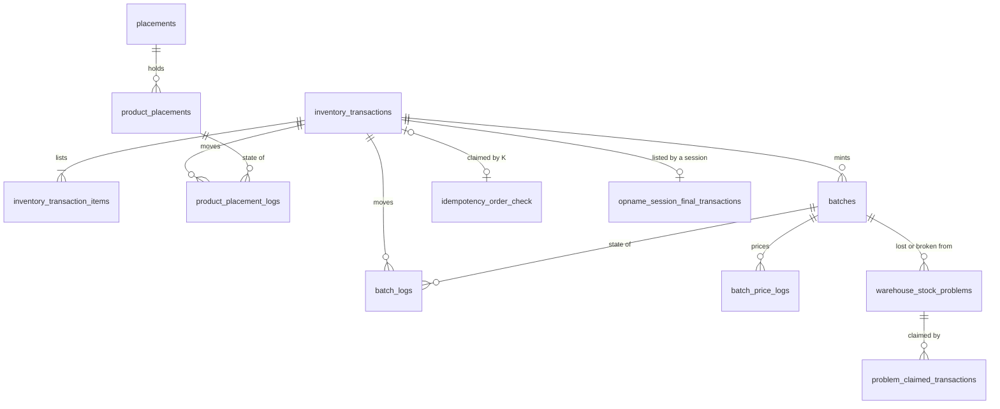

# Development state — inventory / ledgers

🔨 **2026-10-17: the cut-over is in, uncommitted on purpose** — the owner reviews everything at the end (*"we commit until i say"*).
Every business rule the ledgers need is decided ([biggest_question #1](../../biggest_question.md) closed). The ledgers
replace today's `stock_*` tables outright — nothing is in production
([no-switch-over-the-ledgers-replace-todays-tables](../../technical/stock/design_decision.md#no-switch-over-the-ledgers-replace-todays-tables)).

## Stages — reordered 2026-10-16

Each decided writer was built **beside** today's path, then ONE cutover moved every reader, selling's order call and the
frontend together, and the old tables went (`00029`). Nothing writes a `stock_*` table any more: `StockPick`,
`StockMove`, `StockTransfer`, `StockReceive` and `StockReturn` are gone from the contract, and `StockAdjust` and the
one-rack `StockOpname` write provisional `adjustment` transactions.

⚠ **A dev database must be rebuilt, not migrated forward with data in it** — `00029` drops the old tables and the stock
in them with it. `go run ./tools/san dev setup` on a fresh database, then restock to put stock back.

| stage | what | state |
| --- | --- | --- |
| **1 — foundation** | `00025` (7 ledger tables) · models · `inventory_ledgers` (transaction + items, batch mint and oldest-first take with the emptying take taking all, rack put and fewest-first take, `Verify`) · `pkgs/san_money` | ✅ 10 ledger + 3 money tests |
| **2a — restock accept on the ledgers** | `inventory_mutations.PostRestock` in the accept (a batch per line at the decided landed price, rack rows, items, `restocks.transaction_id`), the old stock writes beside it until the cutover · `ProductReader` port + adapter; create/update refuse another team's product ([a-restock-carries-only-the-teams-own-products](../../business/inventory/restock_decision.md#a-restock-carries-only-the-teams-own-products)) | ✅ 3 + 4 tests; removed the two-owners-on-one-shelf opname test |
| **2d — the courier's debt from the event** | *Restock Accepted* carries `warehouse_additional_cost`, its note, `actor_id`; `PostRestockOutlay` removed from the accept, the port, the adapter and the fakes; liability's `ChargeRestockCourier` + route `/event/liability-restock-accepted/push` + `san pubsub ensure` subscription | ✅ 2 liability + 3 inventory tests |
| **4a — the order take** | `order_transaction.proto` (`OrderTransactionService`: Create, Release, `OrderTransactionRefusal`) · `00026` `idempotency_order_check` · `PostOrder`, `RollbackTake` mutations · `AvailableInBatches` (→ `LockBatches`, stage 5), `ReverseBatchLogs`, `ReversePlacementLogs` | ✅ 7 handler tests + 4 race tests (`-tags raceaudit`) |
| **4b — move · 4c — sample** | `RackMove`, `RackSample` on the ledgers — no longer prototypes · `PostMove` (one tx per owning team, a row per rack touched, no batch row, all or nothing), `PostSample` (oldest batch first, the page's rack, the recipient on the tx) · ledger primitives `EnsureAndLockRacks`, `ApplyRackChange` (→ `RackWrites.Apply`, stage 5) | ✅ 4 + 2 tests, 2 race tests |
| **4d — the warehouse transfer** | `00027` (4 tables) · `PostTransferOut` (shares the order's take), `PostTransferIn` (one batch per source layer, broken then missing off the newest) · 10 handlers, the prototype deleted · 4 events (`WarehouseTransferCreated` / `Updated` / `Cancelled` / `Accepted`, money `double`, nobody listens yet) · `ProductFact` gains sku and name — [warehouse_transfer.md](warehouse_transfer.md) | ✅ 17 tests, 5 race tests |
| ⏸ problem / found / opname | the stock count awaits design_accept; adjustment.md is empty — meanwhile `StockAdjust` and the one-rack `StockOpname` run as PROVISIONAL `adjustment` transactions ([old-shelf-corrections-move-onto-the-ledgers-provisionally](../../technical/stock/design_decision.md#old-shelf-corrections-move-onto-the-ledgers-provisionally); open: [adjustment Q1–Q4](../../business/inventory/adjustment_clarify.md#question)) | parked (provisional port ✅) |
| **3 — the cutover** | ✅ every reader on the ledgers (25 RPCs; `ledger_history.go` maps change types to the screens' kinds) · ✅ `racks` → `placements` (`00028`: `deleted_at`, lowercase codes + CHECK) · ✅ selling's take and cancel through `OrderTransactionService` with the key `order:<id>` ([the-order-take-bridges-its-key-per-order](../../technical/stock/design_decision.md#the-order-take-bridges-its-key-per-order)) · ✅ the accept's old writes removed · ✅ `StockReceive`, `StockMove`, `StockTransfer`, `StockPick`, `StockReturn` removed from the contract; the inventory page's Receive gone, the Move dialog on `RackMove` · ✅ the transfer's money `double` · ✅ **2c** `00030`: `restocks`, `restock_items`, `restock_problem_items` (keyed by restock + product, one row per kind), `received_count` is the box, `subtotal`/`total`/`price_unit` stored · ✅ **2b** restock money `double` in the tables, the contract, its four events and the screens; liability and supplier round at their own edge · ✅ e2e: `restock`, `liability`, `opname`, `orders`, `racks` and `inventory` specs on the current contract and green — liability's courier debt now arrives through its push route | ✅ Go suite, race and perf audits green; 1402 stories green; 2 new restock tests |
| **5 — drop** | ✅ `00029` drops `stock_levels`, `stock_movements`, `stock_batches`, `stock_shelf_batches`, `stock_owner_movements`, `restock_received_placements` (down not reversible) and their models · ⬜ dev data reseeded (`san dev setup`) · ✅ `audit-rpc-performance` on the seven ledger writes — all 🔴 heavy by the N+1 rule ([audits/services/inventory_service/performances/](../../../audits/services/inventory_service/performances/)) · ✅ **both fixes in** (owner *"go ahead"*, 2026-10-17): `00031` indexes the placement log by `transaction_id` ([placement-logs-are-indexed-by-transaction](../../technical/stock/design_decision.md#placement-logs-are-indexed-by-transaction)) and the primitives are set-based ([ledger-writes-are-set-based](../../technical/stock/design_decision.md#ledger-writes-are-set-based)): `LockBatches`/`LockRacks`, in-memory `TakeOldestFirst`/`TakeFewestFirst`/`RackWrites.Apply`, `BatchWrites`/`RackWrites.Flush`, `MintBatches`; `AvailableInBatches` and `ApplyRackChange` gone. Every one of the seven now costs the same statements at 1 line and at 20 (9–23), 9–19 ms at 20 lines | 7 `*_perf_test.go` (`-tags perfaudit`) · 2 statement-count tests |

**What is left, for the next pass:**

| | |
| --- | --- |
| performance | ✅ both audit fixes applied 2026-10-17 (stage 5). Left: `RestockRequestArrive`, `Cancel`, `MarkLost` and `Update` save through `tx.Model(&rr)` and may re-upsert preloaded lines the way the accept did — not audited ([RestockRequestAccept § the-accept-writes-its-own-rows-one-at-a-time](../../../audits/services/inventory_service/performances/RestockRequestAccept.md#the-accept-writes-its-own-rows-one-at-a-time)); the provisional `StockAdjust`/`StockOpname` were moved onto the new primitives but not audited |
| money still whole rupiah | the stock reads keep `int64` and round at the read — `StockCost`, the rack and batch values, owner stock, `ProductStockSummary` — until each turns `double` with its feature ([money-is-double-in-the-api-too](../../technical/stock/design_decision.md#money-is-double-in-the-api-too)); liability and supplier round the restock events' doubles at their own edge |
| dev data | `00029` drops the old stock with its tables: rebuild the dev database, then restock to put stock back |
| `buf generate` | ⚠ from the Bash tool on this machine it fails half-way (`Access is denied` removing a generated file) and leaves `gen/` partly deleted; it runs clean from PowerShell |

**Found on the way, not mine to change:** liability's order-fee push handler (`NewLiabilityPushHandler`) is declared
and its `liability-order-placed`/`-cancelled` subscriptions are created, but **no route mounts it** — those pushes reach
nothing. ⚠ The new `/event/liability-restock-accepted/push` posts a **debt**; like every webhook here it is open
(the-event-webhook-is-open), so restrict it at the ingress.

Choices made while building, where the decisions are silent (each revisitable):

| | choice | why |
| --- | --- | --- |
| *oldest batch* | `id` order | ids are mint order; `created_at` can tie |
| a mint's `batch_price_logs.delta_price_unit` | = `new_price_unit` (from 0) | a mint is the first price |
| a restock item's `total` | good units × landed price — what its batch rows hold | [an-item-equals-its-batch-rows](../../business/inventory/transaction_decision.md#an-item-equals-its-batch-rows) is the invariant the tests assert; broken and missing are on the problem rows |
| get-or-create of a rack row | `INSERT … ON CONFLICT DO NOTHING`, then lock | ledger template Critique 4 |
| `idempotency_order_check` | created in stage 4, with the take | nothing writes it before |

---

**Type key** — `id` bigint PK · `fk` in-service FK (same service, allowed) · `xid` another service's id, **no FK** ·
`int` integer count · `dbl` money, `double precision` / Go `float64` / proto `double` · `str` text · `enum` closed text
list · `bool` · `ts` timestamptz · `?` nullable.

---

## Tables

### inventory_transactions

| column | type | rule | fixed by |
| --- | --- | --- | --- |
| `id` | id | | [every-stock-change-belongs-to-a-transaction](../../business/inventory/context_decision.md#every-stock-change-belongs-to-a-transaction) |
| `warehouse_id` | xid (team) | the warehouse whose stock moved; a transfer has one row per leg, each its own warehouse | [the-decided-ledgers-come-before-the-transfer](../../business/inventory/warehouse_transfer_decision.md#the-decided-ledgers-come-before-the-transfer) |
| `team_id` | xid (team) | `order`: the ORDERING team · every other type: the owning team (one tx per owning team for `move`, `sample`, a count's `problem`/`found`/`move`) | [an-order-transaction-is-the-ordering-teams](../../business/inventory/transaction_decision.md#an-order-transaction-is-the-ordering-teams), [a-move-writes-one-transaction-per-owning-team](../../business/inventory/placement_decision.md#a-move-writes-one-transaction-per-owning-team) |
| `tx_type` | enum, see [Enums](#enums) | one direction per type | [problem-and-found-replace-opname](../../business/inventory/transaction_decision.md#problem-and-found-replace-opname) |
| `create_by_user_id` | xid (user) | who did it | [any-warehouse-member-may-move-goods](../../business/inventory/placement_decision.md#any-warehouse-member-may-move-goods) |
| `is_rollback` | bool, default false | set once, by a rollback, under the row lock | [an-undo-rolls-the-transaction-back-once](../../business/inventory/transaction_decision.md#an-undo-rolls-the-transaction-back-once) |
| `description` | str ? | the staff note; a revaluation's reason (required there) | [the-owning-team-revalues-with-a-reason](../../business/inventory/context_decision.md#the-owning-team-revalues-with-a-reason) |
| `recipient` | str ? | 🆕 set by `sample` only (required there); empty on every other type — **not yet in transaction.md** | [a-sample-keeps-its-recipient](../../business/inventory/transaction_decision.md#a-sample-keeps-its-recipient) |
| `updated_at` | ts | moved only by the rollback | [an-undo-rolls-the-transaction-back-once](../../business/inventory/transaction_decision.md#an-undo-rolls-the-transaction-back-once) |
| `created_at` | ts | | |
| ~~`idempotency_key`~~ | — | **removed** — lives in `idempotency_order_check` | [the-key-is-claimed-in-its-own-table](../../business/inventory/transaction_decision.md#the-key-is-claimed-in-its-own-table) |
| ~~`status`, `ref_id`, `picked_at`~~ | — | not columns (design.md's `status` overtaken by `is_rollback`; `ref_id` withdrawn; *picked* is the order's) | [picked-lives-on-the-order-timeline](../../business/inventory/transaction_decision.md#picked-lives-on-the-order-timeline) |

| index (implied by a decided read) | read |
| --- | --- |
| `(team_id, tx_type, created_at)` | a team's history · the sample list · reports grouped by team and type ([items-are-what-history-and-reports-read](../../business/inventory/transaction_decision.md#items-are-what-history-and-reports-read)) |
| `(warehouse_id, created_at)` | reports by warehouse |

### inventory_transaction_items

| column | type | rule | fixed by |
| --- | --- | --- | --- |
| `id` | id | | [a-transaction-lists-its-items](../../business/inventory/transaction_decision.md#a-transaction-lists-its-items) |
| `warehouse_id` | xid | = the transaction's | same |
| `transaction_id` | fk → inventory_transactions | | same |
| `product_id` | xid (product) | required; **one item per product per transaction** | [an-item-names-its-product](../../business/inventory/transaction_decision.md#an-item-names-its-product) |
| `product_team_id` | xid (team) | the product's OWNER, on every item of every type | [an-item-carries-its-owning-team](../../business/inventory/transaction_decision.md#an-item-carries-its-owning-team) |
| `is_owned` | bool | `product_team_id = transaction.team_id`; false = a borrowed order line | [an-order-transaction-is-the-ordering-teams](../../business/inventory/transaction_decision.md#an-order-transaction-is-the-ordering-teams) |
| `quantity` | int | always positive — the units its batch rows moved (a move: the units off the source rack) | [an-item-equals-its-batch-rows](../../business/inventory/transaction_decision.md#an-item-equals-its-batch-rows), [problem-and-found-replace-opname](../../business/inventory/transaction_decision.md#problem-and-found-replace-opname) |
| `total` | dbl | = Σ value of its product's batch rows in this tx (a move: 0) | [an-item-equals-its-batch-rows](../../business/inventory/transaction_decision.md#an-item-equals-its-batch-rows), [a-move-lists-its-units-at-zero-value](../../business/inventory/placement_decision.md#a-move-lists-its-units-at-zero-value) |
| `created_at` | ts | | |

| constraint / index | why |
| --- | --- |
| `UNIQUE (transaction_id, product_id)` | one item per product per transaction |
| `CHECK (quantity > 0)` *(derived — see open point on revaluation)* | items stay positive |
| `(product_team_id, created_at)` | *"what was taken from my stock"* — the owner reads items, not headers ([an-order-transaction-is-the-ordering-teams](../../business/inventory/transaction_decision.md#an-order-transaction-is-the-ordering-teams)) |
| `(warehouse_id, created_at)` | reports, one join to the header |

### idempotency_order_check

| column | type | rule | fixed by |
| --- | --- | --- | --- |
| `id` | id | | [the-key-is-claimed-in-its-own-table](../../business/inventory/transaction_decision.md#the-key-is-claimed-in-its-own-table) |
| `idempotency_key` | str | **UNIQUE** — on the key alone, not per team | same |
| `transaction_id` | fk → inventory_transactions **?** | NULL = *cancelled before anything was taken* | same |

No `team_id`, no `created_at` in the decision (see open points). Read by: the take's first lookup, the release, the pick page.

### batches — the batch ledger's state (scope = one batch)

| column | type | rule | fixed by |
| --- | --- | --- | --- |
| `id` | id | | [batch.md](../../business/inventory/batch.md) |
| `warehouse_id` | xid | | batch.md |
| `team_id` | xid (team) | the OWNER — required, written at mint, never changed. Restock: the restock's team · transfer_in: the source batch's | [a-batch-carries-its-owner](../../business/inventory/warehouse_transfer_decision.md#a-batch-carries-its-owner) |
| `product_id` | xid | | batch.md |
| `transaction_id` | fk → inventory_transactions | the tx that MINTED it | [every-stock-change-belongs-to-a-transaction](../../business/inventory/context_decision.md#every-stock-change-belongs-to-a-transaction) |
| `price_unit` | dbl | restock: landed price · transfer_in: copied · found-mint: team's newest batch price here · changed only by a revaluation | [unit-price-is-line-price-plus-costs-per-unit](../../business/inventory/restock_decision.md#unit-price-is-line-price-plus-costs-per-unit), [the-receiver-mints-one-batch-per-source-batch](../../business/inventory/warehouse_transfer_decision.md#the-receiver-mints-one-batch-per-source-batch), [last-price-is-the-teams-newest-batch-here](../../business/inventory/opname_decision.md#last-price-is-the-teams-newest-batch-here) |
| `stock_count` | int | `CHECK (stock_count >= 0)` | [both-ledgers-count-the-same-units](../../business/inventory/context_decision.md#both-ledgers-count-the-same-units) |
| `stock_valuation` | dbl | **the truth** — a batch at 0 units is exactly 0 | [an-emptying-take-takes-all-the-value](../../business/inventory/context_decision.md#an-emptying-take-takes-all-the-value) |
| `init_stock_count` | int | at mint, never changed | batch.md |
| `init_stock_valuation` | dbl | at mint, never changed | batch.md, [stock-money-is-float64-compared-at-4-digits](../../technical/stock/design_decision.md#stock-money-is-float64-compared-at-4-digits) |
| `supplier_channel_id` | xid (supplier) ? | copied from the restock line / source batch | [a-line-names-the-channel-it-was-bought-from](../../business/inventory/restock_decision.md#a-line-names-the-channel-it-was-bought-from) |
| `supplier_id` | xid (supplier) ? | 🆕 copied from the restock line / source batch — **not yet in batch.md** | [a-batch-keeps-its-supplier](../../business/inventory/context_decision.md#a-batch-keeps-its-supplier) |
| `expired_at` | ts ? | copied on transfer_in; read by the expiry report only, never by the take | [expiry-is-a-report](../../business/inventory/context_decision.md#expiry-is-a-report) |
| `updated_at`, `created_at` | ts | | |

| index | read |
| --- | --- |
| `(warehouse_id, team_id, product_id, id) WHERE stock_count > 0` | FIFO take, oldest first |
| `(warehouse_id, team_id, product_id, created_at DESC)` — emptied included | *last price* for a found mint |
| `(warehouse_id, expired_at) WHERE stock_count > 0 AND expired_at IS NOT NULL` | the expiry report |

A batch is never deleted: an emptied batch reopens on a found claim ([a-surplus-claims-the-oldest-loss-first](../../business/inventory/opname_decision.md#a-surplus-claims-the-oldest-loss-first)).

### batch_logs — the batch ledger's log (append-only)

| column | type | rule | fixed by |
| --- | --- | --- | --- |
| `id` | id | read in `id` order — the balance-after is a sequence, not a time | [items-are-what-history-and-reports-read](../../business/inventory/transaction_decision.md#items-are-what-history-and-reports-read) |
| `warehouse_id`, `team_id` | xid | = the batch's (team = owner) | batch.md |
| `batch_id` | fk → batches | | batch.md |
| `transaction_id` | fk → inventory_transactions | | [every-stock-change-belongs-to-a-transaction](../../business/inventory/context_decision.md#every-stock-change-belongs-to-a-transaction) |
| `change_type` | enum, see [Enums](#enums) | the tx's type, except a `problem` tx writes `broken`/`lost` | [problem-and-found-replace-opname](../../business/inventory/transaction_decision.md#problem-and-found-replace-opname) (🔄 amended) |
| `change_count` | int | signed; 0 for a revaluation | batch.md |
| `change_valuation` | dbl | signed | batch.md |
| `stock_count_after` | int | ≥ 0 | batch.md |
| `stock_valuation_after` | dbl | | batch.md |
| `price_unit_after` | dbl | 🆕 the batch's `price_unit` once this row applies, on EVERY row — **not yet in batch.md** | [batch-logs-carry-price-unit-after](../../business/inventory/context_decision.md#batch-logs-carry-price-unit-after) |
| `description` | str ? | revaluation: the reason (required) | [the-owning-team-revalues-with-a-reason](../../business/inventory/context_decision.md#the-owning-team-revalues-with-a-reason) |
| `actor_id` | xid (user) | who; on a rollback row, who rolled it back | [a-rollback-reverses-its-log-rows](../../business/inventory/transaction_decision.md#a-rollback-reverses-its-log-rows) |
| `created_at` | ts | **no `updated_at`** | [ledger-logs-are-append-only](../../technical/ledger/mutation_and_ledger_decision.md#ledger-logs-are-append-only) |

| index | read |
| --- | --- |
| `(batch_id, id)` | a batch's stock flow / history |
| `(transaction_id)` | rollback; the transfer's source batches; item check |

### batch_price_logs — every price a batch has had (append-only)

| column | type | rule | fixed by |
| --- | --- | --- | --- |
| `id` | id | | batch.md |
| `batch_id` | fk → batches | | batch.md |
| `new_price_unit` | dbl | = the paired `batch_logs.price_unit_after` | [batch-logs-carry-price-unit-after](../../business/inventory/context_decision.md#batch-logs-carry-price-unit-after) |
| `delta_price_unit` | dbl | new − old | batch.md §Change Price Flow |
| `description` | str ? | revaluation reason, required | [the-owning-team-revalues-with-a-reason](../../business/inventory/context_decision.md#the-owning-team-revalues-with-a-reason) |
| `actor_id` | xid (user) | | batch.md |
| `created_at` | ts | no `updated_at` | [ledger-logs-are-append-only](../../technical/ledger/mutation_and_ledger_decision.md#ledger-logs-are-append-only) |

Written by: every **mint** (the first price) and every **revaluation**. Index `(batch_id, id)`.

### placements

| column | type | rule | fixed by |
| --- | --- | --- | --- |
| `id` | id | | [placement.md](../../business/inventory/placement.md) |
| `warehouse_id` | xid | | placement.md |
| `name` | str | free text | [rack-codes-are-saved-lowercase](../../business/inventory/placement_decision.md#rack-codes-are-saved-lowercase) |
| `code` | str | trimmed + lowercased on save; `CHECK (code = lower(btrim(code)))` | same |
| `description` | str ? | | placement.md |
| `deleted_at` | ts ? | soft delete, allowed only when every `product_placements` row on it is 0 | [a-placement-deletes-at-zero-stock](../../business/inventory/placement_decision.md#a-placement-deletes-at-zero-stock) |
| `updated_at`, `created_at` | ts | | |
| ~~`locked`~~ | — | dropped — the lock is the open snapshot row | [the-lock-is-the-open-snapshot-row](../../business/inventory/opname_decision.md#the-lock-is-the-open-snapshot-row) |

`UNIQUE (warehouse_id, code) WHERE deleted_at IS NULL` — a deleted code is reusable ([one-shelf-row-per-product-per-placement](../../business/inventory/context_decision.md#one-shelf-row-per-product-per-placement)). Screen word *Racks*, schema word `placements` ([the-racks-page-is-the-placement-list](../../business/inventory/placement_decision.md#the-racks-page-is-the-placement-list)).

### product_placements — the placement ledger's state (scope = product × placement)

| column | type | rule | fixed by |
| --- | --- | --- | --- |
| `id` | id | | placement.md |
| `team_id` | xid | the product's owner | placement.md |
| `warehouse_id` | xid | = the placement's | placement.md |
| `product_id` | xid | | placement.md |
| `placement_id` | fk → placements | | placement.md |
| `stock_count` | int | `CHECK (stock_count >= 0)` | [a-shelf-never-goes-below-zero](../../business/inventory/placement_decision.md#a-shelf-never-goes-below-zero) |
| `updated_at`, `created_at` | ts | | |

| constraint / index | read |
| --- | --- |
| `UNIQUE (product_id, placement_id)` | one row per product per rack, and the upsert target for a destination rack — [one-shelf-row-per-product-per-placement](../../business/inventory/context_decision.md#one-shelf-row-per-product-per-placement) |
| `(warehouse_id, team_id, product_id, id)` | the take: lock all of a product's racks by id, then choose |
| `(placement_id)` | Rack detail; the delete check |

No `batch_id` — a rack never knows its batch ([expiry-is-a-report](../../business/inventory/context_decision.md#expiry-is-a-report)).

### product_placement_logs — the placement ledger's log (append-only)

| column | type | rule | fixed by |
| --- | --- | --- | --- |
| `id` | id | read in `id` order | [items-are-what-history-and-reports-read](../../business/inventory/transaction_decision.md#items-are-what-history-and-reports-read) |
| `warehouse_id`, `team_id` | xid | | placement.md |
| `product_id` | xid | | placement.md |
| `placement_id` | fk → placements | | placement.md |
| `transaction_id` | fk → inventory_transactions | | [every-stock-change-belongs-to-a-transaction](../../business/inventory/context_decision.md#every-stock-change-belongs-to-a-transaction) |
| `change_type` | enum, see [Enums](#enums) | the tx's type; `problem` → `broken`/`lost` | [problem-and-found-replace-opname](../../business/inventory/transaction_decision.md#problem-and-found-replace-opname) |
| `stock_change` | int | signed | placement.md |
| `stock_after` | int | ≥ 0 | [a-shelf-never-goes-below-zero](../../business/inventory/placement_decision.md#a-shelf-never-goes-below-zero) |
| `description` | str ? | | placement.md |
| `actor_id` | xid (user) | | [any-warehouse-member-may-move-goods](../../business/inventory/placement_decision.md#any-warehouse-member-may-move-goods) |
| `created_at` | ts | no `updated_at` | [ledger-logs-are-append-only](../../technical/ledger/mutation_and_ledger_decision.md#ledger-logs-are-append-only) |

| index | read |
| --- | --- |
| `(placement_id, product_id, id)` | a rack's stock flow |
| `(warehouse_id, transaction_id)` | the pick page by `orders.transaction_id` ([the-placement-page-reads-racks-by-transaction-id](../../business/inventory/order_decision.md#the-placement-page-reads-racks-by-transaction-id)); rollback |

### warehouse_products — product ↔ warehouse link

| column | type | rule | fixed by |
| --- | --- | --- | --- |
| `id` | id | | [context.md](../../business/inventory/context.md) §Table that must we have |
| `team_id` | xid | the product's owner — ⚠ named `owner_team_id` in design.md (open) | context.md |
| `warehouse_id` | xid | | context.md |
| `product_id` | xid | | context.md |
| `created_at` | ts | | context.md |

`UNIQUE (warehouse_id, product_id)` — from [design.md](../../technical/stock/design.md) only (context.md silent). Written by an upsert **outside** the transaction (*"not critical ops"*): restock create (its warehouse), transfer create (the RECEIVING warehouse). Never removed ([a-transfer-links-its-products-to-the-receiver](../../business/inventory/context_decision.md#a-transfer-links-its-products-to-the-receiver)). ⚠ The build already has this table (inventory `00011`) with no team column.

### opname tables the ledgers touch — *opname, later*

| table | columns | constraints | fixed by |
| --- | --- | --- | --- |
| `opname_session_final_transactions` | `id` · `opname_session_id` fk · `transaction_id` fk · `created_at` | `UNIQUE (transaction_id)`; written at finalize, same db tx; a cancelled session writes none. Listed ⇒ the tx came through a count; not listed ⇒ a report at the shelf | [a-session-lists-its-final-transactions](../../business/inventory/opname_decision.md#a-session-lists-its-final-transactions) |
| `warehouse_stock_problems` | `id` · `warehouse_id` · `team_id` · `product_id` · `transaction_id` fk · `batch_id` fk · `placement_id` fk ? · `note` str ? · `problem_type` enum(`broken`,`lost`) · `problem_stock_count` int · `price_unit` dbl · `claimable_stock_count` int · `claimed_stock_count` int · `created_at` | one row per type per batch per tx · `price_unit` = that batch's · `claimable` = count for `lost`, 0 for `broken` · `CHECK (claimed_stock_count <= claimable_stock_count)` · index `(warehouse_id, team_id, product_id, created_at, id) WHERE problem_type='lost' AND claimed_stock_count < claimable_stock_count` | [a-loss-in-custody-is-a-stock-problem](../../business/inventory/opname_decision.md#a-loss-in-custody-is-a-stock-problem), [a-shortage-writes-a-row-per-batch](../../business/inventory/opname_decision.md#a-shortage-writes-a-row-per-batch), [a-problem-row-names-its-rack](../../business/inventory/opname_decision.md#a-problem-row-names-its-rack), [a-claim-records-its-units](../../business/inventory/opname_decision.md#a-claim-records-its-units) |
| `problem_claimed_transactions` | `id` · `warehouse_id` · `problem_id` fk · `transaction_id` fk · `claimed_stock_count` int · `created_at` | `problems.claimed_stock_count` = Σ its claim rows | [a-claim-names-its-transaction](../../business/inventory/opname_decision.md#a-claim-names-its-transaction), [a-claim-records-its-units](../../business/inventory/opname_decision.md#a-claim-records-its-units) |
| *(read by every mutation)* `opname_session_snapshots` | `product_id` · `placement_id` · `released_at` ? | the count LOCK = a row with `released_at IS NULL`; index `(product_id, placement_id) WHERE released_at IS NULL` | [the-lock-is-the-open-snapshot-row](../../business/inventory/opname_decision.md#the-lock-is-the-open-snapshot-row), [one-active-count-per-warehouse](../../business/inventory/opname_decision.md#one-active-count-per-warehouse) |

---

## Enums

| `tx_type` (11) | batch `change_type` | rack `change_type` |
| --- | --- | --- |
| `order` | `order` | `order` |
| `restock` | `restock` | `restock` |
| `return` *(parked)* | `return` | `return` |
| `sample` | `sample` | `sample` |
| `transfer_in` | `transfer_in` | `transfer_in` |
| `transfer_out` | `transfer_out` | `transfer_out` |
| `adjustment` | `adjustment` | `adjustment` |
| `revaluation` | `revaluation` | — no rack row |
| `problem` | `broken` · `lost` (the reason) | `broken` · `lost` |
| `found` | `found` | `found` |
| `move` | — no batch row | `move` |

So `batch_logs.change_type` = {order, revaluation, return, restock, adjustment, broken, lost, transfer_in, transfer_out, found, sample} and `product_placement_logs.change_type` = {order, restock, return, sample, transfer_in, transfer_out, adjustment, move, broken, lost, found} — both exactly as batch.md / placement.md list them. `warehouse_stock_problems.problem_type` = {broken, lost}. Sources: [problem-and-found-replace-opname](../../business/inventory/transaction_decision.md#problem-and-found-replace-opname), [the-two-type-lists-do-not-line-up](../../business/inventory/transaction_clarify.md#the-two-type-lists-do-not-line-up).

### What each type writes

| `tx_type` | mutation | batch side | rack side | `team_id` | rolled back |
| --- | --- | --- | --- | --- | --- |
| `order` | `PostOrder` | take, FIFO | system picks: unlocked first, fewest first | ordering team | ✅ by K |
| `restock` | `PostRestock` | mint 1 per line with good units, landed price | staff name racks (good units only) | restock's team | ❌ → adjustment |
| `return` | `PostReturn` | ⏸ parked | ⏸ parked | — | ❌ |
| `sample` | `PostSample` | take, FIFO | the page's rack (staff) | owner, 1 tx per team | ❌ |
| `transfer_out` | `PostTransferOut` | take, FIFO, at A | system picks, fewest first | transfer's team | ✅ cancel while `created` |
| `transfer_in` | `PostTransferIn` | mint 1 per source batch with good units | staff name racks at B | transfer's team | ❌ |
| `adjustment` | `PostAdjustment` | ⚠ undesigned (adjustment.md empty) | staff | owner | ❌ |
| `revaluation` | `PostRevaluation` | 1 row, `change_count` 0, + price log | none | owner | ❌ |
| `problem` | *(one per type)* | take FIFO, broken before lost, + problem rows | reported rack / per-rack correction | owner | ❌ |
| `found` | *(one per type)* | claim oldest lost into its batch, rest mint at last price | rack rows `found` | owner | ❌ |
| `move` | *(one per type)* | none | 1 source −, ≥1 destination + | owner, 1 tx per team | ❌ → move again |

Mutation names: [one-mutation-per-operation](../../business/inventory/context_decision.md#one-mutation-per-operation) lists the first seven; `PostRevaluation` is [the-owning-team-revalues-with-a-reason](../../business/inventory/context_decision.md#the-owning-team-revalues-with-a-reason); the last three are unnamed (*"one per `tx_type`"*).

---

## Mutation rules

**Structure**

1. The RPC opens the db transaction and passes `tx` in; a mutation never begins, commits or rolls back. — [the-caller-opens-the-transaction](../../technical/ledger/mutation_and_ledger_decision.md#the-caller-opens-the-transaction)
2. One mutation per operation (`Post<Op>`); it writes the tx row and both ledgers. The per-ledger layer is the *Batch Ledger* / *Placement Ledger*, called only by a mutation; an RPC never writes a ledger. — [one-mutation-per-operation](../../business/inventory/context_decision.md#one-mutation-per-operation), [the-layer-under-a-mutation-is-a-ledger](../../business/inventory/context_decision.md#the-layer-under-a-mutation-is-a-ledger)
3. Every stock change is exactly one `inventory_transactions` row; every log row names it; a batch names the tx that minted it. — [every-stock-change-belongs-to-a-transaction](../../business/inventory/context_decision.md#every-stock-change-belongs-to-a-transaction)
4. A tx is born when stock actually changes (restock accept, order create), never at planning; `restocks.transaction_id` is set at accept. — [a-transaction-is-made-when-the-act-happens](../../business/inventory/transaction_decision.md#a-transaction-is-made-when-the-act-happens)
5. Order of work: lock and choose → insert the tx → insert items with totals → log rows + state updates, one db tx. — [an-item-equals-its-batch-rows](../../business/inventory/transaction_decision.md#an-item-equals-its-batch-rows)

**Locks and concurrency**

6. Lock order: the business record row first (`restocks`, `warehouse_transfers` `FOR UPDATE`), then `batches` by id ascending, then `product_placements` by id ascending. — [batches-lock-before-shelves-by-id](../../business/inventory/context_decision.md#batches-lock-before-shelves-by-id), [a-transfer-is-locked-before-any-status-change](../../business/inventory/warehouse_transfer_decision.md#a-transfer-is-locked-before-any-status-change), [accept-locks-the-restock](../../business/inventory/restock_decision.md#accept-locks-the-restock)
7. Lock ALL of a product's racks by id first, then choose among them by stock — never choose first and lock in choice order. — [batches-lock-before-shelves-by-id](../../business/inventory/context_decision.md#batches-lock-before-shelves-by-id)
8. A `warehouse_stock_problems` row is locked before it is claimed. — [a-claim-records-its-units](../../business/inventory/opname_decision.md#a-claim-records-its-units)
9. Every write RPC gets a concurrency audit (`audit-sql`, `san_race`). — [batches-lock-before-shelves-by-id](../../business/inventory/context_decision.md#batches-lock-before-shelves-by-id)

**Logs**

10. Logs are append-only: no UPDATE/DELETE on `batch_logs`, `batch_price_logs`, `product_placement_logs`; no `updated_at` on them; a correction is a new row. — [ledger-logs-are-append-only](../../technical/ledger/mutation_and_ledger_decision.md#ledger-logs-are-append-only)
11. A log row's `change_type` is its tx's type; a `problem` tx's rows carry the reason (`broken`/`lost`). — [problem-and-found-replace-opname](../../business/inventory/transaction_decision.md#problem-and-found-replace-opname)
12. Every log row carries the balance after it (`stock_count_after`, `stock_valuation_after`, `price_unit_after`; `stock_after`), written under the lock; history reads by `id`. — [batch-logs-carry-price-unit-after](../../business/inventory/context_decision.md#batch-logs-carry-price-unit-after), [items-are-what-history-and-reports-read](../../business/inventory/transaction_decision.md#items-are-what-history-and-reports-read)
13. `actor_id` on every log row = the person; `create_by_user_id` on the tx = the same person. — [any-warehouse-member-may-move-goods](../../business/inventory/placement_decision.md#any-warehouse-member-may-move-goods)

**Invariants (each mutation's unit test asserts them)**

14. Both ledgers count the same units: per (tx, product) Σ `batch_logs.change_count` = Σ `product_placement_logs.stock_change`. A move nets 0 on racks with no batch rows; a revaluation moves 0 on both. — [both-ledgers-count-the-same-units](../../business/inventory/context_decision.md#both-ledgers-count-the-same-units)
15. An item equals its batch rows: `quantity` = units its product's batch rows moved, `total` = their value; a move counts units off the source rack and totals 0. Items positive, one per product per tx. — [an-item-equals-its-batch-rows](../../business/inventory/transaction_decision.md#an-item-equals-its-batch-rows), [a-move-lists-its-units-at-zero-value](../../business/inventory/placement_decision.md#a-move-lists-its-units-at-zero-value)
16. `product_team_id` = the product's owner; `is_owned` = owner equals tx `team_id`. — [an-item-carries-its-owning-team](../../business/inventory/transaction_decision.md#an-item-carries-its-owning-team)
17. A batch emptied over several takes ends at exactly 0 value (the take's test). — [an-emptying-take-takes-all-the-value](../../business/inventory/context_decision.md#an-emptying-take-takes-all-the-value)

**Money**

18. Money is `float64` / `double precision` / `double`, on the wire and in feature tables too; counts are integers. — [stock-money-is-float64-compared-at-4-digits](../../technical/stock/design_decision.md#stock-money-is-float64-compared-at-4-digits), [money-is-double-in-the-api-too](../../technical/stock/design_decision.md#money-is-double-in-the-api-too), [every-ledger-keeps-money-as-float64](../../technical/ledger/mutation_and_ledger_decision.md#every-ledger-keeps-money-as-float64)
19. Two amounts are never compared with `==` — one shared helper, equal at 4 decimal places. — same
20. A take of *n* with units left removes `stock_valuation × n ÷ stock_count`; the take that empties the batch removes all remaining `stock_valuation`. Applies to `order`, `sample`, `transfer_out`, `problem`. — [an-emptying-take-takes-all-the-value](../../business/inventory/context_decision.md#an-emptying-take-takes-all-the-value)

**Batch side**

21. Every take chooses the team's batches of the product in this warehouse **oldest first**; expiry plays no part. — [an-order-takes-from-the-lowest-shelf-first](../../business/inventory/context_decision.md#an-order-takes-from-the-lowest-shelf-first), [expiry-is-a-report](../../business/inventory/context_decision.md#expiry-is-a-report)
22. A batch never goes below 0: the mutation checks under the lock and refuses; `CHECK (stock_count >= 0)` is the backstop. — [both-ledgers-count-the-same-units](../../business/inventory/context_decision.md#both-ledgers-count-the-same-units)
23. A mint writes the `batches` row (`init_*` = the minted count/value), a `batch_logs` row, and a `batch_price_logs` row (its first price). — [batch-logs-carry-price-unit-after](../../business/inventory/context_decision.md#batch-logs-carry-price-unit-after)
24. A non-mint, non-revaluation change writes `batch_logs` only; `price_unit_after` repeats the current price. — same
25. `batches.team_id` is the owner, written at mint, never changed; restock → the restock's team, transfer_in → the source batch's team. — [a-batch-carries-its-owner](../../business/inventory/warehouse_transfer_decision.md#a-batch-carries-its-owner)

**Restock accept (`PostRestock`)**

26. One db tx: lock the restock (accept only from `ongoing`/`arrived`) → status + `restock_logs` → problem rows → courier charge → tx → batch ledger → placement ledger; *Restock Accepted* published after commit, no outbox. — [accept-is-one-transaction-then-an-event](../../business/inventory/restock_decision.md#accept-is-one-transaction-then-an-event), [accept-locks-the-restock](../../business/inventory/restock_decision.md#accept-locks-the-restock), [the-decided-ledgers-come-before-the-restock-accept](../../business/inventory/restock_decision.md#the-decided-ledgers-come-before-the-restock-accept)
27. Per line: `received_count ≤ count` else the accept is refused; `0 ≤ broken ≤ received`; `missing = count − received`; good = `received − broken`. — [any-warehouse-member-counts-what-arrived](../../business/inventory/restock_decision.md#any-warehouse-member-counts-what-arrived), [accept-refuses-more-than-the-line-says](../../business/inventory/restock_decision.md#accept-refuses-more-than-the-line-says), [a-short-unit-at-the-door-is-missing](../../business/inventory/restock_decision.md#a-short-unit-at-the-door-is-missing)
28. **One batch per line with good units** (good > 0); `stock_count` = good. — [one-batch-per-line](../../business/inventory/restock_decision.md#one-batch-per-line)
29. `price_unit = line.total ÷ line.count + (shipment_cost + warehouse_additional_cost) ÷ Σ every line's ordered count` (after edits, added lines included); by quantity, whole restock. — [unit-price-is-line-price-plus-costs-per-unit](../../business/inventory/restock_decision.md#unit-price-is-line-price-plus-costs-per-unit), [all-qty-is-every-unit-ordered](../../business/inventory/restock_decision.md#all-qty-is-every-unit-ordered)
30. Problem rows (broken, missing) carry the same landed unit price, filled by the system, read-only; they never post to the warehouse's payable. — [the-problem-price-is-filled-by-the-system](../../business/inventory/restock_decision.md#the-problem-price-is-filled-by-the-system), [all-qty-is-every-unit-ordered](../../business/inventory/restock_decision.md#all-qty-is-every-unit-ordered)
31. `supplier_id` and `supplier_channel_id` copy from the line to the batch. — [a-batch-keeps-its-supplier](../../business/inventory/context_decision.md#a-batch-keeps-its-supplier)
32. Every good unit lands on a placement (no unplaced pile); the rack rows are the accept's (`restock`), never a `move`; per line Σ rack rows = good units. — [there-is-no-unplaced-pile](../../business/inventory/restock_decision.md#there-is-no-unplaced-pile), [putting-away-at-accept-is-not-a-move](../../business/inventory/placement_decision.md#putting-away-at-accept-is-not-a-move)

**Transfer**

33. `PostTransferOut` runs at the transfer's CREATE, inside its db tx: batches oldest first, racks fewest first; too few at A fails the create; `outbound_transaction_id` set. — [a-transfer-takes-from-the-sender-at-create](../../business/inventory/warehouse_transfer_decision.md#a-transfer-takes-from-the-sender-at-create)
34. `warehouse_transfer_items.total` = Σ value of the out-leg's batch rows for that product; `price_unit` = total ÷ count, display only. — [the-system-fills-a-transfers-prices](../../business/inventory/warehouse_transfer_decision.md#the-system-fills-a-transfers-prices)
35. `PostTransferIn` mints **one batch at B per source batch with good units**, read from the outbound tx's `batch_logs`; copies `price_unit`, `expired_at`, `supplier_channel_id`, `supplier_id`, `team_id`; `transaction_id` = the inbound tx. Broken/missing come off the newest layer first. — [the-receiver-mints-one-batch-per-source-batch](../../business/inventory/warehouse_transfer_decision.md#the-receiver-mints-one-batch-per-source-batch)
36. Neither transfer cost enters a unit price. — [a-transfer-never-changes-a-units-price](../../business/inventory/warehouse_transfer_decision.md#a-transfer-never-changes-a-units-price)
37. Accept runs once, from `arrived` or `shipped`, under the transfer row lock. — [a-transfer-is-locked-before-any-status-change](../../business/inventory/warehouse_transfer_decision.md#a-transfer-is-locked-before-any-status-change)

**Placement side**

38. Order rack choice: the product's racks (warehouse, team, stock > 0) — **unlocked first**, ascending `stock_count`, tie → smaller placement id; a line may split across racks. — [an-order-takes-from-the-lowest-shelf-first](../../business/inventory/context_decision.md#an-order-takes-from-the-lowest-shelf-first), [an-order-line-may-be-taken-from-several-racks](../../business/inventory/placement_decision.md#an-order-line-may-be-taken-from-several-racks), [a-lock-stops-units-moving-not-sales](../../business/inventory/opname_decision.md#a-lock-stops-units-moving-not-sales)
39. A rack never goes below 0: the mutation compares under lock and refuses with an error naming the rack and what it holds; `CHECK (stock_count >= 0)` is the backstop. Too few across all racks fails `PostOrder`, writes nothing. — [a-shelf-never-goes-below-zero](../../business/inventory/placement_decision.md#a-shelf-never-goes-below-zero)
40. Sample: the rack is the page's (staff choose, system never); one row per rack; batch side FIFO at batch value; one tx per owning team; `recipient` required; no money; never rolled back. — [a-sample-names-the-rack-it-was-taken-from](../../business/inventory/placement_decision.md#a-sample-names-the-rack-it-was-taken-from), [a-sample-is-a-stock-out-at-batch-value](../../business/inventory/transaction_decision.md#a-sample-is-a-stock-out-at-batch-value), [a-handed-over-sample-is-final](../../business/inventory/placement_decision.md#a-handed-over-sample-is-final), [a-sample-keeps-its-recipient](../../business/inventory/transaction_decision.md#a-sample-keeps-its-recipient)
41. Move: one source rack → one or more destination racks, never the same rack, never another warehouse or owner; one `move` row per rack touched; destination `product_placements` row created at 0 if missing; no batch rows; max per line = source `stock_count`. — [a-move-writes-two-rack-rows-and-no-batch-row](../../business/inventory/placement_decision.md#a-move-writes-two-rack-rows-and-no-batch-row), [a-move-is-one-rack-to-one-or-more-racks](../../business/inventory/placement_decision.md#a-move-is-one-rack-to-one-or-more-racks), [a-move-leaves-sold-units-on-their-rack](../../business/inventory/placement_decision.md#a-move-leaves-sold-units-on-their-rack)
42. A move of several teams' goods = one tx per owning team, all in one db tx, all or nothing; the error names the product. A wrong move is fixed by another move. — [a-move-writes-one-transaction-per-owning-team](../../business/inventory/placement_decision.md#a-move-writes-one-transaction-per-owning-team), [a-move-is-all-or-nothing](../../business/inventory/placement_decision.md#a-move-is-all-or-nothing), [a-wrong-move-is-fixed-by-moving-again](../../business/inventory/placement_decision.md#a-wrong-move-is-fixed-by-moving-again)
43. Count lock: a product on a rack with an open snapshot row (`released_at IS NULL`) refuses put-away (restock/transfer accept), move on or off, sample, adjustment; the order take is allowed, locked racks last. The refusal names the session, its starter and start time. — [a-lock-stops-units-moving-not-sales](../../business/inventory/opname_decision.md#a-lock-stops-units-moving-not-sales), [the-lock-is-the-open-snapshot-row](../../business/inventory/opname_decision.md#the-lock-is-the-open-snapshot-row), [an-abandoned-count-waits-for-the-admin](../../business/inventory/opname_decision.md#an-abandoned-count-waits-for-the-admin)
44. A placement soft-deletes only when every row on it is 0; no waiting-pick check. — [a-placement-deletes-at-zero-stock](../../business/inventory/placement_decision.md#a-placement-deletes-at-zero-stock)
45. Codes are trimmed + lowercased on save AND on lookup, compared with `=`. — [rack-codes-are-saved-lowercase](../../business/inventory/placement_decision.md#rack-codes-are-saved-lowercase)

**Rollback**

46. Only `order` and `transfer_out` are rolled back; any other `tx_type` is refused. A wrong stock-in is corrected by an `adjustment`. — [a-rollback-only-undoes-a-take](../../business/inventory/transaction_decision.md#a-rollback-only-undoes-a-take)
47. Lock the tx row; `is_rollback` already true → do nothing; else write, under the SAME `transaction_id`, one new log row per existing batch/rack log row, sign flipped (same batch, rack, value), `actor_id` = who rolled back; update states; set `is_rollback`. Items are not re-posted, only checked. — [an-undo-rolls-the-transaction-back-once](../../business/inventory/transaction_decision.md#an-undo-rolls-the-transaction-back-once), [a-rollback-reverses-its-log-rows](../../business/inventory/transaction_decision.md#a-rollback-reverses-its-log-rows)
48. A `transfer_out` is rolled back by a cancel only while the transfer is `created`. — [cancel-before-processed-lost-only-in-transit](../../business/inventory/warehouse_transfer_decision.md#cancel-before-processed-lost-only-in-transit)

**The order's take and its key**

49. `OrderTransactionCreate`: look K up first (before product_service, before the db tx) — a hit is refused *key used*, nothing returned. — [a-used-key-is-refused-first](../../business/inventory/order_decision.md#a-used-key-is-refused-first)
50. Then one product_service read by ids; a borrowed line on a private product, or an owner whose total stock (all warehouses, plain read) is below its reserve, is refused *not allowed* — before the db tx. — [the-take-checks-the-product-first](../../business/inventory/order_decision.md#the-take-checks-the-product-first), [the-reserve-is-read-before-the-take](../../business/inventory/order_decision.md#the-reserve-is-read-before-the-take)
51. One order = ONE tx (`team_id` = orderer), even across owners; after inserting it, claim K in `idempotency_order_check` with its id — a unique violation rolls the whole take back as *key used*. — [an-order-is-one-inventory-transaction](../../business/order/context_decision.md#an-order-is-one-inventory-transaction), [the-key-is-claimed-in-its-own-table](../../business/inventory/transaction_decision.md#the-key-is-claimed-in-its-own-table)
52. One error, one reason (*key used* · *not allowed* · *not enough stock*), naming every refused line (`product_id`; plus `wanted`, `available` for stock). — [a-refusal-names-its-reason-and-every-line](../../business/inventory/order_decision.md#a-refusal-names-its-reason-and-every-line)
53. The answer: one `transaction_id`; per line `owner_team_id` (= `product_team_id`), cost, markup, total. — [inventory-computes-the-markup](../../business/order/context_decision.md#inventory-computes-the-markup), [the-take-names-the-orderer-and-each-owner](../../business/order/context_decision.md#the-take-names-the-orderer-and-each-owner)
54. Release by K (Order Cancel and `InventoryTxCancel`, one path): K claimed with a tx → roll it back · claimed with none → nothing · unclaimed → claim it with `transaction_id` NULL, so a late take fails. — [the-key-is-claimed-in-its-own-table](../../business/inventory/transaction_decision.md#the-key-is-claimed-in-its-own-table), [every-release-goes-by-the-key](../../business/order/context_decision.md#every-release-goes-by-the-key), [inventory-takes-a-key-once](../../business/order/context_decision.md#inventory-takes-a-key-once)

**Problem, found, revaluation**

55. `problem` (out): broken first, then lost; within each, oldest batch first; one `warehouse_stock_problems` row per type per batch at that batch's `price_unit`; `claimable` = count for lost, 0 for broken; a broken unit is thrown away. — [broken-takes-its-batch-before-lost](../../business/inventory/opname_decision.md#broken-takes-its-batch-before-lost), [a-shortage-writes-a-row-per-batch](../../business/inventory/opname_decision.md#a-shortage-writes-a-row-per-batch), [a-broken-unit-is-thrown-away](../../business/inventory/context_decision.md#a-broken-unit-is-thrown-away)
56. A problem row's `placement_id`: a shelf report always; a count only when its units came from one rack (lost: one rack alone short, none over). Its `note` joins the drafts' notes as *"rack code: note"* with *" · "*. — [a-problem-row-names-its-rack](../../business/inventory/opname_decision.md#a-problem-row-names-its-rack), [a-problem-note-names-its-racks](../../business/inventory/opname_decision.md#a-problem-note-names-its-racks)
57. `found` (in): claim the oldest open `lost` rows of the same warehouse, team, product (`created_at`, then id); each unit goes back into the row's `batch_id` at the row's `price_unit` (a batch at 0 reopens); write a `problem_claimed_transactions` row and raise `claimed_stock_count`. — [a-surplus-claims-the-oldest-loss-first](../../business/inventory/opname_decision.md#a-surplus-claims-the-oldest-loss-first), [a-claim-records-its-units](../../business/inventory/opname_decision.md#a-claim-records-its-units), [a-claim-names-its-transaction](../../business/inventory/opname_decision.md#a-claim-names-its-transaction)
58. Units left after every open loss is claimed mint ONE new batch at the team's newest batch price for that product in this warehouse (emptied included); a product the team never had here never reaches a mutation. — [last-price-is-the-teams-newest-batch-here](../../business/inventory/opname_decision.md#last-price-is-the-teams-newest-batch-here), [a-unit-never-stocked-here-comes-in-by-restock](../../business/inventory/opname_decision.md#a-unit-never-stocked-here-comes-in-by-restock)
59. A `found` by either door needs a second person. — [an-adjustment-writes-the-same-problem-row](../../business/inventory/opname_decision.md#an-adjustment-writes-the-same-problem-row)
60. Count finalize, per product: broken drafts post as written; the rest = sellable − (book − broken), netted over every rack of the session — short → lost, over → claims then mint, 0 → move; each rack corrected to its sellable count; no tolerance; up to three tx per team (`problem`, `found`, `move`), listed in `opname_session_final_transactions`; `released_at` set in the same db tx. — [broken-posts-as-written-the-rest-nets](../../business/inventory/opname_decision.md#broken-posts-as-written-the-rest-nets), [a-count-nets-each-product-across-the-session](../../business/inventory/opname_decision.md#a-count-nets-each-product-across-the-session), [a-session-lists-its-final-transactions](../../business/inventory/opname_decision.md#a-session-lists-its-final-transactions), [a-count-has-no-tolerance](../../business/inventory/opname_decision.md#a-count-has-no-tolerance)
61. Revaluation: owning team's Owner/Admin (+ Root, root Administrator) with a required reason; lock the batch; one `batch_logs` row (`change_count` 0, `change_valuation = Δprice × stock_count`) + one `batch_price_logs` row; no rack row; never for a late cost. — [the-owning-team-revalues-with-a-reason](../../business/inventory/context_decision.md#the-owning-team-revalues-with-a-reason), [revaluation-and-opname-are-transaction-types](../../business/inventory/transaction_decision.md#revaluation-and-opname-are-transaction-types), [a-late-cost-is-an-expense-not-a-revaluation](../../business/inventory/context_decision.md#a-late-cost-is-an-expense-not-a-revaluation)

**Build order**

62. The ledgers replace today's `stock_*` tables outright — new migrations create them, the old ones are dropped, dev data is reseeded; no switch-over. — [no-switch-over-the-ledgers-replace-todays-tables](../../technical/stock/design_decision.md#no-switch-over-the-ledgers-replace-todays-tables)

---

## Open or conflicting

**Owner doc lags a decision**

1. `warehouse_products`: `team_id` (context.md) vs `owner_team_id` (design.md); the UNIQUE key is only in design.md — open contradiction [the-link-names-its-team-two-ways](../../business/inventory/context_clarify.md#the-link-names-its-team-two-ways).
2. `inventory_transactions.recipient` is decided but missing from transaction.md.
3. `batches.supplier_id` is decided but missing from batch.md.
4. `batch_logs.price_unit_after` is decided but missing from batch.md; batch.md's *Restock Flow Example* draws a mint writing only `batch_price_logs`.
5. batch.md's mint list (restock, return, transfer in, adjustment) lacks `found`, which mints when nothing is left to claim.
6. `opname_session_final_transactions.created_at` was confirmed in chat but is not in opname.md; opname.md still draws one opname tx per team ([opname-md-still-draws-one-opname-transaction](../../business/inventory/opname_clarify.md#opname-md-still-draws-one-opname-transaction)).
7. transaction.md's flow says *Order Created → call*, draws the ledgers side by side, and labels the rollback arrow *"getting item"* ([the-flow-takes-on-order-created](../../business/inventory/transaction_clarify.md#the-flow-takes-on-order-created), [the-take-draws-the-ledgers-side-by-side](../../business/inventory/order_clarify.md#the-take-draws-the-ledgers-side-by-side)).
8. context.md (`PlacementLedgerMutation`) and placement.md (*Placement Ledger Mutation*) still use *mutation* for the ledger layer ([mutation-means-two-layers](../../business/inventory/context_clarify.md#mutation-means-two-layers)).

**technical/stock/design.md is older — the business docs win on every row**

9. Names: `owner_team_id`→`team_id` · `inventory_transaction_id`→`transaction_id` · `stock_balance`/`valuation_balance`/`unit_price`→`stock_count`/`stock_valuation`/`price_unit` · `stock_accepted_qty`/`_valuation`→`init_stock_count`/`init_stock_valuation`.
10. `places` + `is_deleted` + code mangled on delete → `placements` + `deleted_at` + partial unique on undeleted rows.
11. `placement_logs` (no `product_id`) + `qty_balance` → `product_placement_logs` (with `product_id`) + `stock_count`.
12. `batch_logs.updated_at` contradicts [ledger-logs-are-append-only](../../technical/ledger/mutation_and_ledger_decision.md#ledger-logs-are-append-only); `batch_logs.reason` → `change_type` + `description`.
13. `inventory_transactions.status` with types `broken`/`lost` → `is_rollback` + the 11 `tx_type`s.
14. Its accept draws the placement mutation before the stock mutation (vs batches before shelves), and its create mutation opens its own tx (vs the caller opens it).

**Undecided — blocks or bends a build step**

15. Count finalize: how per-rack corrections are split across a team's `problem` / `found` / `move` tx so each balances per product (rule 14) is not designed.
16. Revaluation's item: items are *"always positive, one per product"*, but a revaluation moves 0 units and a markdown has negative value — whether it writes an item, and its sign, is undecided.
17. A found claim into a batch revalued since the loss adds value at the old row price, so `stock_valuation ÷ stock_count` ≠ `price_unit`; what `price_unit_after` says on a reopened batch is undecided.
18. *Oldest batch* key: `created_at` or `id`? Is a transfer_in batch at B as old as its mint, or as its source batch?
19. `batch_price_logs` has no `transaction_id`, so *"the two rows of one change"* join only by batch + time; and a mint's `delta_price_unit` is undefined (new − 0?).
20. `idempotency_order_check` has no `created_at`; its `transaction_id` must be explicitly nullable.
21. Lock position of `warehouse_stock_problems` (found), `idempotency_order_check` and the tx row (rollback) relative to batches → shelves is unstated. Recommend record rows first.
22. `transfer_out` on a count-locked rack: only *"an order's take"* is allowed there — the transfer create is not stated (last, like an order, or refused?).
23. Actor for an event-driven rollback (Order Cancel / `InventoryTxCancel` from Pub/Sub): no user for `actor_id` / the rollback's actor.
24. `adjustment` is undesigned (adjustment.md is empty): its sign, mint vs existing batch, and how it names what it corrects (a returned sample, a wrong stock-in).
25. `return` is in both enums but parked ([return-is-unplanned](../../business/inventory/context_decision.md#return-is-unplanned)).
26. Who confirms a shelf `found` (rule 59): no column records the second person.
27. A restock item's total: [an-item-equals-its-batch-rows](../../business/inventory/transaction_decision.md#an-item-equals-its-batch-rows) says *"what was paid"*, but with broken/missing the batch value is good × landed price < paid. Rule 15 makes it good × landed.
28. `expired_at`: a date or a timestamp — not stated.
29. Denormalised scopes with no CHECK: `product_placements.team_id`/`warehouse_id` (the placement fixes the warehouse, the product fixes the team); `batches.(warehouse_id, product_id)` repeats `warehouse_products`.
30. Get-or-create races (ledger template Critique 4): the destination rack row *"created at 0 first"* and the `warehouse_products` upsert both need `INSERT … ON CONFLICT DO NOTHING` — implementation, not yet written anywhere decided.
31. Money type drift: opname_clarify's proposed `warehouse_stock_problems.price_unit` is `numeric`; [stock-money-is-float64-compared-at-4-digits](../../technical/stock/design_decision.md#stock-money-is-float64-compared-at-4-digits) makes it `double`.
32. The build: `racks` (00007) becomes `placements` — stored codes are case-sensitive as typed, so lowercase collisions must be merged before the migration ([rack-codes-are-saved-lowercase](../../business/inventory/placement_decision.md#rack-codes-are-saved-lowercase)); `warehouse_products` (00011) exists without a team column; `stock_levels`, `stock_movements`, `stock_batches`, `stock_shelf_batches`, `stock_owner_movements` are dropped.
