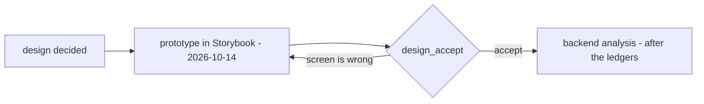

# Development state — inventory / opname

**As of 2026-10-14, opname is DESIGNED and PROTOTYPED — waiting for design_accept.** Every question in
[opname_clarify.md](../../business/inventory/opname_clarify.md) (Q1–Q21) is answered; the decisions are in
[opname_decision.md](../../business/inventory/opname_decision.md) (54), plus
[a-broken-unit-is-thrown-away](../../business/inventory/context_decision.md#a-broken-unit-is-thrown-away) in the context. No
contradiction is open, and every decision is written in [opname.md](../../business/inventory/opname.md).

The implementation analysis is done: four screens run in **Storybook** against a stub that plays the decisions, and the
contract they derive is `OpnameService` ([opname.proto](../../../proto/warehouse/inventory/v1/opname.proto)). In the app the
service is mounted answering **Unimplemented**. Nothing in the backend is built — no table, no migration.

**Next step: design_accept** — the owner previews `Pages/Opname/*` in Storybook (`npm run storybook`). It blocks
everything after it ([design-accept-blocks](../../development_lifecycle_decision.md#design-accept-blocks)). Then the
backend analysis, which waits on the ledgers like placement's
([the-decided-ledgers-come-before-the-transfer](../../business/inventory/warehouse_transfer_decision.md#the-decided-ledgers-come-before-the-transfer)).

## What was decided — the shape

| | |
| --- | --- |
| a session | one `active` per warehouse; started after order processing; `plan` = all · team · product · placement, its target only a filter |
| the snapshot | `product_placements` rows the plan selects, **rows at 0 included**; a product is counted on every rack holding it; an `all` count lists every rack |
| the lock | the open snapshot row; it stops units moving, never a sale |
| counting | blind, sellable units only, then revealed; one recount, which **replaces** the blind count (one column, `recounted_stock_count`); a found product may be added — unless its team never had it here: taken out, restocked by the team |
| drafts | short → `opname_problems_drafts`: the system writes `lost` = the shortage, staff move units to `broken`; over → `opname_surplus_drafts` (+n by the system); **every draft needs a reason**; drafts are written **before** *Mark Counted* |
| a counted row | read-only to its counter; the admin may *Send Back to Count* |
| finalize | a second person, never a counter; finalizing **is** the agreement, no override flag; broken posted as written, **the rest netted per product**: short → lost, over → claim then mint, 0 → a move |
| the register | `warehouse_stock_problems` per batch, oldest first, broken before lost; claims in `problem_claimed_transactions`; two doors — finalize and adjustment |
| a broken unit | thrown away; the warehouse pays the team |

## What the prototype is

| | |
| --- | --- |
| contract | `OpnameService`, 13 RPCs — [rpc.md §Stock count sessions](../../services/inventory_service/rpc.md#stock-count-sessions--opnameservice-prototype). `buf lint` clean |
| backend | `inventory_v1.OpnamePrototype` embeds the Unimplemented handler, mounted in `register.go` — the backend step deletes it |
| stub | `.storybook/opnameStub.ts` + `opnameFixtures.ts` — plays the decisions; reset in `preview.tsx` |
| screens | `pages/opname-sessions` (list + New Count dialog) · `pages/opname-session-detail` (the admin's watch page) · `pages/opname-count` (counting, phone first) · `pages/opname-finalize` (the review) |
| shared | `features/opname/` — `queries.ts`, `adapt.ts`, `OpnameBadges.tsx` (status, plan, row state, difference, drafts); `lib/roles.ts` `canManageOpname` |
| routes | `/inventories/opname/sessions`, `…/:sessionId`, `…/:sessionId/count`, `…/:sessionId/finalize` |
| copy | the `opnameSession` namespace in `en.json` and `id.json` |
| stories | `Pages/Opname/{Sessions,SessionDetail,Count,Finalize}` and `Features/Opname/OpnameBadges` — 26, each a test; every page has a Mobile story. The whole suite passes (1403) |

## Proposed at the prototype — accept or reject at design_accept

| | |
| --- | --- |
| beside the old page | the new screens live at `/inventories/opname/sessions…`; the menu still opens the old one-rack page, whose RPC (`StockOpname`) and e2e spec keep working. The backend step moves the menu and deletes the old page |
| the blind count is the API's | `OpnameRowList` (the book figure) is refused to staff; `OpnameRackCount` sends no book figure before a row is counted; staff are turned away from the watch page |
| broken only when short | the counting card asks *"of the missing, how many are broken?"* only on a short row |
| finalize is a page | a review of every product's posting, with the summary in rupiah, then a confirm |
| New Count waits | disabled while a count is active, with the active count shown above the history |
| `OpnameRackCount` is unpaged | bounded by what one shelf holds, argued in the proto (RULE 9) |
| two shared pickers grew `portalled` | `ProductSelect` and `TeamSelect` take `portalled={false}` inside a modal dialog, where a portalled list is inert — with an `InsideADialog` story each |

## What exists in code and does NOT follow the design

| | |
| --- | --- |
| `frontend/src/pages/opname/` | the older **single-rack** count through `InventoryService.StockOpname` (`usePostOpname`) — no session, blind count, lock or drafts. It stays working until the backend step replaces it; do not extend it |
| `frontend/e2e/opname.spec.ts` | tests that old page against the real backend — retired with it |
