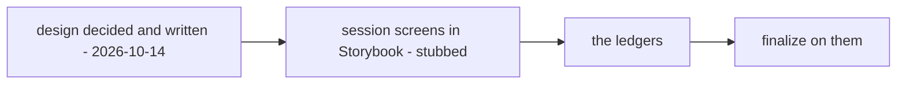

# Development state — inventory / opname

**As of 2026-10-14, opname is DESIGNED, not built.** Every question in
[opname_clarify.md](../../business/inventory/opname_clarify.md) (Q1–Q21) is answered; the decisions are in
[opname_decision.md](../../business/inventory/opname_decision.md) (54), plus
[a-broken-unit-is-thrown-away](../../business/inventory/context_decision.md#a-broken-unit-is-thrown-away) in the context. No
contradiction is open, and every decision is written in [opname.md](../../business/inventory/opname.md).

**Next step: implementation analysis, frontend first.** The session screens go to Storybook against a
stub; the writes wait on the ledgers, like placement's
([the-decided-ledgers-come-before-the-transfer](../../business/inventory/warehouse_transfer_decision.md#the-decided-ledgers-come-before-the-transfer)).

## What was decided — the shape

| | |
| --- | --- |
| a session | one `active` per warehouse; started after order processing; `plan` = all · team · product · placement, its target only a filter |
| the snapshot | `product_placements` rows the plan selects, **rows at 0 included**; a product is counted on every rack holding it; an `all` count lists every rack |
| the lock | the open snapshot row; it stops units moving, never a sale |
| counting | blind, sellable units only, then revealed; one recount, which **replaces** the blind count (one column, `recounted_stock_count`); a found product may be added — unless its team never had it here: taken out, restocked by the team |
| drafts | short → `opname_problems_drafts`: the system writes `lost` = the shortage, staff move units to `broken`; over → `opname_surplus_drafts` (+n by the system); **every draft needs a reason**; drafts are written **before** *Mark Counted* |
| a counted row | read-only to its counter; the admin may *Send Back to Count* |
| finalize | a second person, never a counter; finalizing **is** the agreement, no override flag; broken posted as written, **the rest netted per product**: short → lost, over → claim then mint, 0 → a move |
| the register | `warehouse_stock_problems` per batch, oldest first, broken before lost; claims in `problem_claimed_transactions`; two doors — finalize and adjustment |
| a broken unit | thrown away; the warehouse pays the team |

## What exists in code — and does not follow the design

| | |
| --- | --- |
| `frontend/src/pages/opname/` | an older **single-rack** count posting through the `StockOpname` RPC (`usePostOpname`) — no session, no blind count, no lock, no drafts. It predates every decision above; replace it, do not extend it |
| backend | no session, snapshot, draft or `warehouse_stock_problems` table; no migration. `StockOpname` in `inventory.proto` is the old single-rack write |
