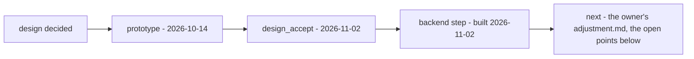
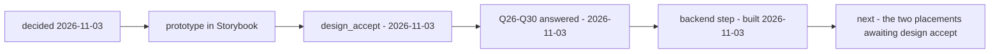

# Development state — inventory / opname

**As of 2026-11-02, the stock count is BUILT** — design accepted the same day
([the-count-prototype-is-accepted](../../business/inventory/opname_decision.md#the-count-prototype-is-accepted)), then the
backend step: schema, the 13 RPCs, the lock in every writer, the finalize into the register and the ledgers, the
adjustment door, the one-rack `StockOpname` retired. Uncommitted — the owner commits.

## What exists

| | |
| --- | --- |
| schema | inventory `00035` — `opname_sessions`, `opname_session_snapshots`, `opname_problems_drafts`, `opname_surplus_drafts`, `warehouse_stock_problems`, `problem_claimed_transactions`, `opname_session_final_transactions`; one model file each ([database-schema.md § The stock count](../../database-schema.md#the-stock-count-00035)) |
| the lock | `opname_session_snapshots_open_lock` — `UNIQUE (product_id, placement_id) WHERE released_at IS NULL`; one active count per warehouse — `opname_sessions_one_active` |
| RPCs | `inventory_v1/opname_*.go`, one per RPC, mounted in `register.go`, `OpnameServiceHandler` asserted in `service.go`; six reads marked `NO_SIDE_EFFECTS` |
| finalize | `inventory_mutations/post_count.go` — `LoadCountBook` · `SettleCount` (the preview runs the same) · `PostCountFinalize` |
| the shelf report | `inventory_mutations/post_problem.go` — `StockAdjust` damaged/lost write a `problem` and its register row |
| the lock in writers | `inventory_ledgers/count_lock.go` — `CountLocks`, `RefuseCounted`; called by `PutOnPlacements` (restock and transfer accept), `PostMove`, `PostSample`, `PostRecount`, `PostShelfProblem`, `ReversePlacementLogs` (every take's rollback); `LockRacks` reads it so a take uses only the racks no count holds (`LockedRacks.Free`, `refuseCountedLines` → `CountedLinesError`); `RefuseRackCounted` in `RackDelete` — all 2026-11-03 |
| reads that show it | `RackStockLine.counting` (Move/Sample dialogs); the order form's refusal *BEING_COUNTED* names each line's count. The pick page's *waiting* badge is gone with `StockPickLocation.counting_session_id` (field 5 reserved) |
| "last counted" | rack detail, placement list, batch shelves, product summary: the later of a recount's `adjustment` row and a finished count's `finalized_at` |
| contract changes | `opname.proto`: money `int64` → `double` (money-is-double-in-the-api-too), `OpnameFinalizeProduct.moved_count`, `OpnameTransaction.type` (problem · found · move), read markers · `inventory.proto`: `StockOpname` and its four messages removed, `StockPickLocation.counting_session_id` |
| screens | the four pages, now on the server; the finalize summary redrawn — Problem (owed) · Found (claimed back) · Found (new stock) · Move (units) · Products, and each product names the transactions it posts in; the menu opens `/inventories/opname/sessions`, `/inventories/opname` redirects there |
| retired | `InventoryService.StockOpname` + `stock_opname*.go` tests · `frontend/src/pages/opname/` · `frontend/e2e/opname.spec.ts` · the `opname.*` i18n namespace · `OpnamePrototype` |

## Tests

| | |
| --- | --- |
| unit | `opname_*_test.go` — one per RPC (create, list, detail, cancel, row list, send back, count, mark counted, rack list, rack count, add found, preview, finalize — seven finalize cases incl. the decision table's rows and the Root override); `count_lock_test.go` (refusals, the take, the pick); `stock_adjust_problem_test.go` |
| race (`-tags raceaudit`) | `opname_race_test.go` — eight creates → one count · eight counts of one row → blind + one recount · four finalizes + a cancel → one wins, posted once · a finalize racing eight takes → no deadlock, ledgers equal · an interleave proving the lock both ways. All safe — no audit file |
| perf (`-tags perfaudit`) | `opname_perf_test.go` — every read ≤ 5 statements, ≤ 6 ms at the background volume; finalize 26/28 statements flat in products, 27 ms at 20 → [OpnameSessionFinalize.md](../../../audits/services/inventory_service/performances/OpnameSessionFinalize.md) (heavy by statement count only) |
| stories | the 13 opname/layout/pick files, 122 stories green; the finalize story pins the problem/found/move badges and the move card |
| e2e | `frontend/e2e/opname_sessions.spec.ts` — plan an `all` count (the move refused), staff count blind with reasons, a second person finalizes; racks corrected, lock lifted. Green |

## Choices made in the build, where the decisions are silent

| | choice |
| --- | --- |
| columns beyond opname.md | `opname_session_snapshots.recounted`, `found_here`, `product_code`, `product_name`; `recounted_stock_count` NULL = not counted (revealed) |
| `counted_by_id` | whoever entered the count that STANDS — a recount by someone else replaces the blind counter |
| splitting a team's racks over problem / found / move (ledgers open point 15) | broken off its drafts' racks; lost off the racks still short once their broken is off, found onto those still over, rack id order; the rest nets 0 → move |
| rack writes in finalize | increases first, so a rack losing a torn unit and gaining a found one never passes below 0 |
| a claim's value | count × the lost row's `price_unit` into its batch; the batch's own `price_unit` is not changed (ledgers open point 17) |
| lock order in finalize | session → the register's open losses → batches (claimed ones in the same statement) → racks (ledgers open point 21) |
| a transfer's out-leg on a counted rack (ledgers open point 22) | as an order's take: allowed, counted racks last — it shares the take. ✅ 2026-11-03: refused like an order, its cancel too ([a-lock-stops-sales-and-cancels-too](../../business/inventory/opname_decision.md#a-lock-stops-sales-and-cancels-too)) — `TestCountLock_ATransferAndItsCancelWaitForTheCount` |
| the finalize review before every row is counted | an uncounted row reads as matching its book |
| a counter's read | caller role `WAREHOUSE_STAFF`: no difference count on an active session; `OpnameRackCount` is blind for everyone |
| AddFound's book | the shelf row's stock now (0 unless a put-away since), and the shelf row is created at 0 |
| finalize descriptions | every transaction and the expense say `stock count #<id>` |
| finalize with no person | refused (PermissionDenied) — `finalized_by_id` must name someone |

## Open — reported, not settled

| | |
| --- | --- |
| a shelf FOUND | was the provisional `adjustment` into the named batch, outside the register. ✅ 2026-11-03: a found request the Owner or Admin approves through the count's own claim and mint ([an-adjust-found-waits-for-the-owner-or-admin](../../business/inventory/opname_decision.md#an-adjust-found-waits-for-the-owner-or-admin)) — built ([below](#found-stock-waits-for-approval--built)) |
| a no-money count | [a-money-difference-needs-a-second-person](../../business/inventory/opname_decision.md#a-money-difference-needs-a-second-person) says it "finalizes at once"; built stricter, as the accepted prototype is — never a counter, whatever moves. ✅ Decided 2026-11-03: as built ([a-quiet-count-is-finalized-by-a-non-counter](../../business/inventory/opname_decision.md#a-quiet-count-is-finalized-by-a-non-counter)) |
| sold during the count past what was counted | the finalize is refused (the rack or the batches would go below 0); cancel, or send the row back — ✅ 2026-11-03: the sale is refused instead ([a-lock-stops-sales-and-cancels-too](../../business/inventory/opname_decision.md#a-lock-stops-sales-and-cancels-too)) — no take reaches a counted rack, so the book cannot move under the count |
| an order cancelled during a count | its rollback puts units back on a counted rack; when the order was taken before the snapshot the count then over-reads by the units — ✅ 2026-11-03: the cancel is refused instead ([a-lock-stops-sales-and-cancels-too](../../business/inventory/opname_decision.md#a-lock-stops-sales-and-cancels-too)); selling's `OrderCancel` hands the FailedPrecondition on in words and the order stays pending |
| a rack a count holds deleted | ✅ 2026-11-03: refused, at 0 or not, and during an `all` count ([a-rack-a-count-holds-cannot-be-deleted](../../business/inventory/opname_decision.md#a-rack-a-count-holds-cannot-be-deleted)) |
| the undo of a failed order create during a count | refused like any cancel — the create's compensation then fails loudly (*"the order failed and its stock could not be returned"*); a count must start in the seconds between the take and the undo. Left open by the decision |
| `is_override` on the session | not stamped (finalizing-is-the-agreement withdrew the flag); the transactions are |

## Found stock waits for approval — built

**As of 2026-11-03, BUILT** — the prototype was accepted
([the-found-stock-prototype-is-accepted](../../business/inventory/opname_decision.md#the-found-stock-prototype-is-accepted)),
the owner answered Q26–Q30 the same day, and the backend step turned it live. Uncommitted — the owner commits.

### What exists

| | |
| --- | --- |
| schema | inventory `00036` — `found_requests` (status `waiting approved rejected settled`, CHECKs tying each status to its columns, the list and waiting indexes), model `inventory_service_models/found_request.go` ([database-schema.md § Found stock](../../database-schema.md#found-stock-waiting-for-approval-00036)). Applied to the dev database with `san migrate up --service inventory_service`; the test database migrates it as every inventory migration |
| contract | `found_request.proto` — `FoundRequestCreate` added (staff in its policy), `FoundRequestList`/`Reject` gain Staff, status `SETTLED_BY_COUNT` + `settled_by_counting_session_id`; the prototype's never-released `NO_PRICE_HERE` block and `StockAdjustResponse.found_request` (field 3) REMOVED, not reserved. `buf lint` clean, regenerated |
| RPCs | `inventory_v1/found_request_create.go`, `_list.go`, `_approve.go`, `_reject.go` + `found_request_mapper.go` (errors, the proto mapping, `settleFoundByCount`); `stock_adjust.go` refuses FOUND (InvalidArgument naming `FoundRequestCreate`) |
| the approval | `inventory_mutations/post_found.go` — `PostFoundApproval` is `PostCountFinalize` over one product and one row (no second claim or mint), `PreviewFound` (the list's would-post, one plain read per page), `StockedHere` (the report's never-stocked test). `post_count.go` gains `CountFinalize.Guard` (the approval's `RefuseCounted` under the rack lock; nil for a count) and `CountTransaction.MintedBatchIDs` |
| the settle | `OpnameSessionFinalize` calls `settleFoundByCount` after the session lock, before the register/batches/racks — the approval's order |
| retired | `PostBatchFound` / `BatchFound` (the provisional found into a named batch, `post_adjustment.go`); the dialog's `foundAwaitsApproval` prop and its batch path |
| screens | `AdjustStockDialog` — Found is always a request (`FoundRequestCreate`), no batch; `features/inventory/ReportFoundDialog.tsx` — staff's **Report Found** on the rack page (rack set, product picked by `ProductSelect`); `pages/found-requests` — Owner/Admin approve and reject, the reporter's own reads **Withdraw**, staff see only their own, a settled one links *Settled by count #N* to the session (under All), *Withdrawn by …*; the menu **Inventories ▸ Found Stock** right after Stock Opname with the waiting count (`useFoundWaitingCount`, `Sidebar.tsx`) |
| refresh | everything under `key.foundRequests`: report, approve, reject, withdraw — and a count's finalize (`useFinalizeOpnameSession`) — refresh the list and the menu's count; an approval also the stock reads (`useInvalidateStock`) and liability |
| copy | `nav.foundStock`, `foundRequest.*` (withdraw, settled, staff), `racks.reportFound.*`, the pending marks — en and id |

### How Q26–Q30 are built (all answered 2026-11-03)

| | answer | built as |
| --- | --- | --- |
| Q26 a count while a request waits | [a-count-settles-the-found-it-counted](../../business/inventory/opname_decision.md#a-count-settles-the-found-it-counted) | a finalize settles every WAITING request on a (product, rack) its session holds a row for — status `settled`, the session, the finalizer, the time; nothing more posts. A cancel settles nothing. While the count is active the approval is refused naming it (`BEING_COUNTED`) |
| Q27 who reports | [staff-may-report-a-found](../../business/inventory/opname_decision.md#staff-may-report-a-found) | `FoundRequestCreate`, the one door, with Staff in its policy; `StockAdjust` refuses FOUND and keeps its policy |
| Q28 the reporter rejects their own | [the-reporter-may-withdraw-their-found](../../business/inventory/opname_decision.md#the-reporter-may-withdraw-their-found) | a withdrawal is a rejection (reason required) whose decider is the reporter; staff reject only their own (PermissionDenied); staff read only their own (`FoundRequestList` filters) |
| Q29 a product its team never had here | [a-found-never-stocked-here-is-refused-at-the-report](../../business/inventory/opname_decision.md#a-found-never-stocked-here-is-refused-at-the-report) | `FoundRequestCreate` refuses it in its transaction, by the mint's own price test — an emptied batch still counts; the approval keeps a FailedPrecondition backstop, no block value |
| Q30 the menu | [found-stock-sits-after-stock-opname-with-its-count](../../business/inventory/opname_decision.md#found-stock-sits-after-stock-opname-with-its-count) | right after Stock Opname for the warehouse's Owner, Admin and Staff (and the monitor, whose screen role is the Owner, as Stock Opname); the count of WAITING requests as Kewajiban's — whole-set total of a one-row page, never a 0, re-asked on every navigation; a shut Inventories group carries it. **Staff see no number** — the narrowest reading: their list is their own reports |

### Tests

| | |
| --- | --- |
| unit | `found_request_create_test.go` — `StaffReportAndNothingPosts`, `ACountedRackIsRefusedNamingTheCount`, `NeverStockedHereIsRefusedEmptiedIsNot`, `RefusesWhatIsNotHere` · `found_request_approve_test.go` — `TheReporterCannotTheOwnerCan`, `ClaimsTheOldestLossFirstThenMints` (two losses at two prices, then the mint at the newest), `NeverClaimsMoreThanClaimable`, `ACountedRackIsRefusedNamingTheCount`, `NotWaitingIsRefused`, `PostsWhatACountsFoundPosts` (the same postings and money as a count's found of the same units), `NoPriceIsRefusedPostingNothing`, `RootIsStampedAsAnOverride` · `found_request_reject_test.go` — `NeedsAReasonAndPostsNothing`, `TheReporterWithdrawsTheirOwn`, `NotWaitingIsRefused` · `found_request_list_test.go` — `NewestFirstFilteredAndPaged`, `StaffSeeOnlyTheirOwn`, `BlocksPerCallerAndTheSettled` · `TestOpnameSessionFinalize_SettlesTheFoundItCounted` (the books equal a count with no request) · `TestOpnameSessionCancel_SettlesNoFound` · `stock_adjust_*` — FOUND refused; the reimbursement given back through an approved found |
| race (`-tags raceaudit`) | `found_request_race_test.go` — `TestRace_FoundRequestApprove_PostsOnce`, `_RacingAWithdraw`, `_RacingTakes`, `_RacingACountPlanAndFinalize` (both orders seen), `TestInterleave_FoundRequest_TheSettleWaitsForAnApproval` → [FoundRequest.md](../../../audits/services/inventory_service/concurrency/FoundRequest.md) |
| perf (`-tags perfaudit`) | `found_request_perf_test.go` — Create 9 statements / 3 ms; List 6 statements flat at page 20 and 200, ≈ 4 ms; Approve (2 claims + a mint) 26 / 9 ms; Reject 4 / 1 ms → [performances/FoundRequest*.md](../../../audits/services/inventory_service/performances/) |
| stories | `Pages/Inventory/FoundStock` (11), `Features/Inventory/AdjustStockDialog` (5), `Layouts/Desktop/Sidebar` (5 new: the count, asked again on navigation, none waiting, staff without a number, no selling team), `Pages/Inventory/Racks/RackDetail` (3 new: staff report, the picker offers only what was held here — it replaced *never-stocked refused*, [below](#the-warehouse-picks-only-what-it-has-held--built) — the Owner reports too) |
| e2e | `frontend/e2e/found_requests.spec.ts` — an Admin reports from the Adjust dialog, nothing posts, the Admin cannot approve (screen and server), another Owner approves, the rack goes 10 → 12 and a batch is minted; staff report from the rack page through the picker (red until the picker was fixed, [below](#the-warehouse-picks-only-what-it-has-held--built)). Green |

### Choices made in the build, where the decisions are silent

| | choice |
| --- | --- |
| what the settle closes | a WAITING request whose (product, rack) the session holds a snapshot row for — counted or not, since an uncounted row reads as its book at finalize |
| the settled request's decider | whoever finalized the count; `transaction_id` stays NULL |
| Root approving | allowed, stamped as an override on the `found` transaction, as a Root finalize is |
| the list's would-post | worked out without locks, each request as if it were the only one approved; the approval re-reads under lock, so two waiting requests may both show the same loss |
| the reporter's note | trimmed, ≤ 200 (the old `StockAdjust.reason` limit) |
| the Adjust dialog's found | starts at 1 unit; the refusals (a counted rack, never stocked here) show the server's words |

### Open — reported, not settled

| | |
| --- | --- |
| **staff's views — awaiting design accept** | the staff list view (`pages/found-requests/pending.ts` *staffView*) and the rack page's **Report Found** door (`pages/rack-detail/pending.ts` *reportFound*) — the rules are decided and built; their placement is not yet design-accepted |
| two identical reports | two requests — `FoundRequestCreate` has no idempotency key (none was decided); the approver rejects the duplicate |
| the warehouse product page | ✅ fixed 2026-11-03: `/inventories/products/:id` reads `StockCost`, whose policy was the selling roles' only (from when it was an order's cost), so it answered permission_denied to every warehouse role. The policy now admits warehouse Owner, Admin and Staff — RackDetail and RackStock already give them the same average — and a warehouse caller reads its own building only (`filter.warehouse_id` must be its `team_id`, else PermissionDenied). Tests: `TestStockCost_PolicyAdmitsTheWarehouse`, `TestStockCost_AWarehouseReadsItsOwnBuildingOnly`; e2e *the warehouse product page opens for the warehouse's Admin and Staff* |
| the Stock screen | ⚠ reported by the found-stock build, not verified: it lists only the warehouse's own catalogue |
| the Adjust screen itself | still undesigned ([adjustment.md](../../business/inventory/adjustment.md) is empty) |

## The warehouse picks only what it has held — built

**As of 2026-11-04, BUILT** — [a-warehouse-picks-only-what-it-has-held](../../business/inventory/opname_decision.md#a-warehouse-picks-only-what-it-has-held)
(owner, 2026-11-03). Uncommitted — the owner commits.

**The bug (verified live).** Report Found, a count's product plan (New Count) and a count's found (Add a Product Found Here)
picked with `ProductSelect scope="all"` → `ProductDiscover`, whose policy is the selling roles' and Root/Administrator's:
the server answered *permission_denied — insufficient role* to warehouse Staff, Admin and Owner, and the picker showed
"No products found". The Storybook stub checks no policy, so every story passed; the e2e
`Found: staff report from the rack page, and the picker finds the product` was red.

**The fix.** One new read, `InventoryService.WarehouseProductSearch` — the products with a batch in THIS warehouse, any
team's, at 0 or not, searched by name or code on the server, paged ([rpc.md](../../services/inventory_service/rpc.md#the-warehouses-product-picker--warehouseproductsearch)).
`ProductDiscover` is unchanged.

| | |
| --- | --- |
| contract | `inventory.proto` — `WarehouseProductSearch` (`NO_SIDE_EFFECTS`), policy Root, Administrator, warehouse Owner/Admin/Staff, `use_scope` on `warehouse_id`; `filter.q` 2–100; `CommonPagination`; the guideline list shape (GENERAL / PRODUCT slices, `ids`, `page_info`), each product `id, team_id, product_code, name` |
| inventory | `inventory_v1/warehouse_product_search.go` — `DISTINCT product_id FROM batches WHERE warehouse_id`, then `ProductReader.Search` with those ids. `ProductReader` (product_reader.go) gains `Search` beside `Facts`; a nil reader refuses (Unavailable), never "held none" |
| product_service | `product_v1/product_search_among.go` — `(*Service).SearchAmong`: `id = ANY($1::bigint[])` (one array parameter), live only, `name/product_code ILIKE`, by name then code then id, the window and `COUNT(*) OVER ()` in one statement (a past-the-end window counts on its own). A plain method, not an RPC — the precedent of `inventory_v1.ProductHasHistory` |
| the seam | `backend/cmd/app_development/product_reader.go` — `inventoryProductReader.Search` calls `SearchAmong` in-process, the way `Facts` calls `ProductByIds`; no wire change |
| screens | `ProductSelect` gains `scope="warehouse"` (`useProductSearch` → `inventoryClient.warehouseProductSearch`, the owners named best-effort through `teamsByIdsQuery`, each option *name · owner*); `ReportFoundDialog`, `NewSessionDialog` (product plan) and `AddFoundDialog` use it, with the helper *Only products this warehouse holds or has held…* (`inventory.pickHeldHelp`, en + id). The Adjust dialog picks no product (it opens on one), so nothing there changed |
| stub | `.storybook/warehouseProductSearchStub.ts`, registered in `stubTransport.ts` — ENFORCES the held set (the found and count stubs' batch registers, `foundHeldHere` / `opnameHeldHere`) and the policy (a selling role is refused, counted in `warehouseProductSearchScenario.refused`) |

### Tests

| | |
| --- | --- |
| unit | `warehouse_product_search_test.go` — `FindsOnlyWhatThisWarehouseHasHeld` (held, held at 0, another warehouse's not, never-stocked not, owners), `ByCodeAndAtZero`, `Pages`, `NothingHeldAndTooShort`, `NoProductServiceIsUnavailable`, `PolicyIsTheWarehouses` (warehouse roles in, selling roles out, `ProductDiscover` not widened, scope, `NO_SIDE_EFFECTS`) · `product_search_among_test.go` — `SearchesOnlyTheGivenProducts` (name, code, locked in, archived out, outside the set out, LIKE wildcards, paging, past the end), `AnEmptySetFindsNothing` · `app_development/product_reader_test.go` — `TestInventoryProductReader_SearchesWhatTheWarehouseHasHeld`, the two halves through the real wiring |
| perf (`-tags perfaudit`) | `app_development/warehouse_product_search_perf_test.go` — 2 statements; ≈ 19 ms at 10 000 held; 62 ms at 5 000 held of which ≈ 49 ms is this host's loopback carrying a 30 KB parameter (a control proves it) → [WarehouseProductSearch.md](../../../audits/services/inventory_service/performances/WarehouseProductSearch.md) |
| stories | `Components/Products/ProductSelect` (5 new: the warehouse scope with the owner, never offers what was never here, finds what is held at 0, emits the snapshot, refuses a selling role) · `RackDetail` *ReportFoundOffersOnlyWhatWasHeldHere* (replaced *ReportFoundNeverStockedHereIsRefused*) · `Opname/Count` *FoundPicksOnlyWhatWasHeldHere* (replaced *FoundButNeverStockedHere*) · `Opname/Sessions` *PlanOneProduct* (new). With a stub that offered everything, these five fail |
| e2e | `found_requests.spec.ts` — the staff Report Found test passes; `opname_sessions.spec.ts` — new *the warehouse Admin plans a one-product count, picking from what the warehouse has held*: a warehouse **Admin** (not Root) sees Kaos A and Kaos B, never Kaos C (in the catalogue, never stocked), plans Kaos B, the count snapshots only Kaos B, then cancels it. Both specs green |

### Choices made in the build, where the decision is silent

| | choice |
| --- | --- |
| "held" | a row in `batches` for the warehouse, any team, any `stock_count` — not `warehouse_products` (that also holds products only ASKED for, never received) |
| archived products | ✅ 2026-11-03: offered, flagged `archived` and labelled *Archived* ([an-archived-product-held-here-can-be-picked](../../business/inventory/opname_decision.md#an-archived-product-held-here-can-be-picked)) — `TestSearchAmong_SearchesOnlyTheGivenProducts`, `TestInventoryProductReader_SearchesWhatTheWarehouseHasHeld`, story `WarehouseScopeOffersAnArchivedProductHeldHere` |
| locked products | in — the lock is about other teams selling, not the warehouse finding what it holds |
| the owner's name | not on the wire: the picker asks `TeamByIds` (team_service), best-effort — a warehouse already names the owner on its batch page the same way. The narrowest reading: the RPC exposes an owner team **id** only, for products the warehouse has held |
| the refusals | `FoundRequestCreate`'s and `OpnameRowAddFound`'s never-stocked refusals stay as the backstop; the picker no longer reaches them, so their stories were replaced by the picker's |

### Open — reported, not settled

| | |
| --- | --- |
| an archived product on the shelf | not offered for a found or a one-product count; an `all`/team/rack count still snapshots it. Whether a warehouse should pick it is not decided |
| the held read grows with the batch history | one row per batch read per keystroke (20 000 → 5 ms); an index or a skip-scan if a warehouse's history gets large — inventory's migration, the owner's call |
