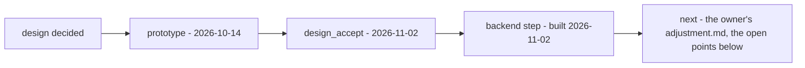

# Development state — inventory / opname

**As of 2026-11-02, the stock count is BUILT** — design accepted the same day
([the-count-prototype-is-accepted](../../business/inventory/opname_decision.md#the-count-prototype-is-accepted)), then the
backend step: schema, the 13 RPCs, the lock in every writer, the finalize into the register and the ledgers, the
adjustment door, the one-rack `StockOpname` retired. Uncommitted — the owner commits.

## What exists

| | |
| --- | --- |
| schema | inventory `00035` — `opname_sessions`, `opname_session_snapshots`, `opname_problems_drafts`, `opname_surplus_drafts`, `warehouse_stock_problems`, `problem_claimed_transactions`, `opname_session_final_transactions`; one model file each ([database-schema.md § The stock count](../../database-schema.md#the-stock-count-00035)) |
| the lock | `opname_session_snapshots_open_lock` — `UNIQUE (product_id, placement_id) WHERE released_at IS NULL`; one active count per warehouse — `opname_sessions_one_active` |
| RPCs | `inventory_v1/opname_*.go`, one per RPC, mounted in `register.go`, `OpnameServiceHandler` asserted in `service.go`; six reads marked `NO_SIDE_EFFECTS` |
| finalize | `inventory_mutations/post_count.go` — `LoadCountBook` · `SettleCount` (the preview runs the same) · `PostCountFinalize` |
| the shelf report | `inventory_mutations/post_problem.go` — `StockAdjust` damaged/lost write a `problem` and its register row |
| the lock in writers | `inventory_ledgers/count_lock.go` — `CountLocks`, `RefuseCounted`; called by `PutOnPlacements` (restock and transfer accept), `PostMove`, `PostSample`, `PostRecount`, `PostShelfProblem`, `PostBatchFound`; `LockRacks` reads it so `TakeFewestFirst` takes counted racks last |
| reads that show it | `RackStockLine.counting` (Move/Sample dialogs), `StockPickLocation.counting_session_id` (the pick page's *Waiting — rak-a is being counted*) |
| "last counted" | rack detail, placement list, batch shelves, product summary: the later of a recount's `adjustment` row and a finished count's `finalized_at` |
| contract changes | `opname.proto`: money `int64` → `double` (money-is-double-in-the-api-too), `OpnameFinalizeProduct.moved_count`, `OpnameTransaction.type` (problem · found · move), read markers · `inventory.proto`: `StockOpname` and its four messages removed, `StockPickLocation.counting_session_id` |
| screens | the four pages, now on the server; the finalize summary redrawn — Problem (owed) · Found (claimed back) · Found (new stock) · Move (units) · Products, and each product names the transactions it posts in; the menu opens `/inventories/opname/sessions`, `/inventories/opname` redirects there |
| retired | `InventoryService.StockOpname` + `stock_opname*.go` tests · `frontend/src/pages/opname/` · `frontend/e2e/opname.spec.ts` · the `opname.*` i18n namespace · `OpnamePrototype` |

## Tests

| | |
| --- | --- |
| unit | `opname_*_test.go` — one per RPC (create, list, detail, cancel, row list, send back, count, mark counted, rack list, rack count, add found, preview, finalize — seven finalize cases incl. the decision table's rows and the Root override); `count_lock_test.go` (refusals, the take, the pick); `stock_adjust_problem_test.go` |
| race (`-tags raceaudit`) | `opname_race_test.go` — eight creates → one count · eight counts of one row → blind + one recount · four finalizes + a cancel → one wins, posted once · a finalize racing eight takes → no deadlock, ledgers equal · an interleave proving the lock both ways. All safe — no audit file |
| perf (`-tags perfaudit`) | `opname_perf_test.go` — every read ≤ 5 statements, ≤ 6 ms at the background volume; finalize 26/28 statements flat in products, 27 ms at 20 → [OpnameSessionFinalize.md](../../../audits/services/inventory_service/performances/OpnameSessionFinalize.md) (heavy by statement count only) |
| stories | the 13 opname/layout/pick files, 122 stories green; the finalize story pins the problem/found/move badges and the move card |
| e2e | `frontend/e2e/opname_sessions.spec.ts` — plan an `all` count (the move refused), staff count blind with reasons, a second person finalizes; racks corrected, lock lifted. Green |

## Choices made in the build, where the decisions are silent

| | choice |
| --- | --- |
| columns beyond opname.md | `opname_session_snapshots.recounted`, `found_here`, `product_code`, `product_name`; `recounted_stock_count` NULL = not counted (revealed) |
| `counted_by_id` | whoever entered the count that STANDS — a recount by someone else replaces the blind counter |
| splitting a team's racks over problem / found / move (ledgers open point 15) | broken off its drafts' racks; lost off the racks still short once their broken is off, found onto those still over, rack id order; the rest nets 0 → move |
| rack writes in finalize | increases first, so a rack losing a torn unit and gaining a found one never passes below 0 |
| a claim's value | count × the lost row's `price_unit` into its batch; the batch's own `price_unit` is not changed (ledgers open point 17) |
| lock order in finalize | session → the register's open losses → batches (claimed ones in the same statement) → racks (ledgers open point 21) |
| a transfer's out-leg on a counted rack (ledgers open point 22) | as an order's take: allowed, counted racks last — it shares the take |
| the finalize review before every row is counted | an uncounted row reads as matching its book |
| a counter's read | caller role `WAREHOUSE_STAFF`: no difference count on an active session; `OpnameRackCount` is blind for everyone |
| AddFound's book | the shelf row's stock now (0 unless a put-away since), and the shelf row is created at 0 |
| finalize descriptions | every transaction and the expense say `stock count #<id>` |
| finalize with no person | refused (PermissionDenied) — `finalized_by_id` must name someone |

## Open — reported, not settled

| | |
| --- | --- |
| a shelf FOUND | still the provisional `adjustment` into the named batch, outside the register — a later count can claim a loss the found already returned, crediting the warehouse twice. Its finished shape (claim the oldest loss, a second person) waits on adjustment.md |
| a no-money count | [a-money-difference-needs-a-second-person](../../business/inventory/opname_decision.md#a-money-difference-needs-a-second-person) says it "finalizes at once"; built stricter, as the accepted prototype is — never a counter, whatever moves |
| sold during the count past what was counted | the finalize is refused (the rack or the batches would go below 0); cancel, or send the row back |
| an order cancelled during a count | its rollback puts units back on a counted rack; when the order was taken before the snapshot the count then over-reads by the units |
| `is_override` on the session | not stamped (finalizing-is-the-agreement withdrew the flag); the transactions are |
