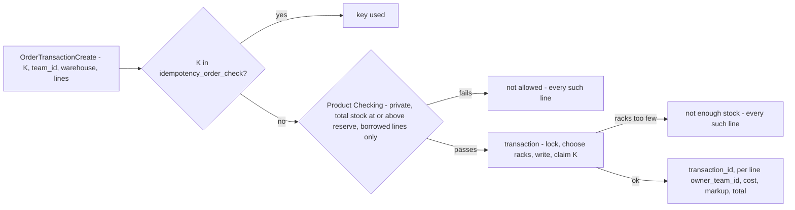

# Development state — inventory / order

**As of 2026-10-17, inventory's side of an order is BUILT** (uncommitted, for the owner's review — [ledgers.md](ledgers.md),
stage 4a and the cut-over). The order FORM does not call it yet: selling's `OrderCreate` and `OrderCancel` reach it
through the composition root's stock picker, under the order form's own key K (backlog #10 slices 1–4, 2026-11-04 — the
earlier `order:<id>` key of [the-order-take-bridges-its-key-per-order](../../technical/stock/design_decision.md#the-order-take-bridges-its-key-per-order) is gone).
[order_clarify.md](../../business/inventory/order_clarify.md) has **no open question**; what is left there is five
Contradictions in the owner's [order.md](../../business/inventory/order.md), for the owner to redraw. The decisions are in
[order_decision.md](../../business/inventory/order_decision.md), with the key's in
[transaction_decision.md](../../business/inventory/transaction_decision.md) and the order side's in
[order/context_decision.md](../../business/order/context_decision.md).

✅ *(2026-11-04, backlog #10 slices 5–6)* the placement page reads its racks by `orders.transaction_id`; the
`StockPickLocations.ref` field and every `order:<id>` bridge path are removed (only the selling migration `00035`'s fill
of developer rows and the `order:` prefix refusal remain).
The take has no screen of its own; its screens are the order form (order context) and the placement page, which exists.

**2026-10-23 — the take has a read-only twin, `StockTakeQuote`**
([an-order-is-costed-at-what-leaves-the-shelf](../../business/order/context_decision.md#an-order-is-costed-at-what-leaves-the-shelf),
flow in [rpc.md](../../services/inventory_service/rpc.md#stocktakequote--what-the-take-would-draw)).

| | built 2026-10-23 |
| --- | --- |
| the selection | `inventory_ledgers.DrawOldestFirst` is the take's selection alone; `TakeOldestFirst` applies it. `ReadBatches` is `LockBatches` without `FOR UPDATE`, marked read-only so nothing can be taken from it |
| the quote | `inventory_mutations.QuoteOrder` beside `PostOrder` — same lines, same read, same count, same draw, no writes. The handler reuses `notAllowedLines`; a refused line answers `available` 0, a short one `enough` false, neither a cost |
| selling | freezes `unit_cost`, the line `total` and `cogs` from the take's answer and prices the fee on that `cogs` after the take — see [order/context.md](../order/context.md) |
| `StockCost` | unchanged, the average — the rack valuation's. No order reads it |
| tests | `stock_take_quote_test.go` (5 — 1/2/3 units of a two-batch product match the real take's batches and cost; short reported; ownership/refusals/other warehouse; a product twice; validation) |
| audits | perf [StockTakeQuote.md](../../../audits/services/inventory_service/performances/StockTakeQuote.md): ✅ fixed 2026-10-26 — the reserve rule shared with the take was an N+1 on borrowed lines (21 queries at 20); now one grouped read (`ownerTotalStocks`) on `batches_owner_product_idx` (`00032`), 2 queries and 1.57 ms at 20 ([the-reserve-is-read-once-for-every-line](../../business/inventory/order_decision.md#the-reserve-is-read-once-for-every-line)) |

## 2026-11-04 — the compensation's listener (backlog #10, slice 3)

| | |
| --- | --- |
| built | `inventory_v1.Service.InventoryTxCancel` (`inventory_tx_cancel_listener.go`) on `/event/inventory-tx-cancel/push` (`InventoryTxCancelSubscription`, `register.go`; `push_handler.go` dispatches the variant). `releaseByKey` is the ONE release, extracted from `OrderTransactionRelease` and shared ([every-release-goes-by-the-key](../../business/order/context_decision.md#every-release-goes-by-the-key), [the-cancel-event-names-the-team](../../business/order/context_decision.md#the-cancel-event-names-the-team)) |
| outcomes | taken → rolled back once · released or claimed-with-none → ACK, nothing · unseen key → claimed with none, a late take refused KEY_USED · another team → ACK + warn log, nothing · a count lock → error, redelivered until the count ends, then the dead-letter ([a-cancel-still-meets-the-count-first](../../business/order/context_decision.md#a-cancel-still-meets-the-count-first)) |
| provisioning | `tools/san/pubsub.go` `inventory-tx-cancel` on topic `inventory-tx-cancel`, `event_type` filter, dead-letter; [san.md](../../tools/san.md) row. The old `/events/inventory` catch-all route is removed |
| tests | `inventory_tx_cancel_listener_test.go` (taken → once + redelivery no-op; unseen → claimed, late take refused; another team → acked and kept; count lock → error, then released after the count) · `push_handler_test.go` (an unhandled variant acked; InventoryTxCancel dispatched) · raceaudit `TestRace_TakeVsTxCancel` (×20 per run, both outcomes hit, net 0 without a settling release) and `TestRace_TxCancelRedelivery` (×10, one rollback) |
| audits | `TestPerf_InventoryTxCancel` — 14 statements at 1 or 20 lines (5.3 / 8.8 ms), 4 for a released take or an unseen key (≈1 ms), not heavy. [lock-order](../../../audits/services/inventory_service/concurrency/lock-order.md#order-takes-and-their-release-2026-11-04): the take claims the key LAST, a release FIRST — no cycle |
| the order side | see [order/context.md](../order/context.md) |

## 2026-11-04 — a cancelled order's stock on its event (backlog #10, slice 4)

| | |
| --- | --- |
| built | `inventory_v1.Service.OrderCancelled` (`order_cancelled_listener.go`) on `/event/inventory-order-cancelled/push` (`InventoryOrderCancelledSubscription`); `StockLockCheck` (`stock_lock_check.go`) — the order's in-process count check, wired by `cmd/app_development/stock_picker.go` ([inventory-returns-stock-on-order-cancelled](../../business/order/context_decision.md#inventory-returns-stock-on-order-cancelled), [a-cancel-still-meets-the-count-first](../../business/order/context_decision.md#a-cancel-still-meets-the-count-first)) |
| outcomes | empty key → ACK, nothing claimed · taken → rolled back once (`releaseByKey`, team-checked) · released (a redelivery, or a late `InventoryTxCancel` first) → ACK · another team → ACK + warn · a count lock → error, redelivered until the count ends, then the dead-letter |
| StockLockCheck | reads `idempotency_order_check` ⋈ `inventory_transactions` (team, warehouse, not rolled back) → the take's rack rows → `RefuseCounted`; answers the `CountedError` the release would refuse with, or nil. No lock, no write |
| provisioning | `tools/san/pubsub.go` `inventory-order-cancelled` on topic `order-cancelled`, `event_type` filter, dead-letter; [san.md](../../tools/san.md) row |
| tests | `order_cancelled_listener_test.go` (listener: once + redelivery + late TxCancel no-op, empty key, another team, count lock; StockLockCheck: names the count, nil for no/other take, other warehouse, after the count, a released take) · `push_handler_test.go` (OrderCancelled dispatched) · raceaudit `TestRace_OrderCancelled_AndALateTxCancelRollBackOnce`, `TestRace_OrderCancelled_RacingACountStartWaitsForIt` |
| audits | `TestPerf_OrderCancelled` — `StockLockCheck` 3 statements ≈1 ms, the release 14 (4.4 / 8.2 ms at 1 / 20 lines), redelivery 4 ≈1 ms; not heavy. [lock-order](../../../audits/services/inventory_service/concurrency/lock-order.md#a-cancelled-order-released-on-its-event-2026-11-04) |

## What was decided

| | |
| --- | --- |
| the key | looked up first, a used one refused ([a-used-key-is-refused-first](../../business/inventory/order_decision.md#a-used-key-is-refused-first)); claimed once in `idempotency_order_check`, off `inventory_transactions` ([the-key-is-claimed-in-its-own-table](../../business/inventory/transaction_decision.md#the-key-is-claimed-in-its-own-table)); every submit mints its own ([every-submit-mints-a-new-key](../../business/order/context_decision.md#every-submit-mints-a-new-key)) |
| the teams | the request carries the ordering `team_id`, each line `owner_team_id` ([the-take-names-the-orderer-and-each-owner](../../business/order/context_decision.md#the-take-names-the-orderer-and-each-owner)); the transaction is the orderer's ([an-order-transaction-is-the-ordering-teams](../../business/inventory/transaction_decision.md#an-order-transaction-is-the-ordering-teams)) |
| the checks | product config read before the transaction ([the-take-checks-the-product-first](../../business/inventory/order_decision.md#the-take-checks-the-product-first)); reserve on total stock, every warehouse, plain read ([the-reserve-is-read-before-the-take](../../business/inventory/order_decision.md#the-reserve-is-read-before-the-take)); `total stock ≥ reserve`, other teams only ([the-reserve-stops-other-teams-at-low-stock](../../business/product/context_decision.md#the-reserve-stops-other-teams-at-low-stock)) |
| a refusal | one error, three reasons, every refused line named ([a-refusal-names-its-reason-and-every-line](../../business/inventory/order_decision.md#a-refusal-names-its-reason-and-every-line)) |
| picking | the placement page reads racks by `orders.transaction_id` ([the-placement-page-reads-racks-by-transaction-id](../../business/inventory/order_decision.md#the-placement-page-reads-racks-by-transaction-id)); the receipt is the shipping label, no racks. 🔄 *(2026-10-16, owner's redraw)* each good is scanned on a verification page, then *Set Picked* moves the order to `picked`, a row on `order_timeline_logs`; inventory is not told and keeps nothing ([picked-lives-on-the-order-timeline](../../business/inventory/transaction_decision.md#picked-lives-on-the-order-timeline)), and the rack delete checks stock only ([a-placement-deletes-at-zero-stock](../../business/inventory/placement_decision.md#a-placement-deletes-at-zero-stock)). The scans are counted on the page only, nothing saved per scan ([the-item-scans-live-on-the-page](../../business/inventory/order_decision.md#the-item-scans-live-on-the-page)). One page, opened first by scanning the label, shows the racks and takes the scans ([the-pick-page-opens-first-by-the-label](../../business/inventory/order_decision.md#the-pick-page-opens-first-by-the-label)); a label scan finds the order by `order_external_ref_id` or `receipt` ([a-label-scan-reads-the-ref-or-the-receipt](../../business/inventory/order_decision.md#a-label-scan-reads-the-ref-or-the-receipt)) — the built handover `resiLookup` reads the resi only. `picked` and `shipping` are order statuses ([picked-and-shipping-are-order-statuses](../../business/order/context_decision.md#picked-and-shipping-are-order-statuses)) |
| missing goods | back to `pending` with a timeline note ([missing-goods-send-the-order-back-to-pending](../../business/inventory/order_decision.md#missing-goods-send-the-order-back-to-pending)); the staff's count finds the loss ([a-missing-unit-is-found-by-opname](../../business/inventory/order_decision.md#a-missing-unit-is-found-by-opname)) |
| cancels | only the selling team ([only-the-selling-team-cancels](../../business/order/context_decision.md#only-the-selling-team-cancels)); a platform cancel goes back through `pending` too ([a-platform-cancel-goes-back-through-pending](../../business/inventory/order_decision.md#a-platform-cancel-goes-back-through-pending)) |
| duplicates | a repeated ref is warned, not refused ([a-duplicate-ref-is-warned-not-refused](../../business/order/context_decision.md#a-duplicate-ref-is-warned-not-refused)); two live orders on one ref post to the shop ([two-live-orders-on-a-ref-post-to-the-shop](../../business/settlement/settlement_importer_decision.md#two-live-orders-on-a-ref-post-to-the-shop)) |

## What exists — and disagrees with the decisions

| | as built | decided |
| --- | --- | --- |
| the take | ✅ `OrderTransactionCreate` / `Release`, `PostOrder`, `RollbackTake`, `00026` `idempotency_order_check`. ✅ *(2026-11-04, backlog #10 slice 3)* Selling takes BEFORE its order row, under the form's K, and stores the answered `transaction_id` on the order | — matches |
| the placement page | ✅ *(2026-11-04, slices 5–6)* `pick-order` → `OrderDetail`, then `StockPickLocations(warehouse_id, transaction_id)` = the order's `transactionId`, read off `product_placement_logs` by `transaction_id` AND the caller's `warehouse_id`, netted against a rollback (`HAVING SUM(-stock_change) > 0`). `ref` (2) reserved; no `idempotency_order_check` join | — matches |
| the order's history | `order_events` (selling_service `00011`), the Timeline tab | `order_timeline_logs` replaces it ([order-timeline-logs-replaces-order-events](../../business/order/context_decision.md#order-timeline-logs-replaces-order-events)) |
| the settlement importer | `orderInShop` pays the newest of two live orders | the shop, naming both |
| the order's statuses | ✅ *(2026-11-09)* `processed` · `picked` · `shipping` (00015); `pick-order` moves processed → picked only by its item scan's *Set Picked*, every line exact (`pages/pick-order/components/ItemScan.tsx`); the list's menu and Change Step never offer it; the label opens the page (Scan Label, `features/picking/labelLookup.ts`) | — matches |

## Left for the owner to draw

| in | what — each reported, never edited |
| --- | --- |
| inventory [order.md](../../business/inventory/order.md) | the *not enough stock* exit · the ledgers drawn side by side · two journeys for one order · the two exits back to `pending` from picking · the handover arrow's *"change shipped"* |
| order [order_creation.md](../../business/order/order_creation.md) | `team_id` on the request · the form's *"same key"* loop |
| order [context.md](../../business/order/context.md) | `processed --> pending`, and no `processed --> cancel` · `picked` and `shipping` in the Status Move · the uniqueness section's *Deny* |
