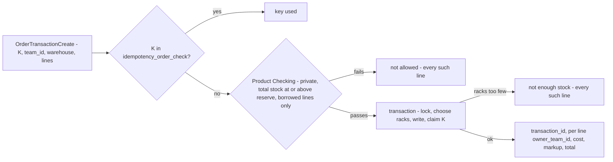

# Development state — inventory / order

**As of 2026-10-16, inventory's side of an order is DECIDED — not prototyped, not built.**
[order_clarify.md](../../business/inventory/order_clarify.md) has **no open question**; what is left there is five
Contradictions in the owner's [order.md](../../business/inventory/order.md), for the owner to redraw. The decisions are in
[order_decision.md](../../business/inventory/order_decision.md), with the key's in
[transaction_decision.md](../../business/inventory/transaction_decision.md) and the order side's in
[order/context_decision.md](../../business/order/context_decision.md).

**Next step: backend analysis of `OrderTransactionCreate`, which waits on the ledgers** — the same critical path as
placement and the transfer ([the-decided-ledgers-come-before-the-transfer](../../business/inventory/warehouse_transfer_decision.md#the-decided-ledgers-come-before-the-transfer)).
The take has no screen of its own; its screens are the order form (order context) and the placement page, which exists.

## What was decided

| | |
| --- | --- |
| the key | looked up first, a used one refused ([a-used-key-is-refused-first](../../business/inventory/order_decision.md#a-used-key-is-refused-first)); claimed once in `idempotency_order_check`, off `inventory_transactions` ([the-key-is-claimed-in-its-own-table](../../business/inventory/transaction_decision.md#the-key-is-claimed-in-its-own-table)); every submit mints its own ([every-submit-mints-a-new-key](../../business/order/context_decision.md#every-submit-mints-a-new-key)) |
| the teams | the request carries the ordering `team_id`, each line `owner_team_id` ([the-take-names-the-orderer-and-each-owner](../../business/order/context_decision.md#the-take-names-the-orderer-and-each-owner)); the transaction is the orderer's ([an-order-transaction-is-the-ordering-teams](../../business/inventory/transaction_decision.md#an-order-transaction-is-the-ordering-teams)) |
| the checks | product config read before the transaction ([the-take-checks-the-product-first](../../business/inventory/order_decision.md#the-take-checks-the-product-first)); reserve on total stock, every warehouse, plain read ([the-reserve-is-read-before-the-take](../../business/inventory/order_decision.md#the-reserve-is-read-before-the-take)); `total stock ≥ reserve`, other teams only ([the-reserve-stops-other-teams-at-low-stock](../../business/product/context_decision.md#the-reserve-stops-other-teams-at-low-stock)) |
| a refusal | one error, three reasons, every refused line named ([a-refusal-names-its-reason-and-every-line](../../business/inventory/order_decision.md#a-refusal-names-its-reason-and-every-line)) |
| picking | the placement page reads racks by `orders.transaction_id` ([the-placement-page-reads-racks-by-transaction-id](../../business/inventory/order_decision.md#the-placement-page-reads-racks-by-transaction-id)); the receipt is the shipping label, no racks. 🔄 *(2026-10-16, owner's redraw)* each good is scanned on a verification page, then *Set Picked* moves the order to `picked`, a row on `order_timeline_logs`; inventory is not told and keeps nothing ([picked-lives-on-the-order-timeline](../../business/inventory/transaction_decision.md#picked-lives-on-the-order-timeline)), and the rack delete checks stock only ([a-placement-deletes-at-zero-stock](../../business/inventory/placement_decision.md#a-placement-deletes-at-zero-stock)). The scans are counted on the page only, nothing saved per scan ([the-item-scans-live-on-the-page](../../business/inventory/order_decision.md#the-item-scans-live-on-the-page)). One page, opened first by scanning the label, shows the racks and takes the scans ([the-pick-page-opens-first-by-the-label](../../business/inventory/order_decision.md#the-pick-page-opens-first-by-the-label)); a label scan finds the order by `order_external_ref_id` or `receipt` ([a-label-scan-reads-the-ref-or-the-receipt](../../business/inventory/order_decision.md#a-label-scan-reads-the-ref-or-the-receipt)) — the built handover `resiLookup` reads the resi only. `picked` and `shipping` are order statuses ([picked-and-shipping-are-order-statuses](../../business/order/context_decision.md#picked-and-shipping-are-order-statuses)) |
| missing goods | back to `pending` with a timeline note ([missing-goods-send-the-order-back-to-pending](../../business/inventory/order_decision.md#missing-goods-send-the-order-back-to-pending)); the staff's count finds the loss ([a-missing-unit-is-found-by-opname](../../business/inventory/order_decision.md#a-missing-unit-is-found-by-opname)) |
| cancels | only the selling team ([only-the-selling-team-cancels](../../business/order/context_decision.md#only-the-selling-team-cancels)); a platform cancel goes back through `pending` too ([a-platform-cancel-goes-back-through-pending](../../business/inventory/order_decision.md#a-platform-cancel-goes-back-through-pending)) |
| duplicates | a repeated ref is warned, not refused ([a-duplicate-ref-is-warned-not-refused](../../business/order/context_decision.md#a-duplicate-ref-is-warned-not-refused)); two live orders on one ref post to the shop ([two-live-orders-on-a-ref-post-to-the-shop](../../business/settlement/settlement_importer_decision.md#two-live-orders-on-a-ref-post-to-the-shop)) |

## What exists — and disagrees with the decisions

| | as built | decided |
| --- | --- | --- |
| the take | no `OrderTransactionCreate`, no `PostOrder`, no `idempotency_order_check` | the flow above |
| the placement page | `pick-order` → `StockPickLocations` by `ref = "order:<id>"` | by `orders.transaction_id` — the take is filed before the order exists |
| the order's history | `order_events` (selling_service `00011`), the Timeline tab | `order_timeline_logs` replaces it ([order-timeline-logs-replaces-order-events](../../business/order/context_decision.md#order-timeline-logs-replaces-order-events)) |
| the settlement importer | `orderInShop` pays the newest of two live orders | the shop, naming both |
| the order's statuses | `OrderStatus` placed · confirmed · picking · packed · shipped; `pick-order` advances one step per button, with no item scan (the scan is only in the `PickQueueNextPage` preview) | `processed` · `picked` at *Set Picked* after every good is scanned · `shipping` at the handover |

## Left for the owner to draw

| in | what — each reported, never edited |
| --- | --- |
| inventory [order.md](../../business/inventory/order.md) | the *not enough stock* exit · the ledgers drawn side by side · two journeys for one order · the two exits back to `pending` from picking · the handover arrow's *"change shipped"* |
| order [order_creation.md](../../business/order/order_creation.md) | `team_id` on the request · the form's *"same key"* loop |
| order [context.md](../../business/order/context.md) | `processed --> pending`, and no `processed --> cancel` · `picked` and `shipping` in the Status Move · the uniqueness section's *Deny* |
