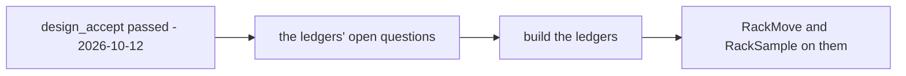

# Development state — inventory / placement

**As of 2026-10-12, placement is DECIDED, PROTOTYPED and ACCEPTED** ([the-placement-prototype-is-accepted](../../business/inventory/placement_decision.md#the-placement-prototype-is-accepted)). Its writes are not built. Every question in
[placement_clarify.md](../../business/inventory/placement_clarify.md) is answered and its contradictions are resolved; the
decisions are in [placement_decision.md](../../business/inventory/placement_decision.md) (20) and two in
[transaction_decision.md](../../business/inventory/transaction_decision.md) (`a-sample-is-handed-over-at-the-warehouse`,
`a-move-has-its-own-type`). Rack detail's two new writes — **Move Goods** and **Record Sample** — run in Storybook against a
stub that plays those decisions; in the app they are on Rack detail and answer **Unimplemented**. The Racks page — the
placement list — is built and real, and now shows each rack's product count and stock count.

**Next step: backend analysis, which waits on the ledgers.** design_accept passed with no change asked for. The backend
step is on the same critical path as the transfer: the decided ledgers first
([the-decided-ledgers-come-before-the-transfer](../../business/inventory/warehouse_transfer_decision.md#the-decided-ledgers-come-before-the-transfer)).

## What was decided

| | |
| --- | --- |
| who picks the rack | the system only when the act is recorded before anyone is at the shelf (an order, a transfer out); otherwise the person at the shelf |
| an order line | fewest first even when it splits over racks; a tie to the smaller rack id (`an-order-line-may-be-taken-from-several-racks`) |
| a sample | a person asks at the warehouse, staff pick and hand over; written against the rack it left; final; recorded from Rack detail |
| a move | staff reorganizing space in one warehouse; one rack to one or more; a `move` transaction per owning team; a row per rack touched; no batch row; all or nothing; a counted product locked at 0; never at accept; at most `stock_count`; a wrong move fixed by moving again |
| the rack screen | `stock_count` only, for now — no physical count, no waiting line (`a-rack-shows-its-stock-count-for-now`, against the recommendation); the Move dialog follows it |

## What exists

| | |
| --- | --- |
| contract | `RackList` gains a `STOCK` data type — `RackStockTotal` (rack id → stock count and product count) per rack on the page, 0 and 0 for an empty one. `RackService.RackMove` (`from_rack_id`, lines of `product_id`·`quantity`·`to_rack_id`, `description`) and `RackService.RackSample` (`rack_id`, lines, `recipient`, `description`), both answering `repeated RackTransaction` (one per owning team). `RackStockLine.counting` (always false until opname). `MovementKind.SAMPLE = 8` |
| backend: real | `RackList` serves the STOCK slice only when asked: one grouped `SUM(on_hand)`, `COUNT(*)` over the page's racks (`rackStockTotals` — a level row is one product on one rack, so the rows are the distinct products); `rack_list_stock_test.go` (sums and counts, empty, zeroed, another warehouse, not asked) |
| backend: prototype | `inventory_v1/rack_move.go`, `rack_sample.go` — methods on `*Service` answering Unimplemented, so service.go's compile-time assertion still catches a forgotten RPC; `rack_move_test.go`, `rack_sample_test.go` pin it. **No tables, no migration** |
| frontend: features | `features/racks/queries.ts`: `useRackContents` (the whole rack, one 200-row page, products resolved by ByIds), `useRackMove`, `useRackSample` (both through `useInvalidateStock`); `movementKind.ts` labels SAMPLE |
| frontend: components | `RackSelect` gains `excludeRackId` (a move's source) and `testId` (+ story `LeavesOneRackOut`) |
| frontend: Racks page | `pages/racks/`: *Products* and *Stock* columns (`rackListPageRowData`, `rackStockTotalsFromList`); the list now spreads `listQuery` and sits in `RefreshOverlay` (RULE 10, which it had missed) |
| frontend: Rack detail | `pages/rack-detail/`: Move Goods and Record Sample actions (a `⋯` menu on a phone), `components/MoveGoodsDialog.tsx`, `components/RecordSampleDialog.tsx`, `pending.ts`; the page's hand-rolled reads re-run on a `reloadKey` after a write; both history tabs show **who** (`by`, via `fetchActors`) and the product's name instead of `#id`; the Products and Prices tables have a **Team** column (`TeamItem`), and the product cell no longer repeats the team |
| Storybook | `.storybook/rackStub.ts` — the registry (rackList with search, paging and the STOCK slice; rackCreate, rackUpdate, rackDelete as the server answers them, on a writeable copy of the fixture racks), rackDetail, rackStock, rackHistory and the two writes, writeable, reset in preview's `beforeEach`; `rackStubScenario.raceBeforeNextWrite` arms the all-or-nothing refusal; `rackShelf` / `lastRackWrite` for assertions. Shelves: A-01-1 holds three teams' goods, A-01-2 a counted product |
| stories | `Pages/Racks/RackList` — Default, Search, CreateRack, DuplicateCodeIsRefused, EditRack, DeleteAnEmptyRack, DeleteRefusedWhileItHoldsStock, OpensRackDetail · `Pages/Racks/RackDetail` — Default, MoveToOneRack, SplitOverTwoRacks, MoveEverythingNeedsARack, TheSourceRackIsNotOffered, SameRackTwiceIsOneLine, RefusedWholeWhenALineChanged, ACountedProductIsLocked, RecordSample, ASampleOfACountedProductIsLocked, PlacementHistoryNamesWhoMovedIt |
| i18n | `racks.table.products`, `racks.table.stock`, `racks.detail.team`, `racks.move.*`, `racks.sample.*`, `racks.detail.actions`, `racks.detail.pending.*`, `warehouseProduct.kind.sample` (en, id) |
| docs | [rpc.md § RackMove and RackSample](../../services/inventory_service/rpc.md) |
| tests | Go build/vet/test green, **with Postgres up**, so the database tests ran · stories **1252** green (8 RackList, 11 RackDetail, 1 RackSelect new) · typecheck and build green |

## Pending marks: what the screen admits

| mark | kind | why |
| --- | --- | --- |
| `countLock` | derived | a counted product locks at 0 — decided ([a-lock-stops-units-moving-not-sales](../../business/inventory/opname_decision.md#a-lock-stops-units-moving-not-sales)); what is missing is opname itself, so only the stub sets it |

✅ *(2026-10-12)* `sampleAgreedBy` is removed: a sample names no member of the owning team and moves no money
([a-sample-is-a-stock-out-at-batch-value](../../business/inventory/transaction_decision.md#a-sample-is-a-stock-out-at-batch-value)).

## Proposed at the prototype — accepted as built

- **Every product starts at 0**, with *Move Everything* to fill them, rather than starting full: a stray Move then moves
  nothing instead of the whole rack. (The chat sketch showed them starting full.)
- **`RackSample.recipient` is required** — who received it, as they gave it. Nothing in the decisions requires it.
- The Products tab column still reads *On this rack* while it now means the stock count; with sold units waiting it reads
  lower than the shelf. Kept as it is.

## The backend step: what it has to do

1. Wait for the ledgers (transaction Q1–Q5 and Q7–Q9, context Q14, the template, technical stock Q5–Q6).
2. `RackMove`: lock the source and destination shelf rows in id order; check every line first (not counting, at most
   `stock_count`, no rack twice, every rack in the warehouse, never the source); one `move` transaction per owning team;
   a placement row per rack touched; no batch row; all in one database transaction.
3. `RackSample`: the same checks on one rack; one `sample` transaction per owning team; the batch ledger takes oldest first;
   no balance entry ([a-sample-is-a-stock-out-at-batch-value](../../business/inventory/transaction_decision.md#a-sample-is-a-stock-out-at-batch-value)).
   Keep `recipient` where [transaction Q9](../../business/inventory/transaction_clarify.md#question) decides, so the owning
   team sees who received each sample.
4. `RackStockLine.counting` from the count's snapshot row, once opname exists.
5. **Lowercase rack codes** ([rack-codes-are-saved-lowercase](../../business/inventory/placement_decision.md#rack-codes-are-saved-lowercase)) — not built: create and update store the code as typed. Trim and lowercase on save, plus a migration for today's codes; two codes differing only by case collide, so the migration has to find them first.
6. When RackList moves onto `product_placements`, `rackStockTotals` sums `stock_count` there instead of `stock_levels.on_hand`.
7. Retire `InventoryService.StockMove` and `MoveStockDialog` (inventory page, warehouse product page) — one product, one
   batch, an *unplaced* end: all superseded.
8. Audit both writes (`audit-rpc-performance`, `audit-sql` — two staff on one rack is the normal case).

## Elsewhere

- Your text in [placement.md](../../business/inventory/placement.md) still lacks `move` in `change_type`, the rules decided
  since `PostOrder`, and the heading's word *Mutation* — listed under the clarify's *Awaiting your text*.
- Rack detail reads with hand-rolled effects, not query hooks, so RULE 10's `listQuery` / `RefreshOverlay` pair does not
  cover it yet.
