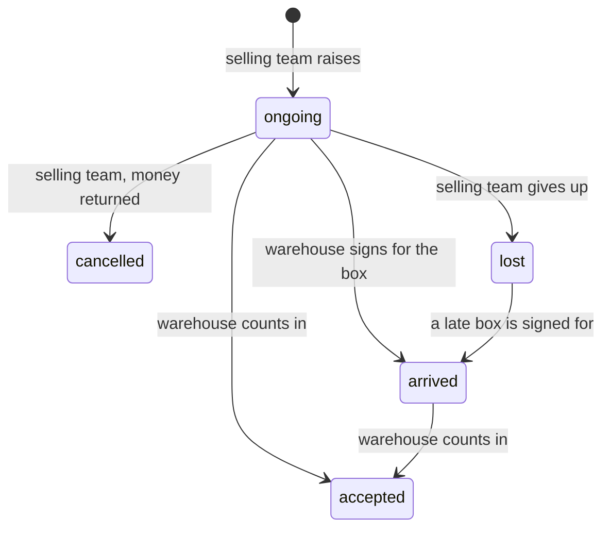
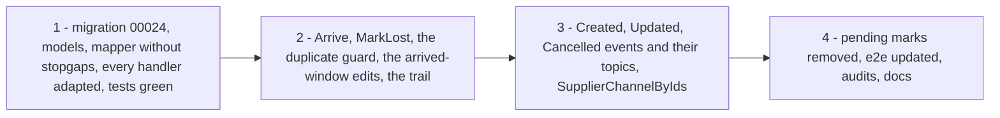

# Development state — inventory / restock

✅ **2026-10-17: the accept is on the ledgers, the tables carry the owner's names, the money is `double`** — uncommitted,
for the owner's review ([ledgers.md](ledgers.md), stages 2a, 2c, 2b).

| | |
| --- | --- |
| the accept | one `restock` transaction (`PostRestock`): a batch per line with good units at the landed price, the good units on the racks named; `restocks.transaction_id` set. No old `stock_*` write is left |
| `00030` | `restock_requests` → `restocks` (`team_id`, `invoice_ref_id`, `shipment_cost`; `shipping_code` dropped; `subtotal` and `total` stored) · `restock_request_items` → `restock_items` (`count`, `total`, `price_unit` stored as total ÷ count, `received_count` = the box, broken included) · `restock_damaged_units` → `restock_problem_items`, keyed by restock + product (composite FK to its line, one row per kind, the line's store copied) · `restock_logs` keyed by `restock_id`, its `at` folded into `created_at` |
| money | `DOUBLE PRECISION` in the tables, `double` in `restock_request.proto` and the four restock events; the landed price is no longer floored at each step, so the screens round it once for display (Coffee's 34.215,69 shows Rp 34.216, where it showed 34.215) |
| models | one per file: `restock.go`, `restock_item.go`, `restock_problem_item.go`, `restock_log.go` (`Restock`, `RestockItem`, `RestockProblemItem`); the problems hang off the restock, not the line |
| tests | the restock suites rewritten onto the new names; `restock_request_totals_test.go` pins the stored totals over create, an ongoing edit and an arrived edit, and the problem rows' keys |
| e2e | `restock.spec` (6), `liability.spec` (6), `opname.spec` (4) and `orders.spec` (19, 2 deliberately skipped) green: every seed names a paying account, uses `count`/`total` and `RestockRequestAccept` onto a real rack; the detail tests assert the decided screen (broken and missing with their notes, the courier's charge outside the total) |
| left | the count lock on the accept's rack picker (below). The accept is audited and fixed — 17 statements whatever the lines ([RestockRequestAccept](../../../audits/services/inventory_service/performances/RestockRequestAccept.md)) |

🔨 **2026-10-15: building.** Stage 1 (`0f5ea6f`: migration 00024, every handler on the decided tables) and stage 2
(`1b9548b`: Arrive, MarkLost) committed. Stage 3 done: `SupplierChannelByIds`, a line's store checked against its
supplier, and *Restock Created / Updated / Cancelled* published after commit. ⚠ Nothing LISTENS to those three yet:
financial_account_service's subscription is its own to add. Next: the accept on the ledgers, then stage 4 (pending
marks, e2e, audits).
🔄 **2026-10-16:** the owner's restock create now upserts `warehouse_products` before its transaction, and inventory
context.md defines the table with a team column. The build links inside the transaction (create **and** update) and has no
team column — a migration when built, its name pending [the-link-names-its-team-two-ways](../../business/inventory/context_clarify.md#the-link-names-its-team-two-ways).
✅ **The accept is unblocked (2026-10-15):** the five ledger rules it needed are decided —
[the-caller-opens-the-transaction](../../technical/ledger/mutation_and_ledger_decision.md#the-caller-opens-the-transaction),
[ledger-logs-are-append-only](../../technical/ledger/mutation_and_ledger_decision.md#ledger-logs-are-append-only),
[both-ledgers-count-the-same-units](../../business/inventory/context_decision.md#both-ledgers-count-the-same-units),
[a-batch-keeps-its-supplier](../../business/inventory/context_decision.md#a-batch-keeps-its-supplier),
[money-is-double-in-the-api-too](../../technical/stock/design_decision.md#money-is-double-in-the-api-too) (restock's money
turns `double` on the wire and in its tables in the same commit as the accept moves onto the ledgers).

✅ **2026-10-15: design_accept passed** ([the-restock-prototype-is-accepted](../../business/inventory/restock_decision.md#the-restock-prototype-is-accepted)).
**Next step: build.** The accept waits for the ledgers (no switch-over is staged — nothing is in production:
[no-switch-over-the-ledgers-replace-todays-tables](../../technical/stock/design_decision.md#no-switch-over-the-ledgers-replace-todays-tables)). The parts that write no stock are built
now ([restocks-non-stock-parts-come-before-the-switch-over](../../business/inventory/restock_decision.md#restocks-non-stock-parts-come-before-the-switch-over)). The e2e ids (step 6 below) are fixed now, so the specs can be updated with the backend step.

🔄 **2026-10-14:** one decision reversed. The courier's debt is no longer written inside the accept: balance posts it from
*Restock Accepted* ([balance-posts-the-couriers-debt-from-the-event](../../business/inventory/restock_decision.md#balance-posts-the-couriers-debt-from-the-event)).
Step 5 below changed with it. The backend also waits on
the ledgers' open questions ([biggest_question #1](../../biggest_question.md)). restock.md lags six decided fields
([restock-md-lags-the-decided-tables](../../business/inventory/restock_clarify.md#restock-md-lags-the-decided-tables)).
✅ **No question is open.** Q22 and Q23, which moved in when the owner deleted context.md's receiving flow, are both
decided ([all-qty-is-every-unit-ordered](../../business/inventory/restock_decision.md#all-qty-is-every-unit-ordered),
[a-box-nobody-raised-comes-in-by-the-teams-restock](../../business/inventory/restock_decision.md#a-box-nobody-raised-comes-in-by-the-teams-restock)).
✅ *(2026-10-15)* **The prototype now prices as decided** — [unit-price-is-line-price-plus-costs-per-unit](../../business/inventory/restock_decision.md#unit-price-is-line-price-plus-costs-per-unit)
and [all-qty-is-every-unit-ordered](../../business/inventory/restock_decision.md#all-qty-is-every-unit-ordered):

| | the accept handler, still | decided |
| --- | --- | --- |
| the goods half | line total ÷ good units | the line's `price_unit`, total ÷ ordered count |
| the cost half | (shipping + courier's charge) ÷ every good unit | ÷ every unit ordered, across the restock |
| a broken or missing row's price | the goods share, `line total × n ÷ line count` | the landed unit price, the same as the batch's |

`features/restock/counting.ts` (`unitGoods`, `unitHpp`), the accept page's problem values and the stub's problem prices
follow the right column, pinned by the `ProblemUnitsCarryTheLandedPrice` story. The handler keeps the left column until
the backend step rebuilds the accept on the ledgers; until then it counts the door's problems twice.
⚠ **The accept must wait for the ledgers** ([the-decided-ledgers-come-before-the-restock-accept](../../business/inventory/restock_decision.md#the-decided-ledgers-come-before-the-restock-accept)),
like the transfer, opname and placement. ⚠ **The accept prototype ignores opname's rack lock**: put-away onto a rack
being counted must be refused ([a-lock-stops-units-moving-not-sales](../../business/inventory/opname_decision.md#a-lock-stops-units-moving-not-sales)).
RackSelect in the accept offers every rack today. **Planned:** `RackListRequest.product_id`, and on each row
a `counting` flag for that product (the same meaning as `RackStock`'s `counting`, false until opname is built); RackSelect
takes a `productId` and shows those racks disabled, *being counted*. Deferred on 2026-10-15 only because another session
had uncommitted protos and `gen/` in this checkout, and `buf generate` rewrites all of `gen/`.

**As of 2026-10-09, the restock is DECIDED and PROTOTYPED. It is not built.** All 45 decisions are in
[restock_decision.md](../../business/inventory/restock_decision.md), and no question is open. The last one,
[a-line-added-after-arrival-names-its-supplier](../../business/inventory/restock_decision.md#a-line-added-after-arrival-names-its-supplier),
lets a line added while `arrived` name its supplier and store. The form and its story already do this, and the backend
step must allow it in Update's arrived window. The screens run in Storybook against a stub that plays the decided
rules. The contract was changed in place
([the-restock-contract-changes-in-place](../../business/inventory/restock_decision.md#the-restock-contract-changes-in-place)),
and the backend was carried along only far enough to compile and stay green. **Next step: the owner's design_accept on
the Storybook screens, then the backend step.**

## Lifecycle as decided

## What exists

| | |
| --- | --- |
| contract | `proto/warehouse/inventory/v1/restock_request.proto`, rewritten in place: statuses ONGOING=1 · ACCEPTED=2 · CANCELLED=3 · ARRIVED=4 · LOST=5 · problems BROKEN/MISSING with a system price · a line carries count, total, `price_unit`, `received_count`, `supplier_id`, `supplier_channel_id`, `note` · `RestockLog` replaces the events · new RPCs `RestockRequestArrive`, `RestockRequestAccept` (was Fulfill), `RestockRequestMarkLost` · Cancel carries `money_returned` · `events/v1`: `RestockAccepted` gains `accepted_at_unix` and per line `missing_count` (was lost), `supplier_id`, `supplier_channel_id`, plus new events `RestockCreated`/`Cancelled`/`Updated` (401–403) · `supplier/v1`: `SupplierChannel.deleted`, `SupplierChannelByIds` |
| backend: stored (00024, `0f5ea6f`) | every contract field has a column; statuses `ongoing`/`arrived`/`accepted`/`lost`/`cancelled`; problems `broken`/`missing` with a stored landed price; `restock_logs` is the trail; the courier's one charge + note on the restock; each line's supplier, store and note; a product once per restock (unique index). The mapper has no stopgaps left |
| backend: Arrive, MarkLost (stage 2) | implemented with a test per rule — `restock_request_arrive_test.go` (6), `restock_request_mark_lost_test.go` (5) |
| backend: stage 3 | `supplier_v1/supplier_channel_by_ids.go` (+ test) · the `SupplierChecker` port asks `Stores` (`restock_line_stores.go`, `restock_request_store_test.go`) — the composition root's `SupplierClients` carries both supplier_service clients, so `wire.go` is unchanged · `restock_money_events.go` (+ test) publishes the three money events; Create, Update (only when money moved) and Cancel call it |
| backend: ported | accept (git-mv'd from fulfill), create, update, cancel, labels, the accepted event, stock cost, owner stock, product stock summary, inbound stat (`status IN restockInboundStatuses`, which is ongoing + arrived), and supplier's `analytic_fold.go` (`GetMissingCount`) |
| frontend: features | `features/restock/`: `summary.ts`, `lines.ts`, `counting.ts`, `statusTabs.ts`, `dateFields.ts`, `problemType.ts`, `queries.ts` (+ Accept/Arrive/MarkLost hooks), `LineSupplier`, `RestockItemsCell`, `SellingRestockActions`, `WarehouseRestockActions`, `RestockTimeline` (each with a story), `storyRestock.ts` (stories only) · `features/suppliers/queries.ts`: `useSupplierChannelsByIds` |
| frontend: components | `badges/RestockStatusBadge` (5 statuses) · new `badges/DeletedBadge` · new `pickers/SupplierChannelPicker` (the Connect Supplier Channel popup, all suppliers) · `pickers/RackSelect` `allowUnplaced` (default true; the accept passes false, per [there-is-no-unplaced-pile](../../business/inventory/restock_decision.md#there-is-no-unplaced-pile)) · `feedback/ConfirmDialog`: optional body, `confirmDisabled`, `dismissLabel` · `pickers/DamageTypeSelect` **removed** |
| frontend: pages | restock-request-form, restock-accept, restock-selling, restock-selling-detail, restock-warehouse, restock-warehouse-detail, restock-labels (each with an `index.stories.tsx`; all but labels have a `pending.ts`) · warehouse-product type fixes |
| Storybook | `.storybook/restockFixtures.ts` (restocks 501–507, one per state) · `.storybook/restockStub.ts` plays the decided rules (`resetRestockStub` runs in preview's `beforeEach`, `restockWire(id)`) · `supplierStub.ts` + `supplierChannelByIds` |
| docs | `docs/services/inventory_service/rpc.md` restock section (lifecycle, the accept transaction, the rules, the event) · liability, selling and supplier `rpc.md`: Fulfill renamed to Accept |
| tests | Go: every package green from the root, 0 skips · stories: **1171** green · mermaid: 1006 parse |

## Pending marks: none

✅ *(2026-10-15)* **Removed from all six restock pages**, with their `pending.ts` files, the action components' `pending`
prop and the `restock.*.pending` translations: every one of the 28 marks named something stages 1–3 now store or do.
Checked against the real dev API (screens shot, `[data-testid^=not-implemented]` counted at 0).
`NothingIsMarkedNotImplemented` on the request form fails the day a mark comes back.

## Backend analysis — the parts that write no stock (2026-10-15)

Scope: [restocks-non-stock-parts-come-before-the-switch-over](../../business/inventory/restock_decision.md#restocks-non-stock-parts-come-before-the-switch-over).
🔄 Nothing is in production, so there is no data to protect. Restock's tables take the owner's names (`restocks`,
`restock_items`, `restock_problem_items`, and the columns in restock.md) **in the commit that moves the accept onto the
ledgers**: 13 of the 36 files that read them are stock readers that commit rewrites anyway (75 raw SQL references, 116
field references). 00024 adds the decided columns under today's names.

**Migration 00024**, on today's tables. Dev data checked 2026-10-15: 14 restocks, no duplicate products, no problem rows,
one courier-charge line with no note.

| change | data | |
| --- | --- | --- |
| status `pending` → `ongoing`, `fulfilled` → `accepted`; new `arrived`, `lost` | rewritten in place | |
| problem `lost` → `missing`; drop the note's `CHECK (reason <> '')` | rewritten in place | |
| `restock_requests` + `receipt_file`, `shipment_id`, `finance_account_id`, `transaction_id`, `warehouse_additional_cost` + `_note`, `arrived_by_user_id`/`arrived_at`, `lost_by_user_id`/`lost_at` | new, defaulted | `order_ref` keeps holding the invoice reference until the rename |
| `restock_request_items` + `supplier_id`, `supplier_channel_id`, `note`; `UNIQUE (restock_request_id, product_id)` | each line takes its restock's `supplier_id` | the migration stops, naming the restocks, if a product appears twice |
| `restock_cost_lines` → the two charge columns | summed, notes joined | ⚠ **then dropped** |
| `restock_request_events` → 🆕 `restock_logs` (from, to, actor, description, at) | every event copied as a log row | ⚠ **then dropped** |
| `restock_requests.supplier_id` | copied onto each line | ⚠ **then dropped** — the supplier figures read the lines' |

**Then, in four commits:**

⚠ **Shared files.** `tools/san/pubsub.go`, `proto/warehouse/events/v1/event.proto`, `backend/cmd/app_development/wire.go`
and `docs/database-schema.md` carry another session's uncommitted edits. Steps 1 and 3 touch them, so those commits
stage hunk by hunk.

## The backend step: what it has to do

1. **Migrations** (inventory_service owns them; `docs/database-schema.md` in the same commit): rename the stored
   statuses (`pending` → `ongoing`, `fulfilled` → `accepted`) and the stored problem `lost` → `missing`, and drop the
   problem note's `CHECK`. Add columns for everything listed as dropped: line supplier/channel/note/count/total,
   restock receipt_file, shipment_id, invoice_ref_id, finance_account_id, the courier's charge and its note,
   arrived/lost actors and times, and the `restock_logs` trail. Then delete the bridges in the mapper.
2. **Arrive and MarkLost** for real. Implement `SupplierChannelByIds`.
3. ⚠ **Batch stopgap.** `restock_request_accept.go:243-244` sets `ArrivedQty = received + missing` and
   `DamagedQty = broken + missing` so the batch reads stay right. That contradicts
   [one-batch-per-line](../../business/inventory/restock_decision.md#one-batch-per-line); replace it when the batch
   is reworked.
4. ⚠ **No duplicate-product guard.**
   [a-product-appears-once-per-restock](../../business/inventory/restock_decision.md#a-product-appears-once-per-restock)
   is enforced by the form only. Create and update accept the same product twice.
5. **Events.** Publish `RestockCreated`/`Cancelled`/`Updated`, and add their topics to `pubsub ensure`. 🔄 **The
   courier's debt moves out of the accept**
   ([balance-posts-the-couriers-debt-from-the-event](../../business/inventory/restock_decision.md#balance-posts-the-couriers-debt-from-the-event)):
   add the charge and its note to `RestockAccepted` (`events/v1`), give `liability_service` a `restock-accepted`
   subscriber that posts the `incidental_fee` once per restock, and delete the `PostRestockOutlay` call
   (`restock_request_accept.go`, and its port and test) together with its code comment. The accept's own transaction
   keeps the charge and its note on the restock.
6. **Stale e2e.** Update `e2e/restock.spec.ts` and `e2e/orders.spec.ts` for the reworked screens. Ids that no longer
   exist: `accept-cod-fee`, `accept-cost-note-0`, `restock-detail-edit`, `restock-detail-short`,
   `restock-detail-cost-incidental`, `restock-detail-labels`, `restock-timeline-created-by`,
   `restock-detail-lost-<id>`. They were left alone on purpose, because the prototype's ids may still move at
   design_accept. **They fail as they stand.**
7. Audit every new or changed write RPC (`audit-rpc-performance`, `audit-sql`). The accept locks the restock row
   first ([accept-locks-the-restock](../../business/inventory/restock_decision.md#accept-locks-the-restock)).

## Elsewhere

- The list pages have no phone arrangement yet (one block per row, FilterBar sheet).
- warehouse-product's **Incoming** reads ongoing restocks only (comment at `pages/warehouse-product/index.tsx:99`).
  An arrived box is incoming too, but the activity read takes one status.
- The receipt photo's upload type is not designed. It stays a `dropped` mark.
- Fixture: team 12 has only product 74, so a story that needs two of one team's products adds its own.
- `qrcode.react` sometimes misses Vite's optimizeDeps on the first labels story run. A re-run passes.
- The other inventory clarifies (context, order, opname, transaction) are still open; see
  [biggest_question.md](../../biggest_question.md).
