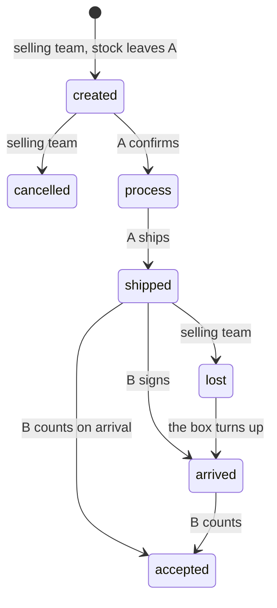

# Development state — inventory / warehouse_transfer

🔨 **2026-10-16: the backend is BUILT on the decided ledgers, uncommitted on purpose** — the owner reviews everything at
the end (*"we commit until i say"*). It is stage 4d of [the ledger build](ledgers.md). All 32 decisions are in
[warehouse_transfer_decision.md](../../business/inventory/warehouse_transfer_decision.md); the clarify has no open
question. The screens now reach a real server; Storybook still runs them on its stub.

✅ **2026-10-17: the cut-over is in** (ledgers stage 3) — every stock screen reads the ledgers, so a transfer shows on
them. ⚠ The four transfer events have no listener yet: the cost and the courier's debt are stored and announced, and
posted nowhere (the screens' pending marks say so).

## Lifecycle as decided

## What exists

| | |
| --- | --- |
| contract | `proto/warehouse/inventory/v1/warehouse_transfer.proto` — unchanged by the build. Money is still `int64` on the wire: the handlers round the `double` columns |
| events | 🆕 `events/v1`: `WarehouseTransferCreated` (404), `…Updated` (405), `…Cancelled` (406), `…Accepted` (407) — money `double` from day one. Topics come from the proto, so `san pubsub ensure` makes them; **no subscription exists**: the financial account's listener is not built, and balance waits on [balance Q13](../../business/balance/context_clarify.md#question) |
| schema | `00027_warehouse_transfers.sql` — `warehouse_transfers`, `_items`, `_problem_items`, `_logs` ([database-schema.md](../../database-schema.md) § Warehouse transfers). No pick or put-away table: they are the legs' rack rows |
| models | `warehouse_transfer.go` (+ `TransferStatus`), `warehouse_transfer_item.go`, `warehouse_transfer_problem_item.go` (+ `TransferProblemType`), `warehouse_transfer_log.go` |
| mutations | `inventory_mutations/post_transfer.go` — `PostTransferOut` (shares `refuseShortLines` + `takeLines` with `PostOrder`), `PostTransferIn` (layers from the out-leg's batch rows, `splitLayers`) |
| handlers | `inventory_v1/warehouse_transfer_*.go`, one per RPC; `_mapper.go` (errors, `lockTransfer`, `moveTransfer`, `transition`, wire shape, `loadLegRacks`), `_events.go`. `WarehouseTransferPrototype` and its test are **deleted**; `service.go` asserts the handler interface |
| product facts | `ProductFact` gained `SKU`, `Name` (the line's snapshot); the composition root's reader fills them |
| frontend: features | `features/warehouseTransfer/`: `queries.ts` (list, detail, 8 mutations — Create/Cancel/Accept also invalidate stock), `adapt.ts`, `statusTabs.ts`, `summary.ts` (units, broken/missing, direction, `parseTransferId`), `SellingTransferActions` (Edit Cost · Cancel · Mark Lost + dialogs), `WarehouseTransferActions` (Process · Ship · Sign · Accept by side + dialogs), `TransferTimeline`, `TransferItemsCell`, `TransferDetailCards` (route, parcel, lines) — each with a story; `storyTransfer.ts` (stories only) |
| frontend: components | `badges/WarehouseTransferStatusBadge` (+ story) |
| frontend: pages | `warehouse-transfer-selling`, `-form`, `-selling-detail`, `-warehouse` (Outgoing/Incoming segment), `-warehouse-detail` (A's pick list), `-accept` (+ `count.ts`, `components/CountLineCard`) — each with `pending.ts` and `index.stories.tsx` |
| routing | `/inventories/transfer` (+ `/new`, `/:transferId`, `/:transferId/accept`) — list and detail pick the selling or warehouse page by team type, like restock; nav entry *Transfers* in `inventoriesFor` for both team types |
| Storybook | `.storybook/warehouseTransferFixtures.ts` (601–609) · `.storybook/warehouseTransferStub.ts` plays the rules · registered in `stubTransport.ts` |
| docs | `docs/services/inventory_service/rpc.md` § Warehouse transfers — built, the create and accept flows as written, the build's choices |
| tests | 17 unit tests, one file per RPC + `warehouse_transfer_fixture_test.go` · 5 concurrency tests (`warehouse_transfer_race_test.go`, `-tags raceaudit`): eight accepts count a box in once, sixteen creates never oversell or deadlock, cancel vs process and lost vs accept each end in one, an Interleave shows the second accept waiting. **No UNSAFE finding**, so no audit file |

## Choices the build made where the decisions are silent

| | choice | why |
| --- | --- | --- |
| price of B's batch | the out-leg row's `price_unit_after` | the layer's price when it left A; a later revaluation at A never reaches B |
| broken and missing on one layer | broken first, then missing, both off the newest | the decision orders newest-first, not the two kinds |
| nothing arrived good | the in-leg is still written, with no rows | [a-transaction-is-made-when-the-act-happens](../../business/inventory/transaction_decision.md#a-transaction-is-made-when-the-act-happens), as a restock |
| the transfer row before the out-leg | inserted first, so the ledger transaction's description names it (`warehouse transfer #41`) | a refused take rolls it back with everything else |
| an edit's event id | `cost_revision`, bumped by each edit that moves money | an edit is not a status change, so there is no trail row to key it on |
| Created / Accepted with 0 | published anyway | one shape for every transfer; a listener posts nothing for 0 |
| the product link | before the transaction, a failure only logged | the decision's *"not critical ops"*. ⚠ The restock still links **inside** its transaction, against the same rule — left for the cut-over |
| warehouse teams | not checked that A and B are warehouses | nor is a restock's warehouse; a transfer to a non-warehouse waits, unaccepted |

## Pending marks: what each screen admits

| page | marks |
| --- | --- |
| selling list, form, selling detail | `costEvent` — `missing`: the cost is stored and announced, the paying account does not post it yet (copy updated) |
| warehouse list, warehouse detail | `labelPhoto` — `dropped`: the upload type is not designed |
| accept | `courierDebt` — `missing`: the charge is saved and announced, balance does not post it yet — its source type is [balance Q13](../../business/balance/context_clarify.md#question) (copy updated) |

## What is left

1. **The listeners**: `financial_account_service` posting *Created / Updated / Cancelled* (and restock's, which it does
   not hear either); balance posting *Accepted* once Q13 names its source type. Never `INCIDENTAL_FEE` keyed by the
   transfer id.
2. ✅ **The cut-over** (ledgers stage 3): the stock screens read the ledgers, so a transfer shows in a product's and a
   rack's history (`transfer_in` / `transfer_out`); the contract's money is `double` with the frontend;
   `InventoryService.StockTransfer` is gone from the contract.
3. **The in-transit figure** on the team's stock screen (`the-transfer-is-where-goods-in-transit-are`): Σ of its
   transfers' lines in `created`…`lost`, not built anywhere yet.
4. **The count lock**: a rack being counted must refuse B's put-away once opname is built
   ([a-lock-stops-units-moving-not-sales](../../business/inventory/opname_decision.md#a-lock-stops-units-moving-not-sales)).
5. ✅ `audit-rpc-performance` on create and accept — fixed 2026-10-17, 19 and 23 statements whatever the lines (stage 5).

## Elsewhere

- The list pages have no phone arrangement yet (one block per row, FilterBar sheet) — the same gap as restock's lists.
- The stub picks every line from A's FIRST rack (it knows no rack counts) and prices new lines from a fixed table; the
  fixtures show the real split (601's Beras over two racks).
- `pickTeamIn` in the form story exists because `TeamSelect` remounts when its list lands: a story with two TeamSelects
  must read the input after the remount and pick from the listbox it controls.
