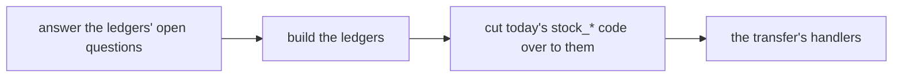
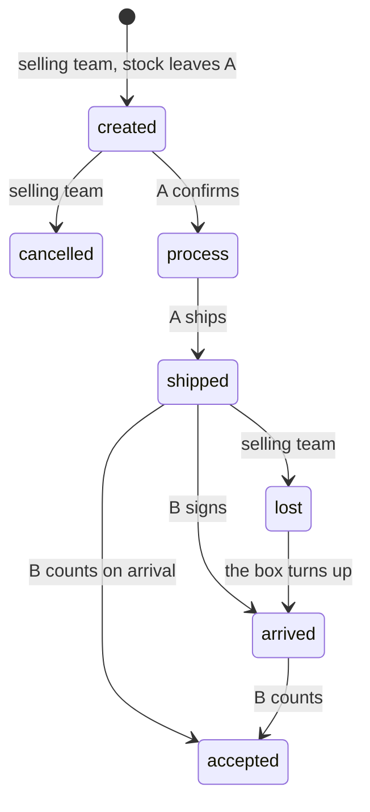

# Development state — inventory / warehouse_transfer

**As of 2026-10-10, the warehouse transfer is DECIDED, PROTOTYPED and its DESIGN ACCEPTED. It is not built.** All 32
decisions are in [warehouse_transfer_decision.md](../../business/inventory/warehouse_transfer_decision.md) — the 32nd, on
2026-10-15, moves the courier's debt out of the accept and onto an event
([balance-posts-the-transfers-on-site-debt-from-the-event](../../business/inventory/warehouse_transfer_decision.md#balance-posts-the-transfers-on-site-debt-from-the-event)),
a comment-only contract change. The clarify has no open question; one contradiction waits on the owner's table (the
charge's note column), and the source type the debt posts under is [balance Q13](../../business/balance/context_clarify.md#question). The screens run in Storybook against a stub that plays the decided rules; in
the app they are routed and in the menu, and every call answers **Unimplemented**.

**Next step is NOT the transfer's handlers.** The owner chose to build the decided ledgers first
([the-decided-ledgers-come-before-the-transfer](../../business/inventory/warehouse_transfer_decision.md#the-decided-ledgers-come-before-the-transfer)),
so the critical path is:

| blocking | where |
| --- | --- |
| what a transaction is: how a release finds an order's take (by its idempotency key, since 2026-10-12), items, rollback, below-zero rollback, the missing types, the team on a cross-team order, where *picked* and a sample's recipient are kept | [transaction_clarify Q1–Q5, Q7–Q9](../../business/inventory/transaction_clarify.md#question) — `sample` settled 2026-10-12 |
| the two ledgers' rules: same units in both, a found unit's batch, zero money at zero units, a late cost, `batches.supplier_id` | [context_clarify Q14a–d, h](../../business/inventory/context_clarify.md#question) |
| one `change_type` list for both ledgers | ✅ agreed 2026-10-16 — [the-two-type-lists-do-not-line-up](../../business/inventory/transaction_clarify.md#the-two-type-lists-do-not-line-up) |
| the ledger template: idempotency, append-only logs, who opens the transaction | [mutation_and_ledger_clarify Q1, Q3, Q4](../../technical/ledger/mutation_and_ledger_clarify.md#question) |
| how today's `stock_*` tables (38 files) give way to the ledgers | [technical stock Q5](../../technical/stock/design_clarify.md#question) |
| whether inventory's `int64` money fields — this transfer's contract included — turn `double` in the same cut-over | [technical stock Q6](../../technical/stock/design_clarify.md#question) |

✅ Settled since: the money type is `float64`, compared at 4 digits
([every-ledger-keeps-money-as-float64](../../technical/ledger/mutation_and_ledger_decision.md#every-ledger-keeps-money-as-float64),
[stock-money-is-float64-compared-at-4-digits](../../technical/stock/design_decision.md#stock-money-is-float64-compared-at-4-digits)).

Ownership is settled for the ledger: `batches.team_id`, written at mint
([a-batch-carries-its-owner](../../business/inventory/warehouse_transfer_decision.md#a-batch-carries-its-owner)). The
shipping-expense event waits for one events pass with restock's
([the-transfer-expense-event-waits-for-the-events-pass](../../business/inventory/warehouse_transfer_decision.md#the-transfer-expense-event-waits-for-the-events-pass)).

## Lifecycle as decided

## What exists

| | |
| --- | --- |
| contract | NEW `proto/warehouse/inventory/v1/warehouse_transfer.proto` — `WarehouseTransferService`: Create, List, Detail, Update, Cancel, MarkLost, Process, Ship, Arrive, Accept. Statuses CREATED=1 · PROCESS=2 · SHIPPED=3 · ARRIVED=4 · ACCEPTED=5 · CANCELLED=6 · LOST=7; `WarehouseTransferDirection` (outgoing/incoming) for a warehouse's list; problems BROKEN/MISSING. The list follows the guideline's columnar shape, `team_id` top-level |
| backend | `inventory_v1/warehouse_transfer_prototype.go` — `WarehouseTransferPrototype` embeds the generated Unimplemented handler; mounted in `register.go` and in reflection; `warehouse_transfer_prototype_test.go` pins every RPC as Unimplemented. **No tables, no migration** |
| frontend: features | `features/warehouseTransfer/`: `queries.ts` (list, detail, 8 mutations — Create/Cancel/Accept also invalidate stock), `adapt.ts`, `statusTabs.ts`, `summary.ts` (units, broken/missing, direction, `parseTransferId`), `SellingTransferActions` (Edit Cost · Cancel · Mark Lost + dialogs), `WarehouseTransferActions` (Process · Ship · Sign · Accept by side + dialogs), `TransferTimeline`, `TransferItemsCell`, `TransferDetailCards` (route, parcel, lines) — each with a story; `storyTransfer.ts` (stories only) |
| frontend: components | `badges/WarehouseTransferStatusBadge` (+ story) |
| frontend: pages | `warehouse-transfer-selling`, `-form`, `-selling-detail`, `-warehouse` (Outgoing/Incoming segment), `-warehouse-detail` (A's pick list), `-accept` (+ `count.ts`, `components/CountLineCard`) — each with `pending.ts` and `index.stories.tsx` |
| routing | `/inventories/transfer` (+ `/new`, `/:transferId`, `/:transferId/accept`) — list and detail pick the selling or warehouse page by team type, like restock; nav entry *Transfers* in `inventoriesFor` for both team types |
| Storybook | `.storybook/warehouseTransferFixtures.ts` (601–609, one per state, one each way, two owners) · `.storybook/warehouseTransferStub.ts` plays the rules (`resetWarehouseTransferStub` in preview's `beforeEach`, `transferWire(id)`) · registered in `stubTransport.ts` |
| shared fixtures touched | `fixtures.ts`: racks 44/45 appended for Gudang Cabang (14); `warehouseStock["74"] = 25` (team 12's Beras, so the form's picker is not empty). `stubTransport.ts`: `rackList` now **scoped by `req.teamId`**, as the server is — every existing story still passes |
| i18n | `warehouseTransfer.*` in en and id; `nav.warehouseTransfer` |
| docs | `docs/services/inventory_service/rpc.md` § Warehouse transfers (lifecycle, the create and accept transactions, the rules) |
| tests | Go: build/vet green, prototype test green, access-policy tests green · stories: **1232** green (61 new) · typecheck, build, mermaid (1047) green |

## Pending marks: what each screen admits

| page | marks |
| --- | --- |
| selling list, form, selling detail | `costEvent` — `missing`: the cost is stored, the paying account does not hear of it |
| warehouse list, warehouse detail | `labelPhoto` — `dropped`: the upload type is not designed |
| accept | `courierDebt` — `missing`: the charge is saved on the transfer, balance does not hear of it until the events pass ([balance-posts-the-transfers-on-site-debt-from-the-event](../../business/inventory/warehouse_transfer_decision.md#balance-posts-the-transfers-on-site-debt-from-the-event)) |

## The backend step: what it has to do

1. **Migrations** (inventory_service): `warehouse_transfers`, `warehouse_transfer_items` (+ picks and placements),
   `warehouse_transfer_problem_items`, `warehouse_transfer_logs`; `UNIQUE (transfer_id, product_id)`,
   `UNIQUE (transfer_id, product_id, problem_type)`, `CHECK (from_warehouse_id <> to_warehouse_id)`. Update
   `docs/database-schema.md` in the same commit.
2. **Handlers**, one file per RPC with a unit test each, as methods on `*Service`; **delete `WarehouseTransferPrototype`**
   and add the compile-time assertion to `service.go`. Every status change locks the transfer row, then batches, then
   shelves (`a-transfer-is-locked-before-any-status-change`).
3. **The legs**: `transfer_out` at create through the batch and placement ledgers (fewest shelves first, oldest batches
   first); `transfer_in` at accept minting one batch per source batch, read from the outbound transaction's `batch_logs`.
4. **Events**: the shipping expense to `financial_account_service` (create, update difference, cancel refund) — not in the
   contract yet; add it to `events/v1` and `san pubsub ensure`. 🆕 *Warehouse Transfer Accepted*, published after every
   accept (0 included), `event_id` `warehouse-transfer-accepted:<transfer_id>`, carrying the charge and its note; balance
   (`liability_service`) posts the team's debt to B from it, nothing for 0. The accept never calls balance. ⚠ Do NOT post
   it as `INCIDENTAL_FEE` with the transfer id: that key collides with a restock's of the same id and is dropped — the
   source type waits on [balance Q13](../../business/balance/context_clarify.md#question).
5. **The in-transit figure** on the team's stock screen (`the-transfer-is-where-goods-in-transit-are`) is not built
   anywhere yet.
6. Retire `InventoryService.StockTransfer`, the instant one-product move this supersedes; nothing calls it.
7. Audit every write RPC (`audit-rpc-performance`, `audit-sql` — two staff at B's door is the normal case).

## Elsewhere

- The list pages have no phone arrangement yet (one block per row, FilterBar sheet) — the same gap as restock's lists.
- The stub picks every line from A's FIRST rack (it knows no rack counts) and prices new lines from a fixed table; the
  fixtures show the real split (601's Beras over two racks).
- `pickTeamIn` in the form story exists because `TeamSelect` remounts when its list lands: a story with two TeamSelects
  must read the input after the remount and pick from the listbox it controls.
