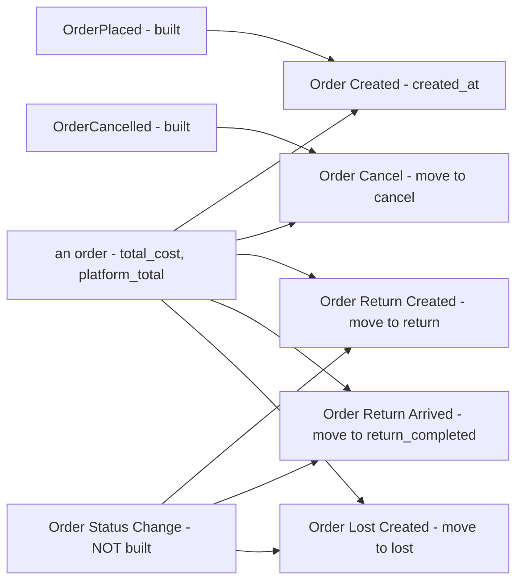

# Development state — order / order_statistic_metric

**DESIGN SETTLED (2026-10-29), NOTHING BUILT.** The order metrics for the analytic screen: five metrics, each counting
whole orders on the day of its own status change. 10 decisions, no open question, two questions parked for inventory.
No proto, no handler, no report table, no fold yet.

- Owner doc: [order_statistic_metric.md](../../business/order/order_statistic_metric.md) — ⚠ **untracked in git** until the owner commits it
- Decisions: [order_statistic_metric_decision.md](../../business/order/order_statistic_metric_decision.md) — 10
- Clarify: [order_statistic_metric_clarify.md](../../business/order/order_statistic_metric_clarify.md) — **0 questions**, 2 slips in the owner's doc, 1 critique (the missing event), 2 parked. Its Proposed Design is the whole decided spec in one table
- The pattern: [rpc_provide.md](../../business/analytic/rpc_provide.md) and its decisions, which these metrics follow

## The design, in one picture

## What a builder must know

| | |
| --- | --- |
| service | `selling_service` owns orders, so it serves the five, beside its order RPCs. The reference implementation is supplier's: `backend/services/supplier_service/supplier_v1/metric_*.go` and `proto/warehouse/supplier/v1/supplier_analytic.proto` |
| one row per | a whole order. No product filter or group: product figures are inventory's, later |
| the day | the metric's own move: `created_at`, or the timeline row's time for the other four |
| money | `*_total` = `total_cost`, `*_mp_total` = `platform_total`, frozen on the order |
| user | `created_by_user_id`, on all five. `0` is its own *no user* row |
| groups | summary, daily to yearly, shop, `TEAM` (the seller), `WAREHOUSE` (the warehouse), user |
| filters | team, shop, warehouse, user, date range |
| scope | a seller reads `team_id` = scope, a warehouse `warehouse_id` = scope, root everything |
| a warehouse | counts only. Money fields are `optional` and left **unset** by the service, and a sort on money is refused |
| stat types | counts `QTY`, totals `CURRENCY` |

## What does not exist yet, in build order

1. **`analytic_base` additions** — `FILTER_TYPE_WAREHOUSE = 7` and `FILTER_TYPE_USER = 8` with their `FilterItem`
   cases, and `GROUP_TYPE_WAREHOUSE = 11`. Decided to land with the first metric that lists them, which is this one.
2. **The Order Status Change event** — nothing publishes `return`, `return_completed` or `lost`. Reports are fed by
   events only, so three of the five metrics wait on it.
3. **The report tables and the fold** — per the analytic pattern, built from the events in `selling_service`.
4. **`MetricSearch` / `MetricData`** in `selling_service`, the five metrics declared in its proto, a unit test per RPC,
   then the performance and concurrency audits.
5. **The screen** — the five go under *Order* in `frontend/src/features/analytic/catalogue.ts`, replacing the sample.

## Not to re-litigate

The day rule, the total, the user, the two team groups, warehouse scope and its money rule, Lost-not-Completed, and
product-to-inventory are all decided — each one is linked from the clarify's Proposed Design table.
