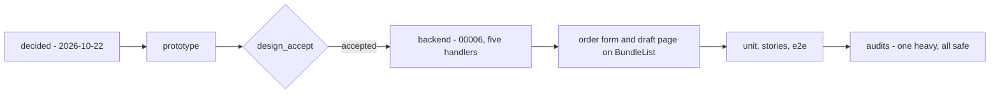

# Development state — product / bundle

**As of 2026-10-22, bundles are IMPLEMENTED** — designed, prototyped, accepted
([the-bundle-prototype-is-accepted](../../business/product/product_bundle_decision.md#the-bundle-prototype-is-accepted)),
built, tested and audited. Every question in [product_bundle_clarify.md](../../business/product/product_bundle_clarify.md)
is answered; the decisions are in [product_bundle_decision.md](../../business/product/product_bundle_decision.md) and the
screen decision in [bundles_decision.md](../../technical/frontend/bundles_decision.md). No contradiction is open.

**One thing waits on the owner:** the product half of BundleList's search reads every team's bundle lines —
[audits/…/BundleList.md](../../../audits/services/product_service/performances/BundleList.md), options (a)/(b)/(c), (a)
recommended (leave it, re-audit at real volume).

## What was decided — the shape

| | |
| --- | --- |
| what a bundle is | a picking recipe — products and how many of each in ONE bundle; no stock, no price |
| tables | `bundles` (id, team_id, name, description, created_by_user_id, timestamps) · `bundle_products` (id, bundle_id, product_id, quantity) — [database-schema.md](../../database-schema.md#product_service) |
| a line | `quantity` 1–9999, each product once per bundle, at least one line |
| the owner of a line | read from `products.team_id` — no copy on the line |
| on the order | expanded into product lines; the order keeps no link back, so a bundle is hard-deleted |
| a borrowed product | ADDED only while shareable; if its owner later locks or archives it, the line stays, unavailable — kept by an update, its slot starting empty on an order |
| who | every selling role reads and creates; the creator or an Admin and up changes and deletes |
| names | may repeat — the lines tell two bundles apart |
| the page | a detail page with what one warehouse's stock can make, the reserve applied to borrowed products |

## What exists

| | |
| --- | --- |
| schema | `product_service/db_migrations/00006_create_bundles.sql`; models `bundle.go`, `bundle_product.go`. Applied to the local dev database |
| backend | `product_v1/bundle_{list,by_ids,create,update,delete}.go` on the same `*Service` as the catalogue, `bundle_mapper.go`, `bundle_rules.go` (`checkLines`, `mayChangeBundle`) — [rpc.md](../../services/product_service/rpc.md) |
| the creator check | `san_auth.GetCallerRole(ctx)` — its comment, and the interceptor's, now name NARROWING a policy the proto cannot express as its one other use |
| contract | [bundle.proto](../../../proto/warehouse/product/v1/bundle.proto) |
| screens | `pages/bundles` (list) · `pages/bundle-detail` (recipe + what stock can make, `makes.ts`) · `pages/bundle-edit` (the form; reads a `?name=&lines=` prefill) |
| order form | its Bundles card searches `BundleList` (server, debounced, `referenceQuery`); a slot is named by its default product, and an unavailable one starts empty with its reason. The samples and the `bundle` pending mark are gone |
| draft page | a row maps to a real bundle; **Make It a Bundle** opens the form in a new tab, prefilled with the listing's name and the split's products (`features/bundles/prefill.ts`). Its `makeBundle` mark is gone |
| shared | `features/bundles/` — `adapt.ts` (`lineState`), `queries.ts` (`useBundles`, `useBundle`, `useBundleSearch`, `useBundleProducts`, `useBundleStock`, the writes), `prefill.ts`; `lib/roles.ts` `canCreateBundle`, `canChangeBundle` |
| Storybook | `.storybook/bundleStub.ts` + `bundleFixtures.ts` play the same rules; `productScenario.ts` locks, archives or reserves a product for one story |

## Tests and audits

| | |
| --- | --- |
| unit | 20 — `bundle_*_test.go`, one file per RPC |
| stories | `Pages/Products/Bundles` (15), `BundleDetail` (11), `BundleEdit` (13), plus the order form's and the draft page's bundle stories. Suite 1463 green on two reruns; one run before them showed 1 failure that did not recur (that run was also 60% slower) |
| e2e | [e2e/bundles.spec.ts](../../../frontend/e2e/bundles.spec.ts) — 6, against the real server: create, list, search, edit, delete, the empty-bundle refusal, and a CS narrowed to her own bundles through the real interceptor |
| performance | `bundle_*_perf_test.go` (`perfaudit`). Only BundleList's search is heavy — [BundleList.md](../../../audits/services/product_service/performances/BundleList.md). Changed while building it: the search subquery scoped to the team (it had hoisted over every team), BundleUpdate down to 5 queries (`DELETE … RETURNING`) |
| concurrency | `bundle_race_test.go` (`raceaudit`), `-count=20` — safe; [lock-order.md](../../../audits/services/product_service/concurrency/lock-order.md) |

## Not built / worth a decision

- **The search's whole-table scan** — the audit's open question above.
- **A Root who is also a CS in a team** is narrowed like a CS there (the caller role is the team role). Rare; recorded
  in rpc.md.
- **Make It a Bundle** returns nothing to the draft: after saving in the new tab, the CS picks the bundle in the draft
  row's search — which reads the server each time it opens.
