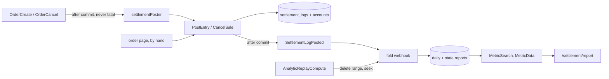

# Development state — settlement

> ✅ **2026-10-30 — the reads are on the analytic pattern, BUILT.** Two metrics,
> [settlement-serves-its-headline-and-its-breakdown](../../business/settlement/context_decision.md#settlement-serves-its-headline-and-its-breakdown), each reading both tables
> ([one-settlement-metric-reads-both-tables](../../business/settlement/context_decision.md#one-settlement-metric-reads-both-tables)):
>
> | | |
> | --- | --- |
> | the contract | [settlement_analytic.proto](../../../proto/warehouse/settlement/v1/settlement_analytic.proto) — `SettlementAnalyticService` is `MetricSearch` / `MetricData`; `metrics/settlement` (6 fields, `take_rate` a `RATIO`, `position_to_date` a `POSITION`) and `metrics/settlement/types` (the 10 types). The old `SettlementMetric` and `Analytic*Search`/`Metric` messages are gone from settlement.proto |
> | the handlers | `settlement_v1/metric_search.go`, `metric_data.go`, `metric_shared.go` — `measureSQL` is the ONE definition of every field (`received` = Σ SettlementTypeMetric's fields, read off the descriptor; an `init` refuses a field with no definition), `tableOf` picks the table and refuses a shop with a person, `idBase` / `timeBase` are the old reads' SQL, kept |
> | tests | `metric_data_test.go` (9) and `metric_search_test.go` (6 + the startup check), on the fold's worked example. The old read tests are gone; the fold, replay and maintenance tests stay in `analytic_test.go` |
> | perf | ✅ **not heavy since 2026-11-05** — the running sum (below). [MetricData](../../../audits/services/settlement_service/performances/MetricData.md) 12.5 ms @ 20 days (was 273), 41 ms @ 200 (1 596), 32 ms @ 200 shops (233); [MetricSearch](../../../audits/services/settlement_service/performances/MetricSearch.md) 14 ms @ shops (143), 34 ms @ 250 days (1 487). Both audits resolved |
> | the screen | the Settlement Report reads the pair (`features/settlement/analytics.ts`); `measure.ts` maps the served fields and derives nothing; the ranking pages with the growing pager; the *Not recorded* person row is gone (left out of the `USER` group, as decided). The Analytic screen serves both metrics (`catalogue.ts`), with a `ratio` kind: a percentage, its own graph, "—" when unset |
> | Storybook | `.storybook/settlementAnalyticStub.ts` folds one ledger book (`fixtures.ts` `settlementBook`, a shop and a person on every row) with the service's rules — the report stories and the Analytic stories read it |
> | the take rate | ✅ sorts *(2026-11-02)*, ranking only the keys that sold at least Rp 1.000.000 in the window — `rankSample` in `metric_shared.go`, the minimum off the proto: [a-take-rate-ranks-above-one-million-of-sales](../../business/settlement/context_decision.md#a-take-rate-ranks-above-one-million-of-sales) |

**Pass:** `implementation` + `technical_test`, **COMPLETE** (2026-09-14). Backend `dabc331`; the report
screen and docs in the commit after it. 🔨 **Widened 2026-09-29 for the settlement importer** (9f20652): the five types,
source `importer`, an imported shop row counted for the shop's primary CS, and the report's *Position to date* — see
[below](#what-the-importer-changed-2026-09-29) and the importer's own
[state report](./settlement_importer.md). 🔨 **Re-seamed 2026-10-21:** the order no longer calls settlement. `OrderSaleHandler`
opens and cancels the sale from `OrderPlaced` / `OrderCancelled`
([settlement-opens-the-sale-from-the-order-event](../../business/settlement/context_decision.md#settlement-opens-the-sale-from-the-order-event)),
so an order's settlement account lands a moment after the order, not inside its transaction.

**Settlement is BUILT END TO END.** The ledger, the order seam, the event, the fold, the reports, the
maintenance RPCs, the report screen.

| | |
| --- | --- |
| proto | `settlement.proto` — **4 services, 8 RPCs** · `event.proto` — `SettlementLogPosted` (variant 300, topic `settlement-log-posted`) |
| schema | settlement `00001–00006` (00006: the five report columns, `settlement_logs.user_id`, `exporter` → `importer`): `settlement_logs`, `order_settlements` (+`created_by_user_id`), `shop_settlements`, `settlement_event_logs`, `shop_/user_settlement_daily_reports`, `shop_/user_settlement_reports`, `settlement_service_metadata` · selling `00013`: `orders.created_by_user_id` |
| service | `backend/services/settlement_service/` — mounted, plus the push routes `/event/settlement-fold/push`, `/event/settlement-order-placed/push` and `/event/settlement-order-cancelled/push` (`order_sale.go`, 2026-10-21) |
| wiring | ~~`settlement_poster.go` (selling → settlement)~~ deleted 2026-10-21: the order events carry `shop_id` and `platform_total` (`marketplace_total` until 2026-10-23) instead · `replay_broker.go` (the replay's subscription) · `shop_primary.go` (settlement → the shop's `ShopAccessCheck`, a Connect client forwarding the caller's token) |
| provisioning | `san pubsub ensure` declares `settlement-fold` on `settlement-log-posted`, and `settlement-order-placed` / `settlement-order-cancelled` on the order topics. The local emulator PUSHES to them, dev and e2e on separate projects ([the-emulator-pushes-locally](../../technical/event_architecture/context_decision.md#the-emulator-pushes-locally)) |
| frontend | `/settlement` (list — **reworked 2026-10-02**, [below](#the-list-reworked-2026-10-02)), the order page's Settlement tab, **`/settlement/report`** (`pages/settlement-report/`), nav entry, `features/settlement/{analytics,measure,window}.ts` |
| docs | [rpc.md](../../services/settlement_service/rpc.md) · [database-schema.md](../../database-schema.md#settlement_service) · [san.md](../../tools/san.md#pubsub-ensure) |

```sh
go test ./backend/services/settlement_service/... ./backend/services/selling_service/...
go test -tags raceaudit -run 'TestRace_Settlement|TestRace_Fold' ./backend/services/settlement_service/settlement_v1/   # 5 pass — the fold's carry and redelivery storm included
go test -tags perfaudit -run TestPerf_Settlement -v ./backend/services/settlement_service/settlement_v1/
cd frontend && npx vitest run --project=storybook src/pages/settlement-report   # see the port trap below
go run ./tools/san migrate up-all --dsn "…"      # the dev DB is migrated to settlement 00005 / selling 00013
```

## What the build turned into code



| decision | where it lives |
| --- | --- |
| [order-service-calls-settlement](../../business/settlement/context_decision.md#order-service-calls-settlement) · [the-order-commits-without-settlement](../../business/settlement/context_decision.md#the-order-commits-without-settlement) | `order_place.go` `openSettlement`, `order_cancel.go` — after commit, logged not returned |
| [the-creator-is-read-from-the-token-at-placement](../../business/settlement/context_decision.md#the-creator-is-read-from-the-token-at-placement) · [the-creator-is-stamped-on-the-state-row](../../business/settlement/context_decision.md#the-creator-is-stamped-on-the-state-row) | `orders.created_by_user_id` via `eventActor`; stamped only by the account's INSERT … DO NOTHING |
| [the-cancel-key-is-order-plus-act-date](../../business/settlement/context_decision.md#the-cancel-key-is-order-plus-act-date) | `cancelKey` in `settlement_poster.go` — the date is `order.UpdatedAt` written by the cancel, in WIB |
| [a-missing-account-is-fixed-by-hand](../../business/settlement/context_decision.md#a-missing-account-is-fixed-by-hand) | `errSaleAlreadyOpen` — the handler refuses a second live sale unless it reverses |
| [the-fold-owns-the-report-not-the-writer](../../business/settlement/context_decision.md#the-fold-owns-the-report-not-the-writer) · [dedup-and-compute-share-one-transaction](../../business/settlement/context_decision.md#dedup-and-compute-share-one-transaction) · [the-fold-locks-shop-then-user](../../business/settlement/context_decision.md#the-fold-locks-shop-then-user) | `analytic_fold.go` — lock FOR SHARE, claim, advisory locks shop→user, two scopes, one tx |
| [the-carry-is-stored-not-derived](../../business/settlement/context_decision.md#the-carry-is-stored-not-derived) · [genesis-is-not-needed-when-the-log-starts-empty](../../business/settlement/context_decision.md#genesis-is-not-needed-when-the-log-starts-empty) | `foldScope` — the doc's two statements plus the state row; no seed |
| [the-replay-cuts-three-tables-on-one-line](../../business/settlement/context_decision.md#the-replay-cuts-three-tables-on-one-line) · [the-replay-is-bounded-by-the-subscription-retention](../../business/settlement/context_decision.md#the-replay-is-bounded-by-the-subscription-retention) · [topic-retention-carries-the-replay](../../business/settlement/context_decision.md#topic-retention-carries-the-replay) | `analytic_replay_compute.go` · `event_source/replay.go` |
| [the-measure-is-sales-received-and-gap](../../business/settlement/context_decision.md#the-measure-is-sales-received-and-gap) · [posted-on-buckets-the-report](../../business/settlement/context_decision.md#posted-on-buckets-the-report) | the RPCs return the eight movements + position; `features/settlement/measure.ts` derives sales / received / gap / take rate |
| [a-key-held-by-another-account-is-refused](../../business/settlement/context_decision.md#a-key-held-by-another-account-is-refused) | `post_entry.go` — the key check compares the shop as well as the order; `errUniqueIDTaken` says *another account* |

## What the importer changed (2026-09-29)

| decision | where it lives |
| --- | --- |
| the five types of 2026-09-24 ([the Contradiction](../../business/settlement/context_clarify.md#the-type-list-grew-to-thirteen-and-the-contract-still-takes-eight), built) | `SettlementType` 9–13, `mapper.go`, `trackedColumns` + 00006's columns, `SettlementMetric` 12–16, `AnalyticMetricSort` 12–16 — widened together, never the enum before the fold. A withdrawal naming an order is refused (`errWithdrawalIsShopWide`) |
| [withdrawal-counts-in-the-position](../../business/settlement/context_decision.md#withdrawal-counts-in-the-position) | nothing special-cased — a withdrawal's `change` sums into `balance`, `last_balance` and the carry like every type |
| [the-report-headline-is-position-to-date](../../technical/frontend/settlement_report_decision.md#the-report-headline-is-position-to-date) | `features/settlement/measure.ts` — `received` leaves withdrawals out, `withdrawn`, `positionToDate`; `ReportSummary`, `SeriesTable` |
| [the-source-is-named-importer](../../business/settlement/settlement_importer_decision.md#the-source-is-named-importer) | `SOURCE_TYPE_IMPORTER = 1` (the number kept), text `importer`, 00006 rewrote stored `exporter` |
| [settlement-asks-the-shop-for-its-primary-cs](../../business/settlement/settlement_importer_decision.md#settlement-asks-the-shop-for-its-primary-cs) | `shop_primary.go` — `ShopPrimary`, asked in `postEntry` BEFORE the transaction for source `importer` + no order. A failed ask or no primary is HELD until the idempotency check: a stored row is answered, and a new one refused (760b8e2) · `settlement_logs.user_id` · `SettlementLogPosted.user_id` · the fold counts a shop row for it when set |

## Choices the decisions left open — built as recommended, asked for a yes

| | |
| --- | --- |
| [context Q3](../../business/settlement/context_clarify.md#question) | `SettlementPost` publishes, whole row, after commit |
| [context Q4](../../business/settlement/context_clarify.md#question) | `platform_total = 0` opens no account |
| [context Q5](../../business/settlement/context_clarify.md#question) | a cancel undoes the LIVE sale; above it is refused; nothing live is a no-op |
| analytic built-notes | maintenance takes no lock · TEAM grouping crosses teams only from the root team · dedup keyed on the EVENT id |

## ⚠ What is NOT built

| | why |
| --- | --- |
| the reconcile RPC | ✅ **declined** — [the-reconcile-check-is-not-built](../../business/settlement/context_decision.md#the-reconcile-check-is-not-built) (2026-09-28). Nothing checks the stored carry against the log, so widen the fold before `SettlementPost` accepts a new type |
| what [only-the-replay-holds-the-lock](../../business/settlement/context_decision.md#only-the-replay-holds-the-lock) leaves in the code | the replay's error still names *a developer's maintenance* ([analytic_replay_compute.go:45](../../../backend/services/settlement_service/settlement_v1/analytic_replay_compute.go#L45)) and the table's migration comment says *human-set*. No `san` command pauses the fold by switching its subscription to pull. The lease for a lock the replay died holding is [meta Q2](../../business/settlement/meta_context_clarify.md#question) — open |
| what [periods-are-grouped-on-the-server](../../business/settlement/context_decision.md#periods-are-grouped-on-the-server) leaves in OTHER services | `ExpenseDaily` and `LiabilityDaily` still return days, and the daily statement groups them in the browser ([period.ts:85](../../../frontend/src/lib/period.ts#L85), [queries.ts:170](../../../frontend/src/pages/daily-statement/queries.ts#L170)). Both RPCs take a grain with settlement's span unlock, the page draws buckets as they come, and the header comment stating the old rule goes |
| a day re-fold from the log | ✅ **built 2026-11-05** — [below](#2026-11-05--the-reads-run-one-sum-the-session-is-jakarta-a-day-re-folds-the-report-has-an-e2e): `san report refold` → `settlement_v1/day_refold.go` |
| a screen reading a shop's OWN direct rows | ✅ **built 2026-11-07** — Shop Entries, `ShopSettlementEntryList` + Reverse ([below](#2026-11-07--shop-entries-built-backlog-23-and-the-reports-jakarta-window-36)); prototyped the same day ([below](#2026-11-07--shop-entries-prototyped-backlog-23-storybook-only)) |
| Jakarta time on the DSN | ✅ **built 2026-11-05** — `backend/pkgs/san_dbsession` pins `TimeZone=Asia/Jakarta` on every session; `posted_on` is the Jakarta day ([below](#2026-11-05--the-reads-run-one-sum-the-session-is-jakarta-a-day-re-folds-the-report-has-an-e2e)) |
| the fixes the performance audit proposes | ✅ **built 2026-11-05** — the running sum ([below](#2026-11-05--the-reads-run-one-sum-the-session-is-jakarta-a-day-re-folds-the-report-has-an-e2e)). *Was:* 🔴 **the reads are HEAVY** — [MetricData](../../../audits/services/settlement_service/performances/MetricData.md) (285 ms @ 20 daily periods, 1.68 s @ 200; 231 ms @ 200 shops) and [MetricSearch](../../../audits/services/settlement_service/performances/MetricSearch.md) (138 ms); first found in the reads they replaced — [AnalyticTimeSearch](../../../audits/services/settlement_service/performances/AnalyticTimeSearch.md) (261 ms @ 20 daily buckets, 1.65 s @ 200), [AnalyticGroupSearch](../../../audits/services/settlement_service/performances/AnalyticGroupSearch.md) (261 ms), [AnalyticGroupMetric](../../../audits/services/settlement_service/performances/AnalyticGroupMetric.md) (185 ms). One cause: the position is found per scope by `DISTINCT ON` over the whole history, where `Σ change` gives it in one pass. **Not applied** — handler change, awaiting the owner. `SettlementPost` is 5 statements (+ a test-only SAVEPOINT), 1.8 ms — not heavy |
| an e2e spec for `/settlement/report` | ✅ **built 2026-11-05** — `frontend/e2e/the_settlement_report.spec.ts` (3 tests) |

## ⚠ Traps this pass walked into

| | |
| --- | --- |
| **Vitest's browser port 63315 is inside a Windows-reserved TCP range** on this machine (`netsh int ipv4 show excludedportrange protocol=tcp` → 63278–63377) | `listen EACCES ::1:63315`, "no tests". `--browser.api.port` on the CLI is ignored by the project config; a throwaway config that `mergeConfig`s `test.browser.api.port` works. Machine state, not code |
| **GORM does not scan into an embedded struct of UNEXPORTED type** | every figure came back 0 with no error. Scan targets embed `settlement_service_models.SettlementMetricColumns` |
| **`gofmt -w` on a directory rewrote ~50 untouched CRLF files** | restore them with `git checkout --`; format only the files you wrote |
| **`git commit -- <paths>` rejects untracked files** | `git add` exactly those paths first — the owner keeps staged renames of their own docs in the index |
| **no Pub/Sub emulator → every post waits 60 s** | `event_source` waits up to `publishTimeout` for the broker's ack; with the emulator down a `SettlementPost` returns after a minute, so an import crawls. Run `docker compose --profile pubsub up -d` + `san pubsub ensure`. CI starts one since f1854cd, unverified until the next PR runs it |
| **a `time.Time` bound against a `DATE` column** | compares as timestamptz, so the boundary moves with the session zone. Every day in the fold and reports is bound as a string and `CAST(… AS date)` |

## Open questions

[context_clarify](../../business/settlement/context_clarify.md#question) — 4 (`problem funding`, Q3–Q5 above;
Q1, the withdrawal, answered 2026-09-29) · [analytic_context_clarify](../../business/settlement/analytic_context_clarify.md#question)
— 0, Q1–Q7 answered 2026-09-28 · [meta_context_clarify](../../business/settlement/meta_context_clarify.md#question) — 1.

## The list, reworked (2026-10-02)

The owner went through `/settlement` one decision at a time; each is in
[frontend/order_settlement_decision.md](../../technical/frontend/order_settlement_decision.md), and the rules every
screen follows in [frontend/context_decision.md](../../technical/frontend/context_decision.md).

| | now |
| --- | --- |
| filters | `FilterBar`: search (order id) · `ShopSelect` · the order list's `DateRangePicker` with one field, **Last moved** (`updated_at`) |
| summary | the order list's `SummaryStrip`: Orders · Sold for · Received · **Penyesuaian** (signed) — server sums over the filtered set |
| columns | Order · Shop · Sold for · Received · Penyesuaian — sortable headings except Shop; the phone's sheet carries *Urutkan* |
| pager | always on screen, with per page `10 · 20 · 50` (default 20) — `Pagination alwaysShow` |
| ledger panel | Penyesuaian signed, *potongan · dirinci* hint, a `SettlementSourceBadge` on every entry |
| contract | `OrderSettlementSort.RECEIVED`; the direction is the named measure's (`LOSS DESC` = biggest loss); an unrecorded sale sorts last and is left out of both sums; `total_unrecorded`; `order_id` breaks ties |

**Removed, because a list row carries no entries** (they were right only in Storybook): the deductions column and
card, the Manual badge. The owner declined a column to carry them (*"ga perlu"*).

⚠ **Not done:**

- The five new `settlement_list_test.go` cases have **never run** — Docker was down, `san_testdb` skipped them.
  Run them before trusting the new `ORDER BY` and the filtered sums.
- No performance audit of the new `ORDER BY` — it sorts on expressions, so `(team_id, last_balance)` no longer
  serves it.
- Order column still shows the internal id and Shop is blank on live — the ref needs an order lookup by many ids,
  the name the team's shop list.
- Open with the owner: whether *Terjual* and the entry types *Estimasi* / *Pembayaran* are renamed, and a label for
  `system_adjustment` (it has none).

## 2026-11-02 — the replay lock has a lease

[a-dead-replays-lock-expires-after-a-minute](../../business/settlement/meta_context_decision.md#a-dead-replays-lock-expires-after-a-minute) — the fold's lock is taken with a one-minute lease (`eventLockLease`, `event_lock.go`):
`takeEventLock` / `releaseEventLock(ctx, takenAt)`, a lock older than its lease is taken over and logged once
(`logExpiredEventLock`), and a release only frees the lock it took. Both services, the same file; the fold and the replay
use it. Tests beside each. Also this pass: the year cap and *as of* on its metrics ([analytic](../analytic/rpc_provide.md)).

## 2026-11-05 — the missing account is shown on the order list; a colliding key at once is refused

- [the-settlement-missing-badge-is-accepted](../../business/settlement/context_decision.md#the-settlement-missing-badge-is-accepted) — the order list's *No settlement account* badge and *Settlement not opened* filter are live ([order state](../order/context.md)).
- [a-colliding-key-at-once-is-refused-the-same](../../business/settlement/context_decision.md#a-colliding-key-at-once-is-refused-the-same) — `post_entry.go` maps a unique violation at the log insert to `errUniqueIDTaken` (`unique_violation.go`, both the GORM sentinel and pg `23505`). Under the account lock a same-account retry is found before the insert, so a duplicate there is always another account's key. SettlementPost concurrency finding 1 ✅ fixed; the raceaudit regression test is green as `TestInterleave_ImportedShopRow_AKeyCollidingAcrossShopsIsRefusedTheSame`.

## 2026-11-05 — the reads run one sum, the session is Jakarta, a day re-folds, the report has an e2e

| | what | where | proof |
| --- | --- | --- | --- |
| **the running sum** | the audits' fix. `timeBase`: Σ change before the page's first day ONCE (`carried`), the span summed per day ONCE (`days`), `carried + SUM(change) OVER (ORDER BY day)` (`running`, `MATERIALIZED`); each bucket joins only `days`. `idBase`: one hash aggregate per key — the position `SUM(change)` up to the window's end, the movement the same sums `FILTER (WHERE day >= start)`. The position is now read from `change`, not the stored `close_balance` (they differ only on a drifted carry). `reportGrain.position` / `columnsOf` gone | `metric_shared.go`, `analytic_shared.go` (`movementSumsWhere`) | `TestMetricData_APageOfDaysReadsOneRunningSum` + the 15 metric tests unchanged · `TestPerf_Settlement` before/after in both audits' History |
| **Jakarta time** | [the-system-runs-on-jakarta-time](../../technical/architecture/context_decision.md#the-system-runs-on-jakarta-time), the change list of [architecture](../architecture/context.md): `san_dbsession.Config/OpenSQL/OpenGORM` parse the DSN and set the session `timezone` runtime param (any form, any zone the DSN named replaced). Used by the dev server, `shipment_service`, `san` (`NewDatabase`, `openDatabase` — migrate included) and `san_testdb` | `backend/pkgs/san_dbsession/` · settlement `00009` (column comments only) · `settlement_list.go` (`parseJakartaDay` — the list's `updated_at` bounds are Jakarta midnights, the session cannot carry a Go-time bound) | `TestConfig_PinsJakartaOverWhateverTheDSNSays`, `TestSession_IsOnTheJakartaCalendar` (23:30 UTC → next day, CURRENT_DATE = WIB today) · `TestSettlementPost_APostAt2330UTCLandsOnTheJakartaDay` (log row, event, report row) · `TestSettlementList_ThePeriodIsJakartaDays` |
| **the day re-fold** | [a-wrong-day-is-refolded-from-the-log](../../business/settlement/context_decision.md#a-wrong-day-is-refolded-from-the-log): `go run ./tools/san report refold --report settlement-shop-daily --shop <id> --date <day> [--dry-run]`. Counts the day's claimed rows + the unclaimed ones over an hour old (lost — it claims them, so a redelivery folds nothing); leaves younger unclaimed rows to the fold. Replaces the day's row (open from the previous row, as the fold), re-derives the shop state row, writes no other day. Lock order = the fold's minus the user key | `settlement_v1/day_refold.go`, `tools/san/report.go`, [san.md](../../tools/san.md#report-refold), [rpc.md](../../services/settlement_service/rpc.md#the-day-re-fold--dayrefold-not-an-rpc), [lock-order](../../../audits/services/settlement_service/concurrency/lock-order.md) | `day_refold_test.go` (6: corrupted day rewritten + others untouched + idempotent, lost row claimed, in-flight row left, dry run, stray row removed, refusals) · `TestRace_Refold_AFoldRacingItCountsEveryRowOnce` (raceaudit, 10 rounds, both orderings) · `tools/san/report_test.go` · run on the dev DB, output in san.md |
| **the e2e** | a team and two shops of its own, five `SettlementPost`s (no withdrawal, order ids far past any e2e order), polled until the fold lands: headline, today's series row, shops ranked by position, then `grain=month` and *By person* | `frontend/e2e/the_settlement_report.spec.ts` — named to sort after `orders.spec.ts` and `statement.spec.ts` (`statement_x` sorts BEFORE `statement.spec`) | 3 pass |

~~⚠ Open, for the owner~~ — (1)–(3) answered and built the same day (next section:
[a-refold-shifts-the-later-days](../../business/settlement/context_decision.md#a-refold-shifts-the-later-days),
[the-person-report-refolds-too](../../business/settlement/context_decision.md#the-person-report-refolds-too),
[the-liability-day-is-the-jakarta-day](../../business/balance/context_decision.md#the-liability-day-is-the-jakarta-day)).
(4) still owed: dev DB `san migrate up --service settlement_service` (00009, comments only — the dev DB reads version 8),
and the dev server must be restarted to open Jakarta sessions.

## 2026-11-05 — the re-fold shifts the later days, and the person report re-folds too

| | what | where | proof |
| --- | --- | --- | --- |
| **the later days** | [a-refold-shifts-the-later-days](../../business/settlement/context_decision.md#a-refold-shifts-the-later-days): after the day's row, every later day of the scope shifts `open_balance`/`close_balance` by **the day's new close − the close the later days carried from** (stored close, or the open when the day had no row) — the change difference whenever the open did not move. The fold's statement, extracted as `shiftLaterDays` (used by `foldScope` and the re-fold); the state row by `deriveState` after the shift (`lastDayRecomputed` for the re-fold — it may remove the newest day). A scope left with no row: state close 0, `last_day` NULL (`clearEmptyState`). `NextGap` names a next row whose carry was ALREADY off (a shift keeps a break) — re-folding that day closes it | `day_refold.go`, `analytic_fold.go` | `TestDayRefold_RewritesAWrongDayAndShiftsTheLaterCarry` (the later day's open/close move by exactly 29.999, movement untouched, the earlier day not written — ctid — and a second run writes nothing), `…CountsALostRowAndClaimsIt`, `…AQuietDayGainsItsRowAndEveryLaterDayFollows`, `…NamesACarryAlreadyOffAndItsOwnRefoldClosesIt`; mutation: the shift disabled → 7 tests red |
| **the person report** | [the-person-report-refolds-too](../../business/settlement/context_decision.md#the-person-report-refolds-too): `--report settlement-user-daily --user <id>`. One `refoldReport` per report (table, state table, advisory namespace, the scope's rows). The person's rows = the fold's attribution in SQL (`attributedUser`: order row → `order_settlements.created_by_user_id`, shop row → `user_id`, else `actor_id`). `DayRefoldInput.UserID` is a pointer (`--user 0` is the row of "not recorded"); two scopes or none refused | `day_refold.go`, `tools/san/report.go` | `TestDayRefold_Person_*` (wrong day + shift + idempotent + the shop report untouched, attribution of all three row kinds, lost row, in flight, dry run, stray day + `last_day` lowered + emptied person), `TestDayRefold_Refuses`, `tools/san/report_test.go` (both reports + flags) |
| **one claim, two reports** | the claim is per event and both reports share it; the re-fold counts every claimed row, so a lost row one re-fold claims is counted by the other's. The result's `Short` names the other report's scopes the newly claimed rows feed; `san` prints a ready command per scope | `day_refold.go`, `report.go` | `TestDayRefold_ALostRowTheShopRefoldClaimsIsCountedByThePersonRefold`, `TestDayRefold_Person_ALostRowItClaimsIsCountedByTheShopRefold` (both reports then agree day for day) |
| **races** | the person re-fold takes only `settlement-user` keys (the fold's second), after its claims | [lock-order](../../../audits/services/settlement_service/concurrency/lock-order.md) | raceaudit `TestRace_Refold_AFoldRacingItCountsEveryRowOnce` (unchanged, green), `TestRace_Refold_TheLaterDaysTakeEveryShiftOnce`, `TestRace_Refold_TheShopAndPersonRefoldsCountEveryRowOnce` — 10 rounds each, no 40P01 |
| **run on the dev DB** | shop 3 / 2026-10-30, user 1 / 2026-10-30 and 2026-10-26 — dry run and real: every day unchanged (the dev log and both reports agree) | [san.md](../../tools/san.md#report-refold) | output pasted there |

⚠ **Not indexed:** the person re-fold reads the day's log by `posted_on` and the attribution — `settlement_logs` has no
`posted_on` index, so it is one scan of the log per run. An operator command run by hand, not a request path; an index is
the owner's call if the log grows large.

## 2026-11-06 — every rupiah is a double, rounded once as it posts (money-type change, part 1)

[every-ledger-moves-to-double-rounded-when-frozen](../../business/order/context_decision.md#every-ledger-moves-to-double-rounded-when-frozen),
on top of [rupiah-is-floating-point](../../business/order/context_decision.md#rupiah-is-floating-point).

- **Schema** — `settlement_service` `00010_settlement_money_is_double.sql`: 39 columns `bigint → double precision`
  (`settlement_logs.change`/`balance`, `order_settlements.initial_total`/`last_balance`, `shop_settlements.last_balance`, both
  daily reports' 16 figures, both state reports' `close_balance`). Exact casts; the Down rounds back. Applied on
  `warehouse_test` by the harness; **not run on the dev DB** — `go run ./tools/san migrate up --service settlement_service`.
- **Wire** — `settlement.proto` (entry change/balance, account initial_total/last_balance, `SettlementPostRequest.change`
  with `double.finite`, the list's two totals), `settlement_analytic.proto` (5 headline + 10 type figures), event
  `SettlementLogPosted.change`/`balance` → `double`. financial_account's withdrawal listener reads the double.
- **The freeze point** — `postEntry` refuses NaN/±Inf (`errChangeNotFinite`) and rounds `change` with `san_money.Whole`
  (half away from zero, −0 → 0) before anything else, so a retry of a fractional post finds the same row. Nothing
  downstream rounds: the fold adds the posted change; MetricData/MetricSearch serve folded sums. Doubles are compared with
  `san_money.Equal`/`IsZero` (over-cancel check, the re-fold's `sameFigures` and carry, `order_sale`'s `Whole(platform_total) ≤ 0`).
- **Tests** — `TestSettlementPost_RoundsAFractionOnceToWholeRupiah`, `TestSettlementPost_RefusesAChangeThatIsNotFinite`,
  `TestMetricData_TheSumsAndThePositionEqualTheLog` (headline, types, position and the day row == the log, with `==`),
  `TestDayRefold_DustIsTheSameFigureAndARealDifferenceIsRestoredExactly`.
- **Frontend** — the settlement surfaces read `number` (order-settlement model/fixtures/panel/breakdown/list/AddEntryDialog,
  features/settlement measure + queries, settlement-report, the Storybook ledger book and analytic stub). `lib/money.ts`
  formatters take `Rupiah = bigint | number`. A margin meets `goods_cost` (still bigint) by `Number(totalBeli)`.
- ✅ **Part 2 built 2026-11-06**: liability, expense, selling's `goods_cost`/`unit_cost`/`unit_price`/`courier_charge`,
  inventory's stock reads, supplier valuations and the `numeric` columns — see [order](../order/context.md),
  [balance](../balance/context.md), [financial_account](../financial_account/context.md),
  [inventory ledgers](../inventory/ledgers.md), [supplier](../supplier/context.md). The settlement panel's `goods_cost`
  is a `number` now, no `Number()` bridge.

## 2026-11-06 — the backend never rounds money ([the-backend-never-rounds-money](../../business/order/context_decision.md#the-backend-never-rounds-money))

`postEntry` no longer rounds `change` (the freeze point above stored whole rupiah): it refuses NaN/±Inf and stores the
figure exact; the fold, the reports and the metrics are sums of exact doubles, equal to the log within the tolerance
(`san_money.Equal`, now `IsZero(a − b)` — `Round(a) == Round(b)` called two figures a float hair apart across a half
unequal). `openSale` skips a platform total that is not above 0 (`san_money.Positive`). `OrderSettlementList` tells an
unrecorded sale by `abs(initial_total) < 0.00005` (`recordedSale`, `san_money.ZeroBelow`) instead of `= 0`. `san report
refold` prints its figures with `san_money.Text` digits ("25.000", a fraction to 3 places). Tests
`TestSettlementPost_StoresAFractionExact`, `TestMetricData_TheSumsAndThePositionEqualTheLog` (tolerance), `TestReportRefold_RebuildsTheDayFromTheLog`.

## 2026-11-07 — Shop Entries prototyped (backlog #23, Storybook only)

The screen for a shop's OWN rows — settlement rows with no order ([an-entry-names-an-order-or-a-shop](../../business/settlement/context_decision.md#an-entry-names-an-order-or-a-shop)):
withdrawals, `system_adjustment`, shop-level fees/ads, and statement lines whose ref found no order or several live
orders ([an-unmatched-ref-posts-to-the-shop](../../business/settlement/settlement_importer_decision.md#an-unmatched-ref-posts-to-the-shop),
[two-live-orders-on-a-ref-post-to-the-shop](../../business/settlement/settlement_importer_decision.md#two-live-orders-on-a-ref-post-to-the-shop)).
Never `initial_total`/its cancel (`post_entry.go` refuses them without an order). **No Go, proto, migration, route or menu
change; the live screens are unchanged.**

| | |
| --- | --- |
| the gate | `features/settlement/shopEntriesPrototype.tsx` — `SettlementShopEntriesPrototypeProvider` + `useSettlementShopEntriesPrototype()` (null in the app). Its `list` seam stands in for the missing RPC; Storybook answers it from `.storybook/shopEntriesPrototypeStub.ts` (`shopEntriesSeam`, `shopEntriesBook`, `shopEntriesCalls`) |
| the page | `pages/settlement-shop-entries/` (`SettlementShopEntriesPage`, no route): totals strip (Entries · Received · Withdrawn, over the filtered set — the report's own words, [the-report-headline-is-position-to-date](../../technical/frontend/settlement_report_decision.md#the-report-headline-is-position-to-date)), FilterBar (ShopSelect `asFilter` · kind ChoiceFilter · DateRangePicker naming *Learned*), table / phone blocks, GrowingPager, EmptyHint. Filters in the URL (`shop`, `kind`, `range`). The window is `posted_on` ([posted-on-buckets-the-report](../../business/settlement/context_decision.md#posted-on-buckets-the-report)) in JAKARTA days (`window.ts` `jakartaWindowOf` — the report's `windowOf` still cuts at the viewer's midnight) |
| the way in | the report's **By shop** row opens `/settlement/shop-entries?shop=<id>&range=<report's>` — only under the seam (`settlement-report/components/GroupTable.tsx`) |
| stories | `pages/settlement-shop-entries/index.stories.tsx` (13), `pages/settlement-report/ShopEntriesEntry.stories.tsx` (4, incl. `TheLiveReportIsUnchanged`) |
| i18n | `settlementShopEntries.*` (en + id) |

**What the backend step must build** (then delete the seam, add the route + menu entry per the owner's answer, and
turn the stories onto the real stub):

1. `SettlementService.ShopSettlementEntryList` — a READ (`NO_SIDE_EFFECTS`), policy = every settlement read's
   (`ROOT, ADMINISTRATOR, SELLING_OWNER, SELLING_ADMIN, SELLING_CS`, `use_scope` on `team_id`); filter `shop_id` (0 = all),
   `settlement_types` (repeated, the eleven non-sale types), `from`/`to` Jakarta `posted_on` days; `CommonPagination`;
   newest `posted_on` then `id` first; returns `SettlementEntry` rows + `has_next` + totals over the WHOLE filtered set
   (count, received = Σ change of non-withdrawals, withdrawn = −Σ withdrawals). `settlement_logs WHERE team_id = ? AND
   order_id IS NULL …` — a partial index `(team_id, posted_on DESC, id DESC) WHERE order_id IS NULL` (settlement
   migration + `docs/database-schema.md`). Perf audit; no concurrency audit (a read).
2. The statement each row came from — settlement holds no file id, and must not read the importer's tables. A read on the
   importer: `UploadedFileLineBySettlementLogIds(team_id, ids)` → `uploaded_file_id`, sheet, description, `order_ref`,
   reason (`NO_ORDER` / `SEVERAL_ORDERS` / a shop line), `found_order_ids` — over an index on
   `uploaded_file_lines(settlement_log_id)`; the file's platform and period from `UploadedFileByIds`. The screen joins
   them (two calls, one per page) — no write-contract change.
3. Names: shops by `useShopOptions` (closed badged), people by `useActors` — both exist.
4. An e2e named past `statement.spec.ts` (e.g. `the_shop_entries.spec.ts`): import a statement with an unmatched ref and a
   withdrawal, open the report, click the shop, read both rows and the file link.

✅ Both answered the same day — [the-shop-entries-page-is-accepted](../../technical/frontend/settlement_report_decision.md#the-shop-entries-page-is-accepted)
(its own page, *Entri Toko*, and from the report) and [a-shop-entry-reverses-inline](../../technical/frontend/settlement_report_decision.md#a-shop-entry-reverses-inline);
built [below](#2026-11-07--shop-entries-built-backlog-23-and-the-reports-jakarta-window-36). *Was:* where the screen sits in the menu, and whether a person may
REVERSE a wrong shop row here ([an-upload-is-never-reverted](../../business/settlement/settlement_importer_decision.md#an-upload-is-never-reverted)
records *"a wrong shop row — no screen"*; `post_entry.go` already scopes a shop row's reversal to its shop).

## 2026-11-07 — Shop Entries built (backlog #23) and the report's Jakarta window (#36)

[the-shop-entries-page-is-accepted](../../technical/frontend/settlement_report_decision.md#the-shop-entries-page-is-accepted) ·
[a-shop-entry-reverses-inline](../../technical/frontend/settlement_report_decision.md#a-shop-entry-reverses-inline). The
prototype's seam (`shopEntriesPrototype.tsx`, `.storybook/shopEntriesPrototypeStub.ts`) is deleted; the page reads the
real RPC.

| | |
| --- | --- |
| the read | `SettlementService.ShopSettlementEntryList` ([shop_settlement_entry_list.go](../../../backend/services/settlement_service/settlement_v1/shop_settlement_entry_list.go)) — `order_id IS NULL`, the read set, the root team reads every team's; filters shop · kinds (the eleven; the sale and its cancel refused) · `posted_from..posted_to` (the learned Jakarta `DATE`, inclusive); `CommonPagination`, newest learned then id first; `page_info.total_items` = Entries, `total_received` (Σ but withdrawals), `total_withdrawn` (−Σ withdrawals) over the filtered set. Each row: the entry with `actor_name`, `reversed_by_id`, `statement` |
| the statement | settlement's `StatementSources` → the importer's in-process `StatementLinesBySettlementLogIds` ([statement_lines.go](../../../backend/services/settlement_importer_service/settlement_importer_v1/statement_lines.go)): per log id the line that POSTED it (else the first that found it), with file id, platform, period, sheet, description, ref, reason, found orders, uploader. Names: `UserNames` → `UserByIDs` in-process. Adapters: `cmd/app_development/settlement_shop_entries.go` (6th/7th `NewService` deps) |
| Reverse | the order ledger's write — SettlementPost of the opposite row, same type, `reverses_id`, key `reverse-<id>` (`useReverseShopEntry`). [post_entry.go](../../../backend/services/settlement_service/settlement_v1/post_entry.go) now refuses, for BOTH ledgers: a reversal that is not the reversed row's type and opposite amount (`InvalidArgument`), and a second reversal of a row (`FailedPrecondition`, read by `reverses_id` under the account lock). A shop reversal reaches only its shop's rows — so never a sale or a cancel |
| migrations | settlement **00011** — `settlement_logs_shop_rows_idx (team_id, posted_on DESC, id DESC) WHERE order_id IS NULL`, `settlement_logs_reverses_idx (reverses_id) WHERE reverses_id IS NOT NULL`; importer **00005** — `uploaded_file_lines_settlement_log_idx (settlement_log_id, id) WHERE settlement_log_id <> 0`. Indexes only |
| perf | 5 queries a page, 1.7 ms at 200 000 log rows a team (5 000 shop rows); 68 ms without the partial index; one shop + withdrawals 15 ms (BitmapAnd with `shop_occurred_idx`). The importer's lines: 3 ms for 20 ids. Not heavy — no write-up |
| concurrency | the only write path is SettlementPost's, already audited; the new reversed-once read sits under its existing account lock. `TestRace_SettlementPost_AShopEntryIsReversedOnce` (8 racers, half the screen's key, half another: 1 row lands, 4 refused, 3 answered by the key) — mutation-checked |
| the screen | `/settlement/shop-entries` (`router.tsx`); **Entri Toko** (`nav.settlementShopEntriesShort`) the 4th child of Penyelesaian, for `isTeamManager` like Daftar and Laporan; the report's By shop row opens it with the shop and the report's range (`GroupTable`). Reverse (write set, not a monitor) → `ConfirmDialog` → toast; a reversed row dims and reads **Reversed**, a reversal reads *Reverses #id*; neither offers Reverse |
| #36 | `jakartaWindowOf` moved to `features/settlement/window.ts`; the settlement report uses it — a relative range counts back from Jakarta's today. Story `TheWindowIsJakartaDaysAt2330Utc` holds the clock at 23:30 UTC (06:30 WIB next day). ⚠ It can only fail on a non-WIB runner (CI is UTC); `windowOf` stays for the analytic composer, the supplier figures and the settlement list (their own day questions, untouched) |
| #37 | ✅ 2026-11-07: the helper moved to `frontend/src/lib/jakartaDay.ts` (`features/settlement/window.ts` deleted) and every range screen reads it — the settlement list too, and the entry form's default day is Jakarta's (it was the UTC day). The ⚠ above is closed by `src/lib/jakartaDay.test.ts`, which stubs Node's zone and fails for viewer-midnight math on any machine ([architecture state](../architecture/context.md)) |
| stories | `.storybook/shopEntriesStub.ts` (the list + the shop reversal, with the server's rules), `pages/settlement-shop-entries/index.stories.tsx` (17), `ShopEntriesEntry.stories.tsx` (3) |
| e2e | `frontend/e2e/the_shop_entries.spec.ts` (5) — its own team; a one-line Shopee statement built per run (a key is global, so the shared fixture would be "already there"); import → Entri Toko with its statement → Reverse → Reversed, opposite row, totals back → a second reverse refused → the report's By shop row opens it |

Not built: *Move to Order* for a no-order or two-orders line (a later step, by the decision).
