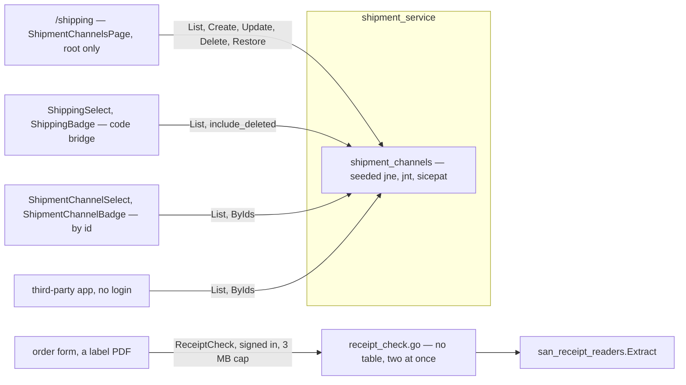

# Development state — shipment

**Channel catalogue DONE — fully implemented (2026-09-16). `ReceiptCheck` BUILT (2026-10-23), its two-at-once limit
the same day.** Business design
decided, prototypes accepted ([the-prototype-is-accepted](../../business/shipment/context_decision.md#the-prototype-is-accepted),
[the-receipt-check-prototype-is-accepted](../../business/shipment/context_decision.md#the-receipt-check-prototype-is-accepted)),
backends built, wired, tested, audited. Deferred by decision, not missing: tracking, the handover to the courier.

- Owner doc: [context.md](../../business/shipment/context.md)
- Decisions: [context_decision.md](../../business/shipment/context_decision.md) — 25
- Clarify: [context_clarify.md](../../business/shipment/context_clarify.md) — **1 open** (2026-10-05): Q1 the eight couriers live receipts ship by. `ReceiptCheck`'s Q2–Q4 were answered the same day

## `ReceiptCheck` — BUILT (2026-10-23)

The owner accepted the screen and the contract on 2026-10-23, and the backend landed the same day. Flow, gates and
results: [rpc.md](../../services/shipment_service/rpc.md#receiptcheck--read-an-uploaded-shipping-label).

| | |
| --- | --- |
| contract | [proto/warehouse/shipment/v1/receipt.proto](../../../proto/warehouse/shipment/v1/receipt.proto) — unchanged from the prototype |
| handler | `shipment_v1/receipt_check.go`, a method on the same `Service` (one impl, two Connect services, as selling does). `Extract` from `github.com/pdcgo/san_receipt_readers` (the submodule, `replace`d in the root go.mod). `ErrUnreadable` → UNREADABLE, `ErrNotShippingLabel` → NOT_SHIPPING_LABEL, any other error → UNKNOWN_LABEL, the fields only on READ. One `slog` line: result, size, time — never a field, never `Extract`'s error text |
| mount | `register.go` mounts `ReceiptService` with `connect.WithReadMaxBytes(3 << 20)` and reports it for reflection. **No wire change**: `shipment_v1.NewService` was already provided and `service_api.go` already calls the register |
| two at once | [an-attached-file-is-up-to-15-mb-and-two-checks-run-at-once](../../business/shipment/context_decision.md#an-attached-file-is-up-to-15-mb-and-two-checks-run-at-once): a buffered channel of `receiptChecksAtOnce` (2) on the `Service`, taken without waiting — a third call is `ResourceExhausted` before `Extract` runs, logged as a Warn with the size only. The slot is released (deferred) when `Extract` returns; it takes no context, so a cancelled request keeps its slot until then. Per API process. `extract` is a `Service` field only so `export_test.go`'s `NewServiceWithExtract` can hold a check open. No wire or proto change |
| tests | `receipt_check_test.go` — 9 tests, no database: both numbers on 4 real samples · field for field against `Extract` on all 41 samples · NOT_SHIPPING_LABEL on the 9 non-labels · UNREADABLE on 4 broken files · a synthetic 2-label bulk print → UNKNOWN_LABEL · the log line carries no field · two held checks, a third ResourceExhausted at once without reaching the reader, a freed slot serving the next · mounted behind the app's own chain: no token Unauthenticated, a user in no team READ · a body over 3 MB ResourceExhausted, a file over 2 MB InvalidArgument, a 2 MB file as JSON fits |
| perf audit | 🔴 **HEAVY** — [ReceiptCheck.md](../../../audits/services/shipment_service/performances/ReceiptCheck.md). Real labels 5.5 ms median (slowest 54 ms), 0 queries. But the PDF library's page lookup is quadratic, so a 2 MB file of many pages costs 9.6 s (2 105 labels) to 74 s (5 902 one-line pages) of CPU. The owner DECLINED the page cap and took the two-at-once limit: one call's worst case stands, and at most two run. Probe: `receipt_check_perf_test.go` (tag `perfaudit`) |
| concurrency audit | none — it writes nothing |
| frontend | the order form's `receiptScan` mark and its copy are gone, so `ORDER_FORM_PENDING` is empty ([order/context.md](../order/context.md)). `checkLabel` answers a refused (busy) check `null`, like any failed call — the card shows nothing, no toast; no code change was needed. The attachment ceiling is **15 MB** (`ReceiptUpload`'s `MAX_BYTES` and the help text in both locales), the document service's own — ⚠ ONE ceiling for every upload kind ([document rpc.md](../../services/document_service/rpc.md#two-phase-presigned-put-upload)). `LABEL_MAX_BYTES` stays 2 MB, so a 2–15 MB PDF uploads and is answered `unreadable` without being sent |
| storybook | the `ReceiptService` stub stays (`stub-result:<name>` markers) — the stories pin the form's answer to each result. `stub-result:busy` throws `ResourceExhausted` and counts it in `receiptCheckScenario.refused`; `ABusyCheckIsNoCheck` pins that nothing appears. `ShippingReceipt`'s `RefusesAFileOver15MB` pins the client-side ceiling |
| e2e | `orders.spec.ts` — its `%PDF-1.4` stub attachment now gets the real `unreadable` notice |
| decisions | [an-attached-file-is-up-to-15-mb-and-two-checks-run-at-once](../../business/shipment/context_decision.md#an-attached-file-is-up-to-15-mb-and-two-checks-run-at-once) · [receipt-check-is-shipments](../../business/shipment/context_decision.md#receipt-check-is-shipments) · [receipt-check-takes-the-file-bytes](../../business/shipment/context_decision.md#receipt-check-takes-the-file-bytes) · [receipt-check-returns-what-the-library-reads](../../business/shipment/context_decision.md#receipt-check-returns-what-the-library-reads) · [receipt-check-needs-a-login](../../business/shipment/context_decision.md#receipt-check-needs-a-login) · [a-label-outcome-is-a-result-not-an-error](../../business/shipment/context_decision.md#a-label-outcome-is-a-result-not-an-error) · [receipt-check-caps-the-body-before-reading](../../business/shipment/context_decision.md#receipt-check-caps-the-body-before-reading) · [receipt-check-logs-only-the-result](../../business/shipment/context_decision.md#receipt-check-logs-only-the-result) · [the-receipt-check-prototype-is-accepted](../../business/shipment/context_decision.md#the-receipt-check-prototype-is-accepted) |

⚠ **`MULTIPLE_LABELS` is unreachable.** The reader's more-than-one-label error is unexported
([receipt_readers critique 4](../../technical/packages/receipt_readers/context_clarify.md#critique)), so a bulk print
answers UNKNOWN_LABEL — nothing filled, nothing said. `labelResult` maps it the day the reader exports it.

⚠ **Read and not used:** the label's recipient (name, phone, address). Whether it may fill the customer card is the
order form's question, and it has not been raised yet.

## What exists

| layer | where |
| --- | --- |
| contract | `proto/warehouse/shipment/v1/shipment.proto` — reads `allow_all`, writes `ROLE_ROOT`; `receipt.proto` — `ReceiptCheck`, `allow_only_authenticated` |
| migration | `backend/services/shipment_service/db_migrations/00001_create_shipment_channels.sql` (plain unique index on code, seed) |
| handlers | `backend/services/shipment_service/shipment_v1/` — one file per RPC; update/delete/restore share `write_row.go` (single `UPDATE … RETURNING`) |
| unit tests | 25, one `<rpc>_test.go` per RPC — the channels on real Postgres, `receipt_check_test.go` (9) with no database |
| wiring | `wire.go` + `service_api.go` (replaced shipping_service) |
| frontend | `pages/shipment-channels/` at `/shipping`, nav item root-only; `features/shipment/`; the two new components; `features/shipping/catalogue.ts` now reads shipment_service |
| stories | page, `ShipmentChannelSelect`, `ShipmentChannelBadge`, plus the re-pointed `ShippingSelect`/`ShippingBadge` — full suite 1510 pass (2026-10-23) |
| e2e | `frontend/e2e/shipment_channels.spec.ts` — 4 pass (public reads / 401 write, seed, create+edit, delete/refuse/restore) |
| perf audit | the 6 channel RPCs fast, no report. `ReceiptCheck` 🔴 heavy on a many-page file — [ReceiptCheck.md](../../../audits/services/shipment_service/performances/ReceiptCheck.md). Probes build-tagged `perfaudit` beside the handlers |
| concurrency audit | all 4 writes safe, no report — `shipment_channel_race_test.go` (tag `raceaudit`), service lock-order table in `audits/services/shipment_service/concurrency/lock-order.md` |

## Removed

`shipping_service` (service, `warehouse.shipping.v1`, generated code), `pages/shipping-channels`, the
`catalog.shipping.*` i18n keys, the `ShippingService` Storybook stub and the `couriers` fixture.

## ⚠ Known leftovers — by decision

| | why |
| --- | --- |
| selling orders + restocks still store `shipping_code` | the move to `shipment_channel_id` is the ORDER redesign's ([the-old-catalogue-bridges-by-code](../../business/shipment/context_decision.md#the-old-catalogue-bridges-by-code)) |
| codes outside the seed (`anteraja`, `tiki`, …) on old rows render as the raw code | root creates the channel to name them |
| `shippings` + `shipping_service_version` remain in existing databases | no service migrates another's table |
| `docs/technical/architecture/context_clarify.md` still proposes a `shipping_service` | a proposal in an agent clarify, superseded by the shipment decisions — re-examine it with that doc |

## Next, when picked up

- Order redesign: `ShipmentChannelSelect` / `ShipmentChannelBadge` + `useShipmentChannelsByIds` are ready for `shipment_channel_id`; then retire the code bridge (`features/shipping/catalogue.ts`, `ShippingSelect`, `ShippingBadge`).
- `ReceiptCheck`: `MULTIPLE_LABELS` once the reader exports its error. The page cap was declined and the two-at-once
  limit is built ([ReceiptCheck.md § Open questions](../../../audits/services/shipment_service/performances/ReceiptCheck.md#open-questions));
  the label check's own 2 MB stays ([the-label-check-stays-at-2-mb](../../business/shipment/context_decision.md#the-label-check-stays-at-2-mb),
  2026-10-26) — a 2–15 MB label PDF uploads and is answered `unreadable`, by design.
- Tracking and handover: undesigned ([tracking-is-deferred](../../business/shipment/context_decision.md#tracking-is-deferred), [the-handover-is-shipments-and-deferred](../../business/shipment/context_decision.md#the-handover-is-shipments-and-deferred)).
