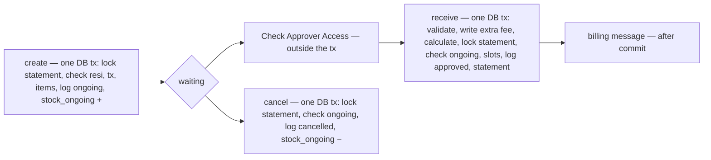

# Development state — stock_thoni / restock_flow

**Pass:** business analysis of [restock_flow.md](../../business/stock_thoni/restock_flow.md), 2026-10-02 → 2026-10-03 14:42.
**Lifecycle position:** `Agent Doing Business Analysis` ⇄ `Business Clarify File` — **paused, not blocked.** The owner moved
on to the return flow with restock's last blocker answered. Nothing past business analysis exists: no `docs/technical/`
doc for this proposal, no screens, no proto, no migration, no code.

> ⚠ **Read this first.** `stock_thoni` is Toni's proposal, written in Indonesian, and it is **separate** from
> `business/inventory/` (Heri's) and `technical/stock/`. Do not merge their decisions. The flow doc is the **only** source
> for restock — the per-case files were deleted on 2026-10-02.

## What the owner's flow now says

## Where everything is

| | file |
| --- | --- |
| the flow (owner's, read-only) | [restock_flow.md](../../business/stock_thoni/restock_flow.md) |
| the ERD (owner's, read-only) | [model.md](../../business/stock_thoni/model.md) |
| open points on the flow | [restock_flow_clarify.md](../../business/stock_thoni/restock_flow_clarify.md) — 0 questions, 1 cosmetic critique, 0 contradictions |
| every decision, indexed at the top | [context_decision.md](../../business/stock_thoni/context_decision.md) — the restock ones run from `restock-dibuat-cs-atau-admin-tim` to `resi-unik-lintas-jasa-kirim` |
| ERD and context-level points | [context_clarify.md](../../business/stock_thoni/context_clarify.md) |

## Decisions that a builder will trip on

| decision | why it matters |
| --- | --- |
| [kunci-statement-lalu-periksa-ongoing](../../business/stock_thoni/context_decision.md#kunci-statement-lalu-periksa-ongoing) | receive and cancel lock `SKU_STATEMENT` rows (in `sku_id` order), THEN re-check `ongoing`. It superseded a lock on the `TRANSACTIONS` row. A DB transaction alone does not stop a double receipt — this took three rounds to settle |
| [transaksi-db-penerimaan-mulai-dari-validasi](../../business/stock_thoni/context_decision.md#transaksi-db-penerimaan-mulai-dari-validasi) | the extra shipping fee is written during validation, inside the same DB tx, so a failed receipt rolls it back |
| [service-lain-di-luar-transaksi-db](../../business/stock_thoni/context_decision.md#service-lain-di-luar-transaksi-db) | the User/Team Service check runs before the tx, the billing message after commit |
| [statement-dibuat-atau-ditambah](../../business/stock_thoni/context_decision.md#statement-dibuat-atau-ditambah) · [statement-ditulis-urut-sku-id](../../business/stock_thoni/context_decision.md#statement-ditulis-urut-sku-id) | `UNIQUE (sku_id, warehouse_id)`, one upsert that ADDS, rows always in `sku_id` order |
| [paket-tiba-setelah-batal-dibuat-restock-baru](../../business/stock_thoni/context_decision.md#paket-tiba-setelah-batal-dibuat-restock-baru) | a `cancelled` restock is never received; a late parcel gets a new restock with the same resi |

## Still open — none blocks returns

- **No open question.** The resi was the last one: creation locks the statement rows, then checks the resi
  ([kunci-statement-lalu-periksa-resi](../../business/stock_thoni/context_decision.md#kunci-statement-lalu-periksa-resi)),
  and a resi is never shared between couriers ([resi-unik-lintas-jasa-kirim](../../business/stock_thoni/context_decision.md#resi-unik-lintas-jasa-kirim)).
- **status-akhir-dua-kali** (in `context_clarify.md`): a database backstop, one final status per `tx_id`.
- No open question, no contradiction.
- One cosmetic critique: the rejected paths are not drawn in the owner's diagram (the clarify's Proposed Design has them).
- ⚠ For the builder: if creation locks existing same-resi `TRANSACTIONS` rows, use a lock mode that does not block a
  cancellation's log insert (its foreign key takes a key-share lock) — `FOR UPDATE` there can deadlock against a
  concurrent cancel of the same resi.

## Next

The owner is writing the **return** flow. Already decided for it:
[transaksi-adalah-barang-masuk](../../business/stock_thoni/context_decision.md#transaksi-adalah-barang-masuk) (`TRANSACTIONS.type = return`) and
[retur-merujuk-order-lewat-ref-order-id](../../business/stock_thoni/context_decision.md#retur-merujuk-order-lewat-ref-order-id).
Test it step by step the same way, and do not ask about steps the owner has not written yet.
