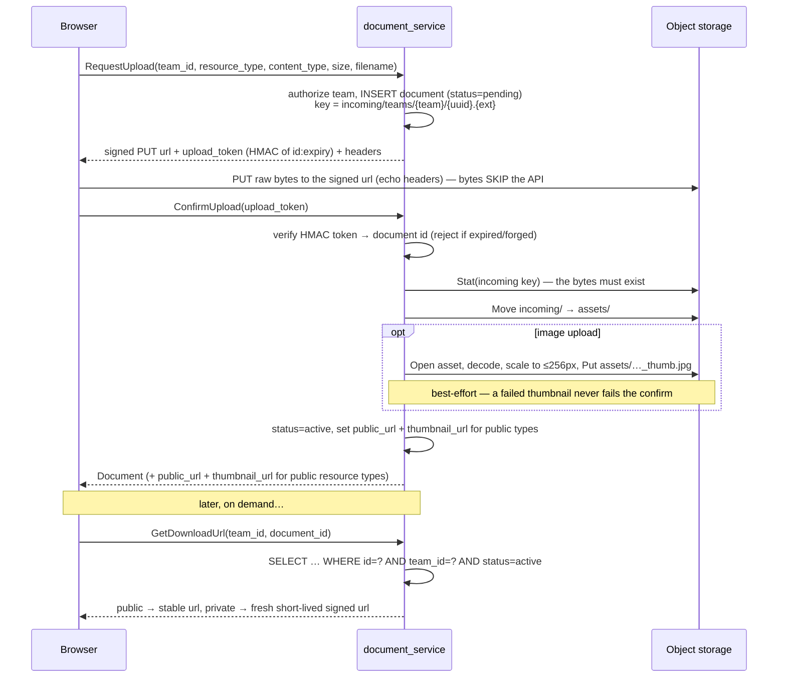
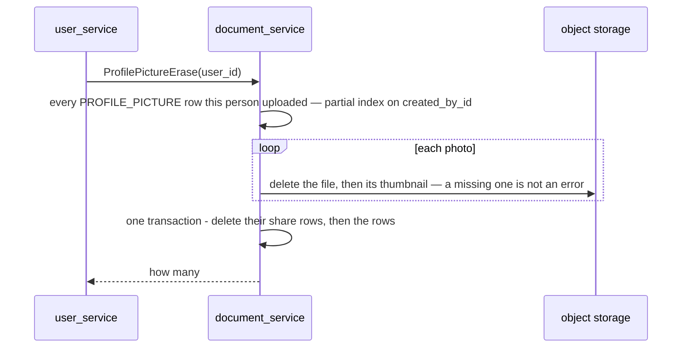
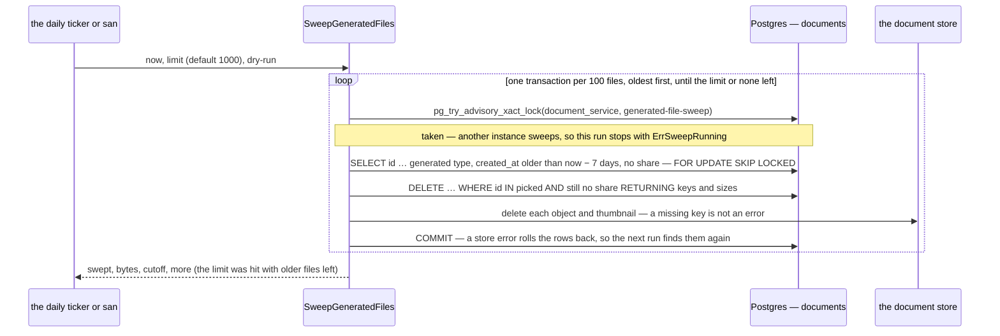

# document_service — complex RPC flows

The upload is a **two-phase** flow across three RPCs; it warrants a diagram even though it has no
cross-service dependency, because the bytes travel a path the API server never sees.

## Two-phase, presigned-PUT upload

**Why these choices:**
- **Two phases (`pending` → `active`).** A metadata row is written before the bytes exist; it is
  only promoted once `ConfirmUpload` verifies the object is actually in storage. So a half-finished
  upload never leaves a row claiming a file that isn't there. Unconfirmed `incoming/` objects are
  reaped by a storage lifecycle TTL.
- **The `upload_token` is a server-signed HMAC** of `documentID:expiry`. It is how `ConfirmUpload`
  recovers *which* document to promote without trusting a client-supplied id, and it can't be forged
  without the server secret. Verified in constant time.
- **`GetDownloadUrl` is team-scoped** — the `team_id = ?` clause means another team's document reads
  as `NotFound`, closing a cross-team read gap. Public resource types (e.g. profile pictures) get a
  stable URL; private ones get a fresh short-lived signed URL each call.
- **Image uploads get a thumbnail** generated on confirm — decoded, scaled so its longest side is
  ≤256px, re-encoded as JPEG, and stored beside the asset. `thumbnail_url` (public types) lets the
  UI load a light preview fast. Generation is best-effort: a non-decodable image just yields no
  thumbnail, never a failed upload.
- **Resource types split public from private.** `PROFILE_PICTURE` and `PRODUCT_IMAGE` are public —
  shown inline from a stable URL. `GENERAL`, `ORDER_RECEIPT`, `PAYMENT_PROOF`, `SETTLEMENT_STATEMENT`, `ORDER_EXPORT`
  and `TABLE_EXPORT` (`00010` — a screen's table as .xlsx, a supplier tab's:
  [each-supplier-tab-exports-its-own-table](../../technical/frontend/suppliers_decision.md#each-supplier-tab-exports-its-own-table),
  uploaded as the person exporting, like the order list's export) are private — a statement is the .xlsx the settlement importer uploads **as a client of this contract**,
  under the uploader's own token, before it reads it. The rest of this point is the receipt's case: an order's courier slip
  (image or PDF) names a buyer and where their parcel went, so it is opened through a signed URL by
  somebody who belongs to the team. Adding a type means four edits in step — the proto enum,
  `resourceTypeToText`/`FromText`, `isPublic`, and the `documents_resource_type_valid` CHECK.
- **One size ceiling, 15 MiB, for every resource type** ([an-attached-file-is-up-to-15-mb-and-two-checks-run-at-once](../../business/shipment/context_decision.md#an-attached-file-is-up-to-15-mb-and-two-checks-run-at-once),
  raised from 10 MiB on 2026-10-23). `docstore.DefaultMaxSizeBytes`, checked twice: `RequestUpload` on the size the
  client DECLARES (`InvalidArgument` before a byte is sent), and `ConfirmUpload` on the bytes that LANDED (`Stat`), so a
  file larger than it claimed is still refused. There is no per-type cap — the owner raised it for an order's file, and
  a payment proof, a product image, a profile picture and an order export got the same 15 MiB (a settlement statement
  stays at 10 MB, held by the importer's own `max_len` before it gets here). Nothing in the dev server
  or `tools/san` sets `MaxSizeBytes`, so the default is the ceiling everywhere. The order form checks the same number
  first (`ReceiptUpload`'s `MAX_BYTES`); the other uploaders do not check it client-side.
- **Storage is behind a `Signer`/`ObjectStore` seam** (`docstore`). Dev/tests use a local
  filesystem backend with an unauthenticated `/local-storage` file endpoint (path-traversal
  guarded); a cloud backend implements the same two interfaces and changes nothing else.

Code: `backend/services/document_service/document_v1/{request_upload,confirm_upload,get_download_url}.go`,
`backend/services/document_service/docstore/`.

## ProfilePictureErase — the photos of an erased person

Called by user_service's `UserErase` ([erase-deletes-the-photo-file](../../business/user/context_decision.md#erase-deletes-the-photo-file)),
with the caller's own bearer, so the policy (Root and the Administrator) is checked against the person erasing.

- **Files first, rows last.** A file that fails to delete stops the call with its row still there, so the next erase
  finds it again. The other order would leave a file no row points to — the one state nothing can clean up.
- **Idempotent.** No rows is `erased = 0`, not an error; a file already gone is skipped. Two erases of one person at
  once both succeed — the local store retries a delete Windows refuses while another one is finishing
  ([lock order](../../../audits/services/document_service/concurrency/lock-order.md)).
- **Every photo, not the current one:** a photo the person replaced is as personal as the one they kept.

Code: `backend/services/document_service/document_v1/profile_picture_erase.go`.

## LabelURL — the one door to a label another team owns (not an RPC)

`document_v1.Service.LabelURL(ctx, ownerTeamID, documentID)` signs a short-lived link to an ORDER RECEIPT for two
in-process callers, each of which has checked the caller's right to it first and names the owner:

| caller | adapter | its check | owner it names |
| --- | --- | --- | --- |
| selling `OrderLabels` ([a-warehouse-prints-the-labels-of-orders-it-ships](../../technical/frontend/warehouse_order_list_decision.md#a-warehouse-prints-the-labels-of-orders-it-ships)) | `cmd/app_development/order_label_linker.go` | the order ships from the caller's warehouse | the order's selling team |
| inventory `RestockReceiptPhoto` ([the-restocks-warehouse-opens-its-label-photo](../../business/inventory/restock_decision.md#the-restocks-warehouse-opens-its-label-photo)) | `cmd/app_development/restock_photo_linker.go` | the restock is going to the caller's warehouse | the restock's selling team |

The restock form's label photo is uploaded through the same ReceiptUpload as an order's label, so it is an
`order_receipt` too — the door did not widen to admit it.
It reads only `documents` (`id`, `team_id` = owner, `resource_type = 'order_receipt'`, `status = 'active'`) and answers
NotFound for anything else — never a payment proof or a statement. No `document_shares` row is written; `GetDownloadUrl`'s
two doors are unchanged. Flow in [selling rpc.md](../selling_service/rpc.md#the-labels-a-warehouse-prints--orderlabels).

**Several labels at once** (2026-11-09) go through two more in-process methods for the same caller, OrderLabels, after the
same check: `LabelFiles(ctx, refs)` reads the BYTES of the asked labels — one `documents` query (`id IN …`, active
`order_receipt`), each row kept only when it is the named owner's, then one store read per file (capped at the upload
limit; a row whose file is gone comes back with no content, which selling reports as *the file can't be read*) — and
`StoreOrderLabels(ctx, team, filename, pdf)` writes the merged PDF straight to the asset prefix and an ACTIVE private
`order_labels` row of the warehouse (`00011`), then signs its link. `RequestUpload` refuses `ORDER_LABELS`: only the
order service makes one. Code: `label_files.go`, `order_labels_store.go`.

## The generated-file sweep — a download is kept seven days (not an RPC)

[generated-files-are-kept-seven-days](../../technical/architecture/context_decision.md#generated-files-are-kept-seven-days):
a file the system MADE for a download — `order_labels` (the merged label PDF), `table_export`, `order_export` — is
deleted, object and row, once it is more than **7 days** old. An uploaded file (every other type) and a generated file
somebody shared are never swept. Built 2026-11-11: `document_v1.Service.SweepGeneratedFiles(ctx, input)` in
`generated_file_sweep.go` — a Go method, no browser can call it. Two callers:

| caller | when |
| --- | --- |
| the server's ticker, `SweepGeneratedFilesEvery` (started by `cmd/app_development/app.go`) | a minute after the server starts, then every `GENERATED_FILE_SWEEP_EVERY` (default `24h`, `0` = off). Nothing else schedules a job in this system, so the ticker lives in the process that runs document_service |
| [`san document sweep-generated`](../../tools/san.md#document-sweep-generated) | by hand, `--dry-run` / `--limit` |

| | |
| --- | --- |
| predicate | `resource_type IN ('order_labels', 'table_export', 'order_export')` written as LITERALS — the partial index `documents_generated_created_idx (created_at, id)` (`00012`) carries the same list, and the planner matches a partial index only against constants — `AND created_at < now − 7 days AND NOT EXISTS (a share)` |
| bounded | at most `limit` files a run (default 1000), 100 per transaction; `More` says older ones are left |
| idempotent | a second run finds nothing; an object already gone still lets its row go |
| a download racing it | `GetDownloadUrl` takes no lock: it reads the row first and signs a link to a file about to go, or reads NotFound — what an expired download answers anyway. `TestRace_SweepGeneratedFiles_ADownloadRacingTheSweep` |
| a share racing it | a share in flight holds the row (its FK check), so the pick SKIPS it and the file stays; a share after the pick waits on the sweep's row lock and is refused once the row is gone (an FK violation — `ShareDocument` answers Internal rather than NotFound for it). Never a share left on a deleted file. `TestInterleave_SweepGeneratedFiles_*`, `TestRace_SweepGeneratedFiles_AShareRacingTheSweep` |
| speed | [performance audit](../../../audits/services/document_service/performances/SweepGeneratedFiles.md) — the index took a 2 000-file run from 1.03 s to 0.14 s at 316 000 documents |
