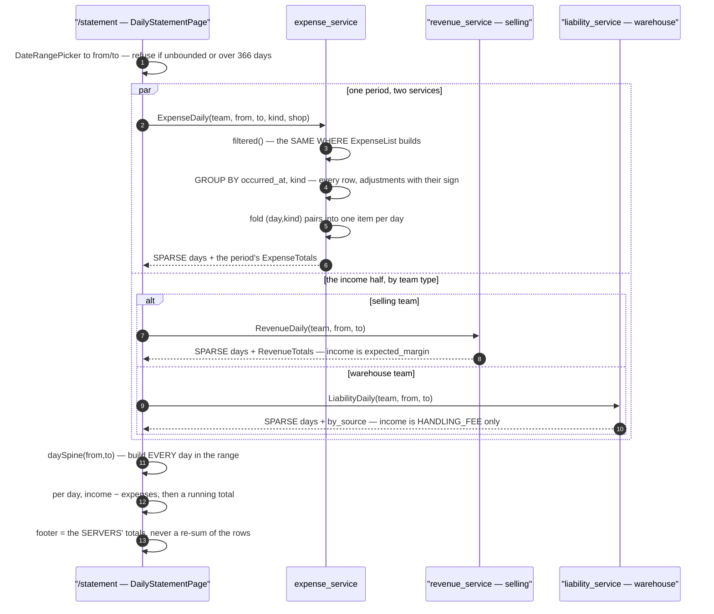
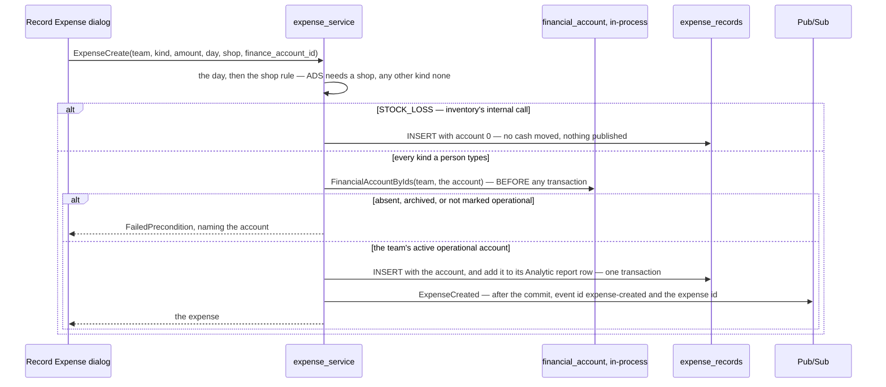
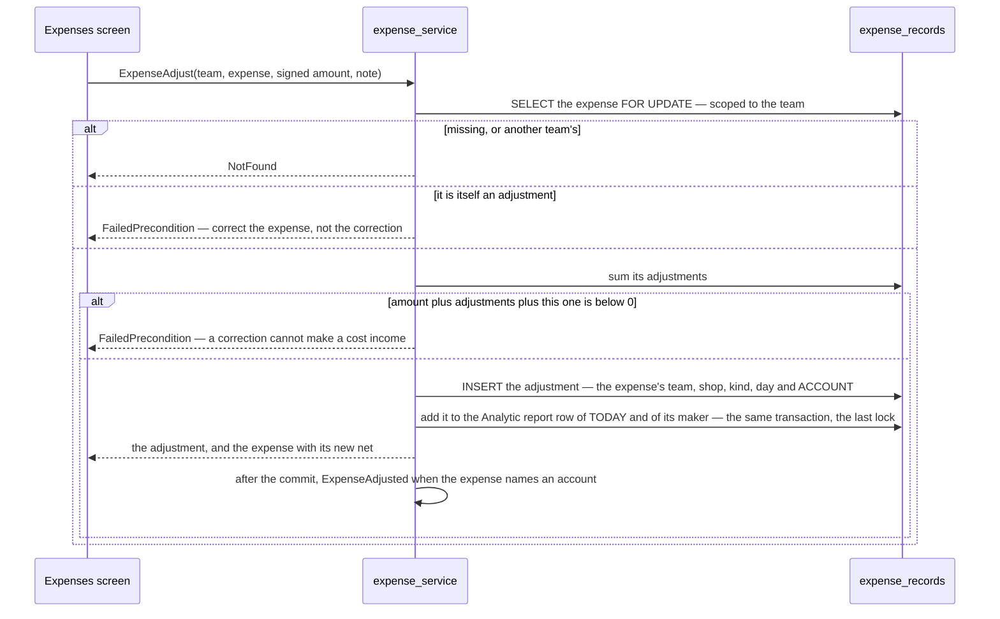
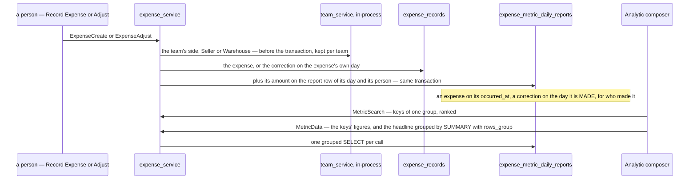

# expense_service — RPC & the daily statement

## What an expense is here

Money the business spent that **no order caused** (#161): ads budget, payroll, rent, subscriptions.

The defining fact is that **a person typed it**. A revenue row is written by the system from an order
and frozen; an expense row is entered by hand about a period. Everything else follows: the form has to
be quick, the mistake has to be fixable, and the row records **who** entered it. A mistake is fixed by a **new row**,
an adjustment, never by an edit or a void ([every-correction-is-a-signed-adjustment](../../business/analytic/context_decision.md#every-correction-is-a-signed-adjustment)) — see
[ExpenseAdjust](#expenseadjust--a-correction-is-a-row).

Deliberately not here: per-order costs (COGS and shipping are frozen onto the order, #74), and any
ledger — no balances, no double entry, the same call revenue made.

### The amount is a double, stored exact as it is written (expense 00005)

`expense_records.amount` is `double precision` and every amount on the wire is `double` since 2026-11-06 — the
create's and the adjust's `amount` (`gt 0` / `not_in [0]`, finite), the list rows, the daily and the per-kind sums, and
`ExpenseCreated` / `ExpenseAdjusted.amount` on the events
([every-ledger-moves-to-double-rounded-when-frozen](../../business/order/context_decision.md#every-ledger-moves-to-double-rounded-when-frozen)). **The write is the freeze point, and it is exact**
([the-backend-never-rounds-money](../../business/order/context_decision.md#the-backend-never-rounds-money), 2026-11-06): `ExpenseCreate` and `ExpenseAdjust` store the figure as sent — a `STOCK_LOSS` arrives
from inventory priced at a FIFO unit cost, a fraction, and is stored as that fraction. Create refuses one that is not
finite and above 0 (InvalidArgument, *"an expense must be more than Rp 0"*; float dust below 4 places counts as 0,
`san_money.Positive`); Adjust refuses a correction of 0 (*"a correction of 0 corrects nothing"*, tolerance-tested with
`san_money.IsZero`). Rp 0,4 is a real expense now. Sums equal their rows within the tolerance.

### One kind nobody types: `STOCK_LOSS`

`EXPENSE_KIND_STOCK_LOSS` is written by **inventory_service**, not by a person. When a warehouse adjusts
a batch as damaged or lost, `StockAdjust` values the units at the batch's frozen `unit_cost` and posts
the money as an expense on the **warehouse's own team** (#211,
[expense_poster.go](../../../backend/cmd/app_development/expense_poster.go)).

It had been filed as `OPERATIONAL` until 2026-08-14, and that was the bug: shrinkage sat in the same
bucket as rent and electricity, so *"how much did we break this month"* had no answer — which is most of
what a warehouse's own P&L is made of. Rent is a decision somebody made; a dropped pallet is not, and
only one of the two is worth a manager's morning.

Three consequences worth knowing:

- **The form does not offer it.** `COST_KINDS` (the picker) excludes it and `COST_FILTER_KINDS` includes
  it — reading a kind and being able to type one are different permissions. A hand-typed loss beside the
  automatic ones would make the total partly a guess.
- **The API refuses it** (2026-11-05). `ExpenseCreateRequest.kind` carries a CEL rule
  (`expense_create.kind.stock_loss_is_not_typed`, `this != 5`), so the validation interceptor answers any caller
  InvalidArgument *"stock loss is recorded by inventory, not typed"*. Inventory's `expensePoster` calls the handler
  in-process, where no interceptor runs, so its write-offs still land
  (`TestExpenseCreate_StockLossIsRefusedThroughTheAPI`, `TestExpenseCreate_StockLossNamesNoAccount`,
  `TestExpensePoster_*`).
- **History stays mixed.** Rows written before the kind existed are still `OPERATIONAL`. They are only
  identifiable by their free-text note, so a backfill would be a guess that could move a real rent row
  (owner). The split is honest from that date forward, not backwards.
- ⚠ **It does not yet separate BROKEN from LOST.** `stock_batches` carries one `damaged_qty` and
  `MovementKind` has a single `ADJUST`, so the DAMAGED/LOST distinction exists in the `StockAdjust`
  request and is **discarded on write** — that is what #227 is for. One combined figure now, split when
  #227 lands, is additive rather than a rework (owner).

> ⚠ **A batch with an unknown `unit_cost` posts NOTHING.** `unit_cost` is nullable and nil means unknown,
> never 0 (#74), so `StockAdjust` skips the expense entirely for those units. Stock genuinely written off
> is therefore **invisible in the money**, and — unlike the revenue side, which counts its unknown-cost
> orders and says so — nothing counts these. A warehouse's loss figure is a floor, not a total. Fixing it
> needs somewhere to record "units written off at unknown cost", which is a schema decision and not this
> RPC's to make.

Most of the service is single-table CRUD and needs no diagram. The one flow that does is the statement,
because it **spans two services**.

---

## The daily statement — `ExpenseDaily`, and whichever income half applies

`ExpenseList` answers *"what did this period cost"*. `ExpenseDaily` answers *"which **day** did it"* —
and it is the **shared half** of one screen, `/statement`. The other half depends on who is reading:

| | income comes from | because |
| --- | --- | --- |
| **selling** team | `RevenueDaily` — the expected margin on its orders | it sells |
| **warehouse** team | `LiabilityDaily` — the handling fees it charged | it has no orders at all |

The expenses half needs no branch, and that is the neat part: a warehouse's written-off stock is already
an expense on its own team, so the same RPC serves both.

**The statement is assembled on the CLIENT.** No service owns it, because none holds the others' numbers
(HARD RULE 3): no shared model package, no table another can read. A backend "statement" RPC would have
made one service own a figure derived from data it does not have.

### A warehouse manager must be able to read this

`ExpenseDailyRequest` carries `ROLE_WAREHOUSE_OWNER` and `ROLE_WAREHOUSE_ADMIN`, which `ExpenseListRequest`
does **not**. That difference is deliberate and load-bearing: without them a warehouse owner gets
`PermissionDenied` on exactly half of their own statement, and the screen would report their fees as pure
profit. `ExpenseList` keeps the narrower set only because no warehouse screen calls it yet — the policies
should differ because of what is built, never because one was forgotten.

### One query, grouped twice

The day item carries a **per-kind split**, so a day that jumped can be read without opening the expense
list. That costs nothing extra: it is the same scan one `GROUP BY` wider — `(occurred_at, kind)` — and
the pairs are folded back into days **in Go**, as a loop over already-sorted rows, rather than as a
second round trip.

A kind with nothing that day is **absent** rather than `0`, matching `ExpenseTotals`. Absent and zero
read identically on a card, and building the empty ones would mean the handler knowing the enum's
members — which would then need editing every time a kind is added.

### The filter is `filtered()`, not a second copy

`ExpenseDaily` builds the `ExpenseListRequest` its period and filters are equivalent to and hands it to
the same `filtered()` helper the list uses. That is the point rather than a tidy-up: a series filtered
to Ads beside a footer that still counted payroll would put a table and a total describing different
things on one screen. One WHERE, three readers.

### The period IS the pagination

`ExpenseDaily` takes no page cursor, and that does not breach HARD RULE 9. The rule guards a `repeated`
whose length grows **with the data**. This one grows with `to − from`, which the caller states:

| | |
| --- | --- |
| Both bounds **required** | unlike `ExpenseList`, where they are optional and a page carries the risk |
| Span **capped at 366 days** | `InvalidArgument` beyond it — refused, never clamped |
| Result | ten years of expenses and one year of expenses return the same 366 rows |

The cap must match the other two services' exactly. The series are read side by side, and a cap that
differed would let the statement load half a period and still look complete. It lives in **four** places:
`maxPeriodDays` in expense, revenue and liability, and `MAX_PERIOD_DAYS` in
[frontend/src/lib/period.ts](../../../frontend/src/lib/period.ts).

### Sparse series, one calendar

Both services **omit** days that hold nothing, and the client builds the date spine — it has to build
one anyway to line the two series up, and a server that also emitted empty days would be a second
calendar free to disagree with it.

A quiet day is still **rendered**, dimmed. A missing row cannot tell a reader "nothing was spent" apart
from "that day did not load".

### No timezone question on this side

`occurred_at` is a **DATE**, chosen by a person — there is no instant to convert and therefore no zone
to get wrong. The revenue half buckets a `TIMESTAMPTZ` and has to name one; see
`revenue_service/rpc.md` (removed with the service on 2026-08-29 — `git show 0d4cbc49^:docs/services/revenue_service/rpc.md`) for the UTC-vs-UTC+7 caveat that carries.

### Adjustments count on their expense's day

An adjustment copies its expense's day, so a day's total and the period's `ExpenseTotals` are the corrected figures
with no special case ([an-adjustment-counts-on-the-day-it-fixes](../../business/analytic/context_decision.md#an-adjustment-counts-on-the-day-it-fixes)).
A day whose only expense was cancelled reads **0, made of two entries** — something was entered and taken back, and the
day says so. The list shows both rows, the expense with what it counts for now.

⚠ **Analytic counts a correction differently** — on the day it is MADE, for who made it
([an-expense-correction-counts-on-the-day-it-is-made](../../business/analytic/rpc_provide_decision.md#an-expense-correction-counts-on-the-day-it-is-made)) —
so a day or month there can differ from the same period here by the corrections made later. Accepted; see
[the Analytic expense metrics](#the-analytic-expense-metrics--expenseanalyticservice).

## ExpenseCreate — Paid from and the ads-only shop

Built 2026-11-04 — [an-expense-must-name-the-account-that-paid](../../business/financial_account/context_decision.md#an-expense-must-name-the-account-that-paid),
[an-expense-names-a-shop-only-for-ads](../../business/financial_account/context_decision.md#an-expense-names-a-shop-only-for-ads),
[the-paid-from-prototype-is-accepted](../../business/financial_account/context_decision.md#the-paid-from-prototype-is-accepted).
Every expense a person types names the account that paid it. expense_service never reads financial_account's tables:
the composition root's [expense_accounts.go](../../../backend/cmd/app_development/expense_accounts.go) answers
`PayingAccounts` in-process from `FinancialAccountByIds` (team-scoped, so another team's account is simply absent).

| | |
| --- | --- |
| `finance_account_id` | `uint64.gt = 0` in the proto, re-checked in the handler (InvalidArgument) — a caller that skips the interceptor is not trusted |
| a refused account | FailedPrecondition, naming it: *"BCA Gaji is not one of the team's active operational accounts — pick another, or ask an admin to mark it operational"*, *"… is archived — …"*, or *"account #N …"* for another team's or an unknown id (never confirms an id) |
| the shop | ADS with shop 0 → InvalidArgument *"an ads expense names its shop"* · any other kind with a shop → *"only an ads expense names a shop"* |
| `STOCK_LOSS` | through the API: InvalidArgument *"stock loss is recorded by inventory, not typed"* (a CEL rule on `kind`, enforced by the validation interceptor). Inventory's `expensePoster` calls the handler directly, with no account and no interceptor — stored with account 0 whatever was sent, the account service never asked, nothing published |
| the event | `ExpenseCreated` (topic `expense-created`) — expense id, team, kind, account, amount, the expense's day, shop, actor + override. Published AFTER the commit; a failed publish is logged with its event_id and never fails the expense (no outbox, as a restock's) |
| never published | a `STOCK_LOSS`, an account 0 |

---

## ExpenseAdjust — a correction is a row

The one way to correct an expense ([every-correction-is-a-signed-adjustment](../../business/analytic/context_decision.md#every-correction-is-a-signed-adjustment)). The screen's
**Adjust** sends the typed correction with its direction; **Batalkan** sends minus what the expense still counts for.

| | |
| --- | --- |
| the lock | the expense row, for the check and the write — two people pressing Batalkan at once cannot both pass the floor |
| `amount` | signed, never 0 (validated, and re-checked in the handler) |
| `net_amount` | on an expense row in `ExpenseList` and in this response: its amount plus every adjustment of it |
| the account | copied from the expense, never typed ([a-correction-follows-the-expenses-account](../../business/financial_account/context_decision.md#a-correction-follows-the-expenses-account)) — 0 on an expense made before *Paid from* |
| events | `ExpenseAdjusted` (topic `expense-adjusted`, event_id `expense-adjusted:<adjustment id>`) after the commit — adjustment and expense ids, team, kind, the expense's account, the SIGNED amount, the expense's day, actor + override. Batalkan is just an adjustment of minus the net, so a cancel gives the account the net back. Not published for an account 0 or a `STOCK_LOSS` (built 2026-11-04) |

---

## The Analytic expense metrics — `ExpenseAnalyticService`

Built 2026-11-06 — [expense-has-ads-and-expenses](../../business/analytic/rpc_provide_decision.md#expense-has-ads-and-expenses),
[expense-figures-are-read-from-its-own-records](../../business/analytic/rpc_provide_decision.md#expense-figures-are-read-from-its-own-records),
[an-expense-correction-counts-on-the-day-it-is-made](../../business/analytic/rpc_provide_decision.md#an-expense-correction-counts-on-the-day-it-is-made),
[stock-loss-stays-out-of-analytic-expenses](../../business/analytic/rpc_provide_decision.md#stock-loss-stays-out-of-analytic-expenses),
[the-expense-metrics-follow-the-decisions-already-made](../../business/analytic/rpc_provide_decision.md#the-expense-metrics-follow-the-decisions-already-made),
[an-expense-correction-counts-for-who-made-it](../../business/analytic/rpc_provide_decision.md#an-expense-correction-counts-for-who-made-it),
[the-expense-prototype-is-accepted](../../business/analytic/rpc_provide_decision.md#the-expense-prototype-is-accepted).
`proto/warehouse/expense/v1/expense_analytic.proto`, handlers `expense_v1/metric_{shared,search,data,fold}.go`, the
report `expense_metric_daily_reports` (00006).

| metric | fields | filters | groups |
| --- | --- | --- | --- |
| **Ads expense** `metrics/ads` | `amount` — the ADS kind | date range (required), shop, team (the seller), user | shop, seller, warehouse, created by, daily / weekly / monthly / yearly |
| **Expenses** `metrics/expenses` | `ads`, `payroll`, `operational`, `other`, `total` — typed kinds only, no STOCK_LOSS | date range (required), team, user | seller, warehouse, created by, time |

| | |
| --- | --- |
| the day | an expense: its own `occurred_at`. A correction and a cancel: the Jakarta day the adjustment was made (`created_at` in WIB). A past day never changes in Analytic, while `expense_records` keeps the correction on its expense's day — the Expenses page, `/statement` and the paying account are unchanged ([an-expense-posts-on-its-own-day](../../business/financial_account/context_decision.md#an-expense-posts-on-its-own-day)) |
| the person | `created_by` of the row: the typer of an expense, the corrector of a correction — a person who only corrects reads negative on that day |
| never counted | `STOCK_LOSS` — the fold skips it and the table's CHECK refuses kind 5; settlement's ads fee and a transfer's shipping are other services' rows |
| Seller / Warehouse | the report row carries the team as `seller_id` (a selling team) or `warehouse_id` (a warehouse team); the root team's on neither. The composition root reads `teams.type` (`cmd/app_development/expense_team_sides.go`, kept per process) |
| readers | every member of a team — CS and warehouse staff included, unlike `ExpenseList` — reads its own team's; the root team every team's; another team's rows match nothing. Both RPCs `NO_SIDE_EFFECTS`, so the admin monitor and an agent read them |
| the headline | MetricData with `GROUP_TYPE_SUMMARY`. `rows_group` names the table's group: under an id group the headline sums only the rows that group keys (by Seller the sellers' — a warehouse team's expense is no Seller row — by Warehouse the warehouses'); under a time group or unset, everything visible. On any other `group_by` it is InvalidArgument |
| refusals | InvalidArgument: another service's metric id, a filter or group a metric does not list (a shop on Expenses), a repeated filter, no date range, a range over a year, keys under SUMMARY, a period keyed by any day but its first |
| money | exact doubles, summed in SQL, never rounded |
| concurrency | one upsert per row, the transaction's last statement — see [lock-order.md](../../../audits/services/expense_service/concurrency/lock-order.md) |
| perf | one query per read; a team's year 1–2 ms, root's every-team year 23–25 ms (the root scan, as the order metrics and Lost stock); create / adjust with the fold ~1 ms (`TestPerf_ExpenseMetric`, ~137 000 report rows) |
| MCP | source `expense` in `mcp_service/tool_metrics.go` |
