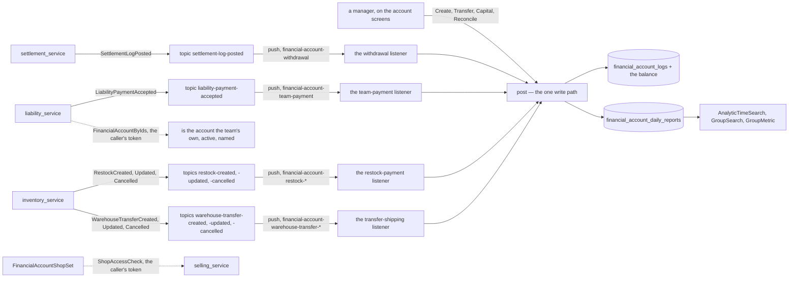
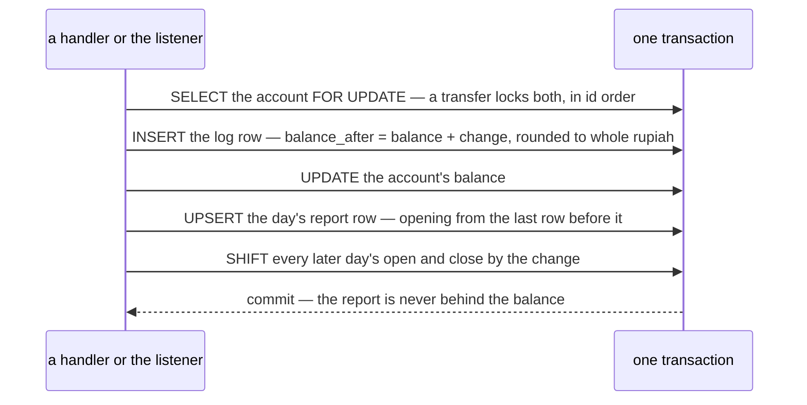
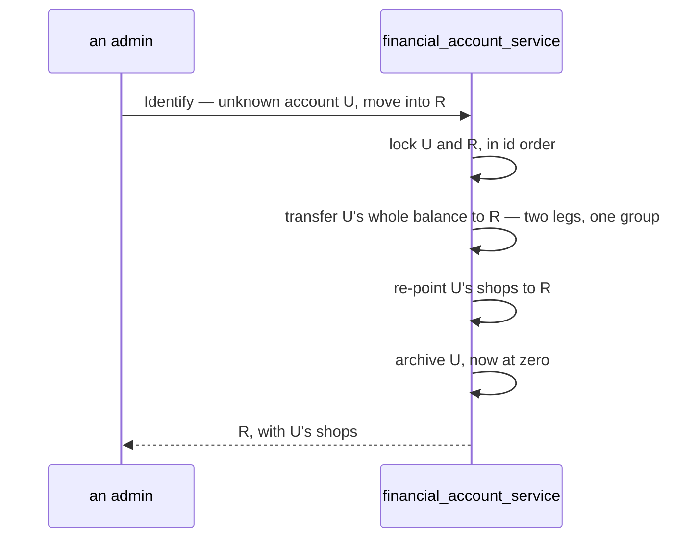
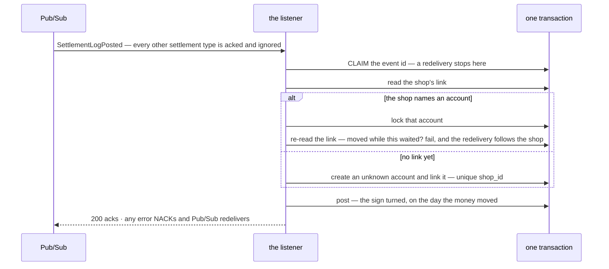
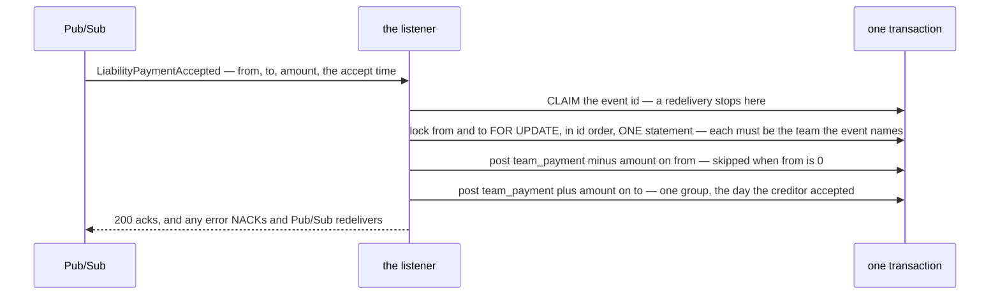
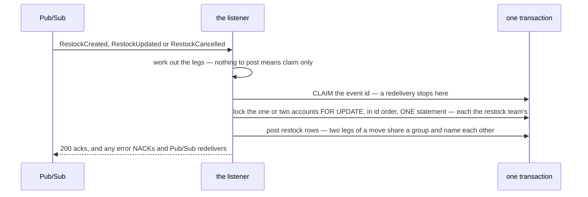
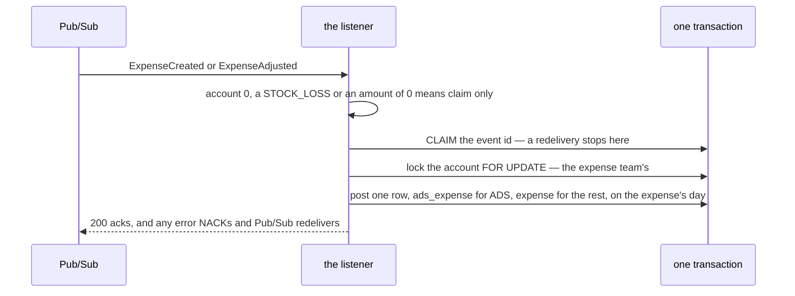
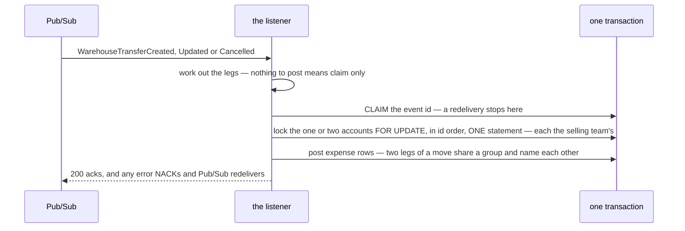

# financial_account_service — RPC flows

The money a team actually **holds** — its bank accounts, ShopeePay wallet and cash box, each with a balance
that moves only with a log row ([context_decision.md](../../business/financial_account/context_decision.md)).

> ⚠ **Not [settlement_service](../settlement_service/rpc.md)**, which is what the marketplace pays us, nor
> **[liability_service](../liability_service/rpc.md)**, which is what teams owe each other. A withdrawal is
> where settlement's money arrives HERE: settlement records it leaving the marketplace wallet, this service
> records it landing in the shop's account.

| service | RPC | what it is |
| --- | --- | --- |
| `FinancialAccountService` | `FinancialAccountList` · `FinancialAccountByIds` | the team's accounts — **no balance** · `archived_only` lists the archived alone, for the archive view |
| | `FinancialAccountOverview` | the balances — per account, and a total per type · `archived` counts the archived per type instead, for the archive's tabs |
| | `FinancialAccountLogList` | one account's statement, newest first |
| | `FinancialAccountCreate` | an account, and its `opening_balance` row in the same transaction · type **Lainnya** is type and provider `unknown`, as a pair, number optional ([lainnya-is-opened-by-the-server](../../business/financial_account/context_decision.md#lainnya-is-opened-by-the-server)) |
| | `FinancialAccountUpdate` · `Archive` · `Restore` | name, holder, description · out of the pickers only at zero · back |
| | `FinancialAccountIdentify` | an `unknown` account filled in, or moved into a registered one |
| | `FinancialAccountTransfer` · `Capital` · `Reconcile` | the hand rows — two legs · the owner's money · the bank's figure in, the difference posted |
| | `FinancialAccountShopSet` · `OperationalSet` | which account a shop withdraws into · which accounts pay for operations |
| `FinancialAccountAnalyticService` | `AnalyticTimeSearch` · `AnalyticGroupSearch` · `AnalyticGroupMetric` | settlement's report shape, read from one row per account per day |
| *(push route)* | `/event/financial-account-withdrawal/push` | settlement's `withdrawal` rows into the shop's account |
| *(push route)* | `/event/financial-account-team-payment/push` | liability's accepted team payments — out of the payer's account, into the creditor's |
| *(push routes)* | `/event/financial-account-restock-{created,updated,cancelled}/push` | inventory's restock payments — out at create, the difference or the move on an edit, the refund on a cancel |
| *(push routes)* | `/event/financial-account-warehouse-transfer-{created,updated,cancelled}/push` | a warehouse transfer's shipping cost as `expense` — out at create, the difference or the move on an edit, the refund on a cancel |

Every member of the team **sees**; admin and up **moves** the money
([seeing-is-team-wide-moving-is-admin-and-up](../../business/financial_account/context_decision.md#seeing-is-team-wide-moving-is-admin-and-up)) —
except `Transfer` and `Capital`, which a warehouse leaves to its Owner
([the-warehouse-admin-equals-the-owner-except-money](../../business/user/context_decision.md#the-warehouse-admin-equals-the-owner-except-money)).
Other services never call a write — they publish, and this service listens
([a-row-comes-by-hand-or-from-the-broker](../../business/financial_account/context_decision.md#a-row-comes-by-hand-or-from-the-broker)).

---

## post — the one write path

Every row, by hand or from the listener, goes through `post` (`ledger.go`) on an account its caller has
**locked `FOR UPDATE`**. That lock is the whole concurrency story: `balance_after` is read under it, and the
day's report row and the later-day shift are per account, so the same lock serialises them.

It never refuses — below zero included
([below-zero-is-warned-never-refused](../../business/financial_account/context_decision.md#below-zero-is-warned-never-refused)).
Whether a row may be posted at all (archived, unknown) is the caller's check, made under the lock.

---

## FinancialAccountIdentify — move in

Fill-in instead updates U's type, provider, number, holder and name in place — its rows stay. A number
already recorded is refused, and the message points at move-in.

---

## The withdrawal listener

| case | what happens |
| --- | --- |
| the same event twice, even at once | posted once — the claim is the write |
| a new shop's first withdrawals at once | one creates the unknown account; the others hit the unique `shop_id`, roll back with their claim, and are redelivered into it |
| a move-in commits while a withdrawal waits on the old account | the re-check under the lock sees the new link and fails; the redelivery posts into the real account |
| an archived account the shop still names | posts — refusing would dead-letter money that moved |

The description names the shop by id (`Withdrawal from shop #21`) — a listener hears an event, not a person,
so it has no caller to ask the shop's service with. The screens put the shop's name in.

---

## The team-payment listener

[a-team-payment-posts-on-accept](../../business/financial_account/context_decision.md#a-team-payment-posts-on-accept) —
liability publishes `LiabilityPaymentAccepted` once a creditor accepts, and this posts the transfer into BOTH
teams' books: one `team_payment` row out of the payer's account, one into the creditor's, sharing a group. Route
`/event/financial-account-team-payment/push`, subscription `financial-account-team-payment` on
`liability-payment-accepted`. How liability checks the two accounts before it publishes:
[liability's rpc.md](../liability_service/rpc.md#where-the-money-left-and-where-it-landed--the-accounts).

| case | what happens |
| --- | --- |
| the same event twice, even at once | posted once — the claim is the write |
| payments both ways between the same two accounts at once | no deadlock — two teams' accounts, locked in id order like a transfer's ([lock order](../../../audits/services/financial_account_service/concurrency/lock-order.md)) |
| `from_account_id = 0` — a payment recorded before *Paid from* existed | only the creditor's leg posts; a reconcile on the payer's side finds the transfer |
| an account missing, or not the team the event names | an error, never filed elsewhere — liability asked before recording and accepting, so this is a bug for the dead-letter queue |
| an archived account | posts — refusing would dead-letter money that moved |
| no `to_account_id`, or no amount | an error — liability's contract makes both impossible, and the listener does not trust that |

The descriptions name the other team by id (`Team payment #12 to team #7`) — as for a withdrawal, a listener
has no caller to ask the team's service with.

---

## The restock-payment listener

[a-created-restock-tells-the-financial-account](../../business/inventory/restock_decision.md#a-created-restock-tells-the-financial-account),
[a-restock-names-its-paying-account](../../business/inventory/restock_decision.md#a-restock-names-its-paying-account),
[an-edit-sends-the-difference](../../business/inventory/restock_decision.md#an-edit-sends-the-difference),
[an-edit-may-move-the-payment-to-another-account](../../business/inventory/restock_decision.md#an-edit-may-move-the-payment-to-another-account)
— inventory publishes a restock's money after each commit, and this posts it as `restock` rows, the type's one way in
([restock-is-never-typed-by-hand](../../business/financial_account/context_decision.md#restock-is-never-typed-by-hand)).
[restock_payment_listener.go](../../../backend/services/financial_account_service/financial_account_v1/restock_payment_listener.go),
three subscriptions to one handler: `financial-account-restock-created|updated|cancelled`. Built 2026-11-04.

| event | posts |
| --- | --- |
| `RestockCreated` | `−amount` on `finance_account_id` (goods plus shipping), dated `created_at_unix` · *"Restock #N"* |
| `RestockUpdated`, same account | `−(new − old)` — a lower total comes back in · *"Restock #N edited"* · nothing when the amount did not change |
| `RestockUpdated`, another account | `+old_amount` back on the old account, `−new_amount` on the new — one group |
| `RestockCancelled`, money returned | `+amount` on the account that paid · *"Restock #N cancelled — money returned"* |
| `RestockCancelled`, not returned | nothing |

| case | what happens |
| --- | --- |
| the same event twice, even at once | posted once — the claim is the write |
| out of order (an edit or cancel before the create) | the same end balance — every event carries its own delta, so the rows commute |
| an amount of 0, an edit that changed nothing paid | nothing posts; the event is still claimed |
| an account missing, or not the restock team's | an error, never filed elsewhere — a dead letter, and the claim rolls back with it |
| no account on a create with an amount | an error — inventory requires one; the listener does not trust that |
| ⚠ my spec — old account 0 (a restock raised before *Paid from*) | an edit posts only the difference into the new account — the old payment predates the ledger; a refunded cancel with no account posts nothing (acked, logged) |
| an archived account | posts — refusing would dead-letter money that moved |
| a move X → Y beside a hand transfer Y → X | no deadlock — both lock the pair in id order ([lock order](../../../audits/services/financial_account_service/concurrency/lock-order.md)) |

## The expense-payment listener

[an-expense-must-name-the-account-that-paid](../../business/financial_account/context_decision.md#an-expense-must-name-the-account-that-paid),
[a-correction-follows-the-expenses-account](../../business/financial_account/context_decision.md#a-correction-follows-the-expenses-account),
[ads-expense-joins-the-types](../../business/financial_account/context_decision.md#ads-expense-joins-the-types)
— expense_service publishes each expense and each correction after its commit, and this posts it on the account the
expense names, as `ads_expense` for ADS and `expense` for every other kind — the two types' one way in
([one-way-in-per-type](../../business/financial_account/context_decision.md#one-way-in-per-type)).
[expense_payment_listener.go](../../../backend/services/financial_account_service/financial_account_v1/expense_payment_listener.go),
two subscriptions to one handler: `financial-account-expense-created|adjusted`. Built 2026-11-04.

| event | posts |
| --- | --- |
| `ExpenseCreated` | `−amount` on `finance_account_id` · *"Expense E-N"* |
| `ExpenseAdjusted` | `−amount` (the correction is signed) on the ORIGINAL expense's account — down gives money back, up takes more, Batalkan gives the whole net back · *"Expense E-N adjusted"* |

| case | what happens |
| --- | --- |
| the day | the expense's own day (`occurred_on`, read in Jakarta) — an adjustment carries the corrected expense's day, so a cancel nets that day to 0 |
| the same event twice, even at once | posted once — the claim is the write |
| out of order (a correction before its expense) | the same end balance — every event carries its own delta |
| account 0 (an expense made before *Paid from*, and its corrections), a `STOCK_LOSS`, an amount of 0 | nothing posts; the event is still claimed |
| an account missing, or not the expense team's | an error, never filed elsewhere — a dead letter, and the claim rolls back with it |
| an archived account | posts — an expense recorded while it was active may be corrected after |
| the override | `actor_is_override` is stamped on the row, beside the actor |
| the daily report | `foldDay` writes the `expense` / `ads_expense` column in the same transaction, so the overview, the report and the analytics pick it up with no other change |

A warehouse transfer's shipping is ALSO `expense`, from inventory's events — see the next section.

---

## The transfer-shipping listener

[a-transfers-shipping-posts-as-an-expense](../../business/financial_account/context_decision.md#a-transfers-shipping-posts-as-an-expense),
[the-shipping-expense-reaches-the-account-by-event](../../business/inventory/warehouse_transfer_decision.md#the-shipping-expense-reaches-the-account-by-event),
[a-transfer-names-its-paying-account](../../business/inventory/warehouse_transfer_decision.md#a-transfer-names-its-paying-account)
— inventory publishes a warehouse transfer's `shipment_cost` after each commit, and this posts it on the selling team's
account the transfer names, as **`expense`** rows. It is `expense`'s second way in, beside expense_service's events, and
it makes no expense record: the Expenses screen never lists it, so the account's *Expense* figure may exceed that
screen's total by the transfers' shipping — each row names its transfer.
[transfer_shipping_listener.go](../../../backend/services/financial_account_service/financial_account_v1/transfer_shipping_listener.go),
three subscriptions to one handler: `financial-account-warehouse-transfer-created|updated|cancelled`. It posts through
the restock listener's `postPaymentLegs` — the claim, the accounts locked in id order, one group for a move — with only
the type and the words changed. Built 2026-11-04.

| event | posts |
| --- | --- |
| `WarehouseTransferCreated` | `−amount` on `finance_account_id`, dated `created_at_unix` · *"Warehouse transfer #N shipping"* · nothing for 0 |
| `WarehouseTransferUpdated`, same account (event id keyed by the cost revision) | `−(new − old)` — a lower cost comes back in · *"… shipping edited"* |
| `WarehouseTransferUpdated`, old account 0 | the cost was 0 until this edit (inventory empties the account with the cost): `−new` on the new account |
| `WarehouseTransferUpdated`, another account | `+old_amount` back on the old account, `−new_amount` on the new — one group · *"… moved to / from another account"*. A cost cleared to 0 is the old account's refund alone |
| `WarehouseTransferCancelled` | `+amount` on the account that paid · *"Warehouse transfer #N shipping cancelled — money returned"* — nothing for 0 |

| case | what happens |
| --- | --- |
| the same event twice, even at once | posted once — the claim is the write |
| out of order (an edit or a cancel before the create) | the same end balance — every event carries its own delta |
| a cost of 0, an edit that moved nothing | nothing posts; the event is still claimed |
| an account missing, or not the selling team's | an error, never filed elsewhere — a dead letter, and the claim rolls back with it |
| no account on a cost above 0 (create or edit) | an error — inventory requires one; the listener does not trust that |
| ⚠ a cancel has no *money returned* flag | unlike a restock's — a transfer is cancelled only while `created`, and the decision says its event *"returns whatever was posted"*, so a cancel with an amount always refunds |
| ⚠ a cancel with an amount and no account | nothing posts (acked, logged) — as the restock's: nothing was posted to give back |
| an archived account | posts — refusing would dead-letter money that moved |
| shipping and its moves beside hand transfers on the same accounts | no deadlock — both lock in id order ([lock order](../../../audits/services/financial_account_service/concurrency/lock-order.md)) |
| the daily report | `foldDay` writes the `expense` column, so the overview, the report and the analytics count it as an expense with no other change |
| *Warehouse Transfer Accepted* | not this listener's — balance's courier charge; the event_type filters keep it out |

---

## FinancialAccountShopSet

`shop_id` arrives in the request, so the shop's service is asked first — `ShopAccessCheck` under the caller's
token, BEFORE the transaction, so no lock is held across the call. Another team's shop or a deleted one is
NotFound, and nothing is linked. Then the account is locked and the link upserted on `shop_id` — pointing a
shop here moves it off the account it named.
