# inventory_service — RPC & event flows

## Pub/Sub push receiver (#102)

`inventory_service` exposes a **Pub/Sub PUSH** endpoint so it can react to events published by other
services (the counterpart to publishing via `event_source.NewPubsubEventSender`). It is a plain HTTP
endpoint — **not** a Connect RPC — mounted at **`/events/inventory`** in
[register.go](../../../backend/services/inventory_service/register.go) and wrapped by
`event_source.NewMuxPushHandler` (which continues the publisher's trace and encodes the ACK/NACK
contract).

One handler dispatches by **subscription name** (`push.subscription`), so a single endpoint can serve
several subscriptions.

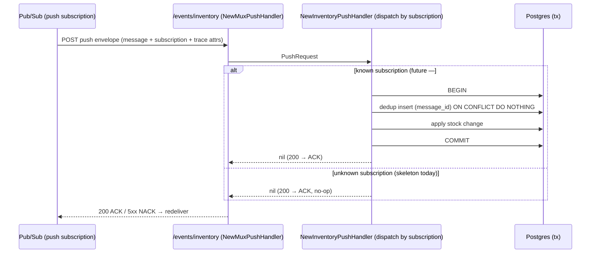

**Status: SKELETON.** No subscription consumes events yet — inventory reacts to order/stock events,
and that integration (order → stock) lands with **#69**, which also introduces the stock-event
contract. Until then the handler ACKs every message as a no-op (returning non-2xx would make Pub/Sub
redeliver forever).

When a real subscription is wired, the handler will, in **one transaction**: insert an **exactly-once**
dedup row keyed by `message.messageId` (`ON CONFLICT DO NOTHING` — a redelivery finds the row and
skips), then decode the event with `event_source.DecodeEvent` and apply the stock change. If the work
fails, the whole transaction (dedup row included) rolls back so a redelivery reprocesses it.

> **Dead-letter policy required.** `event_source/push.go` returns a non-2xx for a malformed or failed
> message, and Pub/Sub redelivers any non-2xx forever. Every push subscription pointed at this
> endpoint must therefore have a dead-letter policy so a poison message is eventually parked, not
> looped. (Push-endpoint authentication — OIDC/token — is a deployment concern, not handled in code.)

---

## Restock requests

A **two-sided** flow across two teams. A SELLING team restocks into a WAREHOUSE; the warehouse signs for the box and
counts it in, and *the accept is what receives the stock*. The design is
[restock.md](../../business/inventory/restock.md) and its decisions in
[restock_decision.md](../../business/inventory/restock_decision.md); the contract was **rewritten in place** to it
([the-restock-contract-changes-in-place](../../business/inventory/restock_decision.md#the-restock-contract-changes-in-place)).

> 🔄 **00024 (2026-10-15): the tables caught up with the contract.** Every field is stored, the status words are the
> contract's, a missing problem row is `missing`, the trail is `restock_logs` and the courier's charge is one column
> pair on the restock ([restocks-non-stock-parts-come-before-the-switch-over](../../business/inventory/restock_decision.md#restocks-non-stock-parts-come-before-the-switch-over)).
> 🔄 **Ledger stage 2 (2026-10-16): the accept writes the decided ledgers** through `inventory_mutations.PostRestock`, in
> its own transaction, and the restock records its `transaction_id`
> ([the-decided-ledgers-come-before-the-restock-accept](../../business/inventory/restock_decision.md#the-decided-ledgers-come-before-the-restock-accept)).
> ⚠ It still writes today's stock tables beside them, until stage 3 moves their readers
> ([ledgers.md](../../development_state/inventory/ledgers.md)). Create and update now refuse another team's product
> ([a-restock-carries-only-the-teams-own-products](../../business/inventory/restock_decision.md#a-restock-carries-only-the-teams-own-products)).

| RPC | Who | From → to | What it does |
| --- | --- | --- | --- |
| `RestockRequestCreate` | selling team | → ongoing | the restock and its lines in one transaction, and the first trail row; each product once (refused as InvalidArgument, and by a unique index); each product the team's own, asked of product_service before the transaction (another team's or an unknown one is InvalidArgument); each line's supplier and store asked of supplier_service before the transaction (a store names its supplier and belongs to it). Announces *Restock Created* after commit |
| `RestockRequestList` / `Detail` | either side | — | rows where `team_id = team` **OR** `warehouse_id = team`; a third team reads **NotFound**. Every filter server-side; a lens narrows the two-sided scope, never replaces it |
| `RestockRequestUpdate` | selling team | ongoing / arrived | a full replace; every product the team's own, asked before the lock, as create. **Ongoing:** every field, the paying account required. **Arrived:** the lines only — count, total, note; new lines may name their supplier and store, a stored line keeps its own, none removed; any other field that differs is refused. Every edit is a trail row, status unchanged. An edit that moves money announces *Restock Updated* |
| `RestockRequestArrive` | warehouse | ongoing / lost → arrived | signs for the box: who and when, a trail row; moves no stock. Locked FOR UPDATE, scoped to `warehouse_id` — the selling team and another warehouse read NotFound. A late lost box keeps its lost-by. Opens the arrived window of Update |
| `RestockRequestAccept` | warehouse | ongoing / arrived → accepted | counts the box in — below |
| `RestockRequestMarkLost` | selling team | ongoing → lost | gives the parcel up: who and when, a trail row carrying the optional why; moves no money. Ongoing only — a box in the building is not lost. A lost restock is neither accepted nor cancelled; only signing for a late box brings it back |
| `RestockRequestCancel` | selling team | ongoing → cancelled | ongoing only, so a second cancel is refused — the money comes back once; whether it did is written on the trail row and announced in *Restock Cancelled* |
| `RestockRequestLabels` | warehouse | accepted | one label per placement the good units went to |
| `RestockInboundStat` | warehouse | — | what is still coming: ongoing **and** arrived |

### Lifecycle

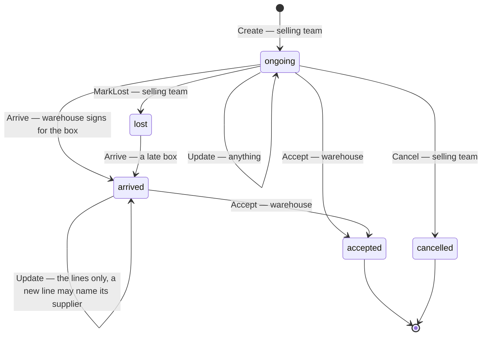

Every move takes the restock row `FOR UPDATE` first and checks the status under it, so an accept and a cancel at the
same second queue on one lock and the second sees what the first did
([accept-locks-the-restock](../../business/inventory/restock_decision.md#accept-locks-the-restock)).

### The accept transaction

Per line the warehouse types **what is in the box** and **how many of those are broken**; good and missing are worked
out ([any-warehouse-member-counts-what-arrived](../../business/inventory/restock_decision.md#any-warehouse-member-counts-what-arrived)).

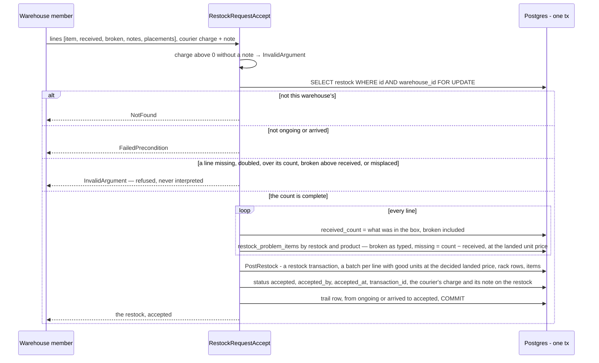

| Rule | Decision |
| --- | --- |
| received above the line's count is refused — the selling team adds the extra by an edit first | [accept-refuses-more-than-the-line-says](../../business/inventory/restock_decision.md#accept-refuses-more-than-the-line-says) |
| the short units are a MISSING row, worked out, never typed | [a-short-unit-at-the-door-is-missing](../../business/inventory/restock_decision.md#a-short-unit-at-the-door-is-missing) |
| the good units go onto placements of this warehouse, exactly received − broken; there is no unplaced choice | [there-is-no-unplaced-pile](../../business/inventory/restock_decision.md#there-is-no-unplaced-pile) |
| a problem row's worth is the landed unit price over every unit ordered, filled at accept and stored | [the-problem-price-is-filled-by-the-system](../../business/inventory/restock_decision.md#the-problem-price-is-filled-by-the-system), [all-qty-is-every-unit-ordered](../../business/inventory/restock_decision.md#all-qty-is-every-unit-ordered) |
| one batch per line with good units; the batch's price = line total ÷ line count + (shipping + courier charge) ÷ every unit ordered | [one-batch-per-line](../../business/inventory/restock_decision.md#one-batch-per-line), [unit-price-is-line-price-plus-costs-per-unit](../../business/inventory/restock_decision.md#unit-price-is-line-price-plus-costs-per-unit) |
| one courier's charge, its note required; outside the restock's total, inside the unit price; saved on the restock, and *Restock Accepted* carries it — liability posts the debt from the event | [the-courier-is-paid-once-per-restock](../../business/inventory/restock_decision.md#the-courier-is-paid-once-per-restock), [balance-posts-the-couriers-debt-from-the-event](../../business/inventory/restock_decision.md#balance-posts-the-couriers-debt-from-the-event) |
| a problem row's note is optional — an empty one stays empty | [a-broken-reason-is-optional](../../business/inventory/restock_decision.md#a-broken-reason-is-optional) |

✅ *(2026-10-16)* **The courier's debt left the accept**: `PostRestockOutlay` is gone, *Restock Accepted* carries the charge, its note and
the accepting person, and liability posts the debt from `/event/liability-restock-accepted/push`.
✅ *(2026-10-16)* **The unit cost is the decided one**: the line's `total ÷ count`, plus the costs over every unit
ORDERED, and a broken or missing row carries that same landed price
([all-qty-is-every-unit-ordered](../../business/inventory/restock_decision.md#all-qty-is-every-unit-ordered)).

✅ *(2026-10-17)* **The accept writes only the ledgers**: one `restock` transaction (`inventory_mutations.PostRestock`), a
batch per line with good units at the landed price, its rack rows. The old `stock_*` writes are gone, and the line's
placements are read back from the accept's rack rows.

✅ *(2026-10-17)* **The tables carry the owner's names and the money is `double`** (`00030`): `restocks`,
`restock_items`, `restock_problem_items` — the problem rows keyed by restock and product — and every money field on
the wire and in the tables a double, as the ledgers hold it
([money-is-double-in-the-api-too](../../technical/stock/design_decision.md#money-is-double-in-the-api-too)).
`restocks.subtotal` / `total` and a line's `price_unit` are stored, written by every create and edit.

---

## Order transactions — an order's take and its release, on the ledgers

`OrderTransactionService` (`order_transaction.proto`): the order service calls it while it creates an order, before the
order exists, so inventory knows the take only by the order form's key K
([every-release-goes-by-the-key](../../business/order/context_decision.md#every-release-goes-by-the-key)). ✅ *(2026-10-17)*
**Selling's order calls it** through the composition root's stock picker, with the key `order:<order id>` until the
order form mints K ([the-order-take-bridges-its-key-per-order](../../technical/stock/design_decision.md#the-order-take-bridges-its-key-per-order)).

### OrderTransactionCreate

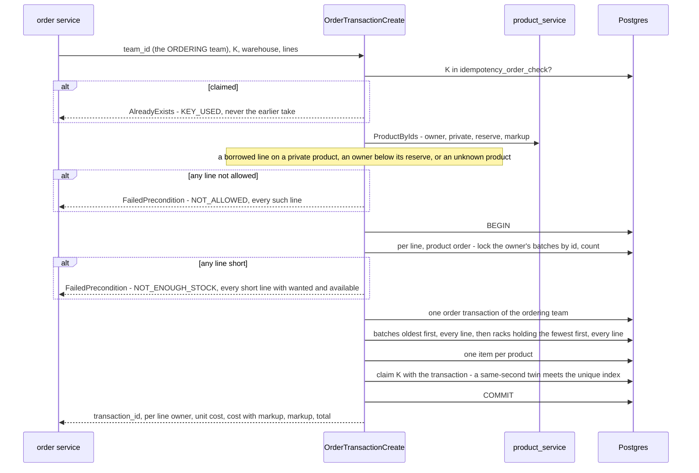

| Rule | Decision |
| --- | --- |
| K looked up first; a hit is refused, never answered | [a-used-key-is-refused-first](../../business/inventory/order_decision.md#a-used-key-is-refused-first) |
| the product read before any transaction; private and the reserve stop other teams only | [the-take-checks-the-product-first](../../business/inventory/order_decision.md#the-take-checks-the-product-first), [the-reserve-stops-other-teams-at-low-stock](../../business/product/context_decision.md#the-reserve-stops-other-teams-at-low-stock) |
| the reserve compares the owner's total stock, every warehouse, a plain read | [the-reserve-is-read-before-the-take](../../business/inventory/order_decision.md#the-reserve-is-read-before-the-take) |
| one error, one reason, every refused line, on an `OrderTransactionRefusal` detail | [a-refusal-names-its-reason-and-every-line](../../business/inventory/order_decision.md#a-refusal-names-its-reason-and-every-line) |
| one transaction per order, of the ordering team; each item names its owner | [an-order-is-one-inventory-transaction](../../business/order/context_decision.md#an-order-is-one-inventory-transaction), [an-item-carries-its-owning-team](../../business/inventory/transaction_decision.md#an-item-carries-its-owning-team) |
| the markup is inventory's, on cost, for another team's product only | [inventory-computes-the-markup](../../business/order/context_decision.md#inventory-computes-the-markup) |
| K claimed in its own table, inside the take's transaction | [the-key-is-claimed-in-its-own-table](../../business/inventory/transaction_decision.md#the-key-is-claimed-in-its-own-table) |
| lines in product order, batches before racks — no deadlock between two orders | [batches-lock-before-shelves-by-id](../../business/inventory/context_decision.md#batches-lock-before-shelves-by-id) · `order_transaction_race_test.go` |

### OrderTransactionRelease

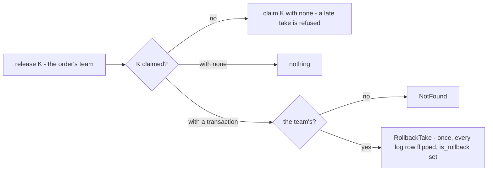

One path for an order cancelled and for a create that failed after its take. Only a take is rolled back
([a-rollback-only-undoes-a-take](../../business/inventory/transaction_decision.md#a-rollback-only-undoes-a-take)); the
rollback reverses the log rows, not the items
([a-rollback-reverses-its-log-rows](../../business/inventory/transaction_decision.md#a-rollback-reverses-its-log-rows)).
⚠ Still to wire: *Order Cancel* and the create's *InventoryTxCancel* compensation reach this by K at the cutover.

---

## Warehouse transfers

A selling team moves its OWN stock from one warehouse (A) to another (B) — **three teams on one record**: the team opens
it, A processes and ships it, B signs for it and counts it in. The design is
[warehouse_transfer.md](../../business/inventory/warehouse_transfer.md) and its decisions in
[warehouse_transfer_decision.md](../../business/inventory/warehouse_transfer_decision.md).

> **Built on the decided ledgers** — `inventory_v1/warehouse_transfer_*.go`, one file per RPC, the legs in
> `inventory_mutations/post_transfer.go` (`PostTransferOut`, `PostTransferIn`). It supersedes
> `InventoryService.StockTransfer`, the instant one-product move, which nothing calls and the cut-over retires.
> ⚠ Money on the wire is still whole rupiah (`int64`), rounded from the `double` columns, until the cut-over turns the
> contract `double`.

| RPC | Who | From → to | What it does |
| --- | --- | --- | --- |
| `WarehouseTransferCreate` | selling team | → created | the transfer, its lines and its `transfer_out` at A in one transaction — below |
| `WarehouseTransferList` / `Detail` | any side | — | rows where the team owns it, or is A, or is B; a fourth team reads **NotFound**. `direction` splits a warehouse's outgoing from its incoming |
| `WarehouseTransferUpdate` | selling team | until accepted | the shipping cost, its account and the note — never the lines. Not a status change: no trail row. An edit that moved money bumps `cost_revision` and publishes *Warehouse Transfer Updated* with both sides |
| `WarehouseTransferCancel` | selling team | created → cancelled | rolls the `transfer_out` back (`RollbackTake`) under the transfer's lock; publishes *Warehouse Transfer Cancelled* — the cost back to its account |
| `WarehouseTransferMarkLost` | selling team | shipped → lost | the loss is the team's |
| `WarehouseTransferProcess` | A | created → process | from here on there is no cancel |
| `WarehouseTransferShip` | A | process → shipped | the courier, tracking number and label photo — all optional |
| `WarehouseTransferArrive` | B | shipped / lost → arrived | signs for the box |
| `WarehouseTransferAccept` | B | shipped / arrived → accepted | counts the box in — below |

### Lifecycle

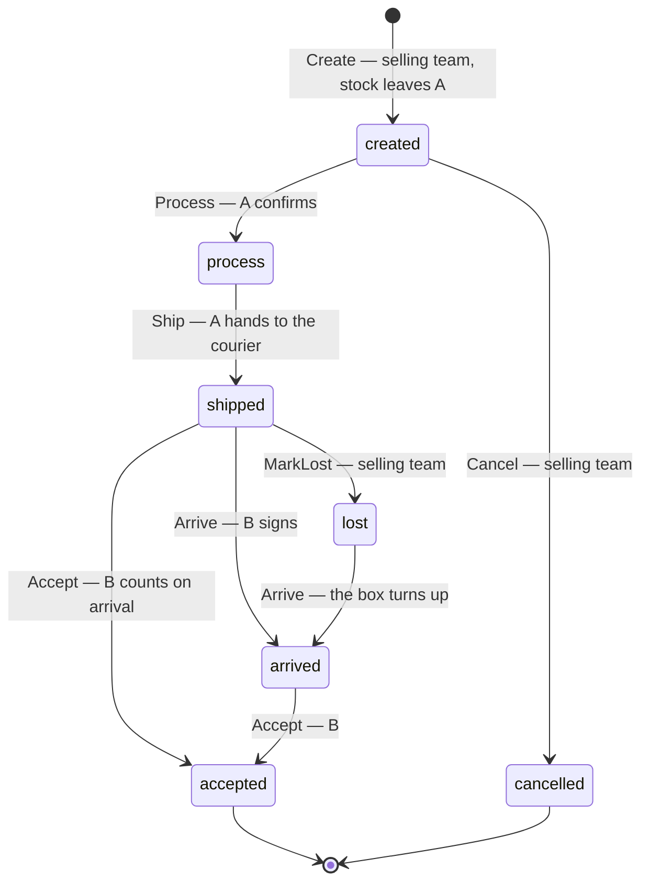

Every status change takes the transfer row `FOR UPDATE` first, then batches, then shelves, each in id order, and checks
the status under the lock — a cancel racing A's confirm, or two accepts of one box, cannot both succeed
([a-transfer-is-locked-before-any-status-change](../../business/inventory/warehouse_transfer_decision.md#a-transfer-is-locked-before-any-status-change)).

### The create transaction — the stock leaves A

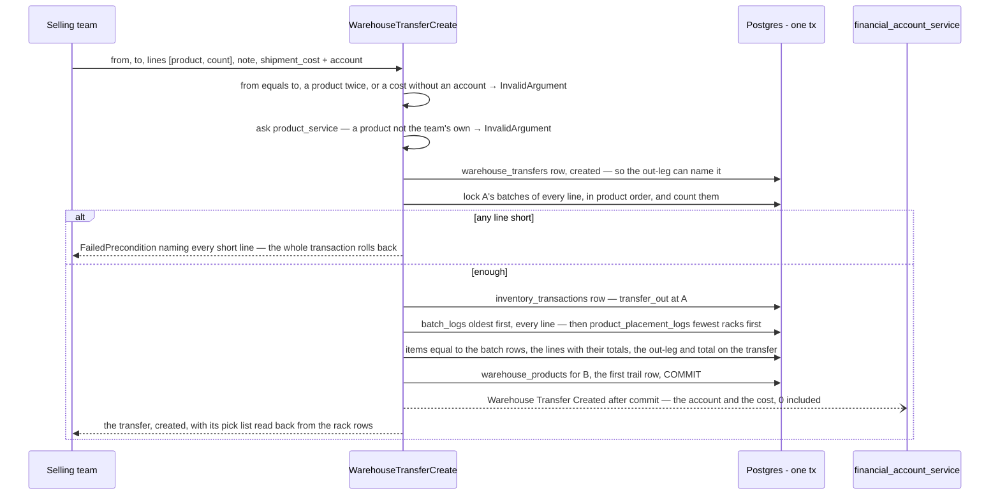

### The accept transaction — the stock arrives at B

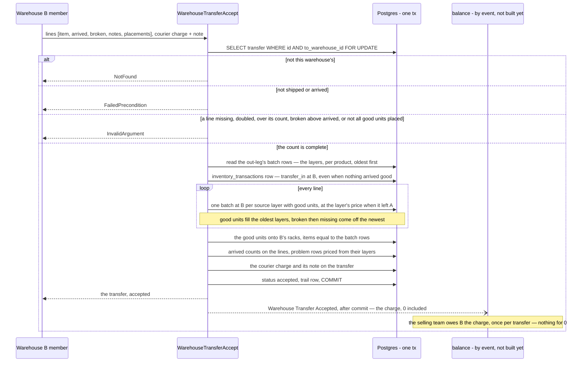

| Rule | Decision |
| --- | --- |
| the stock leaves A at create; too few fails the create | [a-transfer-takes-from-the-sender-at-create](../../business/inventory/warehouse_transfer_decision.md#a-transfer-takes-from-the-sender-at-create) |
| in transit, the units are in neither warehouse's book, only in the transfer | [the-transfer-is-where-goods-in-transit-are](../../business/inventory/warehouse_transfer_decision.md#the-transfer-is-where-goods-in-transit-are) |
| B mints one batch per source batch; the trip never changes a unit's price | [the-receiver-mints-one-batch-per-source-batch](../../business/inventory/warehouse_transfer_decision.md#the-receiver-mints-one-batch-per-source-batch), [a-transfer-never-changes-a-units-price](../../business/inventory/warehouse_transfer_decision.md#a-transfer-never-changes-a-units-price) |
| every price is the system's, from the batch rows | [the-system-fills-a-transfers-prices](../../business/inventory/warehouse_transfer_decision.md#the-system-fills-a-transfers-prices) |
| broken, missing and lost are the selling team's loss | [the-selling-team-bears-broken-missing-and-lost](../../business/inventory/warehouse_transfer_decision.md#the-selling-team-bears-broken-missing-and-lost) |
| the shipping expense reaches the account by event; B pays the on-site charge and saves it at accept, and balance posts the debt from the accepted event | [the-shipping-expense-reaches-the-account-by-event](../../business/inventory/warehouse_transfer_decision.md#the-shipping-expense-reaches-the-account-by-event), [the-on-site-charge-is-paid-by-b-at-accept](../../business/inventory/warehouse_transfer_decision.md#the-on-site-charge-is-paid-by-b-at-accept), [balance-posts-the-transfers-on-site-debt-from-the-event](../../business/inventory/warehouse_transfer_decision.md#balance-posts-the-transfers-on-site-debt-from-the-event) |
| one line per product, one problem row per product per kind | [a-product-appears-once-per-transfer](../../business/inventory/warehouse_transfer_decision.md#a-product-appears-once-per-transfer) |
| the receiving warehouse can find what is coming | [a-transfer-links-its-products-to-the-receiver](../../business/inventory/context_decision.md#a-transfer-links-its-products-to-the-receiver) |

**Choices the build made, inside the decisions** — none is a new rule; each is where the decisions were silent:

| | |
| --- | --- |
| the price B's batch copies | the source batch's `price_unit_after` on the out-leg's row — its price when it left A, so a revaluation at A after the out-leg never reaches B |
| broken and missing on one newest layer | broken first, then missing |
| a pick list and a put-away | never stored: read back from the legs' `product_placement_logs` (takes are negative, puts positive) |
| the events | four, published after commit and never failing the request: *Created* (every create, cost 0 included), *Updated* (only an edit that moved money, id `…:<cost_revision>`), *Cancelled*, *Accepted* (every accept, charge 0 included). Their money is `double` from day one. ⚠ Nobody listens yet: the financial account's listener is not built, and balance waits on the source type ([balance Q13](../../business/balance/context_clarify.md#question)) |
| not checked | that A and B are warehouse teams — as a restock's warehouse is not; a transfer to a team with no warehouse roles simply waits, unaccepted |

Proven under concurrency by `warehouse_transfer_race_test.go` (`-tags raceaudit`): eight accepts of one box count it in
once, sixteen creates never send more than A holds and never deadlock with their lines in opposite order, a cancel
racing A's confirm and a lost racing an accept each end in exactly one, and an Interleave shows a second accept waiting
on the first one's lock.

---

## Stock lives on the decided ledgers — and what that changes about reads

Every reader reads the ledgers ([database-schema.md § The decided ledgers](../../database-schema.md#the-decided-ledgers-00025-00026)),
and nothing reads the dropped `stock_*` tables. One idea explains most of the surprises:

> **A rack row counts units of ONE product on ONE rack; a batch counts units of ONE delivery. Neither knows the other.**

- **Where** a product sits is `product_placements` (one row per product per rack, its count after every change in
  `product_placement_logs`). `StockList`, `ProductPlaces`, `PlacementList`, `RackList`'s stock slice, `RackStock` and
  `RackHistory` read these.
- **What it is worth** is `batches` (price, units, value — `stock_valuation` is the truth). `StockAvailability`,
  `StockCost`, the batch and cost-layer reads and every owner read use these; the owner is `batches.team_id`.
- **No row carries both**, so a product's history without a batch reads the rack rows and with one reads the batch's
  rows; a batch's "racks" are where it was put away when it was minted
  ([a-batch-shows-the-racks-it-was-put-on](../../business/inventory/batch_decision.md#a-batch-shows-the-racks-it-was-put-on)).
- **There is no unplaced pile** ([there-is-no-unplaced-pile](../../business/inventory/restock_decision.md#there-is-no-unplaced-pile)):
  every unit is on a rack, and a request naming "unplaced" is refused.
- **"Last counted"** is the newest `adjustment` rack row — a count writes one even when it finds the rack exact.

### A stock-take counts a RACK (#139) — provisionally, as an `adjustment`

`StockAdjust` and the one-rack `StockOpname` survive the cut-over as provisional `adjustment` transactions
([old-shelf-corrections-move-onto-the-ledgers-provisionally](../../technical/stock/design_decision.md#old-shelf-corrections-move-onto-the-ledgers-provisionally));
every choice the port made is open in [adjustment_clarify.md](../../business/inventory/adjustment_clarify.md). The
request must say which rack it counted — a required `oneof`, re-checked by the handler — and "unplaced" is refused.

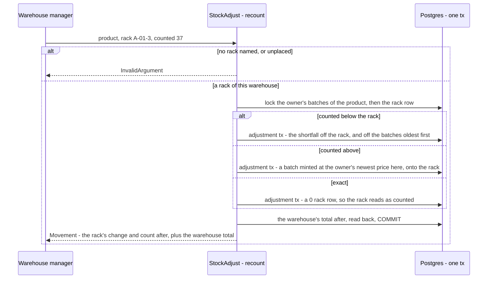

Correcting one rack leaves the product's other racks **exactly as they were**. Damaged, lost and found name a batch
and take from or return to it; a damaged or lost unit is owed to its owner inside the transaction and written off to
expense after it (§ Broken, lost, and found).

### Reading a rack, and why it needs another service (#138)

`RackStock` answers the question a person standing at a shelf actually has: **what is on THIS rack, and
how much of each**. It is the mirror of `StockList` — that one sums a product *across* its racks
("how much of X does this warehouse hold"), this one reads a single rack.

Two things it refuses to conflate:

- **Another warehouse's rack is NotFound, never an empty shelf.** If "not yours" looked like "nothing
  on it", a probe could map another warehouse's rack ids by which came back empty.
- **A line counted to zero is not on the rack.** A level can fall to 0 without being deleted (a
  stock-take zeroing a shelf), and listing it would show a product that is not there.

**It returns product ids only — never names.** That is not laziness, it is the service boundary: a
warehouse holds **other teams' goods** (a selling team's restock puts its product on this shelf), so
the ids belong to catalogues `inventory_service` does not own, and inventing a name for them would be
guessing. The caller resolves them through `product_service`'s **`ProductByIds`** — added for exactly
this, and the reason the §4 question ("whose product is in whose warehouse") had to be settled before
this screen could exist. Two things that decision is honest about: it is **new exposure for warehouse
roles**, and *"only what it holds"* is **not enforced** and cannot be by `product_service`, which
does not know what any warehouse holds.

### Moving stock inside a warehouse (#136)

A move is `RackMove` (below) — `StockMove`, `StockReceive`, `StockTransfer`, `StockPick` and `StockReturn` are gone:
goods come in by a restock, move between racks by `RackMove`, leave for an order by `OrderTransactionCreate`, and go to
another warehouse by a warehouse transfer. **A rack that still holds stock cannot be deleted** (#138) —
`FailedPrecondition`, empty it first; the check sums its `product_placements` rows, because `RackDelete` is a soft delete
and the FK never fires.

### `RackMove` and `RackSample` — on the decided ledgers

The placement decisions ([placement_decision.md](../../business/inventory/placement_decision.md)) give a rack two writes
of its own, both opened from Rack detail: **Move Goods** — staff reorganizing space, from one rack to one or more — and
**Record Sample** — goods handed to a person at the warehouse
([a-sample-is-handed-over-at-the-warehouse](../../business/inventory/transaction_decision.md#a-sample-is-handed-over-at-the-warehouse)).

> ✅ *(2026-10-16)* **Built on the decided ledgers** (`inventory_mutations.PostMove`, `PostSample`; tests in
> `rack_move_test.go`, `rack_sample_test.go`, races in `rack_move_race_test.go`). The rack screens read the ledgers, and
> `RackMove` replaced `StockMove`, whose one product, one batch and *unplaced* end all went.

| RPC | Who | What it writes |
| --- | --- | --- |
| `RackMove` | any warehouse member ([any-warehouse-member-may-move-goods](../../business/inventory/placement_decision.md#any-warehouse-member-may-move-goods)) | per owning team, one `move` transaction: per product, minus on the source rack and plus on each destination, nothing in the batch ledger ([a-move-writes-two-rack-rows-and-no-batch-row](../../business/inventory/placement_decision.md#a-move-writes-two-rack-rows-and-no-batch-row)) |
| `RackSample` | any warehouse member | per owning team, one `sample` transaction: minus on the request's rack ([a-sample-names-the-rack-it-was-taken-from](../../business/inventory/placement_decision.md#a-sample-names-the-rack-it-was-taken-from)), oldest batch first. Final: never rolled back ([a-handed-over-sample-is-final](../../business/inventory/placement_decision.md#a-handed-over-sample-is-final)) |

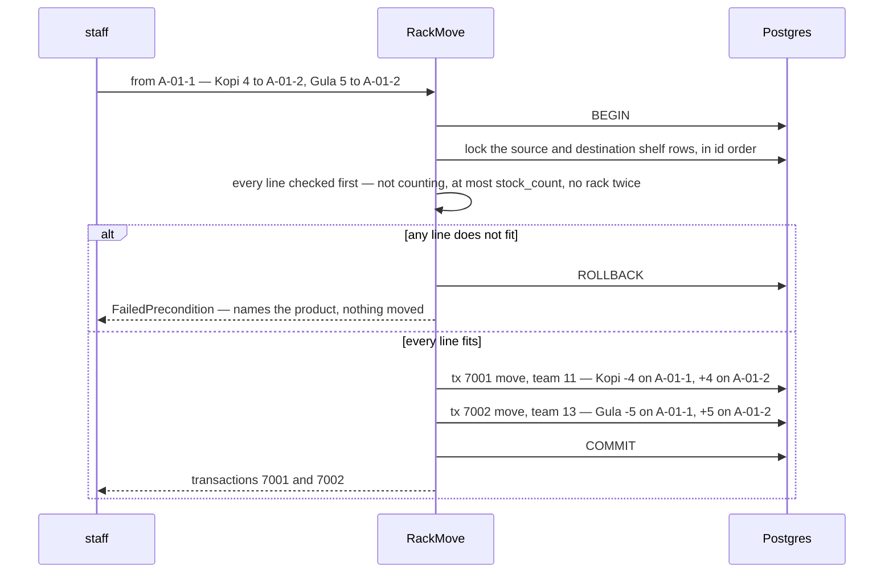

The rules, as the stub played them and the handlers now keep:

| | |
| --- | --- |
| one rack to one or more | every destination in the team's warehouse, never the source; a product may be split, never twice to one rack ([a-move-is-one-rack-to-one-or-more-racks](../../business/inventory/placement_decision.md#a-move-is-one-rack-to-one-or-more-racks)) |
| all or nothing | one database transaction for every team's transaction; any line that does not fit refuses the whole write, naming the product ([a-move-is-all-or-nothing](../../business/inventory/placement_decision.md#a-move-is-all-or-nothing)) |
| one transaction per owning team | the response lists them in team id order ([a-move-writes-one-transaction-per-owning-team](../../business/inventory/placement_decision.md#a-move-writes-one-transaction-per-owning-team)) |
| the ceiling | a line takes at most the rack's stock count, so sold units waiting for the picker stay ([a-move-leaves-sold-units-on-their-rack](../../business/inventory/placement_decision.md#a-move-leaves-sold-units-on-their-rack)) |
| a product being counted | refused once opname is built; `RackStockLine.counting` tells the dialog to lock it at 0 — always false until then |
| `RackList` STOCK slice | real today: each rack's stock count and product count for the Racks page, one grouped `SUM`/`COUNT` over the page's racks, only when asked — a picker never pays for it |
| `RackSample.recipient` | required, who received it, kept on the transaction ([a-sample-keeps-its-recipient](../../business/inventory/transaction_decision.md#a-sample-keeps-its-recipient)). No member of the owning team is asked to agree, and the sample posts nothing to balance ([a-sample-is-a-stock-out-at-batch-value](../../business/inventory/transaction_decision.md#a-sample-is-a-stock-out-at-batch-value)) |

---

## Accepting a delivery (#154, #155, #157)

Accepting is **counting** — what is in the box and how many are broken, per line — and **saying where the good units
went**, with the courier's charge at the door beside it. That is a form with sections, so the warehouse's Accept surface
is a **page**, not a dialog.

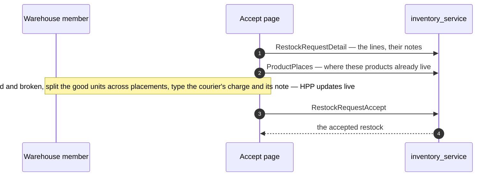

### The rules the screen mirrors

| Rule | Why |
| --- | --- |
| A blank count is **not** zero | 0 means "looked, none of it was in the box". Blank means nobody counted. |
| Received above the line's count **blocks** Accept | the selling team adds the extra by an edit first (accept-refuses-more-than-the-line-says) |
| Missing is **worked out**, never typed | ordered − received (a-short-unit-at-the-door-is-missing) |
| Placements must **sum** to received − broken | counting 8 good and placing 7 is an error in one of the two |
| The courier's charge needs a note, and sits **outside** the total | the-courier-is-paid-once-per-restock, the-couriers-charge-stays-out-of-total |

The guard is a single expression mirroring the handler's rules — a second one beside it is how a screen's idea of
"ready to send" drifts from the handler's idea of "acceptable". The HPP preview mirrors the accept's arithmetic, the
courier's charge included, so the figure on screen is the one the batch freezes.

---

## RestockInboundStat — the receiving warehouse's headline (owner, 2026-07-30)

The mirror of `OwnerStockStat` below, and it exists **because it is not the same question**. The buyer
asks *what have I committed that has not landed*; the warehouse asks *what work is still at my door*.

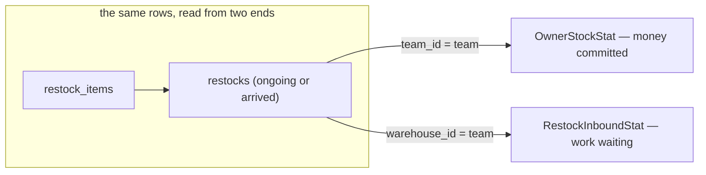

Four figures over **ongoing and arrived restocks coming to this warehouse**, narrowed by the same
`requesting_team_id` lens the list uses — a headline that ignored the filter under it would contradict
the table it sits above.

| Figure | What it is | Why not the obvious thing |
| --- | --- | --- |
| `restock_count` | `COUNT(*)` over the pending REQUESTS | Over requests, not the item join — a two-line delivery is **one** delivery. 3 deliveries of 400 pieces and 30 of 400 are the same stock and completely different amounts of door-opening. |
| `product_count` | **DISTINCT** `product_id` across the queue | Counting LINES reports 4 for one SKU on four deliveries. It is one thing to find a shelf for, and put-away is the job this number sizes. |
| `unit_count` | Σ ordered `count` | The **asked** quantity — nobody has counted these yet, which is exactly why they are in the queue. |
| `amount` | Σ line `total`, a double | **Goods only.** Shipping is what the buying team paid to get them moving and the courier's charge is 0 until someone accepts, so either would answer a question about somebody else's spending. |
| `oldest_pending_unix` | `MIN(created_at)` over the REQUESTS | Over requests, not their lines — a line-less request still waits at the door, and a MIN over the item join would skip it. A count of 7 hides the box that has sat since Monday. |

**Still coming is the whole meaning of it** — on its way, or at the door not yet counted. An accepted restock has
become stock; a lost or cancelled one never arrives. Either leaking in produces a queue that never drains.

`MIN`/`MAX` over no rows is **NULL, not 0** — the scan target is nullable, and an empty queue reports
`0` (the RPC's "never"), which the UI renders as an em dash rather than "0 days".

Its policy carries **warehouse roles only** — this is deliberately not one RPC serving both sides.
`OwnerStockStat`'s policy has no warehouse roles at all, so the receiving crew would have got
PermissionDenied from it; letting one RPC answer both is how two different numbers silently converge.

## OwnerStockByIds / OwnerStockStat — the catalogue owner's stock (the selling team's product list)

Every other read in this service answers **for a warehouse**: the caller is the building, and
`team_id` is that building's team. These two answer **for the selling team that owns the goods** —
*how much of my product is on a shelf, anywhere, and what is it worth* — which no RPC could answer
before.

### Ownership is written on the batch

A batch carries its owner, written at mint and never changed
([a-batch-carries-its-owner](../../business/inventory/warehouse_transfer_decision.md#a-batch-carries-its-owner)): the
restock's selling team, or the source batch's at a transfer. Every owner read filters `batches.team_id`, so a caller
passing another team's product id matches none of its batches and gets nothing back — no climb through restocks, and
no trust placed in the client.

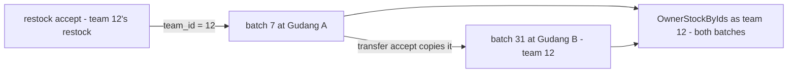

### The page's three reads

The product list is one screen over three services, and each answers for the **whole page** rather
than per row — a per-row fetch is an N+1 that only reveals itself once a real catalogue is loaded.

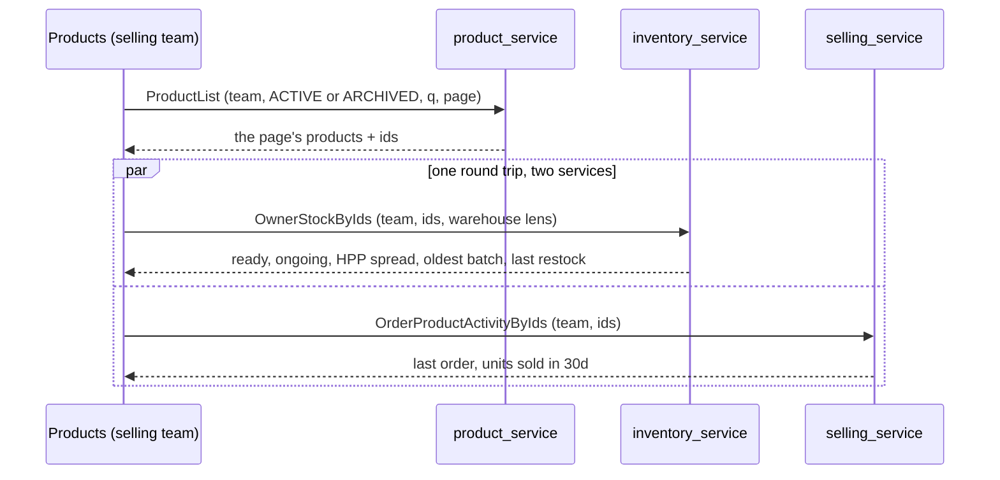

The stat row above the tabs is the same three questions asked of the whole catalogue —
`ProductList` for the count, `OwnerStockStat`, `OrderActivityStat` — and deliberately **not** a total
of the visible page: a headline that moved every time somebody typed in the search box would be
describing the search rather than the business.

### The rules these reads keep

| Rule | Why |
| --- | --- |
| Unknown-cost batches add **units, not money** | A batch whose HPP was never recorded is not free (#74). It counts in `ready_qty` and contributes nothing to `ready_value`; `cost_known` says whether the spread means anything at all. |
| The cost **spread**, not an average | The same product genuinely arrives at different prices. The average is exactly what hides that. |
| Oldest batch = oldest with **ready units** | A delivery that has sold out is not old stock; it is gone. Dating the column from it would flag healthy products as stale. |
| Ongoing is an **estimate** and never summed into ready | Its cost settles on what actually lands (#74). |
| A **cancelled** order is not a sale | On the selling side, both `last_order_unix` and the 30-day units exclude cancelled orders — otherwise a dead product reads as alive on the strength of a mistake somebody corrected. |
| A product with nothing behind it is **absent**, not zeroed | The caller knows which ids it asked about. "Nothing to say" travels lighter, and the UI renders it as *unknown* rather than a confident `0` beside a full shelf. |

### The warehouse lens

`filter.warehouse_id = 0` means every warehouse holding this team's goods. Set it and **every figure
restates as that one building's** — which is the honest reading, because stock is held per warehouse
and a total can never tell you whether *one* of them can fill an order. The UI says so out loud by
appending the warehouse's name to each stock column header.

## OwnerCostLayerList / OwnerBatchList / OwnerStockHistory — the owner's product DETAIL (#232)

`OwnerStockByIds` above answers per-product aggregates. These three answer **what those aggregates are
made of**, behind the selling team's product detail: its Price, Batch and Stock history tabs, which
until now had never shown a row.

They are not new questions — `CostLayerList`, `BatchList` and `StockHistory` have answered them for a
warehouse all along. But every one of those is scoped to the **warehouse team** and admits **warehouse
roles only**, so a selling team has no building to name and no role to ask with. The three owner reads
are the same questions asked by the team that owns the goods:

| | scope | warehouse | who may call |
| --- | --- | --- | --- |
| `CostLayerList` / `BatchList` / `StockHistory` | the warehouse team | **is** the scope | warehouse roles |
| `OwnerCostLayerList` / `OwnerBatchList` / `OwnerStockHistory` | the **selling** team | a **lens** (0 = all) | selling roles |

The warehouse becoming a *lens* rather than the scope is the substantive change. An owner's purchases
are not a fact about a building — 200 units in Surabaya and 300 in Jakarta are one purchase history —
so `warehouse_id` narrows the answer instead of defining it, and the Batch rows carry the building
they landed in as a column.

### The ledger the owner reads is the batch ledger

`OwnerStockHistory` reads the **batch rows** of the owner's batches (`batch_logs` joined to `batches.team_id`), not the
rack rows. A rack row answers for a SHELF — its count is a rack's running total, and a rack-to-rack move is among its
commonest rows — and none of that is a fact about what an owner holds. A move writes no batch row
([a-move-writes-two-rack-rows-and-no-batch-row](../../business/inventory/placement_decision.md#a-move-writes-two-rack-rows-and-no-batch-row)),
so it never appears here; every take, mint, adjustment and rollback does, each naming its batch.

### Why the balance is computed and not stored

`OwnerMovement.balance` is the owner's on-hand of that product **in that building** after the event —
a running `SUM(change_count) OVER (PARTITION BY warehouse_id ORDER BY id)` over their own batch rows.

- **Derived, not stored.** Stored, it would be a number maintained by two writers on different shelves
  of the same product with nothing serialising them: two concurrent receives would each read the same
  "previous" balance and write the same "after". Derived, it cannot drift from the rows it is made of.
- **The window runs BEFORE the filters.** Kind and date narrow the result *outside* the subquery.
  Summing after them would produce "the total of the adjustments I asked to see" — a number about the
  filter rather than about the stock.
- **`PARTITION BY warehouse_id`, always.** With the lens set it is a single partition and costs
  nothing. With the lens open it is what keeps each row's balance a statement about ONE building,
  rather than a total that adds together stock in cities which can never fill each other's orders.

---

## A stock opname — counting a whole shelf (`StockOpname`)

`StockAdjust` with reason `RECOUNT` has been able to correct **one product on one shelf** since #139.
That is the posting, not the job. Nobody walks to A-01-3 to count one product: they stand at the shelf,
count everything on it, and the useful fact afterwards is *"A-01-3 was counted, and here is what was
wrong"* — not five unrelated corrections that happen to share a rack.

`StockOpname` is that act. It reuses the recount mechanics per line and adds the two things a sweep
needs: **all-or-nothing**, and **the whole picture of the variance**. ⚠ It runs on the ledgers **provisionally**, as `adjustment`
transactions, until the stock count replaces it
([old-shelf-corrections-move-onto-the-ledgers-provisionally](../../technical/stock/design_decision.md#old-shelf-corrections-move-onto-the-ledgers-provisionally)).

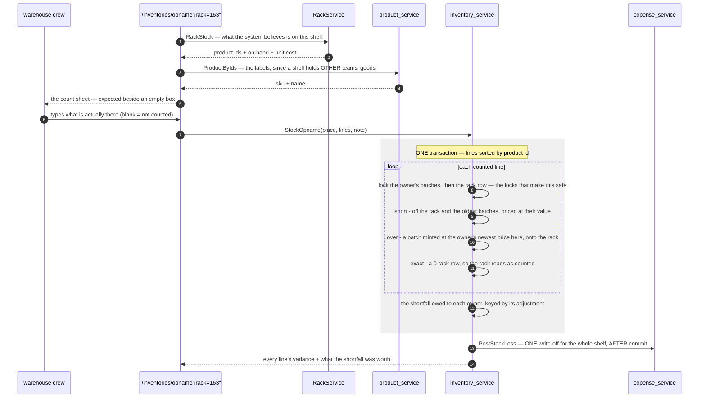

### The two rules that matter most

| | |
| --- | --- |
| **Only the lines sent are counted** | A product on the shelf and absent from `lines` is left completely alone — **never zeroed**. The tempting reading ("a sweep means everything else is gone") would turn one forgotten row or one lost page into a silent write-off of real stock, and a stock-take is BELIEVED. Emptying a shelf is `counted_qty = 0`, said out loud. |
| **A zero-variance line still writes a rack row** | `last_opname_unix` is read from the newest `adjustment` rack row on that `(product, rack)`, so a correct count that wrote nothing would leave the rack looking permanently overdue for the count somebody just did. Counting and changing are different things. |

### What a shortfall is worth

A shortfall leaves the owner's batches **oldest first**, and the write-off is priced at **the value the draw actually
took** from each (an-emptying-take-takes-all-the-value). Every batch carries its price, so `value_known` is always true.

A **surplus is never valued**. Stock that turns up was not bought, and booking a negative expense for it
would let a sloppy count read as income.

### Concurrency

Two people counting one shelf at the same second is the normal case here, not an edge case. Every line
locks its batches and then its rack row (batches-lock-before-shelves-by-id), and **the lines are sorted by product id
before locking** — a deadlock guard, not tidiness: two requests locking `7 then 3` and `3 then 7` would have
Postgres kill one of them, and the person would see a stock-take fail for no reason they could explain.

Proved rather than asserted — see
[audits/services/inventory_service/concurrency/lock-order.md](../../../audits/services/inventory_service/concurrency/lock-order.md).

### Not yet

- **A shelf larger than one screen** is flagged (`truncated`) rather than silently counted in part. The
  uncounted rows are safe — the server never touches a product it was not sent — but the person would
  otherwise believe they had finished.

## Stock count sessions — `OpnameService` (PROTOTYPE)

A stock count of ONE warehouse, as a session: plan it, snapshot and lock the shelf book, count blind, write each difference
as a draft with its reason, and finalize into the stock-problem register. The design is
[opname.md](../../business/inventory/opname.md) and its decisions in
[opname_decision.md](../../business/inventory/opname_decision.md).

> ⚠ **PROTOTYPE — no handler exists.** `OpnameService` ([opname.proto](../../../proto/warehouse/inventory/v1/opname.proto))
> is mounted answering **Unimplemented** (`inventory_v1.OpnamePrototype`), and the screens
> (`/inventories/opname/sessions…`) run against the Storybook stub (`.storybook/opnameStub.ts`) until design_accept. The
> flows below are what the backend step builds. It supersedes `StockOpname` above — that RPC and its page keep working
> until then.

| RPC | Who | What it does |
| --- | --- | --- |
| `OpnameSessionList` / `Detail` | any warehouse member | the sessions, newest first; a counter's read of an unfinished one carries no difference count |
| `OpnameSessionCreate` | Owner, Admin | snapshot the plan's `product_placements` rows — **rows at 0 included** — and lock them; refused while another session is active |
| `OpnameSessionCancel` | Owner, Admin | active → cancel; rows released, nothing posted |
| `OpnameRowList` | Owner, Admin — **never staff** | every row WITH the book figure: the watch page |
| `OpnameRowSendBack` | Owner, Admin | a counted row back to counting; its count and drafts cleared |
| `OpnameRackList` | any member | the racks to visit; an `all` session lists every rack, empty ones too |
| `OpnameRackCount` | any member | one rack as its counter sees it — **no book figure before the row is counted** |
| `OpnameRowCount` | any member | the blind count, then one recount that replaces it; answers the row revealed, with the system's draft |
| `OpnameRowMarkCounted` | any member | closes a revealed row: the broken count and every draft's reason |
| `OpnameRowAddFound` | any member | a product found on a rack: a row at 0, its other racks join; refused when its team never had it here |
| `OpnameFinalizePreview` | Owner, Admin | what finalize posts, per product, and why it is refused |
| `OpnameSessionFinalize` | Owner, Admin — never a counter | posts it: one `opname` transaction per owning team |

### A row's life

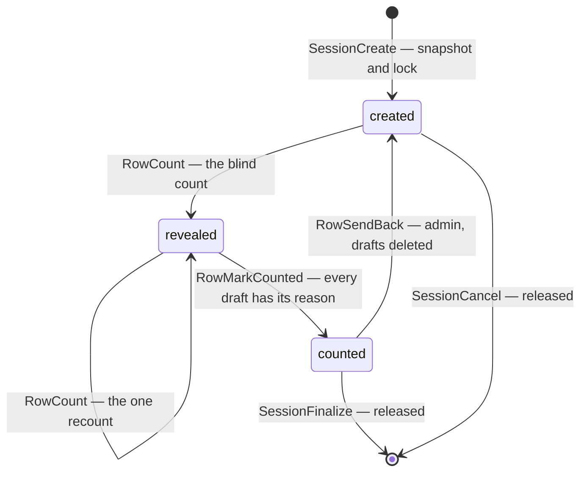

`revealed` is not a stored status: the row is still `created`, with its count in. A short row gets the system's `lost`
draft (the shortage less the broken, at least 0); an over row the system's `surplus` draft.

### What finalize posts

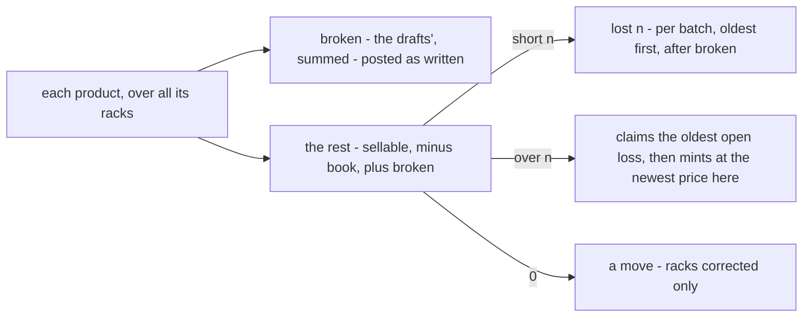

Finalizing **is** the agreement (`finalizing-is-the-agreement`): the broken and lost rows are what the warehouse owes the
teams, a claim is what they pay back.

## Broken, lost, and found — the warehouse reimburses the owner (business_level §Warehouse 5)

A `DAMAGED` / `LOST` adjust already wrote the units off the shelf and their frozen cost to expense.
That answered *"what did our losses cost us"* and left the other question unanswered: the goods
belonged to a **selling team**, and until now they were simply gone.

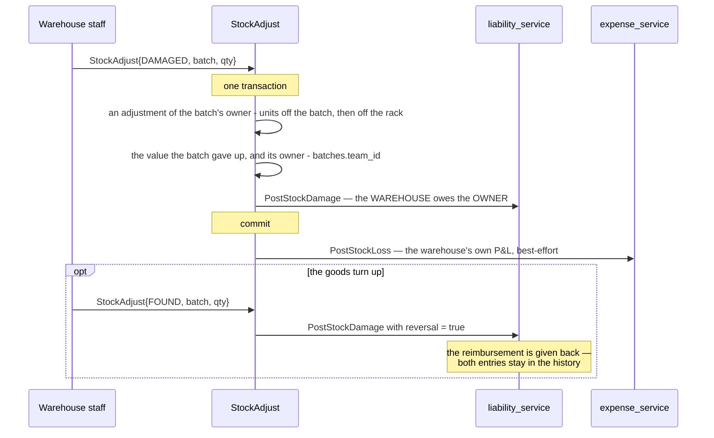

### ⚠ The direction is the whole point

Every other posting from this service has the **selling team owing the warehouse**. This one is
reversed: the warehouse holds the goods, the selling team owns them (§Warehouse 4), so losing them is
a **debt**, not a discount. Getting it backwards would bill the team whose stock was destroyed.

### Two records of one event, and both are wanted

| | answers |
| --- | --- |
| `EXPENSE_KIND_STOCK_WRITE_OFF` | *what did our losses cost us* — the warehouse's own P&L |
| `LIABILITY_SOURCE_TYPE_STOCK_DAMAGE` | *who do we now have to pay* |

Neither replaces the other. Dropping either loses a real question's answer.

### The debt commits with the stock; the expense does not

The liability posting joins the adjust's **transaction**; the expense posting stays best-effort
after it. Same distinction `LiabilityPoster` already draws: an expense is a *derived* record and a
dropped one is a gap a report can find, while an obligation that fails to commit leaves the owning
team's goods gone with nothing recorded — the situation the ledger exists to prevent.

### What is NOT charged here

| | |
| --- | --- |
| **`FOUND`** | posts the same source type as a **reversal**, against its own adjustment — never by deleting the entry that charged it |
| **`RECOUNT`** | books nothing, as before the cut-over — the open contradiction with `StockOpname` is [adjustment Q2](../../business/inventory/adjustment_clarify.md#question) |
| **the warehouse's own goods** | a team cannot owe itself |
| **damage at RECEIVING, and on returned orders** | **§Warehouse 6** — neither enters the warehouse's custody, and neither travels this RPC |

### Idempotency

`source_id` is the **adjustment transaction**. Every adjust writes exactly one, so a retried adjust is refused by the
ledger's unique index, and a damage and its later find can never collide.

### An opname shortfall reimburses too (owner, 2026-08-20)

`StockOpname` is a recount in bulk, and §Warehouse 7 makes counting the shelf the warehouse's own job.
A shortfall it finds is stock lost in the warehouse exactly as one filed as a `LOST` adjust is — so it
posts the same `STOCK_DAMAGE` obligation.

Before this, the same physical loss reimbursed the owner or did not **depending on which RPC noticed
it**, which is the worst kind of inconsistency: invisible, and only in the accounts.

| | |
| --- | --- |
| **one debt per owner** | keyed on that owner's adjustment transaction — one per owning team per count — so `source_id` means the same thing it means for an adjust and a re-run is refused by the ledger rather than charging twice |
| **a surplus reimburses nobody** | and is not a reversal either — stock that turns up on a count was never established as lost, so there is no debt of its own to give back. Only a `FOUND` adjust against a specific batch reverses a specific reimbursement |
| **the warehouse's own goods** | a team cannot owe itself |

The obligation joins the count's **transaction**; the expense stays best-effort after it — the same
split the single-adjust path draws, and for the same reason.

⚠ **`StockAdjust` with reason `RECOUNT` still does neither** — no write-off and no reimbursement — the one path out of
step, kept by the provisional port and open as [adjustment Q2](../../business/inventory/adjustment_clarify.md#question).

## RestockRequestAccept — announces the accept

After the accept COMMITS, `RestockRequestAccept` publishes `RestockAccepted` — the restock, its two teams, its
supplier, the accept's Jakarta day and instant, and per line the ordered count, the total, the good units, the broken,
the missing and the line's supplier
([restock-accepted-carries-every-line](../../business/inventory/restock_decision.md#restock-accepted-carries-every-line)).
supplier_service folds it into a supplier's figures ([its doc](../supplier_service/rpc.md#the-figures--a-fold-of-restock-accepted)).
The restock's money events — *Restock Created*, *Updated* and *Cancelled* — are below.

## The restock's money events — for the account that paid

The selling team's account paid for the goods and the shipping when it raised the restock; three events tell whoever
posts that payment what happened to it
([a-created-restock-tells-the-financial-account](../../business/inventory/restock_decision.md#a-created-restock-tells-the-financial-account),
[an-edit-sends-the-difference](../../business/inventory/restock_decision.md#an-edit-sends-the-difference),
[an-edit-may-move-the-payment-to-another-account](../../business/inventory/restock_decision.md#an-edit-may-move-the-payment-to-another-account)).
Inventory announces and does not know who listens. ⚠ **No listener is built yet** — financial_account_service's
subscription is its own to add; until then the topics fill and nothing posts.

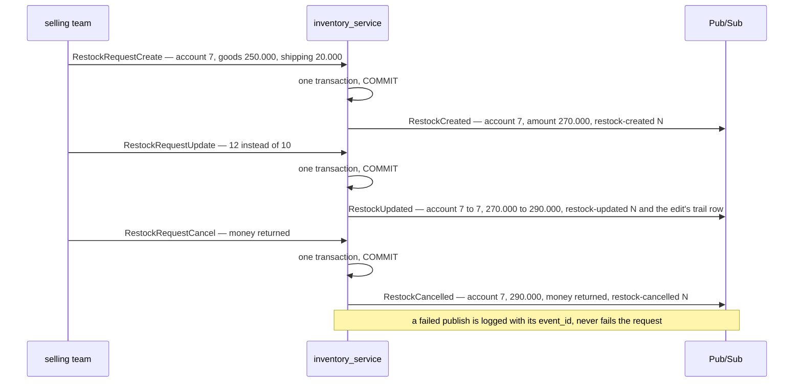

| | |
| --- | --- |
| the amount | goods plus shipping — never the courier's charge, which the warehouse paid ([the-couriers-charge-stays-out-of-total](../../business/inventory/restock_decision.md#the-couriers-charge-stays-out-of-total)) |
| an edit | announced only when the amount or the paying account changed; a note or a tracking number moves no money |
| event ids | derived — `restock-created:N`, `restock-cancelled:N`, and `restock-updated:N:<trail row>` per edit — so a republish dedups |
| after, never inside | an event for a write that rolled back would move money that never moved |
| topics | read from the proto by `san pubsub ensure` — nothing to add |

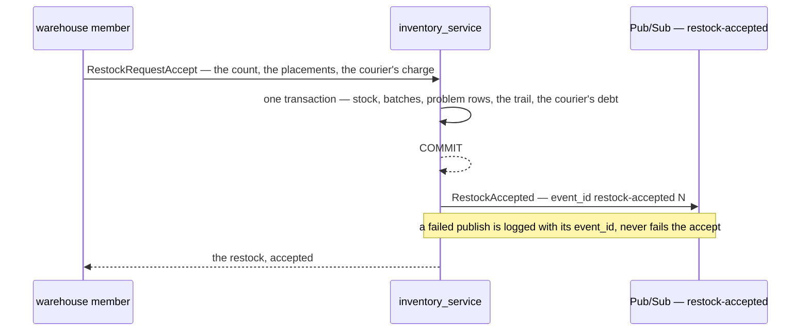

| | |
| --- | --- |
| after, never inside | an event for an accept that rolled back would fold goods that never arrived |
| a failed publish | logged; the supplier's figures are short that restock until a replay or an adjustment — never wrong the other way (no-outbox-the-publish-is-trusted) |
| `RestockAcceptedEvent` | the pure builder, exported — `san supplier backfill-figures` builds the very same event for a restock accepted before it existed |
