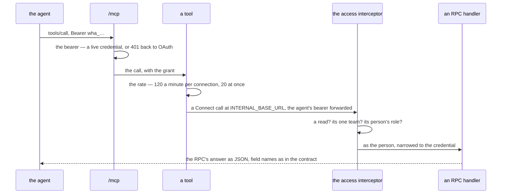

# mcp_service — the AI agents' read-only tools

The MCP endpoint at `/mcp` ([our-server-hosts-the-mcp](../../business/mcp/context_decision.md#our-server-hosts-the-mcp)), on the protocol's official Go SDK
([the-mcp-uses-the-official-go-sdk](../../business/mcp/context_decision.md#the-mcp-uses-the-official-go-sdk)). It owns **no table** and **no proto**: every tool calls our own RPCs as a
Connect client carrying the agent's bearer, so each read passes the access interceptor exactly as a screen's does. A tool
is a convenience over the API, never a second door into it. How an agent connects is
[user_service's](../user_service/rpc.md#connecting-an-ai-agent--oauth-then-its-own-credential).

| tool | reads through | |
| --- | --- | --- |
| `list_metrics` | the descriptors linked into the binary | every metric of the order, settlement and supplier services — id, source, filters, groups, fields with their stat type. A new metric reaches the agent with no new tool ([the-agent-reads-through-the-metric-pattern](../../business/mcp/context_decision.md#the-agent-reads-through-the-metric-pattern)) |
| `read_metric` | `MetricSearch` then `MetricData` of the metric's source | the headline (`SUMMARY`), or a group ranked by one field and paged; a year at most per range, as the screen |
| `search_products` | `ProductList` | a name or code into a product id |
| `find_orders` | `OrderByExternalRefs`, then `OrderDetail` per order | 1–20 marketplace refs; each order whole, the buyer included ([buyer-data-reaches-the-agent](../../business/mcp/context_decision.md#buyer-data-reaches-the-agent)) |
| `balance_positions` | `LiabilityPositionList` | what the team owes and is owed |
| `list_teams` | `TeamByIds` for a one-team connection, `TeamList` for root's | ⚠ my build detail: an every-team connection must name a team on every read, and nothing else turns a name into its id |

| | |
| --- | --- |
| read-only | every tool is listed with `readOnlyHint` — a hint; the interceptor is the enforcement. Each RPC a tool calls is declared `idempotency_level = NO_SIDE_EFFECTS` |
| `team_id` | omitted = the connection's team. An every-team connection must name one; a one-team connection naming another is refused by the interceptor |
| money | a JSON **number** of rupiah in every answer — every money field the tools read is a `double` since 2026-11-06 ([every-ledger-moves-to-double-rounded-when-frozen](../../business/order/context_decision.md#every-ledger-moves-to-double-rounded-when-frozen)), so protojson writes `700000`, never the quoted `"700000"` it wrote for an `int64`. Frozen figures (balances, posted amounts, an order's `goods_cost`) are whole; an unfrozen one (a line's unit cost with markup, a fee) may carry a fraction. `list_metrics` states each field's kind; no tool describes money as an integer. Asserted by `TestMCP_AnotherTeamIsRefusedThroughTheTool` |
| transport | Streamable HTTP, **stateless** with JSON responses — any instance answers, a restart drops nothing |
| the 401 | carries `WWW-Authenticate: Bearer resource_metadata=…`, which is what starts an agent's OAuth |
| behind a tunnel | `PUBLIC_URL` names the public address; a non-loopback one turns off the SDK's localhost guard, which otherwise answers 403 to a proxied request |
| ⚠ the rate | per instance, in memory — a bound on a runaway agent, not an accounting |
