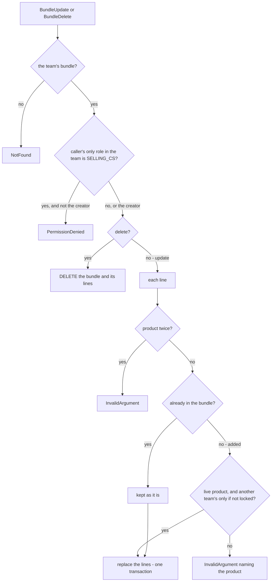

# product_service — RPC flows

## Bundles — `BundleService`

A selling team's **picking recipes**: which products, and how many of each go into ONE bundle. A bundle has no stock and
no price, and nothing outside product_service reads it — the order form expands it into ordinary product lines, and the
order keeps no link back. The design is [product_bundle.md](../../business/product/product_bundle.md) and its decisions
in [product_bundle_decision.md](../../business/product/product_bundle_decision.md).

Built on product_service's own tables (`00006_create_bundles`); the handlers are `product_v1/bundle_*.go`, one file per
RPC, on the same `*Service` as the catalogue. The contract is [bundle.proto](../../../proto/warehouse/product/v1/bundle.proto),
accepted with its screens ([the-bundle-prototype-is-accepted](../../business/product/product_bundle_decision.md#the-bundle-prototype-is-accepted)).

| RPC | Who | What it does |
| --- | --- | --- |
| `BundleList` | every selling role | the team's bundles with their lines, the last change first; `q` matches the name AND a line's product name or code |
| `BundleByIds` | every selling role | the team's bundles by id; another team's id is simply absent |
| `BundleCreate` | every selling role, the CS included | a bundle, `created_by_user_id` from the token |
| `BundleUpdate` | Owner, Admin — and a CS for her own | replaces the name, the description and EVERY line |
| `BundleDelete` | Owner, Admin — and a CS for her own | a HARD delete: no order refers to a bundle |

### What a write checks

The proto carries the fields' own limits (a name, 1–50 lines, quantity 1–9999). The handler adds what no field can say
— who may change THIS bundle, and what the lines may hold. Only a line the save **adds** must be a live, shareable
product: a line already in the bundle that its owner has since locked or archived is kept
([a-borrowed-product-never-blocks-its-owner](../../business/product/product_bundle_decision.md#a-borrowed-product-never-blocks-its-owner)).

`BundleCreate` runs the same line checks with nothing kept.

**Where the creator check reads the role:** `san_auth.GetCallerRole(ctx)`, the role the interceptor resolved for the
scoped team — no second lookup. Its comment now names this as the one sanctioned use besides recording an override: a
handler may NARROW a policy past what the proto can say, never widen or re-derive it. Root and the Administrator hold
no role in the team (they are in by the root-team bypass) and are not narrowed. ⚠ Accepted edge: a person who is Root
AND a CS in the team reads as the CS there.

**Concurrency.** `BundleUpdate` and `BundleDelete` take the bundle row `FOR UPDATE` first, so two saves of one bundle
run one after the other — each replaces the lines whole, and two interleaved replaces would leave a mix of both.
