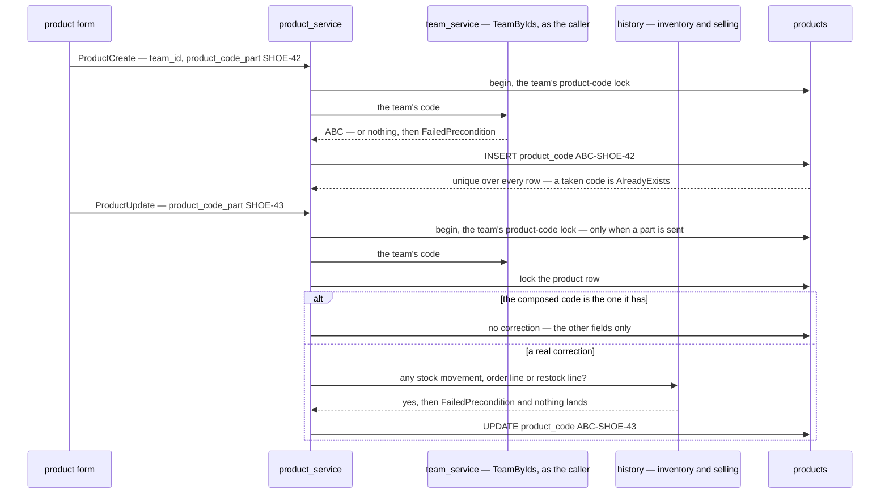
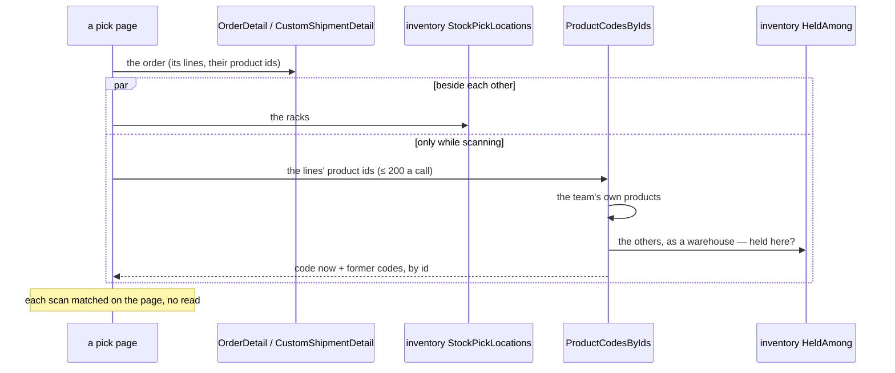
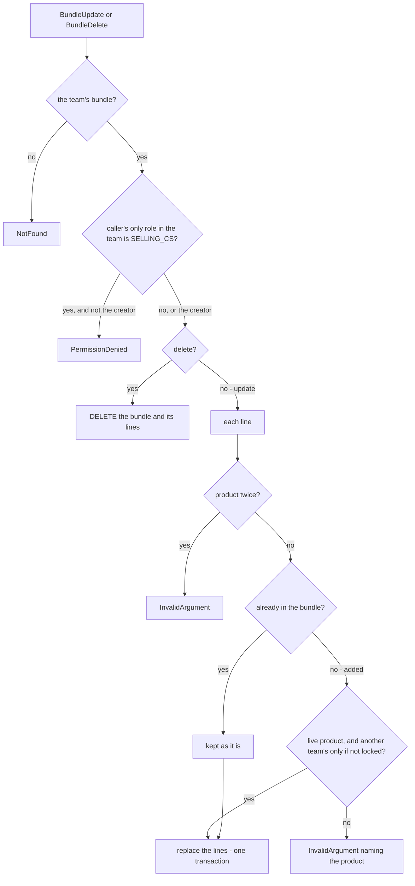
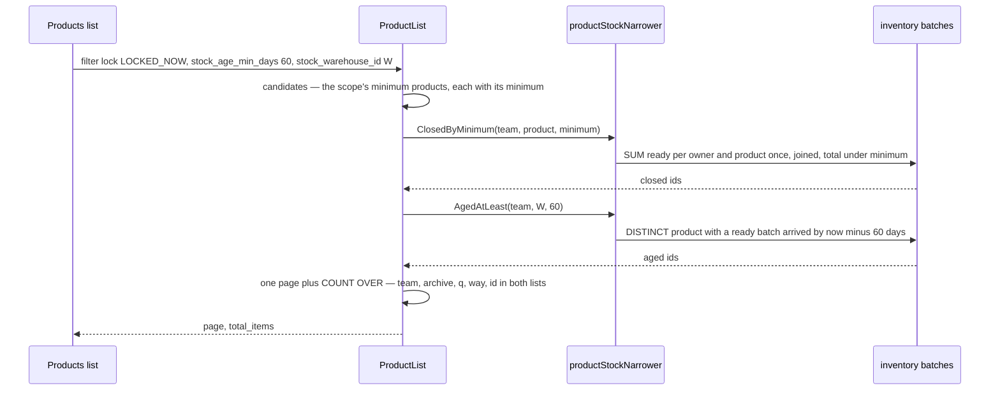
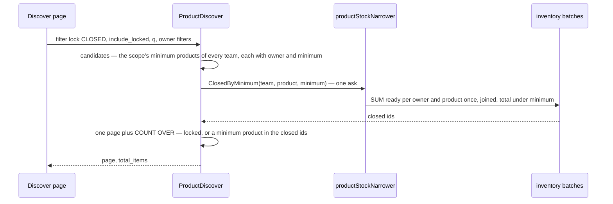
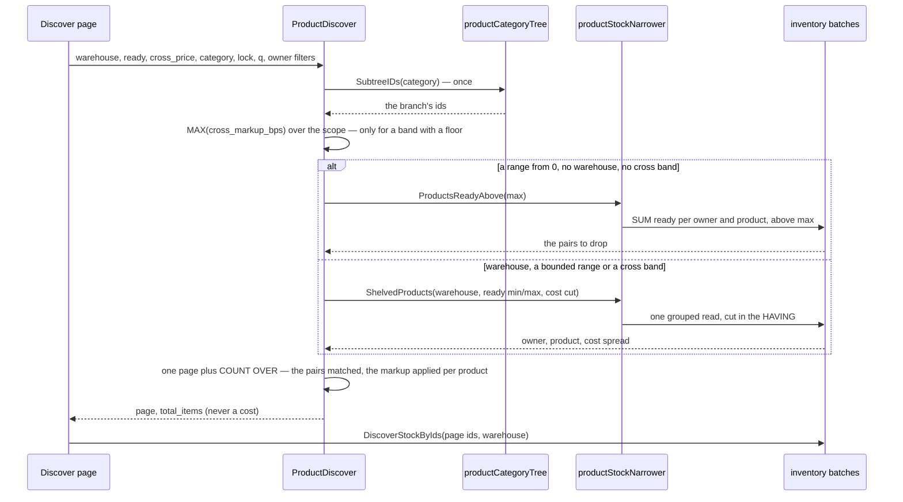
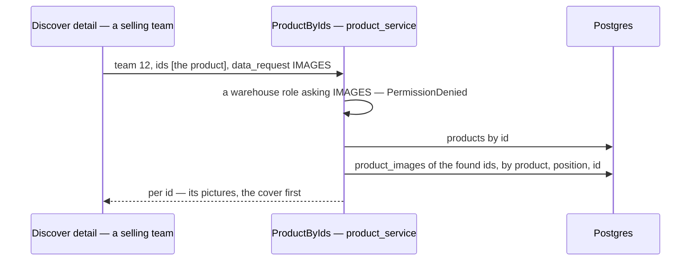
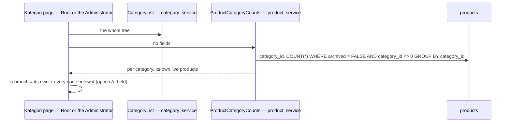

# product_service — RPC flows

## The product code — composed on write

A product has ONE code, `product_code`, and product_service **composes** it: the team sends its own part, and what is
stored is `<team_code>-<part>` — team ABC types `SHOE-42`, the product is `ABC-SHOE-42`
([the-field-is-product-code-composed-on-write](../../business/product/context_decision.md#the-field-is-product-code-composed-on-write)).
The team code is team_service's, so `ProductCreate` and a code correction in `ProductUpdate` depend on it — through
`product_v1.TeamCodes`, which the composition root answers with `TeamByIds` asked as the caller
([product_team_codes.go](../../../backend/cmd/app_development/product_team_codes.go)), uncached. A selling team's code
**can change** (team_service's `TeamCodeUpdate`, which recomposes every product of the team in its own transaction —
[*The team code change*](#the-team-code-change--the-products-take-the-new-code-built-2026-11-27-backlog-149) below), so
both read it INSIDE their transaction, under the team's product-code lock the recompose takes too: a create or a
correction racing a change never stores the old prefix.

| RPC | the code |
| --- | --- |
| `ProductCreate` | takes `product_code_part`; stores `<team_code>-<part>`, the part trimmed. A blank part is InvalidArgument, a team with no code FailedPrecondition, a code any row holds — an archived one included — AlreadyExists |
| `ProductUpdate` | an optional `product_code_part` CORRECTS it — only while the product has NO HISTORY, the line `ProductDelete` uses; otherwise FailedPrecondition. The part it already has is no correction, so a form that always sends it still saves a used product |
| `ProductArchive` / `ProductUnarchive` | the code is KEPT, so Unarchive cannot collide and takes no code |
| `ProductDelete` | frees the code — of a never-used product only |

**Uniqueness is one index over every row** (`products_product_code_unique`, product `00008`). Composition makes it a
namespace per team — no create is ever refused because of another team's row — and the refusal says nothing of another
catalogue. ⚠ A team code may contain a dash, so `AB` + `C-1` and `AB-C` + `1` compose alike; the index refuses the second,
as AlreadyExists.

**Today's rows** — written before composition — are recomposed once by
[`san product recompose-codes`](../../tools/san.md#product-recompose-codes), which `dev setup` runs. A code under one of
its team's FORMER codes is not a bare part, and the command leaves it alone (backlog #149).

## The team code change — the products take the new code (built 2026-11-27, backlog #149)

A selling team's code changes through team_service's `TeamCodeUpdate`
([a-team-code-change-recomposes-its-product-codes](../../business/product/context_decision.md#a-team-code-change-recomposes-its-product-codes);
the cross-service flow is team rpc.md *TeamCodeUpdate*), and in that one transaction its products take the new code:
`product_v1.(*Service).RecomposeTeamCodes(ctx, tx, team, old, new, actor)`
([product_code_recompose_team.go](../../../backend/services/product_service/product_v1/product_code_recompose_team.go)),
handed team_service's transaction by the composition root
([product_code_recomposer.go](../../../backend/cmd/app_development/product_code_recomposer.go)) — the
liability_poster pattern. Set-based, a fixed number of statements whatever the team's size:

| step | what |
| --- | --- |
| the lock | `pg_advisory_xact_lock(hashtextextended('product_service:product-code:<team>', 0))` (`lockTeamProductCodes`) — the FIRST lock `ProductCreate` and a code correction in `ProductUpdate` take too, so none of them lands the old prefix |
| left alone | the team's products NOT under `<old>-` (rows written before composition) are counted and the first 20 named; never touched |
| the clash | a product of the team taking a code another product carries (only through a dash in a code) refuses the WHOLE change, AlreadyExists, nothing written |
| the clear | the moving products' earlier reprint waits and `need_reprint_code` — a second change before a reprint starts the reprint over (⚠7) |
| the move | ONE statement: every product under `<old>-`, **archived too**, becomes `<new>-<part>` (the exact old prefix comes off), and each gets a `product_logs` line — `code_changed`, old → new, who, override, when. Only when one prefix begins with the other (`ABC` → `ABC-X`) are the rows parked first on a placeholder unique by id |
| the shelves | inventory, in the same transaction, in-process: `StockNarrower.StockSitsAmong(tx, ids)` → each (product, warehouse) with units on a shelf NOW (`product_placements.stock_count > 0`) — HeldAmong's sibling, which answers "ever held", not "where now" |
| the waits | ONE statement: a `product_reprint_waits (product_id, warehouse_id, since)` row per pair, and `need_reprint_code` (put on by the app, user 0) on those products — a product with nothing on a shelf anywhere takes the new code and is never tagged (⚠4). #151's reprint deletes a warehouse's row, the tag goes with the last |

Past order, restock and transfer lines are other services' copies and keep the code they were written under.

| RPC | who (proto policy) | what |
| --- | --- | --- |
| `ProductLogList` | the owning team's Owner, Admin and CS, Root, Administrator — never a warehouse, never Discover | a product's history (`product_logs`), newest first, PAGED (HARD RULE 9): `old_code`, `new_code`, `actor_id` (a name at read time), `is_override`, `created_at_unix` — the product page's Riwayat Produk card. Another team's product or none → NotFound; archived ones answer. Messages in `product_log.proto` |
| `ProductCodesByIds` | every selling / warehouse role, Root, Administrator (a read) | up to 200 ids → each one's code NOW and its former codes (`product_logs` `code_changed` `old_code`s, newest first, each once case-insensitively, never the code it carries now), keyed by id — the scoped team's own products, and for a warehouse the products it has held (`HeldAmong`, the rule `ProductTagsByIds` keeps — one helper, `readable_by_ids.go`); any other id **absent**, never refused. Messages in `product_log.proto` |

- **A former code still finds the product** (backlog #152, #141 P4 — its 🔄 *an old sticker scanned before the
  reprint*, owner Q1 "A"). The pick pages' item scan (`features/picking/ItemScan.tsx`, the order's and the custom
  shipment's) matches a scan — trimmed, case-insensitive, WHOLE — against the line's own code, the line product's code
  now and every former code: ONE `ProductCodesByIds` per page, beside `StockPickLocations` in one `Promise.all`, only
  while the item scan is on screen (a processed order, a requested parcel) — never a read per scan. The product search —
  `ProductList`'s `q` and `SearchAmong` (the warehouse's list and picker) — matches a former code whole too
  (`productTermClause`, [product_term_clause.go](../../../backend/services/product_service/product_v1/product_term_clause.go)):
  `… OR products.id IN (SELECT product_id FROM product_logs WHERE lower(old_code) = lower(q) AND kind = 'code_changed')`,
  never a piece of one; the name and the code now as before. Measured (100 000 products, 50 000 history lines):
  `ProductList`'s count 22.4 → 17.8 ms, `SearchAmong` 15.1 → 16.1 ms with `product_logs_old_code_idx` (53.3 / 48.4 ms
  without it), `ProductCodesByIds` of 200 ids 0.2–0.5 ms in the database
  ([the audit](../../../audits/services/product_service/performances/ProductList.md)).

- **Concurrency** (`cmd/app_development/product_code_recomposer_race_test.go`, `raceaudit`, the real seam): a
  `ProductCreate` racing the change never lands the old prefix (parked on the lock, 3 rounds — it composes from the new
  code, or commits first and is recomposed); a code correction likewise; two teams changing to one code → one lands, the
  other AlreadyExists naming the winner; two changes of one team serialise on the team row; a tag put-on / take-off
  racing the recompose lands beside it. Removing the create's lock, the correction's, the recompose's or the team row's
  fails its race (mutation-checked).
- **Measured** — 🟡 HEAVY, the < 1 s target missed: 5 000 products 0.9–1.2 s, 50 000 products 6.3–8.1 s, 15 statements
  at every size — [TeamCodeUpdate audit](../../../audits/services/product_service/performances/TeamCodeUpdate.md).
  `ProductCreate` with the lock: 1.08 → 2.00 ms median, 2 → 4 statements in the test transaction.
- **The preview** (backlog #150): `PreviewTeamRecompose` answers team_service's `TeamCodePreview` through the same seam
  (`ProductCodeRecomposer.PreviewTeamCodes`) on the caller's db, writing nothing — how many products the recompose would
  move (archived too), one example old → new (an active product first: `ORDER BY archived, id LIMIT 1`), and the
  warehouse ids `StockSitsAmong` names for them; three statements at any size
  ([team_service rpc.md](../team_service/rpc.md#teamcodepreview--what-a-teamcodeupdate-would-do-read-before-it-is-sent-built-2026-11-27-backlog-150),
  [the audit](../../../audits/services/team_service/performances/TeamCodePreview.md)). `ProductLogList` is live on the product
  page's Riwayat Produk card since #150 (one call a load, its people named by one `UserByIDs`).

## Bundles — `BundleService`

A selling team's **picking recipes**: which products, and how many of each go into ONE bundle. A bundle has no stock and
no price, and nothing outside product_service reads it — the order form expands it into ordinary product lines, and the
order keeps no link back. The design is [product_bundle.md](../../business/product/product_bundle.md) and its decisions
in [product_bundle_decision.md](../../business/product/product_bundle_decision.md).

Built on product_service's own tables (`00006_create_bundles`); the handlers are `product_v1/bundle_*.go`, one file per
RPC, on the same `*Service` as the catalogue. The contract is [bundle.proto](../../../proto/warehouse/product/v1/bundle.proto),
accepted with its screens ([the-bundle-prototype-is-accepted](../../business/product/product_bundle_decision.md#the-bundle-prototype-is-accepted)).

| RPC | Who | What it does |
| --- | --- | --- |
| `BundleList` | every selling role | the team's bundles with their lines, the last change first; `q` matches the name AND a line's product name or code |
| `BundleByIds` | every selling role | the team's bundles by id; another team's id is simply absent |
| `BundleCreate` | every selling role, the CS included | a bundle, `created_by_user_id` from the token |
| `BundleUpdate` | Owner, Admin — and a CS for her own | replaces the name, the description and EVERY line |
| `BundleDelete` | Owner, Admin — and a CS for her own | a HARD delete: no order refers to a bundle |

### What a write checks

The proto carries the fields' own limits (a name, 1–50 lines, quantity 1–9999). The handler adds what no field can say
— who may change THIS bundle, and what the lines may hold. Only a line the save **adds** must be a live, shareable
product: a line already in the bundle that its owner has since locked or archived is kept
([a-borrowed-product-never-blocks-its-owner](../../business/product/product_bundle_decision.md#a-borrowed-product-never-blocks-its-owner)).

`BundleCreate` runs the same line checks with nothing kept.

**Where the creator check reads the role:** `san_auth.GetCallerRole(ctx)`, the role the interceptor resolved for the
scoped team — no second lookup. Its comment now names this as the one sanctioned use besides recording an override: a
handler may NARROW a policy past what the proto can say, never widen or re-derive it. Root and the Administrator hold
no role in the team (they are in by the root-team bypass) and are not narrowed. ⚠ Accepted edge: a person who is Root
AND a CS in the team reads as the CS there.

**Concurrency.** `BundleUpdate` and `BundleDelete` take the bundle row `FOR UPDATE` first, so two saves of one bundle
run one after the other — each replaces the lines whole, and two interleaved replaces would leave a mix of both.

## The override stamp on the reads — the "by Root team" badge (built 2026-11-11)

[an-override-shows-a-platform-badge](../../business/user/context_decision.md#an-override-shows-a-platform-badge), accepted as
[the-override-badge-is-accepted-as-by-root-team](../../business/user/context_decision.md#the-override-badge-is-accepted-as-by-root-team):
every read a screen names a person from now carries the record's own `is_override` (stamped at the write by
`san_auth.IsOverride`, [an-override-is-stamped-in-every-service](../../business/user/context_decision.md#an-override-is-stamped-in-every-service)),
and the screen draws the shared `ActorName` / `RootTeamBadge` beside the person. Never sent by a caller; a row from
before the column reads false.

| read | field | read from | performance |
| --- | --- | --- | --- |
| `BundleList`, `BundleByIds` (and the bundle writes) | `BundleRowItem.is_override` (9) — the maker | `bundles.is_override`, same row | nil |

## The list's Kunci and Umur stok — narrowed through inventory (built 2026-11-14)

[lock-and-stock-age-filter-ahead-of-the-contract](../../technical/frontend/products_decision.md#lock-and-stock-age-filter-ahead-of-the-contract): the product list's
**Kunci** and **Umur stok** pickers are sent (`ProductListFilter.lock` 3, `stock_age_min_days` 4;
`ProductListRequest.stock_warehouse_id` 6) and `ProductList` narrows its OWN count and page by them — so `total_items`,
the sort and the paging describe the narrowed list. Every one defaults to "no narrowing"; `ProductDiscover` shares the
filter and REFUSES them (InvalidArgument) — Discover's Kunci is its own two values (*Discover's Kunci* below), which
ProductList refuses in turn.

| pick | keeps | facts from |
| --- | --- | --- |
| `MODE_OPEN` *Terbuka* | `cross_locked = false AND reserved_stock = 0` ([one-lock-three-ways](../../technical/frontend/products_decision.md#one-lock-three-ways)) | products |
| `MODE_MINIMUM` *Stok minimum* | `cross_locked = false AND reserved_stock > 0`, in force or not | products |
| `MODE_ALWAYS` *Selalu dikunci* | `cross_locked = true`, whatever minimum it keeps | products |
| `LOCKED_NOW` *Terkunci sekarang* | a minimum product whose owner's READY stock summed over EVERY warehouse is **under** it — `<`, never at it ([a-minimum-closes-only-under-it](../../technical/frontend/products_decision.md#a-minimum-closes-only-under-it), the order take's own line); nothing on a shelf is under any minimum; an always-locked product is not "a minimum in force"; the lens never narrows it | products (candidates) + inventory `ClosedByMinimum` |
| `stock_age_min_days` N *Umur stok* | the oldest batch still holding ready units (`stock_count > 0`) arrived at or before now − N × 24 h — the Umur stok column's own oldest batch, floored the same way ([the-dates-read-as-ages](../../technical/frontend/products_decision.md#the-dates-read-as-ages)); in `stock_warehouse_id` when set, else every warehouse; nothing on a shelf has no age and never matches | inventory `ProductIDsAgedSince` |

**The seam.** `product_v1.StockNarrower` (4th `NewService` dep; nil refuses the two stock picks with Unavailable),
answered by `cmd/app_development/product_stock_narrower.go` over inventory's PLAIN functions on `*gorm.DB`
(`inventory_v1.ClosedByMinimum`, `inventory_v1.ProductIDsAgedSince`) — the `productHistory` shape, never
`*inventory_v1.Service` (inventory reads products through product_service, so a Service dep would close a Wire cycle).
`ClosedByMinimum` takes `(team, product, minimum)` candidates of ANY teams — Discover's lock filter can reuse it — and
sums the owners' live batches ONCE, hash-joined to the candidates (never a per-pair probe). The ids come back and go into
product's statement as one `bigint[]`; with an id list bound, the page and the count are ONE statement
(`COUNT(*) OVER ()`, [the-list-is-sent-once](../../../audits/services/inventory_service/performances/WarehouseProductSearch.md#the-list-is-sent-once-)),
a page past the end counts on its own. Two statements without a shared snapshot: a take between them can leave one row a
unit off its filter until the next read (as the supplier bands).

**Performance** (`product_list_filters_perf_test.go`, `-tags perfaudit`, real wiring; the probed team owns 30 000
products — 9 000 minimum products, 3 000 always-locked, 5 000 never stocked — and 100 000 batches, 60 000 live, over 5
warehouses and 180 days; 10 other teams hold 10 000 products / 30 000 batches beside it; warm, median of 5, page of 20):

| pick | rows (total) | steps, ms | wall |
| --- | --- | --- | --- |
| nothing (today's list) | 20 (30 000) | count 3.7 · page 1.6 | 5.5 ms |
| Terbuka / Stok minimum / Selalu dikunci | 20 (18 000 / 9 000 / 3 000) | count ≤ 5.0 · page ≤ 2.3 | ≤ 7.1 ms |
| Terkunci sekarang | 20 (6 082) | candidates 7.8 · closed-by-minimum 71.8 · page+count 58.1 | 140 ms |
| Terkunci sekarang, by name, page 20 | 20 (6 082) | candidates 7.5 · closed-by-minimum 16.3 · page+count 63.7 | 89 ms |
| Umur 30+ / 60+ / 90+ | 20 (25 000 / 23 611 / 20 418) | aged-ids 16–30 · page+count 12–19 | 29–51 ms |
| Umur 60+ in one warehouse | 20 (10 002) | aged-ids 7.6 · page+count 52.7 | 61 ms |
| Umur 60+ + Terkunci sekarang | 20 (4 443) | candidates 7.4 · closed 16.6 · aged 16.4 · page+count 13.2 | 54 ms |

Not heavy. The 50–70 ms single statements are this host's loopback carrying a big `bigint[]` parameter, not the reads:
the same 72 KB array bound to `SELECT length($1)` takes 50 ms, and EXPLAIN on the test transaction executes the
Terkunci sekarang steps in 4.2 / 18.2 / 3.6 ms and the age steps in 11–27 / 3–11 ms
([the-id-list-stalls-on-this-loopback](../../../audits/services/inventory_service/performances/WarehouseProductSearch.md#the-id-list-stalls-on-this-loopback-)).
No index added: the age read is a bitmap heap scan over the team's live batches (`batches_owner_product_idx`, 11–27 ms
executed); a covering partial index on `batches` would add an index write to every stock change for that — not worth it
at this volume. A pick of nothing calls no seam (today's cost untouched).

## Discover's Kunci — narrowed through inventory (built 2026-11-14)

[discover-filters-by-lock](../../technical/frontend/products_decision.md#discover-filters-by-lock) with its boundary from
[a-minimum-closes-only-under-it](../../technical/frontend/products_decision.md#a-minimum-closes-only-under-it): Discover's
**Kunci** chips are sent as `ProductListFilter.lock` with Discover's OWN two values, and `ProductDiscover` narrows its count
and page by them — the list's *Terbuka* is the setting, Discover's what another team may take now, so they are two enum
values (`PRODUCT_LOCK_FILTER_CLOSED` 5, `PRODUCT_LOCK_FILTER_ORDERABLE` 6). Each RPC refuses the other's values
(InvalidArgument), and Discover still refuses `stock_age_min_days`. No pick = no narrowing, no seam called (every picker,
`orders.spec.ts`' direct calls untouched).

| pick | keeps |
| --- | --- |
| `CLOSED` *Terkunci* | `cross_locked = true` (its owner locked it — with `include_locked`, which only the Discover page sends), OR a minimum product whose owner's READY stock over EVERY warehouse is **under** its minimum — `<`, exactly at it is open; nothing on a shelf is under any |
| `ORDERABLE` *Terbuka* | every other: not locked, and no minimum or one with enough ready stock |

**The seam** is the list's `StockNarrower.ClosedByMinimum` (stock_narrower.go `narrowByOrderable`, sharing
`closedByMinimum` with the list's Terkunci sekarang): the candidates are Discover's own scope's minimum products of EVERY
team (archive, `include_locked`, owner filters, `exclude_own_team`, `q` — built fresh by `scope()`), sent in ONE ask with
their owners and minimums; `inventory_v1.ClosedByMinimum` sums the owners' live batches once. The way is read again in the
page's statement (a lock changed between the two reads lands by its lock now); with an id list bound, page and count are
one statement (`COUNT(*) OVER ()`).

**Performance** (`cmd/app_development/discover_cards_perf_test.go`, `-tags perfaudit`, real wiring; 30 000 products over
20 teams — ≈ 9 000 minimum products, every one a candidate; 100 000 batches, 60 000 live; warm, median of 5, page of 20):

| pick | rows (total) | steps, ms | wall |
| --- | --- | --- | --- |
| nothing (today's page) | 20 (30 000) | count 6.3 · page 1.1 | 7.3 ms |
| Terkunci | 20 (9 082) | candidates 9.9–13.4 · closed-by-minimum 25–84 · page+count 62–65 | 109–160 ms |
| Terbuka | 20 (20 918) | candidates 10.7 · closed-by-minimum 24.8 · page+count 68.5 | 108 ms |
| Terkunci, by name, page 20 | 20 (9 082) | candidates 10.7 · closed 25.1 · page+count 63.4 | 110 ms |
| Terkunci + hide mine | 20 (7 582) | candidates 10.8 · closed 25.7 · page+count 70.6 | 113 ms |
| Terbuka + q=kaos (no minimum product matches) | 0 | candidates 10.9 · page+count 23.4 | 34 ms |
| the page: Terkunci grid + DiscoverStockByIds | 20 | the above + facts 0.8 · shelves 0.6 · on its way 2.3 | 109 ms |

Not heavy — the same shape and cost as the list's *Terkunci sekarang*. EXPLAIN on the test transaction executes the steps
in 4.3 / 23.0 / 13.7 ms; the rest is this host's loopback carrying the two big `bigint[]` parameters (the 72 KB candidate
arrays and the 36 KB closed list each take ≈ 50 ms bound to `SELECT length($1)`,
[the-id-list-stalls-on-this-loopback](../../../audits/services/inventory_service/performances/WarehouseProductSearch.md#the-id-list-stalls-on-this-loopback-)).
No index added; no audit file (audits/README.md).

## Discover's Gudang, Stok siap, Harga cross and Kategori — narrowed through the seams (built 2026-11-14)

[discovers-warehouse-keeps-ready-stock-there](../../technical/frontend/products_decision.md#discovers-warehouse-keeps-ready-stock-there),
[discover-ranges-are-picked](../../technical/frontend/products_decision.md#discover-ranges-are-picked),
[a-cross-band-keeps-a-range-that-touches-it](../../technical/frontend/products_decision.md#a-cross-band-keeps-a-range-that-touches-it),
[a-picked-branch-keeps-its-whole-subtree](../../technical/frontend/categories_decision.md#a-picked-branch-keeps-its-whole-subtree).
Four more fields on `ProductDiscoverRequest`; unset = no narrowing and no seam called (every picker, `orders.spec.ts`'
direct calls untouched). CEL refuses a range whose min is above its max; the prices are `finite`.

| field | keeps |
| --- | --- |
| `warehouse_id` (11) | products — any team's, matched on owner AND id — with READY units (`stock_count > 0`) in that warehouse now. The other two ranges then read that warehouse; the page passes it to `DiscoverStockByIds` too, so the cards say its figures (the lock badge keeps reading every warehouse) |
| `ready` (12, `DiscoverReadyRange` min, optional max) | ready units — the warehouse's, else every warehouse summed — in [min, max], both ends included; no max = open-ended (the screen sends the top band and a max typed at 100.000 open). From 0 with no warehouse and no cross band: the OPPOSITE set (ready above max) is asked and dropped, so a product with no stock row stays (Kosong, 0–10) |
| `cross_price` (13, `DiscoverPriceRange` min, optional max, rupiah) | the product's cross range overlaps the band — `cross_min <= max AND cross_max >= min`, ends included — where cross = cost + cost × `cross_markup_bps` ÷ 10 000 over the batches holding units (in the warehouse, if picked): DiscoverStockByIds' own figure and order of operations. Nothing ready = no cross price = kept by no band |
| `category_id` (14) | `category_id` in the picked node's subtree (itself and every node below, any depth; soft-deleted nodes walked so their products are not lost); a node with no products answers an empty page. It also narrows Kunci's candidates |

**The seams** (HARD RULE 3 — the batches are inventory's, the tree category_service's; answered in-process by the
composition root):

| seam (product_v1) | answered by | read |
| --- | --- | --- |
| `StockNarrower.ShelvedProducts(ShelfAsk)` | `cmd/app_development/product_stock_narrower.go` → `inventory_v1.ShelvedProducts` | one grouped read of `batches` — owner, product, cost MIN/MAX — cut in the HAVING by the ready range and the cost band ([inventory rpc.md](../inventory_service/rpc.md#discovers-shelf-filters--shelvedproducts--productsreadyabove-plain-functions-built-2026-11-14)) |
| `StockNarrower.ProductsReadyAbove(ceiling)` | same → `inventory_v1.ProductsReadyAbove` | the opposite set of a range from 0 |
| `CategoryTree.SubtreeIDs(category)` | `cmd/app_development/product_categories.go` → `category_v1.SubtreeIDs` | `WITH RECURSIVE` over `categories.parent_id` (`UNION`, so a loop cannot run forever) |

**The cost never leaves the process.** The cost band is cut inside inventory loosely — `MIN(price_unit) <= max` (the
markup is never negative) and `MAX(price_unit) >= min ÷ (1 + the scope's highest markup)` (one `MAX(cross_markup_bps)`
read, only when the band has a floor), each widened by a billionth (`crossCutSlack`) — so the cut can only keep too many,
never lose one; the exact test runs in the page's own statement with each product's own markup, over the spread bound as
`unnest` arrays. Nothing of the spread is in the response
(`TestDiscover_NoCostInAnyAnswer`).

**Performance** (`cmd/app_development/discover_filters_perf_test.go`, `-tags perfaudit`, real wiring; 30 000 products
over 20 teams, 5 000 never stocked; 100 000 batches over 5 warehouses, 60 000 live; a 170-node category tree; warm,
median of 5, page of 20, quiet host):

| pick | rows (total) | steps, ms | wall |
| --- | --- | --- | --- |
| nothing (today's page) | 20 (30 000) | count 3.6 · page 1.3 | 4.6 ms |
| Gudang | 20 (15 000) | shelves 28.3 · page+count 71.4 | 99.9 ms |
| Stok siap 1–10 | 20 (6 250) | shelves 32.3 · page+count 19.5 | 53.0 ms |
| Stok siap 11–50 | 20 (18 750) | shelves 49.6 · page+count 58.7 | 110.1 ms |
| Stok siap 10.001+ (open top) | 0 | shelves 22.6 · page+count 1.0 | 24.4 ms |
| Stok siap Kosong 0–0 (opposite set) | 20 (5 000) | ready-above 45.2 · page+count 27.9 | 74.7 ms |
| Stok siap 0–10 (opposite set) | 20 (11 250) | ready-above 39.8 · page+count 29.1 | 71.0 ms |
| Harga cross ≤ 10rb | 20 (4 593) | shelves 26.8 · page+count 15.4 | 44.0 ms |
| Harga cross 25–50rb | 20 (12 113) | markup-max 6.1 · shelves 40.0 · page+count 41.0 | 90.9 ms |
| Harga cross 500rb+ (open top) | 0 | markup-max 3.9 · shelves 16.8 · page+count 2.7 | 24.8 ms |
| Kategori, a branch (12 end categories) | 20 (3 000) | subtree 0.6 · count 1.0 · page 0.5 | 2.1 ms |
| Kategori, an end category | 20 (250) | subtree 0.0 · count 0.7 · page 1.3 | 2.2 ms |
| Gudang + Stok siap 1–10 + Harga cross 10–25rb | 20 (3 355) | markup-max 4.7 · shelves 16.7 · page+count 23.7 | 45.5 ms |
| all four + Kunci Terkunci | 20 (115) | subtree 1.0 · candidates 1.7 · closed-by-minimum 52.3 · markup-max 2.4 · shelves 15.9 · page+count 6.2 | 80.6 ms |
| Gudang + Harga cross 10–25rb, by name, page 20 | 20 (4 021) | markup-max 5.5 · shelves 15.2 · page+count 17.1 | 39.0 ms |

Not heavy. The shelves read is a bitmap scan on `batches_take_idx` with a Gudang (16 ms executed, EXPLAIN), a seq scan
of the 100 000 batches without (31–33 ms); the page is a hash join of products to the bound pairs (28–34 ms executed).
The rest is the loopback carrying the `bigint[]`/`float8[]` parameters (≈ 100–120 KB at 15 000 pairs; bound alone to
`SELECT length($1)` they take 0.5–1.2 ms here, so no stall of the
[the-id-list-stalls-on-this-loopback](../../../audits/services/inventory_service/performances/WarehouseProductSearch.md#the-id-list-stalls-on-this-loopback-)
kind). Kategori is the existing `products_category_idx` with an id list. No index added; no audit file (audits/README.md).

## The discover detail's gallery — `ProductByIds`' IMAGES slice (built 2026-11-16)

A by-ids row carries the cover alone; the discover detail shows ANOTHER team's product's whole gallery
([the-discover-detail-shows-no-markup](../../technical/frontend/products_decision.md#the-discover-detail-shows-no-markup):
*"the pictures are the product page's gallery"*). `ProductByIdsDataType.IMAGES` (3) adds a `ProductImagesMapItem` slice —
each asked product's pictures, ordered `position, id` (ProductDetail's order), an empty list for one with none — and
nothing else: `ProductDetail`, the other read of the gallery, answers only the owning team and carries the whole record.
`product_v1/product_by_ids.go` (`galleriesOf`, one statement for the found ids over `product_images_product_idx`); the
page asks it alone, beside the record's read (`useDiscoverGallery`), so a refusal or a failure costs only the gallery and
the record's cover stands in.

| | |
| --- | --- |
| who | ProductByIds' policy is unchanged (selling and warehouse roles, Root, Administrator). The IMAGES slice is Discover's, so Discover's rule: a WAREHOUSE role asking for it is refused (`PermissionDenied`, a handler narrowing on `san_auth.GetCallerRole` — the proto cannot say "this slice, these roles"); the rest of the read answers a warehouse as before |
| unchanged | a call that does not ask IMAGES reads no `product_images` row (pinned by `TestProductByIds_NoImagesUnlessAsked`) |
| tests | `product_by_ids_images_test.go` — another team's gallery in order, an empty gallery, every warehouse role refused, Root and every selling role read it |

**Performance** (`product_v1/product_by_ids_images_perf_test.go`, `-tags perfaudit`; 100 000 products over 40 teams, each
with a full gallery — 500 000 image rows; median of 5): 1 id 0.52 → 1.05 ms with IMAGES, 200 ids 1.66 → 4.78 ms; the
images read is an index scan of `product_images_product_idx` (0.78 ms executed for 1 000 rows). Not heavy; no audit file.

## The Kategori page's product count — `ProductCategoryCounts` (built 2026-11-21)

The **Kategori** page's *Produk* column was an invented, marked sample until backlog #115
([the-product-count-is-a-marked-sample](../../technical/frontend/categories_decision.md#the-product-count-is-a-marked-sample)).
`ProductCategoryCounts` counts it: how many products are filed DIRECTLY on each category, over EVERY team's catalogue —
a product has exactly one category
([a-product-has-one-category](../../business/product/context_decision.md#a-product-has-one-category)), so it is one
`GROUP BY category_id` (`product_v1/product_category_counts.go`).

| | |
| --- | --- |
| who | Root / the Administrator only, as the page is — **unscoped** (no `team_id`: the taxonomy is global and the count is every team's). Marked `NO_SIDE_EFFECTS`; with no team scope the admin team's monitor never reaches it |
| counted | live products: `archived = FALSE` (an archived product is out of the list and every picker) — ⚠ the scoping's reading, a build default. A product on category 0 (from before categories existed) is left out: no node can show it. A category holding none is not listed |
| answer | `(category_id, products)` per category holding a live product, in id order; NOT paged — bounded by the taxonomy, the tree exception (CLAUDE.md RULE 9), since the page sums a branch over every node at once |
| a branch | the screen's, made in the page from these figures and the tree it already holds (`CategoryList`) — `pages/categories/productCounts.ts`. ⚠ HELD, the owner's Q3 (own vs whole branch): built as **A**, the whole branch, the set Discover's Kategori keeps ([a-picked-branch-keeps-its-whole-subtree](../../technical/frontend/categories_decision.md#a-picked-branch-keeps-its-whole-subtree)) — ✅ settled 2026-11-21, owner *"A"*: [a-categorys-count-is-its-whole-branch](../../technical/frontend/categories_decision.md#a-categorys-count-is-its-whole-branch) |
| a deleted category | its products are counted under its id, but the page lists live nodes only, so they land on no row and in no branch — while Discover's subtree (`category_v1.SubtreeIDs`) still walks a deleted node. A branch can therefore read fewer here than Discover keeps when products sit on a deleted child (open point, reported with the build) |
| tests | `product_category_counts_test.go` — every team's per category, archived and category 0 left out, id order, archive/unarchive followed, the policy (roles, no scope, the read mark); `access_interceptors/product_category_counts_test.go` — every role through the real interceptor: Root / Administrator in the root team answered, every other role (root team, a team, the admin team's monitor) PermissionDenied. 7 mutations killed |

**Performance** (`product_v1/product_category_counts_perf_test.go`, `-tags perfaudit`; 40 teams, 1 500 categories, one
product in ten archived; median of 5, in the test transaction): 100 000 products 27.9 ms, 300 000 products 51.9 ms — a
sequential scan and a hash aggregate; with `products_category_idx` dropped on the same seed 25.4 / 48.9 ms. On a
COMMITTED, `VACUUM ANALYZE`d copy of 300 000 rows: a parallel index-only scan of `products_category_idx` (0 heap
fetches) 46–57 ms, the generic plan 58 ms, with no category index 48–50 ms. The count reads every live row by nature, so
no index buys anything; none added. The page is opened rarely. Not heavy; no audit file.

## Product tags (built 2026-11-27, backlog #147)

A product carries **tags**; the seller's Products list and the warehouse's show and filter by them, and the owning team
tags its products ([products-have-their-own-tag-list](../../business/product/context_decision.md#products-have-their-own-tag-list)
with its 🔄 lines, [the-team-code-and-product-tags-prototype-is-accepted](../../business/product/context_decision.md#the-team-code-and-product-tags-prototype-is-accepted)).
**The products' own list** (`product_tags`, database-schema.md), apart from the orders' and the restocks': one list for
every team, a name one tag whatever its case. The order tags' rules on it (selling rpc.md *Order tags*), with one app
tag: **`need_reprint_code`** (`app_task` `product.code.reprint`, seeded by `00010`), found by its task, never by name —
locked for everyone, admins included (FailedPrecondition), as the restocks' problem tags. The messages are in
`proto/warehouse/product/v1/product_tag.proto`, the RPCs on `ProductService`; the handlers are
`product_v1/product_tag_*.go`, `product_system_tag_*.go` and `product_tags_by_ids.go` on `product_tags.go`.

| RPC | who (proto policy) | what |
| --- | --- | --- |
| `ProductTagList` | every selling / warehouse role, Root, Administrator (a read) | the products' list, the system's first then by name, `q` narrowing — the Tag filter's and the Tag card's picker |
| `ProductTagManageList` | Root, Administrator | the same, each tag's `product_count` (every team's) and `app_task` |
| `ProductTagCreate` | ProductUpdate's roles: selling Owner and Admin, Root, Administrator | a **custom** tag; a name that exists, any case, answers THAT tag with `created` false — never a twin |
| `ProductTagSystemCreate` | Root, Administrator | a **system** tag, same answer for a name that exists |
| `ProductTagRename` | Root, Administrator | a name another product tag carries → AlreadyExists; the app's tag → FailedPrecondition |
| `ProductTagDelete` | Root, Administrator | takes it off every product and says how many (`product_count`); the app's tag → FailedPrecondition |
| `ProductTagAdd` / `Remove` | ProductUpdate's roles | a **custom** tag on / off a product of the scoped team, archived or not; another team's or an unknown product → NotFound; a system tag → PermissionDenied |
| `ProductSystemTagAdd` / `Remove` | Root, Administrator | an admin's **system** tag on / off, same products; a custom tag → InvalidArgument; the app's tag → FailedPrecondition |
| `ProductTagsByIds` | every selling / warehouse role, Root, Administrator (a read) | up to 200 ids → each one's tags, keyed by id: the scoped team's own products, and for a warehouse the products it has held (a batch there, at 0 too); any other id **absent**, never refused |

- **Who sees** (its 🔄 *who sees*): the owning team and every warehouse holding the product's stock. `ProductList` (the
  team's own) and `ProductDetail` carry the tags — `ProductRowItem.tags`, `Product.tags`, the system's first then by
  name, one statement per page (`productTagsOf`); `ProductDiscover` and `ProductByIds` serve other teams and carry
  **none**, and Discover refuses `tag_ids` (InvalidArgument, as the list-only filters). The warehouse reads them
  through inventory: `WarehouseStockList`'s rows (inventory rpc.md *The Stock screen*) and `ProductTagsByIds`, whose
  held check asks inventory in-process — `StockNarrower.HeldAmong(warehouse, ids)`, one read of `batches`
  (`warehouse_id = ? AND product_id = ANY(…)`, an index-only scan of `batches_last_price_idx`), no shared model.
- **The Tag filter** — `ProductListFilter.tag_ids`, up to 50, ANY of: `EXISTS (SELECT 1 FROM product_tag_links l
  WHERE l.product_id = products.id AND l.tag_id = ANY(…))`, inside the list's one count and page, beside every other
  filter (the stock-age and lock narrowing included); empty = any tag or none. `SearchAmong` takes the same filter among
  the held ids and, when asked (`WithTags`), names each match's tags in the same pass.
- **Every product, archived too**: a tag goes on and comes off a live or an archived product alike (the order tags'
  *every status*; the prototype's ⚠2 tags archived products where stock sits). A put-on already on, or a take-off not
  on, is no change; both answer the product's tags after. Who put a tag on is kept on its link
  (`added_by_user_id`, `added_by_is_override`). `ProductDelete` (a never-used product) takes its links by the cascade.
- **Concurrency** (`product_tags_race_test.go`, `raceaudit`): eight creates of one new name → one tag, one `created`
  (`ON CONFLICT ((lower(name))) DO NOTHING`, then the holder is read); eight put-ons → one link; on vs off at once → on
  or off, never an error (10 / 10 over 20 rounds); a put-on holds the product and then the tag `FOR KEY SHARE`, a tag
  delete locks the tag `FOR UPDATE` first — a put-on racing a delete lands first and is taken off with the rest (10) or
  answers NotFound (10), and one racing `ProductDelete` lands and is cascaded (11) or answers NotFound (9), never a
  foreign-key Internal; two renames onto one name → one lands, one AlreadyExists. Removing either `KEY SHARE` fails its
  race (mutation-checked).
- **Measured** (`product_tags_perf_test.go`, `perfaudit`, 100 000 products in five teams, the team 20 000, tags on 1 in
  503 / 53 / 7 / 97, median of 7, in the test transaction): `ProductList` 3 statements at every pick, 3.0–20.4 ms
  (newest 4.9–9.7, by name 3.0–20.4; the rare tag by name 7.1 → 3.0 ms with `product_tag_links_tag_idx`); under a
  forced generic plan 10.6–28.4 ms, its no-tag page itself 10.6 / 19.1 ms; `SearchAmong` among 3 000 / 6 000 held ids 50–61 ms wall, all of it this host's loopback carrying the id
  array (a bare `SELECT length($1)` of it: 50 ms) — server execution ≤ 7.5 ms; `ProductTagsByIds` of 200 ids 1.2 ms,
  2 statements. Through the real wiring (`cmd/app_development/product_tags_seam_perf_test.go`, 30 000 products, 70 000
  batches): `WarehouseStockList` at 10 000 held executes in 8.4 ms with no tag, 2.8 ms rare, 5.1 ms common (wall ≈ the
  same 50–60 ms loopback control as before the tags); `ProductTagsByIds` as a warehouse 2.7 ms, `HeldAmong` 1.0 ms.
  Not heavy; no audit file. `product_tag_links_tag_idx` (tag_id, product_id) is part of the new table, as
  `order_tag_links_tag_idx`: the rare tag's filter, the per-tag count and the delete's take-off.

- **On screen** (backlog #148): the product page's Tag card reads `Product.tags` and writes through the tag RPCs above (`ProductTagList` only for someone who may add); the seller's Products list reads `ProductRowItem.tags` and sends `tag_ids`; the warehouse's list reads `WarehouseStockList`'s row tags and sends its `tag_ids`; the Tag filter reads `ProductTagList` once per screen; the warehouse product page asks `ProductTagsByIds` for its one product; Kelola tag produk reads `ProductTagManageList` while open. Hooks: `frontend/src/features/products/tags/tagQueries.ts`.
