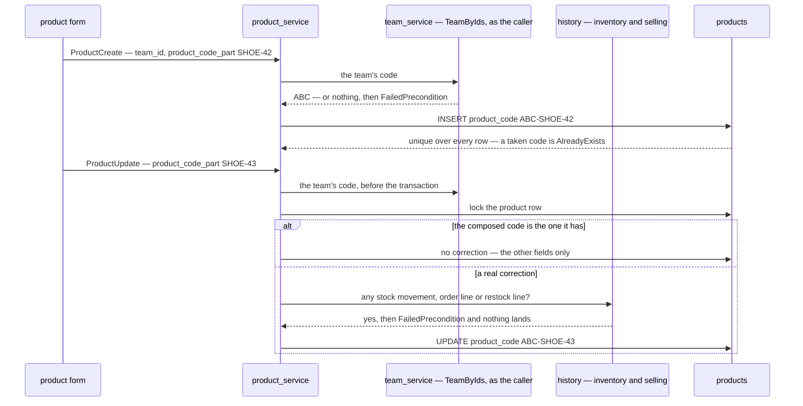
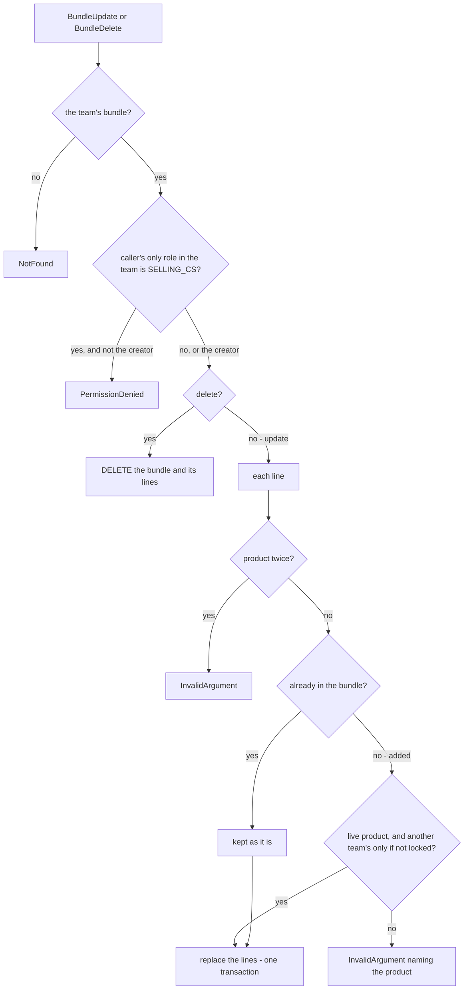
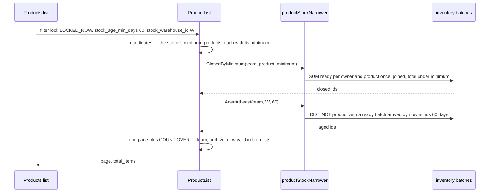
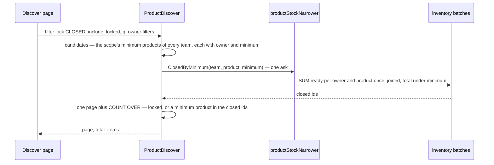
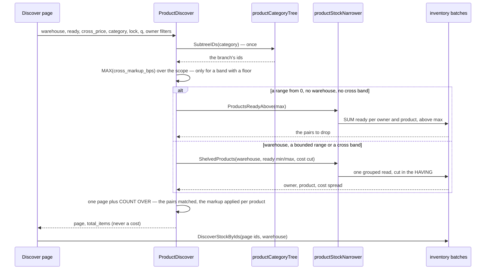

# product_service — RPC flows

## The product code — composed on write

A product has ONE code, `product_code`, and product_service **composes** it: the team sends its own part, and what is
stored is `<team_code>-<part>` — team ABC types `SHOE-42`, the product is `ABC-SHOE-42`
([the-field-is-product-code-composed-on-write](../../business/product/context_decision.md#the-field-is-product-code-composed-on-write)).
The team code is team_service's, so `ProductCreate` and a code correction in `ProductUpdate` depend on it — through
`product_v1.TeamCodes`, which the composition root answers with `TeamByIds` asked as the caller
([product_team_codes.go](../../../backend/cmd/app_development/product_team_codes.go)). It is immutable after the team is
created, so a composed code never goes stale.

| RPC | the code |
| --- | --- |
| `ProductCreate` | takes `product_code_part`; stores `<team_code>-<part>`, the part trimmed. A blank part is InvalidArgument, a team with no code FailedPrecondition, a code any row holds — an archived one included — AlreadyExists |
| `ProductUpdate` | an optional `product_code_part` CORRECTS it — only while the product has NO HISTORY, the line `ProductDelete` uses; otherwise FailedPrecondition. The part it already has is no correction, so a form that always sends it still saves a used product |
| `ProductArchive` / `ProductUnarchive` | the code is KEPT, so Unarchive cannot collide and takes no code |
| `ProductDelete` | frees the code — of a never-used product only |

**Uniqueness is one index over every row** (`products_product_code_unique`, product `00008`). Composition makes it a
namespace per team — no create is ever refused because of another team's row — and the refusal says nothing of another
catalogue. ⚠ A team code may contain a dash, so `AB` + `C-1` and `AB-C` + `1` compose alike; the index refuses the second,
as AlreadyExists.

**Today's rows** — written before composition — are recomposed once by
[`san product recompose-codes`](../../tools/san.md#product-recompose-codes), which `dev setup` runs.

## Bundles — `BundleService`

A selling team's **picking recipes**: which products, and how many of each go into ONE bundle. A bundle has no stock and
no price, and nothing outside product_service reads it — the order form expands it into ordinary product lines, and the
order keeps no link back. The design is [product_bundle.md](../../business/product/product_bundle.md) and its decisions
in [product_bundle_decision.md](../../business/product/product_bundle_decision.md).

Built on product_service's own tables (`00006_create_bundles`); the handlers are `product_v1/bundle_*.go`, one file per
RPC, on the same `*Service` as the catalogue. The contract is [bundle.proto](../../../proto/warehouse/product/v1/bundle.proto),
accepted with its screens ([the-bundle-prototype-is-accepted](../../business/product/product_bundle_decision.md#the-bundle-prototype-is-accepted)).

| RPC | Who | What it does |
| --- | --- | --- |
| `BundleList` | every selling role | the team's bundles with their lines, the last change first; `q` matches the name AND a line's product name or code |
| `BundleByIds` | every selling role | the team's bundles by id; another team's id is simply absent |
| `BundleCreate` | every selling role, the CS included | a bundle, `created_by_user_id` from the token |
| `BundleUpdate` | Owner, Admin — and a CS for her own | replaces the name, the description and EVERY line |
| `BundleDelete` | Owner, Admin — and a CS for her own | a HARD delete: no order refers to a bundle |

### What a write checks

The proto carries the fields' own limits (a name, 1–50 lines, quantity 1–9999). The handler adds what no field can say
— who may change THIS bundle, and what the lines may hold. Only a line the save **adds** must be a live, shareable
product: a line already in the bundle that its owner has since locked or archived is kept
([a-borrowed-product-never-blocks-its-owner](../../business/product/product_bundle_decision.md#a-borrowed-product-never-blocks-its-owner)).

`BundleCreate` runs the same line checks with nothing kept.

**Where the creator check reads the role:** `san_auth.GetCallerRole(ctx)`, the role the interceptor resolved for the
scoped team — no second lookup. Its comment now names this as the one sanctioned use besides recording an override: a
handler may NARROW a policy past what the proto can say, never widen or re-derive it. Root and the Administrator hold
no role in the team (they are in by the root-team bypass) and are not narrowed. ⚠ Accepted edge: a person who is Root
AND a CS in the team reads as the CS there.

**Concurrency.** `BundleUpdate` and `BundleDelete` take the bundle row `FOR UPDATE` first, so two saves of one bundle
run one after the other — each replaces the lines whole, and two interleaved replaces would leave a mix of both.

## The override stamp on the reads — the "by Root team" badge (built 2026-11-11)

[an-override-shows-a-platform-badge](../../business/user/context_decision.md#an-override-shows-a-platform-badge), accepted as
[the-override-badge-is-accepted-as-by-root-team](../../business/user/context_decision.md#the-override-badge-is-accepted-as-by-root-team):
every read a screen names a person from now carries the record's own `is_override` (stamped at the write by
`san_auth.IsOverride`, [an-override-is-stamped-in-every-service](../../business/user/context_decision.md#an-override-is-stamped-in-every-service)),
and the screen draws the shared `ActorName` / `RootTeamBadge` beside the person. Never sent by a caller; a row from
before the column reads false.

| read | field | read from | performance |
| --- | --- | --- | --- |
| `BundleList`, `BundleByIds` (and the bundle writes) | `BundleRowItem.is_override` (9) — the maker | `bundles.is_override`, same row | nil |

## The list's Kunci and Umur stok — narrowed through inventory (built 2026-11-14)

[lock-and-stock-age-filter-ahead-of-the-contract](../../technical/frontend/products_decision.md#lock-and-stock-age-filter-ahead-of-the-contract): the product list's
**Kunci** and **Umur stok** pickers are sent (`ProductListFilter.lock` 3, `stock_age_min_days` 4;
`ProductListRequest.stock_warehouse_id` 6) and `ProductList` narrows its OWN count and page by them — so `total_items`,
the sort and the paging describe the narrowed list. Every one defaults to "no narrowing"; `ProductDiscover` shares the
filter and REFUSES them (InvalidArgument) — Discover's Kunci is its own two values (*Discover's Kunci* below), which
ProductList refuses in turn.

| pick | keeps | facts from |
| --- | --- | --- |
| `MODE_OPEN` *Terbuka* | `cross_locked = false AND reserved_stock = 0` ([one-lock-three-ways](../../technical/frontend/products_decision.md#one-lock-three-ways)) | products |
| `MODE_MINIMUM` *Stok minimum* | `cross_locked = false AND reserved_stock > 0`, in force or not | products |
| `MODE_ALWAYS` *Selalu dikunci* | `cross_locked = true`, whatever minimum it keeps | products |
| `LOCKED_NOW` *Terkunci sekarang* | a minimum product whose owner's READY stock summed over EVERY warehouse is **under** it — `<`, never at it ([a-minimum-closes-only-under-it](../../technical/frontend/products_decision.md#a-minimum-closes-only-under-it), the order take's own line); nothing on a shelf is under any minimum; an always-locked product is not "a minimum in force"; the lens never narrows it | products (candidates) + inventory `ClosedByMinimum` |
| `stock_age_min_days` N *Umur stok* | the oldest batch still holding ready units (`stock_count > 0`) arrived at or before now − N × 24 h — the Umur stok column's own oldest batch, floored the same way ([the-dates-read-as-ages](../../technical/frontend/products_decision.md#the-dates-read-as-ages)); in `stock_warehouse_id` when set, else every warehouse; nothing on a shelf has no age and never matches | inventory `ProductIDsAgedSince` |

**The seam.** `product_v1.StockNarrower` (4th `NewService` dep; nil refuses the two stock picks with Unavailable),
answered by `cmd/app_development/product_stock_narrower.go` over inventory's PLAIN functions on `*gorm.DB`
(`inventory_v1.ClosedByMinimum`, `inventory_v1.ProductIDsAgedSince`) — the `productHistory` shape, never
`*inventory_v1.Service` (inventory reads products through product_service, so a Service dep would close a Wire cycle).
`ClosedByMinimum` takes `(team, product, minimum)` candidates of ANY teams — Discover's lock filter can reuse it — and
sums the owners' live batches ONCE, hash-joined to the candidates (never a per-pair probe). The ids come back and go into
product's statement as one `bigint[]`; with an id list bound, the page and the count are ONE statement
(`COUNT(*) OVER ()`, [the-list-is-sent-once](../../../audits/services/inventory_service/performances/WarehouseProductSearch.md#the-list-is-sent-once-)),
a page past the end counts on its own. Two statements without a shared snapshot: a take between them can leave one row a
unit off its filter until the next read (as the supplier bands).

**Performance** (`product_list_filters_perf_test.go`, `-tags perfaudit`, real wiring; the probed team owns 30 000
products — 9 000 minimum products, 3 000 always-locked, 5 000 never stocked — and 100 000 batches, 60 000 live, over 5
warehouses and 180 days; 10 other teams hold 10 000 products / 30 000 batches beside it; warm, median of 5, page of 20):

| pick | rows (total) | steps, ms | wall |
| --- | --- | --- | --- |
| nothing (today's list) | 20 (30 000) | count 3.7 · page 1.6 | 5.5 ms |
| Terbuka / Stok minimum / Selalu dikunci | 20 (18 000 / 9 000 / 3 000) | count ≤ 5.0 · page ≤ 2.3 | ≤ 7.1 ms |
| Terkunci sekarang | 20 (6 082) | candidates 7.8 · closed-by-minimum 71.8 · page+count 58.1 | 140 ms |
| Terkunci sekarang, by name, page 20 | 20 (6 082) | candidates 7.5 · closed-by-minimum 16.3 · page+count 63.7 | 89 ms |
| Umur 30+ / 60+ / 90+ | 20 (25 000 / 23 611 / 20 418) | aged-ids 16–30 · page+count 12–19 | 29–51 ms |
| Umur 60+ in one warehouse | 20 (10 002) | aged-ids 7.6 · page+count 52.7 | 61 ms |
| Umur 60+ + Terkunci sekarang | 20 (4 443) | candidates 7.4 · closed 16.6 · aged 16.4 · page+count 13.2 | 54 ms |

Not heavy. The 50–70 ms single statements are this host's loopback carrying a big `bigint[]` parameter, not the reads:
the same 72 KB array bound to `SELECT length($1)` takes 50 ms, and EXPLAIN on the test transaction executes the
Terkunci sekarang steps in 4.2 / 18.2 / 3.6 ms and the age steps in 11–27 / 3–11 ms
([the-id-list-stalls-on-this-loopback](../../../audits/services/inventory_service/performances/WarehouseProductSearch.md#the-id-list-stalls-on-this-loopback-)).
No index added: the age read is a bitmap heap scan over the team's live batches (`batches_owner_product_idx`, 11–27 ms
executed); a covering partial index on `batches` would add an index write to every stock change for that — not worth it
at this volume. A pick of nothing calls no seam (today's cost untouched).

## Discover's Kunci — narrowed through inventory (built 2026-11-14)

[discover-filters-by-lock](../../technical/frontend/products_decision.md#discover-filters-by-lock) with its boundary from
[a-minimum-closes-only-under-it](../../technical/frontend/products_decision.md#a-minimum-closes-only-under-it): Discover's
**Kunci** chips are sent as `ProductListFilter.lock` with Discover's OWN two values, and `ProductDiscover` narrows its count
and page by them — the list's *Terbuka* is the setting, Discover's what another team may take now, so they are two enum
values (`PRODUCT_LOCK_FILTER_CLOSED` 5, `PRODUCT_LOCK_FILTER_ORDERABLE` 6). Each RPC refuses the other's values
(InvalidArgument), and Discover still refuses `stock_age_min_days`. No pick = no narrowing, no seam called (every picker,
`orders.spec.ts`' direct calls untouched).

| pick | keeps |
| --- | --- |
| `CLOSED` *Terkunci* | `cross_locked = true` (its owner locked it — with `include_locked`, which only the Discover page sends), OR a minimum product whose owner's READY stock over EVERY warehouse is **under** its minimum — `<`, exactly at it is open; nothing on a shelf is under any |
| `ORDERABLE` *Terbuka* | every other: not locked, and no minimum or one with enough ready stock |

**The seam** is the list's `StockNarrower.ClosedByMinimum` (stock_narrower.go `narrowByOrderable`, sharing
`closedByMinimum` with the list's Terkunci sekarang): the candidates are Discover's own scope's minimum products of EVERY
team (archive, `include_locked`, owner filters, `exclude_own_team`, `q` — built fresh by `scope()`), sent in ONE ask with
their owners and minimums; `inventory_v1.ClosedByMinimum` sums the owners' live batches once. The way is read again in the
page's statement (a lock changed between the two reads lands by its lock now); with an id list bound, page and count are
one statement (`COUNT(*) OVER ()`).

**Performance** (`cmd/app_development/discover_cards_perf_test.go`, `-tags perfaudit`, real wiring; 30 000 products over
20 teams — ≈ 9 000 minimum products, every one a candidate; 100 000 batches, 60 000 live; warm, median of 5, page of 20):

| pick | rows (total) | steps, ms | wall |
| --- | --- | --- | --- |
| nothing (today's page) | 20 (30 000) | count 6.3 · page 1.1 | 7.3 ms |
| Terkunci | 20 (9 082) | candidates 9.9–13.4 · closed-by-minimum 25–84 · page+count 62–65 | 109–160 ms |
| Terbuka | 20 (20 918) | candidates 10.7 · closed-by-minimum 24.8 · page+count 68.5 | 108 ms |
| Terkunci, by name, page 20 | 20 (9 082) | candidates 10.7 · closed 25.1 · page+count 63.4 | 110 ms |
| Terkunci + hide mine | 20 (7 582) | candidates 10.8 · closed 25.7 · page+count 70.6 | 113 ms |
| Terbuka + q=kaos (no minimum product matches) | 0 | candidates 10.9 · page+count 23.4 | 34 ms |
| the page: Terkunci grid + DiscoverStockByIds | 20 | the above + facts 0.8 · shelves 0.6 · on its way 2.3 | 109 ms |

Not heavy — the same shape and cost as the list's *Terkunci sekarang*. EXPLAIN on the test transaction executes the steps
in 4.3 / 23.0 / 13.7 ms; the rest is this host's loopback carrying the two big `bigint[]` parameters (the 72 KB candidate
arrays and the 36 KB closed list each take ≈ 50 ms bound to `SELECT length($1)`,
[the-id-list-stalls-on-this-loopback](../../../audits/services/inventory_service/performances/WarehouseProductSearch.md#the-id-list-stalls-on-this-loopback-)).
No index added; no audit file (audits/README.md).

## Discover's Gudang, Stok siap, Harga cross and Kategori — narrowed through the seams (built 2026-11-14)

[discovers-warehouse-keeps-ready-stock-there](../../technical/frontend/products_decision.md#discovers-warehouse-keeps-ready-stock-there),
[discover-ranges-are-picked](../../technical/frontend/products_decision.md#discover-ranges-are-picked),
[a-cross-band-keeps-a-range-that-touches-it](../../technical/frontend/products_decision.md#a-cross-band-keeps-a-range-that-touches-it),
[a-picked-branch-keeps-its-whole-subtree](../../technical/frontend/categories_decision.md#a-picked-branch-keeps-its-whole-subtree).
Four more fields on `ProductDiscoverRequest`; unset = no narrowing and no seam called (every picker, `orders.spec.ts`'
direct calls untouched). CEL refuses a range whose min is above its max; the prices are `finite`.

| field | keeps |
| --- | --- |
| `warehouse_id` (11) | products — any team's, matched on owner AND id — with READY units (`stock_count > 0`) in that warehouse now. The other two ranges then read that warehouse; the page passes it to `DiscoverStockByIds` too, so the cards say its figures (the lock badge keeps reading every warehouse) |
| `ready` (12, `DiscoverReadyRange` min, optional max) | ready units — the warehouse's, else every warehouse summed — in [min, max], both ends included; no max = open-ended (the screen sends the top band and a max typed at 100.000 open). From 0 with no warehouse and no cross band: the OPPOSITE set (ready above max) is asked and dropped, so a product with no stock row stays (Kosong, 0–10) |
| `cross_price` (13, `DiscoverPriceRange` min, optional max, rupiah) | the product's cross range overlaps the band — `cross_min <= max AND cross_max >= min`, ends included — where cross = cost + cost × `cross_markup_bps` ÷ 10 000 over the batches holding units (in the warehouse, if picked): DiscoverStockByIds' own figure and order of operations. Nothing ready = no cross price = kept by no band |
| `category_id` (14) | `category_id` in the picked node's subtree (itself and every node below, any depth; soft-deleted nodes walked so their products are not lost); a node with no products answers an empty page. It also narrows Kunci's candidates |

**The seams** (HARD RULE 3 — the batches are inventory's, the tree category_service's; answered in-process by the
composition root):

| seam (product_v1) | answered by | read |
| --- | --- | --- |
| `StockNarrower.ShelvedProducts(ShelfAsk)` | `cmd/app_development/product_stock_narrower.go` → `inventory_v1.ShelvedProducts` | one grouped read of `batches` — owner, product, cost MIN/MAX — cut in the HAVING by the ready range and the cost band ([inventory rpc.md](../inventory_service/rpc.md#discovers-shelf-filters--shelvedproducts--productsreadyabove-plain-functions-built-2026-11-14)) |
| `StockNarrower.ProductsReadyAbove(ceiling)` | same → `inventory_v1.ProductsReadyAbove` | the opposite set of a range from 0 |
| `CategoryTree.SubtreeIDs(category)` | `cmd/app_development/product_categories.go` → `category_v1.SubtreeIDs` | `WITH RECURSIVE` over `categories.parent_id` (`UNION`, so a loop cannot run forever) |

**The cost never leaves the process.** The cost band is cut inside inventory loosely — `MIN(price_unit) <= max` (the
markup is never negative) and `MAX(price_unit) >= min ÷ (1 + the scope's highest markup)` (one `MAX(cross_markup_bps)`
read, only when the band has a floor), each widened by a billionth (`crossCutSlack`) — so the cut can only keep too many,
never lose one; the exact test runs in the page's own statement with each product's own markup, over the spread bound as
`unnest` arrays. Nothing of the spread is in the response
(`TestDiscover_NoCostInAnyAnswer`).

**Performance** (`cmd/app_development/discover_filters_perf_test.go`, `-tags perfaudit`, real wiring; 30 000 products
over 20 teams, 5 000 never stocked; 100 000 batches over 5 warehouses, 60 000 live; a 170-node category tree; warm,
median of 5, page of 20, quiet host):

| pick | rows (total) | steps, ms | wall |
| --- | --- | --- | --- |
| nothing (today's page) | 20 (30 000) | count 3.6 · page 1.3 | 4.6 ms |
| Gudang | 20 (15 000) | shelves 28.3 · page+count 71.4 | 99.9 ms |
| Stok siap 1–10 | 20 (6 250) | shelves 32.3 · page+count 19.5 | 53.0 ms |
| Stok siap 11–50 | 20 (18 750) | shelves 49.6 · page+count 58.7 | 110.1 ms |
| Stok siap 10.001+ (open top) | 0 | shelves 22.6 · page+count 1.0 | 24.4 ms |
| Stok siap Kosong 0–0 (opposite set) | 20 (5 000) | ready-above 45.2 · page+count 27.9 | 74.7 ms |
| Stok siap 0–10 (opposite set) | 20 (11 250) | ready-above 39.8 · page+count 29.1 | 71.0 ms |
| Harga cross ≤ 10rb | 20 (4 593) | shelves 26.8 · page+count 15.4 | 44.0 ms |
| Harga cross 25–50rb | 20 (12 113) | markup-max 6.1 · shelves 40.0 · page+count 41.0 | 90.9 ms |
| Harga cross 500rb+ (open top) | 0 | markup-max 3.9 · shelves 16.8 · page+count 2.7 | 24.8 ms |
| Kategori, a branch (12 end categories) | 20 (3 000) | subtree 0.6 · count 1.0 · page 0.5 | 2.1 ms |
| Kategori, an end category | 20 (250) | subtree 0.0 · count 0.7 · page 1.3 | 2.2 ms |
| Gudang + Stok siap 1–10 + Harga cross 10–25rb | 20 (3 355) | markup-max 4.7 · shelves 16.7 · page+count 23.7 | 45.5 ms |
| all four + Kunci Terkunci | 20 (115) | subtree 1.0 · candidates 1.7 · closed-by-minimum 52.3 · markup-max 2.4 · shelves 15.9 · page+count 6.2 | 80.6 ms |
| Gudang + Harga cross 10–25rb, by name, page 20 | 20 (4 021) | markup-max 5.5 · shelves 15.2 · page+count 17.1 | 39.0 ms |

Not heavy. The shelves read is a bitmap scan on `batches_take_idx` with a Gudang (16 ms executed, EXPLAIN), a seq scan
of the 100 000 batches without (31–33 ms); the page is a hash join of products to the bound pairs (28–34 ms executed).
The rest is the loopback carrying the `bigint[]`/`float8[]` parameters (≈ 100–120 KB at 15 000 pairs; bound alone to
`SELECT length($1)` they take 0.5–1.2 ms here, so no stall of the
[the-id-list-stalls-on-this-loopback](../../../audits/services/inventory_service/performances/WarehouseProductSearch.md#the-id-list-stalls-on-this-loopback-)
kind). Kategori is the existing `products_category_idx` with an id list. No index added; no audit file (audits/README.md).
