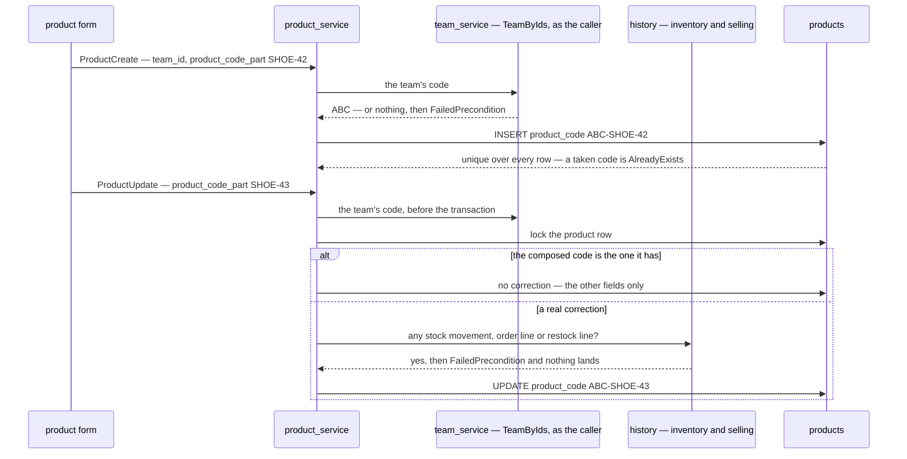
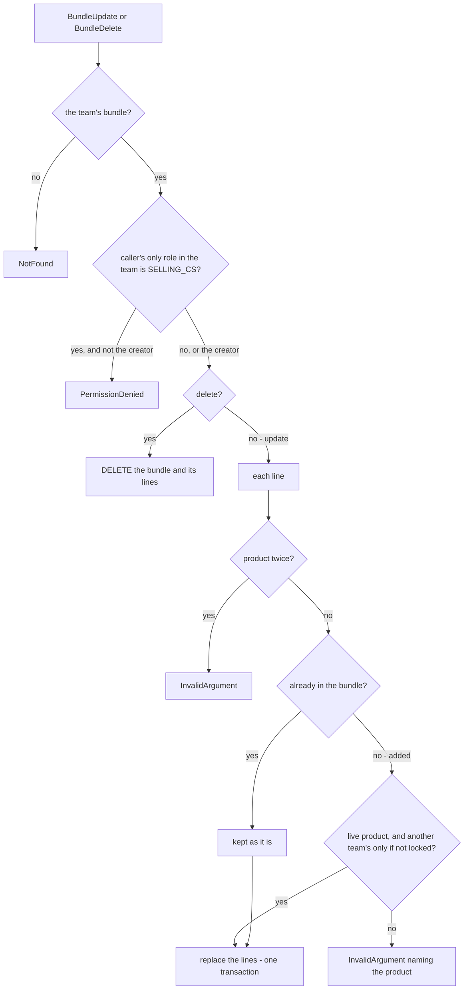

# product_service — RPC flows

## The product code — composed on write

A product has ONE code, `product_code`, and product_service **composes** it: the team sends its own part, and what is
stored is `<team_code>-<part>` — team ABC types `SHOE-42`, the product is `ABC-SHOE-42`
([the-field-is-product-code-composed-on-write](../../business/product/context_decision.md#the-field-is-product-code-composed-on-write)).
The team code is team_service's, so `ProductCreate` and a code correction in `ProductUpdate` depend on it — through
`product_v1.TeamCodes`, which the composition root answers with `TeamByIds` asked as the caller
([product_team_codes.go](../../../backend/cmd/app_development/product_team_codes.go)). It is immutable after the team is
created, so a composed code never goes stale.

| RPC | the code |
| --- | --- |
| `ProductCreate` | takes `product_code_part`; stores `<team_code>-<part>`, the part trimmed. A blank part is InvalidArgument, a team with no code FailedPrecondition, a code any row holds — an archived one included — AlreadyExists |
| `ProductUpdate` | an optional `product_code_part` CORRECTS it — only while the product has NO HISTORY, the line `ProductDelete` uses; otherwise FailedPrecondition. The part it already has is no correction, so a form that always sends it still saves a used product |
| `ProductArchive` / `ProductUnarchive` | the code is KEPT, so Unarchive cannot collide and takes no code |
| `ProductDelete` | frees the code — of a never-used product only |

**Uniqueness is one index over every row** (`products_product_code_unique`, product `00008`). Composition makes it a
namespace per team — no create is ever refused because of another team's row — and the refusal says nothing of another
catalogue. ⚠ A team code may contain a dash, so `AB` + `C-1` and `AB-C` + `1` compose alike; the index refuses the second,
as AlreadyExists.

**Today's rows** — written before composition — are recomposed once by
[`san product recompose-codes`](../../tools/san.md#product-recompose-codes), which `dev setup` runs.

## Bundles — `BundleService`

A selling team's **picking recipes**: which products, and how many of each go into ONE bundle. A bundle has no stock and
no price, and nothing outside product_service reads it — the order form expands it into ordinary product lines, and the
order keeps no link back. The design is [product_bundle.md](../../business/product/product_bundle.md) and its decisions
in [product_bundle_decision.md](../../business/product/product_bundle_decision.md).

Built on product_service's own tables (`00006_create_bundles`); the handlers are `product_v1/bundle_*.go`, one file per
RPC, on the same `*Service` as the catalogue. The contract is [bundle.proto](../../../proto/warehouse/product/v1/bundle.proto),
accepted with its screens ([the-bundle-prototype-is-accepted](../../business/product/product_bundle_decision.md#the-bundle-prototype-is-accepted)).

| RPC | Who | What it does |
| --- | --- | --- |
| `BundleList` | every selling role | the team's bundles with their lines, the last change first; `q` matches the name AND a line's product name or code |
| `BundleByIds` | every selling role | the team's bundles by id; another team's id is simply absent |
| `BundleCreate` | every selling role, the CS included | a bundle, `created_by_user_id` from the token |
| `BundleUpdate` | Owner, Admin — and a CS for her own | replaces the name, the description and EVERY line |
| `BundleDelete` | Owner, Admin — and a CS for her own | a HARD delete: no order refers to a bundle |

### What a write checks

The proto carries the fields' own limits (a name, 1–50 lines, quantity 1–9999). The handler adds what no field can say
— who may change THIS bundle, and what the lines may hold. Only a line the save **adds** must be a live, shareable
product: a line already in the bundle that its owner has since locked or archived is kept
([a-borrowed-product-never-blocks-its-owner](../../business/product/product_bundle_decision.md#a-borrowed-product-never-blocks-its-owner)).

`BundleCreate` runs the same line checks with nothing kept.

**Where the creator check reads the role:** `san_auth.GetCallerRole(ctx)`, the role the interceptor resolved for the
scoped team — no second lookup. Its comment now names this as the one sanctioned use besides recording an override: a
handler may NARROW a policy past what the proto can say, never widen or re-derive it. Root and the Administrator hold
no role in the team (they are in by the root-team bypass) and are not narrowed. ⚠ Accepted edge: a person who is Root
AND a CS in the team reads as the CS there.

**Concurrency.** `BundleUpdate` and `BundleDelete` take the bundle row `FOR UPDATE` first, so two saves of one bundle
run one after the other — each replaces the lines whole, and two interleaved replaces would leave a mix of both.

## The override stamp on the reads — the "by Root team" badge (built 2026-11-11)

[an-override-shows-a-platform-badge](../../business/user/context_decision.md#an-override-shows-a-platform-badge), accepted as
[the-override-badge-is-accepted-as-by-root-team](../../business/user/context_decision.md#the-override-badge-is-accepted-as-by-root-team):
every read a screen names a person from now carries the record's own `is_override` (stamped at the write by
`san_auth.IsOverride`, [an-override-is-stamped-in-every-service](../../business/user/context_decision.md#an-override-is-stamped-in-every-service)),
and the screen draws the shared `ActorName` / `RootTeamBadge` beside the person. Never sent by a caller; a row from
before the column reads false.

| read | field | read from | performance |
| --- | --- | --- | --- |
| `BundleList`, `BundleByIds` (and the bundle writes) | `BundleRowItem.is_override` (9) — the maker | `bundles.is_override`, same row | nil |
