# selling_service — RPC & order lifecycle

## The order lifecycle (#67, #91, #149, #70, #150, 00015)

An order is owned by a SELLING team but **fulfilled by a WAREHOUSE**, and the lifecycle is split along
exactly that line: the warehouse records *what has physically been done to it*, and the selling team's
customer service records *what the platform shows* after the handover. The eleven statuses and who makes
each move are the owner's status diagram ([the-status-move-is-the-only-journey](../../business/order/context_decision.md#the-status-move-is-the-only-journey)).

> ⚠ **CONFIRM IS THE WAREHOUSE'S** (owner). It was the selling team's click (#91) and is the warehouse's
> first move — the building accepting the job. A `pending` order is waiting on the **warehouse**.

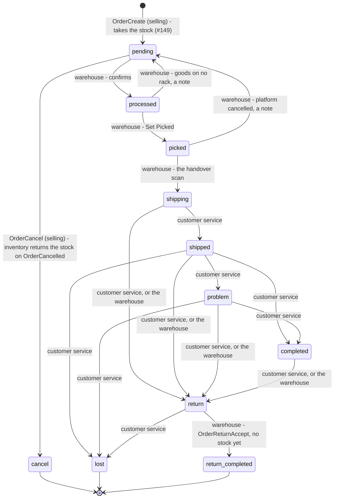

### One RPC for every plain move — `OrderStatusChange`

Every edge above except two goes through **`OrderStatusChange(team_id, order_ids, to, note)`**
([one-status-change-for-every-plain-move](../../technical/frontend/warehouse_order_list_decision.md#one-status-change-for-every-plain-move)).
It replaced `OrderConfirm`, `OrderPick`, `OrderPack` and `OrderShip`, which only ever changed the status.
The two that keep their own RPC do more than move a status: `OrderCancel` checks the count first and announces the
cancel that gives the stock back and cancels the sale, and the return accept (`OrderReturnAccept`, [below](#the-warehouse-accepts-a-return--orderreturnaccept)) notes the
missing units, answers the labels for borrowed lines and announces the courier's charge.

### `OrderCancel` — the count first, then the status, then the event (backlog #10 slice 4)

The cancel **no longer releases the stock inside its own flow**. Inventory releases it when `OrderCancelled` reaches it
([inventory-returns-stock-on-order-cancelled](../../business/order/context_decision.md#inventory-returns-stock-on-order-cancelled)),
by the order's key K ([every-release-goes-by-the-key](../../business/order/context_decision.md#every-release-goes-by-the-key)).
What the person meets is unchanged: a stock count holding a rack the take came from still refuses the cancel, naming the
count, who started it and when, and the order stays pending
([a-cancel-still-meets-the-count-first](../../business/order/context_decision.md#a-cancel-still-meets-the-count-first),
[a-lock-stops-sales-and-cancels-too](../../business/inventory/opname_decision.md#a-lock-stops-sales-and-cancels-too)).

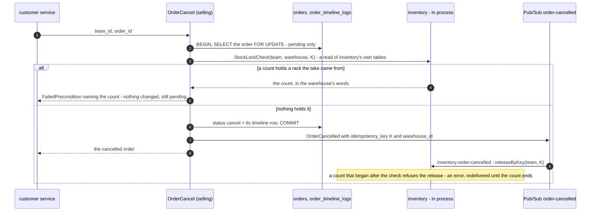

| | |
| --- | --- |
| the check | `StockPicker.StockLockCheck(ctx, team, warehouse, K)` → `*StockLock{SessionID, Reason}` or nil; the bridge (`cmd/app_development/stock_picker.go`) calls `inventory_v1.StockLockCheck`, which reads `idempotency_order_check` → the take (team-checked) → its rack rows → the open count snapshots. Inside the cancel's transaction, after the order row is locked and before its status moves |
| refused | `FailedPrecondition` whose message is the warehouse's own `CountedError` sentence — the same words the release used to refuse with, so the screen and the e2e read the same text. A check that could not be made refuses `Unavailable` (try again); nothing moves |
| no stock to check | an order with no warehouse or no key took none: no check, and the event carries an empty key, which inventory acknowledges |
| the event | `OrderCancelled` gains `idempotency_key` (6) and `warehouse_id` (7). Published after the commit; a failed publish is logged as *STOCK IS STILL TAKEN* with K — release it by hand (`OrderTransactionRelease`) — besides the revenue row it leaves |
| the race | a count planned between the check and the release is the decided fallback: the listener's release is refused by the lock itself, errors, and is redelivered until the count ends — proved in [inventory's race](../../../audits/services/inventory_service/concurrency/lock-order.md) |
| ⚠ the person is not told | the stock comes back a moment after the cancel answers; whether to say so on screen is the owner's open question (#10 Q11) — no message changed |

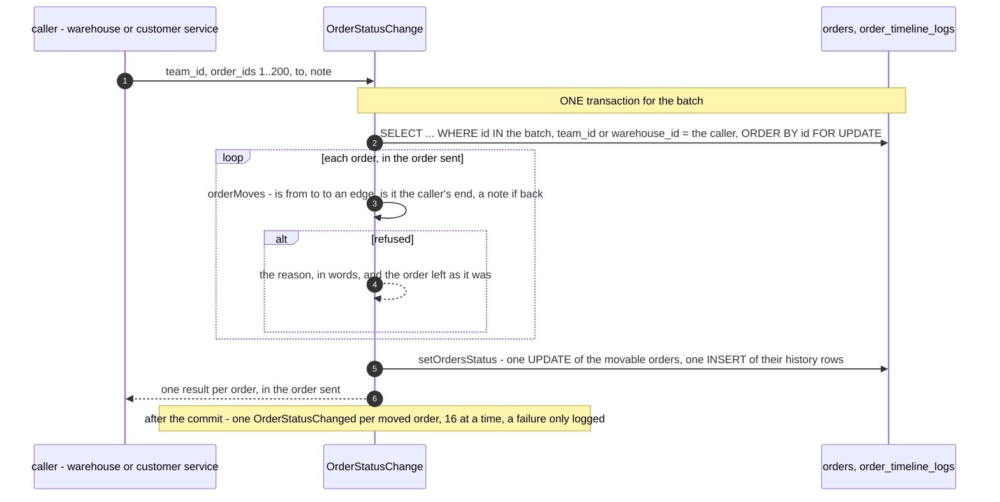

| | |
| --- | --- |
| the table | `orderMoves` in [order_transition.go](../../../backend/services/selling_service/selling_v1/order_transition.go), from → to → which end may make it, and whether it needs a note |
| which end the caller is | per order, from the scope: `team_id` = the order's `warehouse_id` is the warehouse, = its `team_id` is the selling team |
| a refusal | never blocks the rest and never fails the call: `moved: false` with a sentence (*"processed cannot move to shipping"*, *"only the warehouse moves …"*, *"a note is required …"*) |
| not the caller's order | refused as *"not one of this team's orders"*, with no status, so a caller cannot probe ids |
| `to: cancel`, `to: return_completed` | refused here: each has its own action |
| a note | required for a move back to `pending`; written to the history row with the move |
| two crew, one parcel, one second | the row lock serialises them: the second reads the status the first wrote and is refused as *"already shipping"* |
| the event | after the commit, one `OrderStatusChanged` per moved order (from, to, actor, the timeline row) — the order metrics' feed ([the-status-changes-publish-nothing](../../business/order/order_statistic_metric_clarify.md#the-status-changes-publish-nothing)). Its `event_id` is `order-status-changed:<timeline row id>`, so a redelivery collides. Up to 16 publishes wait on the broker at once, so a 200-parcel handover is not 200 round trips in a row. A failed publish is logged and the move stands |
| the save | one transaction of four statements for any batch ([a-batch-move-saves-in-one-transaction](../../technical/frontend/warehouse_order_list_decision.md#a-batch-move-saves-in-one-transaction)). Locked in **id order**, so two batches over the same orders queue rather than deadlock. A database failure rolls the batch back and every order answers *"could not be saved — try again"* |

### Who may move it, and why the scope differs

| Move | Scoped to | Because |
| --- | --- | --- |
| Create / Cancel | the **selling team** | the team that owns the order decides whether it stands |
| the return accept | **the warehouse holding the parcel** — any, for an order in `return` | only the person holding the goods can say they are here, and the parcel may come back to a warehouse that did not ship it ([both-cs-and-the-warehouse-can-return-an-order](../../business/order/context_decision.md#both-cs-and-the-warehouse-can-return-an-order)) |
| confirm, Set Picked, back to pending, the handover | the **order's warehouse** (#72) | the crew doing the work holds no role in the selling team |
| shipped, completed, problem, lost | the **selling team** | customer service reads the platform |
| a forced return | either | customer service claims it, or the warehouse forces it |

**This asymmetry is the design, not an inconsistency.** A picker is a member of the warehouse, not of
the shop whose order they are packing, so the warehouse's moves carry the **warehouse** as their
`use_scope` field. Another team's order reads as refused-not-ours, never PermissionDenied, so a crew
cannot discover that an id belongs to someone else's building.

### Every move leaves a step — the order's timeline (`order_timeline_logs`)

The lifecycle above is drawn as states, but a state is a fact about *now*. Nothing in `orders` could
say **when** an order was confirmed, **how long** it then sat before the crew picked it, or **who** did
either — the row carries `status`, `created_at` and `updated_at`, and no actor at all. So each
transition appends a row to `order_timeline_logs`, saying which side made it
([order-timeline-logs-replaces-order-events](../../business/order/context_decision.md#order-timeline-logs-replaces-order-events)),
and the detail page reads those — the status rows in its **Timeline**, the note rows in *Catatan*.

**The append happens at the single choke point**, not in the handlers:

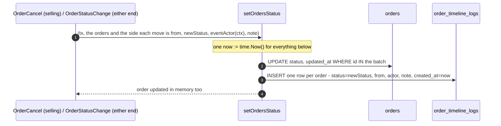

- **One clock, one moment.** The status stamp, the row's `created_at` and the domain event a caller may
  publish afterwards all read the same `now`. Two clock reads for one fact would file a midnight
  transition on different days depending on who looked.
- **`placeOrder` appends its own `pending` row, from `selling`**, so an order typed into the form and one
  promoted from a draft start the same timeline — the two doors cannot differ.
- **A note is a row with no status** ([a-note-is-a-timeline-row](../../technical/frontend/order_detail_decision.md#a-note-is-a-timeline-row)),
  never edited and never deleted. Two writers, neither through `setOrdersStatus` — a note moves nothing:
  - `placeOrder` writes the form's trimmed note, when there is one, in the SAME INSERT as the `pending` row: from
    `selling`, by the person placing the order, at the order's own `created_at` — so it reads straight after `pending`.
  - `OrderNoteCreate(team_id, order_id, note)` appends one from either end, `from` following the scope (the order's
    team `selling`, a team that is both ends included, its warehouse `warehouse`, any other team NotFound). A
    single-table insert after a scoped read — no lock, no transaction.
- **The actor is `eventActor(ctx)` — 0 when unidentifiable, and that never fails the call.** This is a
  deliberate contrast with `draftAuthor`, which refuses the request outright: a draft is personal, so an
  unidentifiable caller has no correct answer to receive, whereas an event is a byproduct and the
  record-keeping must not be able to veto the work.
- **`OrderDetail` is the only RPC that returns them** (`timeline_logs`), preloaded by `created_at`, then `id`.
  `OrderList` stays a summary: a page of 20 orders carrying 20 whole lifecycles is a list that grows with history.

See [database-schema.md](../../database-schema.md) for the table, and why the status column is kept beside the
timeline rather than replaced by it.

### Picking does NOT move stock

The stock was deducted when the order was **placed** (#149, "deduct at placement" — the choice that
makes oversell impossible). Picking records that a person is collecting what the system already
committed. **There is no inventory call in the pick move and there must not be one** — a second deduction
would take the goods twice.

### The cancel window (#70/#150)

Cancel is allowed from **`pending` only**, and the stock goes back **exactly where it came from** — same racks, same
batches, because inventory's release on `OrderCancelled` (`releaseByKey`, by the order's key) reverses the take's own
ledger rows rather than trusting quantities (a-rollback-reverses-its-log-rows).

A `processed` or `picked` order is first handed back to `pending` by the warehouse — the moment the goods
are unpacked and re-shelved — so the stock a cancel returns is really on a shelf. **After the handover a
cancel is refused**: putting the stock back then would book goods onto a shelf while they are on a
courier's van; the count would say something untrue until a human noticed. What comes back
after shipping is a **return** — a different event, with different money — and calling it a cancel
would hide that rather than record it.

> The hand-back to `pending` is what keeps the shelf honest: the books return the goods only once a
> person has put them back. Re-shelving onto a different rack is `RackMove`'s job (#136).

## The warehouse accepts a return — `OrderReturnAccept`

`return` is a **claim** that the goods are coming back; `return_completed` is the goods **in the warehouse's hands**
([the-accept-is-the-status-return-completed](../../business/order/context_decision.md#the-accept-is-the-status-return-completed)).
The move between them is the accepting warehouse's own RPC — **whichever warehouse holds the parcel** — built before its
stock half
([the-return-accept-is-built-before-its-stock-half](../../business/order/context_decision.md#the-return-accept-is-built-before-its-stock-half)):
**it calls no inventory**, so a completed return's units are not back on a shelf until
[inventory/return.md](../../business/inventory/return.md) designs it.

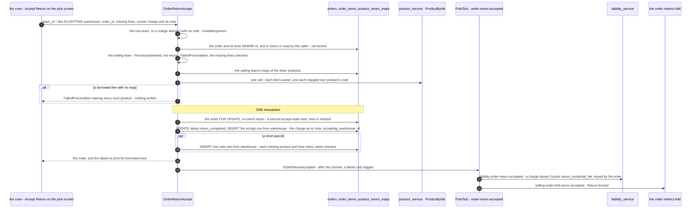

| | |
| --- | --- |
| who | **the warehouse holding the parcel** — `ROOT`, `ADMINISTRATOR`, `WAREHOUSE_OWNER`, `WAREHOUSE_ADMIN`, `WAREHOUSE_STAFF`, scoped on it. Usually the selling team's configured return warehouse, which may not be the one the order shipped from ([a-return-may-land-in-another-warehouse](../../business/order/context_decision.md#a-return-may-land-in-another-warehouse)), and an old label may bring it to a third ([a-stale-return-location-is-accepted](../../business/order/context_decision.md#a-stale-return-location-is-accepted)) — so **any** warehouse may accept an order in `return`. An order in any other status reads `NotFound` unless the caller reads it ([orderReaders](#a-return-reads-to-its-return-warehouse--orderreaders)); the order's own selling team is `PermissionDenied` (it claims, it does not accept — unless it is its own warehouse); the root team, which is no building, `InvalidArgument` |
| where | the accepting warehouse — the call's scope, asked of nobody — is written on the `return_completed` row, `order_timeline_logs.accepting_warehouse_id` (selling `00034`), and travels as `OrderTimelineLog.accepting_warehouse_id` ([the-accept-records-where-it-was-accepted](../../business/order/context_decision.md#the-accept-records-where-it-was-accepted)). It is also `OrderReturnAccepted.warehouse_id`: the courier was paid at that door, so the charge is owed to it |
| from | `return` only. A parcel whose order is not claimed is forced to `return` first ([a-forced-return-follows-the-status-move](../../business/order/context_decision.md#a-forced-return-follows-the-status-move)); an accepted one answers *"this return is already accepted"* |
| whole | every line at its ordered quantity ([a-return-is-never-partial](../../business/order/context_decision.md#a-return-is-never-partial)) — there is no "how many came back", only `missing_lines`: one per line, 1 to the line's quantity, on this order's lines |
| a short parcel | one **note row** (no status) from the warehouse, at the accept's moment: *"Missing from the returned parcel: 1 × KPH-M Kaos Polos Hitam — M · …"* ([a-short-return-is-accepted-and-the-gap-written-off](../../business/order/context_decision.md#a-short-return-is-accepted-and-the-gap-written-off)). Its write-off is inventory's, not built |
| a borrowed line | a line whose owner is known and is not the selling team, as create decides it. It answers a label: the mapped own product's code and name, one per unit in hand — the quantity less the missing ([a-returned-borrowed-unit-is-relabelled-at-the-accept](../../business/order/context_decision.md#a-returned-borrowed-unit-is-relabelled-at-the-accept)). An unmapped one refuses the whole accept ([a-return-never-clones-a-product](../../business/order/context_decision.md#a-return-never-clones-a-product)); an own line never reads the map |
| the courier | `courier_charge` (a double, frozen exact by the accept; 0 = none) and its note, required above 0 ([an-incidental-line-must-say-what-it-was-for](../../business/balance/context_decision.md#an-incidental-line-must-say-what-it-was-for)). Written as the accept row's note — *"Courier charge Rp 15.000: ongkir retur"* — and carried by `OrderReturnAccepted`; liability posts it ([liability_service](../liability_service/rpc.md#the-courier-at-a-return--chargereturncourier)). A note with no charge is dropped |
| the override | `is_override` on both rows it writes, and `actor_is_override` on the event ([an-override-is-stamped-in-every-service](../../business/user/context_decision.md#an-override-is-stamped-in-every-service)). `orders.is_override` is the placement's and is not touched |
| the catalogue | read **before** the lock — no network call holds the order's row. The lines and the maps cannot change under it (frozen at placement, written once); only the status can, and it is re-read under the lock. A failed lookup is `Unavailable` and nothing is accepted |
| the event | `OrderReturnAccepted` on `order-return-accepted`, `event_id` = `order-return-accepted:<order_id>` — the status is terminal, so an order is accepted once. It also replaces `OrderStatusChanged` as Return Arrived's feed: the plain move refuses `return_completed`, so no `OrderStatusChanged` ever carries it |
| two crew, one parcel | ✅ safe — the row lock serialises them: 8 accepts at once leave one `return_completed` row and one event, and the interleave shows the second waiting on the first's lock, then refused. Two **warehouses** at once — the order's own and the configured one, 4 + 4 — the same: one wins, and the row names the one that won (`order_return_accept_race_test.go`) |
| cost | ✅ 7 queries, ~3.7 ms over 50 000 orders, every read an index scan (`order_return_accept_perf_test.go`) |
| ⚠ not built | the stock half — the return transaction into the configured return warehouse and the missing units' write-off ([return-is-unplanned](../../business/inventory/context_decision.md#return-is-unplanned)); **a way for a stale-label warehouse to FIND the order** — it is neither end nor the configured warehouse, so no list or scan of its own matches, and a cross-team search by the label is not designed (the server accepts it by id) — the warehouse's own *Receive Return* search and forced return are built 2026-11-04 (`ReceiveReturnDialog.tsx`); a screen showing where a return was accepted (it is on the wire); a reprint of the labels after the dialog closes |

### A return reads to its return warehouse — `orderReaders`

Every read of an order — `OrderList`, `OrderStat`, `OrderExport`, `OrderCreatorList`, `OrderDetail` — shares one
condition, `orderReaders`: the order's selling team, its warehouse, and **narrowly** the selling team's configured return
warehouse, for an order in `return` or `return_completed` only — read from `team_return_configurations` at that moment
([the-return-warehouse-is-read-when-the-return-happens](../../business/order/context_decision.md#the-return-warehouse-is-read-when-the-return-happens)).
It is how the pick queue's **Returns** tab lists the parcels coming back to a warehouse that never shipped them, and how
the pick screen opens one to accept it. Nothing else of that team's is read, and nothing it may WRITE changes.

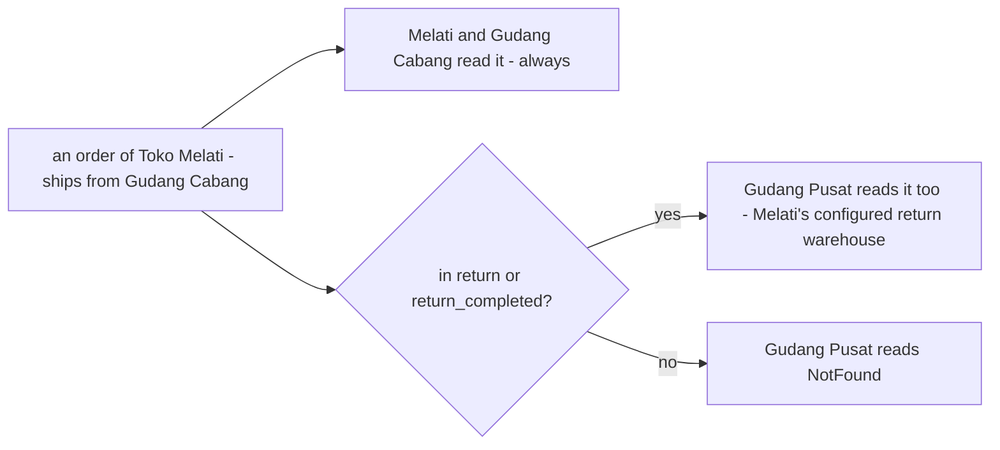

| | |
| --- | --- |
| the SQL | `team_id = @team OR warehouse_id = @team OR (status IN ('return','return_completed') AND team_id = ANY(ARRAY(SELECT team_id FROM team_return_configurations WHERE warehouse_id = @team)))` — `ANY(ARRAY(…))`, an InitPlan computed once, so the arm is an index condition |
| the index | `orders_return_team_idx` (selling `00034`) — `(team_id) WHERE status IN ('return','return_completed')`. Without it the third arm read every order of the configured teams and the planner chose a sequential scan of the table (9 ms over 50 000); with it the three arms are one BitmapOr, 2–4 ms — the two-arm scope's own figure (`TestPerf_OrderList_ReturnWarehouse`) |
| the stale label | a third warehouse reads nothing of the order; it can accept it by id, and after the accept it still reads nothing — a gap, above |

---

## The create form asks before it takes — `StockTakeQuote` (#90, an-order-is-costed-at-what-leaves-the-shelf)

`OrderCreate` draws the goods in the same transaction that writes the order, so **not enough stock is
not a warning — it is a failed order**. Before this, the person typing found that out from a red error
after filling in the customer, the address and every line.

The order form and the draft page read `inventory.v1.InventoryService/StockTakeQuote` for the lines on them — each
product once, its quantities summed — whenever a warehouse is chosen and once a quantity settles. One answer carries
both halves: what the warehouse holds against each line (the stock column, the short-line alert) and **what those units
cost as the take would draw them**, the owner's batches oldest first
([an-order-is-costed-at-what-leaves-the-shelf](../../business/order/context_decision.md#an-order-is-costed-at-what-leaves-the-shelf)).
Each line's HPP, its split over two batches, the invoice, the margin and the warehouse fee's preview all follow from it.
*(It replaced `StockAvailability` + `StockCost` on these two pages, 2026-10-23; `StockCost`'s average values the stock
that stays, and no order reads it.)*

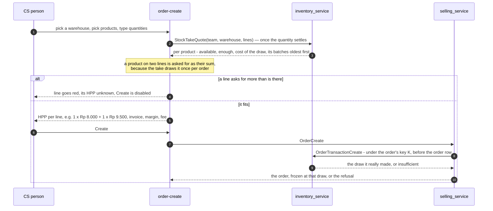

**The quote is ADVISORY. The take remains the authority** — two people can place orders against one
shelf in the same second, so anything read beforehand is already historical. If another order takes the same units
first, the order freezes the draw its own take made; the preview is never charged.

### What it reads

The take's own selection, read-only — see
[inventory_service: StockTakeQuote](../inventory_service/rpc.md#stocktakequote--what-the-take-would-draw). The
product's owner's batches in the warehouse, the rows the order's take counts and draws (`inventory_ledgers.ReadBatches`
is `LockBatches` without the lock), and the take's refusals of a borrowed line (private, below its reserve) read as
nothing available.

## The warehouse prices the order, and the order keeps the price — `WarehouseFeeCalculate` (step 3)

Step 3 of [the-flat-rate-is-dropped-last](../../business/teams/warehouse/context_decision.md#the-flat-rate-is-dropped-last):
`placeOrder` — behind `OrderCreate`, the one door for a typed order and a promoted draft alike — asks warehouse_service what the fulfilling
warehouse charges for the order's goods, and freezes the answer as `orders.warehouse_fee`. The order form asks the same
RPC while the order is typed, on the quote's goods cost, so the figure on screen is the figure kept.

✅ *(2026-10-23)* **Every money figure is frozen from ONE draw — the take's**
([an-order-is-costed-at-what-leaves-the-shelf](../../business/order/context_decision.md#an-order-is-costed-at-what-leaves-the-shelf)).
Each line's `unit_cost` and `total`, the header's `goods_cost`, the fee's basis and `total_cost` all come from what the
take answers, inside the order's transaction. Nothing reads the shelf's average before the take any more.

🔄 *(2026-10-23, the alignment pass)* **The basis is `goods_cost` = Σ the lines' frozen `total`** — a borrowed line WITH
its owner's markup ([the-fee-is-priced-on-goods-cost](../../business/teams/warehouse/context_decision.md#the-fee-is-priced-on-goods-cost),
[the-cross-charge-lives-on-the-line](../../business/order/context_decision.md#the-cross-charge-lives-on-the-line)). The
first build priced it on the drawn cost without the markup (the build's `cogs`); selling `00027` renamed the column and
`placeOrder` now sums the totals. The form's preview (`goodsCostOf`) adds each borrowed line's own markup the same way.

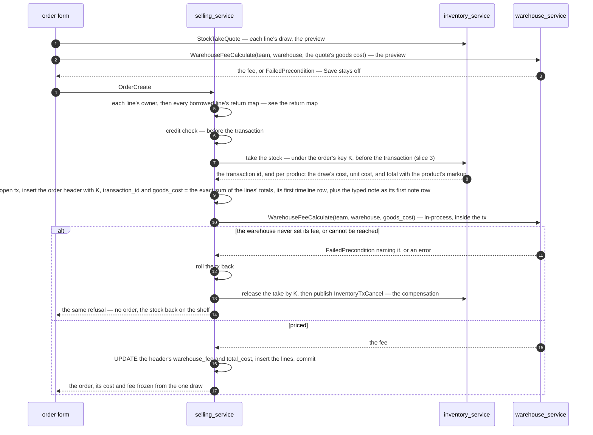

| | |
| --- | --- |
| the basis | `goods_cost` — Σ the lines' frozen `total` (the draw's cost plus, on a borrowed product, its owner's markup), exact — never rounded ([the-fee-is-priced-on-goods-cost](../../business/teams/warehouse/context_decision.md#the-fee-is-priced-on-goods-cost), [an-order-is-costed-at-what-leaves-the-shelf](../../business/order/context_decision.md#an-order-is-costed-at-what-leaves-the-shelf)). A line the take named no draw for adds 0, so a percent warehouse charges its floor on it |
| when | AFTER the take, inside the order's transaction — its basis is the draw, which exists only once the take answers. The fee is warehouse_service's to compute, never selling's ([warehouse-prices-balance-records](../../business/teams/warehouse/context_decision.md#warehouse-prices-balance-records)), so it is asked rather than worked out from a rate read earlier. A refusal fails the transaction and the compensation releases the take — the owner's own flow ([a-warehouse-with-no-rate-takes-no-orders](../../business/teams/warehouse/context_decision.md#a-warehouse-with-no-rate-takes-no-orders) *"the take is rolled back like any failed step"*). The form refuses such a warehouse before Create, so it is the rare path |
| the header | inserted AFTER the take (slice 3), with its `goods_cost` from the draw; `warehouse_fee` and `total_cost` (= the two added) are written by one UPDATE of that row once priced, in the same transaction — no reader sees the order without them |
| concurrency | the fee read takes no lock; the order's KEY SHARE on its shop is held across it. The take is no longer inside the transaction (slice 3) — [lock-order](../../../audits/services/selling_service/concurrency/lock-order.md) |
| the refusal | `FailedPrecondition`, the warehouse's own sentence passed through unchanged ([a-warehouse-with-no-rate-takes-no-orders](../../business/teams/warehouse/context_decision.md#a-warehouse-with-no-rate-takes-no-orders)). An unreachable warehouse_service is `Unavailable` — no order at a fee nobody computed |
| the wiring | `selling_v1.WarehouseFeePricer`, adapted in the composition root (`warehouse_fee_pricer.go`) to the handler itself |
| the event | `OrderPlaced.warehouse_fee` carries the frozen fee as stored (step 4, [the-event-carries-the-warehouse-fee](../../business/teams/warehouse/context_decision.md#the-event-carries-the-warehouse-fee)); liability posts it and reads no rate. Unset only for an order placed before fees were frozen |

## One line per product, and the take's refusal as it came — `placeOrder` (both doors)

**A product named on two lines is merged into ONE order line** before anything else reads the lines. The order form
adds a bundle's products as ordinary lines, so the same product can arrive once by hand and once from a bundle; a
draft's two rows can map to one product. The order keeps only product lines
([the-order-keeps-only-product-lines](../../business/product/product_bundle_decision.md#the-order-keeps-only-product-lines)),
the take refuses a product listed twice, and every money figure of a line is the take's one draw
([an-order-is-costed-at-what-leaves-the-shelf](../../business/order/context_decision.md#an-order-is-costed-at-what-leaves-the-shelf)) —
so `placeOrder` folds them, quantities summed, and stores the one line. In the server, so every door and every client is
covered.

**A refused take reaches the caller as the take answered it** — its Connect code and its `OrderTransactionRefusal`
detail (the reason and every line it names). It used to be wrapped as a database error and reach the form as
`Internal`. The order form and the draft page decode the detail and name the reason and the products.

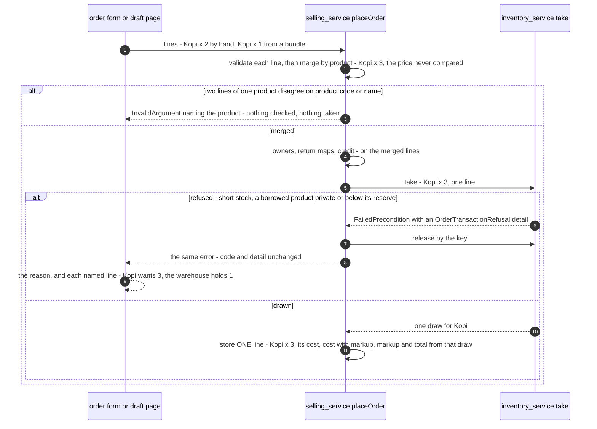

| | |
| --- | --- |
| merged on | the product id. The merged line keeps the first line's product code and name, and the request is not modified |
| the price | **not compared, and not read** ([an-order-line-carries-no-marketplace-price](../../business/order/context_decision.md#an-order-line-carries-no-marketplace-price)). Every money field of a line is stamped from the take after the merge, and a line has no price of its own (`unit_price` was dropped by `00028`). So two draft rows of one product at two marketplace prices promote as ONE line and lose nothing: the prices stay on the draft's rows |
| refused instead | two lines of one product under a different `product_code` or `name` — merging would keep one label and drop the other. The form never sends that (the catalogue's label, per product) and Promote reads one catalogue snapshot per product, so only a client sending one product under two labels to `OrderCreate` meets it |
| the form's totals | the order form and the draft page sum their money **per product** (`byProduct`), so a product on two lines is costed as one draw — the figures on screen are the ones the order stores. The rows themselves still show where each came from |
| passed through | any Connect error the take answers with — its code, message and details. A take that never answered in its own terms (not a Connect error) is still `Internal` |
| the release | unchanged: a refused take is still released by its key, as every failed placement is |

## The courier is a channel id, and no order goes without one — `placeOrder` (2026-11-06)

`orders.shipment_channel_id` and `order_drafts.shipment_channel_id` (selling `00044`) replace the courier CODE the
bridge stored ([the-old-catalogue-bridges-by-code](../../business/shipment/context_decision.md#the-old-catalogue-bridges-by-code)).
The id is shipment_service's and OPAQUE here
([shipment-channel-is-an-id-into-shipment-service](../../business/order/context_decision.md#shipment-channel-is-an-id-into-shipment-service)):
selling stores it and nothing else about the channel
([the-channel-name-is-not-frozen](../../business/order/context_decision.md#the-channel-name-is-not-frozen)), and every screen
names it through `ShipmentChannelByIds`, which answers a deleted channel too, flagged. Create refuses an order with none
([no-order-without-a-courier](../../business/order/context_decision.md#no-order-without-a-courier)).

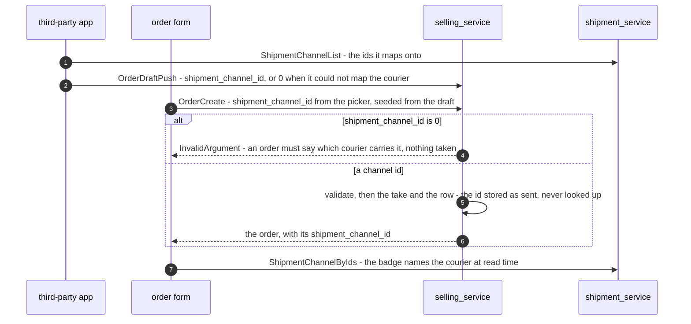

| | |
| --- | --- |
| the rule | `orderPlacement.validate` (`errOrderNoCourier`) — both doors, before the shop, the owners and the take. The request carries no `gt = 0`, so the refusal names what is missing, as `platform_total`'s does |
| looked up | never — the id is opaque here; the picker (`ShipmentChannelSelect`) offers live channels only |
| a draft | may hold 0 (the app could not convert the platform's courier). Push writes it unless a person touched `shipment_channel_id`; `OrderDraftUpdate.shipment_channel_id` (optional) sets it and marks it |
| the filters | `OrderListFilter.shipment_channel_id` / `OrderStatFilter.shipment_channel_id` — 0 = any, an equality ANDed with the scope (≈6 ms over 50 000 orders, `TestPerf_OrderList_Courier`) |
| the file | `OrderExport`'s courier column is the channel's CODE, through `OrderExportStore.ChannelCodes` (composition root → `ShipmentChannelByIds`); an id that resolves to nothing is written `#id` |
| older rows | a developer's order from before `00044` holds 0 — the codes were not filled in, since a selling migration may not read shipment's table ([revamp-has-no-real-orders-yet](../../business/order/context_decision.md#revamp-has-no-real-orders-yet)) |

## An order's address is its own row, names only — `placeOrder` (2026-11-06)

The customer and the address leave `orders` for the order's ONE `order_addresses` row (selling `00045`,
[one-address-per-order-and-per-draft](../../business/order/context_decision.md#one-address-per-order-and-per-draft)),
names only ([an-address-is-plain-names](../../business/order/context_decision.md#an-address-is-plain-names)).

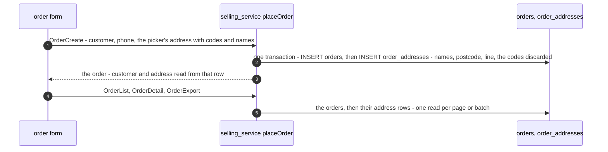

| | |
| --- | --- |
| written | `placeOrder`, after the order row, in its transaction — an order without its row is never reachable; the response carries it |
| read | `OrderDetail` preloads it; `OrderList`, `OrderExport` (per batch), `OrderCancel`, `OrderReceiptUpdate`, `OrderReturnAccept` and the re-read by key attach it (`attachAddresses`, one `order_id IN` read) |
| the wire | unchanged: `Order.customer_name` / `customer_phone` / `address` are filled from the row; an order's `address` carries no `_code` (always empty now), `kode_pos` is the row's `postal_code` |
| the search | the name and phone match `orders.id IN (SELECT order_id FROM order_addresses WHERE …)`, beside the ref and the receipt, served by the GIN trigram indexes of selling `00048` (`order_addresses_customer_trgm_idx`, `orders_ref_receipt_trgm_idx` — the [OrderList audit](../../../audits/services/selling_service/performances/OrderList.md)'s finding 1; its re-measure is there) |
| a draft | its own ONE `order_draft_addresses` row, names only (selling `00046`) — see *A draft's address* below |

## A draft's address — `order_draft_addresses` and the form's pre-fill (2026-11-06)

A draft's buyer and address are its ONE `order_draft_addresses` row (selling `00046`,
[one-address-per-order-and-per-draft](../../business/order/context_decision.md#one-address-per-order-and-per-draft)),
names only and best effort ([a-draft-carries-the-scraped-address](../../business/order/context_decision.md#a-draft-carries-the-scraped-address)).
The order form's region picker works by code, so `OrderDraftDetail` asks region_service, in-process, for the ONE place
the draft's four names match — the address picker's pre-fill
([the-cs-edits-the-whole-address-before-create](../../business/order/context_decision.md#the-cs-edits-the-whole-address-before-create),
*Pre-filled when certain*).

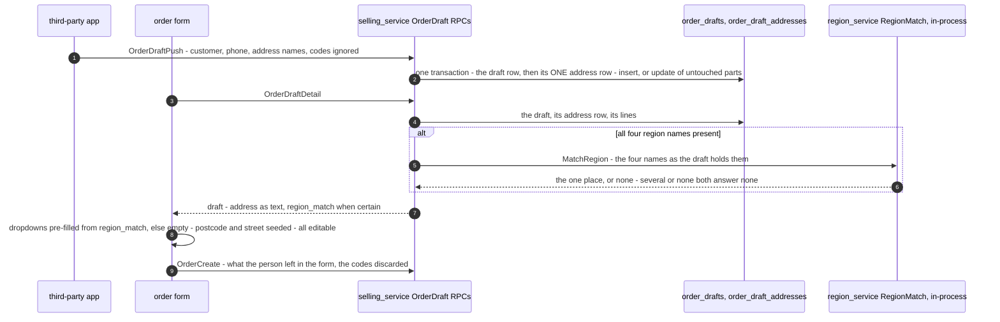

| | |
| --- | --- |
| written | `OrderDraftPush` creates the row with the draft (always, empty fields and all) and a re-push updates its untouched parts (`customer_name`, `customer_phone`, `address` — the address one touched field); `OrderDraftUpdate` writes the present parts and marks them. Under the draft's `FOR UPDATE` lock, in its transaction |
| read | `OrderDraftDetail` (one row), `OrderDraftList` (`attachDraftAddresses`, one `order_draft_id IN` read for the page), `OrderDraftUpdate` / push responses |
| the wire | unchanged: `OrderDraft.customer_name` / `customer_phone` / `address` from the row; the address's `_code` fields always empty |
| the matcher | region_service `RegionMatch`: exact on all four levels after normalising case and spacing and the kabupaten level's Kabupaten / Kab. / Kab / Kota (Administrasi) prefix — a written prefix must agree with the place's, none matches either; several desa matched (a prefix-less name fitting a Kota and a Kabupaten, two desa of one name in one kecamatan) = no match. Two queries (the desa candidates through `regions_name_lower_idx`, their ancestors by key), 0.5–2.1 ms over the 91 599-row seed (`TestPerf_RegionMatch`) |
| the seam | `selling_v1.RegionMatcher` → `cmd/app_development/order_draft_regions.go` (`protovalidate` first; a name the request refuses is no match) → `region_v1.RegionMatch`. A blank level is never asked; a failed lookup is logged and leaves `region_match` unset — the read never fails over a pre-fill |
| `region_match` | `OrderDraft.region_match` (24), an `OrderAddress` with codes, the region list's spelling and the desa's kode pos; `OrderDraftDetail` only, never stored. The form takes the draft's own postcode over the place's |
| the list's Ready | `readyDrafts` needs the row's `customer_name` and `address_line` and the draft's `shipment_channel_id` — no mapping ([the-drafts-list-counts-no-mapping](../../technical/frontend/order_draft_decision.md#the-drafts-list-counts-no-mapping)); ≈10 ms over 50 000 drafts (`TestPerf_OrderDraftListReadyCount`) |

## The submit's own key — `OrderCreate.idempotency_key` (backlog #10, slice 1)

Every submit of the order form — a new order, a resubmit after an error, a draft's finalize — mints a fresh key with
`crypto.randomUUID()` **inside the submit** and sends it as `idempotency_key`
([the-frontend-mints-the-idempotency-key](../../business/order/context_decision.md#the-frontend-mints-the-idempotency-key),
[every-submit-mints-a-new-key](../../business/order/context_decision.md#every-submit-mints-a-new-key)). It is
**required** from the start ([revamp-has-no-real-orders-yet](../../business/order/context_decision.md#revamp-has-no-real-orders-yet)),
stored on `orders.idempotency_key` and UNIQUE ([the-idempotency-key-is-unique](../../business/order/context_decision.md#the-idempotency-key-is-unique)).
A key already on an order is **refused**, never answered with that order
([the-order-refuses-a-used-key](../../business/order/context_decision.md#the-order-refuses-a-used-key)).

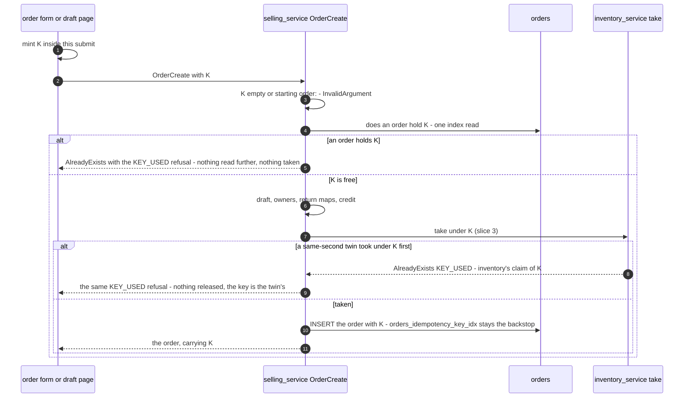

| | |
| --- | --- |
| the shape | `min_len 1`, `max_len 128` (proto); the handler re-checks empty and refuses a key starting `order:` — the shape the migration filled older developer rows with, which was their take's key too — as `InvalidArgument` |
| ⚠ where it is checked | **first** — before the draft, the owner lookup, the credit check and the take; the unique index is the backstop. The owner's recommended default, **awaiting the owner (#10 Q10)** |
| ⚠ how a used key is refused | `AlreadyExists` carrying inventory's `OrderTransactionRefusal{reason: KEY_USED}` with no lines — the detail the take answers a used key with, so the form shows its one *key already used* alert. The recommended default, **awaiting the owner (#10 Q9)** |
| what it discloses | nothing: no order id, no team. A key held by another team's order is refused the same way |
| the twin | two submits of one key at the same second both pass the lookup; since slice 3 the second is refused KEY_USED **at the take**, at once — inventory's claim of K committed with the first's take — and releases nothing (`TestInterleave_OrderCreateSameKey_TheTakeRefusesTheTwin`). The unique index stays the backstop |
| since slice 3 | K is also the key the order's stock take is filed under and released by — see [the take before the order](#the-take-before-the-order-and-its-compensation--backlog-10-slice-3) |

## The take before the order, and its compensation — backlog #10 slice 3

`placeOrder` (both doors) takes the stock **before the order row exists and outside selling's transaction**, under the
order's own key K, then writes the order with K and the take's `transaction_id`. Any failure once the take was called
is **compensated**: the take is released by K directly, under a context the browser cannot cancel, and then
`InventoryTxCancel{K, team_id, warehouse_id, actor}` is published as the backup
([the-compensation-event-is-inventory-tx-cancel](../../business/order/context_decision.md#the-compensation-event-is-inventory-tx-cancel),
[the-release-is-direct-then-the-event](../../business/order/context_decision.md#the-release-is-direct-then-the-event),
[every-release-goes-by-the-key](../../business/order/context_decision.md#every-release-goes-by-the-key)). A take refused
because K is **already used** is never compensated — the key is another submit's live take
([a-used-key-is-never-cancelled](../../business/order/context_decision.md#a-used-key-is-never-cancelled)).

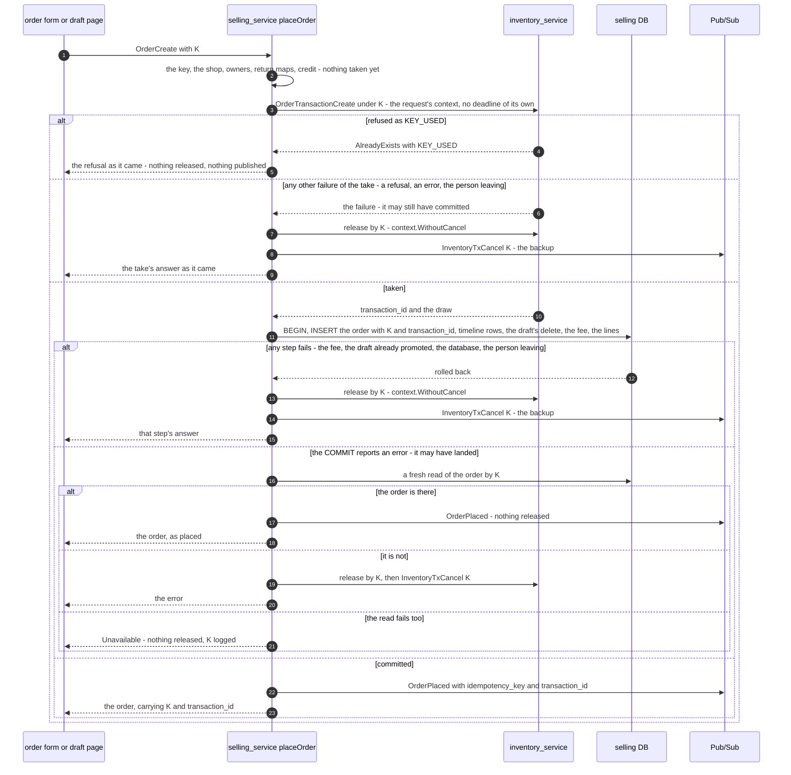

| | |
| --- | --- |
| the take | `StockPicker.Pick(ctx, team, warehouse, lines, K)` → `Take{TransactionID, Draw}`; the bridge (`cmd/app_development/stock_picker.go`) passes K through as `OrderTransactionCreate.idempotency_key`. Runs under the request's context with no deadline of its own ([no-answer-is-only-a-lost-connection](../../business/order/context_decision.md#no-answer-is-only-a-lost-connection)) |
| what the order stores | `orders.idempotency_key = K` and `orders.transaction_id` (selling `00036`, `BIGINT NULL`); `Order.transaction_id` exposes it, `OrderPlaced` carries both |
| the compensation | `compensateTake` (`order_take_compensation.go`): `StockPicker.Return(K)` first, then the event — ALWAYS both, since a released take makes the listener's release a no-op. Neither fails the caller, who hears the order's own failure. A failed release logs and leaves the event to do it; a failed publish is logged loudly; both failing logs *STOCK STILL TAKEN* with K, the key to release by hand |
| the context | `context.WithoutCancel(ctx)` — keeps the identity (the release's ledger rows name who placed the order), drops the cancellation and any deadline |
| KEY_USED | read off the refusal's `OrderTransactionRefusal` detail (`isKeyUsedRefusal`), never the code alone |
| a refusal for stock | compensated too, as decided — the release of a key nothing was taken under claims it, so a take that lands late is refused |
| a commit that reports an error (#10c) | the error came after every step ran, so the commit may have landed. `placedOrderByKey` re-reads `orders` by K on the service's own handle (never the failed transaction), under `context.WithoutCancel`: found → answered as placed and `OrderPlaced` published, nothing released; not found → compensated as above; the read failing too → `Unavailable`, nothing released, logged *STOCK MAY STILL BE TAKEN* with K. An error from inside the transaction's body is a rollback and compensates without the read. Test seam `SetOrderCommitResult` (`export_test.go`) |
| the cancel | slice 4 — see [`OrderCancel`](#ordercancel--the-count-first-then-the-status-then-the-event-backlog-10-slice-4): no release in the cancel; inventory releases by K on `OrderCancelled` |
| the event | `InventoryTxCancel` = envelope field 204, topic `inventory-tx-cancel`, `event_id` `inventory-tx-cancel:<K>` ([inventory-tx-cancel-is-an-order-event](../../business/order/context_decision.md#inventory-tx-cancel-is-an-order-event)); inventory's listener — [inventory_service rpc](../inventory_service/rpc.md#inventorytxcancel--the-compensations-listener) |
| proved | `selling_v1/order_create_compensation_test.go`, `order_create_commit_test.go` (#10c); races in [lock-order](../../../audits/services/selling_service/concurrency/lock-order.md) |

## The pick screen's reads (#151)

The crew's screen is a join of things that already existed — but two of the reads it needs were
**selling-scoped only**, so the warehouse could not perform its own work.

### Both ends of an order

`OrderList` and `OrderDetail` matched `team_id` alone. The write side landed in #150 (`OrderPick` /
`OrderPack` / `OrderShip`, all scoped to the **warehouse** — since 00015 one `OrderStatusChange`) without the read side following, so a crew
could record work on an order it was not allowed to look at.

Both now match **either end**, and `team_id` means *"the team you hold a role in"* rather than *"the
team whose orders you get"*:

```sql
WHERE (team_id = ? OR warehouse_id = ?)
```

**Except the root team, which reads every team** ([root-reads-every-teams-orders](../../technical/frontend/order_list_decision.md#root-reads-every-teams-orders)).
Only ROOT and ADMIN hold that scope, so `readsEveryTeam` drops the clause for `OrderList`, `OrderStat`, the creator
picker (all three share `scopedOrders`) and `OrderDetail`. Reads only. It is the rule settlement's reports already use.

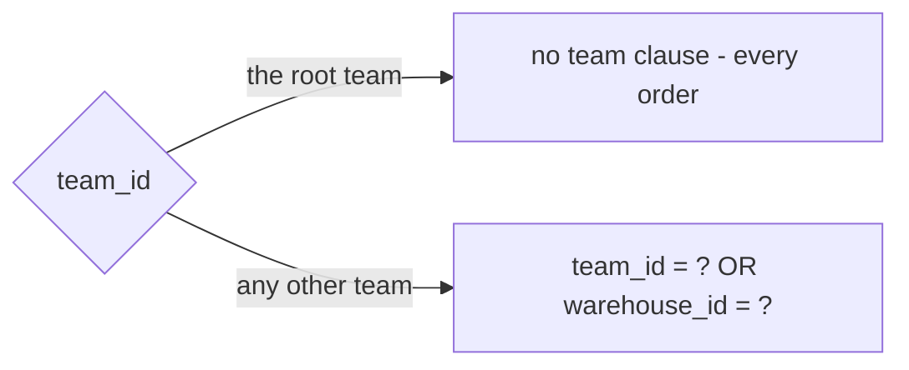

`OrderList` also takes a **status filter**, which is what makes it a queue rather than a list.
Server-side, because the list is paginated: a client-side filter narrows the loaded page only and
still reports the unfiltered total.

### Which shelf to walk to — `StockPickLocations`

The screen's one hard question: a product can sit on several racks (#135), so which does the picker
walk to? Answered by **inventory_service**, from the **take's own rack rows**:

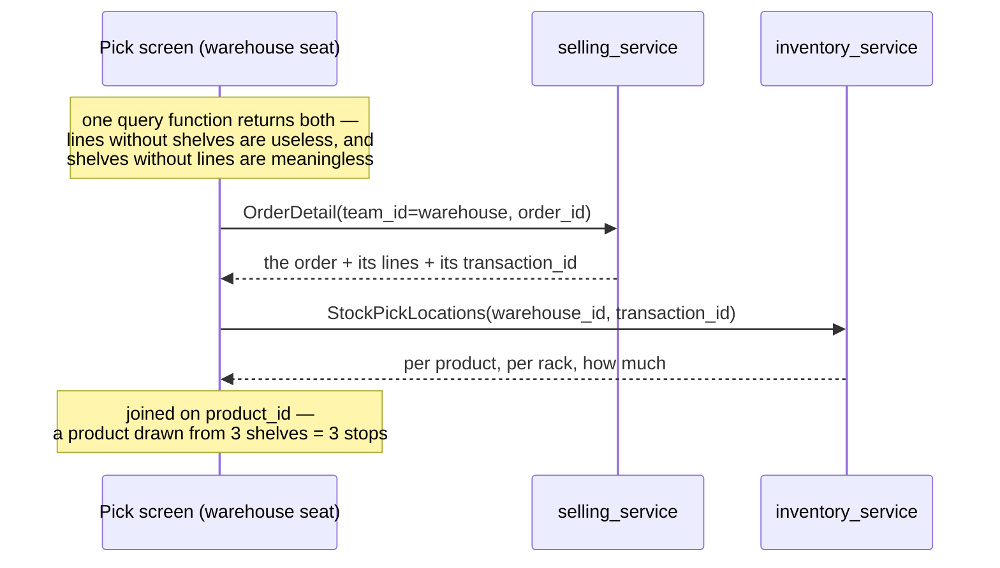

**From the take, not from the racks now — this is the whole design.** The goods were drawn at placement (#149) and the
take recorded, per rack, exactly how much it took, as placement log rows of one inventory transaction — the
`transaction_id` the order stores ([the-placement-page-reads-racks-by-transaction-id](../../business/inventory/order_decision.md#the-placement-page-reads-racks-by-transaction-id),
✅ backlog #10 slice 5). The detail is read first for that id, so the two reads are sequential; an order with no
transaction took nothing and the page asks nothing. Inventory reads the rows only within the caller's `warehouse_id`,
so one building never reads another's take. Those rows are what the order *holds*. Current levels answer a question whose answer
keeps moving — another order draws from the same shelf, a stock-take shifts goods — and a picker sent
by current levels can arrive at a shelf whose stock is spoken for.

The take and its rollback are **netted**, and only a positive remainder is a stop on the walk: the log is append-only,
so a released take's rows survive beside their reversal, and reading the take alone would send a picker after goods
that are back on the rack. The walk is ordered by rack label.

> A product on two shelves appears **twice**, each with its own quantity. #151 asked for "a shelf, or
> all of them with quantities, rather than silently picking one"; when the goods genuinely are in two
> places, listing both is the only honest answer. Every unit is on a rack (there-is-no-unplaced-pile).

---

## Placing an order announces it (#153)

After `OrderCreate` commits, selling_service publishes an **`Event` carrying the `OrderPlaced` variant**
with the frozen money — `goods_cost` (`cogs` until 2026-10-23, same field number) and `platform_total`
(`marketplace_total`, same number); `revenue` (the dropped `total`) and `shipping_cost` are reserved, neither had a
consumer. `liability_service` consumes it and charges the order's fees; settlement opens the sale from `platform_total`.

**`platform_total` is a double, frozen exact at placement** (selling 00041, 2026-11-06,
[every-ledger-moves-to-double-rounded-when-frozen](../../business/order/context_decision.md#every-ledger-moves-to-double-rounded-when-frozen)):
`orders.platform_total`, `order_drafts.platform_total` and `order_daily_reports.mp_total` are `double precision`; the wire's
`platform_total` (Order, OrderCreateRequest, OrderDraft, OrderDraftUpdateRequest, the push line, `OrderPlaced`),
`OrderStatusCount.value`/`mp_value`, `OrderStatPreview.revenue_30d` and the order metrics' `mp_total` fields are `double`.
A draft keeps what was typed; `placeOrder` refuses a figure that is NaN, infinite or not above 0 (`san_money.Positive` —
float dust is as missing as 0) and writes it EXACT onto the row ([the-backend-never-rounds-money](../../business/order/context_decision.md#the-backend-never-rounds-money), 2026-11-06; it rounded with
`san_money.Whole` before, so the decision `a-draft-keeps-its-platform-total-as-typed`'s *"rounded once when the order is
placed"* no longer happens) — the event, the detail, the census and settlement's `initial_total` all carry that one
exact figure.

**The order's costs are doubles too** (selling 00042, 2026-11-06 — part 2): `orders.goods_cost`, `order_items.unit_cost`
and `order_draft_items.unit_price` are `double precision`, and `goods_cost` (Order, `OrderPlaced`), `unit_cost` (OrderItem,
`OrderPlacedLine`), `unit_price` (OrderDraftItem, the push line) and `OrderReturnAcceptRequest.courier_charge` (`gte 0`,
finite; `OrderReturnAccepted` carries it) are `double`. `placeOrder` freezes each line's `unit_cost` (the take's drawn
unit cost) and the order's `goods_cost` (Σ the lines' totals) EXACT — never rounded; the warehouse fee is the pricer's
exact answer on that basis (2,5% of Rp 12.666,99 = Rp 316,67475) and `total_cost` their exact sum. `OrderReturnAccept`
freezes the courier's charge as typed before its note check, its event and the liability posting read it. A draft's
`unit_price` is information, kept as read. The order form previews the same exact figures — the line figures summed,
nothing rounded (`features/orders/form/money.ts`, the fee quote as the warehouse answers it) — so the preview, the fee's
basis and the frozen order are one figure; only the screen rounds, to 3 decimals. The credit block's message writes
its figures with `san_money.Text` ("Rp 52.000.000", a fraction to 3 places).

**Each line carries its frozen `total`** (`00023`) — what inventory's take priced it at, the goods plus the product's own
markup ([inventory-computes-the-markup](../../business/order/context_decision.md#inventory-computes-the-markup)). The
take answers it (`StockPicker.Pick` returns it per product), `placeOrder` writes the lines only after it, with it, and
the event copies it as stored. Liability's product fee is Σ an owner's line totals and reads no markup
([the-ledger-charges-the-frozen-line-total](../../technical/balance/team_balance_design_decision.md#the-ledger-charges-the-frozen-line-total)).
A line the take named no total for stores NULL and rides as 0 — not known, charged nothing.

Published **after** the commit and **never inside** it, and a publish failure does **not** fail the
order — revenue is downstream, and a shop must keep selling while it is down.

selling_service does not know who is listening. It names no topic either: the VARIANT declares its own
(`warehouse.events.v1.event_config`), and the sender unwraps the `oneof` to read it — so a publisher
cannot send it to the wrong one.

The envelope carries `event_id` (derived from the order, so a redelivery and a replay collide),
`occurred_at`, `aggregate_id` and the caller's `identity` — which the sender takes as a PARAMETER and
which is a record of who published, never something a consumer authorises from.

> The full flow, the delivery trade-off, and why the event carries the money rather than just an order
> id are in `revenue_service/rpc.md` (removed with the service on 2026-08-29 — `git show 0d4cbc49^:docs/services/revenue_service/rpc.md`).

## The order metrics — the fold and `OrderAnalyticService`

The five order metrics of [order_statistic_metric.md](../../business/order/order_statistic_metric.md) — Created, Cancel,
Return Created, Return Arrived, Lost Created — and **Warehouse Fee** (`metrics/warehouse_fee`,
[the-warehouse-fee-prototype-is-accepted](../../business/analytic/rpc_provide_decision.md#the-warehouse-fee-prototype-is-accepted))
through the analytic pattern
([rpc_provide.md](../../business/analytic/rpc_provide.md)): a folded report, ranked by `MetricSearch` and filled by
`MetricData`. Served by `selling_v1.Analytic`, its own struct: its one outside question, whether the reader is a
warehouse, is asked of team_service through `TeamTypeReader` (`selling_team_types.go` in the composition root).

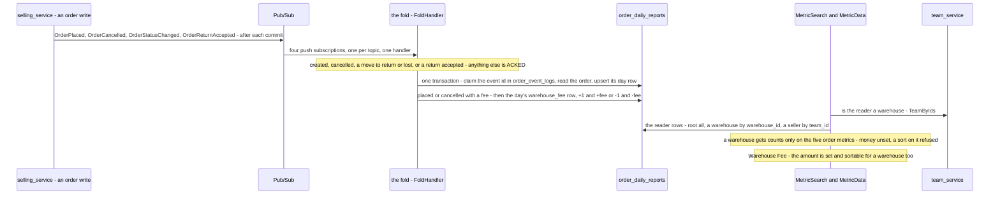

| | |
| --- | --- |
| the subscriptions | `selling-order-fold-placed` (order-placed), `selling-order-fold-cancelled` (order-cancelled), `selling-order-fold-moved` (order-status-changed), `selling-order-fold-return-accepted` (order-return-accepted — Return Arrived, since `return_completed` is the accept's own event) — each its OWN subscription on a topic liability and settlement also read |
| the day | the event's `occurred_at` as a Jakarta date — the placement, the cancel, the move's timeline row ([a-fact-counts-on-the-day-it-happened](../../business/order/order_statistic_metric_decision.md#a-fact-counts-on-the-day-it-happened)) |
| the row | (day, metric, seller, shop, warehouse, creator) += 1 order, its `total_cost`, its `platform_total`, read off the order |
| Warehouse Fee | a sixth `metric` value, `warehouse_fee` (00038), written by the SAME claim: a placement adds +1 and the order's frozen `warehouse_fee` to the placement day's fee row, a cancel −1 and the fee to the CANCEL day's row ([a-warehouse-fee-counts-on-its-day-and-a-cancel-takes-it-back-on-its-day](../../business/analytic/rpc_provide_decision.md#a-warehouse-fee-counts-on-its-day-and-a-cancel-takes-it-back-on-its-day)) — an earlier day is never re-folded, so a period can read negative. `order_count` = Fee transactions, `total` = Fee amount, `mp_total` 0. An order with no fee writes no fee row. The keys and filters are the order metrics' ([warehouse-fee-groups-like-the-order-metrics](../../business/analytic/rpc_provide_decision.md#warehouse-fee-groups-like-the-order-metrics)); `amount` is set for a warehouse ([a-warehouse-sees-its-own-fee-amount](../../business/analytic/rpc_provide_decision.md#a-warehouse-sees-its-own-fee-amount), `orderMetric.warehouseMoney`). Why a metric row and not a column: the signed row reuses every read (search, fill, summary, sort) unchanged, where a column on `created`/`cancelled` would need a cross-row net in each. The fee row is always the transaction's second report lock, so a placement and a cancel meeting on it queue (raced ×10, 0 deadlocks) |
| a redelivery | the claim is the write: a second claim finds the row and folds nothing. Raced 40/40 |
| the reads | one statement each, after the team-type lookup. A seller's or a warehouse's read uses its scope index (1–8 ms over 100 000 rows); root's scans (13–30 ms) |
| an id of 0 | left out of an id group: `IDList` takes ids above 0 ([a-no-user-row-cannot-be-a-key](../../business/order/order_statistic_metric_clarify.md#a-no-user-row-cannot-be-a-key)) |
| ⚠ not built | a refold of Warehouse Fee for orders folded before 00038 (none in production, [revamp-has-no-real-orders-yet](../../business/order/context_decision.md#revamp-has-no-real-orders-yet), [the-order-metrics-count-from-the-fold-onward](../../business/order/order_statistic_metric_decision.md#the-order-metrics-count-from-the-fold-onward) — a dev order placed before it and cancelled after nets its seller below zero); a backfill of the orders before the fold ([are-past-orders-folded](../../business/order/order_statistic_metric_decision.md#the-order-metrics-count-from-the-fold-onward)), a replay and a dedup prune — supplier's fold has all three |

## Draft orders — `OrderDraftPush` and the blanks-only merge (#190, #191)

A **draft** is an incomplete order pushed in by a **third-party app**, which a person here finishes
and promotes. It lives in `order_drafts` / `order_draft_items`, not in `orders` — see
[database-schema.md](../../database-schema.md) for why (#190).

`OrderDraftPush` is worth documenting because it is not the CRUD it looks like: it is a
**create-or-update keyed on `(team_id, source, external_id)` that writes untouched fields only**.

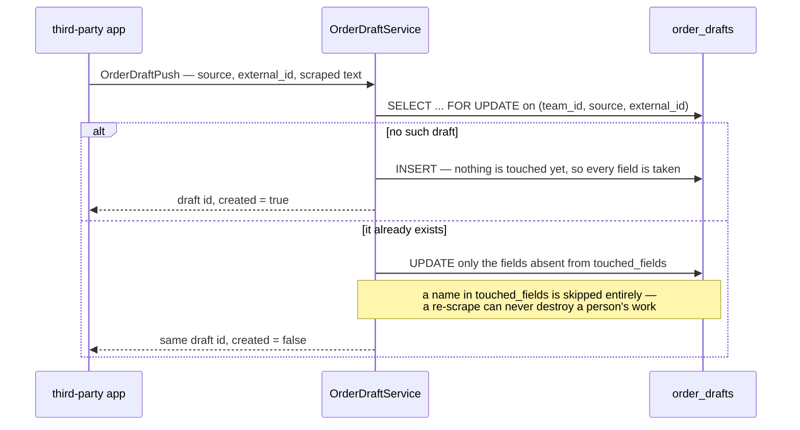

**The push's money, by JSON name.** A client posting Connect JSON names each field in lowerCamelCase. Money is a JSON
number (protobuf `double`), a fraction allowed — a draft keeps it as sent
([a-draft-keeps-its-platform-total-as-typed](../../business/order/context_decision.md#a-draft-keeps-its-platform-total-as-typed)).
A quoted number from a client written for the old `int64` still parses.

| JSON field | proto | what it is |
| --- | --- | --- |
| `platformTotal` | `platform_total = 15` | what the buyer paid the platform, as the app read it. Optional on a push (0 = could not see one); Promote refuses a draft still at 0 ([platform-total-is-required-at-finalize](../../business/order/context_decision.md#platform-total-is-required-at-finalize)). A person's typed figure is touched and wins |
| `items[].unitPrice` | `OrderDraftItem.unit_price = 6` | what the platform charged per unit for that row — the owner's `platform_price`. Information beside the mapping; deleted with the draft, never copied onto the order |

> ⚠ **Changed 2026-10-23** (selling `00026`/`00027`). `marketplaceTotal` was renamed **`platformTotal`** (same field
> number 15, so a binary-protobuf client is unaffected) and `shippingCost` (10) was **dropped** — a draft carries no
> shipping money ([an-order-records-no-shipping-cost](../../business/order/context_decision.md#an-order-records-no-shipping-cost)).
> A JSON client must send `platformTotal` and stop sending `shippingCost`. Connect DISCARDS unknown JSON fields
> rather than refusing them, so a client still sending `marketplaceTotal` gets a 200 and a draft at 0 — which then
> fails Promote with *"an order must say what the buyer paid on the marketplace"*. The same rename applies to
> `OrderDraft.platformTotal` on every read and to `OrderDraftUpdate`.

**Why the RPC name carries the rule.** The app and the person authenticate as the **same user** — the
app logs in as one, because there is no machine identity in this system — so *identity cannot tell
them apart*. `OrderDraftPush` yields to a human; `OrderDraftUpdate` (#193) always wins and marks what
it wrote. Merging the two into one handler would erase the only thing distinguishing them.

Four details that are decisions rather than implementation:

- **It is "untouched fields only", NOT "empty fields only".** An untouched field the app has changed
  its mind about *is* updated — the app remains the authority on everything nobody here has claimed.
- **The address is one touched field, not six names.** Somebody who corrects a kecamatan has
  corrected the address, and rewriting the other parts of the draft's address row around their fix would leave a
  hybrid address that was never true anywhere.
- **`items` is one touched field too.** Once a person has edited any line, the app stops rewriting
  the lines altogether. Per-line merging would need a per-line touched mark; the rule that matters —
  a re-scrape never destroys a person's correction — holds without one. While untouched, the lines are replaced
  **wholesale**, so a line the app no longer sees disappears rather than lingering.
- **A draft stores no mapping** (selling `00047`,
  [a-draft-stores-no-mapping](../../technical/frontend/order_draft_decision.md#a-draft-stores-no-mapping)). The app does
  not know our catalogue ids, and a client matching titles against our catalogue would guess wrong silently, so a line
  is the platform's reference only (`OrderDraftItem.product_id` / `OrderDraftLineEdit.product_id` reserved); the CS maps
  each one in the order form, straight into the order's lines.

**The author follows the push.** A draft is personal, and a colleague cannot pick one up — so
re-pushing under the right person's login is the only way to hand a draft over. That makes
reassignment the escape hatch "personal" leans on rather than an accident.

**A draft publishes nothing.** `OrderCreatedEvent` fires at placement (#153) and revenue consumes it
(#75). A draft that published would put an unfinished scrape into the month's margin — promote (#194)
is the only door into revenue.

### Reading drafts — two narrowings, not one (#192)

`OrderDraftList` and `OrderDraftDetail` both apply **two** restrictions, and they are different kinds
of thing:

| | What it is | Enforced by |
| --- | --- | --- |
| `team_id` | the authorization **scope** (`use_scope`) | the access interceptor |
| `author_user_id` | a **handler filter** — a draft is personal working state | the query itself |

⚠ **The scope is not optional just because the list is personal.** A team-level role policy on a
message with no `use_scope` field is evaluated against the *root team*, where almost nobody is a
member — so "simplifying" this to author-only would leave a policy that authorizes nobody.

A colleague's draft reads as **NotFound**, not PermissionDenied: the caller holds a perfectly good
role in the team, and "exists but is not yours" would leak that a given external ref has already been
scraped by somebody else.

**The list carries a count, not lines.** `item_count` is aggregated in one `GROUP BY` for the whole page — computing
it client-side would mean loading every draft's lines to render one page of a list. 🔄 *(2026-11-06)*
`unmapped_item_count` is gone (reserved 18): a draft stores no mapping, so the list counts none
([the-drafts-list-counts-no-mapping](../../technical/frontend/order_draft_decision.md#the-drafts-list-counts-no-mapping)).
The page's buyers come from their address rows in one more `order_draft_id IN` read.

**The list carries the set's ready count** (#16, 2026-11-04) — `ready_count`, the drafts of the WHOLE filtered set (every
page) with nothing left before Promote, so the drafts screen's *Ready* card reads the backlog and not the page on screen
([the-draft-summary-is-three-cards](../../technical/frontend/order_draft_decision.md#the-draft-summary-is-three-cards)). It is
`readyDrafts` (order_draft_list.go), the SQL twin of the frontend's `draftGaps`, rule for rule: a shop, a warehouse, a
customer name and an address line (the draft's `order_draft_addresses` row, an `EXISTS`), a courier, an order date, a
sell price, at least one line, and not a `manual` draft — no mapping (2026-11-06). Stock is not in it — only the order
form reads the warehouse's availability. One extra `COUNT(*)` on the same narrowed query, run before the page's own
reads (a GORM `Session` copies the statement, so it must not see their ORDER/OFFSET). Perf: 5 queries, ≈10 ms median
at 5 000 drafts for one author (`TestPerf_OrderDraftListReadyCount`, re-measured 2026-11-06) — fast, no audit file.

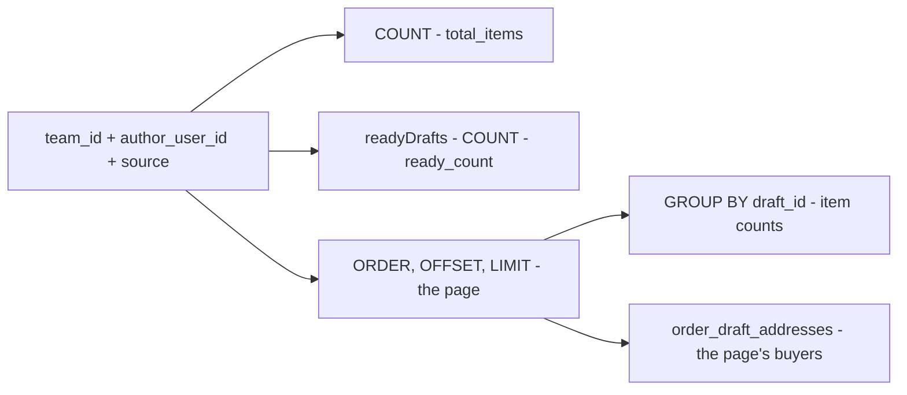

### The human edit path — `OrderDraftUpdate` (#193)

The other half of the merge rule. `OrderDraftUpdate` **always wins** and **marks every field it
writes as touched**; `OrderDraftPush` then refuses to overwrite anything carrying that mark. Neither
handler makes sense read alone.

**Presence decides what was edited, not emptiness.** Every field is `optional`, so a field left unset
is neither written nor marked. If "unset" and "set to empty" were indistinguishable, the first save
anybody made would mark every field touched and freeze the whole draft against the app forever — and
clearing a wrongly-scraped phone number would stop being expressible at all.

**The lines are sent as the complete desired set** (`items`, a wrapper message so it has presence —
absent means "leave the lines alone", present-and-empty means "this draft has no lines"). An id edits
an existing line, `id = 0` adds one, and an omitted line is **deleted**: a buyer who cancels one line
of three must be able to say so, or the draft stays unpromotable forever over a line nobody wants.

⚠ **The edit cannot carry the scraped text.** `external_sku` / `external_name` are absent from
`OrderDraftLineEdit` by design — a request that could rewrite them could quietly make the evidence
agree with a wrong mapping, which is the one failure that keeping both halves on the line was meant
to catch. A hand-added line has empty external text, which truthfully says nobody scraped it.

### Pruning — `OrderDraftDelete` (#193)

**Bulk, and a hard delete.** Nothing expires (§6.7), so this is the only thing between the list and a
graveyard, and an app pushing continuously fills that list faster than a person deletes one at a
time. Hard rather than soft because a draft is working state that was never an order — a soft-deleted
draft would be a row every future reader has to remember to exclude, which is precisely the trap the
separate table was built to avoid. The lines go with it via `ON DELETE CASCADE`.

**Fewer deleted than asked for is a normal answer.** An id already gone, or never the caller's, is
skipped rather than failing the batch: deleting is idempotent by nature, and refusing over one stale
id would make a bulk prune unusable exactly when the list is long enough to need one. The scope and
the author are in the `WHERE` rather than checked beforehand, so there is no window in which the ids
stop being the caller's.

### A draft becomes an order — `OrderCreate` with `order_draft_id`

There is no promote RPC ([a-draft-becomes-an-order-through-order-create](../../business/order/context_decision.md#a-draft-becomes-an-order-through-order-create)).
The draft page's **Promote** sends the same `OrderCreate` the create form sends, built from what is on its screen,
plus `order_draft_id`. `OrderDraftPromote` was removed: it rebuilt the order from the stored draft by hand, and that
copy had already drifted (it never set the marketplace ref).

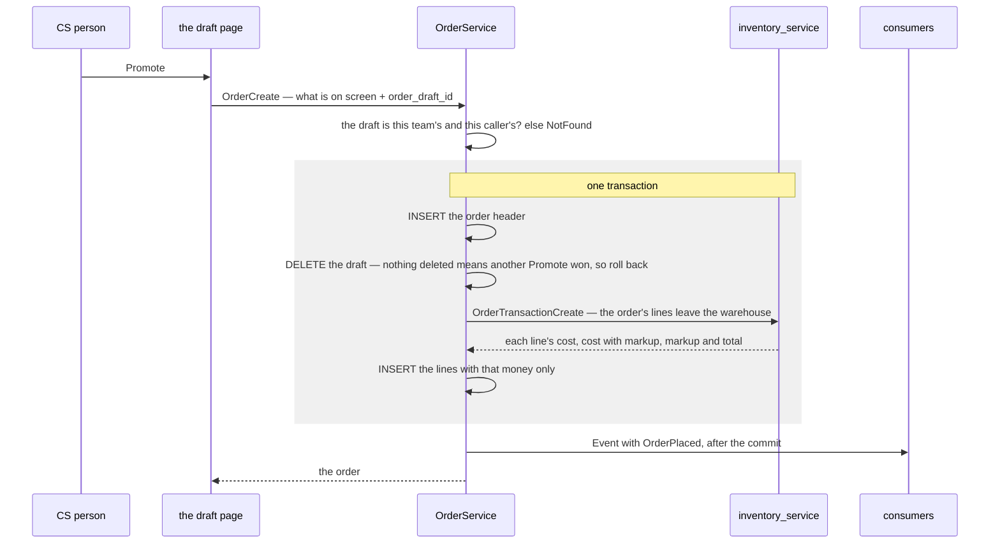

**One door.** Everything the order says comes from the request — the request's validation and `placeOrder` in
[order_place.go](../../../backend/services/selling_service/selling_v1/order_place.go) — so a promoted order meets every
rule a typed one does, by construction. The page sends what is on screen, not what is saved: unsaved edits, bundle and
split rows as their products, and what a draft cannot store (receipt, tracking number, note), which now reach the order.

**The draft's facts reach the order through the page.** The app's pushed values — the platform's two dates (`00020`),
what the buyer paid (`00022`, `platform_total`), the buyer's username — seed the page, a person may correct them, and
Promote sends them. The marketplace REF is the draft's `external_id`, seeded the same way; a `manual` draft's
`external_id` is a minted `form-…` id, so its ref is typed
([an-order-ref-is-required-by-the-rpc](../../business/order/context_decision.md#an-order-ref-is-required-by-the-rpc)).
The catalogue label (`product_code`, `name`) is the page's, from the products it mapped.

**One transaction, and one order per draft.** `orders` and `order_drafts` are the same service in the same database,
so the order is written and the draft deleted together (`placeOrder`'s `inTx`). A refused order — no stock, no fee
rate, a missing field — rolls the deletion back and leaves the draft to fix. Two Promotes of one draft: the second's
DELETE waits on the first's row lock, then finds nothing, answers `Aborted` and rolls its order back; done one after
the other, the second is `NotFound` at the lookup.

**The line carries no marketplace price**
([an-order-line-carries-no-marketplace-price](../../business/order/context_decision.md#an-order-line-carries-no-marketplace-price)).
A draft row's `unit_price` stays on the row and is deleted with the draft; the order's money is the take's, as on any
order.

> ⚠ **The warehouse id is NOT re-checked.** `team_service` has no by-id existence RPC selling_service
> could call, and inventing one for this was out of scope. A warehouse deleted underneath a draft
> surfaces as the stock pick failing, which is late and reads as a stock problem. Worth fixing when
> something else needs that lookup.

**This is where the `OrderPlaced` event fires for a draft, and the only place a draft ever reaches a consumer.**
Pushing and editing publish nothing at all — there is a test asserting exactly that, because "a draft must never
publish" is the kind of rule that is only ever violated by accident.

**A borrowed line needs its return map** — the check is `placeOrder`'s, the same for both buttons. See
[the return map](#a-borrowed-products-return-map--productreturnmapcreate-and-productreturnmapbyids).

## A borrowed product's return map — `ProductReturnMapCreate` and `ProductReturnMapByIds`

[the-return-map-is-selling-services-and-read-by-ids](../../technical/frontend/order_create_decision.md#the-return-map-is-selling-services-and-read-by-ids):
`product_return_maps` (`00024`) records which of a selling team's **own** products a **borrowed** product — another
team's, sold by this one — comes back as when its order is returned. Both RPCs are on `TeamReturnConfigurationService`,
beside the return warehouse: the owner's [order_return.md](../../business/order/order_return.md) §Table Must Have lists
the two tables together, and order create reads both without calling another service.

```mermaid
sequenceDiagram
    autonumber
    participant UI as Return Mapping card
    participant SELL as selling_service
    participant P as product_service

    UI->>SELL: ProductReturnMapByIds(team, the borrowed products on the order)
    SELL-->>UI: the pairs already standing — shown locked, named from ProductByIds
    UI->>SELL: ProductReturnMapCreate(team, borrowed, ours) — at the confirmed pick
    SELL->>P: ProductByIds — who owns each of the two
    alt borrowed is ours, or ours is another team's, or borrowed does not exist
        SELL-->>UI: FailedPrecondition or NotFound — nothing written
    else owners as expected
        SELL->>SELL: INSERT … ON CONFLICT (team_id, shared_product_id) DO NOTHING
        opt a pair already stands
            SELL->>SELL: read the standing row
        end
        SELL-->>UI: the pair that stands, created true or false
    end
    UI->>SELL: OrderCreate — from the form or a draft's Promote
    SELL->>P: ProductByIds — each line's owner, looked up once
    alt the lookup failed
        SELL-->>UI: Unavailable — not placed, try again
    else a borrowed line has no pair
        SELL-->>UI: FailedPrecondition, naming every unmapped product by its product code
    else every borrowed line is mapped
        SELL->>SELL: the cost read, the credit check, the fee, then the transaction
    end
```

| | |
| --- | --- |
| the write | `ProductReturnMapCreate(team_id, shared_product_id, own_product_id)` — its own call, never part of `OrderCreate` ([the-map-is-written-when-it-is-picked](../../technical/frontend/order_create_decision.md#the-map-is-written-when-it-is-picked)). One `INSERT … ON CONFLICT DO NOTHING` on the unique source; a pair already standing is **never overwritten** ([a-return-map-is-written-once](../../business/order/context_decision.md#a-return-map-is-written-once)) — it is read back and returned with `created = false`, and may name a different own product from the one asked for. Two queries at most. Nothing ever `UPDATE`s a row |
| its refusals | `FailedPrecondition` when the "borrowed" product is the team's own ([an-own-line-never-touches-the-map](../../business/order/context_decision.md#an-own-line-never-touches-the-map)) or "our" product is not the team's ([a-return-never-clones-a-product](../../business/order/context_decision.md#a-return-never-clones-a-product)); `NotFound` when the borrowed product does not exist; `Unavailable` when the owners cannot be looked up — a pair written unchecked could not be taken back |
| the read | `ProductReturnMapByIds(team_id, filter.ids)` — the `ByIds` shape, 1–100 borrowed ids, keyed by borrowed id, the `PAIR` slice (`own_product_id`, `created_at_unix`). An unmapped product is absent. The team is the filter as well as the scope: another team's map of the same product is never seen. One query, not paged |
| order create | `placeOrder` — both doors — looks up each line's owner **once** (`lineOwners`, the same `ProductCatalog` port), then refuses a line whose owner is known and is not the ordering team when the team holds no pair for it, naming every such product at once ([a-borrowed-line-needs-its-map-at-create](../../business/order/context_decision.md#a-borrowed-line-needs-its-map-at-create)). One query on the unique index, before the cost read, the credit check and the transaction. An own-only order reads nothing. The credit check reads the same owners |
| ⚠ a failed owners lookup | **refuses the create** (`Unavailable`), as [a-failed-owner-lookup-refuses-the-create](../../business/order/context_decision.md#a-failed-owner-lookup-refuses-the-create) decided. Until this pass the credit check failed open on it; the map check cannot — without owners a borrowed line cannot be told from an own one |
| policy | all three requests: Root, Administrator, Selling Owner, Selling Admin, Selling CS — the roles that create orders |
| names | not stored — the form names our product from `ProductByIds`, the read it already makes |
| concurrency | ✅ safe — the phantom insert is closed by the unique index: N concurrent maps of one product leave one row and every caller is handed it; the interleave shows the second insert waiting on the first and reading its pair (`product_return_map_create_race_test.go`) |

## The shop, asked by other services — `ShopAccessCheck`

One call answers the shop, its primary CS and whether a user may **write** on it
([one-call-answers-the-shop-and-the-access](../../business/shop/context_decision.md#one-call-answers-the-shop-and-the-access)).
The settlement importer asks it before storing a statement; settlement asks it for an imported shop row's
primary CS ([settlement-asks-the-shop-for-its-primary-cs](../../business/settlement/settlement_importer_decision.md#settlement-asks-the-shop-for-its-primary-cs)).
Both call it over Connect, forwarding the caller's own token.

```mermaid
sequenceDiagram
    participant C as caller — the importer, or settlement
    participant S as ShopAccessCheck
    participant DB as shops, shop_users
    participant R as user_service's role resolver
    C->>S: team_id, shop_id, user_id — under the caller's token
    S->>DB: a shop of this team — open or closed
    alt none — another team's, or never existed
        S-->>C: NotFound
    else found — open, or closed and flagged
        S->>DB: the primary grant, and the user's own grant — one read
        opt the user holds no grant
            S->>R: the user's role in the team, and in the root team — cached
        end
        S-->>C: the shop with status, closed_at_unix, primary_user_id, is_have_access
    end
```

| | |
| --- | --- |
| `is_have_access` | granted the shop, or the team's owner or admin, or root or admin ([a-write-needs-a-grant-or-a-manager](../../business/shop/context_decision.md#a-write-needs-a-grant-or-a-manager)). A grant answers it without asking for a role |
| `primary_user_id` | the grant flagged `is_primary` — 0 = none |
| the roles | `RoleReader`, an interface selling owns; the composition root answers it with the access interceptor's resolver, so it is the same cached lookup every request pays for |
| a closed shop | **answered**, `shop.status = SHOP_STATUS_CLOSED` with its `closed_at_unix` — each caller decides ([a-closed-shop-refuses-only-new-selling](../../business/shop/context_decision.md#a-closed-shop-refuses-only-new-selling)). The settlement importer and settlement's primary-CS lookup accept it, so a closed shop's last statements import; financial_account's `ShopOfTeam` adapter (`cmd/app_development/financial_account_deps.go`) refuses it as `NotFound` — no new account link ([a-closed-shop-takes-no-new-account-link](../../business/shop/context_decision.md#a-closed-shop-takes-no-new-account-link)); the order writes refuse it (below). *(2026-11-06: `status` replaced `deleted`, selling `00043`)* |
| in-process | the body is `shopAccess` (`selling_v1/shop_write_gate.go`) — the same answer this service's own order writes read, with no RPC hop |

### The write gate on new selling — `refuseShopWrite` (2026-11-05)

`OrderCreate` (and so a draft's Promote), `OrderDraftPush` naming a shop, and `OrderDraftUpdate` setting one ask
`shopAccess` **in-process**, before any stock moves or any row is written
([a-write-needs-a-grant-or-a-manager](../../business/shop/context_decision.md#a-write-needs-a-grant-or-a-manager)). The
caller is the request's identity; a call with none holds no grant and no role, so it is refused like a stranger.

```mermaid
flowchart TD
  W["OrderCreate, a draft's Promote, OrderDraftPush with a shop, OrderDraftUpdate setting a shop"] --> A["shopAccess - the shop, the caller's grant, the role if no grant"]
  A -->|"another team's, or none"| NF["NotFound - shop not found"]
  A -->|"closed"| FP["FailedPrecondition - NAME: the shop is closed"]
  A -->|"no grant, not owner or admin, not root or admin"| PD["PermissionDenied - You have no access to NAME"]
  A -->|"granted, or a manager"| OK["the write goes on - the take, the row"]
```

| | |
| --- | --- |
| refused | `PermissionDenied`, *"You have no access to <shop> — ask the team's owner or admin for it"* — the importer's words · a closed shop `FailedPrecondition`, *"<shop>: the shop is closed — it takes no new orders"* ([a-closed-shop-refuses-only-new-selling](../../business/shop/context_decision.md#a-closed-shop-refuses-only-new-selling)) |
| not gated | reads (`ShopList`, `OrderList`, reports) · a draft push with no shop yet · an edit that leaves or clears the shop · the order moves and the order imports (`OrderStatusChange`, `ShopeeOrderImport`, `TiktokOrderImport`) — a closed shop's placed orders run to their end ([order-moves-stay-team-wide](../../business/shop/context_decision.md#order-moves-stay-team-wide)) |
| the picker | `ShopList` `writable` (below) — the order form's `ShopSelect` (the draft page is the same form) and the statement import dialog ask it |
| cost | 2 indexed reads (the shop by PK, `shop_users` by `(shop_id, user_id)`) + the cached role; `OrderCreate`'s whole create is 8 queries ≈3.2 ms (`TestPerf_OrderCreateKeyLookup`), was 7 |
| concurrency | the gate itself takes no lock — a revoke landing between it and the write lets that one write through, serializable as *write, then revoke*. A **close** cannot: `placeOrder` re-reads the shop `FOR SHARE` inside its transaction (`refuseClosedShopInTx`), which ShopClose's `FOR NO KEY UPDATE` waits on — the order commits before the close, or reads it closed and is refused, its take returned (`TestRace_ShopClose_OrderCreate`; [lock-order](../../../audits/services/selling_service/concurrency/lock-order.md)) |
| tests | `shop_write_gate_test.go` — `TestOrderCreate_NeedsAGrantOrAManager` · `TestOrderCreate_AClosedShopOrAnotherTeamsIsRefused` · `TestOrderCreate_AShopClosedDuringTheTakeIsRefused` · `TestOrderDraftPush_NeedsAGrantOrAManager` · `TestOrderDraftUpdate_SettingTheShopNeedsAGrantOrAManager` · `TestShopList_WritableIsTheCallersShops`; `shop_access_check_test.go` (a closed shop answered flagged); e2e `writes_need_a_shop_grant.spec.ts`, `the_closed_shop.spec.ts` |

## A shop is closed, never deleted — `ShopClose` and `ShopReopen` (2026-11-06)

There is no delete: `ShopDelete` is gone, and a shop made by mistake is closed too
([a-shop-is-closed-never-deleted](../../business/shop/context_decision.md#a-shop-is-closed-never-deleted)). `shops.status`
(`open` | `closed`) and `closed_at` replaced `deleted` (selling `00043`, which filled every deleted shop in as closed at its
`updated_at`). Both RPCs are the team's owner or admin, or root or admin; both answer the shop as it now stands, with its
primary CS.

```mermaid
flowchart TD
  C["ShopClose"] --> L1["lockShopRow - the shop FOR NO KEY UPDATE"]
  L1 -->|"another team's, or none"| NF1["NotFound"]
  L1 -->|"already closed"| I1["answered as it is - closed_at untouched"]
  L1 -->|"open"| U1["UPDATE status closed, closed_at now"]
  R["ShopReopen"] --> L2["lockShopRow - the shop FOR NO KEY UPDATE"]
  L2 -->|"another team's, or none"| NF2["NotFound"]
  L2 -->|"already open"| I2["answered as it is"]
  L2 -->|"closed"| H["an OPEN shop of the team with its code?"]
  H -->|"yes"| FP["FailedPrecondition - NAME cannot reopen: the open shop HOLDER holds the code CODE"]
  H -->|"no"| U2["UPDATE status open, closed_at NULL"]
  U2 -->|"one took the code in the same instant - the partial unique index"| FP2["FailedPrecondition - by the code"]
```

| | a closed shop |
| --- | --- |
| refused | a new order (`OrderCreate`, a draft's Promote), a draft pushed onto it or edited to it — *"<shop>: the shop is closed — it takes no new orders"* ([a-closed-shop-refuses-only-new-selling](../../business/shop/context_decision.md#a-closed-shop-refuses-only-new-selling)) · `ShopUpdate` — FailedPrecondition, *"the shop is closed — reopen the shop first"* ([a-closed-shop-locks-all-but-its-grants](../../business/shop/context_decision.md#a-closed-shop-locks-all-but-its-grants)) · a new withdrawal-account link (`ShopOfTeam` → NotFound, [a-closed-shop-takes-no-new-account-link](../../business/shop/context_decision.md#a-closed-shop-takes-no-new-account-link)) |
| still served | `ShopDetail`, `ShopAccessCheck` (flagged) · the grants and the primary CS (`ShopUserAdd`/`Remove`/`SetPrimary`) · its statements (the settlement importer) · its placed orders' moves and the order imports · its drafts, which stay listed and wait — after a reopen they promote again ([a-close-leaves-the-drafts-waiting](../../business/shop/context_decision.md#a-close-leaves-the-drafts-waiting)) |
| the code | unique among OPEN shops only — `shops_team_code_open_unique (team_id, shop_code) WHERE status = 'open'` — so the close frees it and `ShopCreate` may reuse it; the reopen is refused while an open shop holds it, naming that shop ([a-shop-code-is-unique-among-open-shops](../../business/shop/context_decision.md#a-shop-code-is-unique-among-open-shops)). The `00043` fill renames nothing: a deleted shop whose code was reused reopens only after one is renamed |
| idempotent | a second close keeps the first `closed_at`; a reopen of an open shop changes nothing — two managers at once is one close (`TestRace_ShopClose_SameShopAtOnce`) |
| concurrency | the row lock queues a close with an edit, a reopen and a grant write on the same shop; an order being placed holds the row `FOR SHARE` from its in-transaction re-check, so it commits before the close or is refused after it (`TestRace_ShopClose_OrderCreate`, mutation-checked). Two closed shops of one code reopened at once: exactly one wins (`TestRace_ShopReopen_TwoShopsOneCode`). Safe — [lock-order](../../../audits/services/selling_service/concurrency/lock-order.md) |
| cost | ShopClose 4 statements, ≈1.1 ms median; ShopReopen 5 (the holder by `shops_team_code_open_unique`), ≈1.2 ms — every read by index (`TestPerf_ShopClose`, `TestPerf_ShopReopen`, `-tags perfaudit`) — fast |
| tests | `shop_close_test.go`, `shop_reopen_test.go` (roles, idempotency, NotFound, the code freed and the clash naming its holder, drafts waiting then promoting) · `shop_update_test.go` `TestShopUpdate_AClosedShopIsRefused` · `shop_user_test.go` (grants editable on a closed shop) · `shop_detail_test.go` · `shop_list_test.go` (status) · `shop_status_migration_test.go` (the `00043` fill) · `shop_close_race_test.go` (`-tags raceaudit`) · e2e `shops.spec.ts`, `the_closed_shop.spec.ts` |

## The shop list's filters — `ShopList` (#16)

`ShopListFilter` carries `q`, `marketplace`, `primary_user_id` and `no_primary` (2026-11-04), and `status`
(2026-11-06); each narrows the whole set on the server, so the count and the pages agree with the rows. The primary is a flag on a grant
([the-primary-cs-is-a-flag-on-a-grant](../../business/shop/context_decision.md#the-primary-cs-is-a-flag-on-a-grant)), never a
column of `shops`, so the two CS filters ask `shop_users` (by `shop_users_one_primary_idx`). A person and *nobody* at once
is refused, InvalidArgument. Perf: 3 queries, ≤ 4.3 ms median over 500 shops a team (`TestPerf_ShopListFilters`) — fast.

| filter | WHERE |
| --- | --- |
| `status` *(2026-11-06)* | UNSPECIFIED and `OPEN` → `status = 'open'` — **the default**, so every picker and the list read open shops unless they ask · `CLOSED` → `status = 'closed'` · `ALL` → none ([a-shop-is-closed-never-deleted](../../business/shop/context_decision.md#a-shop-is-closed-never-deleted)). By `shops_team_status_idx (team_id, status)`; 3 queries, ≤ 2.2 ms median for closed or all over 500 shops (one in five closed) — fast |
| `marketplace` ≠ UNSPECIFIED | `marketplace = <text>` |
| `primary_user_id` > 0 | `id IN (SELECT shop_id FROM shop_users WHERE is_primary AND user_id = ?)` |
| `no_primary` | `NOT EXISTS (SELECT 1 FROM shop_users WHERE shop_id = shops.id AND is_primary)` |
| `writable` *(2026-11-05)* | none for a manager (the team's owner or admin, root or admin); anyone else `EXISTS (SELECT 1 FROM shop_users su WHERE su.shop_id = shops.id AND su.user_id = <caller>)` — the picker of a write. ⚠ planned as a `Seq Scan` on `shop_users` (≈5 ms at 30 000 grants): [ShopList.md](../../../audits/services/selling_service/performances/ShopList.md) recommends an index on `user_id` |

## The primary CS — `ShopUserAdd` and `ShopUserSetPrimary`

[the-primary-cs-is-a-flag-on-a-grant](../../business/shop/context_decision.md#the-primary-cs-is-a-flag-on-a-grant):
a new grant on a shop with no primary becomes it; **Make primary** moves it; removing its grant leaves none.

```mermaid
sequenceDiagram
    participant M as owner or admin
    participant S as ShopService
    participant R as user_service's role resolver
    participant DB as shops, shop_users
    M->>S: ShopUserAdd, or ShopUserSetPrimary
    S->>R: the person's role in the shop's team, and their suspension — cached, before the transaction
    alt not a member, or suspended
        S-->>M: FailedPrecondition, naming the user id — nothing written
    end
    S->>DB: the shop's row FOR UPDATE — Add and Make primary run one at a time, a removal takes no such lock
    alt ShopUserAdd
        S->>DB: insert the grant, nothing if it exists
        opt it was inserted, and the shop has no primary
            S->>DB: flag it
        end
    else ShopUserSetPrimary
        S->>DB: the user's grant — FailedPrecondition when there is none
        S->>DB: clear the old flag, then set the new one — two statements, in that order
        opt the set matched nothing — the grant was removed meanwhile
            S->>DB: roll back — the old primary keeps its flag, FailedPrecondition
        end
    end
```

**Who may be given a shop** (built 2026-11-04): only a member of the shop's team, and never a suspended or erased
account — for a new grant and for Make primary alike
([a-grant-goes-only-to-a-team-member](../../business/shop/context_decision.md#a-grant-goes-only-to-a-team-member),
[a-suspended-user-is-never-picked](../../business/user/context_decision.md#a-suspended-user-is-never-picked)). Membership
is user_service's, so it is asked through `RoleReader.Member` (an interface selling owns; the composition root answers it
with the access interceptor's resolver, the same cached lookup as `ShopAccessCheck`) — never a read of its tables. Make
primary asks too: a grant outlives a suspension, and a leaver's grants go only when `MemberRemoved` lands. The grant
picker (`UserSelect excludeSuspended` → `UserList` `filter.exclude_suspended`) offers no one else. The check runs before
the shop lock — a residual cross-service window, see
[ShopUserAdd](../../../audits/services/selling_service/concurrency/ShopUserAdd.md).

⚠ **Clear, then set.** The partial unique index is checked row by row, so one `UPDATE` flipping both flags
could meet the new one before the old one is gone. And **the shop's row is locked first**: without it, two
grants landing on a shop with none would both find no primary and both be flagged.

⚠ **The set must land.** `ShopUserRemove` takes no shop lock, so a grant can go between Make primary's check and
its set. The set then matches nothing, and the whole change is refused and rolled back rather than answering with a
primary nobody holds. The concurrency audit found this
([ShopUserSetPrimary](../../../audits/services/selling_service/concurrency/ShopUserSetPrimary.md)), and its
lock-level alternatives are still open there.

## A member leaves a team — their shop grants go (`MemberRemoved`)

[removing-a-member-drops-their-shop-access](../../business/user/context_decision.md#removing-a-member-drops-their-shop-access). user_service announces a removal; this service's
listener — `/event/selling-member-removed/push`, subscription `selling-member-removed` — drops the person's grants.

```mermaid
flowchart LR
  E["MemberRemoved — team, user, occurred_at"] --> D["DELETE shop_users WHERE user_id = user AND created_at <= occurred_at AND shop_id IN the team's shops"]
  D --> F["a primary flag is on a grant — it goes with it"]
  D --> K["grants in other teams, and newer ones, stay"]
```

Idempotent with no dedup table: a redelivery finds nothing older to delete. A database error NACKs for a retry.

## A statement's refs, resolved — `OrderByExternalRefs`

The settlement importer turns every marketplace ref in a statement into our order in **one call per file**:
`(team_id, refs[])` → every order of the team carrying each ref — its shop, its creator and its status,
cancelled orders and other shops' included. A ref nothing carries is absent. The importer decides which
counts: the order in its own shop — live first — and a ref found only in another shop fails the file
([a-file-with-another-shops-orders-is-refused](../../business/settlement/settlement_importer_decision.md#a-file-with-another-shops-orders-is-refused)).
It reads `orders_team_external_ref_idx` (`00014`); up to 2,000 refs a call.

🔄 *(2026-11-04)* Each `OrderRefItem` also carries **`created_at_unix`** — when the order was typed in. The order form's
duplicate-ref warning ([the-duplicate-ref-warning-is-accepted](../../business/order/context_decision.md#the-duplicate-ref-warning-is-accepted))
dates every order it names from it, so the form no longer reads an `OrderDetail` per found order.

### The duplicate-ref warning's two reads — `OrderByExternalRefs` + `OrderDraftByExternalRefs`

Before *Create* (a new order, or a draft finalized through the form) the form asks both at once for the shop + ref
([a-duplicate-ref-is-warned-not-refused](../../business/order/context_decision.md#a-duplicate-ref-is-warned-not-refused),
[the-duplicate-warning-reads-drafts-too](../../business/order/context_decision.md#the-duplicate-warning-reads-drafts-too)).
A find is a warning with *Create Anyway*; the server refuses nothing for a repeated ref.

```mermaid
sequenceDiagram
  participant F as order form
  participant O as OrderService
  participant D as OrderDraftService
  F->>O: OrderByExternalRefs(team, refs=[ref])
  F->>D: OrderDraftByExternalRefs(team, shop, refs=[ref])
  O-->>F: every order of the team on the ref, with status and created_at_unix
  D-->>F: the team's drafts in that shop on the ref, never a manual one
  Note over F: keeps live orders of this shop, drops the draft being finalized
  F->>F: nothing left - straight on, else the warning names each with a link and its date
```

`OrderDraftService.OrderDraftByExternalRefs(team_id use_scope, filter {shop_id > 0, refs 1..50 unique})` →
`items: map<ref, list{ draft_ref: map<draft_id, {draft_id, shop_id, author_user_id, created_at_unix}> }>`, a ref no
draft carries absent. Same roles as `OrderCreate` (ROOT, ADMINISTRATOR, SELLING_OWNER/ADMIN/CS); `NO_SIDE_EFFECTS`.

| | |
| --- | --- |
| whose drafts | the **team's**, any author's — a colleague's scrape of the ref is the double worth naming. The drafts list and detail keep their own-drafts rule |
| the ref | a draft's `external_id`, with `source <> 'manual'`: a draft saved from the form carries a minted form id, not a marketplace ref |
| the draft being finalized | answered like any other; the form drops it (`otherDrafts`) |
| index | `order_drafts_team_shop_external_idx` `(team_id, shop_id, external_id)` (selling `00037`, 2026-11-05) — the lookup's own key, one seek per ref. 1 query: ≈0.5 ms at 50 000 drafts in one team for 1 ref and for 50 (was ≈6 ms / ≈15 ms on the unique `(team_id, source, external_id)`, which could not seek without `source`). [Audit](../../../audits/services/selling_service/performances/OrderDraftByExternalRefs.md) |
| the warning's links | the read answers `author_user_id`; the dialog links only the caller's OWN drafts to `/orders/new?draft=id` — a colleague's is named *"A colleague's draft #id"* with no link, since a draft opens only for its author |

## The labels a warehouse prints — `OrderLabels` (step 1)

A shipping label is the SELLER's document — uploaded under its team — so the warehouse that ships the order cannot read
it with `GetDownloadUrl` (NotFound: owner or share only). It asks the ORDER
([a-warehouse-prints-the-labels-of-orders-it-ships](../../technical/frontend/warehouse_order_list_decision.md#a-warehouse-prints-the-labels-of-orders-it-ships)):

```mermaid
sequenceDiagram
  participant W as warehouse screen
  participant O as selling_service OrderLabels
  participant L as LabelLinker - order_label_linker.go
  participant D as document_v1 LabelURL
  W->>O: team_id = the warehouse, order_ids = one
  O->>O: orders WHERE id IN ids AND warehouse_id = team - root reads all
  O-->>W: none found - NOT_SHIPPED_HERE, no label file - NO_LABEL
  O->>L: LabelURL - the order's team as owner, its receipt document id
  L->>D: in-process call, not an RPC
  D->>D: active order_receipt of that owner? else NotFound
  D-->>O: signed URL and its expiry
  O-->>W: url, expires_at, a result per order
```

| | |
| --- | --- |
| policy | WAREHOUSE_OWNER / ADMIN / STAFF, ROOT, ADMINISTRATOR — `NO_SIDE_EFFECTS` (it writes nothing, it signs a link). The seller keeps `GetDownloadUrl` |
| the check | the order's `warehouse_id` is the scoped team; another warehouse's order and a missing id both read `NOT_SHIPPED_HERE`, and document_service is never asked |
| the seam | selling's `LabelLinker` interface → composition root `NewOrderLabelLinker` → `document_v1.Service.LabelURL`, a plain method reading document_service's own table (id, owner team, `order_receipt`, active). No `document_shares` row is ever written |
| a gone file | document_service's NotFound becomes `NO_LABEL` (and a WARN log); any other error is the call's error |
| ⚠ step 1 | `order_ids` max 1, no PDF merge — the link is the order's own file. Merging (step 2) is the pick queue's `printMerge` mark |
| cost | one primary-key read, 0.5 ms at 50 000 orders — not heavy |

## The order list's money sorts and its *settlement not opened* filter — `OrderList` (2026-11-05)

| | |
| --- | --- |
| **the two sorts** ([the-total-sort-is-ours-and-the-platform-total-sorts-apart](../../business/order/context_decision.md#the-total-sort-is-ours-and-the-platform-total-sorts-apart)) | `ORDER_ROW_SORT_TOTAL` orders by `total_cost` (goods cost + warehouse fee — what the order cost the seller); the new `ORDER_ROW_SORT_PLATFORM_TOTAL` by `platform_total` (what the buyer paid). Each `… <dir>, id <dir>`, so equal figures keep one stable order across pages. The column comes from a closed set in `orderOrderClause` (`list_slices.go`), never from input. Before this the TOTAL sort named a `total` column that 00027 had replaced. No screen offers sorting today |
| **settlement not opened** ([a-missing-account-is-found-by-its-opened-at](../../business/settlement/context_decision.md#a-missing-account-is-found-by-its-opened-at)) | `OrderListFilter.settlement_not_opened` → `settlement_opened_at IS NULL` in `scopedOrders`, so OrderStat (`OrderStatFilter.settlement_not_opened`) and OrderExport read the same set. Served by the partial index `orders_settlement_not_opened_idx` (00040). Each row carries `settlement_opened_at_unix` (0 = not yet). The screen's filter and badge are a Storybook prototype awaiting the owner (`SellerOrdersPage settlementMissingPrototype`) |
| **who stamps it** | settlement, in-process, after a committed `initial_total` — `selling_v1.SettlementOpened(order, at)`: one `UPDATE … WHERE settlement_opened_at IS NULL`, so the first opening wins and an unknown order is no error. Not an RPC: no browser may claim an account opened. Seam and flow: [settlement rpc.md](../settlement_service/rpc.md#order_service--settlement_service-cross-service-by-event) |

Tests: `order_list_sort_test.go`, `settlement_opened_test.go`, `settlement_opened_race_test.go` (`-tags raceaudit`), and
through the composition root `cmd/app_development/settlement_opened_marker_test.go` (a real order, its Order Placed
opening the account, and a refused open leaving NULL). Perf: [OrderList.md](../../../audits/services/selling_service/performances/OrderList.md)
findings 3 and 6.

## The list as a file — `OrderExport`

[one-export-is-the-list-as-a-file](../../technical/frontend/warehouse_order_list_decision.md#one-export-is-the-list-as-a-file):
one server stream for both lists. It takes the list's own filter and tab, so the file holds exactly the rows the list
holds, every page of them, and it writes them in the reader's columns as .xlsx.

```mermaid
sequenceDiagram
    autonumber
    participant C as a list's Export - seller or warehouse
    participant S as OrderExport
    participant DB as orders, order_items, shops
    participant T as team_service, user_service and shipment_service
    participant D as document_service

    C->>S: team_id, the list's filter and tab, the view, the ticked ids if any
    S->>DB: COUNT through scopedOrders
    S-->>C: exporting orders - 0 of N
    loop 200 rows at a time, newest first, keyset on id
        S->>DB: the page, with each row's item_quantity, and its shops
        S->>T: TeamByIds, UserByIDs and ShipmentChannelByIds - the sellers' and creators' names and the couriers' codes, as the caller
        S->>S: write the rows - ids and phones as text
        S-->>C: rows written - done of N
    end
    S->>D: RequestUpload ORDER_EXPORT, PUT, ConfirmUpload, GetDownloadUrl - as the caller
    S-->>C: the file is ready - the expiring link and the filename
```

| | |
| --- | --- |
| the rows | `scopedOrders` with the list's filter and status — the same set as `OrderList` and `OrderStat`. With `order_ids` (the warehouse bar's ticked rows, [the-bulk-actions-are-always-on-screen](../../technical/frontend/warehouse_order_list_decision.md#the-bulk-actions-are-always-on-screen)), only those, still inside the scope |
| the columns | **seller**: order id, marketplace ref, shop, marketplace, status, created, created by, customer, phone, courier, qty, goods cost, marketplace total. **Warehouse**: order id, created, created by, seller, shop, marketplace, marketplace ref, courier, qty, status |
| only real data | the tracking number, the marketplace date and the deadline are invented on screen behind a ⚠. A spreadsheet cannot carry the mark, so they are left out until their fields exist |
| text cells | ids, refs and phone numbers are strings, so `0812…` keeps its 0 and a long marketplace id never becomes `5.78E+17`. A money figure of 0 means "not recorded" and is left empty |
| the clock | WIB (UTC+7), the people reading it keep that time |
| as the caller | the names and the upload go through clients that forward the caller's token (`san_auth.ForwardBearer`): the file is stored under the caller's team, as them, as a private `order_export` document behind an expiring signed link |
| the stream | the guideline's long-task shape ([code-implementation-guideline.md](../../../guidelines/code-implementation-guideline.md)): every step a slog line sent as `message`, with `done` and `total` on each, the link on the last |

## A marketplace's order export, imported — `ShopeeOrderImport` and `TiktokOrderImport`

One shop's order export moves each order it names along customer service's moves after handover, and lists every other
order with its reason ([the-import-moves-only-after-handover](../../technical/order/design_decision.md#the-import-moves-only-after-handover),
[the-order-import-is-one-rpc-per-platform](../../technical/order/design_decision.md#the-order-import-is-one-rpc-per-platform)).
Both RPCs run `importOrders`; only the reader differs ([order_import_readers](../../../backend/services/selling_service/order_import_readers/)).

```mermaid
sequenceDiagram
  participant fe as Import dialog
  participant imp as importOrders
  participant rd as order_import_readers
  participant mv as moveOrders
  fe->>imp: team_id, shop_id, file_content
  imp->>imp: the shop - this team's, open or closed, on this platform
  imp-->>fe: ERROR and end, when it is not
  imp->>rd: the file
  rd-->>imp: one order per ref, the platform's words and what they mean
  imp-->>fe: ERROR and end, when it is not this platform's order export
  imp->>imp: the shop's live orders with those refs, 200 a query - no lock
  imp->>imp: each order - cancelled, unknown words, no match, two matches, behind ours, not handed over, already there, or a move
  loop each target status, 200 orders a call
    imp->>mv: the orders, the target, note "Shopee order import"
    mv->>mv: FOR UPDATE in id order, re-check each move against the status diagram, UPDATE, timeline rows
    mv-->>imp: moved, or refused with why
    imp->>imp: publish OrderStatusChanged for each move, after the commit
  end
  imp-->>fe: one line per order - INFO moved or already there, WARN not applied
  imp-->>fe: the tally - moved, already there, not applied
```

| | |
| --- | --- |
| the decision | made on an UNLOCKED read, then re-checked by `moveOrders` under the lock — a move made by someone else in between comes back refused or "already", never written twice ([lock-order](../../../audits/services/selling_service/concurrency/lock-order.md)) |
| a refusal | a WARN line, never an error of the RPC. Only the database failing fails it |
| cancelled on the platform | listed only while a live order holds the ref; with none it is already there ([a-cancelled-order-with-nothing-live-is-already-there](../../technical/order/design_decision.md#a-cancelled-order-with-nothing-live-is-already-there)) |
| two moves for one order | completed on the platform while `shipping` here is `shipped`, then `completed` — one round per step, the second only after the first commits ([a-completed-shipping-order-passes-through-shipped](../../technical/order/design_decision.md#a-completed-shipping-order-passes-through-shipped)). The status diagram gains no edge |
| a closed tab | stops the lines, not the import: the work runs on `context.WithoutCancel`, as the settlement import does |
| ⚠ the readers | built against the MOCK exports in [examples/order_samples](../../../examples/order_samples/README.md) — a real export may disagree |
| ⚠ cost | 373 ms for 1 000 orders on a Windows dev machine, most of it a ~50 ms step per large statement traced to the local database connection, not the code — to be re-measured on Linux ([the audit](../../../audits/services/selling_service/performances/ShopeeOrderImport.md)) |
