# selling_service — RPC & order lifecycle

## The order lifecycle (#67, #91, #149, #70, #150, 00015)

An order is owned by a SELLING team but **fulfilled by a WAREHOUSE**, and the lifecycle is split along
exactly that line: the warehouse records *what has physically been done to it*, and the selling team's
customer service records *what the platform shows* after the handover. The eleven statuses and who makes
each move are the owner's status diagram ([the-status-move-is-the-only-journey](../../business/order/context_decision.md#the-status-move-is-the-only-journey)).

> ⚠ **CONFIRM IS THE WAREHOUSE'S** (owner). It was the selling team's click (#91) and is the warehouse's
> first move — the building accepting the job. A `pending` order is waiting on the **warehouse**.

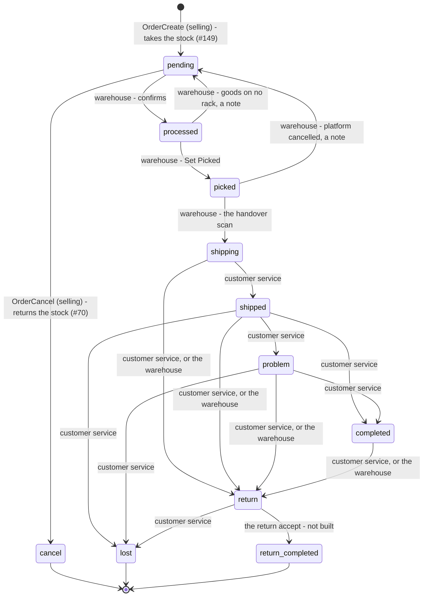

### One RPC for every plain move — `OrderStatusChange`

Every edge above except two goes through **`OrderStatusChange(team_id, order_ids, to, note)`**
([one-status-change-for-every-plain-move](../../technical/frontend/warehouse_order_list_decision.md#one-status-change-for-every-plain-move)).
It replaced `OrderConfirm`, `OrderPick`, `OrderPack` and `OrderShip`, which only ever changed the status.
The two that keep their own RPC do more than move a status: `OrderCancel` returns the stock and cancels
the sale, and the return accept (not built) records the warehouse and relabels borrowed units.

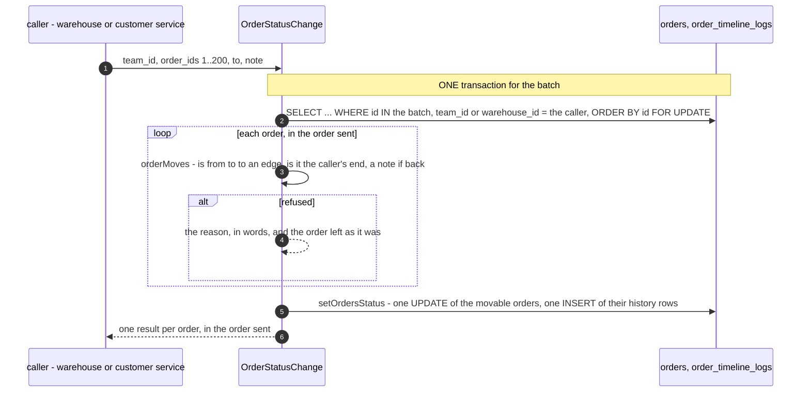

| | |
| --- | --- |
| the table | `orderMoves` in [order_transition.go](../../../backend/services/selling_service/selling_v1/order_transition.go), from → to → which end may make it, and whether it needs a note |
| which end the caller is | per order, from the scope: `team_id` = the order's `warehouse_id` is the warehouse, = its `team_id` is the selling team |
| a refusal | never blocks the rest and never fails the call: `moved: false` with a sentence (*"processed cannot move to shipping"*, *"only the warehouse moves …"*, *"a note is required …"*) |
| not the caller's order | refused as *"not one of this team's orders"*, with no status, so a caller cannot probe ids |
| `to: cancel`, `to: return_completed` | refused here: each has its own action |
| a note | required for a move back to `pending`; written to the history row with the move |
| two crew, one parcel, one second | the row lock serialises them: the second reads the status the first wrote and is refused as *"already shipping"* |
| the save | one transaction of four statements for any batch ([a-batch-move-saves-in-one-transaction](../../technical/frontend/warehouse_order_list_decision.md#a-batch-move-saves-in-one-transaction)). Locked in **id order**, so two batches over the same orders queue rather than deadlock. A database failure rolls the batch back and every order answers *"could not be saved — try again"* |

### Who may move it, and why the scope differs

| Move | Scoped to | Because |
| --- | --- | --- |
| Create / Cancel | the **selling team** | the team that owns the order decides whether it stands |
| confirm, Set Picked, back to pending, the handover | the **order's warehouse** (#72) | the crew doing the work holds no role in the selling team |
| shipped, completed, problem, lost | the **selling team** | customer service reads the platform |
| a forced return | either | customer service claims it, or the warehouse forces it |

**This asymmetry is the design, not an inconsistency.** A picker is a member of the warehouse, not of
the shop whose order they are packing, so the warehouse's moves carry the **warehouse** as their
`use_scope` field. Another team's order reads as refused-not-ours, never PermissionDenied, so a crew
cannot discover that an id belongs to someone else's building.

### Every move leaves a step — the order's timeline (`order_timeline_logs`)

The lifecycle above is drawn as states, but a state is a fact about *now*. Nothing in `orders` could
say **when** an order was confirmed, **how long** it then sat before the crew picked it, or **who** did
either — the row carries `status`, `created_at` and `updated_at`, and no actor at all. So each
transition appends a row to `order_timeline_logs`, saying which side made it
([order-timeline-logs-replaces-order-events](../../business/order/context_decision.md#order-timeline-logs-replaces-order-events)),
and the detail page reads those — the status rows in its **Timeline**, the note rows in *Catatan*.

**The append happens at the single choke point**, not in the handlers:

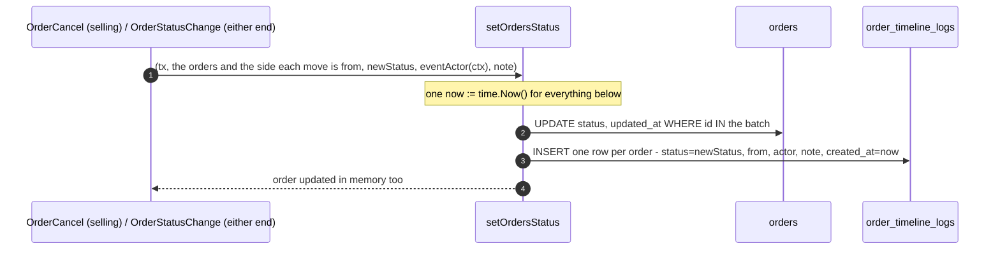

- **One clock, one moment.** The status stamp, the row's `created_at` and the domain event a caller may
  publish afterwards all read the same `now`. Two clock reads for one fact would file a midnight
  transition on different days depending on who looked.
- **`placeOrder` appends its own `pending` row, from `selling`**, so an order typed into the form and one
  promoted from a draft start the same timeline — the two doors cannot differ.
- **A note is a row with no status** ([a-note-is-a-timeline-row](../../technical/frontend/order_detail_decision.md#a-note-is-a-timeline-row)),
  never edited and never deleted. Two writers, neither through `setOrdersStatus` — a note moves nothing:
  - `placeOrder` writes the form's trimmed note, when there is one, in the SAME INSERT as the `pending` row: from
    `selling`, by the person placing the order, at the order's own `created_at` — so it reads straight after `pending`.
  - `OrderNoteCreate(team_id, order_id, note)` appends one from either end, `from` following the scope (the order's
    team `selling`, a team that is both ends included, its warehouse `warehouse`, any other team NotFound). A
    single-table insert after a scoped read — no lock, no transaction.
- **The actor is `eventActor(ctx)` — 0 when unidentifiable, and that never fails the call.** This is a
  deliberate contrast with `draftAuthor`, which refuses the request outright: a draft is personal, so an
  unidentifiable caller has no correct answer to receive, whereas an event is a byproduct and the
  record-keeping must not be able to veto the work.
- **`OrderDetail` is the only RPC that returns them** (`timeline_logs`), preloaded by `created_at`, then `id`.
  `OrderList` stays a summary: a page of 20 orders carrying 20 whole lifecycles is a list that grows with history.

See [database-schema.md](../../database-schema.md) for the table, and why the status column is kept beside the
timeline rather than replaced by it.

### Picking does NOT move stock

The stock was deducted when the order was **placed** (#149, "deduct at placement" — the choice that
makes oversell impossible). Picking records that a person is collecting what the system already
committed. **There is no inventory call in the pick move and there must not be one** — a second deduction
would take the goods twice.

### The cancel window (#70/#150)

Cancel is allowed from **`pending` only**, and returns the stock **exactly where it came from** — same racks, same batches, because the release (`OrderTransactionRelease`, by the order's key) reverses the
take's own ledger rows rather than trusting quantities (a-rollback-reverses-its-log-rows).

A `processed` or `picked` order is first handed back to `pending` by the warehouse — the moment the goods
are unpacked and re-shelved — so the stock a cancel returns is really on a shelf. **After the handover a
cancel is refused**: putting the stock back then would book goods onto a shelf while they are on a
courier's van; the count would say something untrue until a human noticed. What comes back
after shipping is a **return** — a different event, with different money — and calling it a cancel
would hide that rather than record it.

> The hand-back to `pending` is what keeps the shelf honest: the books return the goods only once a
> person has put them back. Re-shelving onto a different rack is `RackMove`'s job (#136).

---

## The create form asks before it takes — `StockTakeQuote` (#90, an-order-is-costed-at-what-leaves-the-shelf)

`OrderCreate` draws the goods in the same transaction that writes the order, so **not enough stock is
not a warning — it is a failed order**. Before this, the person typing found that out from a red error
after filling in the customer, the address and every line.

The order form and the draft page read `inventory.v1.InventoryService/StockTakeQuote` for the lines on them — each
product once, its quantities summed — whenever a warehouse is chosen and once a quantity settles. One answer carries
both halves: what the warehouse holds against each line (the stock column, the short-line alert) and **what those units
cost as the take would draw them**, the owner's batches oldest first
([an-order-is-costed-at-what-leaves-the-shelf](../../business/order/context_decision.md#an-order-is-costed-at-what-leaves-the-shelf)).
Each line's HPP, its split over two batches, the invoice, the margin and the warehouse fee's preview all follow from it.
*(It replaced `StockAvailability` + `StockCost` on these two pages, 2026-10-23; `StockCost`'s average values the stock
that stays, and no order reads it.)*

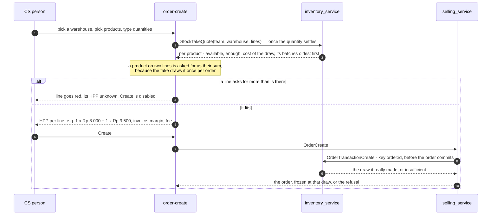

**The quote is ADVISORY. The take remains the authority** — two people can place orders against one
shelf in the same second, so anything read beforehand is already historical. If another order takes the same units
first, the order freezes the draw its own take made; the preview is never charged.

### What it reads

The take's own selection, read-only — see
[inventory_service: StockTakeQuote](../inventory_service/rpc.md#stocktakequote--what-the-take-would-draw). The
product's owner's batches in the warehouse, the rows the order's take counts and draws (`inventory_ledgers.ReadBatches`
is `LockBatches` without the lock), and the take's refusals of a borrowed line (private, below its reserve) read as
nothing available.

## The warehouse prices the order, and the order keeps the price — `WarehouseFeeCalculate` (step 3)

Step 3 of [the-flat-rate-is-dropped-last](../../business/teams/warehouse/context_decision.md#the-flat-rate-is-dropped-last):
`placeOrder` — behind `OrderCreate`, the one door for a typed order and a promoted draft alike — asks warehouse_service what the fulfilling
warehouse charges for the order's goods, and freezes the answer as `orders.warehouse_fee`. The order form asks the same
RPC while the order is typed, on the quote's goods cost, so the figure on screen is the figure kept.

✅ *(2026-10-23)* **Every money figure is frozen from ONE draw — the take's**
([an-order-is-costed-at-what-leaves-the-shelf](../../business/order/context_decision.md#an-order-is-costed-at-what-leaves-the-shelf)).
Each line's `unit_cost` and `total`, the header's `goods_cost`, the fee's basis and `total_cost` all come from what the
take answers, inside the order's transaction. Nothing reads the shelf's average before the take any more.

🔄 *(2026-10-23, the alignment pass)* **The basis is `goods_cost` = Σ the lines' frozen `total`** — a borrowed line WITH
its owner's markup ([the-fee-is-priced-on-goods-cost](../../business/teams/warehouse/context_decision.md#the-fee-is-priced-on-goods-cost),
[the-cross-charge-lives-on-the-line](../../business/order/context_decision.md#the-cross-charge-lives-on-the-line)). The
first build priced it on the drawn cost without the markup (the build's `cogs`); selling `00027` renamed the column and
`placeOrder` now sums the totals. The form's preview (`goodsCostOf`) adds each borrowed line's own markup the same way.

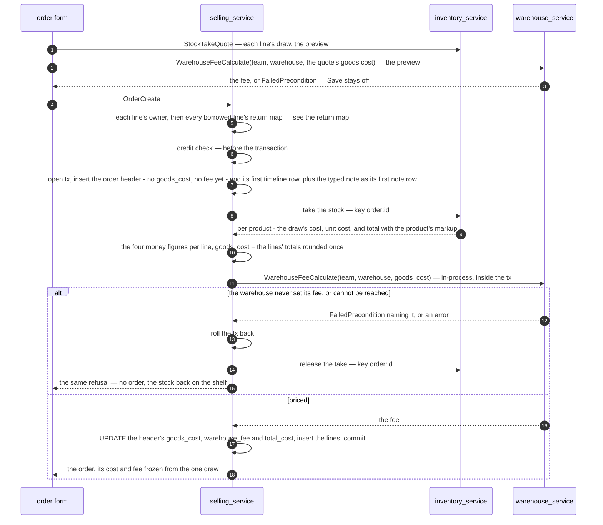

| | |
| --- | --- |
| the basis | `goods_cost` — Σ the lines' frozen `total` (the draw's cost plus, on a borrowed product, its owner's markup), rounded once to whole rupiah ([the-fee-is-priced-on-goods-cost](../../business/teams/warehouse/context_decision.md#the-fee-is-priced-on-goods-cost), [an-order-is-costed-at-what-leaves-the-shelf](../../business/order/context_decision.md#an-order-is-costed-at-what-leaves-the-shelf)). A line the take named no draw for adds 0, so a percent warehouse charges its floor on it |
| when | AFTER the take, inside the order's transaction — its basis is the draw, which exists only once the take answers. The fee is warehouse_service's to compute, never selling's ([warehouse-prices-balance-records](../../business/teams/warehouse/context_decision.md#warehouse-prices-balance-records)), so it is asked rather than worked out from a rate read earlier. A refusal fails the transaction and the compensation releases the take — the owner's own flow ([a-warehouse-with-no-rate-takes-no-orders](../../business/teams/warehouse/context_decision.md#a-warehouse-with-no-rate-takes-no-orders) *"the take is rolled back like any failed step"*). The form refuses such a warehouse before Create, so it is the rare path |
| the header | inserted first, for the id the take's key is made of; its `goods_cost`, `warehouse_fee` and `total_cost` (= the two added) are written by one UPDATE of that row after the take, in the same transaction — no reader sees the order without them |
| concurrency | the fee read takes no lock; the order's KEY SHARE on its shop is held across it as it is across the take — [lock-order](../../../audits/services/selling_service/concurrency/lock-order.md) |
| the refusal | `FailedPrecondition`, the warehouse's own sentence passed through unchanged ([a-warehouse-with-no-rate-takes-no-orders](../../business/teams/warehouse/context_decision.md#a-warehouse-with-no-rate-takes-no-orders)). An unreachable warehouse_service is `Unavailable` — no order at a fee nobody computed |
| the wiring | `selling_v1.WarehouseFeePricer`, adapted in the composition root (`warehouse_fee_pricer.go`) to the handler itself |
| the event | `OrderPlaced.warehouse_fee` carries the frozen fee as stored (step 4, [the-event-carries-the-warehouse-fee](../../business/teams/warehouse/context_decision.md#the-event-carries-the-warehouse-fee)); liability posts it and reads no rate. Unset only for an order placed before fees were frozen |

## One line per product, and the take's refusal as it came — `placeOrder` (both doors)

**A product named on two lines is merged into ONE order line** before anything else reads the lines. The order form
adds a bundle's products as ordinary lines, so the same product can arrive once by hand and once from a bundle; a
draft's two rows can map to one product. The order keeps only product lines
([the-order-keeps-only-product-lines](../../business/product/product_bundle_decision.md#the-order-keeps-only-product-lines)),
the take refuses a product listed twice, and every money figure of a line is the take's one draw
([an-order-is-costed-at-what-leaves-the-shelf](../../business/order/context_decision.md#an-order-is-costed-at-what-leaves-the-shelf)) —
so `placeOrder` folds them, quantities summed, and stores the one line. In the server, so every door and every client is
covered.

**A refused take reaches the caller as the take answered it** — its Connect code and its `OrderTransactionRefusal`
detail (the reason and every line it names). It used to be wrapped as a database error and reach the form as
`Internal`. The order form and the draft page decode the detail and name the reason and the products.

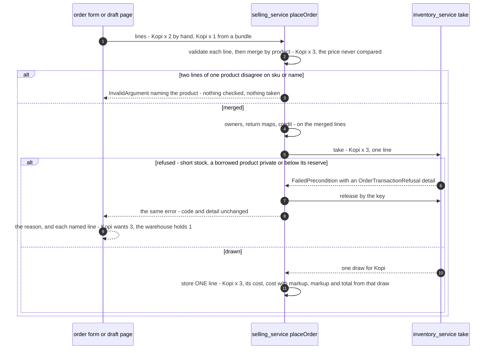

| | |
| --- | --- |
| merged on | the product id. The merged line keeps the first line's sku and name, and the request is not modified |
| the price | **not compared, and not read** ([an-order-line-carries-no-marketplace-price](../../business/order/context_decision.md#an-order-line-carries-no-marketplace-price)). Every money field of a line is stamped from the take after the merge, and a line has no price of its own (`unit_price` was dropped by `00028`). So two draft rows of one product at two marketplace prices promote as ONE line and lose nothing: the prices stay on the draft's rows |
| refused instead | two lines of one product under a different `sku` or `name` — merging would keep one label and drop the other. The form never sends that (the catalogue's label, per product) and Promote reads one catalogue snapshot per product, so only a client sending one product under two labels to `OrderCreate` meets it |
| the form's totals | the order form and the draft page sum their money **per product** (`byProduct`), so a product on two lines is costed as one draw — the figures on screen are the ones the order stores. The rows themselves still show where each came from |
| passed through | any Connect error the take answers with — its code, message and details. A take that never answered in its own terms (not a Connect error) is still `Internal` |
| the release | unchanged: a refused take is still released by its key, as every failed placement is |

## The pick screen's reads (#151)

The crew's screen is a join of things that already existed — but two of the reads it needs were
**selling-scoped only**, so the warehouse could not perform its own work.

### Both ends of an order

`OrderList` and `OrderDetail` matched `team_id` alone. The write side landed in #150 (`OrderPick` /
`OrderPack` / `OrderShip`, all scoped to the **warehouse** — since 00015 one `OrderStatusChange`) without the read side following, so a crew
could record work on an order it was not allowed to look at.

Both now match **either end**, and `team_id` means *"the team you hold a role in"* rather than *"the
team whose orders you get"*:

```sql
WHERE (team_id = ? OR warehouse_id = ?)
```

**Except the root team, which reads every team** ([root-reads-every-teams-orders](../../technical/frontend/order_list_decision.md#root-reads-every-teams-orders)).
Only ROOT and ADMIN hold that scope, so `readsEveryTeam` drops the clause for `OrderList`, `OrderStat`, the creator
picker (all three share `scopedOrders`) and `OrderDetail`. Reads only. It is the rule settlement's reports already use.

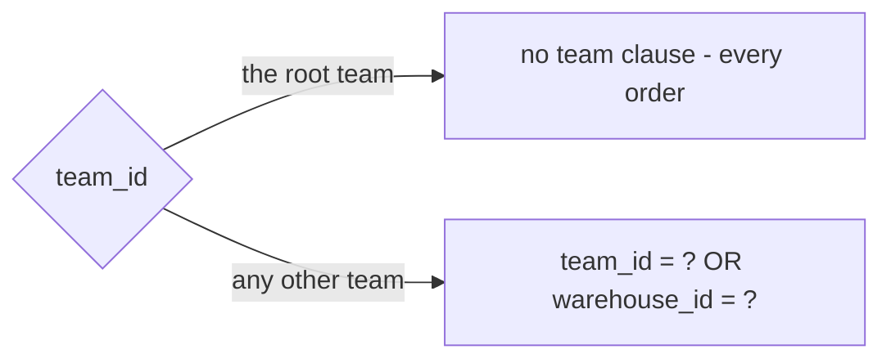

`OrderList` also takes a **status filter**, which is what makes it a queue rather than a list.
Server-side, because the list is paginated: a client-side filter narrows the loaded page only and
still reports the unfiltered total.

### Which shelf to walk to — `StockPickLocations`

The screen's one hard question: a product can sit on several racks (#135), so which does the picker
walk to? Answered by **inventory_service**, from the **take's own rack rows**:

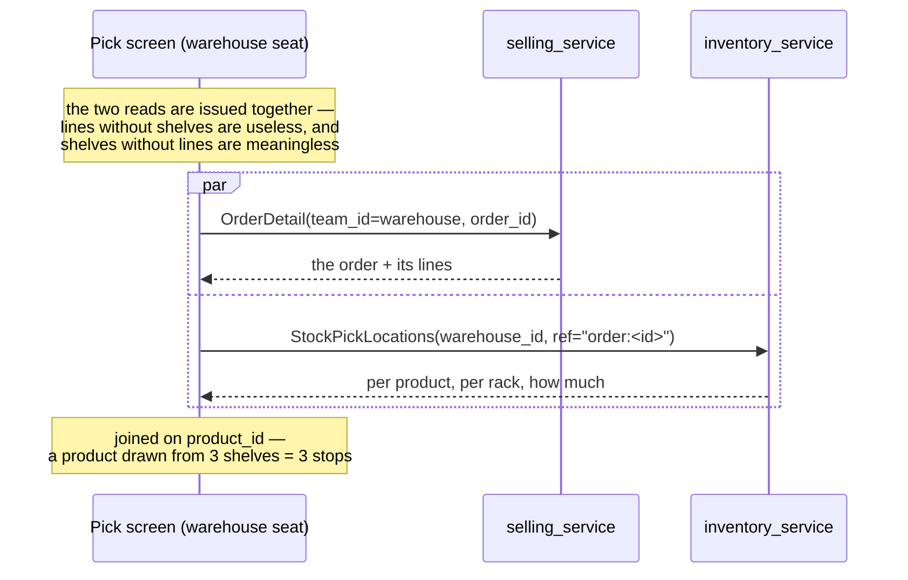

**From the take, not from the racks now — this is the whole design.** The goods were drawn at placement (#149) and the
take recorded, per rack, exactly how much it took under the order's key (`order:<id>`, found through
`idempotency_order_check`). Those rows are what the order *holds*. Current levels answer a question whose answer
keeps moving — another order draws from the same shelf, a stock-take shifts goods — and a picker sent
by current levels can arrive at a shelf whose stock is spoken for.

The take and its rollback are **netted**, and only a positive remainder is a stop on the walk: the log is append-only,
so a released take's rows survive beside their reversal, and reading the take alone would send a picker after goods
that are back on the rack. The walk is ordered by rack label.

> A product on two shelves appears **twice**, each with its own quantity. #151 asked for "a shelf, or
> all of them with quantities, rather than silently picking one"; when the goods genuinely are in two
> places, listing both is the only honest answer. Every unit is on a rack (there-is-no-unplaced-pile).

---

## Placing an order announces it (#153)

After `OrderCreate` commits, selling_service publishes an **`Event` carrying the `OrderPlaced` variant**
with the frozen money — `goods_cost` (`cogs` until 2026-10-23, same field number) and `platform_total`
(`marketplace_total`, same number); `revenue` (the dropped `total`) and `shipping_cost` are reserved, neither had a
consumer. `liability_service` consumes it and charges the order's fees; settlement opens the sale from `platform_total`.

**Each line carries its frozen `total`** (`00023`) — what inventory's take priced it at, the goods plus the product's own
markup ([inventory-computes-the-markup](../../business/order/context_decision.md#inventory-computes-the-markup)). The
take answers it (`StockPicker.Pick` returns it per product), `placeOrder` writes the lines only after it, with it, and
the event copies it as stored. Liability's product fee is Σ an owner's line totals and reads no markup
([the-ledger-charges-the-frozen-line-total](../../technical/balance/team_balance_design_decision.md#the-ledger-charges-the-frozen-line-total)).
A line the take named no total for stores NULL and rides as 0 — not known, charged nothing.

Published **after** the commit and **never inside** it, and a publish failure does **not** fail the
order — revenue is downstream, and a shop must keep selling while it is down.

selling_service does not know who is listening. It names no topic either: the VARIANT declares its own
(`warehouse.events.v1.event_config`), and the sender unwraps the `oneof` to read it — so a publisher
cannot send it to the wrong one.

The envelope carries `event_id` (derived from the order, so a redelivery and a replay collide),
`occurred_at`, `aggregate_id` and the caller's `identity` — which the sender takes as a PARAMETER and
which is a record of who published, never something a consumer authorises from.

> The full flow, the delivery trade-off, and why the event carries the money rather than just an order
> id are in [revenue_service/rpc.md](../revenue_service/rpc.md).

## Draft orders — `OrderDraftPush` and the blanks-only merge (#190, #191)

A **draft** is an incomplete order pushed in by a **third-party app**, which a person here finishes
and promotes. It lives in `order_drafts` / `order_draft_items`, not in `orders` — see
[database-schema.md](../../database-schema.md) for why (#190).

`OrderDraftPush` is worth documenting because it is not the CRUD it looks like: it is a
**create-or-update keyed on `(team_id, source, external_id)` that writes untouched fields only**.

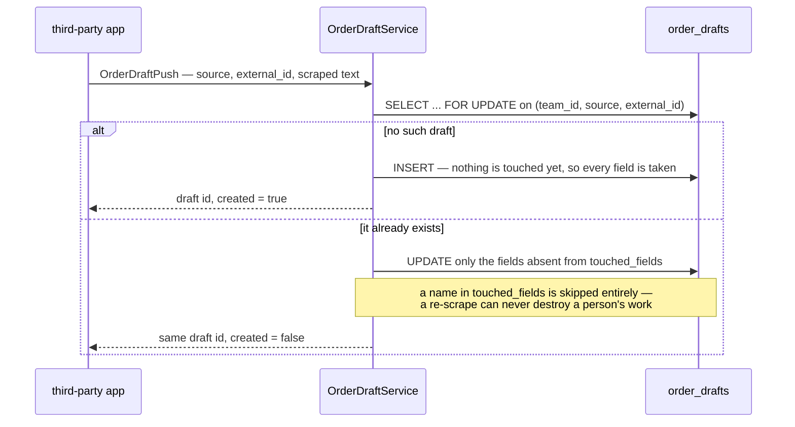

**The push's money, by JSON name.** A client posting Connect JSON names each field in lowerCamelCase. Money is whole
rupiah, sent as a string or a number (protobuf `int64` in JSON).

| JSON field | proto | what it is |
| --- | --- | --- |
| `platformTotal` | `platform_total = 15` | what the buyer paid the platform, as the app read it. Optional on a push (0 = could not see one); Promote refuses a draft still at 0 ([platform-total-is-required-at-finalize](../../business/order/context_decision.md#platform-total-is-required-at-finalize)). A person's typed figure is touched and wins |
| `items[].unitPrice` | `OrderDraftItem.unit_price = 6` | what the platform charged per unit for that row — the owner's `platform_price`. Information beside the mapping; deleted with the draft, never copied onto the order |

> ⚠ **Changed 2026-10-23** (selling `00026`/`00027`). `marketplaceTotal` was renamed **`platformTotal`** (same field
> number 15, so a binary-protobuf client is unaffected) and `shippingCost` (10) was **dropped** — a draft carries no
> shipping money ([an-order-records-no-shipping-cost](../../business/order/context_decision.md#an-order-records-no-shipping-cost)).
> A JSON client must send `platformTotal` and stop sending `shippingCost`. Connect DISCARDS unknown JSON fields
> rather than refusing them, so a client still sending `marketplaceTotal` gets a 200 and a draft at 0 — which then
> fails Promote with *"an order must say what the buyer paid on the marketplace"*. The same rename applies to
> `OrderDraft.platformTotal` on every read and to `OrderDraftUpdate`.

**Why the RPC name carries the rule.** The app and the person authenticate as the **same user** — the
app logs in as one, because there is no machine identity in this system — so *identity cannot tell
them apart*. `OrderDraftPush` yields to a human; `OrderDraftUpdate` (#193) always wins and marks what
it wrote. Merging the two into one handler would erase the only thing distinguishing them.

Four details that are decisions rather than implementation:

- **It is "untouched fields only", NOT "empty fields only".** An untouched field the app has changed
  its mind about *is* updated — the app remains the authority on everything nobody here has claimed.
- **The address is one touched field, not ten columns.** Somebody who corrects a kecamatan has
  corrected the address, and rewriting the nine columns around their fix would leave a hybrid address
  that was never true anywhere.
- **`items` is one touched field too.** Once a person has edited any line, the app stops rewriting
  the lines altogether. Per-line merging would need a per-line touched mark; the rule that matters —
  a re-scrape never destroys a mapping — holds without one. While untouched, the lines are replaced
  **wholesale**, so a line the app no longer sees disappears rather than lingering.
- **`product_id` is ignored on push.** The app does not know our catalogue ids, and a client matching
  titles against our catalogue on its own would guess wrong silently. Mapping is a human act. This is
  the same instinct as `OrderItem.unit_cost`, which `OrderCreate` also refuses from the client.

**The author follows the push.** A draft is personal, and a colleague cannot pick one up — so
re-pushing under the right person's login is the only way to hand a draft over. That makes
reassignment the escape hatch "personal" leans on rather than an accident.

**A draft publishes nothing.** `OrderCreatedEvent` fires at placement (#153) and revenue consumes it
(#75). A draft that published would put an unfinished scrape into the month's margin — promote (#194)
is the only door into revenue.

### Reading drafts — two narrowings, not one (#192)

`OrderDraftList` and `OrderDraftDetail` both apply **two** restrictions, and they are different kinds
of thing:

| | What it is | Enforced by |
| --- | --- | --- |
| `team_id` | the authorization **scope** (`use_scope`) | the access interceptor |
| `author_user_id` | a **handler filter** — a draft is personal working state | the query itself |

⚠ **The scope is not optional just because the list is personal.** A team-level role policy on a
message with no `use_scope` field is evaluated against the *root team*, where almost nobody is a
member — so "simplifying" this to author-only would leave a policy that authorizes nobody.

A colleague's draft reads as **NotFound**, not PermissionDenied: the caller holds a perfectly good
role in the team, and "exists but is not yours" would leak that a given external ref has already been
scraped by somebody else.

**The list carries counts, not lines.** `item_count` and `unmapped_item_count` are aggregated in one
`GROUP BY` for the whole page — they are the only thing on the list screen (#195) that says how much
work is left on a draft, and computing them client-side would mean loading every draft's lines to
render one page of a list. A non-zero `unmapped_item_count` is exactly what makes a draft still a
draft.

### The human edit path — `OrderDraftUpdate` (#193)

The other half of the merge rule. `OrderDraftUpdate` **always wins** and **marks every field it
writes as touched**; `OrderDraftPush` then refuses to overwrite anything carrying that mark. Neither
handler makes sense read alone.

**Presence decides what was edited, not emptiness.** Every field is `optional`, so a field left unset
is neither written nor marked. If "unset" and "set to empty" were indistinguishable, the first save
anybody made would mark every field touched and freeze the whole draft against the app forever — and
clearing a wrongly-scraped phone number would stop being expressible at all.

**The lines are sent as the complete desired set** (`items`, a wrapper message so it has presence —
absent means "leave the lines alone", present-and-empty means "this draft has no lines"). An id edits
an existing line, `id = 0` adds one, and an omitted line is **deleted**: a buyer who cancels one line
of three must be able to say so, or the draft stays unpromotable forever over a line nobody wants.

⚠ **The edit cannot carry the scraped text.** `external_sku` / `external_name` are absent from
`OrderDraftLineEdit` by design — a request that could rewrite them could quietly make the evidence
agree with a wrong mapping, which is the one failure that keeping both halves on the line was meant
to catch. A hand-added line has empty external text, which truthfully says nobody scraped it.

### Pruning — `OrderDraftDelete` (#193)

**Bulk, and a hard delete.** Nothing expires (§6.7), so this is the only thing between the list and a
graveyard, and an app pushing continuously fills that list faster than a person deletes one at a
time. Hard rather than soft because a draft is working state that was never an order — a soft-deleted
draft would be a row every future reader has to remember to exclude, which is precisely the trap the
separate table was built to avoid. The lines go with it via `ON DELETE CASCADE`.

**Fewer deleted than asked for is a normal answer.** An id already gone, or never the caller's, is
skipped rather than failing the batch: deleting is idempotent by nature, and refusing over one stale
id would make a bulk prune unusable exactly when the list is long enough to need one. The scope and
the author are in the `WHERE` rather than checked beforehand, so there is no window in which the ids
stop being the caller's.

### A draft becomes an order — `OrderCreate` with `order_draft_id`

There is no promote RPC ([a-draft-becomes-an-order-through-order-create](../../business/order/context_decision.md#a-draft-becomes-an-order-through-order-create)).
The draft page's **Promote** sends the same `OrderCreate` the create form sends, built from what is on its screen,
plus `order_draft_id`. `OrderDraftPromote` was removed: it rebuilt the order from the stored draft by hand, and that
copy had already drifted (it never set the marketplace ref).

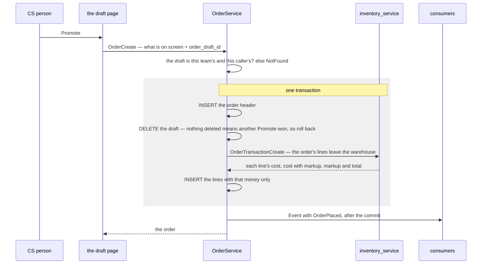

**One door.** Everything the order says comes from the request — the request's validation and `placeOrder` in
[order_place.go](../../../backend/services/selling_service/selling_v1/order_place.go) — so a promoted order meets every
rule a typed one does, by construction. The page sends what is on screen, not what is saved: unsaved edits, bundle and
split rows as their products, and what a draft cannot store (receipt, tracking number, note), which now reach the order.

**The draft's facts reach the order through the page.** The app's pushed values — the platform's two dates (`00020`),
what the buyer paid (`00022`, `platform_total`), the buyer's username — seed the page, a person may correct them, and
Promote sends them. The marketplace REF is the draft's `external_id`, seeded the same way; a `manual` draft's
`external_id` is a minted `form-…` id, so its ref is typed
([an-order-ref-is-required-by-the-rpc](../../business/order/context_decision.md#an-order-ref-is-required-by-the-rpc)).
The catalogue label (`sku`, `name`) is the page's, from the products it mapped.

**One transaction, and one order per draft.** `orders` and `order_drafts` are the same service in the same database,
so the order is written and the draft deleted together (`placeOrder`'s `inTx`). A refused order — no stock, no fee
rate, a missing field — rolls the deletion back and leaves the draft to fix. Two Promotes of one draft: the second's
DELETE waits on the first's row lock, then finds nothing, answers `Aborted` and rolls its order back; done one after
the other, the second is `NotFound` at the lookup.

**The line carries no marketplace price**
([an-order-line-carries-no-marketplace-price](../../business/order/context_decision.md#an-order-line-carries-no-marketplace-price)).
A draft row's `unit_price` stays on the row and is deleted with the draft; the order's money is the take's, as on any
order.

> ⚠ **The warehouse id is NOT re-checked.** `team_service` has no by-id existence RPC selling_service
> could call, and inventing one for this was out of scope. A warehouse deleted underneath a draft
> surfaces as the stock pick failing, which is late and reads as a stock problem. Worth fixing when
> something else needs that lookup.

**This is where the `OrderPlaced` event fires for a draft, and the only place a draft ever reaches a consumer.**
Pushing and editing publish nothing at all — there is a test asserting exactly that, because "a draft must never
publish" is the kind of rule that is only ever violated by accident.

**A borrowed line needs its return map** — the check is `placeOrder`'s, the same for both buttons. See
[the return map](#a-borrowed-products-return-map--productreturnmapcreate-and-productreturnmapbyids).

## A borrowed product's return map — `ProductReturnMapCreate` and `ProductReturnMapByIds`

[the-return-map-is-selling-services-and-read-by-ids](../../technical/frontend/order_create_decision.md#the-return-map-is-selling-services-and-read-by-ids):
`product_return_maps` (`00024`) records which of a selling team's **own** products a **borrowed** product — another
team's, sold by this one — comes back as when its order is returned. Both RPCs are on `TeamReturnConfigurationService`,
beside the return warehouse: the owner's [order_return.md](../../business/order/order_return.md) §Table Must Have lists
the two tables together, and order create reads both without calling another service.

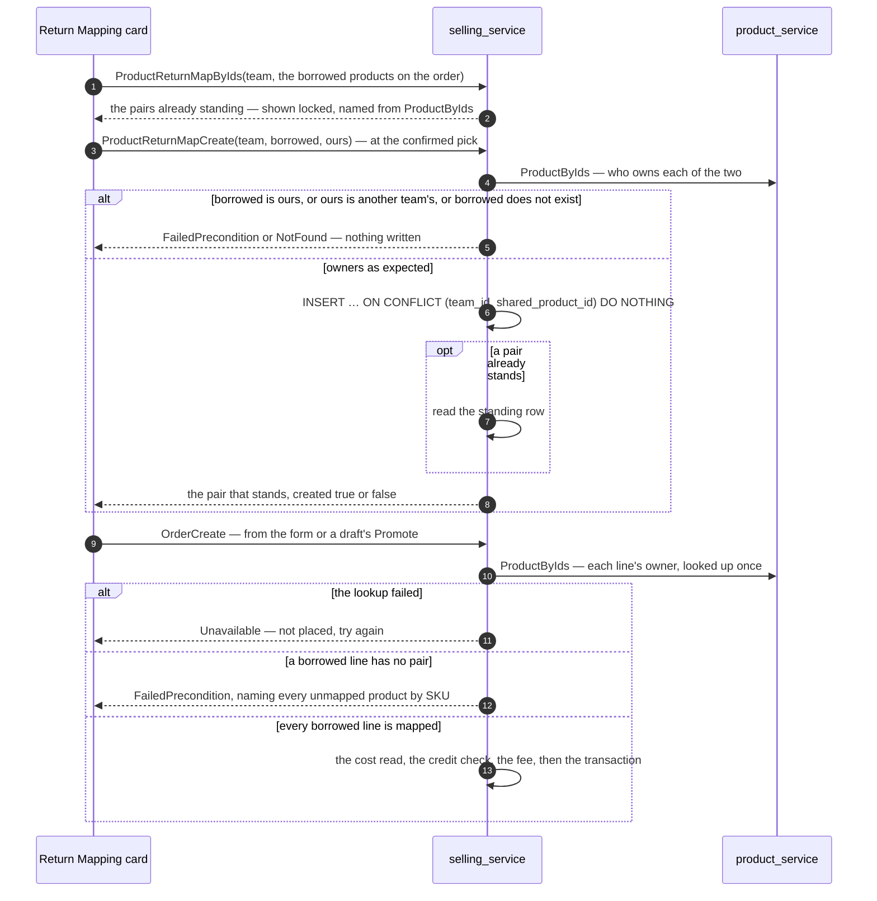

| | |
| --- | --- |
| the write | `ProductReturnMapCreate(team_id, shared_product_id, own_product_id)` — its own call, never part of `OrderCreate` ([the-map-is-written-when-it-is-picked](../../technical/frontend/order_create_decision.md#the-map-is-written-when-it-is-picked)). One `INSERT … ON CONFLICT DO NOTHING` on the unique source; a pair already standing is **never overwritten** ([a-return-map-is-written-once](../../business/order/context_decision.md#a-return-map-is-written-once)) — it is read back and returned with `created = false`, and may name a different own product from the one asked for. Two queries at most. Nothing ever `UPDATE`s a row |
| its refusals | `FailedPrecondition` when the "borrowed" product is the team's own ([an-own-line-never-touches-the-map](../../business/order/context_decision.md#an-own-line-never-touches-the-map)) or "our" product is not the team's ([a-return-never-clones-a-product](../../business/order/context_decision.md#a-return-never-clones-a-product)); `NotFound` when the borrowed product does not exist; `Unavailable` when the owners cannot be looked up — a pair written unchecked could not be taken back |
| the read | `ProductReturnMapByIds(team_id, filter.ids)` — the `ByIds` shape, 1–100 borrowed ids, keyed by borrowed id, the `PAIR` slice (`own_product_id`, `created_at_unix`). An unmapped product is absent. The team is the filter as well as the scope: another team's map of the same product is never seen. One query, not paged |
| order create | `placeOrder` — both doors — looks up each line's owner **once** (`lineOwners`, the same `ProductCatalog` port), then refuses a line whose owner is known and is not the ordering team when the team holds no pair for it, naming every such product at once ([a-borrowed-line-needs-its-map-at-create](../../business/order/context_decision.md#a-borrowed-line-needs-its-map-at-create)). One query on the unique index, before the cost read, the credit check and the transaction. An own-only order reads nothing. The credit check reads the same owners |
| ⚠ a failed owners lookup | **refuses the create** (`Unavailable`), as [a-failed-owner-lookup-refuses-the-create](../../business/order/context_decision.md#a-failed-owner-lookup-refuses-the-create) decided. Until this pass the credit check failed open on it; the map check cannot — without owners a borrowed line cannot be told from an own one |
| policy | all three requests: Root, Administrator, Selling Owner, Selling Admin, Selling CS — the roles that create orders |
| names | not stored — the form names our product from `ProductByIds`, the read it already makes |
| concurrency | ✅ safe — the phantom insert is closed by the unique index: N concurrent maps of one product leave one row and every caller is handed it; the interleave shows the second insert waiting on the first and reading its pair (`product_return_map_create_race_test.go`) |

## The shop, asked by other services — `ShopAccessCheck`

One call answers the shop, its primary CS and whether a user may **write** on it
([one-call-answers-the-shop-and-the-access](../../business/shop/context_decision.md#one-call-answers-the-shop-and-the-access)).
The settlement importer asks it before storing a statement; settlement asks it for an imported shop row's
primary CS ([settlement-asks-the-shop-for-its-primary-cs](../../business/settlement/settlement_importer_decision.md#settlement-asks-the-shop-for-its-primary-cs)).
Both call it over Connect, forwarding the caller's own token.

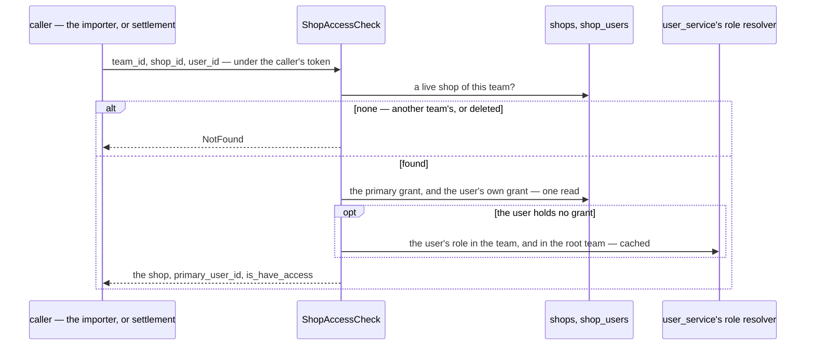

| | |
| --- | --- |
| `is_have_access` | granted the shop, or the team's owner or admin, or root or admin ([a-write-needs-a-grant-or-a-manager](../../business/shop/context_decision.md#a-write-needs-a-grant-or-a-manager)). A grant answers it without asking for a role |
| `primary_user_id` | the grant flagged `is_primary` — 0 = none |
| the roles | `RoleReader`, an interface selling owns; the composition root answers it with the access interceptor's resolver, so it is the same cached lookup every request pays for |
| a deleted shop | `NotFound`, like every shop read — its last statements cannot be imported ([shop Q3](../../business/shop/context_clarify.md#question)) |

## The primary CS — `ShopUserAdd` and `ShopUserSetPrimary`

[the-primary-cs-is-a-flag-on-a-grant](../../business/shop/context_decision.md#the-primary-cs-is-a-flag-on-a-grant):
a new grant on a shop with no primary becomes it; **Make primary** moves it; removing its grant leaves none.

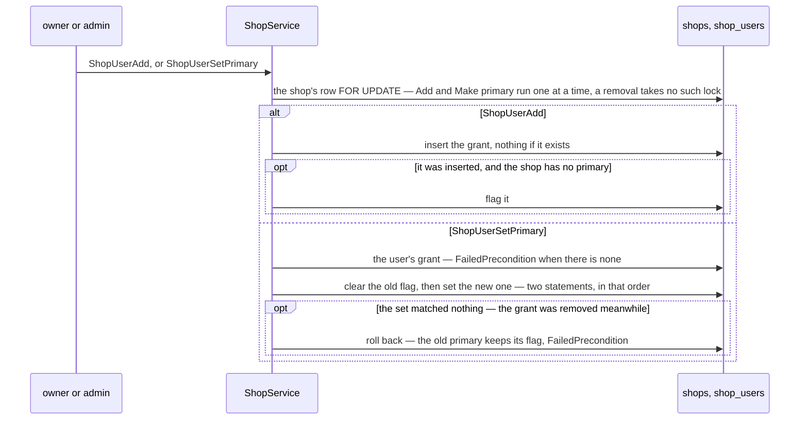

⚠ **Clear, then set.** The partial unique index is checked row by row, so one `UPDATE` flipping both flags
could meet the new one before the old one is gone. And **the shop's row is locked first**: without it, two
grants landing on a shop with none would both find no primary and both be flagged.

⚠ **The set must land.** `ShopUserRemove` takes no shop lock, so a grant can go between Make primary's check and
its set. The set then matches nothing, and the whole change is refused and rolled back rather than answering with a
primary nobody holds. The concurrency audit found this
([ShopUserSetPrimary](../../../audits/services/selling_service/concurrency/ShopUserSetPrimary.md)), and its
lock-level alternatives are still open there.

## A member leaves a team — their shop grants go (`MemberRemoved`)

[removing-a-member-drops-their-shop-access](../../business/user/context_decision.md#removing-a-member-drops-their-shop-access). user_service announces a removal; this service's
listener — `/event/selling-member-removed/push`, subscription `selling-member-removed` — drops the person's grants.

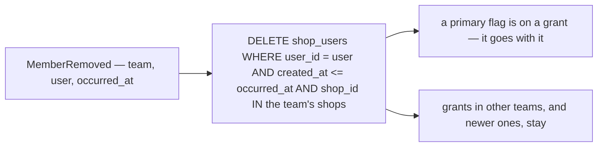

Idempotent with no dedup table: a redelivery finds nothing older to delete. A database error NACKs for a retry.

## A statement's refs, resolved — `OrderByExternalRefs`

The settlement importer turns every marketplace ref in a statement into our order in **one call per file**:
`(team_id, refs[])` → every order of the team carrying each ref — its shop, its creator and its status,
cancelled orders and other shops' included. A ref nothing carries is absent. The importer decides which
counts: the order in its own shop — live first — and a ref found only in another shop fails the file
([a-file-with-another-shops-orders-is-refused](../../business/settlement/settlement_importer_decision.md#a-file-with-another-shops-orders-is-refused)).
It reads `orders_team_external_ref_idx` (`00014`); up to 2,000 refs a call.

## The list as a file — `OrderExport`

[one-export-is-the-list-as-a-file](../../technical/frontend/warehouse_order_list_decision.md#one-export-is-the-list-as-a-file):
one server stream for both lists. It takes the list's own filter and tab, so the file holds exactly the rows the list
holds, every page of them, and it writes them in the reader's columns as .xlsx.

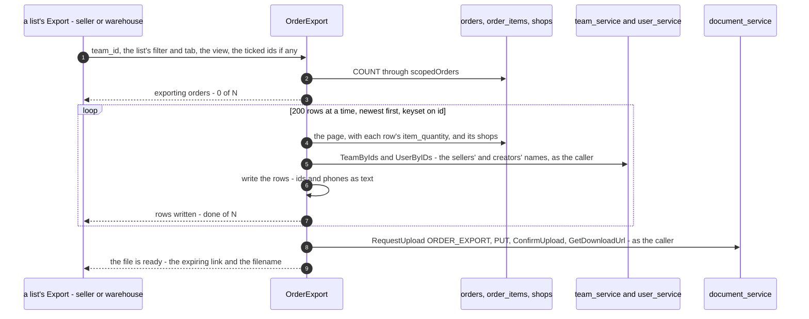

| | |
| --- | --- |
| the rows | `scopedOrders` with the list's filter and status — the same set as `OrderList` and `OrderStat`. With `order_ids` (the warehouse bar's ticked rows, [the-bulk-actions-are-always-on-screen](../../technical/frontend/warehouse_order_list_decision.md#the-bulk-actions-are-always-on-screen)), only those, still inside the scope |
| the columns | **seller**: order id, marketplace ref, shop, marketplace, status, created, created by, customer, phone, courier, qty, goods cost, marketplace total. **Warehouse**: order id, created, created by, seller, shop, marketplace, marketplace ref, courier, qty, status |
| only real data | the tracking number, the marketplace date and the deadline are invented on screen behind a ⚠. A spreadsheet cannot carry the mark, so they are left out until their fields exist |
| text cells | ids, refs and phone numbers are strings, so `0812…` keeps its 0 and a long marketplace id never becomes `5.78E+17`. A money figure of 0 means "not recorded" and is left empty |
| the clock | WIB (UTC+7), the people reading it keep that time |
| as the caller | the names and the upload go through clients that forward the caller's token (`san_auth.ForwardBearer`): the file is stored under the caller's team, as them, as a private `order_export` document behind an expiring signed link |
| the stream | the guideline's long-task shape ([code-implementation-guideline.md](../../../guidelines/code-implementation-guideline.md)): every step a slog line sent as `message`, with `done` and `total` on each, the link on the last |
