# selling_service — RPC & order lifecycle

## The order lifecycle (#67, #91, #149, #70, #150, 00015)

An order is owned by a SELLING team but **fulfilled by a WAREHOUSE**, and the lifecycle is split along
exactly that line: the warehouse records *what has physically been done to it*, and the selling team's
customer service records *what the platform shows* after the handover. The eleven statuses and who makes
each move are the owner's status diagram ([the-status-move-is-the-only-journey](../../business/order/context_decision.md#the-status-move-is-the-only-journey)).

> ⚠ **CONFIRM IS THE WAREHOUSE'S** (owner). It was the selling team's click (#91) and is the warehouse's
> first move — the building accepting the job. A `pending` order is waiting on the **warehouse**.

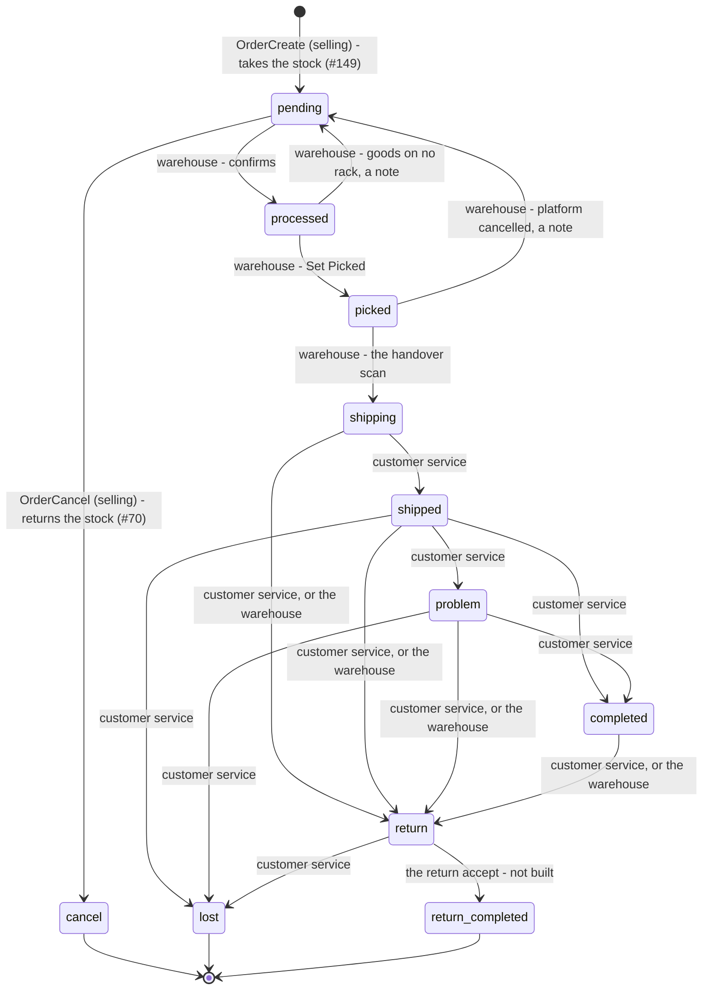

### One RPC for every plain move — `OrderStatusChange`

Every edge above except two goes through **`OrderStatusChange(team_id, order_ids, to, note)`**
([one-status-change-for-every-plain-move](../../technical/frontend/warehouse_order_list_decision.md#one-status-change-for-every-plain-move)).
It replaced `OrderConfirm`, `OrderPick`, `OrderPack` and `OrderShip`, which only ever changed the status.
The two that keep their own RPC do more than move a status: `OrderCancel` returns the stock and cancels
the sale, and the return accept (not built) records the warehouse and relabels borrowed units.

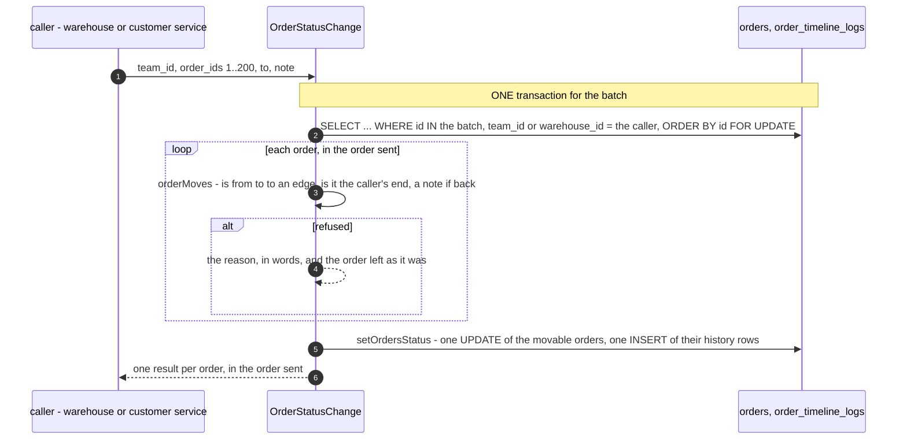

| | |
| --- | --- |
| the table | `orderMoves` in [order_transition.go](../../../backend/services/selling_service/selling_v1/order_transition.go), from → to → which end may make it, and whether it needs a note |
| which end the caller is | per order, from the scope: `team_id` = the order's `warehouse_id` is the warehouse, = its `team_id` is the selling team |
| a refusal | never blocks the rest and never fails the call: `moved: false` with a sentence (*"processed cannot move to shipping"*, *"only the warehouse moves …"*, *"a note is required …"*) |
| not the caller's order | refused as *"not one of this team's orders"*, with no status, so a caller cannot probe ids |
| `to: cancel`, `to: return_completed` | refused here: each has its own action |
| a note | required for a move back to `pending`; written to the history row with the move |
| two crew, one parcel, one second | the row lock serialises them: the second reads the status the first wrote and is refused as *"already shipping"* |
| the save | one transaction of four statements for any batch ([a-batch-move-saves-in-one-transaction](../../technical/frontend/warehouse_order_list_decision.md#a-batch-move-saves-in-one-transaction)). Locked in **id order**, so two batches over the same orders queue rather than deadlock. A database failure rolls the batch back and every order answers *"could not be saved — try again"* |

### Who may move it, and why the scope differs

| Move | Scoped to | Because |
| --- | --- | --- |
| Create / Cancel | the **selling team** | the team that owns the order decides whether it stands |
| confirm, Set Picked, back to pending, the handover | the **order's warehouse** (#72) | the crew doing the work holds no role in the selling team |
| shipped, completed, problem, lost | the **selling team** | customer service reads the platform |
| a forced return | either | customer service claims it, or the warehouse forces it |

**This asymmetry is the design, not an inconsistency.** A picker is a member of the warehouse, not of
the shop whose order they are packing, so the warehouse's moves carry the **warehouse** as their
`use_scope` field. Another team's order reads as refused-not-ours, never PermissionDenied, so a crew
cannot discover that an id belongs to someone else's building.

### Every move leaves a step — the order's timeline (`order_timeline_logs`)

The lifecycle above is drawn as states, but a state is a fact about *now*. Nothing in `orders` could
say **when** an order was confirmed, **how long** it then sat before the crew picked it, or **who** did
either — the row carries `status`, `created_at` and `updated_at`, and no actor at all. So each
transition appends a row to `order_timeline_logs`, saying which side made it
([order-timeline-logs-replaces-order-events](../../business/order/context_decision.md#order-timeline-logs-replaces-order-events)),
and the detail page's **Timeline** tab reads those.

**The append happens at the single choke point**, not in the handlers:

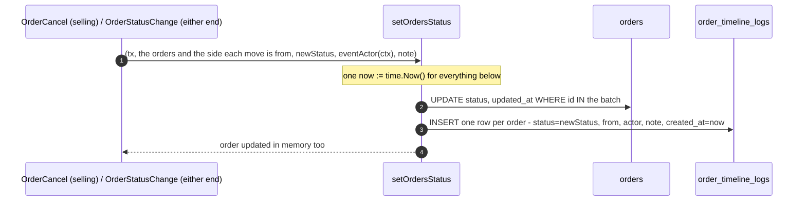

- **One clock, one moment.** The status stamp, the row's `created_at` and the domain event a caller may
  publish afterwards all read the same `now`. Two clock reads for one fact would file a midnight
  transition on different days depending on who looked.
- **`placeOrder` appends its own `pending` row, from `selling`**, so an order typed into the form and one
  promoted from a draft start the same timeline — the two doors cannot differ.
- **The actor is `eventActor(ctx)` — 0 when unidentifiable, and that never fails the call.** This is a
  deliberate contrast with `draftAuthor`, which refuses the request outright: a draft is personal, so an
  unidentifiable caller has no correct answer to receive, whereas an event is a byproduct and the
  record-keeping must not be able to veto the work.
- **`OrderDetail` is the only RPC that returns them** (`timeline_logs`), preloaded by `created_at`, then `id`.
  `OrderList` stays a summary: a page of 20 orders carrying 20 whole lifecycles is a list that grows with history.

See [database-schema.md](../../database-schema.md) for the table, and why the status column is kept beside the
timeline rather than replaced by it.

### Picking does NOT move stock

The stock was deducted when the order was **placed** (#149, "deduct at placement" — the choice that
makes oversell impossible). Picking records that a person is collecting what the system already
committed. **There is no inventory call in the pick move and there must not be one** — a second deduction
would take the goods twice.

### The cancel window (#70/#150)

Cancel is allowed from **`pending` only**, and returns the stock **exactly where it came from** — same racks, same batches, because the release (`OrderTransactionRelease`, by the order's key) reverses the
take's own ledger rows rather than trusting quantities (a-rollback-reverses-its-log-rows).

A `processed` or `picked` order is first handed back to `pending` by the warehouse — the moment the goods
are unpacked and re-shelved — so the stock a cancel returns is really on a shelf. **After the handover a
cancel is refused**: putting the stock back then would book goods onto a shelf while they are on a
courier's van; the count would say something untrue until a human noticed. What comes back
after shipping is a **return** — a different event, with different money — and calling it a cancel
would hide that rather than record it.

> The hand-back to `pending` is what keeps the shelf honest: the books return the goods only once a
> person has put them back. Re-shelving onto a different rack is `RackMove`'s job (#136).

---

## The create form asks before it takes — `StockAvailability` (#90)

`OrderCreate` draws the goods in the same transaction that writes the order, so **not enough stock is
not a warning — it is a failed order**. Before this, the person typing found that out from a red error
after filling in the customer, the address and every line.

The form now reads `inventory.v1.InventoryService/StockAvailability` for the products on it, whenever a
warehouse is chosen, and marks any line the warehouse cannot fill.

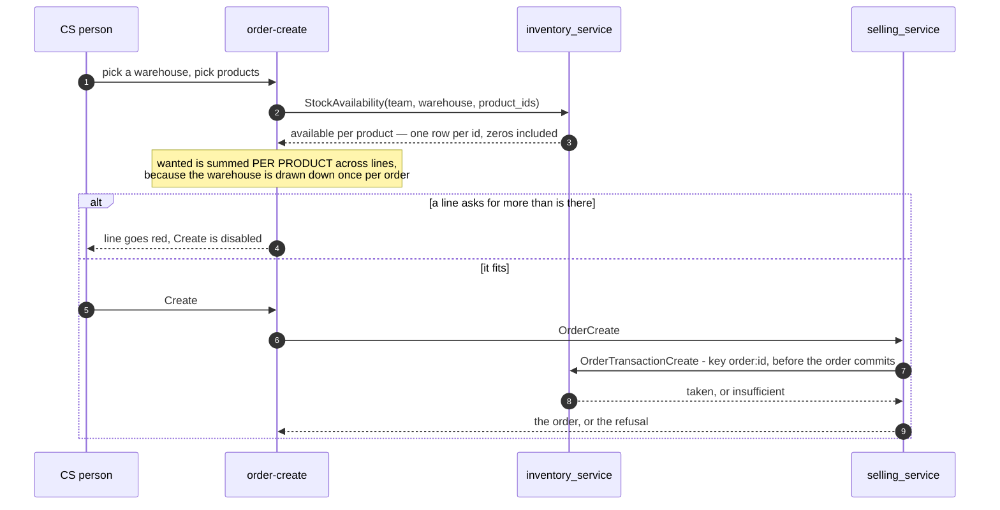

**The check is ADVISORY. The take remains the authority** — two people can place orders against one
shelf in the same second, so anything read beforehand is already historical. The pre-check exists to
stop somebody wasting five minutes of typing, not to guarantee the pick.

### What it reads

The product's batches in the warehouse, summed — the rows the order's take counts (`inventory_ledgers.LockBatches`). A product has
one owner, so they are its owner's batches whoever asks; the take's other refusals (a locked product, the reserve) are
its own and are not repeated here.

## The pick screen's reads (#151)

The crew's screen is a join of things that already existed — but two of the reads it needs were
**selling-scoped only**, so the warehouse could not perform its own work.

### Both ends of an order

`OrderList` and `OrderDetail` matched `team_id` alone. The write side landed in #150 (`OrderPick` /
`OrderPack` / `OrderShip`, all scoped to the **warehouse** — since 00015 one `OrderStatusChange`) without the read side following, so a crew
could record work on an order it was not allowed to look at.

Both now match **either end**, and `team_id` means *"the team you hold a role in"* rather than *"the
team whose orders you get"*:

```sql
WHERE (team_id = ? OR warehouse_id = ?)
```

**Except the root team, which reads every team** ([root-reads-every-teams-orders](../../technical/frontend/order_list_decision.md#root-reads-every-teams-orders)).
Only ROOT and ADMIN hold that scope, so `readsEveryTeam` drops the clause for `OrderList`, `OrderStat`, the creator
picker (all three share `scopedOrders`) and `OrderDetail`. Reads only. It is the rule settlement's reports already use.

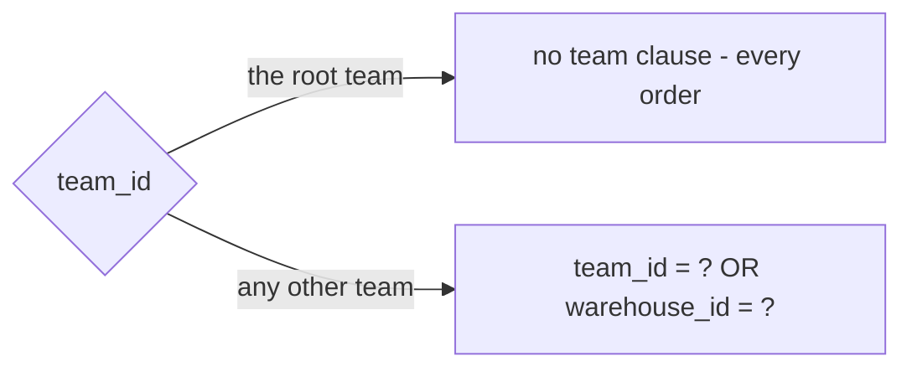

`OrderList` also takes a **status filter**, which is what makes it a queue rather than a list.
Server-side, because the list is paginated: a client-side filter narrows the loaded page only and
still reports the unfiltered total.

### Which shelf to walk to — `StockPickLocations`

The screen's one hard question: a product can sit on several racks (#135), so which does the picker
walk to? Answered by **inventory_service**, from the **take's own rack rows**:

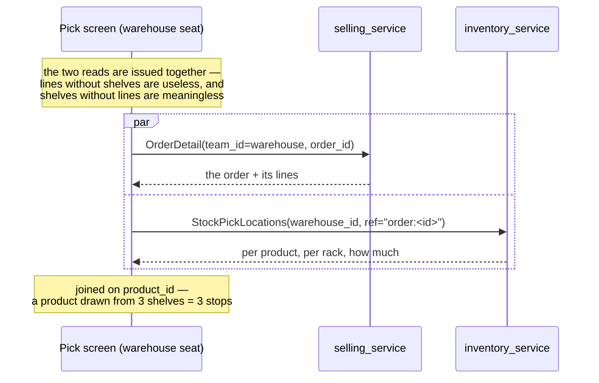

**From the take, not from the racks now — this is the whole design.** The goods were drawn at placement (#149) and the
take recorded, per rack, exactly how much it took under the order's key (`order:<id>`, found through
`idempotency_order_check`). Those rows are what the order *holds*. Current levels answer a question whose answer
keeps moving — another order draws from the same shelf, a stock-take shifts goods — and a picker sent
by current levels can arrive at a shelf whose stock is spoken for.

The take and its rollback are **netted**, and only a positive remainder is a stop on the walk: the log is append-only,
so a released take's rows survive beside their reversal, and reading the take alone would send a picker after goods
that are back on the rack. The walk is ordered by rack label.

> A product on two shelves appears **twice**, each with its own quantity. #151 asked for "a shelf, or
> all of them with quantities, rather than silently picking one"; when the goods genuinely are in two
> places, listing both is the only honest answer. Every unit is on a rack (there-is-no-unplaced-pile).

---

## Placing an order announces it (#153)

After `OrderCreate` commits, selling_service publishes an **`Event` carrying the `OrderPlaced` variant**
with the frozen money. `liability_service` consumes it and charges the order's fees.

Published **after** the commit and **never inside** it, and a publish failure does **not** fail the
order — revenue is downstream, and a shop must keep selling while it is down.

selling_service does not know who is listening. It names no topic either: the VARIANT declares its own
(`warehouse.events.v1.event_config`), and the sender unwraps the `oneof` to read it — so a publisher
cannot send it to the wrong one.

The envelope carries `event_id` (derived from the order, so a redelivery and a replay collide),
`occurred_at`, `aggregate_id` and the caller's `identity` — which the sender takes as a PARAMETER and
which is a record of who published, never something a consumer authorises from.

> The full flow, the delivery trade-off, and why the event carries the money rather than just an order
> id are in [revenue_service/rpc.md](../revenue_service/rpc.md).

## Draft orders — `OrderDraftPush` and the blanks-only merge (#190, #191)

A **draft** is an incomplete order pushed in by a **third-party app**, which a person here finishes
and promotes. It lives in `order_drafts` / `order_draft_items`, not in `orders` — see
[database-schema.md](../../database-schema.md) for why (#190).

`OrderDraftPush` is worth documenting because it is not the CRUD it looks like: it is a
**create-or-update keyed on `(team_id, source, external_id)` that writes untouched fields only**.

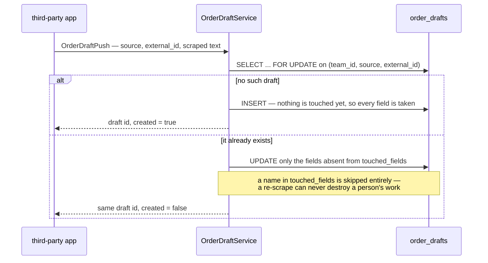

**Why the RPC name carries the rule.** The app and the person authenticate as the **same user** — the
app logs in as one, because there is no machine identity in this system — so *identity cannot tell
them apart*. `OrderDraftPush` yields to a human; `OrderDraftUpdate` (#193) always wins and marks what
it wrote. Merging the two into one handler would erase the only thing distinguishing them.

Four details that are decisions rather than implementation:

- **It is "untouched fields only", NOT "empty fields only".** An untouched field the app has changed
  its mind about *is* updated — the app remains the authority on everything nobody here has claimed.
- **The address is one touched field, not ten columns.** Somebody who corrects a kecamatan has
  corrected the address, and rewriting the nine columns around their fix would leave a hybrid address
  that was never true anywhere.
- **`items` is one touched field too.** Once a person has edited any line, the app stops rewriting
  the lines altogether. Per-line merging would need a per-line touched mark; the rule that matters —
  a re-scrape never destroys a mapping — holds without one. While untouched, the lines are replaced
  **wholesale**, so a line the app no longer sees disappears rather than lingering.
- **`product_id` is ignored on push.** The app does not know our catalogue ids, and a client matching
  titles against our catalogue on its own would guess wrong silently. Mapping is a human act. This is
  the same instinct as `OrderItem.unit_cost`, which `OrderCreate` also refuses from the client.

**The author follows the push.** A draft is personal, and a colleague cannot pick one up — so
re-pushing under the right person's login is the only way to hand a draft over. That makes
reassignment the escape hatch "personal" leans on rather than an accident.

**A draft publishes nothing.** `OrderCreatedEvent` fires at placement (#153) and revenue consumes it
(#75). A draft that published would put an unfinished scrape into the month's margin — promote (#194)
is the only door into revenue.

### Reading drafts — two narrowings, not one (#192)

`OrderDraftList` and `OrderDraftDetail` both apply **two** restrictions, and they are different kinds
of thing:

| | What it is | Enforced by |
| --- | --- | --- |
| `team_id` | the authorization **scope** (`use_scope`) | the access interceptor |
| `author_user_id` | a **handler filter** — a draft is personal working state | the query itself |

⚠ **The scope is not optional just because the list is personal.** A team-level role policy on a
message with no `use_scope` field is evaluated against the *root team*, where almost nobody is a
member — so "simplifying" this to author-only would leave a policy that authorizes nobody.

A colleague's draft reads as **NotFound**, not PermissionDenied: the caller holds a perfectly good
role in the team, and "exists but is not yours" would leak that a given external ref has already been
scraped by somebody else.

**The list carries counts, not lines.** `item_count` and `unmapped_item_count` are aggregated in one
`GROUP BY` for the whole page — they are the only thing on the list screen (#195) that says how much
work is left on a draft, and computing them client-side would mean loading every draft's lines to
render one page of a list. A non-zero `unmapped_item_count` is exactly what makes a draft still a
draft.

### The human edit path — `OrderDraftUpdate` (#193)

The other half of the merge rule. `OrderDraftUpdate` **always wins** and **marks every field it
writes as touched**; `OrderDraftPush` then refuses to overwrite anything carrying that mark. Neither
handler makes sense read alone.

**Presence decides what was edited, not emptiness.** Every field is `optional`, so a field left unset
is neither written nor marked. If "unset" and "set to empty" were indistinguishable, the first save
anybody made would mark every field touched and freeze the whole draft against the app forever — and
clearing a wrongly-scraped phone number would stop being expressible at all.

**The lines are sent as the complete desired set** (`items`, a wrapper message so it has presence —
absent means "leave the lines alone", present-and-empty means "this draft has no lines"). An id edits
an existing line, `id = 0` adds one, and an omitted line is **deleted**: a buyer who cancels one line
of three must be able to say so, or the draft stays unpromotable forever over a line nobody wants.

⚠ **The edit cannot carry the scraped text.** `external_sku` / `external_name` are absent from
`OrderDraftLineEdit` by design — a request that could rewrite them could quietly make the evidence
agree with a wrong mapping, which is the one failure that keeping both halves on the line was meant
to catch. A hand-added line has empty external text, which truthfully says nobody scraped it.

### Pruning — `OrderDraftDelete` (#193)

**Bulk, and a hard delete.** Nothing expires (§6.7), so this is the only thing between the list and a
graveyard, and an app pushing continuously fills that list faster than a person deletes one at a
time. Hard rather than soft because a draft is working state that was never an order — a soft-deleted
draft would be a row every future reader has to remember to exclude, which is precisely the trap the
separate table was built to avoid. The lines go with it via `ON DELETE CASCADE`.

**Fewer deleted than asked for is a normal answer.** An id already gone, or never the caller's, is
skipped rather than failing the batch: deleting is idempotent by nature, and refusing over one stale
id would make a bulk prune unusable exactly when the list is long enough to need one. The scope and
the author are in the `WHERE` rather than checked beforehand, so there is no window in which the ids
stop being the caller's.

### A draft becomes an order — `OrderDraftPromote` (#194)

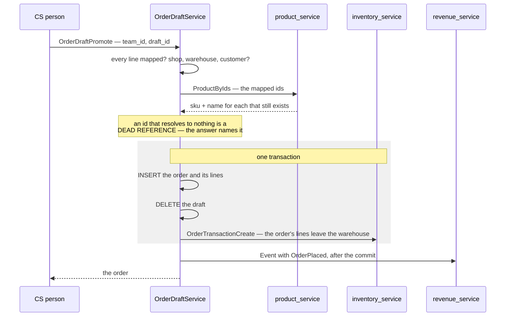

**It runs the same code path `OrderCreate` runs**, not a copy of it — `placeOrder` in
[order_place.go](../../../backend/services/selling_service/selling_v1/order_place.go). That is the
payoff the separate drafts table was chosen for: what counts as a placeable order is defined once, so
the draft door cannot quietly accept an order the form would refuse. `placeOrder` re-checks the field
rules that proto validation covers for `OrderCreate`, because promote's request carries only a draft
id and none of those rules ran.

**One transaction, not two.** `orders` and `order_drafts` are the same service in the same database,
so the order is written and the draft deleted together. A refused promote leaves the draft intact to
be fixed — which is the behaviour that makes retrying safe.

**The money is recomputed from the mapped lines**, not carried over. A draft's totals are whatever the
marketplace page said, and the lines somebody actually mapped may not add up to that — a line removed,
a quantity corrected. An order's totals must agree with its own lines, because margin comes from them.

**The line freezes the CATALOGUE's label, not the scrape.** `external_name` is what the buyer clicked
on; `sku`/`name` on the order line say what we shipped. They come from `ProductByIds` because
promote's request names a draft, not a basket — there is nowhere honest for them to come from except
the catalogue. (`OrderCreate` takes them from the request because the person typing has the catalogue
open in front of them.)

**Stale references are named, not lumped together.** A draft names products by id with no FK, so one
can be deleted between the mapping and the promote. Every dead id is reported at once — somebody who
must re-map three lines should learn that in one attempt, not by promoting three times. The `shop_id`
check falls out of `placeOrder`'s existing shop lookup.

> ⚠ **The warehouse id is NOT re-checked.** `team_service` has no by-id existence RPC selling_service
> could call, and inventing one for this was out of scope. A warehouse deleted underneath a draft
> surfaces as the stock pick failing, which is late and reads as a stock problem. Worth fixing when
> something else needs that lookup.

**This is where the `OrderPlaced` event fires, and the only place a draft ever reaches a consumer.** Pushing
and editing publish nothing at all — there is a test asserting exactly that, because "a draft must
never publish" is the kind of rule that is only ever violated by accident.

## The shop, asked by other services — `ShopAccessCheck`

One call answers the shop, its primary CS and whether a user may **write** on it
([one-call-answers-the-shop-and-the-access](../../business/shop/context_decision.md#one-call-answers-the-shop-and-the-access)).
The settlement importer asks it before storing a statement; settlement asks it for an imported shop row's
primary CS ([settlement-asks-the-shop-for-its-primary-cs](../../business/settlement/settlement_importer_decision.md#settlement-asks-the-shop-for-its-primary-cs)).
Both call it over Connect, forwarding the caller's own token.

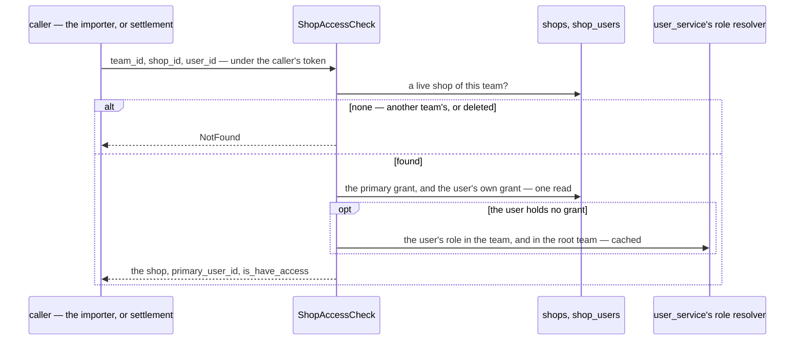

| | |
| --- | --- |
| `is_have_access` | granted the shop, or the team's owner or admin, or root or admin ([a-write-needs-a-grant-or-a-manager](../../business/shop/context_decision.md#a-write-needs-a-grant-or-a-manager)). A grant answers it without asking for a role |
| `primary_user_id` | the grant flagged `is_primary` — 0 = none |
| the roles | `RoleReader`, an interface selling owns; the composition root answers it with the access interceptor's resolver, so it is the same cached lookup every request pays for |
| a deleted shop | `NotFound`, like every shop read — its last statements cannot be imported ([shop Q3](../../business/shop/context_clarify.md#question)) |

## The primary CS — `ShopUserAdd` and `ShopUserSetPrimary`

[the-primary-cs-is-a-flag-on-a-grant](../../business/shop/context_decision.md#the-primary-cs-is-a-flag-on-a-grant):
a new grant on a shop with no primary becomes it; **Make primary** moves it; removing its grant leaves none.

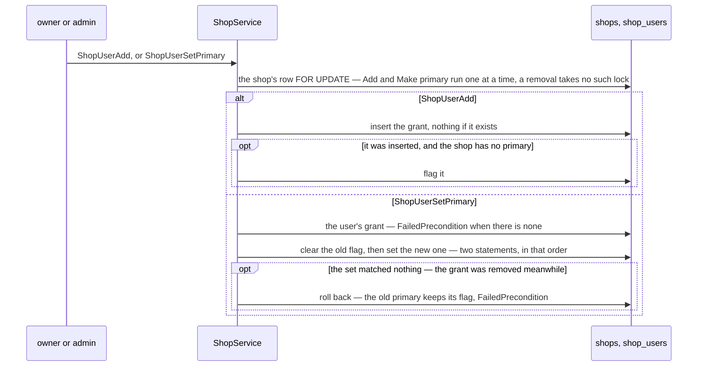

⚠ **Clear, then set.** The partial unique index is checked row by row, so one `UPDATE` flipping both flags
could meet the new one before the old one is gone. And **the shop's row is locked first**: without it, two
grants landing on a shop with none would both find no primary and both be flagged.

⚠ **The set must land.** `ShopUserRemove` takes no shop lock, so a grant can go between Make primary's check and
its set. The set then matches nothing, and the whole change is refused and rolled back rather than answering with a
primary nobody holds. The concurrency audit found this
([ShopUserSetPrimary](../../../audits/services/selling_service/concurrency/ShopUserSetPrimary.md)), and its
lock-level alternatives are still open there.

## A member leaves a team — their shop grants go (`MemberRemoved`)

[removing-a-member-drops-their-shop-access](../../business/user/context_decision.md#removing-a-member-drops-their-shop-access). user_service announces a removal; this service's
listener — `/event/selling-member-removed/push`, subscription `selling-member-removed` — drops the person's grants.

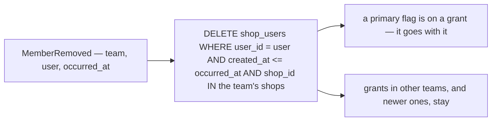

Idempotent with no dedup table: a redelivery finds nothing older to delete. A database error NACKs for a retry.

## A statement's refs, resolved — `OrderByExternalRefs`

The settlement importer turns every marketplace ref in a statement into our order in **one call per file**:
`(team_id, refs[])` → every order of the team carrying each ref — its shop, its creator and its status,
cancelled orders and other shops' included. A ref nothing carries is absent. The importer decides which
counts: the order in its own shop — live first — and a ref found only in another shop fails the file
([a-file-with-another-shops-orders-is-refused](../../business/settlement/settlement_importer_decision.md#a-file-with-another-shops-orders-is-refused)).
It reads `orders_team_external_ref_idx` (`00014`); up to 2,000 refs a call.

## The list as a file — `OrderExport`

[one-export-is-the-list-as-a-file](../../technical/frontend/warehouse_order_list_decision.md#one-export-is-the-list-as-a-file):
one server stream for both lists. It takes the list's own filter and tab, so the file holds exactly the rows the list
holds, every page of them, and it writes them in the reader's columns as .xlsx.

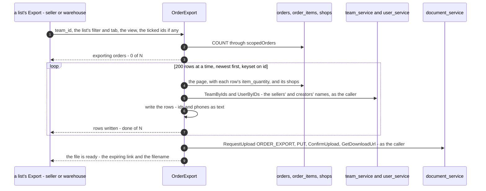

| | |
| --- | --- |
| the rows | `scopedOrders` with the list's filter and status — the same set as `OrderList` and `OrderStat`. With `order_ids` (the warehouse bar's ticked rows, [the-bulk-actions-are-always-on-screen](../../technical/frontend/warehouse_order_list_decision.md#the-bulk-actions-are-always-on-screen)), only those, still inside the scope |
| the columns | **seller**: order id, marketplace ref, shop, marketplace, status, created, created by, customer, phone, courier, qty, goods cost, marketplace total. **Warehouse**: order id, created, created by, seller, shop, marketplace, marketplace ref, courier, qty, status |
| only real data | the tracking number, the marketplace date and the deadline are invented on screen behind a ⚠. A spreadsheet cannot carry the mark, so they are left out until their fields exist |
| text cells | ids, refs and phone numbers are strings, so `0812…` keeps its 0 and a long marketplace id never becomes `5.78E+17`. A money figure of 0 means "not recorded" and is left empty |
| the clock | WIB (UTC+7), the people reading it keep that time |
| as the caller | the names and the upload go through clients that forward the caller's token (`san_auth.ForwardBearer`): the file is stored under the caller's team, as them, as a private `order_export` document behind an expiring signed link |
| the stream | the guideline's long-task shape ([code-implementation-guideline.md](../../../guidelines/code-implementation-guideline.md)): every step a slog line sent as `message`, with `done` and `total` on each, the link on the last |
